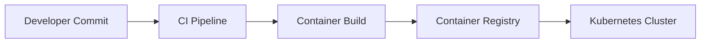

# Content Authoring Guide

The `content/` directory is the **single source of truth** for all educational content in Ops Handbook. When you add or update Markdown (`.md`) or MDX (`.mdx`) files here, the platform automatically takes care of routing, navigation trees, search indexing, code highlighting, and asset optimization.

---

## 1. Documentation Hierarchy & Routing

Content routes are derived deterministically from the directory structure:

```text
Documentation Area (e.g. containers)
        ↓
Technology / Tool (e.g. docker)
        ↓
Topic / Article (e.g. images)
```

### URL Mapping Examples

| File Path in `content/` | Generated Route |
| :--- | :--- |
| `content/devops-fundamentals/overview/what-is-devops.mdx` | `/docs/devops-fundamentals/overview/what-is-devops` |
| `content/operating-systems/linux/permissions.md` | `/docs/operating-systems/linux/permissions` |
| `content/containers/docker/images/index.mdx` | `/docs/containers/docker/images` |
| `content/cheat-sheets/git/configuration.mdx` | `/cheat-sheets/git/configuration` |
| `content/interview-questions/kubernetes/networking.mdx` | `/interview-questions/kubernetes/networking` |

Every documentation area automatically generates an area index at `/docs/<area>`, and every tool with at least one published article receives an automated landing page at `/docs/<area>/<tool>`.

---

## 2. Choosing Between Markdown (`.md`) and MDX (`.mdx`)

| Feature | Standard Markdown (`.md`) | Enhanced MDX (`.mdx`) |
| :--- | :---: | :---: |
| Headings, text, lists, blockquotes | ✓ | ✓ |
| Syntax-highlighted code blocks | ✓ | ✓ |
| Native Mermaid diagrams (` ```mermaid `) | ✓ | ✓ |
| Interactive UI components (`<Callout>`, `<Steps>`) | ✗ | ✓ |
| Structured cards (`<InfoCard>`, `<CardGrid>`) | ✗ | ✓ |
| Local asset imports (images, PDF embeds) | ✗ | ✓ |

> **Rule of thumb**: Use `.md` for simple, text-centric documentation. Use `.mdx` whenever you need rich components, interactive callouts, or colocated image imports.

---

## 3. Article File Structure & Colocation

For articles with diagrams, images, or reference files, colocate assets within the topic directory:

```text
content/
└── container-orchestration/
    └── kubernetes/
        └── pods/
            ├── index.mdx          # Article content
            ├── images/            # Local images & diagrams
            │   ├── pod-lifecycle.svg
            │   └── multi-container.png
            └── resources/         # Local downloadable assets
                └── pod-manifest-reference.pdf
```

- **Colocated Images**: Relative paths like `./images/pod-lifecycle.svg` are processed and optimized automatically by Astro.
- **Standalone Articles**: Articles without extra assets can live as flat files (e.g., `content/operating-systems/linux/file-system.md`).

---

## 4. Frontmatter Specification

Every article begins with a YAML frontmatter block:

```yaml
---
title: Kubernetes Pod Architecture and Lifecycle
description: An in-depth guide to pod phases, restart policies, and multi-container design patterns.
order: 1                            # Position in sidebar navigation (default: 0)
level: intermediate                 # beginner | intermediate | advanced
tags: [kubernetes, pods, containers]
draft: false                        # Set to true to hide from builds and search
---
```

### Fields Reference

- `title` *(required)*: The primary heading and HTML document title.
- `description` *(recommended)*: Summarizes the article for the search modal, previews, and SEO metadata.
- `order` *(optional)*: Controls numerical sorting in sidebar navigation.
- `level` *(optional)*: Displays difficulty badges (`beginner`, `intermediate`, `advanced`).
- `tags` *(optional)*: Keywords powering the **Related Topics** recommendations at the bottom of the page.
- `draft` *(optional)*: If `true`, the page is excluded from the build, navigation, and search index.

---

## 5. Built-in MDX Components

All standard components are **globally registered** in `.mdx` files. You can use them directly without adding `import` statements at the top of your document.

### Callouts

Highlight notes, tips, warnings, and hands-on lab steps:

```mdx
<Callout type="note" title="Note">
Kubernetes automatically injects service environment variables into every running pod.
</Callout>

<Callout type="tip" title="Pro Tip">
Use `kubectl diff -f deployment.yaml` to preview cluster mutations prior to applying.
</Callout>

<Callout type="warning" title="Production Warning">
Avoid using `:latest` tags in production container specifications.
</Callout>

<Callout type="lab" title="Hands-On Lab">
Deploy an Nginx pod and inspect its event log using `kubectl describe pod nginx`.
</Callout>
```

### Numbered Steps

Format procedural tutorials and sequential workflows cleanly:

```mdx
<Steps>
  <li>Initialize a new Git repository using `git init`.</li>
  <li>Create a `.gitignore` file and specify non-tracking rules.</li>
  <li>Stage and commit your baseline files.</li>
</Steps>
```

### Captioned Figures

Present responsive images and diagrams with captions:

```mdx
import podLifecycle from './images/pod-lifecycle.svg';

<Figure 
  src={podLifecycle} 
  alt="Kubernetes Pod Lifecycle Diagram" 
  caption="Figure 1: Transitions between Pending, Running, Succeeded, and Failed states." 
/>
```

### Information Cards & Grids

Compare related concepts or highlight critical architecture patterns:

```mdx
<CardGrid columns={3} gap="md">
  <InfoCard 
    variant="concept"
    title="Control Plane" 
    description="Manages cluster scheduling, state coordination, and API requests." 
    icon="cube" 
  />
  <InfoCard 
    variant="concept"
    title="Worker Nodes" 
    description="Hosts containers and executes workloads managed by the kubelet." 
    icon="terminal" 
  />
  <InfoCard 
    variant="insight"
    title="etcd Storage" 
    description="Strongly consistent distributed key-value store for cluster metadata." 
    icon="shield" 
  />
</CardGrid>
```

Available `variant` options:
`concept` · `comparison` · `insight` · `tip` · `warning` · `summary` · `command` · `resource`

Available `icon` options:
`terminal` · `cube` · `wheel` · `modules` · `cloud` · `cycle` · `shield` · `pulse` · `sliders`

### PDF Resources

Link or embed reference manuals and offline guides:

```mdx
import cheatSheetPdf from './resources/k8s-sheet.pdf';

{/* Action buttons for opening and downloading */}
<PdfCard href={cheatSheetPdf} title="Kubernetes Command Reference PDF" />

{/* Embedded native browser viewer */}
<PdfEmbed src={cheatSheetPdf} title="Kubernetes Architecture Cheatsheet" height="600px" />
```

---

## 6. Interactive Architecture Diagrams (Mermaid)

Render dynamic diagrams client-side using standard fenced code blocks. Mermaid is lazy-loaded only on pages that contain a diagram:

````markdown

````

---

## 7. Code Blocks & Commands

- **Always specify the language**: ` ```bash `, ` ```yaml `, ` ```dockerfile `, ` ```json `, ` ```python `.
- Code blocks are rendered using **Shiki** with Gruvbox dark surfaces and an integrated one-click copy button.
- Keep commands realistic and functional. Never embed multiline scripts into regular paragraph text; use a code block instead.

---

## 8. Organizing Tools & Categories (`_meta.json`)

Tools are automatically discovered from directory names (`content/<area>/<tool-name>/`).

To customize the human-readable display title or sorting order, create an optional `_meta.json` file inside the tool directory:

```json
{
  "label": "Docker Engine",
  "order": 10
}
```

- `label`: Overrides the auto-generated title in sidebars, breadcrumbs, and search results.
- `order`: Controls ordering among tools within the same area (lower numbers appear first).

---

## 9. Authoring Cheat Sheets

Cheat sheets live in `content/cheat-sheets/<technology>/<topic>.mdx`. They render as fast, searchable command cards with syntax explanations and examples:

```mdx
---
title: Pod Operations
technology: kubernetes
topic: pods
description: Inspect, debug, and stream logs from running Kubernetes pods.
order: 1
draft: false
---

## 1. Inspection & Debugging

<CheatSheet
  rows={[
    {
      command: 'kubectl get pods -o wide',
      does: 'Lists all pods in the active namespace with assigned node IP addresses',
      when: 'To verify pod distribution across cluster nodes',
      example: 'kubectl get pods -n production -o wide',
    },
    {
      command: 'kubectl logs -f <pod-name>',
      does: 'Streams continuous standard output and error logs from the pod',
      when: 'During real-time debugging of container service errors',
      example: 'kubectl logs -f nginx-web-6d4c5',
    },
  ]}
/>
```

---

## 10. Authoring Interview Questions

Technical interview questions live in `content/interview-questions/<technology>/<topic>.mdx`. They are designed for quick revision and deep technical preparation:

```mdx
---
title: Kubernetes Networking & Services
technology: kubernetes
topic: networking
description: Core networking questions covering CNI, Services, Ingress, and kube-proxy.
order: 3
draft: false
---

<InterviewQuestion
  id="k8s-service-clusterip"
  number={1}
  difficulty="beginner"
  question="What is a Kubernetes ClusterIP Service and how does it route traffic?"
  directAnswer="ClusterIP is the default Service type that exposes pods internally within the cluster on a virtual, stable IP address. Kube-proxy configures iptables or IPVS rules to load balance incoming traffic across healthy backend pods."
  tags={['kubernetes', 'networking', 'services']}
  pitfalls={[
    'Assuming ClusterIP is accessible from outside the cluster network without port-forwarding or ingress.',
    'Expecting ClusterIP to respond to ICMP ping (it only handles TCP/UDP traffic configured in the spec).',
  ]}
  followUps={[
    'How does NodePort differ from ClusterIP under the hood?',
    'What role does CoreDNS play when resolving Service names?',
  ]}
/>
```

---

## 11. Technical Writing Guidelines

1. **Concept First, Command Second**: Explain *why* something exists and what problem it solves before providing executable commands.
2. **Production-First Mindset**: Point out operational pitfalls, security trade-offs, and failure recovery modes rather than trivial demo setups.
3. **Deterministic & Executable**: Code snippets and configuration manifests should be syntactically valid and testable.
4. **Consistency**: Use standard technical terminology (`Deployment`, `Pod`, `Namespace`, `DaemonSet`, `Ingress`, `CIDR`, `Containerd`).

---

## 12. Pre-Commit Verification

Always verify your changes locally before committing:

```bash
# Verify TypeScript types and content schemas
npm run check

# Verify that the complete static build succeeds without broken links
npm run build
```
