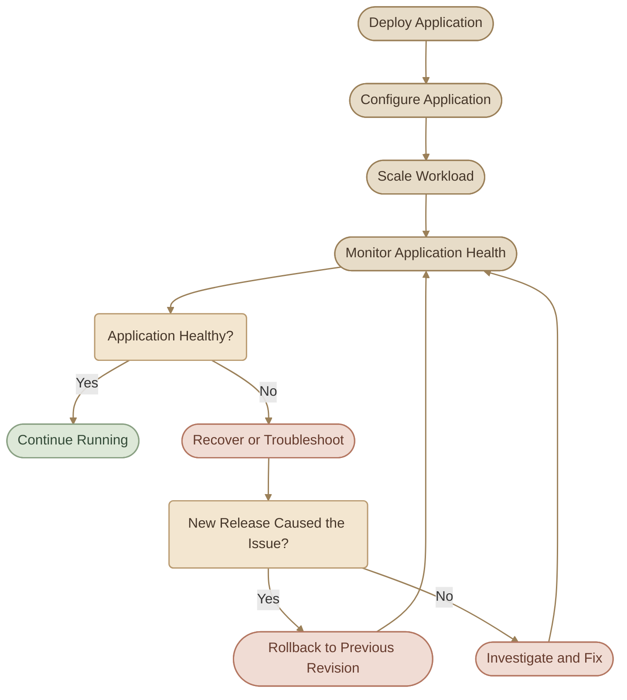

## 1. What Is Application Lifecycle Management?

في Kubernetes، تشغيل الـ Application مش معناه إننا نعمل Deployment وخلاص. إحنا محتاجين كمان ندير دورة حياة التطبيق بالكامل، من لحظة نشره وتحديثه، لحد التعامل مع الأعطال والحفاظ على الـ desired state.

وده دور **Application Lifecycle Management (ALM)** في Kubernetes: مجموعة من المفاهيم والآليات اللي بتساعدنا ندير التطبيقات أثناء تشغيلها وتغييرها وصيانتها.

<InfoCard variant="insight" title="The Core Idea" description="مش كفاية إن التطبيق يشتغل؛ المهم نقدر نحدّثه، نتحكم في إعداداته، نغيّر عدد نسخه، ونستعيد حالته المطلوبة لما تحصل مشكلة." icon="layers" tags={["ALM", "Kubernetes"]} />

## 2. What We Will Learn

الموديول ده بيركز على خمس مجموعات أساسية، كل واحدة بتحل مشكلة مختلفة أثناء إدارة الـ Applications.

### I. Rolling Updates and Rollbacks

لما نحتاج ننشر Version جديدة من التطبيق، مش دايمًا ينفع نوقف النسخة الحالية ونشغّل الجديدة مرة واحدة.

<CardGrid columns={2} label="Update Mechanics">
  <InfoCard variant="feature" title="Rolling Updates" description="تحديث الـ Application تدريجيًا عن طريق استبدال الـ old Pods بالـ new Pods." icon="cycle" tags={["Rollout"]} />
  <InfoCard variant="concept" title="Rollbacks" description="الرجوع إلى Revision سابقة لما التحديث الجديد يسبب مشكلة." icon="branch" tags={["Recovery"]} />
</CardGrid>

الهدف إننا نتحكم في عملية التحديث ونقلل الـ downtime والمخاطر قدر الإمكان.

### II. Application Configuration

التطبيقات بتحتاج إعدادات مختلفة حسب البيئة، زي API endpoints وenvironment variables، وأحيانًا بيانات حساسة.

هنتعلم إزاي ندير الإعدادات باستخدام Kubernetes resources المناسبة، زي:

<CardGrid columns={2} label="Configuration Resources">
  <InfoCard variant="concept" title="ConfigMaps" description="للإعدادات غير الحساسة." icon="modules" tags={["Settings"]} />
  <InfoCard variant="warning" title="Secrets" description="للبيانات الحساسة، مع ضرورة إعداد الحماية المناسبة لها." icon="shield" tags={["Sensitive"]} />
</CardGrid>

### III. Scaling Applications

أحيانًا عدد نسخ التطبيق الحالي مش كفاية للتعامل مع الـ workload، أو نحتاج نقلله لتوفير الموارد.

هنتعلم إزاي نتحكم في عدد الـ replicas، وإزاي Kubernetes بيساعدنا نحافظ على العدد المطلوب من الـ Pods.

### IV. Self-Healing Applications

ممكن Pod تتوقف، أو Container يحصل لها failure، أو الـ Application تبقى غير قادرة على استقبال الطلبات بشكل سليم.

Kubernetes عنده آليات تساعده يتعامل مع الحالات دي، زي Controllers وProbes، علشان يراقب حالة الـ workloads ويتخذ الإجراء المناسب.

لكن مهم نفهم إن:

<InfoCard variant="callout" title="Self-Healing Is Not Bug Fixing" description="Self-Healing مش معناه إن Kubernetes هيصلّح أي Bug داخل التطبيق تلقائيًا؛ هو بيعيد إنشاء أو إعادة تشغيل الموارد حسب نوع المشكلة والإعدادات المتاحة." icon="shield" />

### V. Application Lifecycle in Practice

المواضيع دي مش منفصلة عن بعض. في بيئة عمل حقيقية، ممكن نحتاج نعمل Deployment جديد، نغيّر Configuration، نزود عدد الـ replicas، وبعدها نعمل Rollback لو الـ release فشل.

## 3. Application Lifecycle Overview

## 4. How This Connects to DevOps

من منظور DevOps، إدارة دورة حياة التطبيق مرتبطة بأكتر من مجرد أوامر `kubectl`:

<CardGrid columns={2} label="DevOps Connection">
  <InfoCard variant="concept" title="Release Management" description="نشر Versions جديدة بطريقة يمكن التحكم فيها." icon="cycle" />
  <InfoCard variant="concept" title="Configuration Management" description="فصل إعدادات التطبيق عن الـ container image قدر الإمكان." icon="sliders" />
  <InfoCard variant="concept" title="Scalability" description="التعامل مع تغيّر الـ workload." icon="wheel" />
  <InfoCard variant="concept" title="Reliability" description="اكتشاف بعض حالات الفشل والتعافي منها." icon="shield" />
  <InfoCard variant="concept" title="Troubleshooting" description="تحديد سبب المشكلة واختيار الإجراء المناسب بدلًا من تغيير الموارد عشوائيًا." icon="wrench" />
</CardGrid>
