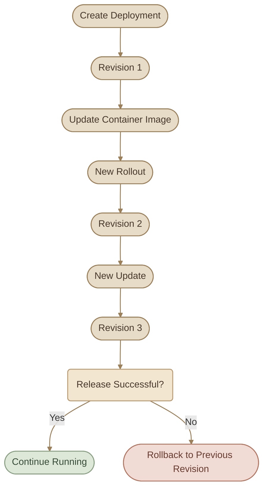
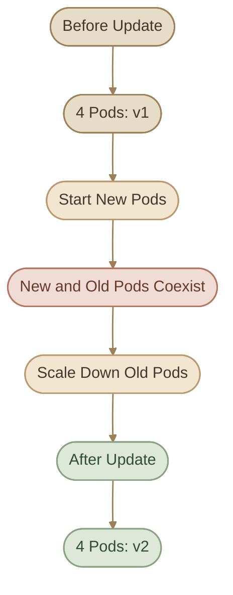
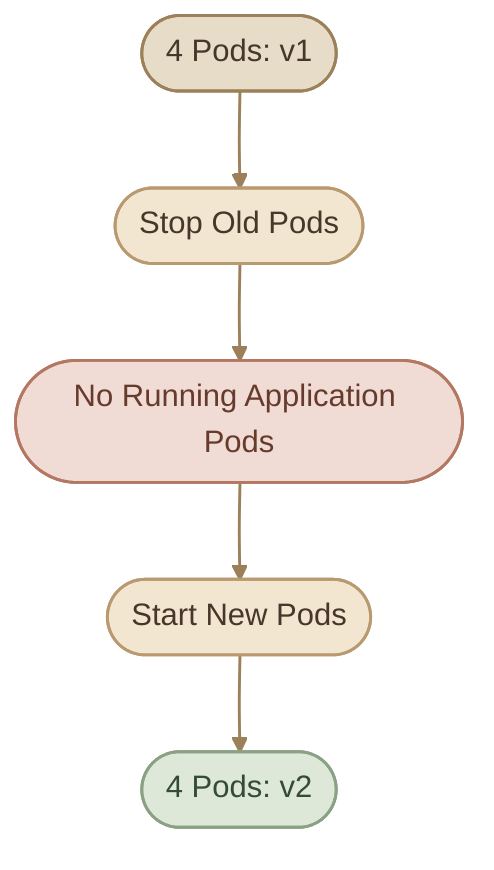

## 1. Understanding Rollouts and Revisions

لما تعمل `Deployment` جديد في Kubernetes، مش بتنشئ مجموعة Pods وخلاص؛ أنت بتعرّف الـ desired state اللي Kubernetes المفروض يحافظ عليها.

الـ Deployment بيتولى إدارة الـ `ReplicaSet`، والـ ReplicaSet بدوره بيحافظ على العدد المطلوب من الـ Pods.

خلينا نفترض إن عندنا Web Application بتشتغل باستخدام Image اسمها `webapp:v1`، وعايزين نشغّل منها 3 Replicas.

لما تنشئ الـ Deployment لأول مرة، Kubernetes بيبدأ عملية اسمها **Rollout**، وبيكون عندك أول Deployment Revision.

بعد كده، لما تغيّر الـ Container Image من `webapp:v1` إلى `webapp:v2`، بيبدأ Rollout جديد، وبيتسجل Revision جديد يمثل الـ Pod template الجديدة.

<InfoCard variant="concept" title="Rollout vs Revision" description="الـ Rollout هو عملية نشر أو تطبيق تغيير على الـ Deployment، أما الـ Revision فهي نسخة محفوظة من تاريخ تغييرات الـ Pod template، وبتساعدنا نراجع التغييرات أو نرجع لنسخة سابقة." icon="branch" tags={["Rollout", "Revision"]} />

### I. How Deployment Revisions Work



خلي بالك من نقطة مهمة: مش أي تعديل في الـ Deployment بيعمل Revision جديدة.

<CardGrid columns={3} label="What Creates a Revision">
  <InfoCard variant="concept" title="Template Changes" description="تعديل الـ Pod template، زي تغيير الـ Image أو Environment Variables الموجودة داخل الـ template، بيؤدي إلى Rollout جديد." icon="cube" />
  <InfoCard variant="concept" title="Replica Count Only" description="تغيير عدد الـ Replicas فقط بيغيّر حجم الـ Workload، لكنه مش بيعمل Revision جديدة لوحده." icon="sliders" />
  <InfoCard variant="concept" title="Metadata Changes" description="تغيير Metadata موجودة على الـ Deployment نفسه، خارج الـ Pod template، مش بالضرورة يؤدي إلى Rollout جديد." icon="code" />
</CardGrid>

وده معناه إن الـ Revision History مش سجل لكل تغيير حصل على كل حقل في الـ Deployment؛ هي مرتبطة أساسًا بتغييرات الـ Pod template.

## 2. Inspecting Rollout Status and History

قبل ما تعمل أي Update، لازم تعرف الحالة الحالية للـ Deployment.

### I. Check Rollout Status

```bash
kubectl rollout status deployment/<deployment-name>
```

مثال:

```bash
kubectl rollout status deployment/frontend
```

الأمر ده بيستنى لحد ما الـ Rollout يوصل لحالة النجاح، أو يظهر إن فيه مشكلة تمنع اكتماله.

لكن مهم تفهم إن نجاح الـ Rollout مش ضمان إن الـ Application نفسها سليمة وظيفيًا؛ هو معناه إن Kubernetes شايف إن عملية النشر حققت شروط النجاح الخاصة بالـ Deployment.

### II. View Revision History

```bash
kubectl rollout history deployment/frontend
```

الأمر ده بيعرض الـ Revisions المتاحة في تاريخ الـ Deployment.

ولو عايز تفاصيل Revision معينة:

```bash
kubectl rollout history deployment/frontend --revision=2
```

ده بيساعدك تعرف الـ Pod template المرتبطة بالـ Revision دي، ومنها الـ Container Images المستخدمة.

### III. Inspect the Deployment

```bash
kubectl get deployments
```

```bash
kubectl describe deployment frontend
```

ولو عايز تعرف الـ ReplicaSets المرتبطة بالـ Deployment:

```bash
kubectl get replicasets
```

ممكن تلاقي ReplicaSet قديمة عدد الـ Pods بتاعتها صفر، وReplicaSet جديدة بتشغّل النسخة الحالية من التطبيق.

ده طبيعي؛ لأن Kubernetes بيحتفظ بالـ ReplicaSets القديمة وفقًا لإعدادات الـ Revision History، علشان يقدر يدعم الـ Rollback.

## 3. Deployment Update Strategies

Kubernetes بيدعم استراتيجيتين أساسيتين لتحديث الـ Deployment:

<CardGrid columns={2} label="Update Strategies">
  <InfoCard variant="comparison" title="RollingUpdate" description="الاستراتيجية الافتراضية للـ Deployment — بتحديث الـ Pods تدريجيًا حسب إعدادات الـ Update Strategy." icon="cycle" />
  <InfoCard variant="comparison" title="Recreate" description="بيوقف الـ Pods القديمة قبل ما يشغّل النسخة الجديدة، فممكن يحصل Downtime." icon="cube" />
</CardGrid>

كل واحدة ليها سلوك مختلف أثناء الانتقال من النسخة القديمة للجديدة.

### I. RollingUpdate

دي الاستراتيجية الافتراضية للـ Deployment.

بدل ما Kubernetes يوقف كل الـ Pods القديمة مرة واحدة، بيبدأ يشغّل Pods بالنسخة الجديدة، ويقلّل عدد النسخ القديمة تدريجيًا حسب إعدادات الـ Update Strategy.

خلينا نفترض إن عندنا 4 Replicas شغالة بالإصدار `v1`، وعايزين ننقل للإصدار `v2`.

أثناء التحديث، ممكن تلاقي Pods من الإصدارين شغالين في نفس الوقت لفترة مؤقتة.



الهدف إن التطبيق يفضل متاحًا أثناء عملية التحديث قدر الإمكان.

لكن **RollingUpdate مش ضمان مطلق لعدم حدوث Downtime**. النتيجة بتعتمد على عوامل زي:

<CardGrid columns={3} label="Downtime Factors">
  <InfoCard variant="concept" title="Application Health" description="صحة الـ Application الجديدة." icon="shield" />
  <InfoCard variant="concept" title="Readiness Probe">
إعدادات `readinessProbe`.
  </InfoCard>
  <InfoCard variant="concept" title="Update Settings">
إعدادات `maxUnavailable` و`maxSurge`.
  </InfoCard>
  <InfoCard variant="concept" title="Cluster Resources" description="توفر الموارد الكافية لتشغيل الـ Pods الجديدة." icon="layers" />
  <InfoCard variant="concept" title="Multi-Version Traffic" description="قدرة الـ Application على التعامل مع وجود أكثر من Version شغالة مؤقتًا." icon="network" />
</CardGrid>

### II. Recreate

في استراتيجية `Recreate`، Kubernetes بيوقف الـ Pods القديمة قبل ما يبدأ تشغيل النسخة الجديدة كجزء من عملية التحديث.

يعني لو عندك 4 Replicas بالإصدار `v1`، وطلبت تحديثها للإصدار `v2`، فالـ Pods القديمة بتتوقف، وبعدها يبدأ تشغيل الـ Pods الجديدة.



أثناء الفترة اللي مفيهاش Pods جاهزة لاستقبال الطلبات، ممكن يحصل Downtime.

وده بيخلي `Recreate` مناسبًا في بعض الحالات اللي بتحتاج إن النسخة القديمة تتوقف قبل بدء النسخة الجديدة، لكنه مش الاختيار المعتاد لتحديث Web Application محتاجة تفضل متاحة.

### III. Strategy Comparison

<TableCard>
| Feature | RollingUpdate | Recreate |
|---|---|---|
| Default strategy | Yes | No |
| تحديث تدريجي | Yes | No |
| تداخل النسختين أثناء التحديث | ممكن | مش ضمن سلوك الاستراتيجية المعتاد |
| احتمالية حدوث Downtime | أقل عند الإعداد الصحيح، لكنها مش مستحيلة | أعلى أثناء الانتقال |
| التحكم في عدد الـ Pods أثناء التحديث | `maxSurge` و`maxUnavailable` | مش بيستخدم إعدادات RollingUpdate |
| الاستخدام المعتاد | تحديث التطبيقات مع الحفاظ على التوافر قدر الإمكان | الحالات اللي تتطلب إيقاف النسخة القديمة قبل الجديدة |
</TableCard>

<InfoCard variant="warning" title="Important" description="اختيار RollingUpdate لا يكفي وحده لضمان Zero Downtime، وRecreate لا يعني بالضرورة أن التطبيق كله غير متاح في كل تصميم ممكن. الكلام هنا عن سلوك الـ Deployment نفسه، أما التوافر الفعلي فيعتمد على الـ Architecture والـ Traffic Routing." icon="network" tags={["Availability", "Deployment Strategy"]} />

## 4. Controlling a Rolling Update

لما تستخدم `RollingUpdate`، عندك إعدادان مهمان بيتحكموا في طريقة التحديث:

<InfoCard variant="concept" title="maxUnavailable" description="بيحدد أقصى عدد من الـ Pods اللي مسموح إنها تكون غير متاحة أثناء الـ Rolling Update مقارنة بالعدد المطلوب." icon="sliders">

مثلًا، لو عندك 4 Replicas:

```yaml
maxUnavailable: 1
```

فده بيسمح إن عدد الـ Pods غير المتاحة يزيد بمقدار Pod واحدة عن العدد المطلوب، وفقًا لقواعد تنفيذ الـ Deployment.

وممكن تستخدم نسبة مئوية بدل رقم ثابت:

```yaml
maxUnavailable: 25%
```

في حالة 4 Replicas، نسبة 25% تساوي Pod واحدة.

</InfoCard>

<InfoCard variant="concept" title="maxSurge" description="بيحدد أقصى عدد إضافي من الـ Pods اللي ممكن يتجاوز العدد المطلوب أثناء الـ Rolling Update." icon="layers">

مثلًا:

```yaml
maxSurge: 1
```

معناه إن Kubernetes ممكن يشغّل Pod إضافية فوق العدد المطلوب أثناء التحديث.

وممكن تستخدم:

```yaml
maxSurge: 25%
```

بالنسبة المئوية، Kubernetes بيقرّب قيمة `maxSurge` لأعلى عدد صحيح، بينما بيقرّب قيمة `maxUnavailable` لأسفل.

</InfoCard>

خلينا نربط الإعدادين ببعض:

```yaml
strategy:
  type: RollingUpdate
  rollingUpdate:
    maxSurge: 1
    maxUnavailable: 1
```

لو عندك 4 Replicas، فالإعدادات دي بتسمح بوجود Pod إضافية أثناء التحديث، وبتسمح بتعطّل Pod واحدة عن العدد المطلوب وفقًا لقواعد الـ Strategy.

لكن الأرقام دي مش معناها إن Kubernetes لازم يوقف Pod قديمة قبل ما يشغّل الجديدة؛ التنفيذ الفعلي بيتأثر بتوفر الموارد وجاهزية الـ Pods.

## 5. Updating a Deployment

فيه أكتر من طريقة لتحديث الـ Deployment، لكن مهم تختار طريقة تخليك قادر تحافظ على مصدر الحقيقة الخاص بالـ Configuration.

### I. Update the Manifest and Apply It

دي الطريقة المفضلة لما تكون بتدير الـ Infrastructure والـ Workloads باستخدام YAML files.

مثلًا، عندك Manifest فيها:

```yaml
spec:
  template:
    spec:
      containers:
        - name: web
          image: nginx:1.26-alpine
```

بعد ما تغيّر الـ Image إلى Version جديدة:

```yaml
spec:
  template:
    spec:
      containers:
        - name: web
          image: nginx:1.27-alpine
```

طبّق التغيير:

```bash
kubectl apply -f deployment.yaml
```

Kubernetes بيقارن الـ desired state بالتكوين الحالي، ولو حصل تغيير في الـ Pod template، بيبدأ Rollout جديد.

الميزة هنا إن الـ Manifest بتفضل بتعبّر عن الـ Configuration اللي أنت عايز تطبّقها.

### II. Update the Image Using kubectl set image

تقدر كمان تحدّث الـ Container Image مباشرة:

```bash
kubectl set image deployment/frontend web=nginx:1.27-alpine
```

في المثال ده:

- `deployment/frontend` هو اسم الـ Deployment.
- `web` هو اسم الـ Container داخل الـ Pod template.
- `nginx:1.27-alpine` هي الـ Image الجديدة.

لكن خليك واخد بالك: الأمر ده بيعدّل الـ Live Object داخل Kubernetes، لكنه مش بيعدّل ملف YAML الموجود على جهازك.

لو رجعت بعد كده وطبّقت Manifest قديمة لسه بتشير إلى `nginx:1.26-alpine`، ممكن ترجع الـ Configuration للنسخة القديمة.

عشان كده، في الـ GitOps والـ Infrastructure as Code workflows، الأفضل تحدّث ملف الـ Manifest في الـ Repository وتطبّقه، بدل ما تعتمد على تعديلات يدوية مش متسجلة في مصدر الحقيقة.

### III. Verify the Update

بعد التحديث، متفترضش إن العملية نجحت لمجرد إن أمر التعديل رجع من غير Error.

<Steps>
<li>

<InfoCard title="Check the Rollout Status" icon="pulse" />

استخدم:

```bash
kubectl rollout status deployment/frontend
```
</li>
<li>

<InfoCard title="Inspect the Deployment" icon="cube" />

وبعدها:

```bash
kubectl get deployment frontend
```

```bash
kubectl get replicasets
```

```bash
kubectl describe deployment frontend
```
</li>
</Steps>

كده بتتحقق من حالة الـ Rollout، وعدد الـ Replicas، والـ ReplicaSets الموجودة، وأي Events ممكن تساعدك في فهم اللي حصل.

## 6. Understanding ReplicaSets During an Update

خلينا نربط الـ Deployment بالـ ReplicaSets بصورة أوضح.

لو أنشأت Deployment بالإصدار `v1`، Kubernetes بينشئ ReplicaSet مرتبطة بالـ Pod template الخاصة بالإصدار ده.

لما تغيّر الـ Image إلى `v2`، الـ Deployment بينشئ ReplicaSet جديدة بالـ Pod template الجديدة.

أثناء الـ Rolling Update:

<CardGrid columns={3} label="During the Update">
  <InfoCard variant="concept" title="New ReplicaSet" description="الـ ReplicaSet الجديدة بتبدأ تشغيل Pods بالإصدار الجديد." icon="cube" />
  <InfoCard variant="concept" title="Old ReplicaSet" description="الـ ReplicaSet القديمة بتقلّل عدد الـ Pods تدريجيًا." icon="sliders" />
  <InfoCard variant="concept" title="After Completion" description="بعد اكتمال التحديث، غالبًا هتلاقي الـ ReplicaSet الجديدة بتشغّل العدد المطلوب، والقديمة عددها صفر." icon="flag" />
</CardGrid>

مثلًا:

```text
NAME                    DESIRED   CURRENT   READY
frontend-7b9c8d6f5       0         0         0
frontend-6c8d7f9a2       4         4         4
```

الأسماء هنا توضيحية، وبتختلف حسب الـ Deployment والـ Pod template.

تقدر تعرض الـ ReplicaSets باستخدام:

```bash
kubectl get replicasets
```

وتفحص الـ Deployment والـ Events باستخدام:

```bash
kubectl describe deployment frontend
```

الاحتفاظ بالـ ReplicaSets القديمة بيساعد Kubernetes يدعم الـ Rollbacks، لكنه مش معناه إن الـ Pods القديمة لازم تفضل شغالة.

## 7. Rolling Back a Deployment

اعتبر إنك نشرت `v2`، وبعد التحديث اكتشفت إن الـ Application بترجع Errors أو إن الـ Release فيها مشكلة.

في الحالة دي، تقدر تستخدم Rollback للرجوع إلى Revision سابقة.

### I. Undo the Latest Rollout

<Steps>
<li>

<InfoCard title="Undo the Latest Rollout" icon="cycle" />

```bash
kubectl rollout undo deployment/frontend
```

الأمر ده بيطلب من Kubernetes التراجع عن آخر Rollout إلى Revision سابقة مناسبة.
</li>
<li>

<InfoCard title="Verify the Result" icon="shield" />

بعد كده تحقق من النتيجة:

```bash
kubectl rollout status deployment/frontend
```

```bash
kubectl rollout history deployment/frontend
```

```bash
kubectl get replicasets
```
</li>
</Steps>

### II. Roll Back to a Specific Revision

لو عايز ترجع إلى Revision معينة، استخدم:

<Steps>
<li>

<InfoCard title="Show the Revision History" icon="branch" />

```bash
kubectl rollout history deployment/frontend
```
</li>
<li>

<InfoCard title="Undo to the Target Revision" icon="tag" />

حدد رقم الـ Revision المناسبة، وبعدها:

```bash
kubectl rollout undo deployment/frontend --to-revision=2
```

الرقم `2` مجرد مثال؛ استخدم الرقم اللي يناسب الحالة الفعلية عندك.
</li>
</Steps>

### III. What Happens During a Rollback?

الـ Rollback مش مجرد تشغيل الـ Pods القديمة يدويًا.

Kubernetes بيحدّث الـ Pod template الخاصة بالـ Deployment علشان ترجع إلى الـ Configuration الموجودة في الـ Revision المستهدفة، وبعدها بيدير الانتقال إلى الحالة المطلوبة.

وممكن تلاحظ إن الـ ReplicaSet القديمة بتزيد في عدد الـ Pods، والـ ReplicaSet اللي كانت بتشغّل النسخة الجديدة بتقلّ أو توصل إلى صفر.

كمان مهم تعرف إن الـ Rollback نفسه بيؤدي إلى Revision جديدة في تاريخ الـ Deployment؛ هو تغيير جديد في الـ Pod template، مش محو للتاريخ السابق.

<InfoCard variant="danger" title="Rollback Is Not a Complete Release Recovery" description="الـ Deployment Rollback بيرجع الـ Pod template إلى Revision سابقة، لكنه مش بيرجع تلقائيًا تغييرات قواعد البيانات أو البيانات الخارجية أو أي Side Effects حصلت أثناء الـ Release." icon="database" tags={["Rollback", "Release Safety"]} />

## 8. Troubleshooting Failed Rollouts

مش كل Rollout بيفشل لنفس السبب. ممكن يكون السبب في الـ Image، أو الموارد، أو الـ Application نفسها.

خلينا نراجع بعض الحالات المهمة.

### I. ImagePullBackOff

لو كتبت Image Tag غير موجودة، Kubernetes ممكن يفشل في سحب الـ Image.

مثلًا:

```yaml
image: nginx:this-tag-does-not-exist
```

تقدر تكتشف المشكلة باستخدام:

```bash
kubectl get pods
```

وبعدها افحص الـ Pod:

```bash
kubectl describe pod <pod-name>
```

ابحث عن Events مرتبطة بفشل سحب الـ Image.

### II. Insufficient Resources

لو الـ Cluster مش عنده CPU أو Memory كفاية لتشغيل الـ Pods المطلوبة، ممكن بعض الـ Pods تفضل في حالة `Pending`.

افحص:

```bash
kubectl get pods
```

```bash
kubectl describe pod <pod-name>
```

وابحث عن رسائل مرتبطة بالـ Scheduling أو الموارد غير المتاحة.

### III. Application Is Not Ready

ممكن الـ Container تشتغل، لكن الـ Application نفسها مش جاهزة لاستقبال Traffic.

في الحالة دي، الـ Readiness Probe مهمة؛ لأنها بتساعد Kubernetes يحدد إذا كانت الـ Pod جاهزة لاستقبال الطلبات أم لا.

لو الـ Probe مضبوطة بشكل غير صحيح أو الـ Application مش بتنجح فيها، ممكن الـ Rollout يتأخر أو يفشل في إكمال شروط النجاح.

### IV. Rollout Status Is Stuck

لو عايز تعرف هل فيه Rollout لسه شغال:

```bash
kubectl rollout status deployment/frontend
```

ولو محتاج تعرف الـ Events:

```bash
kubectl describe deployment frontend
```

ولو محتاج تراقب الـ Pods أثناء التحديث:

```bash
kubectl get pods -w
```

<InfoCard variant="warning" title="Do Not Undo Blindly" icon="wrench">

متستخدمش `kubectl rollout undo` لمجرد إن الـ Rollout اتأخر. افهم السبب الأول، وحدد إذا كان الـ Rollback هو الإجراء المناسب فعلًا.

</InfoCard>

## 9. Practical Lab — Safe Releases and Failed Rollbacks

هنشتغل في Namespace منفصلة، ونطبّق Workflow قريب من اللي ممكن تواجهه أثناء إدارة Deployment في بيئة تطوير.

بنهاية الـ Lab، المفروض تقدر:

<ChecklistCard title="Lab Objectives" items={['تنشئ Deployment وتتحقق من حالتها.', 'تراقب الـ ReplicaSets أثناء تحديث الـ Image.', 'تفهم الفرق بين تحديث ناجح وتحديث فاشل.', 'تستخدم Revision History للوصول إلى معلومات عن إصدار سابق.', 'تعمل Rollback وتتحقق من النتيجة.', 'تميّز بين الـ desired state المكتوبة في Manifest وبين التعديلات اليدوية على الـ Live Object.']} />

<Steps>
<li>

<InfoCard title="Create a Dedicated Namespace" icon="terminal" />

ابدأ بإنشاء Namespace للـ Lab:

```bash
kubectl create namespace alm-lab
```

وتأكد إنها موجودة:

```bash
kubectl get namespace alm-lab
```

هنستخدم Namespace دي في كل الخطوات الجاية علشان نعزل موارد التدريب عن باقي الـ Cluster.
</li>
<li>

<InfoCard title="Create the Initial Deployment" icon="cube" />

أنشئ ملف باسم `release-lab.yaml`:

```yaml
apiVersion: apps/v1
kind: Deployment
metadata:
  name: release-demo
  namespace: alm-lab
spec:
  replicas: 3
  revisionHistoryLimit: 5
  selector:
    matchLabels:
      app: release-demo
  strategy:
    type: RollingUpdate
    rollingUpdate:
      maxSurge: 1
      maxUnavailable: 1
  template:
    metadata:
      labels:
        app: release-demo
    spec:
      containers:
        - name: web
          image: nginx:1.26-alpine
          ports:
            - name: http
              containerPort: 80
```

طبّق الـ Manifest:

```bash
kubectl apply -f release-lab.yaml
```

استنى لحد ما الـ Deployment تكتمل:

```bash
kubectl rollout status deployment/release-demo -n alm-lab
```

وتحقق من الموارد:

```bash
kubectl get deployment,replicasets,pods -n alm-lab
```

**المطلوب منك:**

1. كام Replica مطلوبين في الـ Deployment؟
2. كام Pod جاهزة بعد اكتمال الـ Rollout؟
3. إيه اسم الـ ReplicaSet الحالية؟
4. إيه الـ Image المستخدمة في الـ Deployment؟

متنتقلش للخطوة اللي بعدها قبل ما تتأكد إن الـ Deployment مستقرة.
</li>
<li>

<InfoCard title="Inspect the First Revision" icon="layers" />

اعرض تاريخ الـ Rollout:

```bash
kubectl rollout history deployment/release-demo -n alm-lab
```

وبعدها افحص الـ Deployment:

```bash
kubectl describe deployment release-demo -n alm-lab
```

وسجّل رقم الـ Revision الحالية.

**المطلوب منك:** فسّر ليه Kubernetes أنشأت ReplicaSet للـ Deployment، وإيه العلاقة بينها وبين الـ Pods.
</li>
<li>

<InfoCard title="Perform a Rolling Update" icon="cycle" />

هنغيّر الـ Image إلى Version مختلفة:

```bash
kubectl set image deployment/release-demo web=nginx:1.27-alpine -n alm-lab
```

في Terminal أول، راقب الـ Pods:

```bash
kubectl get pods -n alm-lab -w
```

وفي Terminal تاني، راقب الـ ReplicaSets:

```bash
kubectl get replicasets -n alm-lab -w
```

وفي Terminal ثالث، تابع الـ Rollout:

```bash
kubectl rollout status deployment/release-demo -n alm-lab
```

بعد اكتمال التحديث، نفّذ:

```bash
kubectl get deployment,replicasets,pods -n alm-lab
```

**المطلوب منك:**

1. هل ظهرت ReplicaSet جديدة؟
2. إيه اللي حصل للـ ReplicaSet القديمة؟
3. هل كل الـ Pods المطلوبة بقت جاهزة؟
4. هل الـ Revision History اتغيرت؟

متفترضش إجابة أي سؤال؛ استنتجها من الـ Output الفعلي.
</li>
<li>

<InfoCard title="Inspect the Updated Revision" icon="pulse" />

اعرض التاريخ مرة تانية:

```bash
kubectl rollout history deployment/release-demo -n alm-lab
```

وبعدها اعرض تفاصيل الـ Revision الجديدة:

```bash
kubectl rollout history deployment/release-demo -n alm-lab --revision=2
```

لو رقم الـ Revision عندك مختلف، استخدم الرقم الفعلي بدل `2`.

**المطلوب منك:** حدد إيه اللي اتغير بين الـ Revision الأولى والثانية.
</li>
<li>

<InfoCard title="Introduce a Failed Release" icon="wrench" />

دلوقتي هنحاكي مشكلة شائعة: نشر Image Tag غير موجودة.

نفّذ:

```bash
kubectl set image deployment/release-demo web=nginx:this-tag-does-not-exist -n alm-lab
```

تابع حالة الـ Rollout:

```bash
kubectl rollout status deployment/release-demo -n alm-lab --timeout=60s
```

ممكن الأمر ينتهي بسبب الـ Timeout قبل ما يكتمل التحديث، وده متوقع في السيناريو ده.

افحص الـ Pods:

```bash
kubectl get pods -n alm-lab
```

افحص الـ Deployment:

```bash
kubectl describe deployment release-demo -n alm-lab
```

وبعدها افحص الـ Pods اللي فشلت في بدء التشغيل:

```bash
kubectl describe pod <pod-name> -n alm-lab
```

استبدل `<pod-name>` باسم Pod فعلية من الـ Output.

**المطلوب منك:**

1. إيه الـ Image اللي الـ Deployment بتحاول تستخدمها حاليًا؟
2. إيه حالة الـ Pods الجديدة؟
3. هل كل الـ Pods القديمة اتوقفت؟
4. ليه الـ Rollout مش بيكتمل؟

<InfoCard variant="tip" title="Keep in Mind" icon="flag">

بسبب `maxUnavailable: 1` و`maxSurge: 1`، Kubernetes عندها قيود على عدد الـ Pods أثناء التحديث. لكن ده مش معناه إن أي Update فاشل هيحافظ على كل الـ Pods القديمة في كل الظروف؛ النتيجة بتعتمد على إعدادات الـ Strategy وحالة الـ Workload.

</InfoCard>
</li>
<li>

<InfoCard title="Recover Using Rollback" icon="branch" />

بما إن الـ Release الجديدة فشلت، هنرجع للـ Revision السابقة:

```bash
kubectl rollout undo deployment/release-demo -n alm-lab
```

تابع العملية:

```bash
kubectl rollout status deployment/release-demo -n alm-lab
```

بعدها افحص الموارد:

```bash
kubectl get deployment,replicasets,pods -n alm-lab
```

وتحقق من الـ Image الحالية:

```bash
kubectl get deployment release-demo -n alm-lab -o jsonpath='{.spec.template.spec.containers[?(@.name=="web")].image}{"\n"}'
```

المفروض بعد نجاح الـ Rollback إن الـ Deployment ترجع إلى الـ Image الموجودة في الـ Revision السابقة المستهدفة.

**المطلوب منك:**

1. إيه الـ Image اللي رجعنا ليها؟
2. هل الـ ReplicaSet القديمة رجعت تشغّل Pods؟
3. إيه اللي حصل للـ ReplicaSet اللي كانت مرتبطة بالـ Release الفاشلة؟
4. هل الـ Rollback مسح الـ Revision History القديمة؟
</li>
<li>

<InfoCard title="Reconcile the Manifest" icon="sliders" />

في بداية الـ Lab، ملف `release-lab.yaml` كان بيحدد:

```yaml
image: nginx:1.26-alpine
```

لكن أثناء التدريب، غيّرنا الـ Image باستخدام `kubectl set image`.

افحص الـ Image الموجودة في الـ Live Deployment، وقارنها بالـ Image المكتوبة في الملف.

بعد ما تتأكد إن الـ Rollback نجح، قرر إيه الـ desired state اللي عايز تحتفظ بيها، وعدّل ملف الـ Manifest علشان يعكسها.

بعدها طبّق الملف:

```bash
kubectl apply -f release-lab.yaml
```

وتحقق من النتيجة:

```bash
kubectl rollout status deployment/release-demo -n alm-lab
```

```bash
kubectl get deployment release-demo -n alm-lab -o yaml
```

**المطلوب منك:** اشرح ليه تحديث الـ Live Object من غير تحديث ملف الـ Manifest ممكن يعمل Configuration Drift.
</li>
<li>

<InfoCard title="Cleanup" icon="terminal" />

بعد ما تخلص وتراجع الـ Output:

```bash
kubectl delete namespace alm-lab
```

تأكد إن الـ Namespace اتمسحت:

```bash
kubectl get namespace alm-lab
```

لو ظهرت رسالة `NotFound`، فده معناه إن الـ Namespace مش موجودة، وبالتالي موارد الـ Lab اللي كانت داخلها اتشالت.
</li>
</Steps>

## 10. Knowledge Check

جاوب على الأسئلة دي من فهمك، مش من حفظ الأوامر.

<InfoCard variant="concept" title="Question 1" icon="flag">

عندك Deployment فيها 5 Replicas، وغيّرت الـ Image من `v1` إلى `v2`.

إيه دور الـ Deployment وإيه دور الـ ReplicaSet أثناء عملية التحديث؟

</InfoCard>

<InfoCard variant="concept" title="Question 2" icon="flag">

لو الـ Deployment بتستخدم `RollingUpdate`، هل ده يضمن إن كل المستخدمين هيقدروا يوصلوا للتطبيق طول فترة التحديث؟ وضّح السبب.

</InfoCard>

<InfoCard variant="concept" title="Question 3" icon="flag">

عندك 4 Replicas والإعدادات التالية:

```yaml
maxSurge: 1
maxUnavailable: 1
```

إيه القيود اللي الإعدادات دي بتفرضها أثناء الـ Rolling Update؟

</InfoCard>

<InfoCard variant="concept" title="Question 4" icon="flag">

إيه الفرق بين الأوامر دي؟

```bash
kubectl rollout status deployment/my-app
```

```bash
kubectl rollout history deployment/my-app
```

```bash
kubectl rollout undo deployment/my-app
```

</InfoCard>

<InfoCard variant="concept" title="Question 5" icon="flag">

حدّثت الـ Image باستخدام `kubectl set image`، وبعدها طبّقت Manifest قديمة بتشير إلى الـ Image السابقة.

إيه اللي ممكن يحصل؟ وإزاي تمنع المشكلة دي في Workflow بيعتمد على Git؟

</InfoCard>

<InfoCard variant="concept" title="Question 6" icon="flag">

نشرت Version جديدة، والـ Pods بدأت تشتغل، لكن الـ Application بترجع Errors للمستخدمين.

هل نجاح الـ Rollout كفاية علشان نحكم إن الـ Release ناجحة؟ إيه خطوات التحقق اللي هتعملها؟

</InfoCard>

## Summary

<CardGrid columns={2} label="Key Takeaways">
  <InfoCard variant="summary" title="Deployment and ReplicaSets" icon="wheel">

الـ Deployment بتدير الـ ReplicaSets، والـ ReplicaSets بتحافظ على عدد الـ Pods المطلوب.

  </InfoCard>
  <InfoCard variant="summary" title="Revisions Come From Template Changes" icon="cube">

تغييرات الـ Pod template بتؤدي إلى Rollout جديد وRevision جديدة.

  </InfoCard>
  <InfoCard variant="summary" title="RollingUpdate Is the Default" icon="sliders">

`RollingUpdate` هي الاستراتيجية الافتراضية، وبتسمح بتحديث تدريجي يمكن التحكم فيه باستخدام `maxSurge` و`maxUnavailable`.

  </InfoCard>
  <InfoCard variant="summary" title="Recreate Accepts Downtime" icon="cycle">

`Recreate` بتوقف الـ Pods القديمة قبل تشغيل النسخة الجديدة، وبالتالي ممكن تسبب Downtime.

  </InfoCard>
  <InfoCard variant="summary" title="The Core Rollout Commands" icon="terminal">

`kubectl rollout status` لمتابعة حالة التحديث، و`kubectl rollout history` لفحص الـ Revisions، و`kubectl rollout undo` للتراجع عن تحديث.

  </InfoCard>
  <InfoCard variant="summary" title="Rollback Has Limits" icon="database">

الـ Rollback مش بديل عن فهم سبب المشكلة، ومش بيرجع تلقائيًا تغييرات قواعد البيانات أو الـ External Systems.

  </InfoCard>
  <InfoCard variant="summary" title="Keep Manifest and Cluster in Sync" icon="branch">

في الـ Workflows المعتمدة على Git، لازم تحافظ على التوافق بين الـ Manifest والـ Live Configuration.

  </InfoCard>
</CardGrid>
