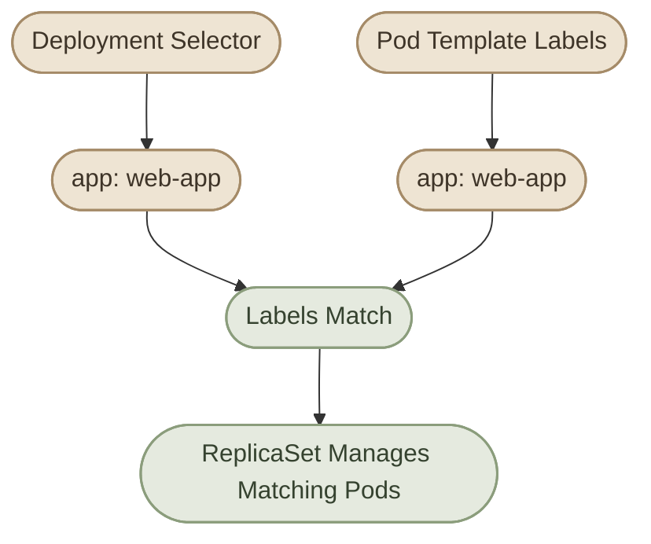

## Overview

في المقال السابق، فهمنا الـ Deployment ودورها في إدارة الـ ReplicaSets والـ Pods.

دلوقتي هننتقل من فهم المفهوم إلى **كتابة الـ Configuration بشكل صحيح**.

الـ Deployment بتتعرّف من خلال Kubernetes API، وغالبًا بنكتب إعداداتها في ملف YAML وبعدين نطبّقها باستخدام `kubectl apply`.

أهم الحقول اللي هنشتغل عليها:

- `replicas`: عدد نسخ التطبيق المطلوب.
- `selector`: إزاي الـ Deployment بتحدد الـ Pods التابعة لها.
- `template`: المواصفات اللي Kubernetes بتستخدمها لإنشاء الـ Pods.
- `containers`: تعريف الـ container image والأوامر والـ environment والموارد.
- `strategy`: طريقة تحديث الـ Pods عند تغيير الـ Pod template.

<CardGrid>
  <InfoCard title="Replicas" icon="layers">
    تحديد عدد الـ Pod replicas اللي التطبيق محتاجها.
  </InfoCard>
  <InfoCard title="Selectors & Labels" icon="tag">
    ربط الـ Deployment بالـ Pods المستهدفة عن طريق Labels وSelectors.
  </InfoCard>
  <InfoCard title="Pod Template" icon="code">
    تحديد مواصفات كل Pod جديدة هينشئها الـ Deployment.
  </InfoCard>
  <InfoCard title="Container Settings" icon="sliders">
    ضبط الـ Image والـ Ports والـ Environment والـ Resources والـ Probes.
  </InfoCard>
</CardGrid>

## 1. Anatomy of a Deployment Manifest

خلينا نبدأ بملف YAML كامل لتطبيق بسيط:

```yaml
apiVersion: apps/v1
kind: Deployment
metadata:
  name: web-app
  namespace: deployment-lab
  labels:
    app: web-app
spec:
  replicas: 3
  selector:
    matchLabels:
      app: web-app
  template:
    metadata:
      labels:
        app: web-app
    spec:
      containers:
        - name: nginx
          image: nginx:1.28
          ports:
            - name: http
              containerPort: 80
          resources:
            requests:
              cpu: 100m
              memory: 64Mi
            limits:
              cpu: 500m
              memory: 128Mi
```

الـ Manifest ده بيعرّف Deployment اسمها `web-app` داخل Namespace اسمها `deployment-lab`، وبيطلب 3 replicas.

قبل التطبيق، لازم تكون الـ Namespace موجودة:

```bash
kubectl create namespace deployment-lab
```

احفظ الـ Manifest في ملف اسمه `deployment.yaml`، وبعدها طبّقه:

```bash
kubectl apply -f deployment.yaml
```

وتابع النتيجة:

```bash
kubectl get deployment,pods -n deployment-lab
```

<Callout type="note">
  قيم الـ CPU والـ Memory في المثال للتدريب فقط، ومش بالضرورة مناسبة لكل تطبيق. اختار الـ Requests والـ Limits بناءً على استهلاك التطبيق الفعلي.
</Callout>

## 2. Understanding the Main Fields

### I. `apiVersion`

```yaml
apiVersion: apps/v1
```

بيحدد Kubernetes API group والـ version المستخدمة لتعريف المورد.

الـ Deployments الحديثة بتستخدم `apps/v1`.

### II. `kind`

```yaml
kind: Deployment
```

بيحدد نوع الـ resource اللي بننشئه.

### III. `metadata`

```yaml
metadata:
  name: web-app
  namespace: deployment-lab
  labels:
    app: web-app
```

الـ `metadata` بتحتوي على معلومات تعريفية عن المورد، زي الاسم والـ Namespace والـ Labels.

خلي بالك إن الـ Labels الموجودة في `metadata.labels` هنا بتخص الـ Deployment نفسها، ومش هي اللي بتحدد تلقائيًا الـ Pods التابعة لها.

### IV. `spec`

```yaml
spec:
  replicas: 3
```

الـ `spec` بتحدد الحالة المطلوبة للـ Deployment، بما فيها عدد النسخ وطريقة اختيار الـ Pods ومواصفات الـ Pod template.

## 3. Replicas — Defining the Desired Count

الحقل `replicas` بيحدد عدد الـ Pod replicas اللي عايز Kubernetes تحافظ عليه.

```yaml
spec:
  replicas: 3
```

لو كتبت `replicas: 3`، فالـ Deployment هتطلب من الـ ReplicaSet توفير 3 Pods.

تقدر تغيّر العدد في الملف وتعيد تطبيقه، أو تستخدم أمر `kubectl scale` للتغيير المباشر:

```bash
kubectl scale deployment web-app \
  --replicas=5 \
  -n deployment-lab
```

تحقق من الحالة:

```bash
kubectl get deployment web-app -n deployment-lab
```

**مهم:** الـ replicas المطلوبة مش معناها إن العدد ده هيبقى جاهز فورًا. لو فيه مشكلة في الـ scheduling أو الـ image أو الموارد، ممكن العدد الفعلي أو الجاهز يفضل أقل من المطلوب.

كمان لو بتدير الموارد من خلال GitOps أو ملفات YAML، لازم تحدّث المصدر الأساسي للإعدادات عشان ما يرجعش العدد القديم عند إعادة التطبيق.

## 4. Labels and Selectors

الـ Labels هي Key-Value pairs بنستخدمها لتصنيف الموارد، أما الـ Selectors فهي اللي بتحدد الموارد المطابقة لمجموعة Labels معينة.

في الـ Deployment، الـ `selector` بيحدد الـ Pods اللي الـ Deployment مسؤولة عن إدارتها عن طريق الـ ReplicaSet.

```yaml
spec:
  selector:
    matchLabels:
      app: web-app
  template:
    metadata:
      labels:
        app: web-app
```

لاحظ إن:

- `selector.matchLabels` بيحدد الـ Labels المطلوبة.
- `template.metadata.labels` بيحدد الـ Labels اللي هتتحط على الـ Pods الجديدة.
- لازم الـ Pod template labels تحقق الـ selector بتاع الـ Deployment.



### I. Common Selector Mistake

المثال ده غير صحيح لو الـ selector بيطلب `app: web-app` بينما الـ template بتستخدم `app: nginx`:

```yaml
spec:
  selector:
    matchLabels:
      app: web-app
  template:
    metadata:
      labels:
        app: nginx
```

في الحالة دي، Kubernetes هترفض إنشاء الـ Deployment لأن الـ Pod template labels لا تحقق الـ selector.

<Callout type="warning">
  في `apps/v1`، الـ Deployment selector مطلوب، وبيكون غير قابل للتغيير بعد إنشاء الـ Deployment. اختار الـ selector بعناية من البداية.
</Callout>

## 5. Pod Template Configuration

الـ `template` هي الجزء اللي بيحدد شكل كل Pod جديدة ينشئها الـ Deployment.

```yaml
template:
  metadata:
    labels:
      app: web-app
  spec:
    containers:
      - name: nginx
        image: nginx:1.28
```

الـ template بتحتوي على:

- `metadata`: Labels وAnnotations الخاصة بالـ Pod.
- `spec`: الـ Containers والـ Volumes والـ Scheduling settings والـ Probes وغيرها.

لو غيّرت حقلًا مؤثرًا في الـ Pod template، زي الـ container image، الـ Deployment عادةً بتنشئ ReplicaSet جديدة وتبدأ عملية rollout.

لكن تعديل الـ metadata الخاصة بالـ Deployment نفسها مش بالضرورة يؤدي إلى إنشاء Pods جديدة.

### I. Example: Updating the Image

```yaml
containers:
  - name: nginx
    image: nginx:1.29
```

بعد تعديل الـ image في ملف الـ YAML:

```bash
kubectl apply -f deployment.yaml
```

تابع التحديث:

```bash
kubectl rollout status deployment/web-app -n deployment-lab
```

هنشرح استراتيجيات التحديث والـ Rollback بالتفصيل في ملف `deployment-strategy-and-rollouts.mdx`.

## 6. Container Configuration

جوه `template.spec` بنحدد إعدادات الـ Containers.

### I. Image

```yaml
containers:
  - name: nginx
    image: nginx:1.28
```

الـ `image` بتحدد الـ container image اللي هيتشغّل.

في البيئات المهمة، اختار إصدارًا محددًا أو Image digest مناسبًا بدل الاعتماد على Tag متغير زي `latest`، عشان تقلل احتمالية تغيّر الـ image المستخدمة بشكل غير متوقع.

### II. Container Port

```yaml
ports:
  - name: http
    containerPort: 80
```

الـ `containerPort` بيوثّق المنفذ اللي التطبيق متوقع يسمع عليه داخل الـ container، لكنه مش كفاية لوحده لنشر التطبيق خارج الـ Pod أو لعمل Service.

الـ Service والـ Network Configuration ليهم إعدادات منفصلة.

### III. Environment Variables

```yaml
env:
  - name: APP_ENV
    value: production
```

تقدر تستخدم `env` لتعريف Environment Variables داخل الـ container.

لو القيمة سرية، ما تحطّهاش مباشرةً في ملف YAML محفوظ في Git؛ استخدم آلية مناسبة لإدارة الأسرار، زي Kubernetes Secrets مع ضوابط الوصول المناسبة أو Secret Management خارجي.

### IV. Commands and Arguments

```yaml
command: ["/bin/sh", "-c"]
args: ["echo Starting application && exec nginx -g 'daemon off;'"]
```

الـ `command` و`args` بيحددوا طريقة تشغيل الـ container، مع اختلاف سلوكهم عن الـ defaults الموجودة في الـ image.

ما تضيفش إعدادات التشغيل دي إلا لو محتاج تغيّر السلوك الافتراضي للتطبيق.

## 7. Resource Requests and Limits

الـ Resources بتساعد Kubernetes في اتخاذ قرارات الـ scheduling، وبتحدد حدود استهلاك الـ CPU والـ Memory للـ containers.

```yaml
resources:
  requests:
    cpu: 100m
    memory: 64Mi
  limits:
    cpu: 500m
    memory: 128Mi
```

### I. Requests

الـ `requests` بتعبّر عن الموارد اللي Kubernetes بتستخدمها في حسابات الـ scheduling.

مثلًا:

- `cpu: 100m` يعني 100 millicores، أي عُشر CPU core.
- `memory: 64Mi` يعني 64 mebibytes.

### II. Limits

الـ `limits` بتحدد الحدود القصوى المسموح بها للموارد وفقًا لآليات Kubernetes والـ container runtime.

- الـ CPU ممكن يتعرّض للـ throttling عند الوصول للحد.
- تجاوز حد الـ Memory ممكن يؤدي إلى إنهاء الـ container بسبب OOM.

<Callout type="tip">
  الـ Requests والـ Limits لازم تتحدد بناءً على احتياجات التطبيق وسلوكه تحت الضغط. القيم الصغيرة جدًا ممكن تسبب مشاكل أداء أو إعادة تشغيل الـ containers.
</Callout>

## 8. Health Probes

الـ Probes بتساعد Kubernetes في تقييم حالة التطبيق داخل الـ container.

أشهر ثلاثة أنواع:

| Probe | Purpose |
|---|---|
| `startupProbe` | بتحدد إذا كان التطبيق بدأ بنجاح. |
| `readinessProbe` | بتحدد إذا كان الـ container جاهزًا لاستقبال الطلبات. |
| `livenessProbe` | بتساعد في اكتشاف الحالات اللي تستدعي إعادة تشغيل الـ container. |

مثال لتطبيق HTTP بيوفر endpoint اسمه `/healthz`:

```yaml
startupProbe:
  httpGet:
    path: /healthz
    port: 8080
  failureThreshold: 30
  periodSeconds: 10

readinessProbe:
  httpGet:
    path: /ready
    port: 8080
  periodSeconds: 5

livenessProbe:
  httpGet:
    path: /healthz
    port: 8080
  periodSeconds: 10
```

المثال ده يحتاج تطبيقًا يستمع فعلًا على المنفذ `8080` ويوفّر المسارات المذكورة؛ مش مناسب لنسخة NGINX الافتراضية من غير تعديل.

الـ `readinessProbe` بتأثر على جاهزية الـ Pod واستقبالها للطلبات من خلال الـ Services، بينما الـ `livenessProbe` الفاشلة ممكن تؤدي إلى إعادة تشغيل الـ container.

## 9. Deployment Update Strategy

الـ `strategy` بتحدد طريقة التعامل مع تحديثات الـ Pod template.

من الاستراتيجيات الأساسية:

- `RollingUpdate`: تحديث تدريجي للـ Pods.
- `Recreate`: حذف الـ Pods القديمة قبل إنشاء النسخ الجديدة وفقًا لسلوك الاستراتيجية.

مثال:

```yaml
spec:
  strategy:
    type: RollingUpdate
    rollingUpdate:
      maxSurge: 1
      maxUnavailable: 0
```

في المثال ده:

- `maxSurge: 1` بيسمح بوجود Pod إضافية واحدة فوق العدد المطلوب أثناء التحديث.
- `maxUnavailable: 0` بيمنع تقليل عدد الـ replicas المتاحة تحت العدد المطلوب بسبب قواعد الـ rollout نفسها.

لكن الإعدادات دي مش ضمان إن التطبيق هيكون متاحًا دائمًا؛ لازم كمان تتوفر الموارد المناسبة وتكون الـ readiness checks صحيحة.

هنفصّل الـ Rollouts والـ Rollbacks في المقال المخصص لها.

## 10. Applying and Validating Configuration

قبل تطبيق Manifest، من الأفضل التحقق من صحة الـ YAML والـ Kubernetes schema باستخدام أدوات Kubernetes المناسبة.

### I. Validate the Manifest

```bash
kubectl apply --dry-run=client -f deployment.yaml
```

ده بيختبر الـ Manifest محليًا ضمن حدود الـ client-side dry run.

وللتحقق من جهة الـ API Server، بما في ذلك بعض أنواع التحقق اللي تعتمد على الكلاستر:

```bash
kubectl apply --dry-run=server -f deployment.yaml
```

الـ server-side dry run يحتاج إن الـ API Server يدعم العملية، وإن المستخدم عنده الصلاحيات اللازمة.

### II. Apply the Manifest

```bash
kubectl apply -f deployment.yaml
```

### III. Verify the Result

```bash
kubectl get deployment web-app -n deployment-lab
kubectl get replicasets -n deployment-lab
kubectl get pods -n deployment-lab -o wide
```

### IV. Inspect Problems

```bash
kubectl describe deployment web-app -n deployment-lab
kubectl get events -n deployment-lab \
  --sort-by=.metadata.creationTimestamp
```

نجاح `kubectl apply` معناه إن الطلب اتقبل، لكنه مش ضمان إن التطبيق اشتغل بشكل صحيح.

## 11. Hands-on Lab — Configure a Deployment

في اللاب ده هتنشئ Deployment من Manifest، وتتحقق من إعداداتها، وبعدها تغيّر عدد الـ replicas.

<Steps>
<li>

<InfoCard title="Create a Namespace" icon="terminal" />

```bash
kubectl create namespace deployment-config-lab
```
</li>
<li>

<InfoCard title="Create deployment.yaml" icon="code" />

```yaml
apiVersion: apps/v1
kind: Deployment
metadata:
  name: web-app
  namespace: deployment-config-lab
  labels:
    app: web-app
spec:
  replicas: 2
  selector:
    matchLabels:
      app: web-app
  template:
    metadata:
      labels:
        app: web-app
    spec:
      containers:
        - name: nginx
          image: nginx:1.28
          ports:
            - name: http
              containerPort: 80
          resources:
            requests:
              cpu: 100m
              memory: 64Mi
            limits:
              cpu: 500m
              memory: 128Mi
```
</li>
<li>

<InfoCard title="Validate and Apply" icon="shield" />

```bash
kubectl apply --dry-run=server -f deployment.yaml
kubectl apply -f deployment.yaml
```
</li>
<li>

<InfoCard title="Inspect the Deployment" icon="layers" />

```bash
kubectl get deployment web-app -n deployment-config-lab
kubectl get pods -n deployment-config-lab --show-labels
kubectl describe deployment web-app -n deployment-config-lab
```

تحقق من إن:

- الـ Deployment بتطلب 2 replicas.
- الـ selector والـ Pod template labels متطابقين.
- الـ Pods بتستخدم الـ image المحددة.
- الـ Resource Requests والـ Limits موجودة في إعدادات الـ containers.
</li>
<li>

<InfoCard title="Scale the Deployment" icon="cycle" />

```bash
kubectl scale deployment web-app \
  --replicas=4 \
  -n deployment-config-lab
```

تحقق من العدد الجديد:

```bash
kubectl get deployment web-app -n deployment-config-lab
kubectl get pods -n deployment-config-lab
```
</li>
<li>

<InfoCard title="Clean Up" icon="wrench" />

بعد انتهاء التجربة:

```bash
kubectl delete namespace deployment-config-lab
```
</li>
</Steps>

## 12. Common Configuration Mistakes

| Mistake | Result or Risk |
|---|---|
| عدم تطابق الـ selector مع الـ template labels | رفض إنشاء الـ Deployment في حالة عدم تحقق شروط الـ selector. |
| اختيار Image غير موجودة أو غير قابلة للوصول | ممكن الـ Pod تدخل `ImagePullBackOff`. |
| Requests أكبر من الموارد المتاحة | ممكن الـ Pod تفضل `Pending`. |
| إعداد Probe على Port أو Path غير صحيح | ممكن التطبيق يفشل في اجتياز الـ Probe. |
| استخدام `containerPort` مع افتراض إنه أنشأ Service | التطبيق مش هيكون منشورًا عبر Service لمجرد تعريف الـ port. |
| تغيير `replicas` في مصدر Declarative من غير تحديث الملف | ممكن القيمة القديمة ترجع عند إعادة تطبيق المصدر. |

## Summary

- الـ Deployment Manifest بتحدد الحالة المطلوبة للتطبيق.
- `replicas` بتحدد العدد المطلوب من الـ Pod replicas.
- الـ `selector` لازم يطابق الـ Labels الموجودة في الـ Pod template.
- الـ `template` بتحدد شكل الـ Pods اللي الـ Deployment هتنشئها.
- الـ Requests والـ Limits والـ Probes بتساعد في إدارة الموارد وصحة التطبيق.
- الـ Update Strategy بتحدد طريقة تحديث الـ Pods.
- استخدام `kubectl apply` مع التحقق من النتيجة بيساعد في إدارة الإعدادات بشكل واضح وقابل للمراجعة.
