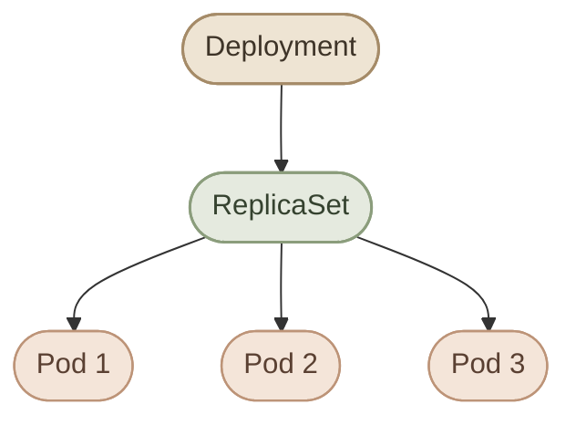
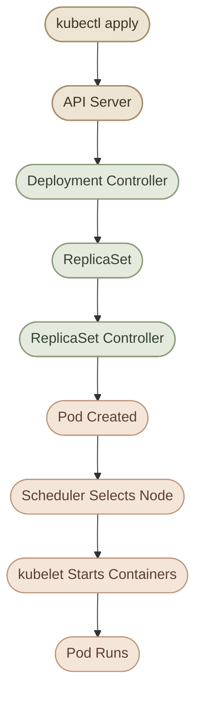
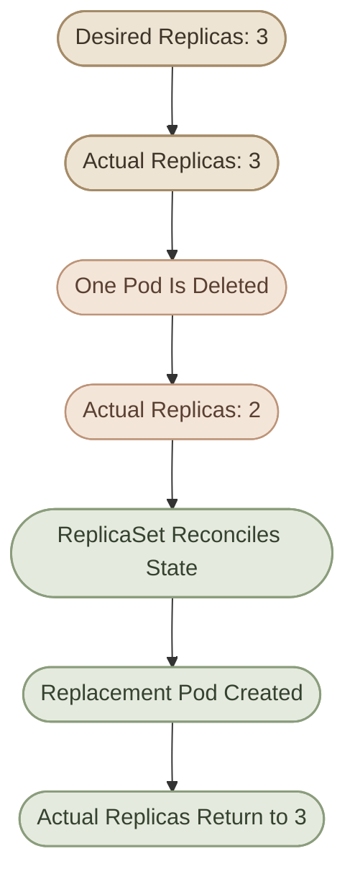

## Overview

في Kubernetes، تشغيل تطبيق داخل Pod واحدة مش كفاية غالبًا لو عايزينه يفضل شغال، ويتعافى من الأعطال، ويتوسع حسب احتياجاتنا.

تخيّل إن عندك تطبيق اسمه `web-app`، وعايز تشغّل منه 3 نسخ. لو أنشأت 3 Pods يدويًا، هتحتاج تتابع كل واحدة، ولو واحدة اختفت، هتحتاج تتصرف بنفسك.

هنا بييجي دور **Deployment**.

الـ Deployment بيسمحلك تعرّف الحالة المطلوبة للتطبيق، وKubernetes Controllers بتحاول تحافظ على الحالة دي عن طريق إنشاء وإدارة الـ ReplicaSets والـ Pods.

<CardGrid>
  <InfoCard title="Declarative Management" icon="layers">
    بتحدد الحالة المطلوبة، وKubernetes بتحاول توصل لها وتحافظ عليها.
  </InfoCard>
  <InfoCard title="Self-Healing" icon="shield">
    لو Pod اختفت، الـ controllers بتحاول تعوّضها للحفاظ على العدد المطلوب.
  </InfoCard>
  <InfoCard title="Scaling" icon="sliders">
    تقدر تزود أو تقلل عدد الـ replicas بسهولة.
  </InfoCard>
  <InfoCard title="Controlled Updates" icon="cycle">
    الـ Deployment بيدير إنشاء ReplicaSets جديدة أثناء تحديث التطبيق.
  </InfoCard>
</CardGrid>

## 1. What Is a Deployment?

الـ **Deployment** هو Kubernetes resource بيستخدم لإدارة التطبيقات اللي بتشتغل عادةً داخل Pods، وبيعتمد على `ReplicaSet` عشان يحافظ على العدد المطلوب من الـ Pod replicas.

بدل ما تدير كل Pod بشكل منفصل، بتعرّف في الـ Deployment حاجات زي:

- الـ Container image اللي التطبيق هيستخدمها.
- عدد الـ replicas المطلوب.
- الـ Pod template اللي بيحدد شكل الـ Pods.
- الـ Labels والـ Selectors اللي بتربط الموارد ببعضها.

تفاصيل الحقول دي هنشرحها في ملف `deployment-configuration.mdx`. هنا هنركّز على فهم طريقة العمل.

### I. Why Not Create Pods Directly?

لو أنشأت Pod مباشرةً:

```bash
kubectl run web-app --image=nginx
```

فأنت أنشأت Pod مستقلة، ومفيش Deployment أو ReplicaSet مسؤول عنها تلقائيًا.

لو الـ Pod اتحذفت، مش هيكون فيه ReplicaSet يعيد إنشاءها لمجرد إنك كنت عايزها تفضل موجودة.

لكن لو أنشأت Deployment، Kubernetes هتدير الـ Pods من خلال الـ ReplicaSet التابعة لها.

<Callout type="note">
  الـ Deployment مش بديل عن فهم الـ Pods والـ ReplicaSets؛ هو طبقة إدارة أعلى بتستخدم الـ ReplicaSets للحفاظ على الحالة المطلوبة وإدارة تحديثات التطبيق.
</Callout>

## 2. Deployment, ReplicaSet, and Pod

عشان نفهم الـ Deployment صح، لازم نعرف العلاقة بين المكونات الثلاثة.



كل مكوّن ليه مسؤولية مختلفة:

| Resource | Responsibility |
|---|---|
| Deployment | إدارة الحالة المطلوبة للتطبيق وتنظيم التحديثات. |
| ReplicaSet | الحفاظ على العدد المطلوب من الـ Pod replicas المطابقة للـ selector والـ template. |
| Pod | تشغيل الـ containers الخاصة بالـ workload على إحدى الـ Nodes. |

في الحالة المعتادة، الـ Deployment بينشئ ReplicaSet، والـ ReplicaSet بتنشئ Pods.

لو الـ Deployment عندها 3 replicas، فالهدف إن الـ ReplicaSet التابعة لها تحافظ على 3 Pods مطابقة للمواصفات المطلوبة، طالما ظروف الكلاستر تسمح بذلك.

## 3. How a Deployment Works

لما تنشئ Deployment، مش معنى كده إن الـ Pods هتظهر في نفس اللحظة بالضرورة. Kubernetes بتتعامل مع الموارد بشكل مستمر للوصول إلى الحالة المطلوبة.

العملية بتتم تقريبًا بالشكل ده:

1. تبعت طلب إنشاء الـ Deployment إلى الـ API Server.
2. يتم تخزين حالة الـ Deployment في الكلاستر.
3. الـ Deployment Controller يلاحظ إن فيه Deployment محتاجة إدارة.
4. يتم إنشاء ReplicaSet مناسبة.
5. الـ ReplicaSet Controller يحاول توفير العدد المطلوب من الـ Pods.
6. الـ Scheduler يختار Node مناسبة لكل Pod غير مجدولة.
7. الـ kubelet والـ Container Runtime على الـ Node يحاولوا تشغيل الـ containers.



**مهم:** إنشاء الـ Deployment بنجاح لا يعني بالضرورة إن التطبيق أصبح جاهزًا لاستقبال الطلبات. ممكن الـ Pods تتأخر في الـ scheduling، أو تفشل في سحب الـ image، أو تواجه مشاكل أثناء التشغيل.

عشان كده بنراجع الـ status والـ conditions بدل ما نعتمد على نجاح أمر الإنشاء وحده.

## 4. Understanding Desired State

من أهم مفاهيم Kubernetes فكرة **Desired State**.

لما تكتب في الـ Deployment إنك عايز 3 replicas، فأنت بتحدد الحالة المطلوبة، مش مجرد أمر بإنشاء 3 Pods مرة واحدة.

مثلًا:

```yaml
apiVersion: apps/v1
kind: Deployment
metadata:
  name: web-app
spec:
  replicas: 3
  selector:
    matchLabels:
      app: web-app
  template:
    metadata:
      labels:
        app: web-app
    spec:
      containers:
        - name: nginx
          image: nginx:1.28
```

الـ Deployment بتعلن إن المطلوب هو 3 Pods بمواصفات الـ template المحددة.

لو واحدة من الـ Pods اتحذفت، الـ ReplicaSet هتلاحظ إن العدد الفعلي أقل من المطلوب، وتحاول تنشئ Pod بديلة.



ده مثال على **Reconciliation Loop**: الـ controllers بتقارن الحالة الفعلية بالحالة المطلوبة، وبتحاول تقلل الفرق بينهم.

<Callout type="tip">
  فكّر في الـ Deployment على إنها تعريف للحالة اللي عايزها، مش مجموعة أوامر مؤقتة. الـ controllers هي اللي بتواصل محاولة تحقيق الحالة دي.
</Callout>

## 5. Self-Healing: What It Does and What It Doesn't

الـ Deployment بتستفيد من الـ ReplicaSet عشان تعوّض الـ Pods اللي اختفت، لكن ده مش معناه إن كل مشكلة في التطبيق هتتحل تلقائيًا.

### I. What Kubernetes Can Do

- إعادة إنشاء Pod اتحذفت يدويًا.
- إنشاء Pod بديلة لو Pod فشلت واختفت من الحالة المطلوبة.
- محاولة توفير العدد المطلوب من الـ replicas.
- إنشاء Pods بديلة على Nodes أخرى لو الـ scheduling والموارد والسياسات تسمح.

### II. What Kubernetes Cannot Guarantee

- إن كل Pod هتشتغل بنجاح مهما كانت المشكلة.
- إن الـ replacement Pod هتشتغل على نفس الـ Node.
- إن الـ application data هتفضل موجودة لو كانت محفوظة داخل filesystem مؤقت داخل Pod.
- إن التطبيق نفسه خالي من bugs أو إن الـ database متاحة.
- إن الـ Deployment هتقدر توفر العدد المطلوب لو مفيش CPU أو Memory كفاية أو فيه قيود scheduling.

<Callout type="warning">
  الـ Self-Healing بتعالج فرق الحالة بين العدد المطلوب والفعلي، لكنها مش بديل عن Monitoring أو Health Checks أو إدارة البيانات الدائمة.
</Callout>

## 6. Deployment vs. Standalone Pod

قارن بين الحالتين:

| Behavior | Standalone Pod | Deployment-managed Pod |
|---|---|---|
| يتم إنشاؤها مباشرةً | نعم | عن طريق ReplicaSet في الحالة المعتادة |
| وجود Controller يحافظ على عدد replicas | لا | نعم |
| إعادة إنشاء Pod بعد حذفها | مش تلقائيًا لمجرد إنها كانت موجودة | الـ ReplicaSet بتحاول تعويضها |
| إدارة rolling updates | لا | نعم، من خلال Deployment |
| تحديد عدد النسخ المطلوبة | لا يوجد ReplicaSet تلقائيًا | عن طريق `spec.replicas` |

لاحظ إن Kubernetes ممكن تعيد إنشاء Pods لأسباب أخرى حسب نوع الـ controller، لكن الـ standalone Pod لا تملك Controller مسؤولًا عن الحفاظ على عدد ثابت من النسخ.

## 7. Creating a Deployment with kubectl

نقدر ننشئ Deployment باستخدام `kubectl create deployment`.

مثلًا:

```bash
kubectl create deployment web-app \
  --image=nginx:1.28 \
  --replicas=3
```

الأمر ده بيطلب إنشاء Deployment اسمها `web-app`، باستخدام image اسمها `nginx:1.28`، وبعدد مطلوب قدره 3 replicas.

تحقق من الـ Deployment:

```bash
kubectl get deployments
```

اعرض الـ ReplicaSets:

```bash
kubectl get replicasets
```

اعرض الـ Pods:

```bash
kubectl get pods
```

وتقدر تعرض العلاقة بين الموارد باستخدام Labels:

```bash
kubectl get pods -l app=web-app
```

لو الـ Pods لسه بتتجهز، استنى شوية وراجع الحالة مرة تانية.

## 8. Inspecting a Deployment

في الشغل اليومي، إنشاء الـ Deployment مش كفاية؛ لازم نعرف حالتها الحالية.

### I. Check the Deployment Status

```bash
kubectl get deployment web-app
```

هتلاقي أعمدة زي:

- `READY`: عدد الـ replicas الجاهزة مقارنة بالمطلوب.
- `UP-TO-DATE`: عدد الـ replicas المحدثة وفقًا لمواصفات الـ Deployment الحالية.
- `AVAILABLE`: عدد الـ replicas المتاحة حسب شروط الـ availability.
- `AGE`: عمر المورد.

### II. Get Detailed Information

```bash
kubectl describe deployment web-app
```

الأمر ده بيساعدك تفهم إعدادات الـ Deployment، والـ selector، والـ conditions، والـ events المرتبطة بيها.

### III. Watch Changes

```bash
kubectl get deployment web-app --watch
```

ده بيسمحلك تتابع تغيّر الحالة مباشرةً لحد ما توقف الأمر.

### IV. Check the ReplicaSet

```bash
kubectl get replicasets -l app=web-app
```

وتقدر تعرض الـ Pods التابعة للتطبيق:

```bash
kubectl get pods -l app=web-app -o wide
```

الخيار `-o wide` بيعرض تفاصيل إضافية، ومنها الـ Node اللي كل Pod شغالة عليها.

## 9. Declarative vs. Imperative Management

في Kubernetes، فيه طريقتان شائعتان للتعامل مع الموارد.

### I. Imperative Approach

بتستخدم أوامر مباشرةً لتنفيذ إجراء معين:

```bash
kubectl create deployment web-app --image=nginx:1.28 --replicas=3
```

الطريقة دي مفيدة في التجارب السريعة والتعلم والمهام البسيطة.

### II. Declarative Approach

بتكتب الحالة المطلوبة داخل ملف YAML، وبعدها تطبّقها:

```bash
kubectl apply -f deployment.yaml
```

الميزة إن ملف الـ YAML يقدر يكون جزءًا من Git repository، فتقدر تراجع التغييرات وتتبعها وتعيد تطبيق الإعدادات بشكل منظم.

في الـ Production، الأسلوب الـ Declarative غالبًا أنسب لإدارة الموارد من خلال ملفات محفوظة ومراجعة، مع مراعاة طريقة إدارة الموارد المستخدمة في بيئتك.

هنشرح حقول الـ Deployment بالتفصيل في ملف `deployment-configuration.mdx`.

## 10. Hands-on Lab — Create and Inspect a Deployment

في اللاب ده هتنشئ Deployment، وتراقب الـ ReplicaSet والـ Pods اللي اتعملوا، وبعدها تختبر الـ Self-Healing عن طريق حذف Pod واحدة.

<Steps>
<li>

<InfoCard title="Create a Dedicated Namespace" icon="terminal" />

```bash
kubectl create namespace deployment-lab
```
</li>
<li>

<InfoCard title="Create the Deployment" icon="cube" />

```bash
kubectl create deployment web-app \
  --image=nginx:1.28 \
  --replicas=3 \
  -n deployment-lab
```
</li>
<li>

<InfoCard title="Inspect the Resources" icon="layers" />

```bash
kubectl get deployments -n deployment-lab
kubectl get replicasets -n deployment-lab
kubectl get pods -n deployment-lab -o wide
```

جاوب على الأسئلة دي:

1. كام Pod اتعملت؟
2. اسم الـ ReplicaSet إيه؟
3. هل الـ Pods كلها على نفس الـ Node ولا متوزعة؟
4. هل كل الـ replicas جاهزة؟
</li>
<li>

<InfoCard title="Inspect the Ownership Relationship" icon="code" />

اعرض الـ Pods بالـ Labels:

```bash
kubectl get pods -n deployment-lab --show-labels
```

اختار اسم Pod من النتائج، وبعدها:

```bash
kubectl describe pod <POD_NAME> -n deployment-lab
```

استبدل `<POD_NAME>` بالاسم الفعلي للـ Pod.

راجع قسم `Controlled By`، وتأكد إن الـ Pod تحت إدارة ReplicaSet، مش Deployment مباشرةً.
</li>
<li>

<InfoCard title="Test Self-Healing" icon="pulse" />

اعرض الـ Pods:

```bash
kubectl get pods -n deployment-lab
```

اختار واحدة واحذفها:

```bash
kubectl delete pod <POD_NAME> -n deployment-lab
```

بعدها راقب الـ Pods:

```bash
kubectl get pods -n deployment-lab --watch
```

افتح Terminal تانية لو عايز تتابع الـ Deployment في نفس الوقت:

```bash
kubectl get deployment web-app -n deployment-lab --watch
```

المتوقع إن الـ ReplicaSet تلاحظ إن العدد الفعلي قل عن المطلوب، وتحاول إنشاء Pod بديلة.

**ملاحظة:** اسم الـ Pod البديلة غالبًا هيكون مختلفًا عن اسم الـ Pod اللي اتحذفت.
</li>
<li>

<InfoCard title="Clean Up" icon="wrench" />

بعد ما تخلص التجربة:

```bash
kubectl delete namespace deployment-lab
```

الأمر ده بيحذف الـ Namespace والموارد الـ Namespaced اللي أنشأناها في اللاب.
</li>
</Steps>

## 11. Troubleshooting Quick Reference

| Symptom | What to Check |
|---|---|
| عدد الـ Pods أقل من المطلوب | `kubectl describe deployment web-app` |
| الـ Deployment مش بتوصل لحالة Ready | راجع الـ Pods والـ Events والـ container status |
| الـ Pods في حالة `Pending` | افحص الـ scheduling والموارد المتاحة والقيود |
| الـ Pods في حالة `ImagePullBackOff` | راجع اسم الـ image وإمكانية الوصول للـ registry والـ credentials |
| الـ Deployment موجودة لكن التطبيق مش متاح | افحص الـ readiness والـ Service والـ application logs |

أوامر مفيدة للتشخيص:

```bash
kubectl describe deployment web-app
kubectl get pods -o wide
kubectl get events --sort-by=.metadata.creationTimestamp
kubectl logs <POD_NAME>
```

استبدل أسماء الموارد بالأسماء الفعلية، وحدد `-n <NAMESPACE>` لو المورد موجود في Namespace غير الحالية.

هنفصّل سيناريوهات التشخيص في ملف `deployment-troubleshooting.mdx` بدل ما نحول المقال ده إلى دليل troubleshooting كامل.

## 12. Best Practices

- استخدم Deployments لمعظم التطبيقات الـ stateless اللي محتاجة إدارة replicas وتحديثات منظمة.
- استخدم أسماء واضحة للموارد والـ Namespaces.
- احتفظ بملفات YAML في Git لما يكون ده مناسبًا لطريقة إدارة البيئة.
- راجع حالة الـ Deployment والـ ReplicaSets والـ Pods بدل ما تعتمد على نجاح أمر الإنشاء فقط.
- حدد Resource Requests وLimits المناسبة للتطبيق عند تصميم الـ Deployment.
- استخدم Readiness وLiveness Probes حسب احتياجات التطبيق.
- ما تعتمدش على الـ Deployment وحدها لتوفير network access أو persistent data.
- اختبر التغييرات في بيئة مناسبة قبل تطبيقها على Production.

## Summary

- الـ Deployment بتدير الحالة المطلوبة للتطبيق باستخدام ReplicaSets وPods.
- الـ ReplicaSet بتحاول الحفاظ على العدد المطلوب من الـ Pod replicas.
- الـ Reconciliation Loop هي أساس طريقة Kubernetes في مطابقة الحالة الفعلية مع الحالة المطلوبة.
- الـ Self-Healing بتساعد في تعويض الـ Pods المفقودة، لكنها مش ضمان إن التطبيق هيشتغل مهما كانت الظروف.
- أوامر `kubectl get` و`describe` و`logs` و`events` أدوات أساسية لفهم حالة التطبيق.
- ملفات YAML والـ Declarative Management بتساعد في إدارة التغييرات بشكل قابل للمراجعة والتكرار.
