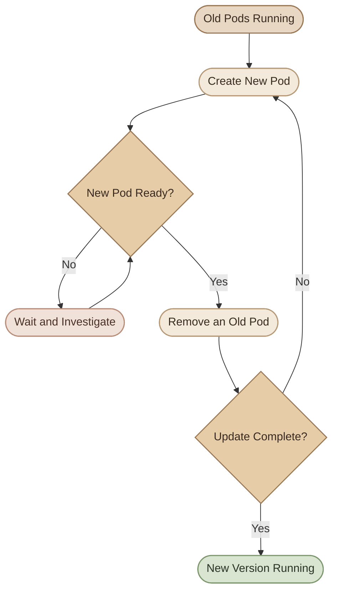

## Introduction

تحديث التطبيق في Kubernetes مش مجرد تغيير الـ container image. لازم نعرف إزاي نحدّث الـ Pods تدريجيًا، نراقب نجاح الإصدار الجديد، ونتصرف لو حصلت مشكلة.

الـ **Deployment** بيدير العملية دي من خلال آلية اسمها **Rollout**، واللي بتسمح لنا ننتقل من إصدار للتاني مع الحفاظ على الـ Desired State.

## 1. What Is a Rollout?

الـ **Rollout** هو عملية نشر تغييرات جديدة على الـ Pods اللي بيديرها الـ Deployment.

مثلًا، عندك تطبيق شغال بثلاث نسخ:

- `web-app` شغال باستخدام `nginx:1.28`.
- قررت تحدّثه إلى `nginx:1.29`.
- Kubernetes يبدأ يطبّق التغيير وفقًا للـ Deployment update strategy.
- تقدر تتابع العملية وتتأكد إن الـ Pods الجديدة بقت جاهزة.

الـ Rollout بيبدأ عادةً لما يحصل تغيير في الـ **Pod template**، مثل تغيير image أو environment variables أو resource configuration. تغيير الـ Deployment metadata خارج `spec.template` مش بالضرورة يبدأ Rollout جديد.

<Callout type="note" title="Important distinction">
تغيير عدد الـ `replicas` لوحده بيؤدي إلى Scaling، مش بالضرورة Rollout جديد. أما تغيير `spec.template`، فبيؤدي عادةً إلى إنشاء Revision جديدة للـ Deployment.
</Callout>

## 2. Deployment Update Strategies

Kubernetes بيوفّر استراتيجيتين أساسيتين لتحديث الـ Deployment:

<CardGrid>
  <InfoCard title="RollingUpdate" icon="cycle">
    بيستبدل الـ Pods تدريجيًا، بحيث يقدر يحتفظ بجزء من النسخ القديمة شغّال أثناء تجهيز النسخ الجديدة.
  </InfoCard>
  <InfoCard title="Recreate" icon="layers">
    بيحذف النسخ القديمة قبل إنشاء النسخ الجديدة. ممكن ينتج عنه فترة توقف للتطبيق.
  </InfoCard>
</CardGrid>

### I. RollingUpdate

دي الاستراتيجية الافتراضية للـ Deployment.

بدل ما Kubernetes يحذف كل الـ Pods القديمة مرة واحدة، بيبدأ يستبدلها تدريجيًا، مع مراعاة إعدادات التحديث وحالة جاهزية الـ Pods.



المخطط بيوضح الفكرة العامة، لكن عدد الـ Pods اللي بتتضاف أو تتحذف في كل مرحلة بيتحدد بواسطة إعدادات `maxSurge` و`maxUnavailable`.

### II. Recreate

مع `Recreate`، Kubernetes بيحذف الـ Pods القديمة قبل إنشاء النسخ الجديدة.

```yaml
spec:
  strategy:
    type: Recreate
```

ده ممكن يكون مناسب لبعض التطبيقات اللي مينفعش تشتغل فيها نسخ من إصدارين مختلفين في نفس الوقت.

لكن خليك واخد بالك:

- ممكن يحصل **downtime** أثناء التبديل.
- الاستراتيجية لا تضمن إن التطبيق الجديد هيشتغل بنجاح.
- لازم التطبيق نفسه يكون مناسب لطريقة التوقف وإعادة التشغيل دي.

## 3. Configure RollingUpdate

تقدر تتحكم في سلوك التحديث باستخدام `maxSurge` و`maxUnavailable`.

```yaml
spec:
  strategy:
    type: RollingUpdate
    rollingUpdate:
      maxSurge: 25%
      maxUnavailable: 25%
```

<CardGrid>
  <InfoCard title="maxSurge" icon="pulse">
    أقصى عدد إضافي من الـ Pods فوق العدد المطلوب أثناء التحديث.
  </InfoCard>
  <InfoCard title="maxUnavailable" icon="sliders">
    أقصى عدد من الـ Pods اللي ممكن يكون غير متاح أثناء التحديث مقارنةً بالعدد المطلوب.
  </InfoCard>
</CardGrid>

### I. Understanding the defaults

لو عندك Deployment فيه `4 replicas`، والقيم الافتراضية هي `25%` لكل من `maxSurge` و`maxUnavailable`:

- `maxSurge: 25%` تتحول إلى `1` Pod إضافية؛ لأن النسبة بتتقرب لأعلى.
- `maxUnavailable: 25%` تتحول إلى `1` Pod؛ لأن النسبة بتتقرب لأسفل.
- Kubernetes يقدر يشغّل لحد `5` Pods أثناء التحديث.
- ممكن يكون فيه Pod واحدة غير متاحة كحد أقصى وفقًا لهذا الإعداد.

بالنسبة إلى Deployment فيه Replica واحدة، النسب الافتراضية بتتحول إلى `maxSurge: 1` و`maxUnavailable: 0`.

تقدر تستخدم أرقام صحيحة بدل النسب المئوية، مثل:

```yaml
rollingUpdate:
  maxSurge: 2
  maxUnavailable: 0
```

الإعداد ده بيسمح بإضافة لحد نسختين فوق العدد المطلوب، مع منع تقليل عدد النسخ المتاحة عن العدد المطلوب بسبب إعداد `maxUnavailable`.

<Callout type="warning" title="RollingUpdate does not guarantee zero downtime">
نجاح التحديث بدون انقطاع بيعتمد كمان على `readinessProbe`، وسعة الـ cluster، وتوفر الموارد، وسلوك التطبيق، وإعدادات الـ Service. وجود RollingUpdate لوحده مش ضمان لعدم حدوث downtime.
</Callout>

## 4. Monitor a Rollout

بعد تغيير الـ Pod template، استخدم أوامر `kubectl rollout` لمتابعة العملية.

### I. Check rollout status

```bash
kubectl rollout status deployment/web-app
```

ولو الـ Deployment موجود في Namespace محددة:

```bash
kubectl rollout status deployment/web-app \
  -n deployment-rollout-lab
```

الأمر بينتظر لحد ما الـ rollout يكتمل أو يتعطل أو ينتهي وقت الانتظار المحدد.

تقدر تحدد مدة انتظار:

```bash
kubectl rollout status deployment/web-app \
  -n deployment-rollout-lab \
  --timeout=120s
```

### II. Inspect the Deployment

```bash
kubectl get deployments -n deployment-rollout-lab

kubectl get replicasets -n deployment-rollout-lab

kubectl get pods -n deployment-rollout-lab -o wide

kubectl describe deployment web-app \
  -n deployment-rollout-lab
```

كل أمر بيوضح جزء مختلف:

- `deployments`: حالة الـ Deployment وعدد النسخ المطلوبة والمتاحة.
- `replicasets`: الـ ReplicaSets المرتبطة بالإصدارات المختلفة.
- `pods`: حالة كل Pod والـ Node اللي شغّال عليها.
- `describe deployment`: الأحداث والـ conditions وتفاصيل التحديث.

### III. Read rollout history

```bash
kubectl rollout history deployment/web-app \
  -n deployment-rollout-lab
```

لعرض تفاصيل Revision محددة:

```bash
kubectl rollout history deployment/web-app \
  -n deployment-rollout-lab \
  --revision=2
```

الـ **Revision** بتمثل نسخة من الـ Pod template تم تسجيلها ضمن تاريخ الـ Deployment. عدد الـ Revisions المتاحة بيتأثر بإعداد `revisionHistoryLimit` وبما إذا كانت النسخ القديمة ما زالت محفوظة.

## 5. Update the Application Image

تقدر تغيّر image باستخدام `kubectl set image`:

```bash
kubectl set image deployment/web-app \
  nginx=nginx:1.29 \
  -n deployment-rollout-lab
```

في المثال ده:

- `deployment/web-app` هو الـ Deployment المستهدف.
- `nginx` هو اسم الـ container داخل الـ Pod template.
- `nginx:1.29` هي الـ image الجديدة.

بعدها تابع التحديث:

```bash
kubectl rollout status deployment/web-app \
  -n deployment-rollout-lab
```

وتأكد من الـ image المستخدمة:

```bash
kubectl get deployment web-app \
  -n deployment-rollout-lab \
  -o jsonpath='{.spec.template.spec.containers[*].image}'

echo
```

<Callout type="warning" title="Declarative workflow">
`kubectl set image` بيغيّر الـ Deployment مباشرةً. لو بتستخدم GitOps أو بتدير الـ manifests من Git، لازم تحدّث الملف الأصلي كمان؛ وإلا ممكن يحصل drift بين الحالة الموجودة في الـ cluster والحالة المعلنة في Git.
</Callout>

## 6. Rollback a Deployment

لو الإصدار الجديد فيه مشكلة، تقدر ترجع إلى Revision سابقة.

```bash
kubectl rollout undo deployment/web-app \
  -n deployment-rollout-lab
```

الأمر بيرجع الـ Pod template إلى Revision سابقة متاحة في تاريخ الـ Deployment، وبيبدأ Rollout جديد باستخدام الإعدادات الحالية.

تابع عملية الرجوع:

```bash
kubectl rollout status deployment/web-app \
  -n deployment-rollout-lab
```

وللرجوع إلى Revision معينة:

```bash
kubectl rollout undo deployment/web-app \
  -n deployment-rollout-lab \
  --to-revision=2
```

قبل استخدام رقم Revision، افحص التاريخ عشان تتأكد إنك بتختار الإصدار المقصود.

### I. What rollback does not undo

الـ Rollback مش زرار بيرجع النظام كله إلى حالته السابقة. هو بيرجع إعدادات الـ Pod template إلى إصدار سابق، لكنه لا يعكس تلقائيًا:

- تغييرات قاعدة البيانات أو الـ schema migrations.
- البيانات اللي اتعدلت أو اتمسحت.
- التغييرات اللي حصلت في أنظمة خارج Kubernetes.
- كل تغييرات الـ Deployment اللي خارج الـ Pod template.

علشان كده، لازم يكون عندك خطة للتعامل مع تغييرات الـ database والـ external dependencies قبل إطلاق إصدار جديد.

## 7. Restart a Deployment

أحيانًا تحتاج تعيد إنشاء الـ Pods حتى لو ما غيّرتش الـ image، مثلًا بعد تحديث إعداد خارجي لا يُحقن تلقائيًا داخل الـ Pods.

```bash
kubectl rollout restart deployment/web-app \
  -n deployment-rollout-lab
```

الأمر بيحدّث annotation في الـ Pod template، وده بيؤدي إلى Rollout جديد وإعادة إنشاء الـ Pods وفقًا للـ strategy.

**مهم:** إعادة التشغيل لا تعني إن كل التغييرات الخارجية هتظهر تلقائيًا داخل التطبيق. ده بيعتمد على طريقة تحميل التطبيق للإعدادات، وهل فيه ConfigMap أو Secret أو dependency اتغيّرت بالفعل.

## 8. Pause and Resume a Rollout

ممكن توقف تطبيق تغييرات الـ Pod template مؤقتًا لو محتاج تجمع عدة تغييرات قبل استكمال النشر.

إيقاف الـ rollout:

```bash
kubectl rollout pause deployment/web-app \
  -n deployment-rollout-lab
```

بعد كده تقدر تطبّق تعديلات إضافية على الـ Pod template. التعديلات دي مش هتبدأ Rollout فعليًا أثناء الـ pause.

استكمال النشر:

```bash
kubectl rollout resume deployment/web-app \
  -n deployment-rollout-lab
```

وبعدين راقب الحالة:

```bash
kubectl rollout status deployment/web-app \
  -n deployment-rollout-lab
```

<Callout type="tip" title="Use pause carefully">
لو نسيت تعمل `resume`، التغييرات هتفضل من غير Rollout. وفي حالة وجود مشكلة، افحص حالة الـ Deployment قبل افتراض إن التحديث بدأ أو اكتمل.
</Callout>

## 9. Failed Rollouts and Troubleshooting

مش كل Rollout بيكمل بنجاح. أشهر الأسباب هي:

<CardGrid>
  <InfoCard title="ImagePullBackOff" icon="cube">
    الـ image غير موجودة، أو اسمها غلط، أو الـ registry محتاج credentials.
  </InfoCard>
  <InfoCard title="Readiness Failure" icon="pulse">
    الـ Pod شغالة لكن التطبيق مش جاهز لاستقبال traffic، أو الـ readiness probe إعدادها غير صحيح.
  </InfoCard>
  <InfoCard title="Insufficient Resources" icon="sliders">
    الـ scheduler مش قادر يلاقي Node فيها CPU أو Memory كفاية لتشغيل النسخ الجديدة.
  </InfoCard>
  <InfoCard title="Application Failure" icon="wrench">
    التطبيق بدأ لكنه بيقع أو مش قادر يتصل بقاعدة البيانات أو dependency أساسية.
  </InfoCard>
</CardGrid>

### I. A practical troubleshooting sequence

ابدأ بفحص حالة الـ rollout:

```bash
kubectl rollout status deployment/web-app \
  -n deployment-rollout-lab \
  --timeout=60s
```

افحص الـ Pods:

```bash
kubectl get pods -n deployment-rollout-lab
```

اعرض الأحداث والتفاصيل:

```bash
kubectl describe deployment web-app \
  -n deployment-rollout-lab

kubectl get events \
  -n deployment-rollout-lab \
  --sort-by=.metadata.creationTimestamp
```

لو فيه Pod فاشلة، افحصها بالتحديد:

```bash
kubectl describe pod <pod-name> \
  -n deployment-rollout-lab

kubectl logs <pod-name> \
  -n deployment-rollout-lab
```

لو الـ container بتعمل restart، ممكن تحتاج تشوف الـ logs الخاصة بالمحاولة السابقة:

```bash
kubectl logs <pod-name> \
  -n deployment-rollout-lab \
  --previous
```

بعد ما تحدد السبب، أصلح المشكلة أو نفّذ Rollback لو ده الأنسب.

### II. Understand Deployment conditions

ممكن تفحص الـ conditions باستخدام:

```bash
kubectl describe deployment web-app \
  -n deployment-rollout-lab
```

من الحالات المهمة:

- `Available`: هل الـ Deployment عنده الحد الأدنى المطلوب من النسخ المتاحة؟
- `Progressing`: هل فيه تقدم في نشر الإصدار؟
- `ProgressDeadlineExceeded`: هل التقدم في الـ rollout اتجاوز المهلة المحددة؟

لو الـ Deployment تجاوز `progressDeadlineSeconds` من غير تقدم كافٍ، Kubernetes بيبلّغ عن المشكلة من خلال condition. **Kubernetes لا ينفّذ Rollback تلقائيًا لمجرد تجاوز المهلة.** لازم تفحص السبب وتقرر هل تصلحه أم ترجع لإصدار سابق.

## 10. Hands-on Lab: Update and Roll Back

هنطبّق تحديثًا فعليًا على Deployment ونراقب الـ rollout، وبعدها نرجع إلى الإصدار السابق.

<Steps>
<li>

<InfoCard title="Create a namespace and Deployment" icon="terminal" />

```bash
kubectl create namespace deployment-rollout-lab

kubectl create deployment web-app \
  --image=nginx:1.28 \
  --replicas=3 \
  -n deployment-rollout-lab
```

انتظر لحد ما الـ Pods تبقى جاهزة:

```bash
kubectl rollout status deployment/web-app \
  -n deployment-rollout-lab
```

افحص الحالة:

```bash
kubectl get deployment,replicaset,pods \
  -n deployment-rollout-lab
```
</li>
<li>

<InfoCard title="Update the image" icon="cycle" />

```bash
kubectl set image deployment/web-app \
  nginx=nginx:1.29 \
  -n deployment-rollout-lab
```

تابع التحديث:

```bash
kubectl rollout status deployment/web-app \
  -n deployment-rollout-lab
```

وبعد اكتماله:

```bash
kubectl get deployment,replicaset,pods \
  -n deployment-rollout-lab

kubectl rollout history deployment/web-app \
  -n deployment-rollout-lab
```

لاحظ إن تغيير الـ Pod template بيؤدي إلى Revision جديدة، وإن الـ ReplicaSet الجديدة بتدير الـ Pods الخاصة بالإصدار الجديد.
</li>
<li>

<InfoCard title="Roll back" icon="cycle" />

```bash
kubectl rollout undo deployment/web-app \
  -n deployment-rollout-lab
```

انتظر انتهاء الرجوع:

```bash
kubectl rollout status deployment/web-app \
  -n deployment-rollout-lab
```

تحقق من الـ image الحالية:

```bash
kubectl get deployment web-app \
  -n deployment-rollout-lab \
  -o jsonpath='{.spec.template.spec.containers[*].image}'

echo
```

المفروض ترجع إلى `nginx:1.28` لو كانت هي الـ Revision السابقة المتاحة في اللاب.
</li>
<li>

<InfoCard title="Simulate a failed rollout" icon="shield" />

للتجربة فقط، استخدم image غير موجودة:

```bash
kubectl set image deployment/web-app \
  nginx=nginx:does-not-exist \
  -n deployment-rollout-lab
```

افحص الـ Pods:

```bash
kubectl get pods -n deployment-rollout-lab
```

راقب حالة الـ rollout بمهلة محددة:

```bash
kubectl rollout status deployment/web-app \
  -n deployment-rollout-lab \
  --timeout=60s
```

قد تلاحظ `ErrImagePull` أو `ImagePullBackOff`، وقد يتوقف التقدم مع استمرار بعض الـ Pods القديمة في العمل حسب استراتيجية التحديث وحالة النسخ.

ارجع إلى آخر Revision سليمة:

```bash
kubectl rollout undo deployment/web-app \
  -n deployment-rollout-lab

kubectl rollout status deployment/web-app \
  -n deployment-rollout-lab
```
</li>
<li>

<InfoCard title="Clean up" icon="wrench" />

بعد انتهاء اللاب:

```bash
kubectl delete namespace deployment-rollout-lab
```

الأمر ده بيحذف الـ namespace والموارد الموجودة بداخلها، فمتستخدموش لو عندك موارد تانية مهمة داخل نفس الـ namespace.
</li>
</Steps>

## 11. Best Practices

<list>
  <list-item>**Define readiness probes:** متعتبرش الـ Pod جاهزة لمجرد إن الـ container بدأت.</list-item>
  <list-item>**Use versioned images:** تجنب الاعتماد على `latest` في بيئات الإنتاج، واستخدم إصدارات واضحة يمكن تتبعها.</list-item>
  <list-item>**Monitor every rollout:** استخدم `kubectl rollout status` وافحص الـ events عند حدوث تأخير.</list-item>
  <list-item>**Plan capacity:** تأكد إن الـ cluster عنده موارد كافية لتشغيل الـ Pods الإضافية أثناء RollingUpdate.</list-item>
  <list-item>**Keep manifests in Git:** خلّي التغييرات قابلة للمراجعة والتكرار، خصوصًا مع GitOps.</list-item>
  <list-item>**Plan database compatibility:** الإصدار القديم والجديد ممكن يشتغلوا بالتوازي أثناء التحديث؛ لذلك لازم تكون تغييرات الـ schema متوافقة مع النسختين عند الحاجة.</list-item>
  <list-item>**Test rollback procedures:** اتأكد إن الرجوع ممكن عمليًا، وإنه مش هيترك البيانات أو الأنظمة الخارجية في حالة غير متوافقة.</list-item>
</list>

## 12. Quick Reference

| Task | Command |
|---|---|
| Watch rollout | `kubectl rollout status deployment/web-app` |
| View history | `kubectl rollout history deployment/web-app` |
| Inspect a revision | `kubectl rollout history deployment/web-app --revision=2` |
| Update image | `kubectl set image deployment/web-app nginx=nginx:1.29` |
| Roll back | `kubectl rollout undo deployment/web-app` |
| Roll back to a revision | `kubectl rollout undo deployment/web-app --to-revision=2` |
| Restart Pods | `kubectl rollout restart deployment/web-app` |
| Pause rollout | `kubectl rollout pause deployment/web-app` |
| Resume rollout | `kubectl rollout resume deployment/web-app` |

لو الـ Deployment موجود في Namespace غير `default`، أضف `-n <namespace>` للأوامر اللي بتستهدفه.

## Summary

الـ Deployment Rollout هو الآلية اللي Kubernetes بيستخدمها لنقل التطبيق من Pod template لإصدار جديد.

- `RollingUpdate` بيستبدل الـ Pods تدريجيًا، وهو الافتراضي.
- `Recreate` بيحذف النسخ القديمة قبل إنشاء الجديدة.
- `maxSurge` و`maxUnavailable` بيتحكموا في حدود التحديث.
- `kubectl rollout status` لمتابعة التقدم، و`history` لمراجعة الإصدارات.
- `undo` بيرجع الـ Pod template إلى Revision سابقة متاحة، لكنه مش بيرجع تغييرات البيانات الخارجية.
- نجاح النشر بيعتمد على صحة التطبيق، والـ probes، والموارد، وطريقة إدارة الإعدادات.

الخطوة التالية هي **ReplicaSet Troubleshooting**، علشان نربط فهمنا للـ ReplicaSets والـ Deployments بتشخيص مشاكل الـ selectors، والـ Pods غير المتوقعة، وعدم تطابق العدد الفعلي مع الـ Desired State.
