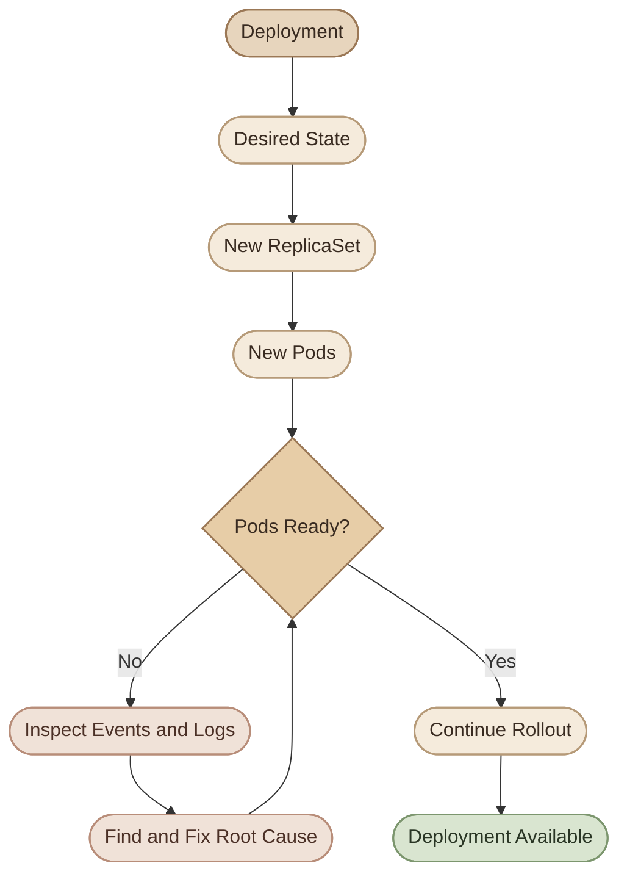

## Overview

الـ Deployment بتسهّل إدارة التطبيق، لكن وجود Deployment resource في الـ cluster مش معناه إن التطبيق شغّال بشكل سليم.

ممكن الـ Deployment تكون موجودة، لكن:

- الـ Pods الجديدة مش بتتعمل أصلًا.
- الـ Pods موجودة لكن مش `Ready`.
- التحديث واقف والـ Pods القديمة لسه شغّالة.
- الـ container بتفشل بسبب image أو configuration.
- الـ Deployment مش قادرة توصل للـ Desired State بسبب قيود الـ scheduling أو الموارد.

في الدرس ده هنتعلم نمشي بخطوات تشخيص منظمة بدل ما نبدأ بعمل `delete` أو `restart` من غير ما نعرف السبب.

## 1. Understand the Deployment Control Chain

الـ Deployment بتدير الـ ReplicaSets، والـ ReplicaSets بتدير الـ Pods.

لما تغيّر الـ Pod template، الـ Deployment عادةً بتنشيء ReplicaSet جديدة، وتبدأ عملية Rollout حسب الـ update strategy.



أثناء التشخيص، افحص المستويات الثلاثة:

- **Deployment:** هل التحديث بيتقدم؟ وهل عدد النسخ المتاحة كفاية؟
- **ReplicaSet:** هل بتحاول إنشاء العدد المطلوب من الـ Pods؟
- **Pod:** ليه الـ Pod مش بتتجدول، أو مش بتبدأ، أو مش بتبقى جاهزة؟

<Callout type="note" title="Important">
فشل الـ Deployment مش بالضرورة معناه إن الـ Deployment configuration نفسها غلط. السبب ممكن يكون في الـ Pod template، أو الـ cluster capacity، أو الـ image registry، أو التطبيق نفسه.
</Callout>

## 2. Start with a Standard Diagnostic Workflow

ابدأ بالأوامر دي بالترتيب، وغيّر اسم الـ Deployment والـ Namespace حسب بيئتك.

<Steps>
<li>

<InfoCard title="Check the Deployment" icon="terminal" />

```bash
kubectl get deployment <deployment-name> \
  -n <namespace>
```

مثال على الأعمدة المهمة:

```text
NAME      READY   UP-TO-DATE   AVAILABLE   AGE
web-app   2/3     1            2           5m
```

معاني الأعمدة:

- `READY`: عدد النسخ الجاهزة مقارنة بالعدد المطلوب.
- `UP-TO-DATE`: عدد النسخ اللي بتستخدم أحدث Pod template الخاص بالـ Deployment.
- `AVAILABLE`: عدد النسخ المتاحة وفقًا لمتطلبات الـ Deployment.
- `AGE`: عمر الـ Deployment.

لو النتيجة `READY 2/3`، فده معناه إن نسخة واحدة على الأقل مش داخلة ضمن العدد الجاهز المطلوب. لكن العمود وحده مش بيحدد السبب.
</li>
<li>

<InfoCard title="Inspect the Deployment Details" icon="code" />

```bash
kubectl describe deployment <deployment-name> \
  -n <namespace>
```

راجع:

- `Replicas`
- `Conditions`
- `Events`
- `StrategyType`
- `NewReplicaSet`
- `OldReplicaSets`

الـ `Events` والـ `Conditions` غالبًا هيدّوك أول دليل عن المشكلة.
</li>
<li>

<InfoCard title="Inspect ReplicaSets and Pods" icon="layers" />

```bash
kubectl get replicasets \
  -n <namespace>

kubectl get pods \
  -n <namespace> \
  -o wide
```

لو فيه أكثر من ReplicaSet، قارن عدد الـ replicas لكل واحدة. ده بيساعدك تعرف هل التحديث بدأ، وهل النسخ الجديدة بتشتغل، وهل النسخ القديمة لسه موجودة.
</li>
<li>

<InfoCard title="Inspect Events" icon="pulse" />

```bash
kubectl get events \
  -n <namespace> \
  --sort-by=.metadata.creationTimestamp
```

ابحث عن رسائل مثل:

- `FailedScheduling`
- `FailedCreate`
- `ErrImagePull`
</li>
</Steps>
- `ImagePullBackOff`
- `Unhealthy`
- `BackOff`

الأحداث ممكن تنتهي صلاحيتها أو تختفي مع الوقت، لذلك غياب الحدث مش دليل قاطع إن المشكلة لم تحدث.

## 3. Problem: Deployment Rollout Is Stuck

ممكن تشغّل:

```bash
kubectl rollout status deployment/web-app \
  -n <namespace> \
  --timeout=120s
```

وتلاقي إن الـ rollout لم يكتمل خلال المهلة المحددة.

ده مش تشخيص نهائي؛ هو إشارة إنك محتاج تفحص سبب عدم اكتمال التحديث.

### I. Common causes

<CardGrid>
  <InfoCard title="New Pods Not Ready" icon="pulse">
    الـ containers بدأت، لكن الـ readiness probe فشلت أو التطبيق مش جاهز.
  </InfoCard>
  <InfoCard title="Scheduling Failure" icon="sliders">
    مفيش موارد أو Nodes مناسبة لتشغيل النسخ الجديدة.
  </InfoCard>
  <InfoCard title="Image Pull Failure" icon="cube">
    الـ image غير موجودة، أو الـ tag غلط، أو الوصول للـ registry فشل.
  </InfoCard>
  <InfoCard title="Application Crash" icon="wrench">
    التطبيق بيقع بسبب configuration أو dependency أو runtime error.
  </InfoCard>
</CardGrid>

افحص حالة الـ rollout والـ Pods:

```bash
kubectl describe deployment web-app \
  -n <namespace>

kubectl get replicasets,pods \
  -n <namespace>
```

بعدها اختار الـ Pod اللي فيها المشكلة واستخدم `describe` و`logs` حسب الحالة.

## 4. Problem: ProgressDeadlineExceeded

الـ Deployment عندها إعداد اسمه `progressDeadlineSeconds`، وبيحدد المهلة اللي Kubernetes بيستخدمها لاكتشاف إن التقدم في الـ rollout متوقف لفترة أطول من المسموح.

مثال على الرسالة:

```text
ProgressDeadlineExceeded
```

ده معناه إن الـ Deployment لم تحقق تقدمًا كافيًا خلال المهلة المحددة. السبب الحقيقي ممكن يكون مشكلة image، أو probe، أو scheduling، أو التطبيق نفسه.

افحص الـ conditions:

```bash
kubectl describe deployment web-app \
  -n <namespace>
```

أو استخرجها مباشرة:

```bash
kubectl get deployment web-app \
  -n <namespace> \
  -o jsonpath='{range .status.conditions[*]}{.type}{"\t"}{.status}{"\t"}{.reason}{"\t"}{.message}{"\n"}{end}'
```

### I. How to respond

1. افحص الـ Pods الجديدة والأحداث المرتبطة بها.
2. حدد هل المشكلة في الـ scheduling، أو الـ container startup، أو readiness، أو التطبيق.
3. أصلح السبب لو كان واضحًا وقابلًا للإصلاح.
4. لو الإصدار الجديد غير صالح أو غير آمن، قيّم عمل Rollback.

<Callout type="warning" title="No automatic rollback">
`ProgressDeadlineExceeded` لا يعني إن Kubernetes هيرجع تلقائيًا للإصدار السابق. النظام بيبلّغ عن توقف التقدم، لكن قرار الإصلاح أو الـ Rollback لازم يتاخد بشكل منفصل.
</Callout>

## 5. Problem: ImagePullBackOff or ErrImagePull

لو الـ image مش بتتحمّل، الـ container مش هتبدأ بالشكل المطلوب، والـ rollout ممكن يفضل متعطل.

اعرف حالة الـ Pods:

```bash
kubectl get pods -n <namespace>
```

افحص الـ Pod المتأثرة:

```bash
kubectl describe pod <pod-name> \
  -n <namespace>
```

### I. Possible causes

- اسم الـ image أو الـ tag غير صحيح.
- الـ image غير موجودة في الـ registry.
- الـ registry خاص وبيحتاج credentials.
- الاتصال بالـ registry فشل.
- فيه مشكلة في DNS أو network من الـ node.

افحص الـ image اللي موجودة في الـ Pod template:

```bash
kubectl get deployment web-app \
  -n <namespace> \
  -o jsonpath='{.spec.template.spec.containers[*].image}'

echo
```

لو اكتشفت إن اسم الـ image غلط، صحّحه في مصدر الـ configuration المعتمد، ثم طبّق التغيير بالطريقة المناسبة لبيئتك.

مثلًا، في لاب يدوي:

```bash
kubectl set image deployment/web-app \
  nginx=nginx:1.29 \
  -n <namespace>
```

استبدل `nginx` باسم الـ container الفعلي داخل الـ Pod template.

وبعدين تابع:

```bash
kubectl rollout status deployment/web-app \
  -n <namespace>
```

لو المشكلة في credentials أو الشبكة، تغيير الـ image tag مش هيحلها؛ لازم تعالج السبب الفعلي.

## 6. Problem: CrashLoopBackOff

`CrashLoopBackOff` معناها إن الـ container بتفشل، وKubernetes بيحاول يعيد تشغيلها مع زيادة فترة الانتظار بين المحاولات.

ابدأ بالـ logs الحالية:

```bash
kubectl logs <pod-name> \
  -n <namespace>
```

ولو الـ container عملت restart بالفعل:

```bash
kubectl logs <pod-name> \
  -n <namespace> \
  --previous
```

افحص كمان:

```bash
kubectl describe pod <pod-name> \
  -n <namespace>
```

### I. Common causes

- Environment variables ناقصة أو قيمها غير صحيحة.
- التطبيق مش قادر يتصل بقاعدة البيانات أو dependency.
- أمر التشغيل أو `command` أو `args` غير صحيح.
- ملفات configuration المطلوبة غير موجودة.
- التطبيق بيخرج بسبب runtime error.
- الـ container اتقتلت بسبب استهلاك الذاكرة، وده ممكن يظهر من خلال `OOMKilled`.

لو الـ Pod فيها أكثر من container، حدّد الـ container المقصودة باستخدام `-c`:

```bash
kubectl logs <pod-name> \
  -n <namespace> \
  -c <container-name>
```

مهم تميّز بين `CrashLoopBackOff` و`ImagePullBackOff`: الأولى غالبًا معناها إن الـ container بدأت أو حاولت تبدأ ثم فشلت، بينما الثانية معناها إن Kubernetes مش قادر يحمّل الـ image بالشكل المطلوب.

## 7. Problem: Readiness or Liveness Probe Failures

الـ probes بتحدد جوانب مختلفة من حالة التطبيق:

- `readinessProbe`: هل الـ Pod جاهزة لاستقبال traffic؟
- `livenessProbe`: هل الـ container محتاجة إعادة تشغيل بسبب فشل health check؟
- `startupProbe`: هل التطبيق خلّص مرحلة البداية؟

افحص أحداث الـ Pod:

```bash
kubectl describe pod <pod-name> \
  -n <namespace>
```

ممكن تلاقي رسالة مثل:

```text
Readiness probe failed
```

أسباب شائعة:

- المسار أو الـ port غلط.
- التطبيق لسه بيبدأ.
- التطبيق مش بيسمع على العنوان أو الـ port المتوقع.
- الـ health endpoint نفسها بترجع failure.
- الـ probe timeout أو إعداداتها مش مناسبة للتطبيق.

مثال على إعداد HTTP probe:

```yaml
readinessProbe:
  httpGet:
    path: /ready
    port: 8080
  initialDelaySeconds: 5
  periodSeconds: 10
  timeoutSeconds: 2
  failureThreshold: 3
```

المثال ده مجرد نموذج؛ لازم الـ application تكون فعلًا بتوفر endpoint اسمها `/ready` على port `8080`.

لو الـ readiness فشلت، الـ Pod ممكن تفضل موجودة لكن لا تُعتبر جاهزة، وده ممكن يمنع اكتمال الـ rollout.

أما فشل الـ liveness probe المتكرر، فممكن يؤدي إلى إعادة تشغيل الـ container. عشان كده، متستخدمش liveness probe كبديل عن readiness probe.

## 8. Problem: Insufficient Resources or FailedScheduling

لو الـ Pods الجديدة في حالة `Pending`، افحص الـ events:

```bash
kubectl describe pod <pod-name> \
  -n <namespace>
```

لو ظهرت رسالة:

```text
FailedScheduling
```

اقرأ التفاصيل لمعرفة هل السبب:

- `Insufficient cpu`
- `Insufficient memory`
- Node selectors أو affinity غير متوافقة.
- Taints لا توجد لها tolerations مناسبة.
- قيود أخرى على الـ Nodes أو الموارد.

افحص الـ nodes:

```bash
kubectl get nodes
```

وافحص موارد الـ Pods المطلوبة في الـ Deployment:

```bash
kubectl get deployment web-app \
  -n <namespace> \
  -o yaml
```

ركز على `resources.requests` و`resources.limits`.

الـ scheduler بيعتمد على الـ resource requests عند تحديد ما إذا كانت الـ Pod قابلة للجدولة على Node. زيادة الـ limits وحدها مش بالضرورة تحل مشكلة `Insufficient cpu` أو `Insufficient memory`.

كمان، الـ RollingUpdate ممكن يحتاج سعة إضافية مؤقتة بسبب `maxSurge`. لو الـ cluster مش قادر يشغّل النسخ الإضافية، التحديث ممكن يتأخر أو يتوقف.

الحلول المحتملة حسب السبب:

- توفير موارد إضافية.
- مراجعة الـ requests لو كانت أعلى من احتياجات التطبيق الفعلية.
- إصلاح الـ node affinity أو selectors.
- مراجعة الـ taints والـ tolerations.
- تعديل سياسة التحديث بعد تقييم تأثيرها على availability.

## 9. Problem: New ReplicaSet Created but Rollout Does Not Finish

ممكن تلاقي ReplicaSet جديدة اتعملت، لكن الـ Deployment لسه مش مكتملة.

اعرض الـ ReplicaSets:

```bash
kubectl get replicasets \
  -n <namespace>
```

ثم افحص الـ Pods:

```bash
kubectl get pods \
  -n <namespace> \
  -o wide
```

لو فيه ReplicaSets قديمة وجديدة، قارن:

- عدد النسخ المطلوبة والحالية والجاهزة.
- الـ image المستخدمة في كل ReplicaSet.
- حالة الـ Pods الجديدة.
- أحداث الـ scheduling والـ probes.
- هل الـ rollout لسه بيتقدم ولا وصل إلى حالة فشل.

مع `RollingUpdate`، ممكن تفضل بعض النسخ القديمة شغالة لو النسخ الجديدة مش جاهزة، حسب إعدادات `maxSurge` و`maxUnavailable` وحالة التطبيق.

ده ممكن يساعد في الحفاظ على availability، لكنه مش معناه إن التحديث هيكمل لوحده.

## 10. Problem: Deployment Configuration Is Invalid

لو `kubectl apply` رفض الـ manifest، اقرأ رسالة الخطأ قبل ما تغيّر الملف.

```bash
kubectl apply --dry-run=server \
  -f deployment.yaml
```

أخطاء ممكن تقابلها:

- الـ YAML غير صالح.
- `selector` لا تطابق labels الموجودة في الـ Pod template.
- الـ container configuration غير صالحة.
- قيمة غير صحيحة في resource configuration.
- المستخدم الحالي مش عنده الصلاحيات المطلوبة.

في `apps/v1`، الـ Deployment selector لازم تطابق labels في الـ Pod template، والـ selector نفسها غير قابلة للتغيير بعد إنشاء الـ Deployment.

لو الـ selector محتاجة تصحيح، غالبًا هتحتاج خطة لإنشاء Deployment جديدة بدل محاولة تعديل selector الموجودة.

قبل أي تغيير، افحص الـ manifest الفعلية والموارد الموجودة في الـ cluster؛ متحذفش Deployment شغالة لمجرد إن تعديلًا واحدًا فشل.

## 11. Rollback or Fix Forward?

لما تكتشف مشكلة في الإصدار الجديد، قدامك اتجاهان أساسيان:

<CardGrid>
  <InfoCard title="Fix Forward" icon="wrench">
    أصلح سبب الفشل في الإصدار الحالي، ثم طبّق configuration صحيحة وراقب الـ rollout من جديد.
  </InfoCard>
  <InfoCard title="Rollback" icon="cycle">
    ارجع إلى Pod template سابقة متاحة لو الإصدار الجديد غير صالح أو فيه خطر على الخدمة.
  </InfoCard>
</CardGrid>

### I. Rollback

افحص تاريخ الإصدارات:

```bash
kubectl rollout history deployment/web-app \
  -n <namespace>
```

ارجع إلى الإصدار السابق:

```bash
kubectl rollout undo deployment/web-app \
  -n <namespace>
```

تابع العملية:

```bash
kubectl rollout status deployment/web-app \
  -n <namespace>
```

الـ Rollback بيرجع الـ Pod template إلى Revision سابقة متاحة، لكنه مش بيرجع تغييرات قاعدة البيانات أو الأنظمة الخارجية تلقائيًا.

### II. When should you avoid an immediate rollback?

لو المشكلة مجرد نقص موارد أو registry مؤقتة، ممكن يكون الإصلاح المباشر هو الأنسب.

ولو الإصدار الجديد نفّذ database migration غير متوافقة مع الإصدار القديم، فالـ Rollback ممكن يسبب مشكلة إضافية حتى لو رجّع الـ Pods بنجاح.

قبل القرار، اسأل:

1. هل الخدمة الحالية متأثرة؟
2. هل الإصدار السابق ما زال متوافقًا مع الـ data والـ dependencies؟
3. هل سبب الفشل معروف؟
4. هل إصلاح السبب أسرع وأقل خطورة من الرجوع؟
5. هل فيه تغييرات خارج Kubernetes لازم تتعالج؟

## 12. Hands-on Lab: Diagnose a Failed Rollout

في اللاب ده هننشئ Deployment سليمة، ونحدّثها إلى image غير موجودة، ونشخّص الفشل، وبعدها نرجع للإصدار السليم.

<Steps>
<li>

<InfoCard title="Create the lab environment" icon="terminal" />

```bash
kubectl create namespace deployment-troubleshooting-lab
```

أنشئ Deployment بثلاث نسخ:

```bash
kubectl create deployment web-app \
  --image=nginx:1.28 \
  --replicas=3 \
  -n deployment-troubleshooting-lab
```

انتظر اكتمال التشغيل:

```bash
kubectl rollout status deployment/web-app \
  -n deployment-troubleshooting-lab
```
</li>
<li>

<InfoCard title="Introduce a bad image" icon="cube" />

لأغراض اللاب فقط، استخدم tag غير موجودة:

```bash
kubectl set image deployment/web-app \
  nginx=nginx:does-not-exist \
  -n deployment-troubleshooting-lab
```

تابع الـ rollout بمهلة محددة:

```bash
kubectl rollout status deployment/web-app \
  -n deployment-troubleshooting-lab \
  --timeout=60s
```

ممكن الأمر ينتهي بمهلة من غير ما يكتمل الـ rollout، وده متوقع في التجربة دي.
</li>
<li>

<InfoCard title="Investigate the failure" icon="shield" />

افحص الـ Deployment:

```bash
kubectl describe deployment web-app \
  -n deployment-troubleshooting-lab
```

اعرض الـ ReplicaSets:

```bash
kubectl get replicasets \
  -n deployment-troubleshooting-lab
```

اعرض الـ Pods:

```bash
kubectl get pods \
  -n deployment-troubleshooting-lab
```

اختار Pod من النسخ الجديدة وافحصها:

```bash
kubectl describe pod <pod-name> \
  -n deployment-troubleshooting-lab
```

**Expected finding:** غالبًا هتلاقي `ErrImagePull` أو `ImagePullBackOff` على الـ Pods الجديدة، بينما ممكن تفضل النسخ القديمة شغالة أثناء التحديث.
</li>
<li>

<InfoCard title="Roll back to the previous revision" icon="cycle" />

```bash
kubectl rollout history deployment/web-app \
  -n deployment-troubleshooting-lab
```

ارجع إلى الإصدار السابق:

```bash
kubectl rollout undo deployment/web-app \
  -n deployment-troubleshooting-lab
```

راقب النتيجة:

```bash
kubectl rollout status deployment/web-app \
  -n deployment-troubleshooting-lab
```

وتأكد من الـ image الحالية:

```bash
kubectl get deployment web-app \
  -n deployment-troubleshooting-lab \
  -o jsonpath='{.spec.template.spec.containers[*].image}'

echo
```

المفروض ترجع إلى `nginx:1.28`، بشرط إنها تكون الـ Revision السابقة المتاحة.
</li>
<li>

<InfoCard title="Verify the final state" icon="flag" />

```bash
kubectl get deployment,replicaset,pods \
  -n deployment-troubleshooting-lab
```

اتأكد إن الـ Deployment وصلت إلى العدد المطلوب وإن الـ Pods بقت جاهزة.
</li>
<li>

<InfoCard title="Clean up" icon="wrench" />

```bash
kubectl delete namespace deployment-troubleshooting-lab
```

الأمر ده بيحذف كل الموارد داخل الـ Namespace؛ نفّذه بعد انتهاء اللاب فقط.
</li>
</Steps>

## 13. Troubleshooting Checklist

<list>
  <list-item>**1. Check the Deployment:** قارن `READY` و`UP-TO-DATE` و`AVAILABLE` بالعدد المطلوب.</list-item>
  <list-item>**2. Inspect conditions and events:** ابحث عن سبب واضح للتأخير أو الفشل.</list-item>
  <list-item>**3. Inspect ReplicaSets:** حدد الإصدار القديم والجديد وعدد النسخ في كل منهما.</list-item>
  <list-item>**4. Inspect Pods:** افحص `Pending` و`ImagePullBackOff` و`CrashLoopBackOff` و`Running` مع readiness failures.</list-item>
  <list-item>**5. Check logs and probes:** راجع التطبيق وإعدادات health checks عند الحاجة.</list-item>
  <list-item>**6. Decide on remediation:** أصلح السبب أو اعمل Rollback بعد تقييم تأثيره على البيانات والـ dependencies.</list-item>
  <list-item>**7. Verify recovery:** متكتفيش بنجاح الأمر؛ اتأكد إن الـ rollout اكتمل وإن الـ Pods المطلوبة أصبحت جاهزة.</list-item>
</list>

## Summary

تشخيص الـ Deployment بيعتمد على فهم العلاقة بين الـ Deployment والـ ReplicaSets والـ Pods.

- `kubectl describe deployment` بيساعد في فهم الـ conditions والأحداث.
- `kubectl get replicasets,pods` بيوضح حالة الإصدارات والنسخ التابعة لها.
- `kubectl logs` و`kubectl describe pod` بيساعدوا في تشخيص مشاكل الـ container والـ probes.
- `ProgressDeadlineExceeded` بيشير إلى فشل التقدم خلال المهلة، لكنه لا ينفّذ Rollback تلقائيًا.
- `kubectl rollout undo` بيرجع الـ Pod template إلى Revision سابقة متاحة، لكنه مش بيرجع التغييرات الخارجية.
- الإصلاح الصحيح بيبدأ بتحديد السبب الجذري، مش بحذف الموارد أو إعادة تشغيلها بشكل عشوائي.

الخطوة التالية هي **Service Discovery and Networking**، وهنشرح إزاي التطبيقات بتوصل لبعضها داخل Kubernetes باستخدام Services وDNS، وإزاي نميّز بين مشاكل الـ Service ومشاكل الـ Pods أو الـ application نفسها.
