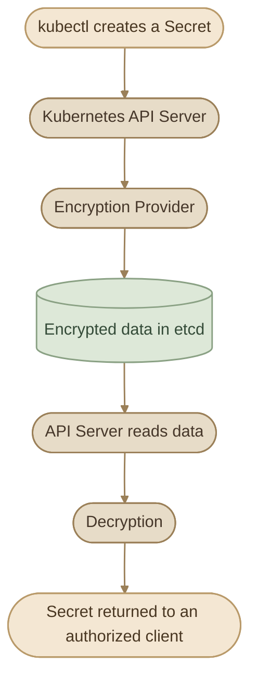

## Introduction

في الدرس السابق، اتعلمنا إزاي ننشئ `Kubernetes Secrets` ونستخدمها داخل الـ Pods. لكن فيه نقطة أمنية مهمة: **وجود البيانات داخل Kubernetes Secret مش معناه بالضرورة إنها متشفرة أثناء التخزين.**

افتراضيًا، Kubernetes بيخزن بيانات الـ API objects داخل `etcd`، وهو الـ datastore اللي بيحتفظ بحالة الـ Cluster. لو `Encryption at Rest` مش متفعّل، ممكن بيانات الـ Secrets تكون قابلة للقراءة من التخزين بواسطة أي شخص عنده صلاحية وصول مناسبة إلى بيانات `etcd`.

في الدرس ده هنتعلم إزاي نفعّل التشفير، ونتحقق من النتيجة، ونتعامل مع الـ Secrets اللي كانت موجودة قبل تفعيل التشفير.

<InfoCard variant="insight" title="The main security goal" description="Encrypt sensitive Kubernetes resources in etcd so that reading the stored data directly does not reveal their plaintext values." icon="shield" tags={["Security", "etcd"]} />

## 1. Base64 Encoding vs Encryption

لما ننشئ Secret، ممكن نعرض محتواه باستخدام:

```bash
kubectl get secret my-secret -o yaml
```

غالبًا هنشوف قيمة `data` بالشكل ده:

```yaml
apiVersion: v1
kind: Secret
metadata:
  name: my-secret
type: Opaque
data:
  password: c3VwZXItc2VjcmV0
```

القيمة الموجودة تحت `data` عبارة عن Base64-encoded data.

نقدر نفك الترميز باستخدام:

```bash
echo 'c3VwZXItc2VjcmV0' | base64 --decode
```

الناتج:

```text
super-secret
```

وده معناه إن Base64 مجرد **Encoding**، مش وسيلة حماية تشفيرية. أي شخص يحصل على القيمة المشفرة بـ Base64 يقدر يفكها بسهولة.

لكن خلّي بالك من نقطة مهمة: ده مش موضوع الدرس الأساسي. حتى لو Kubernetes عرض قيمة الـ Secret بشكل مش مقروء، لازم نعرف هل القيمة المخزنة داخل `etcd` نفسها متشفرة أم لا.

## 2. What Does Encryption at Rest Mean?

`Encryption at Rest` يعني تشفير البيانات وهي مخزنة على وسيط التخزين، بدل ما تكون محفوظة كنص واضح يمكن قراءته مباشرةً.

في Kubernetes، الـ API Server هو المسؤول عن التعامل مع الـ API objects، وبيستخدم `etcd` لتخزينها. نقدر نضبط الـ API Server بحيث يشفر موارد محددة قبل تخزينها، ويفك تشفيرها عند قراءتها.



الفكرة الأساسية:

<CardGrid columns={2} label="How Encryption at Rest Works">
  <InfoCard variant="concept" title="API Server Encrypts" icon="shield">

الـ API Server بيشفّر البيانات قبل تخزينها.

  </InfoCard>
  <InfoCard variant="concept" title="etcd Stores Encrypted Data" icon="database">

`etcd` بيحتفظ بالبيانات المشفرة بدل الـ plaintext.

  </InfoCard>
  <InfoCard variant="concept" title="Authorized Decryption" icon="pulse">

لما Kubernetes يحتاج البيانات، الـ API Server بيفك التشفير ويعيدها بالشكل الطبيعي للعميل المصرّح له.

  </InfoCard>
  <InfoCard variant="concept" title="Not a Replacement for RBAC" icon="flag">

التشفير لا يمنع تلقائيًا كل أشكال الوصول غير المصرّح به؛ لازم تفضل مفعّل `RBAC` وتطبّق أقل صلاحيات ممكنة.

  </InfoCard>
</CardGrid>

## 3. Check Whether Encryption Is Enabled

قبل ما نغيّر أي إعداد، لازم نتحقق من الوضع الحالي.

في الـ clusters اللي بتستخدم `kubeadm`، غالبًا الـ API Server بيشتغل كـ Static Pod، وإعداداته موجودة في:

```text
/etc/kubernetes/manifests/kube-apiserver.yaml
```

نبحث عن الـ encryption provider configuration argument:

```bash
sudo grep -n -- '--encryption-provider-config' \
  /etc/kubernetes/manifests/kube-apiserver.yaml
```

لو مفيش نتيجة، فده معناه إن الـ argument مش موجود في الـ manifest ده. لكنه مش دليل شامل لوحده على إعدادات أي cluster؛ لازم نتأكد من طريقة تشغيل الـ API Server الفعلية.

كمان نقدر نراجع إعدادات الـ Static Pod:

```bash
kubectl -n kube-system get pods
```

<InfoCard variant="warning" title="Distribution-Specific Paths" icon="terminal">

**Important:** المسارات دي شائعة في `kubeadm` clusters، لكنها مش قاعدة عامة لكل Kubernetes distribution. ما تفترضش إن عندك نفس المسارات على `kind` أو managed Kubernetes.

</InfoCard>

## 4. EncryptionConfiguration

لتفعيل التشفير، بننشئ ملف اسمه `EncryptionConfiguration` ونمرر مساره إلى الـ API Server.

الملف بيسمح لنا نحدد:

<CardGrid columns={2} label="What the File Defines">
  <InfoCard variant="concept" title="Resources to Encrypt" description="الـ resources اللي عايزين نشفرها." icon="layers" />
  <InfoCard variant="concept" title="Encryption Provider" description="الـ encryption provider المستخدم." icon="sliders" />
  <InfoCard variant="concept" title="Required Keys" description="مفاتيح التشفير المطلوبة." icon="tag" />
  <InfoCard variant="concept" title="Provider Order" description="ترتيب الـ providers المستخدمة في التشفير وفك التشفير." icon="cycle" />
</CardGrid>

### I. Example Configuration

الملف التالي مثال توضيحي باستخدام `aescbc` لتشفير Kubernetes Secrets:

```yaml
apiVersion: apiserver.config.k8s.io/v1
kind: EncryptionConfiguration
resources:
  - resources:
      - secrets
    providers:
      - aescbc:
          keys:
            - name: key1
              secret: REPLACE_WITH_BASE64_ENCODED_32_BYTE_KEY
      - identity: {}
```

احفظ الملف باسم:

```text
/etc/kubernetes/enc/enc.yaml
```

**ما تفعّلوش قبل استبدال قيمة المفتاح التجريبية بمفتاح حقيقي مولّد عشوائيًا، والتأكد من صلاحيات الملف.**

لإنشاء مفتاح عشوائي بطول 32 bytes على Linux، تقدر تستخدم:

```bash
head -c 32 /dev/urandom | base64 | tr -d '\n'
echo
```

القيمة الناتجة هي الـ Base64 representation لمفتاح عشوائي بطول 32 bytes. احتفظ بها بأمان؛ فقدان المفتاح اللازم لفك التشفير ممكن يمنعك من استعادة البيانات المشفرة.

### II. Understanding the Configuration

**`resources`**

```yaml
resources:
  - resources:
      - secrets
```

ده معناه إن إعداد التشفير ده بيستهدف موارد `secrets`، مش كل موارد Kubernetes تلقائيًا.

**`providers`**

```yaml
providers:
  - aescbc:
      keys:
        - name: key1
          secret: ...
  - identity: {}
```

- `aescbc`: بيستخدم AES-CBC لتشفير البيانات بالمفتاح المحدد.
- `identity`: بيمرر البيانات من غير تشفير.

**الترتيب مهم جدًا.** الـ provider الأول هو اللي بيستخدمه Kubernetes لتشفير البيانات الجديدة. والـ providers الموجودة في القائمة تُستخدم بالترتيب لتجربة فك التشفير.

في المثال السابق، `aescbc` هو الأول، وبالتالي البيانات الجديدة بتتشفّر. وجود `identity` في النهاية يسمح بقراءة بيانات قديمة كانت مخزنة من غير تشفير، طالما كانت بصيغتها المتوقعة.

ما تحطّش `identity` في أول القائمة لو هدفك هو تشفير البيانات الجديدة.

<InfoCard variant="warning" title="Protect the encryption key" description="Encryption at rest لا يفيدك لو مفتاح التشفير نفسه متاح لأي شخص يقدر يقرأ البيانات. احفظ المفتاح خارج Git، وقيّد الوصول إليه، وخطّط للنسخ الاحتياطي وتدوير المفاتيح." icon="database" tags={["Key Management", "Security"]} />

## 5. Configure the API Server

مجرد إنشاء `EncryptionConfiguration` مش كفاية. لازم الـ API Server يعرف مكان الملف ويقدر يقرأه.

في `kubeadm` cluster، الخطوات العامة هي:

<Steps>
<li>

<InfoCard title="Create the Settings File" icon="code">

إنشاء ملف الإعدادات على الـ Control Plane node.

</InfoCard>
</li>
<li>

<InfoCard title="Set File Permissions" icon="wrench">

ضبط صلاحيات الملف والمجلد.

</InfoCard>
</li>
<li>

<InfoCard title="Mount into the API Server" icon="layers">

إتاحة الملف داخل الـ API Server container باستخدام `volumeMounts` و`volumes`.

</InfoCard>
</li>
<li>

<InfoCard title="Add the Argument" icon="sliders">

إضافة الـ argument التالي إلى الـ API Server:

```text
--encryption-provider-config=/etc/kubernetes/enc/enc.yaml
```

</InfoCard>
</li>
<li>

<InfoCard title="Confirm the File Is Present" icon="flag">

التأكد من إن الملف موجود داخل الـ container في المسار المحدد.

</InfoCard>
</li>
<li>

<InfoCard title="Save and Watch Recovery" icon="cycle">

حفظ التغييرات في Static Pod manifest ومراقبة رجوع الـ API Server للعمل.

</InfoCard>
</li>
</Steps>

الفكرة في الـ manifest بتكون بالشكل التالي؛ المسارات وأسماء الـ volumes مجرد مثال لازم يتوافق مع إعدادات الـ cluster:

```yaml
spec:
  containers:
    - name: kube-apiserver
      command:
        - kube-apiserver
        - --encryption-provider-config=/etc/kubernetes/enc/enc.yaml
      volumeMounts:
        - name: encryption-config
          mountPath: /etc/kubernetes/enc
          readOnly: true
  volumes:
    - name: encryption-config
      hostPath:
        path: /etc/kubernetes/enc
        type: DirectoryOrCreate
```

**ما تستبدلش الـ manifest بالكامل بالمثال ده.** لازم تضيف الإعدادات إلى الـ manifest الموجود مع الحفاظ على باقي الـ arguments والـ mounts والـ volumes الضرورية.

عند تغيير Static Pod manifest، الـ kubelet بيحاول إعادة إنشاء الـ Pod. لو الـ API Server ما قدرش يقرأ الملف أو الإعدادات غير صحيحة، ممكن الـ Control Plane يتأثر.

بعد التطبيق، تحقق من الحالة:

```bash
kubectl get nodes
kubectl -n kube-system get pods
```

وتحقق من وجود الـ argument في عملية الـ API Server أو في الـ manifest الفعلي. مجرد وجود الملف على الـ host لا يعني إن التشفير اتفعّل.

## 6. Verify Encryption in etcd

المسار الشائع لمورد Secret في `etcd` بيكون:

```text
/registry/secrets/<namespace>/<secret-name>
```

في `kubeadm` cluster، لو عندك صلاحية إدارية على الـ Control Plane، تقدر تستخدم `etcdctl` مع إعدادات الاتصال وشهادات TLS المناسبة لبيئتك:

```bash
sudo ETCDCTL_API=3 etcdctl \
  --endpoints=https://127.0.0.1:2379 \
  --cacert=/etc/kubernetes/pki/etcd/ca.crt \
  --cert=/etc/kubernetes/pki/etcd/server.crt \
  --key=/etc/kubernetes/pki/etcd/server.key \
  get /registry/secrets/default/my-secret
```

المثال يفترض إن `etcd` محلي على المنفذ `2379` وإن المسارات دي موجودة وصالحة. قد تختلف الشهادات وعناوين الاتصال حسب الـ cluster، وقد تحتاج شهادة عميل مخصصة بدل شهادة الخادم.

قبل تفعيل التشفير، ممكن تلاقي قيمة الـ Secret قابلة للقراءة داخل البيانات المخزنة. بعد تفعيل الإعداد بشكل صحيح وإنشاء Secret جديد، المفروض تكون البيانات المخزنة مشفرة.

عادةً تقدر تلاحظ بادئة تدل على الـ provider المستخدم، مثل:

```text
k8s:enc:aescbc:v1:key1:
```

البادئة دي مؤشر على استخدام صيغة التشفير المحددة، لكنها مش بديل عن التحقق من إعدادات الـ API Server وحالة الموارد فعليًا.

<InfoCard variant="callout" title="etcdctl Is a Sensitive Tool" icon="shield">

`etcdctl` أداة إدارية حساسة. ما تستخدمهاش لاستعراض بيانات الإنتاج إلا لو عندك تصريح واضح، وتجنب طباعة أسرار حقيقية في الـ terminal logs أو مشاركة النتائج.

</InfoCard>

## 7. What Happens to Existing Secrets?

لنفترض إن عندنا Secret اتعمل قبل تفعيل التشفير:

```text
my-secret
```

بعد تفعيل `Encryption at Rest`، الـ API Server هيستخدم التشفير للكتابات الجديدة، لكن **البيانات القديمة مش بالضرورة يعاد تشفيرها تلقائيًا لمجرد تفعيل الإعداد**.

يعني ممكن يحصل الآتي:

<CardGrid columns={3} label="Storage After Enabling Encryption">
  <InfoCard variant="warning" title="Secret قديم" description="ما زال مخزنًا بالشكل القديم." icon="database" />
  <InfoCard variant="success" title="Secret جديد" description="يُخزّن باستخدام الـ encryption provider الجديد." icon="cube" />
  <InfoCard variant="success" title="Secret قديم تم تحديثه وإعادة كتابته بنجاح" description="يُخزّن باستخدام الإعداد الجديد." icon="cycle" />
</CardGrid>

عشان كده لازم تعمل عملية إعادة كتابة (rewrite) للـ Secrets الموجودة، وتتحقق من نجاحها.

في cluster مناسبة وبعد مراجعة حجم البيانات والصلاحيات وخطة الاستعادة، توثّق Kubernetes طريقة شائعة لإعادة كتابة الـ Secrets:

```bash
kubectl get secrets --all-namespaces -o json \
  | kubectl replace -f -
```

الأمر ده بيقرأ الـ Secrets الموجودة ثم يعيد إرسالها إلى الـ API Server، وبالتالي يتم تخزينها وفق إعداد التشفير الحالي عند نجاح العملية.

**ما تشغّلوش بشكل أعمى على Production.** راجع عدد الـ Secrets، والصلاحيات، والـ API limits، والـ backup/recovery plan أولًا. البيانات بتعدي في pipeline محلي، فلازم كمان تتعامل مع بيئة التنفيذ باعتبارها حساسة.

بعد العملية، افحص عيّنة من الموارد وتأكد من إن قيمها المخزنة في `etcd` مشفرة، بدل الاعتماد على نجاح الأمر وحده.

## 8. Safe Practical Lab

الـ lab ده بيشرح الفكرة من غير ما نغيّر إعدادات الـ Control Plane في الـ kind cluster الأساسي عندك.

### I. Part A — Observe a Secret

<Steps>
<li>

<InfoCard title="Create a Test Namespace" icon="layers" />

أنشئ Namespace تجريبيًا:

```bash
kubectl create namespace encryption-lab
```
</li>
<li>

<InfoCard title="Create a Demo Secret" icon="cube" />

أنشئ Secret بقيمة وهمية فقط:

```bash
kubectl -n encryption-lab create secret generic demo-secret \
  --from-literal=password='demo-only-value'
```
</li>
<li>

<InfoCard title="Inspect the Secret" icon="terminal" />

اعرض الـ Secret:

```bash
kubectl -n encryption-lab get secret demo-secret -o yaml
```

لاحظ إن القيمة في `data` تكون Base64-encoded.
</li>
<li>

<InfoCard title="Decode the Value" icon="code" />

فك الترميز:

```bash
kubectl -n encryption-lab get secret demo-secret \
  -o jsonpath='{.data.password}' \
  | base64 --decode
echo
```

الهدف من الخطوات دي إنك تتأكد إن Base64 مش تشفير.
</li>
</Steps>

### II. Part B — Understand the Configuration

أنشئ ملفًا تجريبيًا باسم `enc.yaml` يحتوي على الـ `EncryptionConfiguration` الموضح في القسم الرابع.

راجع بنفسك:

<ChecklistCard title="Self Review" items={['هل resources تستهدف secrets؟', 'هل الـ encryption provider موجود في أول القائمة؟', 'هل المفتاح حقيقي وعشوائي، أم ما زال placeholder؟', 'هل identity موجودة في النهاية كخيار لقراءة بيانات غير مشفرة قديمة؟']} />

الجزء ده مراجعة لإعدادات التشفير فقط. **إنشاء الملف وحده لا يفعّل التشفير داخل الـ cluster.**

### III. Part C — Apply in a Disposable Cluster

لتجربة التفعيل الحقيقي، استخدم بيئة تجريبية مخصصة يمكن إعادة إنشائها، ويفضل `kubeadm` control plane تستطيع التحكم في إعداداته.

نفّذ الخطوات بالترتيب:

<Steps>
<li>

<InfoCard title="Create a Secret Before Encryption" icon="cube">

أنشئ Secret وهميًا قبل التشفير.

</InfoCard>
</li>
<li>

<InfoCard title="Check Current API Server Config" icon="terminal">

تحقق من إعدادات الـ API Server الحالية.

</InfoCard>
</li>
<li>

<InfoCard title="Create EncryptionConfiguration" icon="code">

أنشئ `EncryptionConfiguration` بمفتاح آمن.

</InfoCard>
</li>
<li>

<InfoCard title="Wire the Config into the API Server" icon="sliders">

اربط الملف بالـ API Server، وفعّل `--encryption-provider-config`.

</InfoCard>
</li>
<li>

<InfoCard title="Wait for the API Server to Recover" icon="pulse">

انتظر حتى يعود الـ API Server للعمل وتصبح الـ nodes جاهزة.

</InfoCard>
</li>
<li>

<InfoCard title="Create a New Secret" icon="flag">

أنشئ Secret جديدًا.

</InfoCard>
</li>
<li>

<InfoCard title="Verify Data in etcd" icon="database">

تحقق من تمثيل البيانات داخل `etcd` باستخدام `etcdctl`.

</InfoCard>
</li>
<li>

<InfoCard title="Rewrite Old Secrets" icon="cycle">

أعد كتابة الـ Secrets القديمة، ثم تحقق منها مرة أخرى.

</InfoCard>
</li>
</Steps>

تختلف خطوات إعداد البيئة حسب طريقة تثبيت Kubernetes؛ لذلك لا تنسخ تعديلات الـ Static Pod manifest الخاصة بـ `kubeadm` مباشرةً إلى `kind` أو إلى Cluster مُدارة.

### IV. Cleanup

احذف الـ Namespace التجريبي:

```bash
kubectl delete namespace encryption-lab
```

ده بيحذف الـ resources التجريبية التي أنشأناها، لكنه لا يغيّر إعدادات التشفير على مستوى الـ cluster.

## 9. Important Security Considerations

<CardGrid columns={3} label="Security Considerations">
  <InfoCard variant="warning" title="Encryption at Rest مش بديل عن RBAC" icon="shield">

لازم تمنع الوصول غير الضروري إلى Secrets من خلال صلاحيات Kubernetes.

  </InfoCard>
  <InfoCard variant="warning" title="احمِ مفاتيح التشفير" icon="tag">

وصول المهاجم إلى المفتاح قد يسمح له بفك البيانات التي حصل عليها.

  </InfoCard>
  <InfoCard variant="warning" title="احتفظ بخطة لاستعادة المفاتيح" icon="cycle">

تغيير المفتاح أو فقدانه من غير الاحتفاظ بالقدرة على فك البيانات القديمة ممكن يسبب فقدان الوصول إلى الـ Secrets.

  </InfoCard>
  <InfoCard variant="warning" title="راجع الـ backups" icon="cloud">

نسخ `etcd` الاحتياطية قد تحتوي على بيانات حساسة؛ لازم تكون محمية وفق سياسة التشفير والوصول المعتمدة.

  </InfoCard>
  <InfoCard variant="warning" title="Encryption at Rest لا يحمي من كل التهديدات" icon="wrench">

المستخدم أو الـ workload المصرح له بقراءة Secret قد يظل قادرًا على الحصول على قيمته.

  </InfoCard>
  <InfoCard variant="warning" title="فكّر في إدارة المفاتيح" icon="database">

في البيئات الإنتاجية، قد تحتاج إلى KMS أو حل مركزي لإدارة المفاتيح بدل الاعتماد على مفتاح ثابت داخل ملف إعدادات محلي.

  </InfoCard>
</CardGrid>

## Summary

في الدرس ده اتعلمنا إن:

<CardGrid columns={2} label="Key Takeaways">
  <InfoCard variant="summary" title="Base64 Is Not Encoding-Safe">

Base64 Encoding مش Encryption.

  </InfoCard>
  <InfoCard variant="summary" title="Explicit Opt-In">

Kubernetes بيحتاج إعدادًا صريحًا لتشفير Secrets داخل `etcd`.

  </InfoCard>
  <InfoCard variant="summary" title="EncryptionConfiguration">

`EncryptionConfiguration` بتحدد الموارد والـ providers والمفاتيح.

  </InfoCard>
  <InfoCard variant="summary" title="Provider Order Matters">

ترتيب الـ providers مهم، لأن أول provider هو المستخدم في التشفير.

  </InfoCard>
  <InfoCard variant="summary" title="Old Data Needs a Rewrite">

تفعيل التشفير لا يعيد تشفير كل البيانات القديمة تلقائيًا؛ لازم يتم التعامل معها بعملية rewrite مناسبة والتحقق من النتيجة.

  </InfoCard>
  <InfoCard variant="summary" title="Keys, RBAC, and Backups">

حماية مفاتيح التشفير وRBAC والـ backups أجزاء أساسية من الحل.

  </InfoCard>
</CardGrid>

<InfoCard variant="insight" title="The Key Takeaway" description="تأمين Kubernetes Secrets يتطلب حماية البيانات أثناء التخزين، وحماية مفاتيح التشفير، والتحكم في مَن يستطيع الوصول إلى البيانات من خلال الـ Kubernetes API." icon="flag" />
