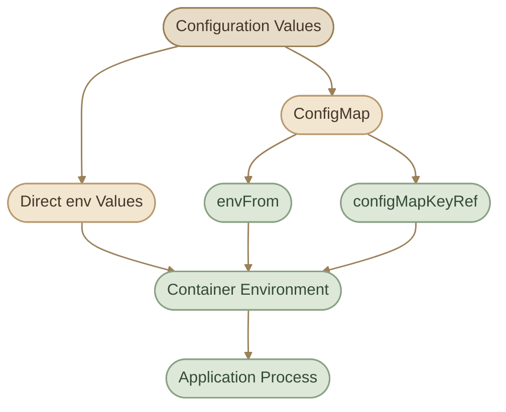

## 1. Overview

أي Application بيحتاج Configuration عشان يشتغل بالشكل المطلوب. ممكن يحتاج اسم الـ Database، أو الـ API endpoint، أو الـ Application mode، أو قيمة تحدد طريقة عرض البيانات.

في Kubernetes، عندنا طريقتين أساسيتين لتمرير Configuration من خلال Environment Variables:

<CardGrid columns={2} label="Configuration Approaches">
  <InfoCard variant="feature" title="Direct Environment Variables" description="بنحدد اسم كل Variable وقيمته مباشرة داخل Pod definition." icon="sliders" />
  <InfoCard variant="concept" title="ConfigMaps" description="بنخزن Configuration بشكل منفصل عن الـ Pod، وبعد كده بنربطها بالـ Container اللي محتاجها." icon="modules" />
</CardGrid>

الفكرة الأساسية إننا نفصل إعدادات التطبيق عن تفاصيل تشغيله، بحيث نقدر نعيد استخدام نفس الإعدادات أو نغيّرها من غير ما نكرر نفس القيم في ملفات YAML كتير.

<InfoCard variant="concept" title="Important distinction" description="Environment Variables هي وسيلة لتمرير الإعدادات إلى الـ Process، أما ConfigMap فهي Kubernetes Object لتخزين Configuration غير الحساسة وإتاحتها للتطبيق." icon="sliders" tags={["Configuration", "Kubernetes"]} />

## 2. Environment Variables in a Pod

### I. Define Environment Variables Directly

نقدر نحدد Environment Variables داخل `spec.containers[].env` في Pod definition.

كل عنصر في `env` بيحتوي على `name` و`value`.

```yaml
apiVersion: v1
kind: Pod
metadata:
  name: checkout-app
spec:
  containers:
    - name: checkout
      image: busybox:1.36
      command: ["/bin/sh", "-c"]
      args:
        - 'echo "APP_NAME=$APP_NAME"; echo "APP_MODE=$APP_MODE"; sleep 3600'
      env:
        - name: APP_NAME
          value: checkout
        - name: APP_MODE
          value: production
```

في المثال ده:

<CardGrid columns={2} label="Example Breakdown">
  <InfoCard variant="concept" title="APP_NAME">
    `APP_NAME` قيمته `checkout`.
  </InfoCard>
  <InfoCard variant="concept" title="APP_MODE">
    `APP_MODE` قيمته `production`.
  </InfoCard>
  <InfoCard variant="concept" title="Reading the Variables" description="الـ Container بيستخدم Shell عشان يقرأ الـ Variables ويطبعها." icon="code" />
  <InfoCard variant="concept" title="Keep Process Alive">
    `sleep 3600` بيخلّي الـ Main Process مستمر في التشغيل، وبالتالي الـ Container يفضل Running.
  </InfoCard>
</CardGrid>

**ليه استخدمنا `/bin/sh -c`؟**

<InfoCard variant="tip" title="Shell Expansion" icon="code">

لأننا محتاجين Shell يفسّر التعبيرات زي `$APP_NAME`. Kubernetes مش بيعمل Shell Expansion تلقائيًا لمجرد إننا كتبنا `$APP_NAME` داخل `args`.

</InfoCard>

### II. Create and Inspect the Pod

احفظ الـ Manifest في ملف باسم `checkout-app.yaml`، وبعدها نفّذ:

```bash
kubectl apply -f checkout-app.yaml
```

تأكد إن الـ Pod شغال:

```bash
kubectl get pod checkout-app
```

اقرأ الـ Application Output:

```bash
kubectl logs checkout-app
```

المفروض تشوف:

```text
APP_NAME=checkout
APP_MODE=production
```

وتقدر كمان تفحص الـ Environment Variables الموجودة في الـ Container:

```bash
kubectl exec checkout-app -- printenv APP_NAME
kubectl exec checkout-app -- printenv APP_MODE
```

الميزة في الطريقة دي إنها بسيطة ومباشرة، لكن لما يكون عندك عدد كبير من الـ Pods أو أكتر من Environment، تكرار نفس الإعدادات داخل كل Manifest بيصعّب إدارتها.

وده السبب اللي بيخلّينا نستخدم ConfigMaps.

## 3. What Is a ConfigMap?

الـ **ConfigMap** هو Kubernetes Object بيخزن Configuration على هيئة Key-Value Pairs.

بدل ما نكتب القيم داخل كل Pod definition، بنخزنها في Object مستقل، وبعد كده بنربط الـ Pods بالـ ConfigMap المناسبة.

على سبيل المثال، ممكن نخزن إعدادات تطبيق Checkout بالشكل ده:

<TableCard>
| Key | Value |
|---|---|
| `APP_NAME` | `checkout` |
| `APP_MODE` | `production` |
| `LOG_LEVEL` | `info` |
</TableCard>

وبعدها نستخدم نفس الـ ConfigMap مع أكتر من Pod محتاج نفس الإعدادات.

### I. Why Use ConfigMaps?

<CardGrid columns={2} label="Why Use ConfigMaps">
  <InfoCard variant="concept" title="Separation of concerns" description="فصل Configuration عن Pod specification." icon="layers" />
  <InfoCard variant="concept" title="Reusability" description="استخدام نفس الإعدادات في أكتر من Workload." icon="cycle" />
  <InfoCard variant="concept" title="Maintainability" description="إدارة القيم من مكان واحد بدل تكرارها." icon="sliders" />
  <InfoCard variant="concept" title="Environment-specific configuration" description="استخدام إعدادات مختلفة للـ Development والـ Staging والـ Production." icon="cloud" />
</CardGrid>

لكن خلي بالك: وجود Configuration في ConfigMap مش معناه إن كل التطبيقات اللي بتستخدمها هتتحدّث تلقائيًا عند تغيير القيم. السلوك بيعتمد على طريقة استهلاك الإعدادات.

## 4. Create a ConfigMap

عندنا طريقتين شائعتين لإنشاء ConfigMap: Imperative وDeclarative.

### I. Imperative Approach

الطريقة دي بتخلّينا ننشئ الـ ConfigMap مباشرة باستخدام `kubectl`، من غير ما نكتب Manifest منفصل.

```bash
kubectl create configmap checkout-config \
  --from-literal=APP_NAME=checkout \
  --from-literal=APP_MODE=production \
  --from-literal=LOG_LEVEL=info
```

كل `--from-literal` بتضيف Key-Value Pair.

تقدر تتحقق من الـ ConfigMap:

```bash
kubectl get configmaps
```

وتعرض تفاصيلها:

```bash
kubectl describe configmap checkout-config
```

ولو محتاج تشوف الـ YAML الناتج:

```bash
kubectl get configmap checkout-config -o yaml
```

الطريقة دي مناسبة للإنشاء السريع أو أثناء الـ Troubleshooting والـ Labs.

### II. Declarative Approach

في الطريقة دي، بنكتب Configuration داخل ملف YAML ونخلي Kubernetes يدير الـ Object من خلاله.

أنشئ ملف `checkout-config.yaml`:

```yaml
apiVersion: v1
kind: ConfigMap
metadata:
  name: checkout-config
data:
  APP_NAME: checkout
  APP_MODE: production
  LOG_LEVEL: info
```

أنشئ الـ ConfigMap:

```bash
kubectl apply -f checkout-config.yaml
```

تحقق من النتيجة:

```bash
kubectl get configmap checkout-config
kubectl describe configmap checkout-config
```

<InfoCard variant="comparison" title="Imperative vs Declarative" icon="terminal">

**الفرق العملي:** الـ Imperative Approach مناسب للأوامر السريعة، بينما الـ Declarative Approach بيسهّل حفظ Configuration في Git، ومراجعته، وتتبّع التغييرات عليه.

</InfoCard>

## 5. Inject ConfigMaps into Containers

بعد إنشاء ConfigMap، عندنا أكتر من طريقة لإتاحتها للـ Container.

### I. Use `envFrom`

لو عايزين نمرّر كل المفاتيح الموجودة في ConfigMap كـ Environment Variables، نستخدم `envFrom`.

```yaml
apiVersion: v1
kind: Pod
metadata:
  name: checkout-app
spec:
  containers:
    - name: checkout
      image: busybox:1.36
      command: ["/bin/sh", "-c"]
      args:
        - 'echo "APP_NAME=$APP_NAME"; echo "APP_MODE=$APP_MODE"; echo "LOG_LEVEL=$LOG_LEVEL"; sleep 3600'
      envFrom:
        - configMapRef:
            name: checkout-config
```

السطر ده:

```yaml
envFrom:
  - configMapRef:
      name: checkout-config
```

معناه إن Kubernetes يمرّر المفاتيح الموجودة في `checkout-config` كـ Environment Variables للـ Container.

بالتالي التطبيق هيقدر يقرأ:

- `APP_NAME`
- `APP_MODE`
- `LOG_LEVEL`

من غير ما نكرر تعريف كل Variable داخل الـ Pod.

<InfoCard variant="warning" title="Namespace and Name Must Match" icon="network">

**مهم:** اسم الـ ConfigMap لازم يكون صحيحًا، والـ ConfigMap والـ Pod لازم يكونوا في نفس Namespace.

</InfoCard>

### II. Use `configMapKeyRef`

أحيانًا مش محتاجين كل القيم الموجودة في ConfigMap. ممكن نحتاج قيمة واحدة بس.

في الحالة دي نستخدم `configMapKeyRef` داخل `env`.

```yaml
apiVersion: v1
kind: Pod
metadata:
  name: checkout-app
spec:
  containers:
    - name: checkout
      image: busybox:1.36
      command: ["/bin/sh", "-c"]
      args:
        - 'echo "APP_MODE=$APP_MODE"; sleep 3600'
      env:
        - name: APP_MODE
          valueFrom:
            configMapKeyRef:
              name: checkout-config
              key: APP_MODE
```

هنا بنحدد:

- `name`: اسم الـ Environment Variable اللي هيظهر داخل الـ Container.
- `valueFrom`: إن القيمة مصدرها Kubernetes Object.
- `configMapKeyRef.name`: اسم الـ ConfigMap.
- `configMapKeyRef.key`: اسم المفتاح المطلوب من الـ ConfigMap.

النتيجة إن `APP_MODE` داخل الـ Container هتكون قيمته `production`.

الميزة إننا نقدر نختار مفتاحًا واحدًا، وكمان نغيّر اسم الـ Environment Variable داخل الـ Container لو احتجنا.

### III. `envFrom` vs `configMapKeyRef`

<TableCard>
| Feature | `envFrom` | `configMapKeyRef` |
|---|---|---|
| What it imports | كل المفاتيح المناسبة من ConfigMap | مفتاح محدد |
| Configuration size | مناسب لمجموعة إعدادات كاملة | مناسب لقيمة واحدة أو عدد محدود من القيم |
| Naming | أسماء الـ Variables بتتبع أسماء المفاتيح | تقدر تحدد اسم الـ Variable بشكل مستقل |
| Flexibility | سريع لما تحتاج معظم القيم | أدق لما تحتاج قيمًا معينة |
</TableCard>

اختار الطريقة بناءً على احتياج التطبيق، مش لمجرد إن واحدة أقصر في YAML.

## 6. `optional` References

في بعض الحالات، ممكن تكون ConfigMap أو قيمة معينة اختيارية.

مثلًا، التطبيق ممكن يشتغل بالقيمة الافتراضية لو `FEATURE_MODE` مش موجودة.

نقدر نحدد `optional: true` مع `configMapKeyRef`:

```yaml
env:
  - name: FEATURE_MODE
    valueFrom:
      configMapKeyRef:
        name: checkout-config
        key: FEATURE_MODE
        optional: true
```

في الحالة دي، غياب الـ ConfigMap أو المفتاح المشار إليه مش هيمنع تشغيل الـ Container بسبب المرجع ده وحده. لكن لو الـ ConfigMap موجودة والمفتاح غير موجود، فالـ Variable نفسها مش هتُحقن.

أما لو `optional` مش محددة أو قيمتها `false`، فغياب المرجع المطلوب ممكن يمنع الـ Container من بدء التشغيل بصورة طبيعية.

<InfoCard variant="tip" title="Optional Is Not Automatic" icon="wrench">

**خد بالك:** `optional: true` مش معناها إن التطبيق هيعرف يتصرف تلقائيًا لو القيمة غايبة. لازم التطبيق نفسه يكون قادرًا على التعامل مع غيابها.

</InfoCard>

## 7. How Configuration Flows into a Pod

المخطط ده بيوضح الفرق بين تخزين الإعدادات وتمريرها للتطبيق.



الـ ConfigMap بتخزن البيانات، والـ Pod specification بتحدد إزاي القيم هتوصل للـ Container، وبعد كده الـ Application بتقرأها من الـ Environment.

## 8. Updating Configuration

تغيير قيمة داخل ConfigMap مش معناه إن كل الـ Pods اللي بتستخدمها هتقرأ القيمة الجديدة تلقائيًا.

### I. Direct Environment Variables

لو القيمة متعرفة مباشرة داخل Pod:

```yaml
env:
  - name: APP_MODE
    value: production
```

تغيير القيمة في Manifest مش بيعدّل الـ Environment Variable داخل Container شغّال بالفعل. لازم يتم إنشاء Container جديد بالقيمة المحدّثة.

### II. ConfigMap Used as Environment Variables

لو الـ Pod بيستخدم `envFrom` أو `configMapKeyRef`:

```yaml
envFrom:
  - configMapRef:
      name: checkout-config
```

تحديث الـ ConfigMap مش بيحدّث Environment Variables الموجودة بالفعل داخل الـ Container. الـ Variables بتتحدد وقت إنشاء الـ Container.

عشان تطبّق القيم الجديدة، لازم تعمل Restart أو Recreate للـ Pods بالطريقة المناسبة للـ Workload.

مثلًا، لو التطبيق شغال داخل Deployment:

```bash
kubectl rollout restart deployment/checkout
```

الأمر ده بيطلب إعادة تشغيل الـ Pods التابعة للـ Deployment، لكنه مش بيغيّر الـ ConfigMap نفسها.

<InfoCard variant="callout" title="Use the Real Deployment Name" icon="terminal">

**ملحوظة:** اسم الـ Deployment هنا مثال؛ استخدم الاسم الفعلي الموجود في الـ Cluster.

</InfoCard>

### III. ConfigMap Mounted as a Volume

ممكن كمان نعرض بيانات ConfigMap على هيئة ملفات داخل Container باستخدام Volume.

في الحالة دي، Kubernetes بيحدّث الملفات الموجودة في الـ Volume في النهاية بعد تحديث ConfigMap، مع وجود تأخير محتمل.

لكن التطبيق لازم يكون قادرًا على إعادة قراءة الملفات أو مراقبة تغيّرها. التحديث مش معناه إن التطبيق نفسه هيطبّق الإعدادات الجديدة تلقائيًا.

كمان الـ ConfigMap المستخدمة من خلال `subPath` مش بتستقبل التحديثات التلقائية بنفس طريقة الـ Volume Mount العادي.

## 9. ConfigMaps Are Not for Secrets

الـ ConfigMap مناسبة للإعدادات غير الحساسة، زي:

<CardGrid columns={2} label="Safe for ConfigMaps">
  <InfoCard variant="concept" title="APP_MODE" icon="sliders" />
  <InfoCard variant="concept" title="LOG_LEVEL" icon="sliders" />
  <InfoCard variant="concept" title="أسماء Features." icon="flag" />
  <InfoCard variant="concept" title="عناوين Services داخلية غير سرية." icon="network" />
</CardGrid>

لكن متستخدمهاش لتخزين:

<CardGrid columns={2} label="Use Secrets Instead">
  <InfoCard variant="warning" title="Database passwords." icon="database" />
  <InfoCard variant="warning" title="API tokens." icon="tag" />
  <InfoCard variant="warning" title="Private keys." icon="code" />
  <InfoCard variant="warning" title="Credentials." icon="shield" />
</CardGrid>

البيانات الحساسة مكانها المناسب هو **Kubernetes Secrets** مع إعداد الصلاحيات والحماية المطلوبة.

ومهم تفهم إن Kubernetes Secret مش معناها إن البيانات مشفّرة تلقائيًا في كل الظروف؛ قيمة Secret ممكن تكون Base64-encoded من غير ما تكون encrypted. هنفصل الموضوع ده في درس Secrets.

## 10. Common Mistakes and Troubleshooting

### I. Mistake 1: The ConfigMap Does Not Exist

لو الـ Pod بيشير إلى ConfigMap مش موجودة، ممكن الـ Container ما يبدأش بالشكل المتوقع.

افحص الـ ConfigMaps الموجودة:

```bash
kubectl get configmaps
```

افحص الـ Namespace:

```bash
kubectl get configmaps -n default
```

ولو الـ Pod في Namespace مختلفة، اتأكد إن الـ ConfigMap موجودة في نفس الـ Namespace.

### II. Mistake 2: The Key Name Is Incorrect

مثلًا، الـ ConfigMap تحتوي على:

```yaml
data:
  APP_MODE: production
```

لكن الـ Pod بيطلب:

```yaml
key: APP_NAME
```

هنا المفتاح المطلوب غير موجود.

افحص البيانات:

```bash
kubectl describe configmap checkout-config
```

وتأكد من تطابق اسم المفتاح مع القيمة الموجودة فعلًا.

### III. Mistake 3: Changes Are Not Reflected in the Application

لو عدّلت ConfigMap لكن التطبيق لسه بيستخدم القيمة القديمة، اسأل نفسك:

<ChecklistCard title="Reflection Checklist" items={['هل القيمة بتتوصل من خلال Environment Variable؟', 'هل الـ Container اتعمله Restart بعد التعديل؟', 'هل التطبيق بيقرأ الإعدادات مرة واحدة عند بدء التشغيل؟', 'هل الـ Pod بيستخدم ConfigMap مختلفة أو موجود في Namespace مختلفة؟']} />

متفترضش إن تحديث ConfigMap معناه إن التطبيق أعاد تحميل الإعدادات.

### IV. Mistake 4: Treating ConfigMap as a Secret Store

متخزنش كلمات المرور والـ Tokens في ConfigMaps. استخدم Secrets، واهتم بالـ RBAC والتشفير أثناء التخزين حسب متطلبات البيئة.

## 11. Custom Lab: Configure a Checkout Worker

في الـ Lab ده هتعمل Configuration مستقلة لتطبيق Checkout، وبعدها تربطها بـ Pod وتتحقق إن التطبيق بيقرأ القيم الصحيحة.

هنستخدم Namespace مستقلة عشان نعزل موارد التدريب عن باقي الـ Cluster.

بنهاية الـ Lab، المفروض تكون قادرًا على:

<ChecklistCard title="Lab Objectives" items={['إنشاء ConfigMap باستخدام YAML.', 'تمرير كل القيم باستخدام envFrom.', 'اختيار قيمة محددة باستخدام configMapKeyRef.', 'اكتشاف مشكلة ناتجة عن اسم ConfigMap أو Key غير صحيح.', 'فهم تأثير تحديث Configuration على Container شغّال.']} />

<Steps>
<li>

<InfoCard title="Verify Your Cluster" icon="terminal" />

اتأكد إنك متصل بالـ Cluster الصحيح:

```bash
kubectl config current-context
kubectl cluster-info
```

أنشئ Namespace خاصة بالـ Lab:

```bash
kubectl create namespace app-lifecycle-lab
```
</li>
<li>

<InfoCard title="Create the Configuration" icon="modules" />

أنشئ ملفًا باسم `checkout-lab-config.yaml`:

```yaml
apiVersion: v1
kind: ConfigMap
metadata:
  name: checkout-settings
  namespace: app-lifecycle-lab
data:
  APP_NAME: checkout
  APP_MODE: maintenance
  LOG_LEVEL: debug
  FEATURE_REPORTS: "false"
```

طبّق الملف:

```bash
kubectl apply -f checkout-lab-config.yaml
```

تحقق من البيانات:

```bash
kubectl get configmap checkout-settings -n app-lifecycle-lab
kubectl describe configmap checkout-settings -n app-lifecycle-lab
```
</li>
<li>

<InfoCard title="Create the Checkout Worker" icon="cube" />

أنشئ ملفًا باسم `checkout-lab-pod.yaml`:

```yaml
apiVersion: v1
kind: Pod
metadata:
  name: checkout-worker
  namespace: app-lifecycle-lab
  labels:
    app: checkout-worker
spec:
  containers:
    - name: worker
      image: busybox:1.36
      command: ["/bin/sh", "-c"]
      args:
        - |
          echo "Application: $APP_NAME"
          echo "Mode: $APP_MODE"
          echo "Log level: $LOG_LEVEL"
          echo "Reports enabled: $FEATURE_REPORTS"
          sleep 3600
      envFrom:
        - configMapRef:
            name: checkout-settings
      env:
        - name: APP_MODE
          value: staging
```

طبّق الـ Manifest:

```bash
kubectl apply -f checkout-lab-pod.yaml
```

تحقق من حالة الـ Pod:

```bash
kubectl get pod checkout-worker -n app-lifecycle-lab
```

اقرأ الـ Logs:

```bash
kubectl logs checkout-worker -n app-lifecycle-lab
```
</li>
<li>

<InfoCard title="Understand the Result" icon="flag" />

هتلاحظ إن `APP_MODE` ظهرت بقيمة `staging` بدلًا من `maintenance`.

ليه؟

لأننا استخدمنا `envFrom` لاستيراد مفاتيح الـ ConfigMap، وبعدها عرّفنا `APP_MODE` بشكل مباشر داخل `env`.

عند وجود أكثر من مصدر لنفس اسم الـ Environment Variable، التعريف المباشر داخل `env` بيكون له الأولوية على القيمة المستوردة من `envFrom`.

باقي القيم، زي `APP_NAME` و`LOG_LEVEL`، هتفضل جاية من الـ ConfigMap.
</li>
<li>

<InfoCard title="Inspect the Runtime Environment" icon="pulse" />

نفّذ:

```bash
kubectl exec -n app-lifecycle-lab checkout-worker -- printenv APP_MODE
```

المتوقع:

```text
staging
```

وتحقق من قيمة جاية من ConfigMap:

```bash
kubectl exec -n app-lifecycle-lab checkout-worker -- printenv LOG_LEVEL
```

المتوقع:

```text
debug
```
</li>
<li>

<InfoCard title="Practice configMapKeyRef" icon="sliders" />

عدّل ملف `checkout-lab-pod.yaml`، واستبدل تعريف `APP_MODE` المباشر بالتعريف التالي:

```yaml
env:
  - name: APP_MODE
    valueFrom:
      configMapKeyRef:
        name: checkout-settings
        key: APP_MODE
```

دلوقتي القيمة هتيجي من `checkout-settings` بدلًا من القيمة المكتوبة مباشرة داخل الـ Pod specification.

ولكن لأننا بنتعامل مع Pod مستقلة، تغيير الـ Manifest مش هيعدّل الـ Pod الموجودة تلقائيًا.

احذف الـ Pod وأعد إنشاءها:

```bash
kubectl delete pod checkout-worker -n app-lifecycle-lab
kubectl apply -f checkout-lab-pod.yaml
```

بعد ما الـ Pod ترجع Running، افحص القيمة:

```bash
kubectl exec -n app-lifecycle-lab checkout-worker -- printenv APP_MODE
```

المتوقع:

```text
maintenance
```
</li>
<li>

<InfoCard title="Troubleshooting Challenge" icon="wrench" />

جرّب تغيير اسم الـ ConfigMap في الـ Pod إلى اسم غير موجود، مثل:

```yaml
envFrom:
  - configMapRef:
      name: missing-settings
```

طبّق التغيير بعد حذف الـ Pod القديمة، وبعدها افحص:

```bash
kubectl get pods -n app-lifecycle-lab
kubectl describe pod checkout-worker -n app-lifecycle-lab
```

**أسئلة التحقيق:**

1. هل الـ Pod وصلت إلى حالة `Running`؟
2. هل الـ Container بدأ فعلًا؟
3. ما الرسالة التي ظهرت في Events؟
4. إيه أقل تعديل مطلوب لحل المشكلة؟

بعد ما تخلص، رجّع الاسم إلى `checkout-settings` وتأكد إن الـ Pod اشتغلت بشكل طبيعي.
</li>
<li>

<InfoCard title="Cleanup" icon="tag" />

بعد ما تخلص الـ Lab، احذف الـ Namespace الخاصة بالتدريب:

```bash
kubectl delete namespace app-lifecycle-lab
```

ده هيحذف الـ Pod والـ ConfigMap الموجودة داخلها.

<InfoCard variant="danger" title="Delete Namespaces Carefully" icon="wrench">

**مهم:** الأمر ده مناسب لأن الـ Namespace اتعملت خصيصًا للـ Lab. متستخدمش حذف Namespace كاملة لو كانت بتحتوي على Workloads تانية محتاجها.

</InfoCard>
</li>
</Steps>

## 12. Knowledge Check

<InfoCard variant="concept" title="Question 1" icon="flag">

عندك ConfigMap تحتوي على 10 مفاتيح، والتطبيق محتاجهم كلهم كـ Environment Variables. إيه الاختيار الأنسب؟

- A. تكتب كل القيم مباشرة في `env`.
- B. تستخدم `envFrom` مع `configMapRef`.
- C. تستخدم `command` بدل `env`.
- D. تستخدم `volumeMounts` من غير Volume.

</InfoCard>

<InfoCard variant="concept" title="Question 2" icon="flag">

عدّلت قيمة داخل ConfigMap، لكن الـ Container ما زال بيقرأ القيمة القديمة من Environment Variable. إيه التفسير الأدق؟

- A. Kubernetes بيمنع تعديل ConfigMaps.
- B. Environment Variables داخل الـ Container بتتحدّث تلقائيًا دائمًا.
- C. الـ Environment Variables الموجودة بالفعل لا تتحدّث لمجرد تعديل ConfigMap.
- D. لازم تغيّر اسم الـ Namespace.

</InfoCard>

<InfoCard variant="concept" title="Question 3" icon="flag">

محتاج تمرّر قيمة واحدة فقط من ConfigMap، وتختار اسمًا مختلفًا للـ Environment Variable داخل الـ Container. تستخدم إيه؟

- A. `envFrom`
- B. `configMapKeyRef` داخل `env`
- C. `command`
- D. `args`

</InfoCard>

<InfoCard variant="concept" title="Question 4" icon="flag">

هل تخزين Database Password داخل ConfigMap ممارسة مناسبة؟

- A. نعم، لأن ConfigMaps مشفّرة تلقائيًا.
- B. نعم، بشرط استخدام `envFrom`.
- C. لا، الأفضل استخدام Kubernetes Secret مع إعداد الحماية والصلاحيات المناسبة.
- D. لا، لأن Kubernetes لا يدعم Environment Variables لكلمات المرور.

</InfoCard>

## Summary

<CardGrid columns={2} label="Key Takeaways">
  <InfoCard variant="summary" title="Direct env in the Container">

`env` بتحدد Environment Variables مباشرة داخل Container specification.

  </InfoCard>
  <InfoCard variant="summary" title="ConfigMaps Separate Configuration">

ConfigMaps بتفصل Configuration عن تعريف الـ Pod.

  </InfoCard>
  <InfoCard variant="summary" title="Two Ways to Create">

`kubectl create configmap` بيدعم الإنشاء السريع باستخدام `--from-literal` أو `--from-file`.

  </InfoCard>
  <InfoCard variant="summary" title="envFrom Imports Everything">

`envFrom` بتتيح مفاتيح ConfigMap كـ Environment Variables.

  </InfoCard>
  <InfoCard variant="summary" title="configMapKeyRef Imports One Key">

`configMapKeyRef` بتتيح اختيار مفتاح محدد.

  </InfoCard>
  <InfoCard variant="summary" title="Direct env Wins">

القيمة المباشرة في `env` بتتقدم على القيمة المستوردة من `envFrom` لما يكون لهما نفس الاسم.

  </InfoCard>
  <InfoCard variant="summary" title="Updates Need a Restart">

تعديل ConfigMap مش بيحدّث Environment Variables الموجودة داخل Containers شغّالة.

  </InfoCard>
  <InfoCard variant="summary" title="Not for Secrets">

ConfigMaps مخصصة للبيانات غير الحساسة، أما البيانات الحساسة فمكانها المناسب Secrets.

  </InfoCard>
  <InfoCard variant="summary" title="Understand How Your App Reads Config">

استخدام ConfigMaps مش بيغني عن فهم طريقة التطبيق في قراءة الإعدادات وإعادة تحميلها.

  </InfoCard>
</CardGrid>
