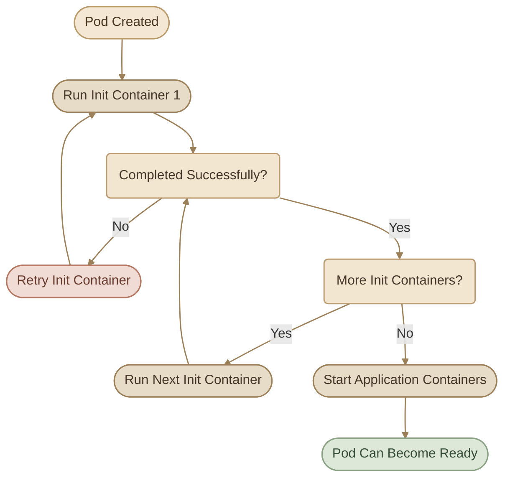

## Overview

في الجزء ده هنجمع فكرتين مهمتين في Kubernetes:

<CardGrid columns={2} label="Two Core Ideas">
  <InfoCard variant="concept" title="Init Containers" description="تشغيل مهام لازم تخلص قبل ما الـ Application Containers تبدأ." icon="flag" />
  <InfoCard variant="concept" title="Multi-Container Pods" description="تشغيل أكتر من Container جوه نفس الـ Pod لما يكونوا محتاجين يشتغلوا مع بعض." icon="layers" />
</CardGrid>

هنشوف كمان إزاي نفحص الـ Pods، ونفهم حالات الفشل، ونستخدم Sidecar Container في جمع الـ logs.

## 1. Init Containers

الـ `Init Container` هو Container بيشغّل مهمة تحضيرية قبل ما الـ Application Containers تبدأ.

المهمة دي ممكن تكون:

<CardGrid columns={2} label="Common Init Tasks">
  <InfoCard variant="concept" title="التأكد إن خدمة أو dependency جاهزة." icon="network" />
  <InfoCard variant="concept" title="تجهيز ملفات أو إعدادات التطبيق." icon="database" />
  <InfoCard variant="concept" title="تنفيذ initialization scripts." icon="code" />
  <InfoCard variant="concept" title="تجهيز بيئة التشغيل قبل بدء الـ Application." icon="sliders" />
</CardGrid>

الـ Init Container مش المفروض يفضل شغال زي الـ Application Container؛ هو بيشغّل المهمة المطلوبة، ولما تخلص بنجاح بينتهي.

<InfoCard variant="insight" title="The Main Rule" description="Kubernetes doesn't start the regular application containers until all Init Containers have completed successfully." icon="shield" tags={["Init Containers", "Pod Startup"]} />

### I. How Init Containers Work



### II. Multiple Init Containers Run Sequentially

لو الـ Pod عنده أكتر من Init Container، Kubernetes بيشغّلهم **واحد ورا التاني بالترتيب**.

مثلًا، لو عندنا:

- Init Container أول بيستغرق 10 دقائق.
- Init Container تاني بيستغرق 20 دقيقة.

فالتطبيق مش هيبدأ قبل ما الاتنين يخلصوا. في المثال ده، وقت الانتظار قبل بدء التطبيق هيكون حوالي 30 دقيقة، بافتراض إن مفيش تأخير إضافي أو retries.

ده مجرد مثال توضيحي؛ في التطبيقات الحقيقية، الـ Init Containers بتنفّذ مهام تحضيرية فعلية بدل الانتظار غير الضروري.

### III. Init Container Example

```yaml
apiVersion: v1
kind: Pod
metadata:
  name: init-demo
spec:
  initContainers:
    - name: warm-up
      image: busybox:1.36
      command: ["sh", "-c", "sleep 5"]

  containers:
    - name: app
      image: nginx:stable
```

في المثال ده:

<Steps>
<li>

<InfoCard title="Create the Pod" icon="cube">

Kubernetes ينشئ الـ Pod.

</InfoCard>
</li>
<li>

<InfoCard title="Run the Init Container" icon="flag">

يشغّل الـ `warm-up` باستخدام صورة `busybox`.

</InfoCard>
</li>
<li>

<InfoCard title="Wait for Success" icon="cycle">

الـ Init Container ينتظر 5 ثوانٍ ثم ينتهي بنجاح.

</InfoCard>
</li>
<li>

<InfoCard title="Start the App Container" icon="pulse">

Kubernetes يبدأ الـ `app` Container.

</InfoCard>
</li>
</Steps>

لاحظ إن `command` هنا مكتوبة كـ array. الأمر `sh -c "sleep 5"` بيخلّي الـ shell ينفّذ أمر الانتظار.

## 2. Understanding Init Container States

لازم نفرّق بين حالة الـ Init Container وحالة الـ Pod نفسه.

<TableCard>
| State / Reason | Meaning |
|---|---|
| `Terminated` + `Completed` | الـ Init Container انتهى بنجاح. |
| `Terminated` + `Error` | الـ Init Container انتهى بسبب خطأ. |
| `CrashLoopBackOff` | Kubernetes بيحاول يعيد تشغيل Container فشل بشكل متكرر، مع زيادة مدة الانتظار بين المحاولات. |
| `Pod Pending` | الـ Pod لسه مش جاهز للتشغيل؛ ممكن يكون مستني الـ Init Containers تخلص، لكن الحالة دي ممكن تحصل لأسباب تانية كمان. |
</TableCard>

<InfoCard variant="tip" title="Terminated Can Be Normal" icon="flag">

**مهم:** كون الـ Init Container حالته `Terminated` مش معناه بالضرورة إن فيه مشكلة. ده طبيعي لو خلّص المهمة بنجاح.

</InfoCard>

### I. Why Can an Init Container Fail?

تخيّل إن عندك Init Container بيشغّل الأمر ده:

```yaml
command: ["sh", "-c", "slepp 20"]
```

فيه typo في اسم الأمر: كتبنا `slepp` بدل `sleep`.

النتيجة المتوقعة إن الأمر يفشل، والـ Init Container مش هيكمل initialization بنجاح. بالتالي، الـ Application Container مش هيبدأ، وهيفضل الـ Pod في مرحلة initialization لحد ما المشكلة تتحل.

في بعض الصور، لو الأمر غير موجود، ممكن يظهر exit code `127`، زي المثال اللي اتشرح في اللاب.

### II. Troubleshooting Init Containers

ابدأ بالفحص بدل ما تفترض إن المشكلة في التطبيق نفسه.

<Steps>
<li>

<InfoCard title="Identify the Pod" icon="terminal" />

```bash
kubectl get pods
```
</li>
<li>

<InfoCard title="Inspect the Pod Details" icon="wrench" />

```bash
kubectl describe pod <pod-name>
```

دور على قسم `Init Containers`، وافحص:

- اسم الـ Init Container.
- الـ Image المستخدمة.
- حالة التشغيل.
- `Reason` و`Exit Code`.
- رسائل الخطأ والأحداث `Events`.
</li>
<li>

<InfoCard title="Read the Init Container Logs" icon="pulse" />

```bash
kubectl logs <pod-name> -c <init-container-name>
```

مثلًا:

```bash
kubectl logs orange -c init-myservice
```

الـ `-c` بتحدد اسم الـ Container اللي عايز تقرأ الـ logs بتاعته. من غيرها، Kubernetes بيحاول يختار Container من الـ Pod، وده ممكن يوديك للـ Container الغلط.
</li>
<li>

<InfoCard title="Inspect the Configuration" icon="code" />

```bash
kubectl get pod <pod-name> -o yaml
```

راجع `spec.initContainers` وتأكد من:

- صحة `command` و`args`.
- صحة اسم الـ Image.
- وجود الملفات أو الأوامر المطلوبة.
- إن الـ Initialization Task نفسها قابلة للتنفيذ.
</li>
</Steps>

<InfoCard variant="tip" title="Troubleshooting Tip" description="If a Pod is stuck initializing, inspect its Init Containers and their logs before troubleshooting the main application." icon="terminal" tags={["Debugging", "kubectl logs"]} />

### III. What About `kubectl get pods`?

الأمر:

```bash
kubectl get pods
```

بيساعدك تعرف حالة الـ Pod وعدد الـ Containers الجاهزة مقارنة بإجمالي الـ Containers العادية المطلوبة للتشغيل.

لكنه مش بديل عن فحص الـ Init Containers بالتفصيل. استخدم:

```bash
kubectl describe pod <pod-name>
```

عشان تشوف قسم `Init Containers` بوضوح.

## 3. Multi-Container Pods

الـ Pod ممكن يحتوي على أكتر من Container بدل ما يحتوي على Container واحد.

بنستخدم التصميم ده لما نحتاج مكوّنات مختلفة تشتغل مع بعض، مع الحفاظ على مسؤولية منفصلة لكل مكوّن.

مثلًا:

<CardGrid columns={3} label="Example Components">
  <InfoCard variant="feature" title="Application Container" description="بيشغّل التطبيق." icon="cube" />
  <InfoCard variant="feature" title="Sidecar Container" description="بيقرأ الـ logs ويرسلها لنظام مركزي." icon="modules" />
  <InfoCard variant="feature" title="Container إضافي" description="ممكن يساعد في وظيفة مرتبطة بالتطبيق." icon="layers" />
</CardGrid>

الفكرة مش إننا نجمع كل البرامج في Container واحد؛ الفكرة إننا نشغّل مكوّنات متعاونة داخل نفس الـ Pod لما يكون ده مناسبًا.

### I. What Do Containers in the Same Pod Share?

Containers داخل نفس الـ Pod:

<CardGrid columns={3} label="What Pods Share">
  <InfoCard variant="concept" title="Shared Lifecycle" icon="cycle">

بتشترك في دورة حياة الـ Pod؛ لما الـ Pod يتوقف، مكوّناته بتتأثر معاه.

  </InfoCard>
  <InfoCard variant="concept" title="Shared Network" icon="network">

بتشارك نفس الـ network namespace، وبالتالي تقدر تتواصل مع بعضها عبر `localhost`.

  </InfoCard>
  <InfoCard variant="concept" title="Shared Volumes" icon="database">

تقدر تشارك نفس الـ Volumes عن طريق تعريف Volume في الـ Pod وعمل `volumeMounts` لكل Container محتاجه.

  </InfoCard>
</CardGrid>

لكن ده **مش معناه** إن كل Container بيشترك تلقائيًا في نفس filesystem؛ مشاركة الملفات بتحتاج Volume مشترك ومتوصّل صح بكل Container.

<InfoCard variant="concept" title="When to Use Multi-Container Pods" description="Use multiple containers in one Pod when the components are tightly coupled and should run together, communicate locally, or share Pod storage." icon="layers" tags={["Pod Design", "Containers"]} />

### II. Multi-Container Pod Example

المثال ده بيشغّل Container للتطبيق وContainer تاني كمساعد.

```yaml
apiVersion: v1
kind: Pod
metadata:
  name: multi-container-demo
spec:
  containers:
    - name: app
      image: nginx:stable
      ports:
        - containerPort: 80

    - name: helper
      image: busybox:1.36
      command: ["sh", "-c", "sleep 3600"]
```

لاحظ إن الاتنين موجودين تحت نفس `spec.containers`، لأن Kubernetes بيسمح بأكتر من عنصر في الـ array دي.

أما الـ Init Containers فمكانها مختلف:

```yaml
spec:
  initContainers:
    # Initialization tasks
  containers:
    # Application containers
```

<InfoCard variant="comparison" title="Init vs Regular Containers" icon="flag">

**الفرق الأساسي:** الـ Init Container بيجهّز البيئة قبل تشغيل التطبيق، بينما الـ Regular Container بيشغّل التطبيق أو وظيفة مساعدة ممكن تستمر أثناء تشغيله.

</InfoCard>

## 4. The Sidecar Pattern

الـ **Sidecar Pattern** هو استخدام Container إضافي جنب الـ Application Container لتنفيذ وظيفة مساعدة.

من أشهر الأمثلة: جمع الـ logs.

تخيّل إن التطبيق بيكتب الـ logs في ملف داخل Volume مشترك، وعايزين نبعتها إلى نظام مركزي زي Elasticsearch عشان نقدر نستعرضها في Kibana.

بدل ما نضيف منطق إرسال الـ logs داخل التطبيق نفسه، نقدر نشغّل Sidecar متخصص في قراءة الملفات وإرسال البيانات.

### I. How Log Collection Works


تسلسل العملية:

<Steps>
<li>

<InfoCard title="الـ Application Container بيكتب الـ logs." icon="cube" />
</li>
<li>

<InfoCard title="الـ logs بتتخزن في Volume مشترك." icon="database" />
</li>
<li>

<InfoCard title="الـ Sidecar بيقرأ نفس الملفات." icon="terminal" />
</li>
<li>

<InfoCard title="الـ Sidecar يرسل الـ logs إلى Elasticsearch." icon="network" />
</li>
<li>

<InfoCard title="تقدر تستخدم Kibana لاستعراض البيانات والبحث فيها." icon="pulse" />
</li>
</Steps>

في اللاب، كان فيه Application Container بيكتب الـ logs في ملف، وتمت إضافة Sidecar باستخدام صورة Filebeat مُجهّزة للتمرين. الـ Sidecar والتطبيق استخدموا نفس الـ Volume، لكن كل واحد عمل له mount في المسار المناسب داخل الـ Container.

<InfoCard variant="callout" title="Pre-Configured Lab Image" description="الصورة المستخدمة في اللاب كانت مُجهّزة خصيصًا لإرسال الـ logs إلى Elasticsearch؛ مجرد تشغيل Filebeat عادي مش معناه إنه هيشتغل بنفس الإعدادات تلقائيًا." icon="cube" />

### II. Shared Volume Example

المثال التالي يوضّح فكرة مشاركة مجلد بين Application Container وSidecar. هو مثال تعليمي لتوضيح الـ Volume Mounts، مش إعداد Filebeat كامل جاهز للإنتاج.

```yaml
apiVersion: v1
kind: Pod
metadata:
  name: sidecar-demo
spec:
  volumes:
    - name: log-volume
      emptyDir: {}

  containers:
    - name: app
      image: busybox:1.36
      command:
        - sh
        - -c
        - |
          while true; do
            echo "$(date) - Application event" >> /var/log/app/app.log
            sleep 5
          done
      volumeMounts:
        - name: log-volume
          mountPath: /var/log/app

    - name: sidecar
      image: busybox:1.36
      command:
        - sh
        - -c
        - |
          touch /var/log/app/app.log
          tail -F /var/log/app/app.log
      volumeMounts:
        - name: log-volume
          mountPath: /var/log/app
```

هنا:

<CardGrid columns={2} label="How the Example Works">
  <InfoCard variant="concept" title="volumes" icon="database">

`volumes` بتعرّف الـ Volume على مستوى الـ Pod.

  </InfoCard>
  <InfoCard variant="concept" title="emptyDir" icon="cube">

`emptyDir` بيعمل مساحة تخزين مؤقتة مرتبطة بعمر الـ Pod.

  </InfoCard>
  <InfoCard variant="concept" title="volumeMounts" icon="layers">

`volumeMounts` بتوصل نفس الـ Volume بكل Container.

  </InfoCard>
  <InfoCard variant="concept" title="Application Writes" icon="code">

الـ Application بيكتب في `app.log`.

  </InfoCard>
  <InfoCard variant="concept" title="Sidecar Reads" icon="pulse">

الـ Sidecar بيقرأ الملف باستمرار باستخدام `tail -F`.

  </InfoCard>
</CardGrid>

<InfoCard variant="callout" title="Sharing Logs Only" icon="terminal">

**ملاحظة:** المثال بيعرض مشاركة الـ logs فقط؛ مش بيبعت البيانات إلى Elasticsearch. ده محتاج Log Agent وإعدادات اتصال مناسبة.

</InfoCard>

## 5. How to Inspect Multi-Container Pods

<Steps>
<li>

<InfoCard title="List Pods and Their Ready Containers" icon="terminal" />

```bash
kubectl get pods
```

لو ظهر مثلًا:

```text
NAME    READY   STATUS
red     3/3     Running
blue    2/2     Running
```

فده معناه إن `red` عنده 3 Containers عادية، وكلهم Ready، بينما `blue` عنده 2، وكلهم Ready.

العمود `READY` مش وسيلة لمعرفة عدد الـ Init Containers المنفصلة.
</li>
<li>

<InfoCard title="Inspect Container Names and Configuration" icon="wrench" />

```bash
kubectl describe pod red
```

دور على قسم `Containers` عشان تشوف الـ Regular Containers، وقسم `Init Containers` لو موجود.

ولو محتاج تشوف الـ Pod definition كاملة:

```bash
kubectl get pod red -o yaml
```
</li>
<li>

<InfoCard title="Read Logs from a Specific Container" icon="pulse" />

في الـ Multi-Container Pod، حدّد الـ Container اللي عايز تقرأ الـ logs بتاعته:

```bash
kubectl logs <pod-name> -c <container-name>
```

مثال:

```bash
kubectl logs sidecar-demo -c app
```

ولمتابعة الـ logs باستمرار:

```bash
kubectl logs -f sidecar-demo -c app
```
</li>
<li>

<InfoCard title="Execute a Command Inside a Specific Container" icon="code" />

```bash
kubectl exec -it <pod-name> -c <container-name> -- sh
```

مثال:

```bash
kubectl exec -it sidecar-demo -c app -- sh
```

ده بيدخّلك على الـ shell داخل الـ `app` Container، لو الصورة بتدعم `sh`.
</li>
</Steps>

## 6. Updating Existing Pods

في اللابات، احتجنا نضيف Init Container إلى Pod موجود، وفي مثال تاني أضفنا Sidecar.

لكن مش كل تغييرات الـ Pod spec مسموح بيها على Pod موجود؛ إضافة أو إزالة Containers غالبًا بتحتاج إعادة إنشاء الـ Pod بدل تعديل الـ Pod نفسه مباشرة.

في اللاب، استُخدم أسلوب:

```bash
kubectl replace --force -f pod.yaml
```

الأمر ده بيحذف الـ Pod الموجود ويعيد إنشاءه من الملف، فخد بالك من تأثير الحذف على التطبيق وأي بيانات غير محفوظة خارج الـ Pod.

في التطبيقات الحقيقية، الأفضل غالبًا إدارة التغييرات من خلال الـ Deployment أو الـ Controller المسؤول عن إنشاء الـ Pods، بدل تعديل Pods مُدارة يدويًا. كمان لازم تراعي أي Volumes أو إعدادات إضافية قبل إعادة الإنشاء.

## 7. Common Mistakes

<TableCard>
| Mistake | Why It Matters | What to Check |
|---|---|---|
| وضع Init Container داخل `containers` | هيتعامل كـ Regular Container، مش كمرحلة Initialization. | `spec.initContainers` |
| افتراض إن `Terminated` معناها فشل | ممكن يكون الـ Init Container خلّص بنجاح. | `Reason` و`Exit Code` |
| قراءة Logs من الـ Container الغلط | ممكن الـ Application Container لسه ما بدأش أصلًا. | `kubectl logs -c <name>` |
| نسيان مشاركة الـ Volume مع الـ Sidecar | الـ Sidecar مش هيقدر يقرأ ملفات التطبيق من filesystem منفصل. | `volumes` و`volumeMounts` |
| اعتبار `Pending` دليلًا أكيدًا على مشكلة Init Container | فيه أسباب أخرى، زي مشاكل الجدولة أو الموارد. | `kubectl describe pod` |
| استخدام Sidecar من غير إعداد الاتصال بالخدمة المركزية | مشاركة الملفات وحدها لا ترسل الـ logs إلى Elasticsearch. | Image configuration وconnection settings |
</TableCard>

## Summary

راجع النقاط دي قبل ما تنتقل للجزء التالي:

<CardGrid columns={2} label="Key Takeaways">
  <InfoCard variant="summary" title="Init Container" icon="flag">

بيشغّل مهمة تحضيرية قبل بدء الـ Application Containers.

  </InfoCard>
  <InfoCard variant="summary" title="Execution Order" icon="cycle">

الـ Init Containers بتشتغل بالتتابع، وكل واحد لازم ينجح قبل الانتقال للي بعده.

  </InfoCard>
  <InfoCard variant="summary" title="Terminated + Completed" icon="flag">

غالبًا معناها إن مهمة الـ Init Container خلصت بنجاح.

  </InfoCard>
  <InfoCard variant="summary" title="CrashLoopBackOff" icon="wrench">

حالة بتساعدك تلاحظ إن Container بيفشل ويتعاد تشغيله؛ افحص الـ logs والـ configuration عشان تعرف السبب.

  </InfoCard>
  <InfoCard variant="summary" title="Multi-Container Pod" icon="layers">

بيشغّل أكتر من Regular Container داخل نفس الـ Pod.

  </InfoCard>
  <InfoCard variant="summary" title="Shared Network" icon="network">

الـ Containers في نفس الـ Pod بتشارك الـ network namespace، وبتقدر تستخدم `localhost` للتواصل.

  </InfoCard>
  <InfoCard variant="summary" title="Shared Storage" icon="database">

مشاركة الملفات بتحصل من خلال Volumes و`volumeMounts`.

  </InfoCard>
  <InfoCard variant="summary" title="Sidecar" icon="modules">

Container مساعد بيشتغل بجانب التطبيق، زي Log Agent.

  </InfoCard>
  <InfoCard variant="summary" title="Container-Specific Logs" icon="terminal">

استخدم `kubectl logs <pod> -c <container>`.

  </InfoCard>
  <InfoCard variant="summary" title="Pod Updates" icon="cycle">

بعض تغييرات الـ Pod spec بتحتاج إعادة إنشاء الـ Pod، وده لازم يتم بحذر.

  </InfoCard>
</CardGrid>

## Final Takeaway

اختيار التصميم المناسب بيعتمد على وظيفة كل Container:

لو عندك مهمة لازم تخلص قبل تشغيل التطبيق، فكّر في **Init Container**.

لو عندك مكوّن مساعد محتاج يشتغل بجانب التطبيق، ويشاركه الـ network أو storage، فكّر في **Multi-Container Pod** واستخدام نمط زي **Sidecar**.

وأهم مهارة عملية هنا هي إنك تعرف تفحص الـ Pod، تحدد الـ Container المسؤول عن المشكلة، وتقرأ الـ logs الصحيحة بدل ما تعتمد على الحالة العامة للـ Pod بس.
