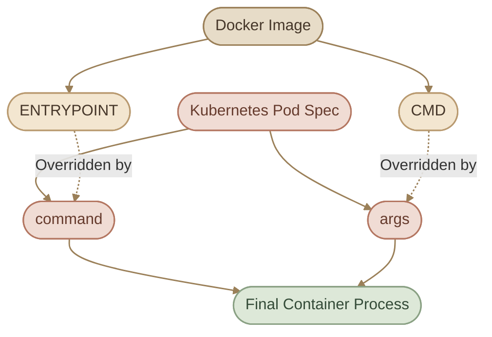

## 1. Understanding the Container Lifecycle

قبل ما نتكلم عن `command` و`args` في Kubernetes، لازم نفهم حاجة أساسية عن الـ Containers.

لما تشغّل Container، مش معنى كده إنك شغّلت Operating System كامل زي الـ Virtual Machine؛ الـ Container بيشغّل Process أو مجموعة Processes مرتبطة بالـ Application أو المهمة اللي بيؤديها.

والـ Container بيكون مرتبط بدورة حياة الـ Main Process اللي بدأ بيها.

مثلًا، لو شغّلت Container من Ubuntu Image:

```bash
docker run ubuntu
```

ممكن الـ Container يخرج مباشرة بعد تشغيله.

ليه؟

لأن الـ Default Command في Ubuntu Image غالبًا بيشغّل `bash`، والـ Shell في الحالة دي مش عندها Interactive Terminal تستقبل منه أوامر، فبتنتهي، وبالتالي الـ Container بتتوقف.

لكن لو شغّلت Container بتشغّل Web Server، فالـ Process الخاصة بالـ Web Server ممكن تفضل شغالة، وبالتالي الـ Container تفضل Running.

### I. Try It with Docker

```bash
docker run --name ubuntu-test ubuntu
```

افحص الـ Container:

```bash
docker ps
```

مش هتلاقيها ضمن الـ Running Containers لو خرجت بالفعل.

لكن لو عرضت كل الـ Containers:

```bash
docker ps -a
```

هتلاقيها بحالة `Exited`.

دلوقتي جرّب:

```bash
docker run --name ubuntu-sleep-test ubuntu sleep 10
```

الـ Container هتشغّل `sleep 10`، وبعد مرور 10 ثوانٍ هتنتهي.

تقدر تتابع حالتها من Terminal تانية باستخدام:

```bash
docker ps -a
```

<InfoCard variant="insight" title="The Main Process Matters" description="الـ Container مش بتفضل شغالة لمجرد إن الـ Image مبنية على Ubuntu أو Linux. لازم الـ Main Process تفضل شغالة؛ ولما تنتهي، بتنتهي دورة حياة الـ Container عادةً." icon="pulse" tags={["Docker", "Containers", "Processes"]} />

## 2. Docker ENTRYPOINT and CMD

في Docker، فيه تعليمات بتحدد إيه اللي يحصل لما الـ Container تبدأ.

أهم تعليمات محتاجين نفهمها هنا:

<CardGrid columns={2} label="Docker Instructions">
  <InfoCard variant="comparison" title="ENTRYPOINT" description="بيحدد البرنامج الأساسي اللي Docker هتشغّله عند بدء الـ Container." icon="code" />
  <InfoCard variant="comparison" title="CMD" description="بيحدد الـ Default Command والـ Arguments اللي Docker هتستخدمها عند تشغيل الـ Container." icon="terminal" />
</CardGrid>

الفرق بينهم مهم جدًا؛ لأن Kubernetes بتستخدم مفاهيم مقابلة ليهم في Pod Definition.

### I. CMD

تعليمة `CMD` بتحدد الـ Default Command والـ Arguments اللي Docker هتستخدمها عند تشغيل الـ Container، حسب طريقة كتابتها ووجود `ENTRYPOINT` من عدمه.

مثال:

```dockerfile
FROM ubuntu:24.04

CMD ["sleep", "5"]
```

ابنِ الـ Image:

```bash
docker build -t ubuntu-sleeper:local .
```

شغّلها:

```bash
docker run --rm ubuntu-sleeper:local
```

الـ Container هتشغّل `sleep 5` وبعدها تنتهي.

تقدر تستبدل الـ Default Command من خلال الأمر اللي بتمرره بعد اسم الـ Image:

```bash
docker run --rm ubuntu-sleeper:local sleep 10
```

هنا Docker هتشغّل `sleep 10` بدل الـ Default Command.

يعني لما تكون بتستخدم `CMD` من غير `ENTRYPOINT`، فالـ Command اللي بتمرره وقت التشغيل بيستبدل الـ Default Command.

### II. ENTRYPOINT

تعليمة `ENTRYPOINT` بتحدد البرنامج الأساسي اللي Docker هتشغّله عند بدء الـ Container.

مثال:

```dockerfile
FROM ubuntu:24.04

ENTRYPOINT ["sleep"]
```

ابنِ الـ Image:

```bash
docker build -t ubuntu-sleeper-entrypoint:local .
```

شغّلها:

```bash
docker run --rm ubuntu-sleeper-entrypoint:local 10
```

Docker هتجمع الـ `ENTRYPOINT` مع الـ Arguments اللي بتمررها، فيكون الأمر الفعلي:

```bash
sleep 10
```

وده مفيد لما تكون بتبني Image مخصصة لمهمة معينة، وعايز تسمح للمستخدم يغيّر Parameters من غير ما يكرر اسم البرنامج كل مرة.

### III. Combining ENTRYPOINT and CMD

ممكن تستخدم التعليمتين مع بعض:

```dockerfile
FROM ubuntu:24.04

ENTRYPOINT ["sleep"]
CMD ["5"]
```

لو شغّلت:

```bash
docker run --rm ubuntu-sleeper-entrypoint:local
```

الأمر الفعلي هيكون:

```bash
sleep 5
```

لكن لو شغّلت:

```bash
docker run --rm ubuntu-sleeper-entrypoint:local 10
```

الأمر الفعلي هيكون:

```bash
sleep 10
```

السبب إن الـ Arguments اللي بتمررها وقت التشغيل بتستبدل الـ Default Arguments الموجودة في `CMD`، بينما الـ `ENTRYPOINT` بتفضل هي البرنامج الأساسي.

### IV. Docker Behavior Summary

<TableCard>
| Docker Instruction | Role | Runtime Behavior |
|---|---|---|
| `CMD` without `ENTRYPOINT` | Default command and/or arguments | Runtime command can replace the default command |
| `ENTRYPOINT` | Main executable | Runtime arguments are appended to it |
| `ENTRYPOINT` + `CMD` | Executable + default arguments | Runtime arguments replace the default arguments |
</TableCard>

<InfoCard variant="tip" title="Exec Form vs Shell Form" icon="code">

**مهم:** الأمثلة دي بتستخدم Exec Form، وهي الصيغة اللي بنفضّلها غالبًا في الحالات دي:

```dockerfile
ENTRYPOINT ["sleep"]
CMD ["5"]
```

في الـ Exec Form، أول عنصر بيكون اسم الـ Executable، وباقي العناصر بتكون Arguments منفصلة.

أما Shell Form، زي:

```dockerfile
CMD sleep 5
```

فليها سلوك مختلف متعلق بالـ Shell وطريقة تشغيل الـ Process، وده ممكن يأثر على التعامل مع Signals والإيقاف السليم للـ Container.

</InfoCard>

## 3. Mapping Docker to Kubernetes

دلوقتي نربط الكلام ده بـ Kubernetes.

لما تكتب Pod Definition، تقدر تتحكم في الـ Command والـ Arguments اللي هتستخدمها الـ Container.

في Kubernetes، أهم حقلين هما:

- `command`
- `args`

والعلاقة بينهم وبين Docker كالتالي:

<TableCard>
| Kubernetes Pod Field | Dockerfile Instruction | Purpose |
|---|---|---|
| `command` | `ENTRYPOINT` | تحديد الـ Executable أو الـ Startup Command |
| `args` | `CMD` | تحديد الـ Default Arguments أو استبدالها |
</TableCard>

خلّي الجدول ده مرجع أساسي عندك.

### I. How the Mapping Works



خد بالك إن `command` و`args` مش مجرد نسخ حرفي للتعليمتين في كل تفاصيل Docker؛ دي العلاقة الأساسية اللي بنستخدمها لفهم سلوك الـ Pod.

كمان لو حددت `command` في الـ Pod Spec، فأنت بتستبدل الـ Image's `ENTRYPOINT`، ولو حددت `args`، فأنت بتستبدل الـ Default Arguments الموجودة في `CMD`.

## 4. Using command and args in a Pod

خلينا نبدأ بمثال بسيط.

عايزين نعمل Pod تشغّل `sleep 5000`.

هنكتب Manifest بالشكل ده:

```yaml
apiVersion: v1
kind: Pod
metadata:
  name: sleeper
spec:
  containers:
    - name: sleeper
      image: ubuntu:24.04
      command: ["sleep"]
      args: ["5000"]
```

احفظ الملف باسم `sleeper-pod.yaml`، وبعدها طبّقه:

```bash
kubectl apply -f sleeper-pod.yaml
```

افحص حالة الـ Pod:

```bash
kubectl get pod sleeper
```

وتحقق من الـ Command والـ Arguments:

```bash
kubectl describe pod sleeper
```

أو اعرضهم مباشرة من الـ Pod Spec:

```bash
kubectl get pod sleeper -o jsonpath='{.spec.containers[0].command}{"\n"}{.spec.containers[0].args}{"\n"}'
```

في المثال ده:

<CardGrid columns={3} label="Example Breakdown">
  <InfoCard variant="concept" title="command">
    `command` بتحدد `sleep`.
  </InfoCard>
  <InfoCard variant="concept" title="args">
    `args` بتحدد `5000`.
  </InfoCard>
  <InfoCard variant="concept" title="Result">
    الـ Container هتشغّل `sleep 5000`.
  </InfoCard>
</CardGrid>

### I. Overriding Only the Arguments

افترض إن الـ Image عندها أصلًا:

```dockerfile
ENTRYPOINT ["sleep"]
CMD ["5"]
```

تقدر تعمل Pod بالشكل ده:

```yaml
apiVersion: v1
kind: Pod
metadata:
  name: sleeper-custom-duration
spec:
  containers:
    - name: sleeper
      image: ubuntu-sleeper:local
      args: ["10"]
```

هنا Kubernetes هتستخدم الـ `ENTRYPOINT` الموجودة في الـ Image، وتستبدل الـ Default Arguments بالـ `args` اللي حددتها.

الأمر الفعلي هيكون:

```bash
sleep 10
```

وده معناه إنك مش مضطر تكرر الـ Command لو كل اللي عايز تغيّره هو الـ Arguments.

<InfoCard variant="warning" title="Image Availability" icon="cube">

**ملاحظة:** المثال ده بيعتمد على Image اسمها `ubuntu-sleeper:local` موجودة ومتاحة للـ Kubernetes Nodes. لو بتستخدم `kind`، لازم تتأكد إن الـ Image متاحة للـ Cluster، أو تستخدم Image مناسبة متاحة بالفعل.

</InfoCard>

### II. Overriding the Command

لو عايز تستبدل الـ `ENTRYPOINT` الموجودة في الـ Image، استخدم `command`:

```yaml
apiVersion: v1
kind: Pod
metadata:
  name: custom-command
spec:
  containers:
    - name: web
      image: python:3.12-alpine
      command: ["python", "-c"]
      args: ["print('Hello from Kubernetes')"]
```

في المثال ده:

<CardGrid columns={2} label="What Each Field Does">
  <InfoCard variant="concept" title="command">
    `command` بتشغّل Python مع الخيار `-c`.
  </InfoCard>
  <InfoCard variant="concept" title="args">
    `args` بتحدد الكود اللي Python هتنفذه.
  </InfoCard>
</CardGrid>

الـ Container هتطبع الرسالة وبعدها تنتهي، لأن الـ Process خلصت شغلها.

وبالتالي، الـ Pod ممكن تنتقل إلى حالة `Completed` لو الـ Process انتهت بنجاح، بدل ما تفضل Running.

<InfoCard variant="insight" title="command Is Not the Same as args" description="لو عايز تغيّر الـ Executable أو الـ Startup Command، استخدم command. لو عايز تمرر Parameters للـ Command، استخدم args. تحديد واحد منهم لا يعني بالضرورة إنك محتاج تحدد التاني." icon="terminal" tags={["Pod Spec", "Command", "Arguments"]} />

## 5. Choosing the Correct YAML Structure

من الأخطاء الشائعة إنك تكتب الـ Command والـ Arguments بطريقة غير صحيحة.

### I. Correct: Separate Executable and Arguments

```yaml
command: ["sleep"]
args: ["5000"]
```

أو باستخدام YAML List:

```yaml
command:
  - sleep
args:
  - "5000"
```

الصيغتين صحيحتين.

### II. Incorrect: Using the Wrong Field Name

```yaml
commands:
  - sleep
```

المشكلة إن اسم الحقل في Kubernetes هو `command`، مش `commands`.

لو كتبت حقل غير معروف في Pod Spec، ممكن Kubernetes ترفض الـ Manifest، حسب طريقة التحقق وإصدار الـ API Server.

### Incorrect: Treating Arguments as One Combined Executable

```yaml
command: ["sleep 5000"]
```

في الحالة دي Kubernetes هتحاول تشغيل Executable اسمه `sleep 5000` بدل ما تشغّل `sleep` وتمرير `5000` كـ Argument.

الصحيح:

```yaml
command: ["sleep"]
args: ["5000"]
```

ولو محتاج تشغّل Shell Command مركّب، ممكن تحدد الـ Shell صراحة:

```yaml
command: ["/bin/sh", "-c"]
args:
  - "echo Starting; sleep 5"
```

لكن لازم الـ Image تحتوي على `/bin/sh`، وإلا الـ Container مش هتقدر تشغّل الأمر.

### III. Why Arguments Are Usually Strings

في الـ Pod Spec، `command` و`args` عبارة عن Arrays من Strings.

علشان كده، الأفضل كتابة الأرقام اللي بتُمرر كـ Arguments بين علامات اقتباس:

```yaml
args: ["5000"]
```

ده بيوضّح إن القيمة Argument نصية، وبيمنع مشاكل تحويل الأنواع أثناء كتابة الـ YAML.

## 6. Debugging Container Startup Commands

لما Container متبدأش بالشكل المتوقع، متكتفيش بإنك تبص على حالة الـ Pod؛ افحص الـ Spec والـ Events والـ Logs حسب الحالة.

### I. Inspect the Pod Definition

```bash
kubectl get pod <pod-name> -o yaml
```

راجع الحقول دي:

```yaml
spec:
  containers:
    - name: web
      image: nginx:1.27-alpine
      command: []
      args: []
```

المثال هنا توضيحي؛ لو الحقول مش موجودة في الـ Pod، ده مش معناه إن Kubernetes هتستخدم قيم فاضية بالضرورة. ممكن تعتمد على إعدادات الـ Image الافتراضية.

### II. Inspect the Container State

```bash
kubectl get pod <pod-name>
```

وبعدها:

```bash
kubectl describe pod <pod-name>
```

دور على الـ Container State والـ Events.

مثلًا:

<CardGrid columns={3} label="Container States">
  <InfoCard variant="concept" title="Running" description="الـ Container شغالة حاليًا." icon="cycle" />
  <InfoCard variant="success" title="Completed" description="الـ Process انتهت بنجاح." icon="flag" />
  <InfoCard variant="warning" title="CrashLoopBackOff" description="الـ Container بتفشل وتتكرر محاولات تشغيلها." icon="wrench" />
  <InfoCard variant="concept" title="CreateContainerError" description="فيه مشكلة أثناء إنشاء الـ Container." icon="cube" />
  <InfoCard variant="warning" title="ImagePullBackOff" description="فيه مشكلة في سحب الـ Image." icon="cloud" />
</CardGrid>

كل حالة محتاجة تشخيص مناسب؛ مش كل مشكلة سببها `command` أو `args`.

### III. Inspect Logs

لو الـ Container بدأت وكتبت Output قبل ما تفشل، جرّب:

```bash
kubectl logs <pod-name>
```

ولو الـ Pod فيها أكثر من Container، حدد الـ Container المقصودة:

```bash
kubectl logs <pod-name> -c <container-name>
```

لكن لو الـ Executable نفسه مش موجود، أو الـ Container بتفشل قبل ما تكتب أي Logs، ممكن تحتاج تعتمد على `kubectl describe pod` والـ Events.

## 7. Practical Lab — Container Startup Investigation

في الـ Lab ده، هنشتغل على سيناريوهات مختلفة علشان تتعلم تميّز بين:

<CardGrid columns={3} label="Lab Scenarios">
  <InfoCard variant="concept" title="Clean Completion" description="Container خلصت شغلها بشكل طبيعي." icon="flag" />
  <InfoCard variant="concept" title="Timed Run" description="Container شغالة بمدة انتظار محددة." icon="cycle" />
  <InfoCard variant="warning" title="Broken Startup Command" description="Startup Command مكتوبة غلط." icon="wrench" />
  <InfoCard variant="warning" title="Missing Executable" description="Image موجودة لكن الـ Executable المطلوب مش موجود." icon="cloud" />
  <InfoCard variant="concept" title="Spec Mismatch" description="Live Pod Spec مختلفة عن اللي أنت متوقعه." icon="code" />
</CardGrid>

الـ Lab مستقل عن أسئلة الكورس، ومصمم علشان تتدرب على التشخيص بدل ما تحفظ الإجابات.

بنهاية الـ Lab، المفروض تقدر:

<ChecklistCard title="Lab Objectives" items={['تكتب Pod Definition باستخدام command و args.', 'تحدد الـ Process الفعلية اللي هتشتغل داخل الـ Container.', 'تكتشف أخطاء YAML وStartup Commands.', 'تفرق بين Completed و CrashLoopBackOff و CreateContainerError.', 'تستخدم kubectl describe و kubectl logs للوصول إلى سبب المشكلة.']} />

<Steps>
<li>

<InfoCard title="Create the Lab Namespace" icon="terminal" />

```bash
kubectl create namespace command-lab
```

هنستخدم Namespace منفصلة علشان نعزل موارد التدريب.
</li>
<li>

<InfoCard title="Create a Long-Running Pod" icon="cube" />

أنشئ ملف `sleeper.yaml`:

```yaml
apiVersion: v1
kind: Pod
metadata:
  name: sleeper
  namespace: command-lab
spec:
  containers:
    - name: sleeper
      image: busybox:1.36
      command: ["sleep"]
      args: ["3600"]
```

طبّق الملف:

```bash
kubectl apply -f sleeper.yaml
```

وتحقق من الحالة:

```bash
kubectl get pod sleeper -n command-lab
```

**Your Tasks:**

1. إيه الـ Executable اللي الـ Container بتشغّله؟
2. إيه الـ Argument اللي اتبعت للـ Executable؟
3. ليه الـ Pod المفروض تفضل Running بدل ما تدخل `Completed`؟
</li>
<li>

<InfoCard title="Create a Container That Completes Successfully" icon="flag" />

أنشئ ملف `completion.yaml`:

```yaml
apiVersion: v1
kind: Pod
metadata:
  name: completion-demo
  namespace: command-lab
spec:
  restartPolicy: Never
  containers:
    - name: worker
      image: busybox:1.36
      command: ["sh", "-c"]
      args:
        - "echo Starting task; echo Task completed successfully"
```

طبّقه:

```bash
kubectl apply -f completion.yaml
```

تابع الحالة:

```bash
kubectl get pod completion-demo -n command-lab -w
```

بعدها اعرض الـ Logs:

```bash
kubectl logs completion-demo -n command-lab
```

**Your Tasks:**

1. ليه الـ Container انتهت بعد طباعة الرسائل؟
2. ليه `restartPolicy: Never` مناسبة للمثال ده؟
3. هل حالة `Completed` معناها إن فيه مشكلة؟
</li>
<li>

<InfoCard title="Investigate an Incorrect Command" icon="wrench" />

أنشئ ملف `broken-command.yaml`:

```yaml
apiVersion: v1
kind: Pod
metadata:
  name: broken-command
  namespace: command-lab
spec:
  restartPolicy: Never
  containers:
    - name: worker
      image: busybox:1.36
      command: ["sleep 5"]
```

حاول إنشاء الـ Pod:

```bash
kubectl apply -f broken-command.yaml
```

لو Kubernetes قبلت الـ Manifest، افحص الحالة:

```bash
kubectl get pod broken-command -n command-lab
```

وبعدها:

```bash
kubectl describe pod broken-command -n command-lab
```

**Your Tasks:**

1. هل الـ YAML صحيحة من ناحية Syntax؟
2. هل ده معناه إن الـ Command صحيحة من ناحية التشغيل؟
3. لو ظهر Error، إيه الـ Executable اللي Container حاولت تشغّله؟
4. أصلح الـ Manifest بحيث تشغّل `sleep 5` بالشكل الصحيح.

**Hint:** افصل اسم الـ Executable عن الـ Argument.
</li>
<li>

<InfoCard title="Compare command and args" icon="code" />

أنشئ ملف `python-task.yaml`:

```yaml
apiVersion: v1
kind: Pod
metadata:
  name: python-task
  namespace: command-lab
spec:
  restartPolicy: Never
  containers:
    - name: task
      image: python:3.12-alpine
      command: ["python", "-c"]
      args:
        - "print('Task started'); print('Task completed')"
```

طبّقه:

```bash
kubectl apply -f python-task.yaml
```

افحص الـ Logs:

```bash
kubectl logs python-task -n command-lab
```

**Your Tasks:**

1. ليه حددنا `command` و`args` بدل ما نكتب أمر واحد طويل؟
2. إيه الـ Command الفعلية اللي هتشتغل داخل الـ Container؟
3. ليه الـ Pod هتدخل `Completed` بعد نجاح تنفيذ الكود؟
</li>
<li>

<InfoCard title="Investigate a Missing Executable" icon="cloud" />

أنشئ ملف `missing-executable.yaml`:

```yaml
apiVersion: v1
kind: Pod
metadata:
  name: missing-executable
  namespace: command-lab
spec:
  restartPolicy: Never
  containers:
    - name: worker
      image: busybox:1.36
      command: ["program-that-does-not-exist"]
```

طبّقه:

```bash
kubectl apply -f missing-executable.yaml
```

افحص الحالة:

```bash
kubectl get pod missing-executable -n command-lab
```

وبعدها:

```bash
kubectl describe pod missing-executable -n command-lab
```

**Your Tasks:**

1. هل المشكلة في سحب الـ Image أم في الـ Command؟
2. إيه الفرق بين الحالة دي وبين `ImagePullBackOff`؟
3. إيه الخطوات اللي هتعملها علشان تحدد سبب الفشل من غير ما تخمّن؟
</li>
<li>

<InfoCard title="Repair and Verify" icon="cycle" />

ارجع للـ Manifest الخاصة بالـ `missing-executable`، واستبدل الـ Command بأمر موجود داخل BusyBox:

```yaml
command: ["sh", "-c"]
args:
  - "echo Recovery successful"
```

طبّق التعديل:

```bash
kubectl apply -f missing-executable.yaml
```

بما إن الـ Pod بتستخدم `restartPolicy: Never`، تعديل ملف الـ YAML وتطبيقه مش هيضمن إن الـ Container الموجودة هتتبدل أو تعيد التشغيل تلقائيًا؛ الـ Pod العادية مش قابلة لتغيير كل حقول الـ Spec بعد إنشائها.

احذف الـ Pod القديمة:

```bash
kubectl delete pod missing-executable -n command-lab
```

وبعدها أنشئها من الملف المعدّل:

```bash
kubectl apply -f missing-executable.yaml
```

تحقق من النتيجة:

```bash
kubectl get pod missing-executable -n command-lab
```

```bash
kubectl logs missing-executable -n command-lab
```

المفروض تشوف:

```text
Recovery successful
```

**Your Tasks:**

1. ليه احتجنا نحذف الـ Pod ونعيد إنشاءها؟
2. إيه الفرق بين تعديل ملف YAML وتعديل الـ Live Pod؟
3. إيه اللي اتأكدنا منه باستخدام `kubectl logs`؟
</li>
<li>

<InfoCard title="Cleanup" icon="tag" />

بعد ما تخلص التدريب:

```bash
kubectl delete namespace command-lab
```

وتأكد إن الموارد اتشالت:

```bash
kubectl get namespace command-lab
```

لو ظهر `NotFound`، فده معناه إن الـ Namespace مش موجودة.
</li>
</Steps>

## 8. Knowledge Check

جاوب على الأسئلة دي من فهمك:

<InfoCard variant="concept" title="Question 1" icon="flag">

عندك Dockerfile:

```dockerfile
ENTRYPOINT ["sleep"]
CMD ["30"]
```

إيه الـ Command الفعلية لما تشغّل الـ Container من غير Arguments إضافية؟

وإيه اللي يحصل لو مرّرت `60` وقت التشغيل؟

</InfoCard>

<InfoCard variant="concept" title="Question 2" icon="flag">

عندك Pod Spec:

```yaml
command: ["python", "-c"]
args: ["print('Hello')"]
```

إيه دور كل حقل؟ وإيه الـ Process اللي هتتنفذ؟

</InfoCard>

<InfoCard variant="concept" title="Question 3" icon="flag">

إيه الفرق بين إن الـ Container تدخل `Completed` وإنها تدخل `CrashLoopBackOff`؟

</InfoCard>

<InfoCard variant="concept" title="Question 4" icon="flag">

ليه كتابة:

```yaml
command: ["sleep 5000"]
```

مختلفة عن:

```yaml
command: ["sleep"]
args: ["5000"]
```

</InfoCard>

<InfoCard variant="concept" title="Question 5" icon="flag">

لو الـ Pod مش بتبدأ، إيه المعلومات اللي ممكن تستخرجها من:

```bash
kubectl describe pod <pod-name>
```

وإمتى تستخدم:

```bash
kubectl logs <pod-name>
```

</InfoCard>

## Summary

<CardGrid columns={2} label="Key Takeaways">
  <InfoCard variant="summary" title="The Main Process Rules the Container">

الـ Container بتعتمد على الـ Main Process اللي بتشغّلها، ومش بتفضل Running لمجرد إن الـ Image مبنية على Linux.

  </InfoCard>
  <InfoCard variant="summary" title="ENTRYPOINT and CMD">

`ENTRYPOINT` بتحدد البرنامج الأساسي في Docker، و`CMD` بتحدد الـ Default Command أو Arguments حسب طريقة استخدامها.

  </InfoCard>
  <InfoCard variant="summary" title="command Maps to ENTRYPOINT">

في Kubernetes، `command` بتقابل `ENTRYPOINT`، و`args` بتقابل `CMD`.

  </InfoCard>
  <InfoCard variant="summary" title="Arrays of Strings">

`command` و`args` عبارة عن Arrays من Strings، وفصل الـ Executable عن الـ Arguments بيمنع أخطاء شائعة.

  </InfoCard>
  <InfoCard variant="summary" title="Completed Can Be Normal">

حالة `Completed` ممكن تكون طبيعية لو الـ Container بتنفّذ Task وتنتهي.

  </InfoCard>
  <InfoCard variant="summary" title="describe vs logs">

`kubectl describe pod` بتساعدك تفحص الـ State والـ Events، بينما `kubectl logs` بتعرض الـ Output اللي كتبته الـ Application.

  </InfoCard>
  <InfoCard variant="summary" title="Manifest vs Live Pod">

تغيير ملف YAML مش معناه إن كل التعديلات هتتطبق على Pod موجودة؛ لازم تميّز بين تعديل الـ Manifest وتغيير الـ Live Resource.

  </InfoCard>
</CardGrid>
