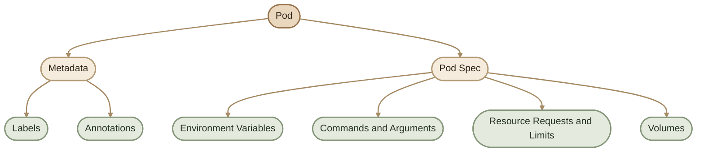
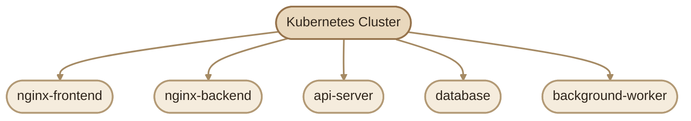
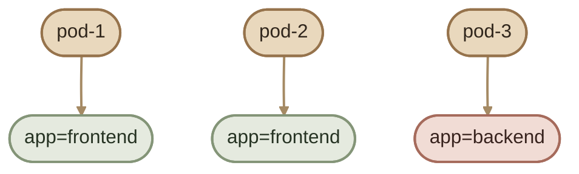
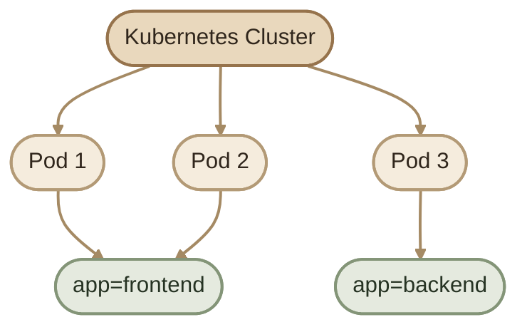
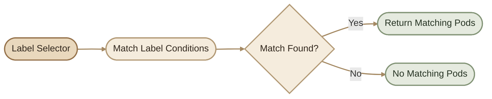
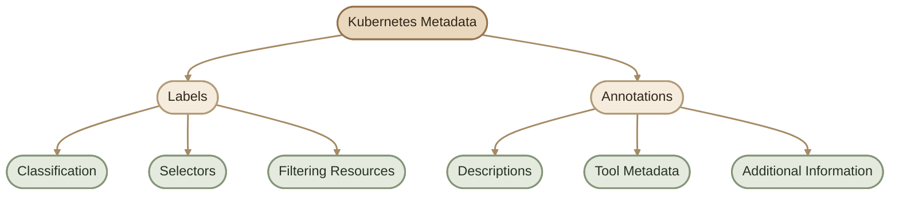
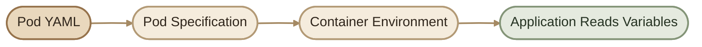

## Overview

في الجزء اللي فات فهمنا:

- إيه هو الـ Pod.
- إزاي Kubernetes بيشغّله.
- إزاي نعمل Pod بسيط.

لكن الـ Pods في الواقع محتاجة Configuration إضافية علشان نقدر نديرها ونتحكم في سلوكها داخل Kubernetes.

مثلًا:

- إزاي نحدد الـ Pods اللي بتنتمي لنفس التطبيق؟
- إزاي نربط الـ Pods بالـ Services؟
- إزاي نمرر Configuration للتطبيق؟
- إزاي نحدد الـ CPU والـ Memory اللي محتاجها؟
- إزاي نضيف معلومات تساعدنا في الإدارة والـ Troubleshooting؟

في المقال ده هنبدأ بأهم عناصر الـ Pod Configuration، وهنربط كل مفهوم بأمثلة عملية.

## 1. Understanding Pod Configuration

الـ Pod بيتكوّن من جزئين مهمين في الـ Configuration:

- **Metadata:** معلومات بتعرّف الـ Resource وبتساعدنا ننظّمه.
- **Spec:** الإعدادات اللي بتحدد الحالة المطلوبة للـ Pod والـ Containers الموجودة جواه.

<CardGrid>
  <InfoCard title="Metadata" icon="tag">
    بتشمل `labels` و`annotations`، وبتساعد في التصنيف والبحث وإضافة معلومات وصفية.
  </InfoCard>
  <InfoCard title="Pod Spec" icon="sliders">
    بيحدد إعدادات الـ Containers، زي الـ Image والـ Environment Variables والـ Commands والـ Resources.
  </InfoCard>
</CardGrid>



<Callout type="note" title="A Pod Is Not Just a Container">

الـ Pod هو Kubernetes Resource بيحتوي على Container واحدة أو أكتر، بالإضافة إلى Configuration خاصة بيه. الإعدادات دي بتحدد إزاي الـ Containers تشتغل، لكن مش كل إعداد بيكون داخل `containers`؛ فيه إعدادات على مستوى الـ Pod نفسه كمان.

</Callout>

---

## 2. Labels

### I. What Are Labels?

الـ **Labels** هي مجموعة من الـ Key-Value pairs بنضيفها إلى Kubernetes Resources بهدف تصنيفها وتنظيمها.

بمعنى أبسط، اعتبر الـ Labels عبارة عن Tags بتساعدك تعرف وظيفة الـ Resource أو البيئة اللي بيشتغل فيها.

مثال:

```yaml
metadata:
  labels:
    app: nginx
    environment: production
```

في المثال ده:

- `app` هو الـ Key.
- `nginx` هو الـ Value.
- `environment` هو Key تاني.
- `production` هي الـ Value الخاصة بيه.

### II. Why Do We Need Labels?

تخيّل إن عندك Cluster فيه عدد كبير من الـ Pods:



لما عدد الـ Pods يزيد، الاعتماد على أسماء الـ Resources بس بيكون غير عملي.

الـ Labels بتخلينا نصنّف الـ Pods حسب التطبيق أو البيئة أو أي تصنيف مناسب.

<CardGrid>
  <InfoCard title="Application" icon="cube">
    `app: frontend` لتحديد الـ Pods الخاصة بالـ Frontend.
  </InfoCard>
  <InfoCard title="Environment" icon="layers">
    `environment: dev` لتمييز الـ Resources الخاصة ببيئة التطوير.
  </InfoCard>
  <InfoCard title="Component" icon="modules">
    `component: database` لتوضيح وظيفة الـ Resource داخل النظام.
  </InfoCard>
</CardGrid>

### III. Labels Example

بدل ما نشوف مجموعة Pods من غير تصنيف:

```text
pod-1
pod-2
pod-3
```

نقدر نضيف Labels توضح وظيفة كل Pod:



دلوقتي نقدر نستخدم Selector لاختيار كل الـ Pods اللي عندها `app=frontend`، من غير ما نحتاج نعرف أسماء الـ Pods مسبقًا.

### IV. Label Architecture



---

## 3. Adding Labels to a Pod

نقدر نضيف Labels داخل `metadata.labels` في ملف الـ YAML.

```yaml
apiVersion: v1
kind: Pod

metadata:
  name: nginx-pod
  labels:
    app: nginx
    environment: dev

spec:
  containers:
    - name: nginx
      image: nginx:1.29-alpine
```

في المثال ده:

- `name: nginx-pod` هو اسم الـ Pod.
- `app: nginx` بيحدد التطبيق المرتبط بيه.
- `environment: dev` بيوضح البيئة.
- الـ `spec` بيحدد الـ Container اللي هيشتغل داخل الـ Pod.

<Callout type="tip" title="Keep Labels Consistent">

حاول تستخدم Naming Convention ثابتة للـ Labels في المشروع كله. ده بيسهّل استخدام الـ Selectors، ومراجعة الـ Resources، وتشخيص المشاكل بعد كده.

</Callout>

---

## 4. Viewing Labels

لعرض الـ Pods والـ Labels المرتبطة بيها:

```bash
kubectl get pods --show-labels
```

مثال على Output:

```text
NAME        READY   STATUS    RESTARTS   AGE   LABELS
nginx-pod   1/1     Running   0          10s   app=nginx,environment=dev
```

ولو عايز تعرض Label معينة كعمود مستقل، تقدر تستخدم `-L`:

```bash
kubectl get pods -L app,environment
```

الفرق:

- `--show-labels`: بيعرض كل الـ Labels في عمود واحد.
- `-L`: بيعرض الـ Labels اللي اخترتها في أعمدة منفصلة.

---

## 5. Filtering Pods Using Labels

تقدر تستخدم `-l`، وهي اختصار لـ `--selector`، علشان تختار Resources بناءً على Labels.

### I. Match a Single Label

```bash
kubectl get pods -l app=nginx
```

الأمر ده بيعرض الـ Pods اللي عندها Label مطابقة للقيمة `app=nginx`.

### II. Match Multiple Labels

```bash
kubectl get pods -l app=nginx,environment=dev
```

هنا لازم الـ Pod تحقق الشرطين مع بعض.

### III. Select by Label Existence

```bash
kubectl get pods -l app
```

ده بيختار الـ Pods اللي عندها Label اسمها `app`، بغض النظر عن قيمتها.

### IV. Exclude a Label Value

```bash
kubectl get pods -l 'environment!=production'
```

ده بيختار الـ Pods اللي قيمة `environment` عندها لا تساوي `production`، وبيشمل كمان الـ Pods اللي معندهاش الـ Label دي أصلًا.

<Callout type="note" title="Label Selectors Are Not Full-Text Search">

الـ Label Selector بيطابق شروط محددة على الـ Labels. هو مش بيبحث داخل Logs أو أسماء الـ Containers أو محتوى التطبيق.

</Callout>

---

## 6. Labels and Selectors

الـ Labels لوحدها بتصنّف الـ Resources، لكن الـ **Selectors** هي اللي بتخلّي Kubernetes أو المستخدم يختار مجموعة Resources بناءً على التصنيف ده.

بمعنى:

- `Label`: بتحدد خاصية للـ Resource.
- `Selector`: بيحدد الـ Resources اللي بتطابق خاصية أو أكتر.

### I. Selector Example

لنفترض إن عندنا Pods بالـ Labels التالية:

| Pod | Labels |
|---|---|
| `frontend-1` | `app=frontend` |
| `frontend-2` | `app=frontend` |
| `backend-1` | `app=backend` |

لو استخدمنا:

```bash
kubectl get pods -l app=frontend
```

هنحصل على `frontend-1` و`frontend-2` فقط.

### II. Selector Flow



### III. Labels and Services

الـ Services بتستخدم Selectors علشان تحدد الـ Pods اللي هتوجّه ليها الـ Traffic.

مثال:

```yaml
apiVersion: v1
kind: Service

metadata:
  name: nginx-service

spec:
  selector:
    app: nginx
  ports:
    - port: 80
      targetPort: 80
```

في المثال ده، الـ Service بتختار الـ Pods اللي عندها `app: nginx`.

لكن لازم الـ Pods المطابقة تكون مناسبة لتشغيل الخدمة، ويكون عندها Port يستقبل الاتصالات المطلوبة.

<Callout type="warning" title="A Selector Does Not Guarantee a Healthy Backend">

وجود Label مطابقة مش ضمان إن التطبيق جاهز لاستقبال الطلبات. Kubernetes بيستخدم آليات تانية، زي Readiness Probes وحالة الـ Endpoints، علشان يحدد الـ Backends المناسبة للـ Service.

</Callout>

---

## 7. Annotations

### I. What Are Annotations?

الـ **Annotations** هي Metadata بنستخدمها لتخزين معلومات إضافية عن الـ Kubernetes Resources.

على عكس الـ Labels، الـ Annotations مش معمولة علشان نستخدمها في اختيار الـ Resources عن طريق Label Selectors.

مثال:

```yaml
metadata:
  annotations:
    description: "Nginx frontend server"
    owner: "devops-team"
```

ممكن تخزن فيها معلومات عن الغرض من الـ Resource أو النظام اللي أنشأه أو بيانات بتستخدمها أدوات خارجية.

### II. Labels vs Annotations

| Feature | Labels | Annotations |
|---|---|---|
| Main purpose | Classification and selection | Additional metadata |
| Label Selectors | Supported | Not supported |
| Typical use | Application, environment, component | Descriptions, tool metadata, build information |
| Values | Strings ضمن قيود الـ Label format | Strings ضمن قيود الـ Annotation metadata |
| Common consumer | Kubernetes controllers and users | Controllers, tools, automation systems |

### III. Annotations Example

```yaml
apiVersion: v1
kind: Pod

metadata:
  name: nginx-pod
  labels:
    app: nginx
  annotations:
    description: "Nginx frontend server"
    owner: "devops-team"
    managed-by: "deployment-pipeline"

spec:
  containers:
    - name: nginx
      image: nginx:1.29-alpine
```

في المثال ده:

- `app: nginx` Label ممكن تستخدمها Service أو Selector.
- `description` Annotation بتشرح الغرض من الـ Pod.
- `owner` Annotation بتوضح الفريق المسؤول، حسب الـ Convention المستخدمة في المشروع.
- `managed-by` Annotation بتضيف معلومة عن أداة الإدارة.

<Callout type="note" title="Annotations Do Not Have Automatic Meaning">

Kubernetes مش هيبدأ يشغّل CI/CD أو Monitoring لمجرد إنك أضفت Annotation باسم `managed-by`. لازم يكون فيه Tool أو Controller مصمم يقرأ القيمة دي ويتصرف بناءً عليها.

</Callout>

### IV. Viewing Annotations

تقدر تعرض تفاصيل الـ Pod:

```bash
kubectl describe pod nginx-pod
```

أو تعرض قيمة Annotation محددة باستخدام JSONPath:

```bash
kubectl get pod nginx-pod \
  -o jsonpath='{.metadata.annotations.owner}{"\n"}'
```

استبدل `owner` باسم الـ Annotation اللي عايز تعرضها.

---

## 8. Labels vs Annotations: Visual Summary



**قاعدة سهلة للحفظ:**

- لو محتاج تصنّف Resource أو تختاره باستخدام Selector، استخدم `Labels`.
- لو محتاج تخزّن معلومات وصفية إضافية، استخدم `Annotations`.

---

## 9. Environment Variables

### I. What Are Environment Variables?

الـ **Environment Variables** هي قيم بيتم تمريرها إلى الـ Container علشان التطبيق يقرأها وقت التشغيل.

بدل ما تكتب إعدادات التطبيق مباشرةً داخل الـ Source Code، ممكن تخلي التطبيق يقرأها من Environment Variables.

مثلًا، تطبيق محتاج يعرف عنوان الـ Database.

بدل ما يكون العنوان مكتوبًا داخل الكود:

```text
database.example.internal
```

ممكن التطبيق يقرأ متغيرًا اسمه:

```text
DATABASE_URL
```

وبكده تقدر تغيّر الـ Configuration من غير ما تحتاج تعدّل الـ Application Code، بشرط إن التطبيق نفسه يكون مصمم يقرأ الإعدادات دي.

<CardGrid>
  <InfoCard title="Environment-Specific Config" icon="sliders">
    تغيير إعدادات التطبيق حسب البيئة، زي `development` أو `production`.
  </InfoCard>
  <InfoCard title="Container Configuration" icon="cube">
    تمرير قيم يحتاجها التطبيق وقت التشغيل.
  </InfoCard>
  <InfoCard title="Separation of Concerns" icon="layers">
    فصل إعدادات التشغيل عن منطق التطبيق قدر الإمكان.
  </InfoCard>
</CardGrid>

### II. Environment Variable Example

```yaml
apiVersion: v1
kind: Pod

metadata:
  name: app-pod

spec:
  containers:
    - name: app
      image: my-app:1.0
      env:
        - name: APP_ENV
          value: "production"

        - name: APP_VERSION
          value: "1.0"
```

هنا Kubernetes بيمرر متغيرين للـ Container:

| Variable | Value | Purpose |
|---|---|---|
| `APP_ENV` | `production` | تحديد بيئة التشغيل |
| `APP_VERSION` | `1.0` | تحديد إصدار التطبيق |

خلي بالك إن `my-app:1.0` مجرد مثال؛ لازم تستخدم Image موجودة فعلًا في بيئتك لو هتشغّل الـ Pod.

### III. Environment Variable Flow



---

## 10. Reading Environment Variables

لو عايز تتأكد إن الـ Environment Variables وصلت للـ Container، تقدر تستخدم `kubectl exec`.

### Option 1: Read a Specific Variable

```bash
kubectl exec app-pod -c app -- printenv APP_ENV
```

النتيجة المتوقعة:

```text
production
```

الأمر بيشغّل `printenv` داخل الـ Container وبيعرض قيمة `APP_ENV`.

### Option 2: List Environment Variables

```bash
kubectl exec app-pod -c app -- printenv
```

ده بيعرض الـ Environment Variables الموجودة في بيئة العملية.

<Callout type="warning" title="Be Careful When Printing Environment Variables">

ما تعرضش كل الـ Environment Variables بشكل عشوائي على أنظمة الإنتاج؛ ممكن تحتوي على Tokens أو Credentials أو معلومات حساسة. افحص المتغير المطلوب فقط، وتأكد إن الـ Output مش بيتسجل في Logs أو بيتشارك مع أشخاص غير مصرح لهم.

</Callout>

### Option 3: Open a Shell

لو الـ Container فيها Shell متاح:

```bash
kubectl exec -it app-pod -c app -- sh
```

وبعدها:

```sh
printenv APP_ENV
```

استخدم `bash` بدل `sh` فقط لو Bash موجود فعلًا داخل الـ Image.

ولو التطبيق بيستخدم Distroless أو Image صغيرة مفيهاش Shell، استخدم طريقة فحص مناسبة للـ Image أو التطبيق بدل افتراض وجود `bash`.

---

## 11. Environment Variables from ConfigMaps

لما عدد الإعدادات يزيد، كتابة كل قيمة يدويًا داخل الـ Pod Spec ممكن تبقى غير عملية.

هنا نقدر نستخدم **ConfigMap** لتخزين Configuration غير الحساسة، ونمرر القيم إلى الـ Container باستخدام `configMapKeyRef`.

مثال:

```yaml
apiVersion: v1
kind: ConfigMap

metadata:
  name: app-config

data:
  APP_ENV: "development"
  APP_VERSION: "1.0"
---
apiVersion: v1
kind: Pod

metadata:
  name: app-pod

spec:
  containers:
    - name: app
      image: my-app:1.0
      env:
        - name: APP_ENV
          valueFrom:
            configMapKeyRef:
              name: app-config
              key: APP_ENV

        - name: APP_VERSION
          valueFrom:
            configMapKeyRef:
              name: app-config
              key: APP_VERSION
```

في المثال ده، Kubernetes بيقرأ القيم من الـ ConfigMap وبيمررها كـ Environment Variables إلى الـ Container.

<Callout type="note" title="ConfigMap Changes and Environment Variables">

لو الـ ConfigMap اتغيّرت، الـ Environment Variables الموجودة داخل Container شغّالة بالفعل مش بتتحدّث تلقائيًا. غالبًا هتحتاج تعيد تشغيل الـ Pods أو تعمل Rollout مناسب علشان التطبيق يستقبل القيم الجديدة.

</Callout>

ولو البيانات حساسة، استخدم آلية مناسبة زي Kubernetes Secrets مع فهم حدود الحماية وإعدادات الـ Cluster؛ الـ ConfigMap مخصصة للبيانات غير الحساسة.

---

## 12. Commands and Arguments

ممكن كمان نتحكم في الأمر اللي Kubernetes بيشغّله داخل الـ Container باستخدام `command` و`args`.

- `command`: بتحدد الـ Command اللي هيتشغّل بدل الـ Image ENTRYPOINT في Kubernetes.
- `args`: بتحدد الـ Arguments اللي هتتبعت للأمر، وبتستبدل الـ Default CMD الخاصة بالـ Image.

مثال:

```yaml
apiVersion: v1
kind: Pod

metadata:
  name: command-demo

spec:
  containers:
    - name: demo
      image: busybox:1.36
      command: ["sh", "-c"]
      args: ["echo 'Hello from Kubernetes'; sleep 3600"]
```

في المثال ده:

1. Kubernetes بيشغّل `sh -c`.
2. الأمر بيطبع رسالة.
3. الـ Process بيكمل شغله عن طريق `sleep`.

لو الـ Main Process انتهى، سلوك الـ Pod بعد كده بيعتمد على `restartPolicy` وحالة الـ Pod.

---

## 13. Resource Requests and Limits

الـ Resources بتحدد احتياجات الـ Container وحدود استهلاكها من CPU والـ Memory.

<CardGrid>
  <InfoCard title="Requests" icon="sliders">
    الموارد المطلوبة واللي Kubernetes بيستخدمها في قرارات الـ Scheduling.
  </InfoCard>
  <InfoCard title="Limits" icon="shield">
    الحدود المفروضة على استهلاك موارد معينة بواسطة الـ Container Runtime وKubernetes.
  </InfoCard>
</CardGrid>

مثال:

```yaml
apiVersion: v1
kind: Pod

metadata:
  name: resource-demo

spec:
  containers:
    - name: nginx
      image: nginx:1.29-alpine
      resources:
        requests:
          cpu: "100m"
          memory: "128Mi"
        limits:
          cpu: "500m"
          memory: "256Mi"
```

المعنى:

- `100m` CPU يساوي `0.1` من نواة CPU.
- `128Mi` Memory تعادل 128 Mebibytes.
- `500m` CPU يساوي نصف نواة CPU.
- `256Mi` هو حد الـ Memory المحدد للـ Container.

الـ CPU Limit بيحدد سقف استخدام المعالج، بينما تجاوز الـ Memory Limit ممكن يؤدي إلى قتل العملية داخل الـ Container بسبب تجاوز الذاكرة، وغالبًا بتظهر حالة زي `OOMKilled`.

أما الـ Requests فهي مش ضمان إن التطبيق هيستخدم الموارد دي طول الوقت؛ هي أساسًا مدخل مهم لجدولة الـ Pods وتخصيص الموارد.

---

## 14. Practical Lab: Inspect Pod Configuration

في اللاب ده هتنشئ Pod بسيطة، وتضيف Labels وAnnotations وEnvironment Variables، وبعدها تفحص الإعدادات.

<Callout type="lab" title="Lab Requirements">

- Cluster شغال.
- `kubectl` متصل بالـ Context المقصود.
- صلاحيات تسمح بإنشاء Pods.

</Callout>

### Step 1: Create a Manifest

أنشئ ملفًا باسم `pod-config-lab.yaml`:

```yaml
apiVersion: v1
kind: Pod

metadata:
  name: pod-config-lab
  labels:
    app: nginx
    environment: dev
  annotations:
    owner: "devops-team"
    description: "Pod configuration practice"

spec:
  containers:
    - name: nginx
      image: nginx:1.29-alpine
      env:
        - name: APP_ENV
          value: "development"

        - name: APP_VERSION
          value: "1.0"

      resources:
        requests:
          cpu: "100m"
          memory: "64Mi"
        limits:
          cpu: "250m"
          memory: "128Mi"
```

### Step 2: Apply the Manifest

```bash
kubectl apply -f pod-config-lab.yaml
```

### Step 3: Verify the Pod

```bash
kubectl get pod pod-config-lab
```

ولو محتاج تفاصيل أكتر:

```bash
kubectl describe pod pod-config-lab
```

### Step 4: Inspect the Labels

```bash
kubectl get pods --show-labels
```

واختبر الـ Selector:

```bash
kubectl get pods -l app=nginx,environment=dev
```

### Step 5: Inspect the Annotations

```bash
kubectl get pod pod-config-lab \
  -o jsonpath='{.metadata.annotations.owner}{"\n"}'
```

### Step 6: Inspect Environment Variables

```bash
kubectl exec pod-config-lab -c nginx -- printenv APP_ENV
```

المفروض تشوف:

```text
development
```

وجرّب كمان:

```bash
kubectl exec pod-config-lab -c nginx -- printenv APP_VERSION
```

### Step 7: Clean Up

بعد ما تخلص اللاب:

```bash
kubectl delete -f pod-config-lab.yaml
```

<Callout type="tip" title="Troubleshooting">

لو الـ Pod مش في حالة `Running`، راجع:

```bash
kubectl describe pod pod-config-lab
kubectl get events --sort-by=.metadata.creationTimestamp
```

دور على رسائل زي `FailedScheduling` أو `ImagePullBackOff` أو `ErrImagePull`. مش كل مشكلة في إنشاء الـ Pod بتكون بسبب الـ YAML؛ ممكن تكون مرتبطة بالموارد المتاحة أو تحميل الـ Image أو إعدادات الكلاستر.

</Callout>

---

## 15. Common Mistakes

<CardGrid>
  <InfoCard title="Wrong Selector" icon="wrench">
    الـ Service بتحدد `app=frontend`، لكن الـ Pods عندها `app=backend`؛ النتيجة إن الـ Service مش هتلاقي الـ Pods المقصودة.
  </InfoCard>
  <InfoCard title="Wrong Environment Variable" icon="code">
    اسم المتغير في الـ YAML مختلف عن الاسم اللي التطبيق بيقرأه، وبالتالي التطبيق ممكن يستخدم قيمة افتراضية أو يفشل.
  </InfoCard>
  <InfoCard title="Using Annotations for Selection" icon="tag">
    الـ Label Selectors مش بتستخدم الـ Annotations؛ لازم تستخدم Labels لو عايز تختار Resources بالطريقة دي.
  </InfoCard>
  <InfoCard title="Assuming Every Image Has Bash" icon="terminal">
    بعض الـ Container Images مفيهاش Bash أو حتى Shell؛ استخدم أدوات الفحص المتاحة داخل الـ Image.
  </InfoCard>
</CardGrid>

---

## Key Takeaways

- `metadata` بتحتوي على معلومات تعريفية ووصفية عن الـ Resource.
- `Labels` بتستخدم في التصنيف والاختيار باستخدام Selectors.
- `Annotations` بتخزّن Metadata إضافية لا تُستخدم في Label Selectors.
- `env` بتسمح بتمرير إعدادات للتطبيق داخل الـ Container.
- `command` و`args` بيتحكموا في الأمر والـ Arguments المستخدمة لتشغيل الـ Container.
- `requests` بتأثر على الـ Scheduling، بينما `limits` بتحدد حدود استخدام موارد معينة.
- `ConfigMaps` مناسبة للإعدادات غير الحساسة، بينما البيانات الحساسة تحتاج معالجة مناسبة.
- الفحص باستخدام `kubectl describe` و`kubectl exec` بيساعدك تتأكد من الإعدادات الفعلية.
