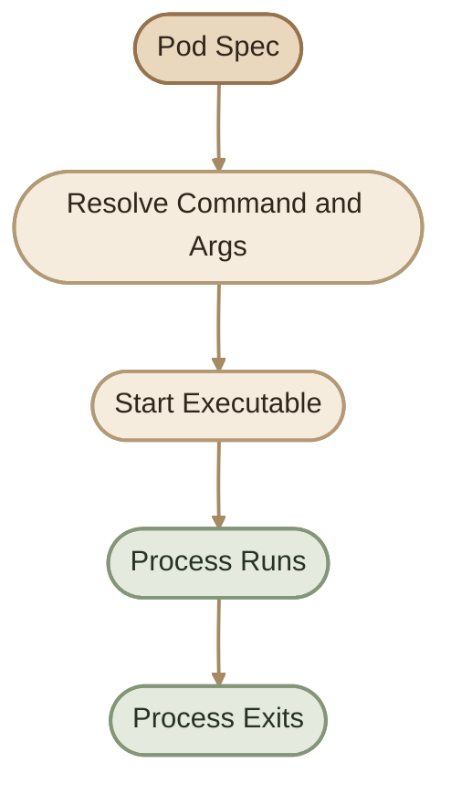
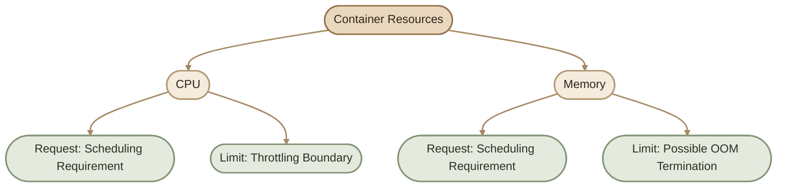
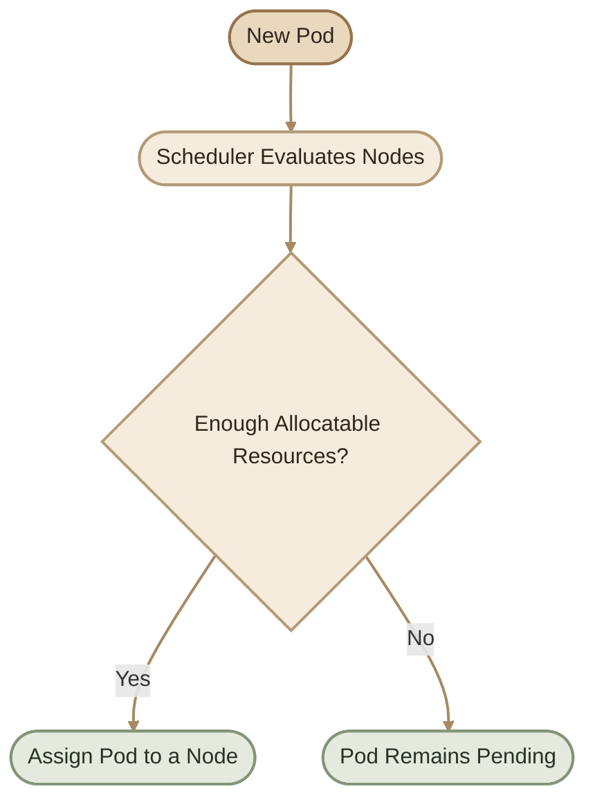
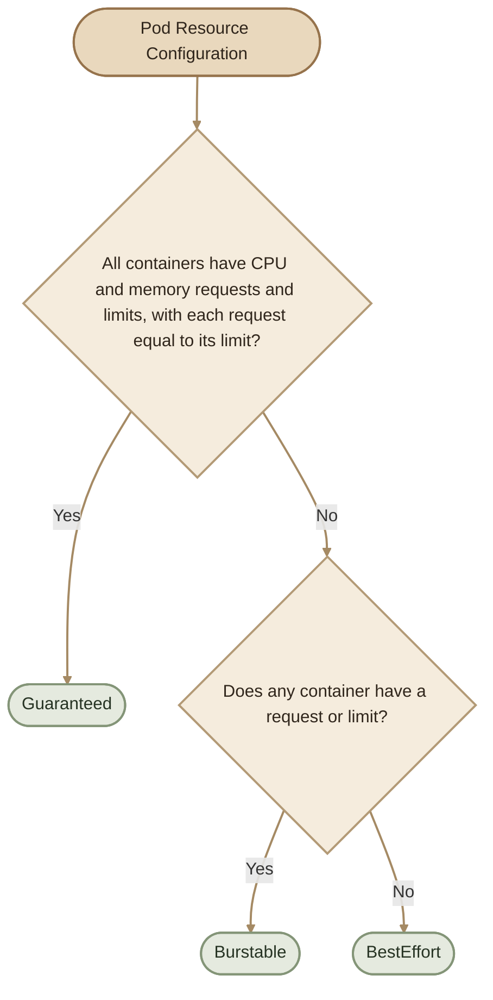

## Overview

بعد ما اتعلمنا إزاي نعرّف الـ Pod ونظبط الـ Configuration بتاعته، محتاجين نفهم حاجتين مهمين:

- **Execution:** إزاي الـ Container بيبدأ تشغيل الـ Application أو الـ Process المطلوب.
- **Resource Management:** إزاي بنحدد احتياجات الـ CPU والـ Memory، وإزاي Kubernetes بيقرر يشغّل الـ Pod على أنهي Node.

<CardGrid>
  <InfoCard title="Container Execution" icon="terminal">
    التحكم في الـ Process اللي بيبدأ مع تشغيل الـ Container باستخدام `command` و`args`.
  </InfoCard>
  <InfoCard title="Resource Requests" icon="sliders">
    تحديد الموارد اللي بيستخدمها الـ Scheduler عند اختيار الـ Node المناسبة.
  </InfoCard>
  <InfoCard title="Resource Limits" icon="shield">
    وضع حدود لاستهلاك الـ CPU والـ Memory داخل الـ Container.
  </InfoCard>
  <InfoCard title="QoS Classes" icon="layers">
    تصنيف الـ Pods حسب إعدادات الموارد للمساعدة في تحديد أولويات التعامل معها تحت ضغط الموارد.
  </InfoCard>
</CardGrid>

## 1. Container Startup: ENTRYPOINT, CMD, command, and args

لما Docker يشغّل Container، الـ Image ممكن تحدد سلوك التشغيل باستخدام:

- `ENTRYPOINT`: البرنامج الأساسي اللي هيتشغّل.
- `CMD`: الـ Default command أو arguments، حسب طريقة تعريفه في الـ Image.

في Kubernetes، الـ Pod spec بيوفر طريقتين للتحكم في سلوك التشغيل:

- `command`: بتعمل override للـ Image `ENTRYPOINT`.
- `args`: بتعمل override للـ Image `CMD`.

<Callout type="note">
  الـ `command` و`args` مش أوامر Shell تلقائيًا. Kubernetes بيشغّل الـ executable مباشرةً مع الـ arguments المحددة. لو محتاج Shell features زي `&&` أو environment-variable expansion، لازم تشغّل Shell بشكل صريح.
</Callout>

## 2. The `command` Field

الـ `command` بيحدد الـ executable اللي Kubernetes هيشغّله بدل الـ default `ENTRYPOINT` الموجود في الـ Image.

مثال:

```yaml
command:
  - sleep
```

ده بيحدد `sleep` باعتباره الـ executable الأساسي. لو مفيش arguments مناسبة، ممكن الـ Process يخرج بخطأ بدل ما يفضل شغال.

## 3. The `args` Field

الـ `args` بتحدد الـ arguments اللي هتتبعت للـ executable.

```yaml
args:
  - "3600"
```

في المثال ده، القيمة `3600` هي عدد الثواني اللي هنطلب من `sleep` الانتظار خلالها.

لما نجمع الاتنين، النتيجة بتكون:

```bash
sleep 3600
```

### I. `command` vs `args`

| Kubernetes field | Docker equivalent | الوظيفة |
|---|---|---|
| `command` | `ENTRYPOINT` | تحديد البرنامج الأساسي |
| `args` | `CMD` | تحديد الـ arguments الافتراضية |

التشبيه ده بيوضح العلاقة الأساسية بينهم. التفاصيل الدقيقة بتعتمد على طريقة تعريف `ENTRYPOINT` و`CMD` داخل الـ Image.

## 4. Complete Command Example

هنشغّل Ubuntu Container لمدة ساعة باستخدام `sleep`.

```yaml
apiVersion: v1
kind: Pod
metadata:
  name: command-demo
spec:
  containers:
    - name: ubuntu
      image: ubuntu:24.04
      command:
        - sleep
      args:
        - "3600"
```

احفظ الملف باسم `command-demo.yaml`، وبعدها نفّذ:

```bash
kubectl apply -f command-demo.yaml
kubectl get pod command-demo
kubectl describe pod command-demo
```

للتحقق من الـ Process داخل الـ Container:

```bash
kubectl exec command-demo -- ps -ef
```

الـ Pod المفروض يفضل في حالة `Running` طول ما الـ `sleep` شغال، بشرط إن الـ Container بدأ بنجاح ومفيش سبب تاني لإنهاء الـ Process.

## 5. Container Execution Flow



**مهم:** لو الـ main process انتهى، الـ Container بيعتبر منتهي. ولو الـ Pod تابع لـ Deployment، ممكن Kubernetes يعيد تشغيل الـ Container أو ينشئ بديلًا حسب حالة الـ Pod وسياسة التشغيل وإدارة الـ Workload.

## 6. Resource Management Fundamentals

كل Container بيستهلك موارد من الـ Node اللي شغّال عليها. أهم موردين بنحددهم في البداية:

- **CPU:** وقت المعالجة اللي بيحتاجه الـ Application.
- **Memory:** الذاكرة اللي بيستخدمها الـ Application أثناء التشغيل.

Kubernetes بيوفر إعدادين أساسيين لكل Container:

<CardGrid>
  <InfoCard title="Requests" eyebrow="Scheduling requirement" icon="sliders">
    بتحدد كمية الموارد اللي الـ Scheduler بيحسبها عند اختيار الـ Node.
  </InfoCard>
  <InfoCard title="Limits" eyebrow="Usage boundary" icon="shield">
    بتحدد الحد المسموح لاستهلاك الـ Container من الموارد اللي لها Limits.
  </InfoCard>
</CardGrid>

<Callout type="warning">
  الـ Request مش معناه إن الـ Container هيحصل على نفس كمية الـ CPU بشكل مضمون في كل لحظة. والـ Memory Request مش حجز مادي منفصل للذاكرة؛ الاتنين بيأثروا على قرارات الجدولة وإدارة الموارد.
</Callout>

## 7. Resource Requests

الـ `requests` بتحدد احتياجات الـ Container اللي بيستخدمها الـ Scheduler لتحديد إذا كانت الـ Node مناسبة لتشغيله.

مثال:

```yaml
resources:
  requests:
    cpu: "100m"
    memory: "128Mi"
```

معنى القيم:

- `100m` CPU = \(0.1\) CPU core.
- `128Mi` Memory = \(128 \times 1024\) bytes × \(1024\) bytes، أي 128 mebibytes.

بالتالي، الـ Scheduler بيحسب إن الـ Container محتاج `100m` من الـ CPU و`128Mi` من الـ Memory عند تقييم سعة الـ Node.

### I. CPU Units

| Value | Meaning |
|---|---|
| `100m` | 0.1 CPU core |
| `250m` | 0.25 CPU core |
| `500m` | 0.5 CPU core |
| `1` | 1 CPU core |

الرمز `m` معناه millicores، وكل `1000m` يساوي CPU core واحد.

### II. Memory Units

| Value | Meaning |
|---|---|
| `128Mi` | 128 mebibytes |
| `256Mi` | 256 mebibytes |
| `1Gi` | 1 gibibyte |

`Mi` و`Gi` وحدات binary، بينما `M` و`G` وحدات decimal. استخدم الوحدات بوضوح لتجنب الالتباس.

## 8. Resource Limits

الـ `limits` بتحدد الحد الأقصى لاستهلاك الـ Container للموارد اللي لها Limits.

```yaml
resources:
  limits:
    cpu: "500m"
    memory: "256Mi"
```

في المثال ده:

- الـ CPU Limit هو `500m`، أي نصف CPU core.
- الـ Memory Limit هو `256Mi`.

### I. CPU Limit Behavior

لو الـ Container حاول يستخدم CPU أكتر من الحد المتاح له، Linux CFS bandwidth control ممكن يطبّق **CPU throttling**. ده معناه إن الـ Container ممكن يفضل شغال لكن أداءه يتأثر.

### II. Memory Limit Behavior

لو الـ Container تجاوز الـ Memory Limit، ممكن الـ kernel ينهي الـ Process بسبب استهلاك الذاكرة، وده غالبًا يظهر في Kubernetes بالشكل:

`OOMKilled`

النتيجة الفعلية بتعتمد على ظروف الذاكرة والـ kernel؛ تجاوز الحد مش معناه إن الـ Container هيتوقف بالضرورة في نفس اللحظة.

<Callout type="tip">
  اختار Requests بناءً على استهلاك الـ Application المتوقع، واستخدم Limits بحذر بعد فهم الـ Workload. الـ Limits المنخفضة جدًا ممكن تسبب CPU throttling أو `OOMKilled` وتؤثر على استقرار الخدمة.
</Callout>

## 9. Requests vs Limits



| Setting | CPU | Memory |
|---|---|---|
| Request | بيأثر على الجدولة، ومشاركة الـ CPU تحت الضغط | بيأثر على الجدولة وإدارة ضغط الذاكرة |
| Limit | ممكن يؤدي إلى throttling | ممكن يؤدي إلى `OOMKilled` |

## 10. Resource Scheduling Flow

لما الـ Pod يتبعت للـ Kubernetes API، الـ Scheduler بيقيّم الـ Nodes المتاحة لاختيار Node مناسبة.



الـ Scheduler بيستخدم الـ Requests ضمن حساباته، مع مراعاة عوامل تانية زي الـ Node selectors والـ Affinity والـ Taints والـ Tolerations والقيود الأخرى.

**ملحوظة:** الـ Scheduler مش بيقرر بناءً على الـ CPU usage اللحظي فقط. ممكن الـ Node يكون استهلاكها الحالي قليل، لكن الـ Pod يفضل `Pending` لأن الموارد المطلوبة حسب الـ Requests مش متاحة في حسابات الجدولة.

لو الـ Pod مش بيتجدول، ابدأ بـ:

```bash
kubectl describe pod <pod-name>
```

ودوّر في قسم `Events` على رسائل زي:

```text
FailedScheduling
Insufficient cpu
Insufficient memory
```

## 11. Complete Resource Configuration

ده مثال كامل لـ Pod بيشغّل Nginx مع Requests وLimits.

```yaml
apiVersion: v1
kind: Pod
metadata:
  name: resource-demo
  labels:
    app: nginx
spec:
  containers:
    - name: nginx
      image: nginx:1.29-alpine
      resources:
        requests:
          cpu: "100m"
          memory: "128Mi"
        limits:
          cpu: "500m"
          memory: "256Mi"
```

طبّق الـ Manifest:

```bash
kubectl apply -f resource-demo.yaml
```

راجع حالة الـ Pod وإعدادات الموارد:

```bash
kubectl get pod resource-demo
kubectl describe pod resource-demo
kubectl get pod resource-demo -o yaml
```

ولو عايز تشوف الاستهلاك الفعلي للموارد، استخدم:

```bash
kubectl top pod resource-demo
```

<Callout type="note">
  أمر `kubectl top` محتاج Metrics API متاحة، وغالبًا ده بيكون عن طريق Metrics Server. لو ظهر خطأ متعلق بالـ Metrics API، ده مش بالضرورة معناه إن الـ Pod فيه مشكلة.
</Callout>

## 12. Quality of Service (QoS) Classes

Kubernetes بيصنّف الـ Pods في واحدة من ثلاث QoS Classes بناءً على إعدادات الموارد:

- `Guaranteed`
- `Burstable`
- `BestEffort`

التصنيف ده بيساعد Kubernetes في التعامل مع ضغط الموارد، خصوصًا وقت الـ Memory pressure. لكنه مش بديل عن ضبط Requests وLimits بشكل صحيح.



## 13. Guaranteed QoS

الـ Pod بيكون `Guaranteed` لما **كل Container** فيه يحدد:

- CPU Request وCPU Limit، ويكونوا متساويين.
- Memory Request وMemory Limit، ويكونوا متساويين.

مثال:

```yaml
apiVersion: v1
kind: Pod
metadata:
  name: guaranteed-demo
spec:
  containers:
    - name: app
      image: nginx:1.29-alpine
      resources:
        requests:
          cpu: "500m"
          memory: "128Mi"
        limits:
          cpu: "500m"
          memory: "128Mi"
```

في المثال ده، الـ CPU Request بيساوي الـ CPU Limit، والـ Memory Request بيساوي الـ Memory Limit.

**مهم:** تساوي CPU Request وLimit لوحده مش كفاية؛ لازم شروط الـ Memory تتحقق كمان، ولكل Container في الـ Pod.

## 14. Burstable QoS

الـ Pod بيكون `Burstable` لما ما يحققش شروط `Guaranteed`، لكن يكون فيه على الأقل Container واحد عنده Request أو Limit محدد.

مثال:

```yaml
apiVersion: v1
kind: Pod
metadata:
  name: burstable-demo
spec:
  containers:
    - name: app
      image: nginx:1.29-alpine
      resources:
        requests:
          cpu: "100m"
          memory: "128Mi"
        limits:
          cpu: "500m"
          memory: "256Mi"
```

هنا الـ Requests مختلفة عن الـ Limits، وبالتالي الـ Pod من فئة `Burstable`.

## 15. BestEffort QoS

الـ Pod بيكون `BestEffort` لما **كل Containers** الموجودة فيه ما يكونش ليها CPU أو Memory Requests أو Limits محددة.

مثال:

```yaml
apiVersion: v1
kind: Pod
metadata:
  name: besteffort-demo
spec:
  containers:
    - name: app
      image: nginx:1.29-alpine
```

في المثال ده، مفيش موارد محددة صراحةً للـ Container.

<Callout type="warning">
  الـ `BestEffort` Pods ممكن تكون أكثر عرضة للإنهاء تحت ضغط الذاكرة مقارنةً بالـ QoS Classes الأخرى. الأفضل ما تعتمدش على غياب Requests وLimits في الـ Production لمجرد إن الـ Application بسيط.
</Callout>

## 16. QoS Classes Comparison

| QoS Class | Resource Configuration | General Behavior |
|---|---|---|
| `Guaranteed` | CPU وMemory Requests وLimits محددة ومتساوية لكل Container | أعلى أولوية نسبيًا في التعامل مع Memory pressure |
| `Burstable` | فيه Requests أو Limits، لكن شروط Guaranteed مش مكتملة | الأولوية بتتأثر بعوامل إضافية، منها مقدار استهلاك الذاكرة مقارنةً بالـ Requests |
| `BestEffort` | مفيش CPU أو Memory Requests أو Limits لأي Container | الأكثر عرضة للإنهاء تحت Memory pressure |

الـ QoS Class مش ضمان إن الـ Pod مش هيتقتل أو مش هيتأثر بنقص الموارد. وفي حالات الـ Node pressure، Kubernetes بيأخذ عوامل أخرى في الاعتبار، منها استهلاك الموارد مقارنةً بالـ Requests والـ Pod priority.

## 17. Practical Lab: Inspect Pod Resources

في اللاب ده هننشئ Pod بموارد محددة، وبعدها نتحقق من الـ Configuration والـ QoS Class.

### Step 1: Create the Manifest

احفظ الملف باسم `resource-lab.yaml`:

```yaml
apiVersion: v1
kind: Pod
metadata:
  name: resource-lab
spec:
  containers:
    - name: nginx
      image: nginx:1.29-alpine
      resources:
        requests:
          cpu: "100m"
          memory: "128Mi"
        limits:
          cpu: "500m"
          memory: "256Mi"
```

### Step 2: Apply and Inspect

```bash
kubectl apply -f resource-lab.yaml
kubectl get pod resource-lab
kubectl describe pod resource-lab
```

### Step 3: Verify the QoS Class

```bash
kubectl get pod resource-lab -o jsonpath='{.status.qosClass}'
```

النتيجة المتوقعة:

```text
Burstable
```

لأن الـ Requests والـ Limits موجودة، لكنها مش متساوية.

### Step 4: Inspect Resource Configuration

```bash
kubectl get pod resource-lab -o yaml
```

راجع قسم `resources` داخل الـ Container، وقارنه بالقيم اللي كتبتها في الـ Manifest.

### Step 5: Clean Up

```bash
kubectl delete pod resource-lab
```

## 18. Troubleshooting Checklist

<CardGrid>
  <InfoCard title="Pod remains Pending" icon="sliders">
    راجع `kubectl describe pod` وابحث عن `FailedScheduling` أو رسائل `Insufficient cpu` و`Insufficient memory`.
  </InfoCard>
  <InfoCard title="Application is slow" icon="pulse">
    راجع CPU throttling والـ actual resource usage، وقارنها بالـ Requests والـ Limits.
  </InfoCard>
  <InfoCard title="Container exits with OOMKilled" icon="database">
    راجع الـ Memory Limit واستهلاك التطبيق، وتأكد إن الحد مناسب للـ Workload.
  </InfoCard>
  <InfoCard title="Container exits immediately" icon="terminal">
    راجع `command` و`args` والـ Container logs، وتأكد إن الـ executable موجود وإن الـ Process مش بيخرج فورًا.
  </InfoCard>
</CardGrid>

## 19. Best Practices

- حدد Requests واقعية بدل الاعتماد على التخمين.
- استخدم Limits للـ CPU والـ Memory حسب طبيعة التطبيق واحتياجاته.
- راجع الـ `Events` والـ Logs عند فشل التشغيل أو الجدولة.
- استخدم `kubectl top` لمراجعة الاستهلاك الفعلي لو Metrics API متاحة.
- ما تفترضش إن `Guaranteed` معناه إن الـ Application مش هيتأثر بأي مشكلة في الـ Node.
- راجع موارد كل Container في الـ Pod، مش أول Container بس.
- في الـ Production، استخدم `Deployment` أو Workload Controller مناسب بدل الاعتماد على Pod منفرد لو محتاج إدارة مستمرة للـ Replicas.

## 20. Key Takeaways

<Callout type="tip">
  افتكر الفرق الأساسي:

  - `command` بيحدد الـ executable اللي هيبدأ.
  - `args` بتحدد الـ arguments اللي هتتبعت له.
  - `requests` بتدخل في حسابات الـ Scheduling.
  - `limits` بتحط حدود لاستهلاك الموارد.
  - `QoS Class` بتعكس إعدادات الموارد وبتساعد في تحديد سلوك Kubernetes تحت ضغط الموارد.
</Callout>

لو فهمت العلاقة بين الـ Container startup والـ Requests والـ Limits والـ Scheduler، هتقدر تفسر مشاكل كتير زي `Pending Pods` و`CPU throttling` و`OOMKilled` بشكل أدق.
