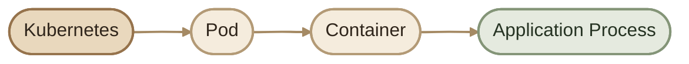
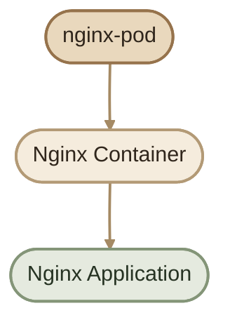
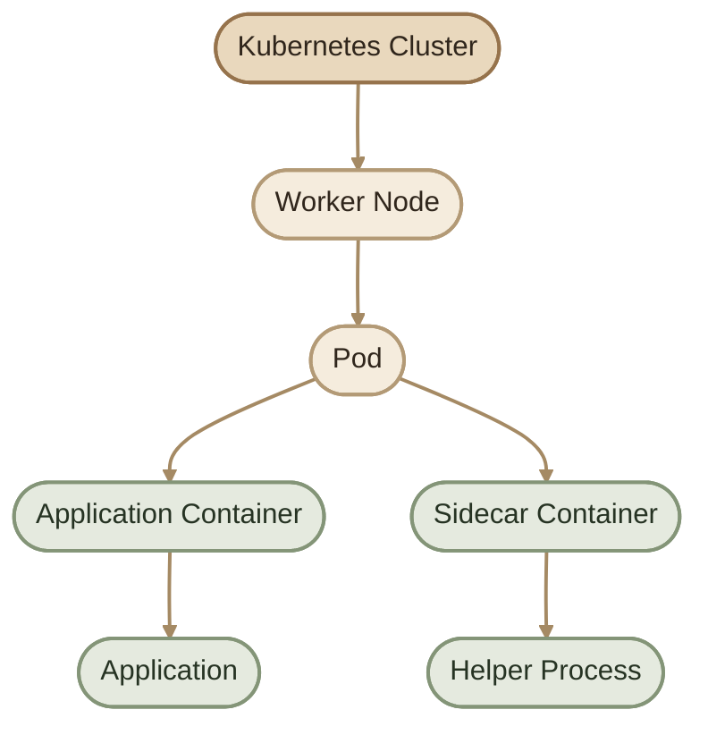
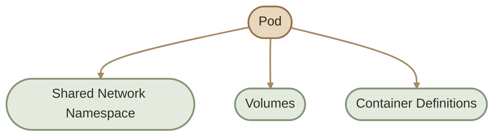
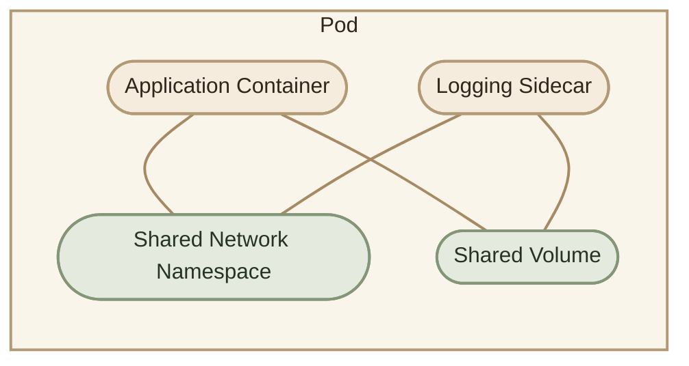
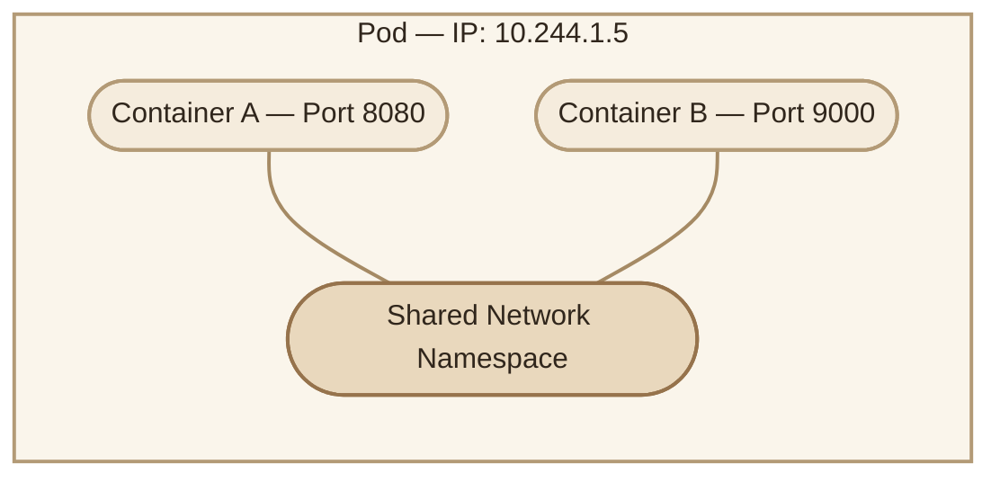
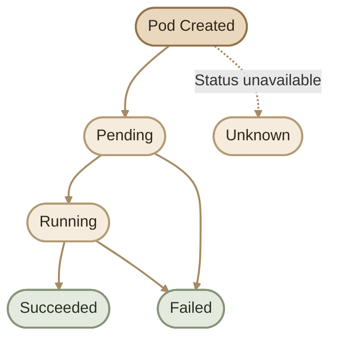
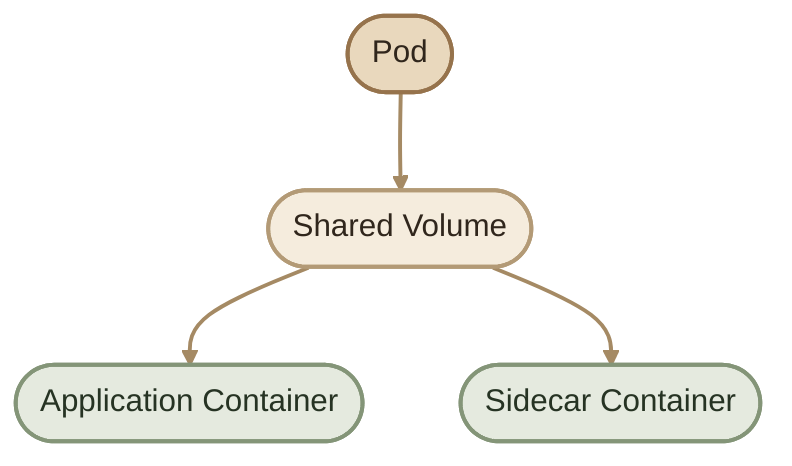

## Introduction

لما نبدأ نتعلم Kubernetes، أول مفهوم أساسي لازم نفهمه هو الـ **Pod**.

الـ Pod هو أصغر وحدة قابلة للنشر (Smallest Deployable Unit) في Kubernetes. بدل ما Kubernetes يدير الـ Containers بشكل منفصل كـ Workloads، بيستخدم الـ Pod كـ abstraction layer لتعريف وتشغيل Container واحد أو أكثر مع بعض.

ببساطة:

- **Container:** بيشغّل الـ Application أو الـ Process.
- **Pod:** بيحدد الـ Containers وإعدادات التشغيل والموارد المشتركة بينهم.
- **Kubernetes:** بيدير الـ Pods من خلال الـ Controllers والـ Scheduler والـ Kubelet والـ Container Runtime.

<Callout type="note">
  الـ Pod مش بديل عن الـ Container، ومش هو اللي بيشغّل الـ Application بنفسه. الـ Pod هو Kubernetes resource بيحدد الـ desired configuration، والـ Container Runtime هو اللي بيشغّل الـ Containers فعليًا.
</Callout>



## 1. What Is a Pod?

الـ Pod هو مجموعة من Container واحد أو أكثر، بيتم تشغيلهم وإدارتهم كوحدة واحدة.

في أغلب الحالات، الـ Pod بيحتوي على Container واحد مسؤول عن تشغيل الـ Application. لكن أحيانًا بنحتاج أكتر من Container داخل نفس الـ Pod، زي Application Container مع Sidecar مسؤول عن وظيفة مساعدة.

مثال:



في المثال ده:

- اسم الـ Pod هو `nginx-pod`.
- جواه Container اسمه `nginx`.
- الـ Container بيستخدم Nginx Image لتشغيل Web Server.

## 2. Pod Architecture

الـ Pods بتشتغل داخل Kubernetes Cluster، وغالبًا بتتوزع على الـ Worker Nodes.



كل Pod بيتحدد له Node بواسطة الـ Scheduler، وبعد كده الـ Kubelet الموجود على الـ Node بيتولى تنفيذ الـ Pod configuration بالتعاون مع الـ Container Runtime.

**ملحوظة:** مش شرط الـ Pod يحتوي على Containerين؛ الرسم السابق بيوضح مثالًا توضيحيًا لحالة Multi-container Pod.

## 3. Why Does Kubernetes Use Pods?

ممكن نسأل: ليه Kubernetes ما يديرش كل Container بشكل منفصل؟

الـ Pod بيوفر مجموعة من الخصائص اللي بتخلي تشغيل الـ Containers المرتبطة ببعض أسهل:

<CardGrid>
  <InfoCard title="Networking" icon="network">
    الـ Containers داخل نفس الـ Pod بتشارك Network Namespace، وبالتالي بتستخدم نفس الـ Pod IP والـ Port Space.
  </InfoCard>
  <InfoCard title="Shared Storage" icon="database">
    ممكن الـ Containers تشارك الملفات من خلال Volumes يتم تعريفها في الـ Pod spec وتركيبها داخل كل Container محتاجها.
  </InfoCard>
  <InfoCard title="Container Grouping" icon="layers">
    بيجمع Containers المرتبطة ببعض في وحدة تشغيل واحدة، زي Application وSidecar.
  </InfoCard>
  <InfoCard title="Lifecycle Management" icon="cycle">
    بيوفر Kubernetes object واحد لتعريف وتشغيل مجموعة الـ Containers المرتبطة بالـ Pod.
  </InfoCard>
</CardGrid>



## 4. Pod vs Container

مهم جدًا نفرّق بين الـ Pod والـ Container لأن كل واحد ليه دور مختلف.

| Container | Pod |
|---|---|
| بيشغّل Application Process | Kubernetes unit for deploying workloads |
| بيستخدم Container Image | بيحتوي على Container definitions |
| بيتم تشغيله بواسطة Container Runtime | بيتم إدارته كـ Kubernetes resource |
| عنده Filesystem خاص بالـ Container | بيقدر يوفّر Volumes مشتركة بين الـ Containers |
| بيشارك الـ Network Namespace مع Containers الأخرى داخل نفس الـ Pod | عنده Pod IP وNetwork Namespace مشتركة بين الـ Containers |

<Callout type="warning">
  وجود Containerين في نفس الـ Pod مش معناه إنهم بيشاركوا الـ Filesystem بالكامل. كل Container عنده Container filesystem خاص بيه، لكن ممكن يتشاركوا الملفات من خلال Volume مشتركة يتم Mount لها داخل كل Container.
</Callout>

## 5. Pods with Multiple Containers

الـ Pod ممكن يحتوي على أكتر من Container لما يكون فيه احتياج حقيقي إنهم يشتغلوا مع بعض كوحدة واحدة.

مثال: Application Container مع Logging Sidecar.



في السيناريو ده:

- الـ Application Container بيشغّل التطبيق.
- الـ Logging Sidecar بيقرأ أو يعالج الـ Logs.
- ممكن الاتنين يتواصلوا من خلال `localhost` لأنهم بيشاركوا نفس Network Namespace.
- ممكن يتشاركوا ملفات الـ Logs من خلال Volume مشتركة، بشرط تعريفها وعمل Mount داخل كل Container.

**Best Practice:** لو مفيش احتياج قوي لمشاركة الشبكة أو التخزين أو دورة التشغيل، غالبًا الأفضل تشغيل كل Application Component في Pod منفصل وإدارته باستخدام Workload Controller مناسب.

## 6. Pod Networking

كل الـ Containers داخل نفس الـ Pod بتشارك:

- **Network Namespace:** بيئة الشبكة المشتركة.
- **Pod IP:** عنوان IP واحد للـ Pod.
- **Port Space:** مساحة المنافذ المشتركة بين الـ Containers.

وده معناه إن الـ Containers داخل نفس الـ Pod ممكن تتواصل مع بعضها عن طريق `localhost`.

### I. Networking Example



في المثال، الـ Container A والـ Container B بيشاركوا نفس الـ Pod IP، لكن كل واحد بيستخدم Port مختلف.

لو الـ Container A بيستمع على `8080`، يقدر الـ Container B يتواصل معاه من خلال:

```text
http://localhost:8080
```

**مهم:** بما إن الـ Port Space مشتركة، مينفعش عمليًا إن عمليتين داخل نفس الـ Pod يستمعوا على نفس الـ IP ونفس الـ Port في نفس الوقت من غير إعداد خاص. ده ممكن يؤدي إلى Port conflict.

### II. Pod Network Flow

في العادة، الـ Clients بتوصل للتطبيق من خلال Service بدل الاعتماد على Pod IP مباشرةً.


الـ Service بتوفّر طريقة ثابتة للوصول إلى مجموعة من الـ Pods المطابقة للـ Selector الخاص بيها، بدل الاعتماد على عناوين الـ Pods اللي ممكن تتغير مع إعادة إنشائها.

## 7. Creating the First Pod

في Kubernetes، بنعرّف الـ Resources باستخدام ملفات YAML اسمها **Manifests**.

هننشئ Pod بيشغّل Nginx باستخدام الـ Image `nginx:1.29-alpine`.

احفظ الملف باسم `nginx-pod.yaml`:

```yaml
apiVersion: v1
kind: Pod
metadata:
  name: nginx-pod
  labels:
    app: nginx
spec:
  containers:
    - name: nginx
      image: nginx:1.29-alpine
      ports:
        - containerPort: 80
```

### I. Understanding Pod YAML

#### A. `apiVersion`

بيحدد إصدار Kubernetes API المستخدم لتعريف الـ Resource.

```yaml
apiVersion: v1
```

الـ Pods بتستخدم `v1` من الـ Core API Group.

#### B. `kind`

بيحدد نوع الـ Resource اللي بننشئه.

```yaml
kind: Pod
```

يعني إن الـ Manifest بيعرّف Kubernetes Pod.

#### C. `metadata`

بيحتوي على معلومات تعريفية عن الـ Resource، زي الاسم والـ Labels والـ Annotations.

```yaml
metadata:
  name: nginx-pod
  labels:
    app: nginx
```

- `name`: اسم الـ Pod داخل الـ Namespace.
- `labels`: بتساعد في تصنيف الـ Pods واختيارها باستخدام Selectors.

#### D. `spec`

بيحدد الـ Desired Configuration للـ Pod، زي الـ Containers والـ Volumes والموارد المطلوبة.

```yaml
spec:
  containers:
```

#### E. `containers`

بيحدد الـ Containers اللي Kubernetes مطلوب منه يشغّلها داخل الـ Pod.

```yaml
containers:
  - name: nginx
    image: nginx:1.29-alpine
```

- `name`: اسم الـ Container داخل الـ Pod.
- `image`: الـ Container Image المستخدمة.
- `ports`: توثّق الـ Container Port المتوقع استخدامه بواسطة التطبيق؛ لكنها مش بتنشئ Service ولا بتفتح المنفذ خارجيًا لوحدها.

## 8. Creating the Pod

بعد حفظ الملف، نفّذ:

```bash
kubectl apply -f nginx-pod.yaml
```

لعرض الـ Pod:

```bash
kubectl get pods
```

مثال على شكل النتيجة:

```text
NAME        READY   STATUS    RESTARTS   AGE
nginx-pod   1/1     Running   0          10s
```

معنى الأعمدة:

- `READY`: عدد الـ Containers الجاهزة مقارنةً بإجمالي عددها.
- `STATUS`: الـ Pod Phase المعروضة في الجدول.
- `RESTARTS`: عدد مرات إعادة تشغيل الـ Containers.
- `AGE`: عمر الـ Pod منذ إنشائه.

## 9. Inspecting Pods

في شغل Kubernetes اليومي، إنشاء الـ Pod مجرد خطوة أولى. لازم نعرف إزاي نتحقق من حالته ونفهم تفاصيله.

### I. List Pods

```bash
kubectl get pods
```

لعرض تفاصيل أكتر:

```bash
kubectl get pods -o wide
```

الأمر ده بيعرض معلومات إضافية، زي الـ Node اللي الـ Pod شغّال عليها والـ Pod IP.

### II. Describe a Pod

```bash
kubectl describe pod nginx-pod
```

الأمر ده بيوضح معلومات مهمة، منها:

- Node assignment.
- Container state.
- Image.
- Events.
- أسباب فشل الجدولة أو بدء التشغيل، لو موجودة.

### III. View Pod YAML

```bash
kubectl get pod nginx-pod -o yaml
```

مفيد لمراجعة الـ Configuration الفعلية والـ Status اللي Kubernetes بيرجّعهم.

### IV. View Container Logs

```bash
kubectl logs nginx-pod
```

لو الـ Pod فيه أكتر من Container، حدد اسم الـ Container:

```bash
kubectl logs nginx-pod -c nginx
```

## 10. Pod Lifecycle

الـ Pod بيمر بمراحل مختلفة خلال حياته. الـ Pod Phase بتوصف حالته العامة، لكنها مش وصف تفصيلي لكل حالة ممكنة للـ Containers.

الـ Phases الأساسية هي:

- `Pending`
- `Running`
- `Succeeded`
- `Failed`
- `Unknown`



الرسم توضيحي للمسارات الشائعة، مش State Machine كاملة لكل الانتقالات الممكنة.

## 11. Understanding Pod Phases

### I. Pending

معناها إن الـ Pod اتقبل في الـ Cluster، لكن الـ Containers مش كلها جاهزة للتشغيل بعد.

أسباب محتملة:

- الـ Scheduler لسه ما اختارش Node.
- الـ Container Image لسه بتتسحب.
- فيه مشكلة في الـ Storage أو إعدادات التشغيل.
- الموارد المطلوبة مش متاحة على الـ Nodes المناسبة.

للتشخيص:

```bash
kubectl describe pod nginx-pod
```

راجع قسم `Events` عشان تعرف السبب الفعلي بدل ما تفترض إن كل `Pending` معناها Scheduling problem.

### II. Running

معناها إن الـ Pod اتربط بـ Node، وإن الـ Containers اتعمل لها إنشاء، وإن Container واحد على الأقل بيشتغل أو في مرحلة بدء التشغيل أو إعادة التشغيل.

لكن `Running` مش بالضرورة معناها إن الـ Application جاهز لاستقبال Traffic؛ لازم تراجع حالة الـ Readiness والـ Probes لو موجودة.

### III. Succeeded

معناها إن كل الـ Containers داخل الـ Pod انتهت بنجاح، ومش هتتم إعادة تشغيلها.

الحالة دي شائعة في الـ Batch workloads والـ Jobs اللي بتنفذ مهمة وتنتهي.

### IV. Failed

معناها إن كل الـ Containers داخل الـ Pod انتهت، وواحد على الأقل انتهى بفشل.

أسباب محتملة:

- Application process خرج بكود خطأ.
- Container اتوقف بسبب مشكلة أثناء التنفيذ.
- حصلت مشكلة أدت لإنهاء الـ Containers.

لمعرفة السبب، راجع الـ Logs والـ Events وContainer termination state.

### V. Unknown

معناها إن Kubernetes مش قادر يحدد حالة الـ Pod، غالبًا بسبب مشكلة في التواصل مع الـ Node أو عدم القدرة على الحصول على الحالة الحالية.

دي مش حالة طبيعية متوقعة لتشغيل مستقر، ولازم تتراجع تفاصيل الـ Node والـ Pod.

<Callout type="note">
  `CrashLoopBackOff` مش Pod Phase. دي حالة انتظار مرتبطة بتأخير إعادة تشغيل Container فشل مرارًا. ممكن تشوف الـ Pod في جدول `kubectl get pods` وحالته `CrashLoopBackOff`، بينما الـ Pod Phase الفعلية تكون `Running`.
</Callout>

## 12. Pod Phase vs Container State

الفرق ده مهم جدًا أثناء الـ Troubleshooting.

| Pod Phase | Container State |
|---|---|
| بتوصف الحالة العامة للـ Pod | بتوصف حالة Container محدد |
| أمثلة: `Pending`, `Running`, `Succeeded`, `Failed` | أمثلة: `Waiting`, `Running`, `Terminated` |
| بتظهر في `.status.phase` | بتظهر في `.status.containerStatuses[].state` |
| مش بتوضح وحدها سبب فشل Container | ممكن تحتوي على سبب الانتظار أو الإنهاء |

لمراجعة تفاصيل الـ Container:

```bash
kubectl get pod nginx-pod -o jsonpath='{.status.containerStatuses[*].state}'
```

ولعرض الأحداث والتفاصيل بشكل أوضح:

```bash
kubectl describe pod nginx-pod
```

## 13. Pod Storage Fundamentals

الـ Containers داخل نفس الـ Pod مش بتشارك الـ Filesystem بالكامل بشكل تلقائي.

لو محتاج Containerين يشوفوا نفس الملفات، تقدر تعرّف Volume في الـ Pod spec وتعمل Mount للـ Volume داخل كل Container.



الـ Volume بتسمح للـ Containers بالوصول لنفس البيانات، حسب إعدادات الـ Mount والصلاحيات. لكن نوع الـ