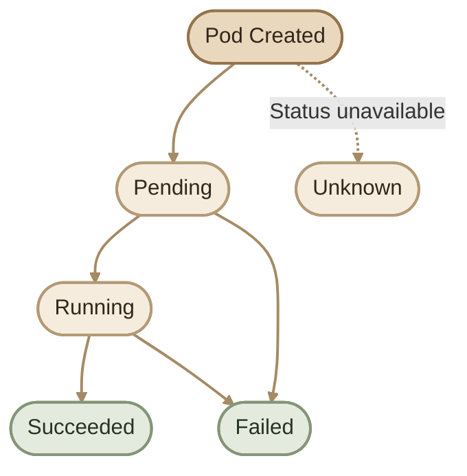
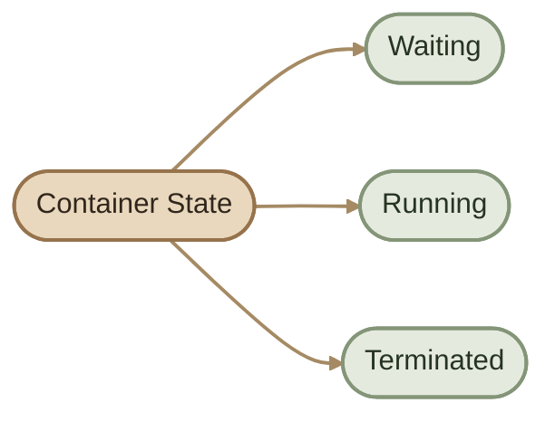
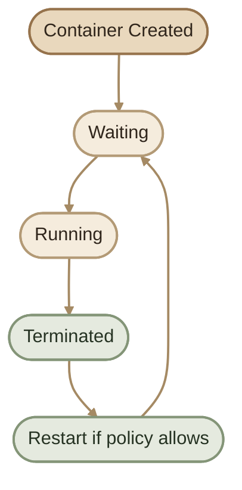
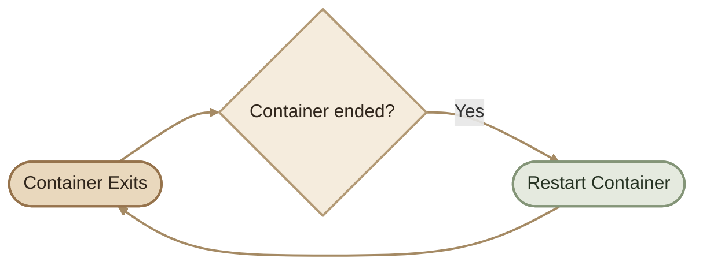
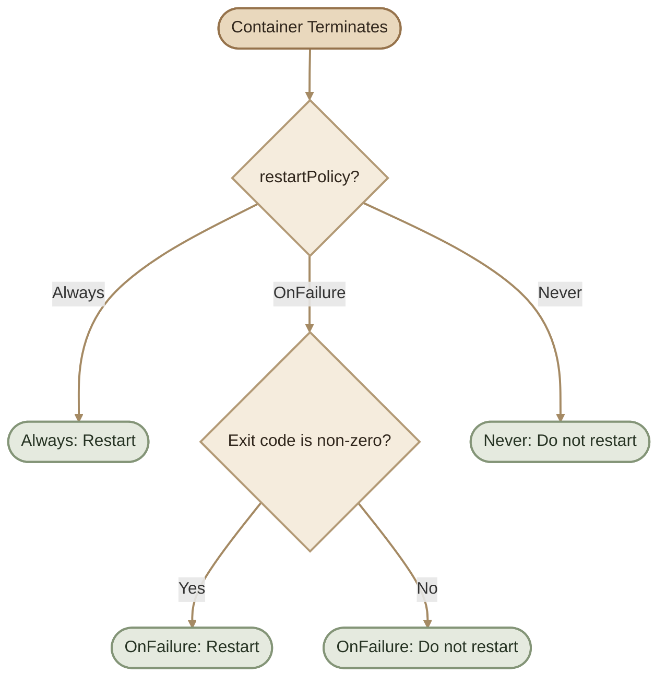
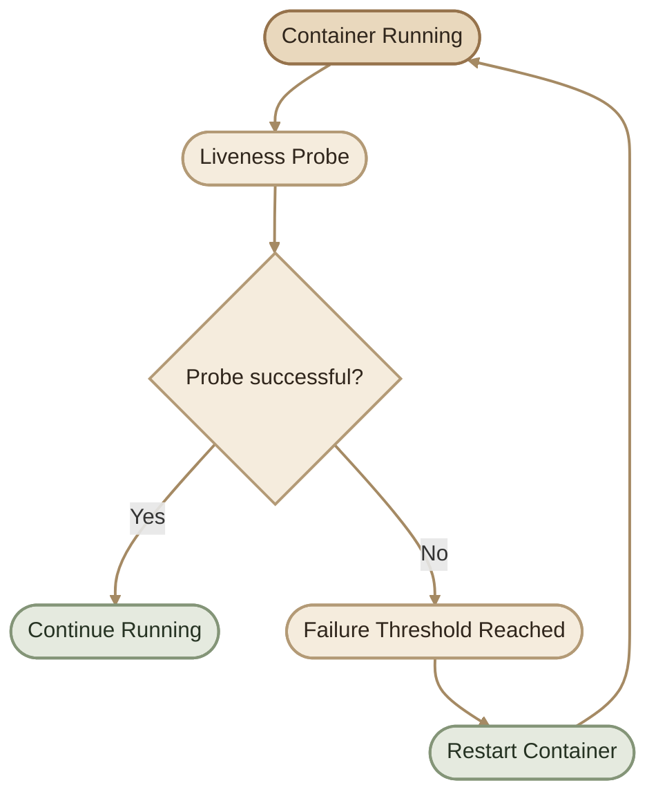
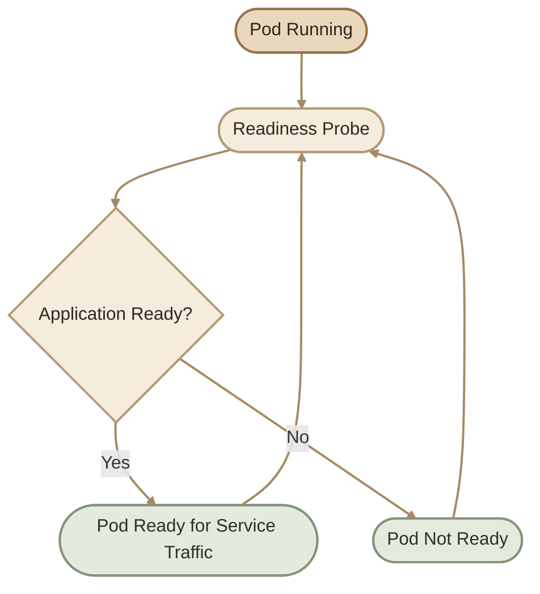
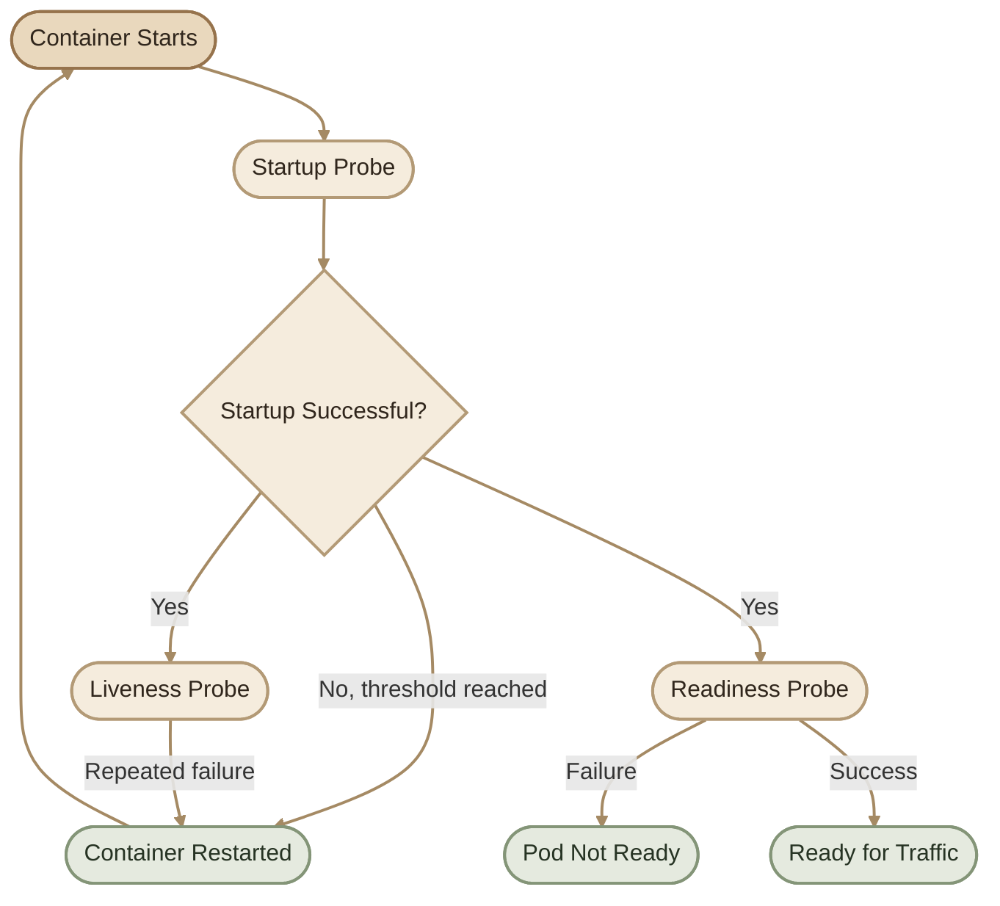
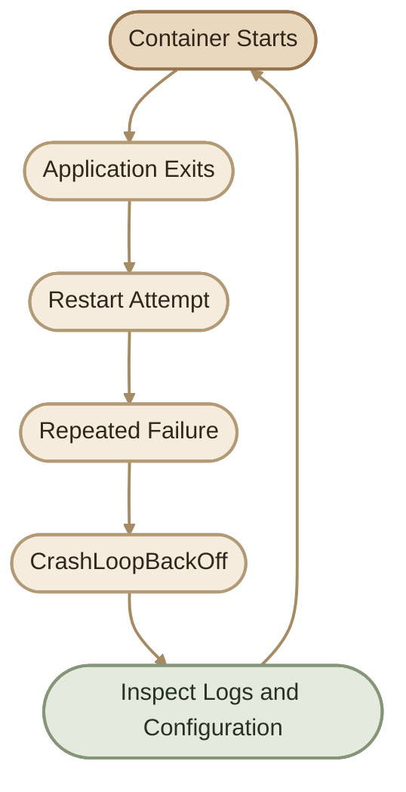
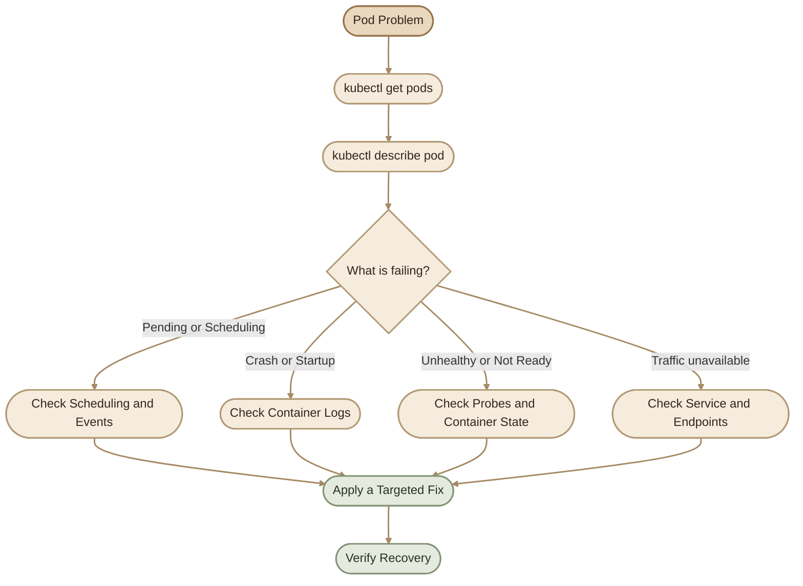

## Introduction

في المواضيع السابقة، فهمنا:

- إيه هو الـ Pod وإزاي Kubernetes بيشغّله.
- إزاي نكتب Pod Configuration باستخدام YAML.
- إزاي نحدد `command` و`args`.
- إزاي نضبط CPU وMemory Requests وLimits.

لكن في بيئة الـ Production، السؤال الأهم هو: **إيه اللي بيحصل لما الـ Application يفشل؟**

ممكن نواجه مشاكل مختلفة:

- الـ Container بيتوقف ويبدأ من جديد باستمرار.
- الـ Application مش بيستجيب رغم إن الـ Container شغال.
- الـ Pod موجود في حالة `Pending` ومش بيتجدول.
- Kubernetes مش قادر يسحب الـ Container Image.
- الـ Application شغال، لكن الـ Service مش قادر يوصله للـ Clients.

عشان نفهم المشاكل دي، لازم نعرف خمس مفاهيم أساسية:

<CardGrid>
  <InfoCard title="Pod Lifecycle" icon="cycle">
    مراحل حياة الـ Pod من إنشائه لحد انتهاء تشغيله.
  </InfoCard>
  <InfoCard title="Container States" icon="pulse">
    الحالة الفعلية لكل Container، زي `Waiting` و`Running` و`Terminated`.
  </InfoCard>
  <InfoCard title="Restart Policy" icon="cycle">
    القواعد اللي بتحدد إمتى Kubernetes يعيد تشغيل الـ Container.
  </InfoCard>
  <InfoCard title="Health Probes" icon="shield">
    اختبارات بتساعد Kubernetes يعرف إذا كان التطبيق بدأ، ولسه شغال، وجاهز لاستقبال Traffic.
  </InfoCard>
</CardGrid>

## 1. Pod Lifecycle

### I. What Is Pod Lifecycle?

الـ **Pod Lifecycle** هي دورة حياة الـ Pod من لحظة قبول الـ Pod object في الـ Cluster، مرورًا بالتشغيل، لحد انتهاء الـ Workload أو فشلها.

Kubernetes بيعرض الحالة العامة للـ Pod من خلال `phase`، لكن لازم نفرّق بين الـ Pod Phase وحالة الـ Container نفسه.

المراحل الأساسية للـ Pod هي:

- `Pending`
- `Running`
- `Succeeded`
- `Failed`
- `Unknown`

## 2. Pod Lifecycle Flow



الرسم بيوضح المسارات الشائعة، لكنه مش مخطط كامل لكل الانتقالات الممكنة.

<Callout type="note">
  الـ Pod مش لازم يمر بكل Phase بالترتيب الموجود في الرسم. كمان `CrashLoopBackOff` و`ImagePullBackOff` مش Pod Phases؛ دول حالات أو أسباب انتظار بتظهر في تفاصيل الـ Containers، وغالبًا في عمود `STATUS` في `kubectl get pods`.
</Callout>

## 3. Understanding Pod Phases

### I. Pending

الـ `Pending` معناها إن الـ Pod اتقبل في الـ Cluster، لكن الـ Containers لسه مش كلها بدأت التشغيل.

أسباب محتملة:

- الـ Scheduler لسه ما اختارش Node.
- الموارد المطلوبة مش متاحة على الـ Nodes المناسبة.
- الـ Container Image لسه بتتسحب.
- الـ Storage أو بعض إعدادات التشغيل لسه مش جاهزة.

اعرض الـ Pods:

```bash
kubectl get pods
```

مثال:

```text
NAME        READY   STATUS    RESTARTS   AGE
nginx-pod   0/1     Pending   0          15s
```

لفهم السبب الحقيقي، نفّذ:

```bash
kubectl describe pod nginx-pod
```

وابحث عن قسم `Events`.

مثال:

```text
Warning  FailedScheduling
0/1 nodes are available: Insufficient cpu.
```

ده معناه إن الـ Scheduler مش لاقي Node مناسبة حسب الموارد والقيود المطلوبة.

**الحل:** راجع الـ Requests، وسعة الـ Nodes، وأي Scheduling constraints زي Node Affinity وTaints وTolerations.

### II. Running

الـ `Running` معناها إن الـ Pod اتربط بـ Node، وإن الـ Containers اتعمل لها إنشاء. ممكن تكون بعض الـ Containers لسه بتبدأ أو بتُعاد تشغيلها.

مثال:

```text
NAME        READY   STATUS    RESTARTS   AGE
nginx-pod   1/1     Running   0          30s
```

لكن لازم نلاحظ الفرق:

- `STATUS = Running`: الـ Pod في مرحلة التشغيل.
- `READY = 1/1`: كل الـ Containers المطلوبة للـ Readiness داخل الـ Pod جاهزة وفق حالة Kubernetes الحالية.

حتى لو الـ Pod `Running`، ده مش ضمان إن الـ Application شغال بشكل سليم أو إن كل الـ Requests هتنجح.

### III. Succeeded

الـ `Succeeded` معناها إن كل الـ Containers داخل الـ Pod انتهت بنجاح ومش هتتم إعادة تشغيلها.

بتظهر غالبًا مع الـ Workloads اللي بتنفّذ مهمة وتنتهي، زي:

- Kubernetes Jobs.
- Batch processing.
- One-time tasks.

في جدول `kubectl get pods` ممكن تشوف `Completed` بدل `Succeeded`، وده عرض مختصر للحالة.

### IV. Failed

الـ `Failed` معناها إن كل الـ Containers داخل الـ Pod انتهت، وواحد على الأقل انتهى بفشل.

أسباب محتملة:

- الـ Application خرج بكود خطأ.
- الـ Configuration غير صحيحة.
- الـ Application مش لاقي ملفات أو Dependencies مطلوبة.
- حصل خطأ أدى إلى إنهاء الـ Process.

استخدم:

```bash
kubectl describe pod nginx-pod
kubectl logs nginx-pod
```

علشان تعرف السبب بدل ما تعتمد على الـ Phase وحدها.

### V. Unknown

الـ `Unknown` معناها إن Kubernetes مش قادر يحدد حالة الـ Pod، غالبًا بسبب مشكلة في التواصل مع الـ Node.

راجع الـ Node والـ Pod:

```bash
kubectl get nodes
kubectl describe pod nginx-pod
```

## 4. Container States

الـ Pod ممكن يحتوي على Container واحد أو أكتر، وكل Container ليه State خاص بيه.

Kubernetes بيعرض ثلاث حالات أساسية للـ Container:



### I. Waiting

الـ `Waiting` معناها إن الـ Container مش شغال حاليًا، وKubernetes مستني شرط أو عملية تسمح له بالبدء.

أمثلة:

- سحب الـ Image.
- فشل تحميل الـ Image.
- انتظار إعدادات أو ملفات مطلوبة.
- تأخير إعادة التشغيل بعد فشل متكرر.

ممكن تشوف سبب زي:

```text
State:       Waiting
Reason:      ImagePullBackOff
```

ده معناه إن الـ Container مش قادر يبدأ بسبب مشكلة في سحب الـ Image.

### II. Running

الـ `Running` معناها إن الـ Container اتشغّل، وإن الـ main process شغال.

لكن ده مش معناه تلقائيًا إن التطبيق بيستجيب بشكل صحيح؛ عشان كده بنستخدم Health Probes.

### III. Terminated

الـ `Terminated` معناها إن الـ Container انتهى، سواء بنجاح أو بفشل.

مثال على انتهاء ناجح:

```text
State:       Terminated
Reason:      Completed
Exit Code:   0
```

ومثال على انتهاء بسبب خطأ:

```text
State:       Terminated
Reason:      Error
Exit Code:   1
```

غالبًا `Exit Code 0` بيدل على النجاح، بينما الكود غير الصفري بيدل على خطأ. لكن لازم تراجع الـ Application behavior والـ Logs عشان تفهم السياق.

## 5. Container State Flow



الرسم بيشرح دورة شائعة عند إعادة تشغيل الـ Container. مش كل Container لازم يمر بنفس التسلسل، وقرار إعادة التشغيل بيعتمد على الـ Restart Policy وحالة انتهاء الـ Process.

## 6. Restart Policy

### I. What Is `restartPolicy`?

الـ `restartPolicy` بتحدد إمتى Kubernetes يعيد تشغيل الـ Container داخل الـ Pod بعد ما ينتهي.

مثال:

```yaml
spec:
  restartPolicy: Always
```

الـ Pod بيستخدم واحدة من ثلاث Policies:

| Policy | Behavior |
|---|---|
| `Always` | يعيد تشغيل الـ Container بعد انتهائه، سواء نجح أو فشل. |
| `OnFailure` | يعيد تشغيل الـ Container لو انتهى بكود خطأ غير صفري. |
| `Never` | مش بيحاول يعيد تشغيل الـ Container بعد انتهائه. |

الـ Default للـ Pods هو `Always` لو ما حددتش `restartPolicy` بنفسك.

<Callout type="note">
  الـ Restart Policy بتتحكم في إعادة تشغيل الـ Container داخل نفس الـ Pod. لكنها مش معناها إن Kubernetes هيعيد إنشاء Pod جديد دائمًا. إنشاء Pods بديلة غالبًا بيكون مسؤولية Controller زي Deployment أو Job.
</Callout>

## 7. The `Always` Policy

```yaml
spec:
  restartPolicy: Always
```

لو الـ Container انتهى، Kubernetes بيحاول يعيد تشغيله حتى لو انتهى بنجاح.

ده مناسب لتطبيقات الـ Long-running، زي Web Servers وAPIs، وهو الـ Default للـ Pods.



الـ Kubernetes بيضيف Backoff Delay عند تكرار الفشل بسرعة، عشان ما يفضلش يحاول إعادة التشغيل بلا توقف وبأقصى سرعة.

## 8. The `OnFailure` Policy

```yaml
spec:
  restartPolicy: OnFailure
```

الـ Container بيتعاد تشغيله لو انتهى بفشل، لكن لو انتهى بنجاح مش بيتم إعادة تشغيله.

مثال:

| Container Exit | Behavior |
|---|---|
| Exit Code `0` | لا يتم إعادة التشغيل |
| Exit Code `1` | يتم محاولة إعادة التشغيل |

الـ Policy دي مفيدة لبعض الـ Batch Tasks، لكن الـ Jobs عادةً بتكون اختيار أنسب لإدارة المهام اللي لها بداية ونهاية.

## 9. The `Never` Policy

```yaml
spec:
  restartPolicy: Never
```

لو الـ Container انتهى، Kubernetes مش هيعيد تشغيله داخل نفس الـ Pod.

ممكن تستخدمها في بعض الـ One-time tasks، خصوصًا أثناء الـ Debugging، لكن لو عايز إدارة موثوقة لمهام قصيرة، راجع استخدام Kubernetes Job.

**مهم:** الـ Pods اللي بيتم إنشاؤها بواسطة Job بتدعم `Never` و`OnFailure`، بينما `Always` مش اختيار صالح في Job Pod template.

## 10. Restart Policy Decision Flow



## 11. Health Probes

### I. Why Do We Need Probes?

ممكن الـ Container يكون `Running`، لكن الـ Application داخله مش بيستجيب أو لسه مش جاهز لاستقبال Traffic.

مثال:

```text
Container: Running
Application: Not responding
```

Kubernetes مش بيقدر يستنتج صحة التطبيق بشكل كامل من مجرد إن الـ Process شغال. عشان كده بنستخدم **Health Probes**.

الـ Probe هي اختبار بيعمله الـ Kubelet علشان يقيّم حالة الـ Container وفقًا للشرط اللي إحنا حددناه.

## 12. Types of Probes

Kubernetes بيوفر ثلاث أنواع أساسية:

<CardGrid>
  <InfoCard title="Liveness" icon="pulse">
    هل الـ Application محتاج Restart لأنه مش سليم؟
  </InfoCard>
  <InfoCard title="Readiness" icon="shield">
    هل الـ Application جاهز لاستقبال Traffic؟
  </InfoCard>
  <InfoCard title="Startup" icon="cycle">
    هل الـ Application خلّص مرحلة البداية؟
  </InfoCard>
</CardGrid>

## 13. Liveness Probe

### I. What Is a Liveness Probe?

الـ `livenessProbe` بتساعد Kubernetes يعرف إذا كان الـ Application لسه قادر يشتغل، ولا دخل في حالة فشل محتاجة إعادة تشغيل.

لو الـ Liveness Probe فشلت بشكل متكرر ووصلت إلى `failureThreshold`، الـ Kubelet بيعتبر الـ Container غير سليم، وبيحاول إعادة تشغيله حسب الـ Restart Policy.

مثال:

```yaml
livenessProbe:
  httpGet:
    path: /
    port: 80
  initialDelaySeconds: 10
  periodSeconds: 5
  timeoutSeconds: 1
  failureThreshold: 3
```

شرح الإعدادات:

- `httpGet`: بيعمل HTTP request إلى الـ Endpoint المحدد.
- `path`: مسار الـ Endpoint المطلوب اختباره.
- `port`: المنفذ اللي التطبيق بيستقبل عليه.
- `initialDelaySeconds`: فترة انتظار قبل بدء الفحص.
- `periodSeconds`: الفاصل الزمني بين الفحوصات.
- `timeoutSeconds`: أقصى مدة انتظار لنتيجة الفحص.
- `failureThreshold`: عدد حالات الفشل المتتالية المطلوبة قبل اعتبار الـ Probe فاشلة.

**ملحوظة:** المثال مناسب لو الـ Nginx داخل الـ Container بيستقبل HTTP على Port 80. لو التطبيق بيستخدم Port مختلف أو Endpoint مخصص للصحة، لازم تعدّل الإعدادات.

### II. Liveness Flow



## 14. Readiness Probe

### I. What Is a Readiness Probe?

الـ `readinessProbe` بتحدد إذا كان الـ Application جاهز يستقبل Requests ولا لأ.

الفرق الأساسي:

- **Liveness:** هل محتاجين نعيد تشغيل الـ Container؟
- **Readiness:** هل نقدر نبعت Traffic للـ Application حاليًا؟

مثال:

```yaml
readinessProbe:
  httpGet:
    path: /
    port: 80
  periodSeconds: 5
  timeoutSeconds: 1
  failureThreshold: 3
```

لو الـ Readiness Probe فشلت، Kubernetes بيعتبر الـ Container غير جاهز. ولو الـ Pod تابع لـ Service، الـ Pod بيتشال من الـ ready endpoints المستخدمة لتوجيه الـ Traffic.

الـ Container مش بيتعمله Restart لمجرد إن الـ Readiness Probe فشلت.

### II. Readiness Flow



الـ Probe بتتكرر علشان Kubernetes يقدر يحدّث حالة الـ Readiness مع تغير حالة التطبيق.

## 15. Startup Probe

### I. What Is a Startup Probe?

الـ `startupProbe` بتستخدم مع التطبيقات اللي بتحتاج وقت طويل عشان تبدأ.

أمثلة:

- تطبيقات Java كبيرة.
- Legacy Applications.
- Applications بتعمل Initialization طويل أو بتحمّل بيانات قبل الاستعداد.

من غير Startup Probe مناسبة، الـ Liveness Probe ممكن تبدأ بدري وتعتبر التطبيق فاشل قبل ما يكمّل مرحلة الـ Initialization.

مثال:

```yaml
startupProbe:
  httpGet:
    path: /
    port: 8080
  periodSeconds: 10
  timeoutSeconds: 1
  failureThreshold: 30
```

في المثال ده، Kubernetes بيتيح لعملية الـ Startup وقتًا يصل تقريبًا إلى خمس دقائق من الفحوصات الفاشلة المتتالية قبل اعتبار الـ Startup Probe فاشلة، مع مراعاة توقيت بدء الفحص والـ Timeout.

لو الـ Startup Probe فشلت ووصلت للـ Threshold، الـ Container بيتعمله Restart حسب الـ Restart Policy.

<Callout type="note">
  لو الـ Startup Probe متعرفة، Kubernetes مش بيبدأ تشغيل الـ Liveness والـ Readiness Probes الخاصة بالـ Container لحد ما الـ Startup Probe تنجح.
</Callout>

## 16. Probe Relationships



الرسم بيوضح العلاقة العامة بين الـ Probes. عمليًا، الـ Liveness والـ Readiness بيتم تقييمهم بصورة مستقلة بعد نجاح الـ Startup Probe.

## 17. Complete Probe Configuration

ده مثال كامل لـ Nginx Pod مع Liveness وReadiness Probes.

احفظ الملف باسم `nginx-probes.yaml`:

```yaml
apiVersion: v1
kind: Pod
metadata:
  name: nginx-probes
  labels:
    app: nginx
spec:
  containers:
    - name: nginx
      image: nginx:1.29-alpine
      ports:
        - containerPort: 80
      startupProbe:
        httpGet:
          path: /
          port: 80
        periodSeconds: 5
        failureThreshold: 30
      livenessProbe:
        httpGet:
          path: /
          port: 80
        periodSeconds: 10
        timeoutSeconds: 1
        failureThreshold: 3
      readinessProbe:
        httpGet:
          path: /
          port: 80
        periodSeconds: 5
        timeoutSeconds: 1
        failureThreshold: 3
```

طبّق الملف:

```bash
kubectl apply -f nginx-probes.yaml
kubectl get pod nginx-probes
kubectl describe pod nginx-probes
```

راجع الـ Readiness والـ Events:

```bash
kubectl get pod nginx-probes -o wide
kubectl describe pod nginx-probes
```

**مهم:** المثال بيستخدم `/` للتوضيح، وده مناسب لـ Nginx الافتراضي. في التطبيقات الحقيقية، اختار Endpoints مصممة لفحص الصحة والاستعداد، وتجنب إن فشل Dependency خارجي يؤدي إلى Restart متكرر غير ضروري بسبب Liveness Probe.

## 18. Practical Troubleshooting Scenarios

في القسم ده هنستخدم نفس أسلوب التفكير في كل مشكلة:

1. نلاحظ الـ Symptom.
2. نجمع Evidence.
3. نحدد السبب المحتمل.
4. نختبر الحل ونتأكد من النتيجة.

### Scenario 1: Pod Stuck in Pending

**Problem**

```bash
kubectl get pods
```

Example:

```text
NAME        READY   STATUS    RESTARTS   AGE
nginx-pod   0/1     Pending   0          2m
```

**Investigation**

```bash
kubectl describe pod nginx-pod
```

راجع الـ `Events`. ممكن تلاقي:

```text
Warning  FailedScheduling
0/1 nodes are available: Insufficient cpu.
```

**Possible Causes**

- الـ CPU أو Memory Requests أكبر من السعة المتاحة.
- الـ Node عليها قيود Scheduling.
- مفيش Node مناسبة للـ Pod.

**Solution**

- راجع الـ Requests في الـ Manifest.
- راجع موارد الـ Nodes.
- افحص الـ Taints وTolerations والـ Affinity لو موجودة.
- بعد التعديل، طبّق الـ Manifest وتحقق من الحالة مرة تانية.

### Scenario 2: ImagePullBackOff

**Problem**

```text
STATUS: ImagePullBackOff
```

**Possible Causes**

- اسم الـ Image أو الـ Tag غير صحيح.
- الـ Image موجودة في Private Registry ومفيش Authentication مناسب.
- مشكلة في الاتصال بالـ Registry.
- الـ Image أو الـ Tag مش موجودين.

**Debug**

```bash
kubectl describe pod <pod-name>
```

راجع رسائل الـ Events لتعرف إذا كانت المشكلة `not found` أو Authentication أو Network-related.

**Solution**

- صحّح اسم الـ Image والـ Tag.
- اضبط `imagePullSecrets` لو الـ Registry خاص.
- تأكد إن الـ Node تقدر توصل للـ Registry.

### Scenario 3: CrashLoopBackOff

**Problem**

الـ Container بيبدأ، وبعدها بيقفل، وKubernetes بيحاول يشغّله تاني بشكل متكرر.

```text
STATUS: CrashLoopBackOff
```

الـ `CrashLoopBackOff` معناها إن Kubernetes بيأخر محاولات إعادة التشغيل تدريجيًا بعد تكرار الفشل بسرعة.



**Debug**

اعرض الـ Logs الحالية:

```bash
kubectl logs <pod-name>
```

ولو الـ Container عمل Restart، اعرض Logs المحاولة السابقة:

```bash
kubectl logs <pod-name> --previous
```

لو الـ Pod فيه أكتر من Container، حدد الـ Container باستخدام `-c`:

```bash
kubectl logs <pod-name> -c <container-name> --previous
```

**Possible Causes**

- Application crash أو Exception.
- `command` أو `args` غير صحيحة.
- Environment variables أو Configuration ناقصة.
- الـ Container بيخرج بعد انتهاء المهمة، بينما الـ Restart Policy بتعيد تشغيله.
- الـ Liveness أو Startup Probe بتفشل باستمرار.

**Solution**

- راجع الـ Logs والـ Exit Code.
- افحص الـ Command والـ Arguments.
- راجع الـ Environment Variables والـ Configurations.
- افحص الـ Probes وتأكد إنها مناسبة لوقت بدء التطبيق وسلوكه.

### Scenario 4: Pod Running but Application Is Not Working

**Problem**

```text
Pod: Running
Application: Not Available
```

الـ Pod ممكن يكون `Running`، لكن التطبيق مش بيستقبل Requests بشكل صحيح.

**Step 1: Check Pod Readiness**

```bash
kubectl get pods
kubectl describe pod <pod-name>
```

راجع عمود `READY`، وحالة الـ Readiness Probe والـ Events.

**Step 2: Inspect Logs**

```bash
kubectl logs <pod-name>
```

**Step 3: Test the Application Inside the Container**

لو الـ Container فيه `sh` و`wget`، ممكن تجرب:

```bash
kubectl exec <pod-name> -- sh -c 'wget -qO- http://127.0.0.1:80/'
```

الأمر ده بيختبر الـ HTTP endpoint محليًا من داخل الـ Container، بشرط وجود `sh` و`wget` وإن التطبيق بيستقبل على Port 80.

لو الأمر غير متاح في الـ Image، استخدم أداة موجودة بالفعل أو طريقة اختبار مناسبة للتطبيق.

**Step 4: Check Service and Endpoints**

لو التطبيق شغال محليًا لكن مش متاح من خلال الـ Service، راجع:

```bash
kubectl get svc
kubectl get endpointslices
```

وتأكد من تطابق الـ Service Selector مع الـ Pod Labels، ومن إن الـ Pods جاهزة لاستقبال Traffic.

### Scenario 5: Liveness Probe Keeps Restarting the Container

**Problem**

الـ Container بيعمل Restart باستمرار، والـ Events بتشير إلى فشل الـ Liveness Probe.

**Investigation**

```bash
kubectl describe pod <pod-name>
kubectl logs <pod-name> --previous
```

**Possible Causes**

- الـ Probe بتستخدم Port أو Path غير صحيح.
- التطبيق بيحتاج وقت أطول للبدء.
- الـ Timeout قصير جدًا.
- الـ Health Endpoint نفسه بيعتمد على خدمة ممكن تتعطل.
- الـ Liveness Probe بتفحص شرطًا أقوى من اللازم.

**Solution**

- صحّح الـ Port والـ Path.
- استخدم `startupProbe` لو التطبيق بيحتاج وقت طويل للبدء.
- راجع `timeoutSeconds` و`periodSeconds` و`failureThreshold`.
- خلي الـ Liveness Probe تقيس إن التطبيق قادر يواصل العمل، بدل ما تستخدمها لاختبار كل Dependency خارجي.

## 19. Complete Troubleshooting Workflow

استخدم الـ Workflow ده لما تلاقي Pod فيه مشكلة.



القاعدة الأساسية: **ما تبدأش بتغيير الـ Configuration قبل ما تجمع Evidence كفاية.** الـ Events والـ Logs والـ Container State هيساعدوك تحدد السبب بدل ما تجرّب حلول عشوائية.

## 20. Useful Debug Commands

| Command | Purpose |
|---|---|
| `kubectl get pods` | عرض حالة الـ Pods وعدد الـ Restarts |
| `kubectl get pods -o wide` | عرض تفاصيل إضافية، زي الـ Node والـ Pod IP |
| `kubectl describe pod <pod-name>` | فحص تفاصيل الـ Pod والـ Events |
| `kubectl logs <pod-name>` | عرض Logs الـ Container |
| `kubectl logs <pod-name> --previous` | عرض Logs آخر Container instance انتهى |
| `kubectl logs <pod-name> -c <container-name>` | تحديد Container في Pod متعدد الـ Containers |
| `kubectl exec <pod-name> -- <command>` | تنفيذ أمر داخل الـ Container |
| `kubectl get events --sort-by=.metadata.creationTimestamp` | مراجعة الأحداث مرتبة حسب وقت الإنشاء |
| `kubectl get nodes` | التحقق من حالة الـ Nodes |

لو الـ Pod داخل Namespace مختلفة عن الـ Default، استخدم `-n <namespace>` مع الأوامر المناسبة.

مثال:

```bash
kubectl get pods -n production
kubectl describe pod nginx-pod -n production
kubectl logs nginx-pod -n production
```

## 21. Best Practices

- استخدم `readinessProbe` لتحديد إمتى التطبيق يبقى جاهز لاستقبال Traffic.
- استخدم `livenessProbe` بحذر لتجنب إعادة تشغيل التطبيقات السليمة بسبب مشاكل مؤقتة.
- استخدم `startupProbe` للتطبيقات اللي بتحتاج وقتًا طويلًا للـ Initialization.
- اختار Probe Endpoint مناسب لكل Application.
- راجع `kubectl logs --previous` عند تكرار فشل الـ Container.
- راجع الـ Events قبل تعديل الـ Resources أو الـ Probes.
- استخدم Deployments أو Jobs حسب طبيعة الـ Workload، بدل الاعتماد على Pod منفرد في كل الحالات.
- اختبر التعديلات وتحقق من Recovery بعد تطبيقها.

## 22. Key Takeaways

<Callout type="tip">
  افتكر الفروق الأساسية دي:

  - `Pending`: الـ Pod لسه مش وصل لمرحلة التشغيل الكاملة.
  - `Running`: الـ Pod في مرحلة التشغيل، لكن ده مش ضمان لصحة التطبيق.
  - `Waiting`, `Running`, `Terminated`: حالات للـ Container نفسه.
  - `restartPolicy`: بتحدد سلوك إعادة تشغيل الـ Container داخل الـ Pod.
  - `Liveness`: بتساعد في اكتشاف الحالات اللي تحتاج Restart.
  - `Readiness`: بتحدد إذا كان الـ Container جاهز لاستقبال Traffic.
  - `Startup`: بتوفر وقت لبدء التطبيقات ببطء قبل تفعيل الـ Liveness والـ Readiness Probes.
  - `kubectl describe` و`kubectl logs` من أهم الأدوات لتحديد السبب الحقيقي للمشكلة.
</Callout>

فهم الـ Lifecycle والـ Probes والـ Restart Policy بيخليك تنتقل من مجرد ملاحظة إن الـ Pod فيه مشكلة إلى تشخيص السبب الفعلي واختيار حل مناسب.
