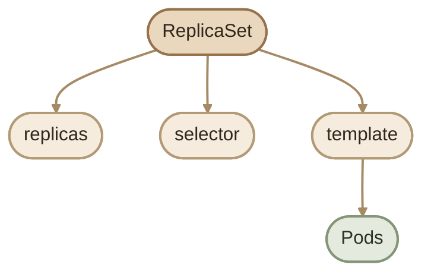
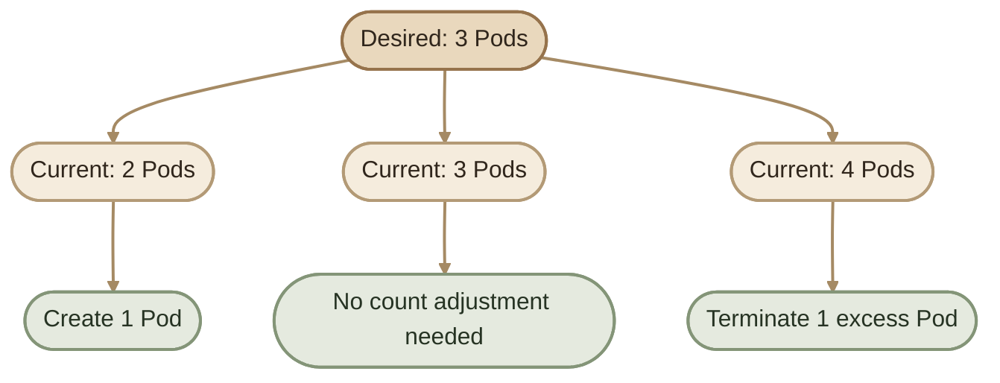
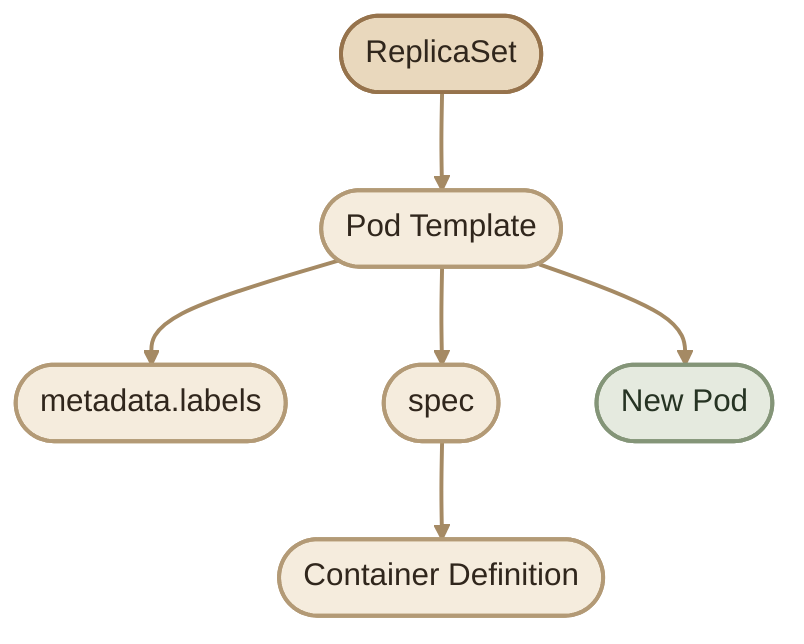
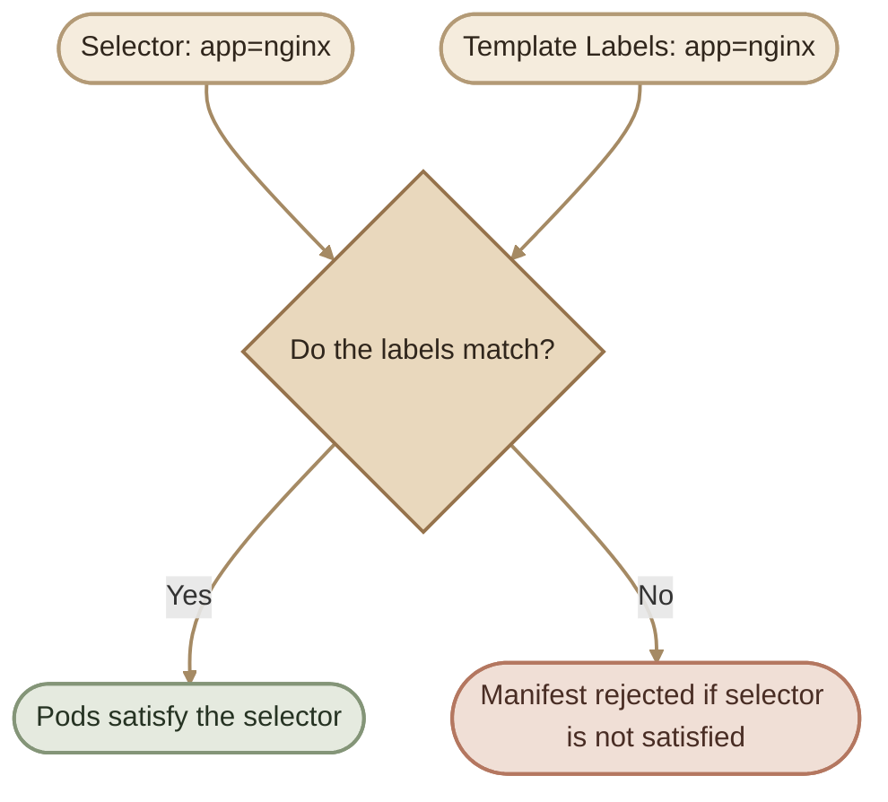
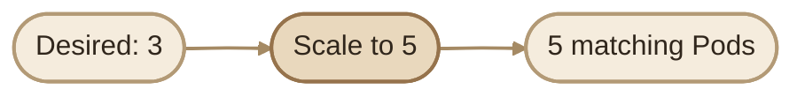
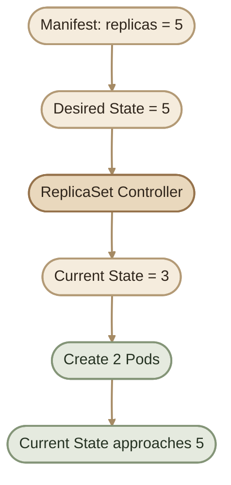
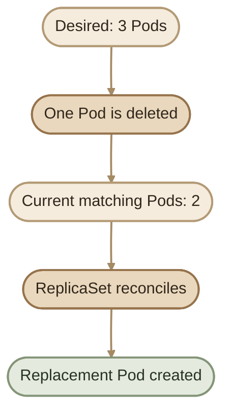
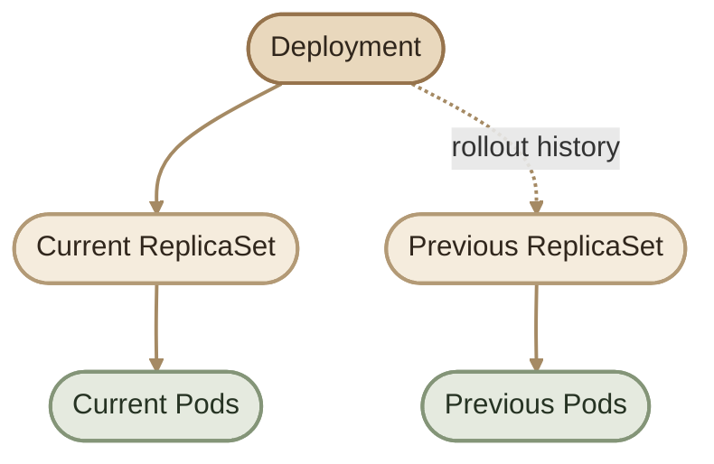
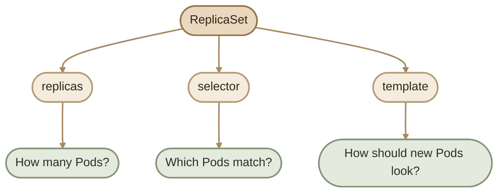

## Introduction

بعد ما فهمنا في **ReplicaSet Fundamentals** إن الـ ReplicaSet مسؤول عن الحفاظ على عدد معين من الـ Pods، هنا هنطبّق المفاهيم دي باستخدام Kubernetes YAML.

الـ ReplicaSet configuration بتعتمد على 3 أجزاء أساسية:

<CardGrid>
  <InfoCard title="replicas" icon="layers">
    عدد الـ Pod replicas المطلوب وجودها.
  </InfoCard>
  <InfoCard title="selector" icon="tag">
    إزاي الـ ReplicaSet يحدد الـ Pods المطابقة له.
  </InfoCard>
  <InfoCard title="template" icon="code">
    المواصفات المستخدمة لإنشاء Pods جديدة.
  </InfoCard>
</CardGrid>



## 1. ReplicaSet Manifest

ده مثال كامل لـ ReplicaSet بيحافظ على وجود 3 Pods لتشغيل NGINX:

```yaml
apiVersion: apps/v1
kind: ReplicaSet
metadata:
  name: nginx-rs
  labels:
    app: nginx-rs
spec:
  replicas: 3
  selector:
    matchLabels:
      app: nginx
  template:
    metadata:
      labels:
        app: nginx
    spec:
      containers:
        - name: nginx
          image: nginx:1.29
```

الـ manifest ده بيطلب من Kubernetes إنشاء ReplicaSet اسمه `nginx-rs`، والمحافظة على 3 Pods مطابقة للـ selector، باستخدام الـ Pod Template المحدد.

<Callout type="note">
  الـ `metadata.labels` الموجودة على الـ ReplicaSet بتوصف الـ ReplicaSet نفسه. أما `template.metadata.labels` فهي الـ labels اللي هتتحط على الـ Pods اللي يتم إنشاؤها. الاتنين مش نفس الحاجة.
</Callout>

## 2. Understanding the Manifest Fields

### I. `apiVersion` and `kind`

```yaml
apiVersion: apps/v1
kind: ReplicaSet
```

- `apiVersion: apps/v1` بيحدد الـ API group والـ version المستخدمين للـ resource.
- `kind: ReplicaSet` بيحدد نوع الـ Kubernetes object.

الـ `apps/v1` هو الـ stable API version المستخدم للـ ReplicaSet.

### II. `metadata`

```yaml
metadata:
  name: nginx-rs
  labels:
    app: nginx-rs
```

الـ `metadata` بتحتوي على معلومات تعريف الـ resource، زي الاسم والـ labels.

الاسم `nginx-rs` لازم يكون فريدًا داخل الـ Namespace اللي الـ ReplicaSet موجود فيه.

### III. `spec.replicas`

```yaml
spec:
  replicas: 3
```

ده بيحدد الـ **Desired Number of Pod Replicas**.

الـ ReplicaSet بيقارن العدد المطلوب بالعدد الحالي للـ Pods المطابقة، وبيحاول يعالج الفرق.



خلي بالك إن الـ replica count بيعبر عن العدد المطلوب، مش ضمان إن كل الـ Pods هتكون `Ready` فورًا. ممكن بعض الـ Pods تتأخر بسبب مشاكل في الـ image أو الموارد أو الـ scheduling.

### IV. `spec.selector`

```yaml
selector:
  matchLabels:
    app: nginx
```

الـ `selector` بيحدد الـ Pods اللي الـ ReplicaSet بيعتبرها مطابقة له بناءً على الـ labels.

في المثال، الـ selector بيدور على Pods عندها:

```text
app=nginx
```

الـ `matchLabels` بتطلب تطابق كل الـ key-value pairs المحددة. ولو استخدمت أكتر من label، لازم الـ Pod يطابقهم كلهم.

### V. `spec.template`

```yaml
template:
  metadata:
    labels:
      app: nginx
  spec:
    containers:
      - name: nginx
        image: nginx:1.29
```

الـ `template` هو تعريف الـ Pod اللي الـ ReplicaSet بيستخدمه لما يحتاج ينشئ Pods جديدة.

بيتكوّن من جزئين أساسيين:

- `template.metadata`: معلومات الـ Pod، بما فيها الـ labels.
- `template.spec`: مواصفات الـ Pod، زي الـ containers والـ images والـ volumes والموارد عند تحديدها.



الـ Template مش نسخة واحدة مشتركة بين كل الـ Pods؛ هو تعريف بيستخدمه الـ ReplicaSet لإنشاء كل Pod جديد، وكل Pod بيكون له هويته وحالته الخاصة.

## 3. Selector and Template Must Match

دي من أهم قواعد الـ ReplicaSet configuration.

الـ selector:

```yaml
selector:
  matchLabels:
    app: nginx
```

لازم يكون متوافقًا مع الـ labels الموجودة في الـ Pod Template:

```yaml
template:
  metadata:
    labels:
      app: nginx
```

الـ selector هنا بيحدد شرط المطابقة، والـ template بيضمن إن الـ Pods الجديدة تحقق الشرط ده.



<Callout type="warning">
  في `apps/v1`، لازم الـ selector يكون غير فارغ، والـ Pod Template labels لازم تحقق شروطه. لو الـ selector مش متوافق مع الـ template، Kubernetes هيرفض إنشاء الـ ReplicaSet بالـ manifest ده.
</Callout>

كمان خلي بالك: الـ selector مش بيحدد الـ Pods اللي اتعملت من الـ template فقط؛ ممكن يطابق Pods موجودة بالفعل بنفس الـ labels. علشان كده، تجنّب إنشاء ReplicaSet باستخدام selector واسع أو متداخل مع workload تاني.

## 4. Container Configuration

داخل `template.spec` بنحدد الـ containers:

```yaml
containers:
  - name: nginx
    image: nginx:1.29
```

- `name`: اسم الـ container داخل الـ Pod.
- `image`: الـ container image اللي Kubernetes هيحاول يشغّلها.

استخدام image version محدد أوضح وأسهل في التتبع من `latest`، لكن الـ tag نفسه مش ضمان إن المحتوى غير قابل للتغيير. لو محتاج reproducibility أقوى، استخدم image digest.

## 5. Create the ReplicaSet

احفظ الـ manifest في ملف اسمه `nginx-rs.yaml`.

```bash
kubectl apply -f nginx-rs.yaml
```

بعدها، افحص الـ ReplicaSet:

```bash
kubectl get rs
```

ولعرض الـ Pods اللي عليها الـ labels المطابقة:

```bash
kubectl get pods -l app=nginx
```

ممكن تشوف نتيجة مشابهة للآتي:

```text
NAME       DESIRED   CURRENT   READY
nginx-rs   3         3         3
```

الأرقام دي مثال توضيحي؛ النتيجة الفعلية بتعتمد على حالة الـ cluster.

### I. Inspect the ReplicaSet

```bash
kubectl describe rs nginx-rs
```

الأمر ده بيساعدك تفحص:

- الـ Selector المستخدم.
- العدد المطلوب والحالي والـ Ready replicas.
- الـ Events المرتبطة بالـ ReplicaSet.

ولعرض الـ labels على الـ Pods:

```bash
kubectl get pods -l app=nginx --show-labels
```

ولعرض الـ Pods اللي الـ ReplicaSet بيتتبعها بشكل أوضح:

```bash
kubectl get pods -l app=nginx -o wide
```

## 6. Scaling a ReplicaSet

ممكن تغيّر عدد الـ replicas مباشرة باستخدام `kubectl scale`.

مثلًا، لزيادة العدد من 3 إلى 5:

```bash
kubectl scale rs nginx-rs --replicas=5
```

تحقق من النتيجة:

```bash
kubectl get rs nginx-rs
kubectl get pods -l app=nginx
```

الـ ReplicaSet هيحاول يوصل للعدد المطلوب عن طريق إنشاء Pods إضافية. ولو قللت العدد، ممكن ينهي بعض الـ Pods الموجودة.



<Callout type="tip">
  تقدر كمان تغيّر قيمة `spec.replicas` في `nginx-rs.yaml` إلى `5`، ثم تشغّل `kubectl apply -f nginx-rs.yaml`. لو بتدير الـ resource من خلال ملف YAML، حاول تخلي الملف هو المصدر الأساسي للتعديلات علشان تتجنب اختلافه عن الحالة الفعلية.
</Callout>

## 7. Reconciliation: Desired State vs Current State

الـ ReplicaSet جزء من Kubernetes control loop. بشكل مستمر، الـ controller بيقارن الـ Desired State بالـ Current State وبيحاول يقلل الفرق بينهم.

مثلًا، لو الـ manifest بيحدد:

```yaml
replicas: 5
```

والـ ReplicaSet عنده 3 Pods مطابقة فقط، هيحاول إنشاء Podين إضافيين.



الـ reconciliation مش عملية بتحصل مرة واحدة بعد `apply`؛ دي عملية مستمرة. ولو حصلت مشكلة منعت إنشاء Pod، الـ controller هيفضل يحاول، لكن الوصول للعدد المطلوب ممكن يتأخر.

## 8. Self-Healing: Deleting a Pod

تقدر تختبر الـ self-healing عن طريق حذف Pod واحدة يديرها الـ ReplicaSet.

اعرض الـ Pods:

```bash
kubectl get pods -l app=nginx
```

اختار اسم Pod من النتيجة واحذفه:

```bash
kubectl delete pod <pod-name>
```

تابع الحالة:

```bash
kubectl get pods -l app=nginx -w
```

الـ ReplicaSet هيلاحظ إن عدد الـ Pods المطابقة أقل من العدد المطلوب، وهيحاول إنشاء Pod بديلة.



<Callout type="note">
  إنشاء Pod بديلة مش معناه إنها هتبقى `Ready` فورًا، ولا إن Kubernetes هيعيد نفس الـ Pod المحذوفة. غالبًا هتتعمل Pod جديدة باسم مختلف، وبحالة وUID مختلفين.
</Callout>

## 9. Updating the ReplicaSet Manifest

لو غيّرت عدد الـ replicas في الملف من `3` إلى `5`، ثم طبّقت التعديل:

```bash
kubectl apply -f nginx-rs.yaml
```

الـ controller هيحاول يوفّر العدد الجديد.

لكن فيه فرق مهم بين تغيير عدد الـ replicas وتغيير الـ Pod Template.

### I. Changing `replicas`

تغيير:

```yaml
replicas: 5
```

بيغيّر العدد المطلوب، وبالتالي الـ ReplicaSet هيحاول يضيف أو ينهي Pods لتحقيقه.

### II. Changing the container image

لو غيّرت:

```yaml
image: nginx:1.29
```

إلى image أخرى داخل الـ template، **الـ ReplicaSet وحده مش بيعمل rolling update تلقائي للـ Pods الموجودة**. تعديل الـ template بيأثر على الـ Pods اللي هتتعمل بعد كده، لكنه مش بيستبدل كل الـ Pods الحالية لمجرد إن الـ template اتغير.

لو محتاج updates منظمة مع rollout وrollback، استخدم `Deployment` بدل إدارة الـ ReplicaSet مباشرة في أغلب التطبيقات.

## 10. ReplicaSet vs Deployment

الـ Deployment هو الـ abstraction الأعلى اللي بيستخدم ReplicaSets لإدارة الـ rollout والـ updates.

| Capability | ReplicaSet | Deployment |
|---|---|---|
| Maintain desired Pod count | Yes | Yes, through ReplicaSets |
| Replace missing Pods | Yes | Yes, through its ReplicaSets |
| Rolling updates | Not managed automatically | Yes |
| Rollback rollout revisions | Not provided as a Deployment rollout workflow | Yes |
| Typical application workload | Usually managed indirectly | Recommended choice |



الـ ReplicaSet مهم لفهم Kubernetes controllers والـ self-healing، لكن في التطبيقات المعتادة، الأفضل إنك تدير الـ workload من خلال Deployment بدل إنشاء ReplicaSet مستقل لكل تطبيق.

## 11. Practical Lab: Configure and Test a ReplicaSet

هنطبّق اللي اتعلمناه في لاب بسيط.

### Step 1 — Create the Manifest

أنشئ ملف `nginx-rs.yaml` بالمحتوى التالي:

```yaml
apiVersion: apps/v1
kind: ReplicaSet
metadata:
  name: nginx-rs
spec:
  replicas: 3
  selector:
    matchLabels:
      app: nginx-lab
  template:
    metadata:
      labels:
        app: nginx-lab
    spec:
      containers:
        - name: nginx
          image: nginx:1.29
```

### Step 2 — Apply and Verify

```bash
kubectl apply -f nginx-rs.yaml

kubectl get rs nginx-rs

kubectl get pods -l app=nginx-lab
```

اتأكد إن الـ ReplicaSet بيطلب 3 replicas وإن الـ Pods بتبدأ التشغيل.

### Step 3 — Inspect Labels and Events

```bash
kubectl get pods -l app=nginx-lab --show-labels

kubectl describe rs nginx-rs
```

راجع الـ selector والـ labels والـ Events.

### Step 4 — Scale to Four Replicas

```bash
kubectl scale rs nginx-rs --replicas=4

kubectl get pods -l app=nginx-lab
```

اتأكد إن الـ ReplicaSet بيحاول الوصول لأربع Pods مطابقة.

### Step 5 — Test Self-Healing

احذف واحدة من الـ Pods اللي ظهرت في الخطوة السابقة:

```bash
kubectl delete pod <pod-name>
```

وبعدين راقب العدد:

```bash
kubectl get pods -l app=nginx-lab -w
```

لاحظ إن الـ ReplicaSet بيحاول يرجّع العدد المطلوب إلى 4.

### Step 6 — Clean Up

بعد ما تخلص اللاب:

```bash
kubectl delete -f nginx-rs.yaml
```

الأمر ده بيحذف الـ ReplicaSet والـ Pods اللي بيديرها.

## 12. Troubleshooting Checklist

لو الـ ReplicaSet مش شغال زي المتوقع، ابدأ بالخطوات دي:

<InfoCard title="Replica count is lower than desired" icon="wrench">
  افحص حالة الـ Pods والـ Events، وتأكد إن الـ cluster عنده موارد كفاية وإن الـ image قابلة للتحميل.

  ```bash
  kubectl describe rs nginx-rs
  kubectl get pods -l app=nginx
  kubectl get events --sort-by=.metadata.creationTimestamp
  ```
</InfoCard>

<InfoCard title="Pods are not matching the selector" icon="tag">
  قارن الـ selector مع labels الموجودة على الـ Pods:

  ```bash
  kubectl get rs nginx-rs -o yaml
  kubectl get pods --show-labels
  ```

  افتكر إن الـ selector والـ template labels لازم يكونوا متوافقين.
</InfoCard>

<InfoCard title="Pods are not Ready" icon="pulse">
  افحص الـ Pod status والـ container logs، لأن وجود Pod لا يعني إنها جاهزة لاستقبال traffic.

  ```bash
  kubectl describe pod <pod-name>
  kubectl logs <pod-name>
  ```
</InfoCard>

## 13. Key Rules

- **API version:** استخدم `apps/v1`.
- **Resource type:** استخدم `kind: ReplicaSet`.
- **Desired count:** `spec.replicas` بيحدد عدد الـ replicas المطلوب.
- **Selector:** `spec.selector` بيحدد الـ Pods المطابقة.
- **Template:** `spec.template` بيحدد مواصفات الـ Pods الجديدة.
- **Label compatibility:** الـ Pod Template labels لازم تحقق شروط الـ selector.
- **Reconciliation:** الـ controller بيحاول باستمرار يقرّب الحالة الفعلية من الحالة المطلوبة.
- **Self-healing:** الـ ReplicaSet بيحاول تعويض الـ Pods الناقصة.
- **Updates:** تغيير الـ template مش بيؤدي وحده إلى rolling update للـ Pods الحالية.
- **Application management:** استخدم Deployment عادةً لما تحتاج rollout وrollback منظمين.

## Summary

الـ ReplicaSet configuration بتدور حول 3 أسئلة:



الـ ReplicaSet مش مجرد YAML فيه `replicas: 3`. هو Kubernetes resource بيحدد العدد المطلوب، والـ Pods المطابقة، وطريقة إنشاء Pods جديدة. والـ controller بيستخدم المعلومات دي علشان يحافظ على الـ desired state قدر الإمكان.

ولما تحتاج إدارة updates وrollbacks بشكل منظم، الـ Deployment بيكون الاختيار المعتاد لأنه بيستخدم ReplicaSets كجزء من آلية الـ rollout.