## Introduction

بعد ما فهمنا الـ Pods والـ Pod Lifecycle، نقدر نبدأ نفهم إزاي Kubernetes بيحافظ على عدد معين من الـ Pods بدل ما نعتمد على إنشاء كل Pod وإدارتها يدويًا.

هنا بيظهر دور الـ **ReplicaSet**.

الـ ReplicaSet هو Kubernetes resource مسؤول عن الحفاظ على العدد المطلوب من الـ Pods المطابقة للـ selector الخاص به، عن طريق إنشاء Pods جديدة أو تقليل العدد حسب الحالة الفعلية.

<Callout type="note">
  الـ ReplicaSet مش بيشغّل الـ Containers بنفسه، ومش بيضمن إن الـ Application سليمة وظيفيًا. دوره الأساسي هو الحفاظ على عدد الـ matching Pods المطلوب.
</Callout>

## 1. What Is a ReplicaSet?

افترض إن عندك Application محتاجة 3 Pod replicas.

الـ Desired State عندك هي:

```text
Desired Replicas = 3
```

الـ ReplicaSet بيحاول يخلي العدد الفعلي من الـ Pods المطابقة يساوي العدد المطلوب.

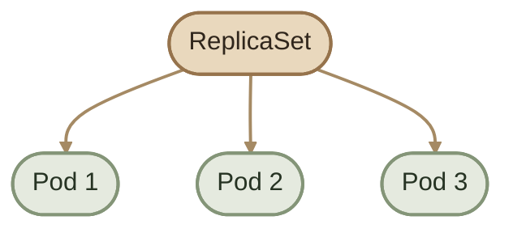

الفكرة الأساسية:

> **A ReplicaSet maintains the desired number of matching Pod replicas.**

كلمة *matching* مهمة، لأن الـ ReplicaSet مش بيحسب كل الـ Pods الموجودة في الـ Namespace، لكنه بيحسب الـ Pods اللي بتطابق الـ selector الخاص به.

## 2. Why Do We Need ReplicaSets?

لو شغّلت Application داخل Pod واحدة من غير Controller مسؤول عن تعويضها، وحصل إن الـ Pod اتمسحت أو انتهت، مش هيكون عندك ReplicaSet يعيد إنشاء Pod بديلة تلقائيًا.

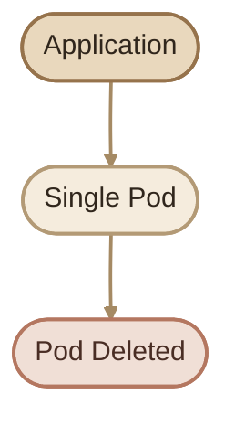

أما لو الـ Pod بتديرها ReplicaSet، فالـ controller بيلاحظ إن العدد الفعلي أقل من العدد المطلوب، وبيحاول إنشاء Pod بديلة.

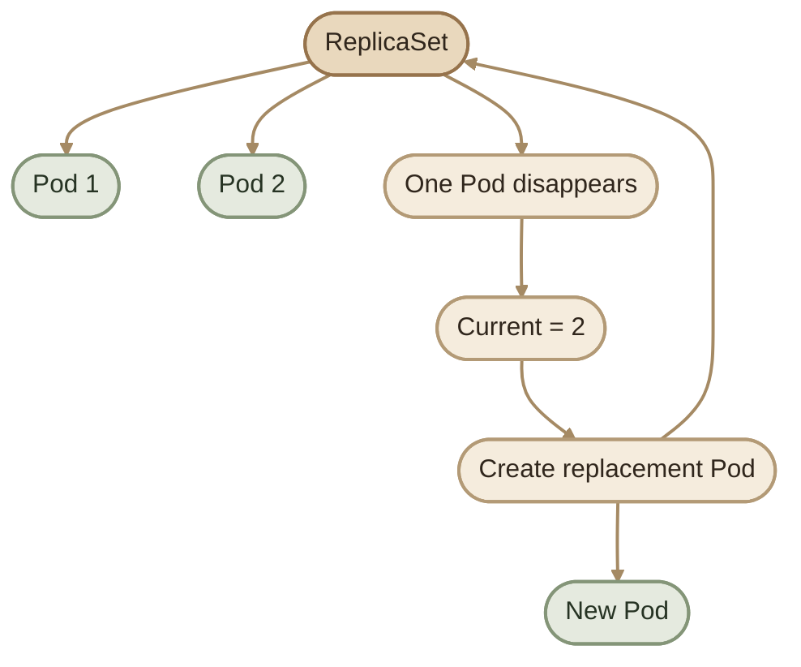

الـ ReplicaSet مش محتاج منك تشغّل `kubectl run` كل مرة Pod تختفي؛ هو بيحاول يحافظ على الـ Desired State تلقائيًا.

## 3. Desired State vs Current State

دي أهم فكرة في ReplicaSet، وهي جزء أساسي من طريقة عمل Kubernetes Controllers عمومًا.

- **Desired State:** الحالة اللي إنت طالب من Kubernetes يحافظ عليها.
- **Current State:** الحالة الفعلية اللي الـ controller بيلاحظها.

مثلًا، لو المطلوب 3 Pods لكن الموجود حاليًا 2:

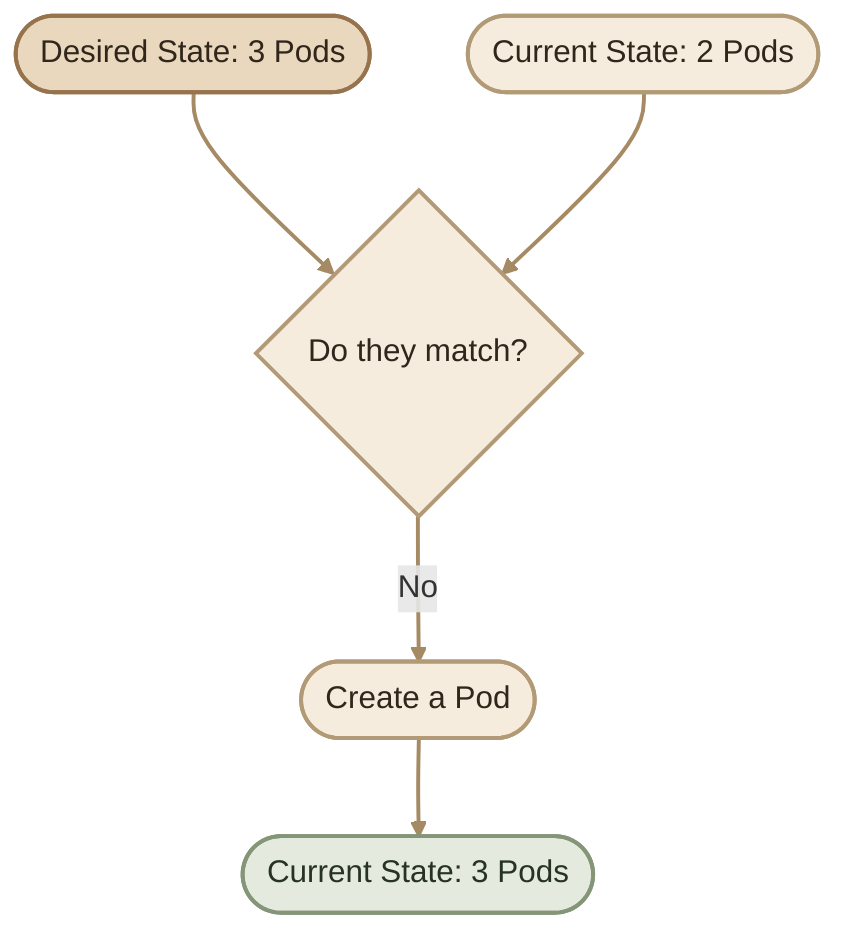

الهدف إن الـ controller يقلل الفرق بين الحالة المطلوبة والحالة الفعلية.

وده مش معناه إن الوصول للحالة المطلوبة مضمون فورًا؛ ممكن توجد مشاكل في الـ scheduling أو الموارد أو تحميل الـ image أو تشغيل الـ containers.

## 4. ReplicaSet as a Controller

الـ ReplicaSet مش مجرد resource بيخزن قيمة `replicas`.

هو جزء من Kubernetes control plane، والـ ReplicaSet controller بيعمل reconciliation بصورة مستمرة.

الـ mental model المبسط:

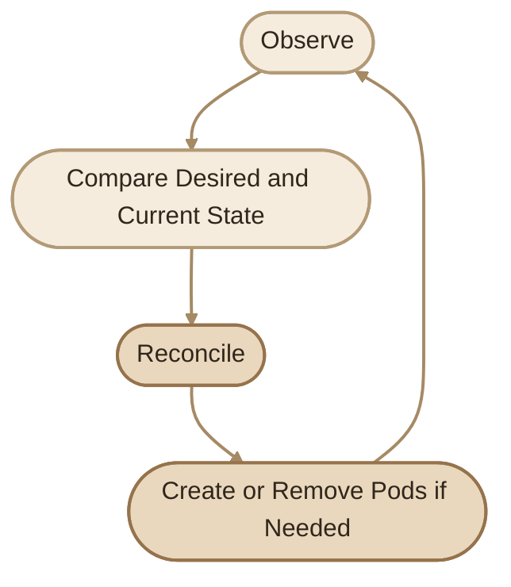

مثلًا:

| Desired | Current | Expected action |
|---:|---:|---|
| 3 | 2 | Create a Pod |
| 3 | 3 | No replica-count adjustment needed |
| 3 | 4 | Remove an excess Pod |

الـ controller مش بيشغّل الخطوات دي مرة واحدة فقط؛ بيستمر في مراقبة الحالة ومحاولة تصحيح الاختلافات.

## 5. How ReplicaSet Identifies Pods

الـ ReplicaSet بيستخدم **Labels and Selectors** علشان يحدد الـ Pods المطابقة له.

افترض إن الـ selector بتاعه هو:

```text
app=nginx
```

والـ Namespace فيها الـ Pods التالية:

```text
Pod A: app=nginx
Pod B: app=nginx
Pod C: app=nginx
Pod D: app=redis
```

الـ ReplicaSet هيعتبر أول 3 Pods مطابقة، لكن `Pod D` مش هتطابق الـ selector.

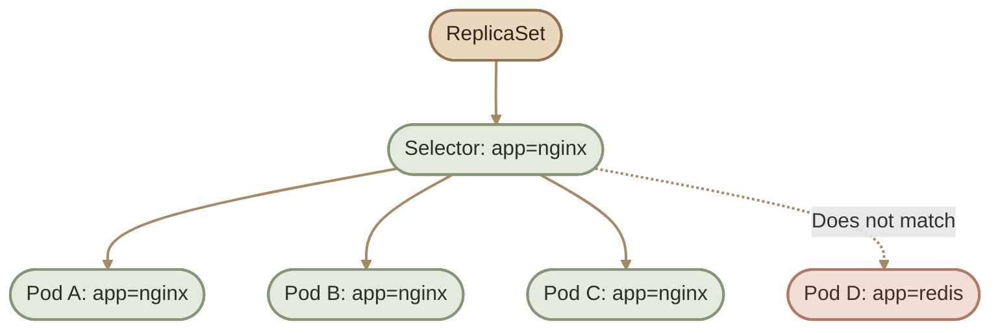

الـ ReplicaSet مش بيهتم باسم Pod بعينها؛ هو بيهتم بعدد الـ matching Pods.

لو Pod اختفت، مش مطلوب يرجّع نفس الاسم أو نفس الـ UID. المطلوب إنه يحاول يوفّر Pod بديلة تحقق شروط الـ selector.

<Callout type="warning">
  لازم تكون حذر مع الـ selectors المتداخلة. الـ ReplicaSet ممكن يطابق Pods موجودة بالفعل لو labels بتاعتها حققت شروطه، حتى لو مش هو اللي أنشأها. تجنّب استخدام selector واسع ممكن يطابق Pods تابعة لـ workload تاني.
</Callout>

## 6. ReplicaSet and Pods

الـ ReplicaSet بيدير الـ Pods، والـ Pods هي اللي بتحتوي على الـ Containers.

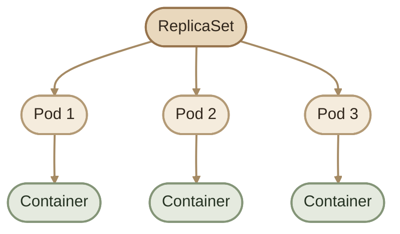

العلاقة الأساسية:

- ReplicaSet: يحافظ على عدد الـ matching Pods.
- Pod: وحدة تشغيل تحتوي على Container واحدة أو أكثر.
- Container: يشغّل التطبيق أو العملية المطلوبة.

الـ ReplicaSet مش مسؤول مباشرة عن تشغيل الـ Container runtime؛ ده جزء من الـ node-level container execution stack.

## 7. Self-Healing

واحدة من أهم فوائد ReplicaSet هي **Self-Healing** بمعنى تعويض الـ Pods الناقصة.

لو الـ Desired State هي 3، ثم انخفض عدد الـ Pods المطابقة إلى 2، الـ controller هيحاول إنشاء Pod جديدة.

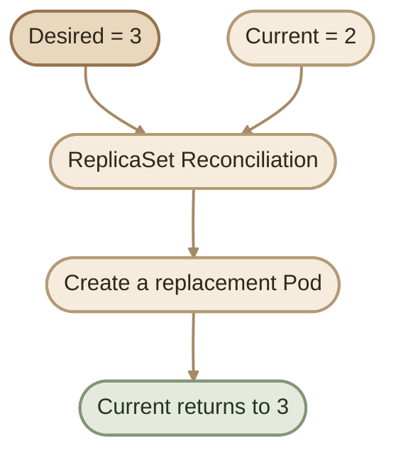

لكن الـ Self-Healing هنا مش معناه إن الـ ReplicaSet هيصلح الـ Application نفسها، أو هيعيد نفس الـ Pod القديمة. هو بيحاول يحافظ على عدد الـ matching Pods.

## 8. ReplicaSet Does Not Guarantee Application Health

ممكن الـ ReplicaSet يكون عنده 3 Pods، ومع ذلك الـ Application مش بتخدم requests بشكل صحيح.

وجود Pods مش معناه بالضرورة إن الـ Application سليمة أو جاهزة لاستقبال traffic.

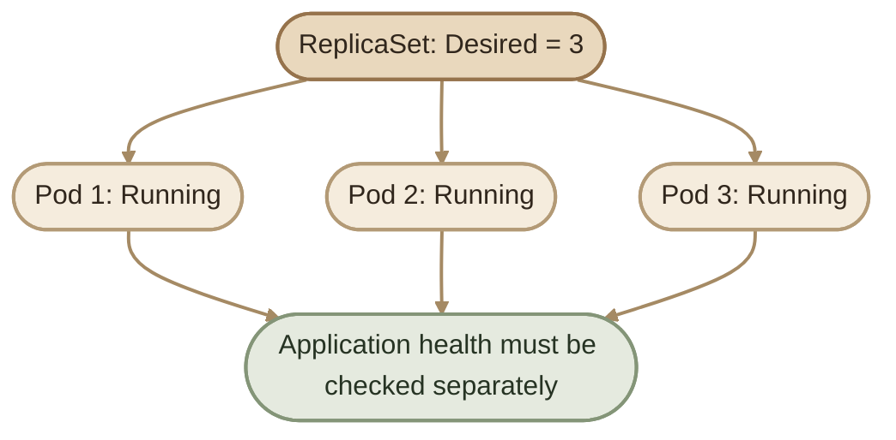

علشان تراقب صحة الـ Application، Kubernetes بيوفّر mechanisms زي:

- `readinessProbe`: بتحدد إذا كان الـ Container جاهز لاستقبال traffic.
- `livenessProbe`: بتساعد على اكتشاف حالات فشل تستدعي إعادة تشغيل الـ Container.
- `startupProbe`: بتدي التطبيق وقت كافي يبدأ قبل تفعيل فحوصات الـ liveness والـ readiness وفق إعداداتها.

الـ readiness failure لوحده مش بيؤدي لإعادة تشغيل الـ Container، بينما فشل الـ liveness أو startup probe بعد تجاوز عدد المحاولات المسموح ممكن يؤدي لإعادة تشغيله.

## 9. Scaling

الـ Scaling هو تغيير العدد المطلوب من الـ replicas.

### I. Scale up

لو العدد المطلوب زاد من 3 إلى 5، الـ ReplicaSet هيحاول إنشاء Podين إضافيين.

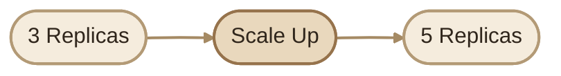

### II. Scale down

لو العدد المطلوب انخفض من 5 إلى 2، الـ ReplicaSet هيحاول إنهاء الـ Pods الزائدة للوصول للعدد الجديد.

الـ Scaling مش معناه إن الـ Application هتستجيب أسرع بالضرورة؛ الأداء بيعتمد على طبيعة الـ workload والموارد والـ application architecture.

## 10. ReplicaSet Does Not Choose the Node

لازم نفرق بين دور الـ ReplicaSet ودور الـ kube-scheduler.

الـ ReplicaSet بيطلب الحفاظ على عدد الـ Pods المطلوب، لكن الـ **kube-scheduler** مسؤول عن اختيار الـ Node المناسبة للـ Pods اللي محتاجة scheduling.

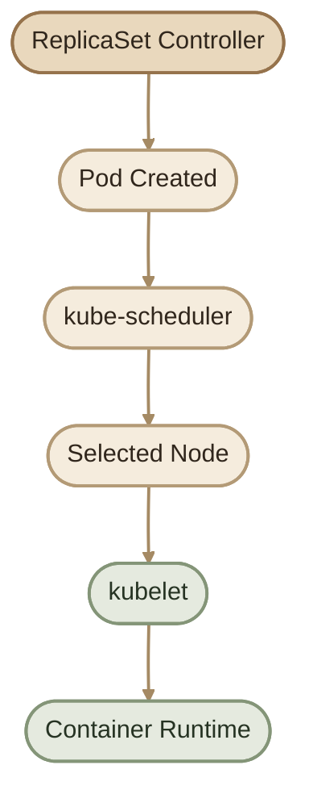

باختصار:

- **ReplicaSet controller:** يحافظ على العدد المطلوب من الـ Pods.
- **kube-scheduler:** يختار الـ Node للـ Pod اللي محتاجة scheduling.
- **kubelet:** يتولى إدارة الـ Pod على الـ Node.
- **Container runtime:** مسؤول عن تشغيل الـ Containers.

## 11. ReplicaSet and Deployment

في التطبيقات المعتادة، بنستخدم **Deployment** لإدارة الـ application workload بدل ما ندير ReplicaSet بشكل مباشر.

الـ Deployment بيستخدم ReplicaSets تحت الـ hood، وبيوفّر capabilities أعلى مستوى، زي rolling updates وrollback لإصدارات الـ Deployment.

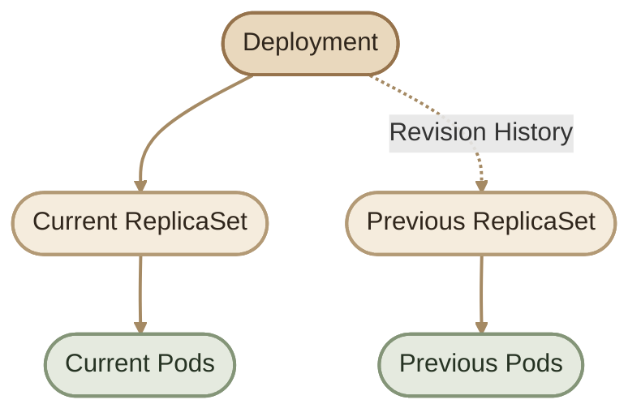

الفرق الأساسي:

| Feature | ReplicaSet | Deployment |
|---|---|---|
| Maintain desired Pod count | Yes | Yes, through ReplicaSets |
| Replace missing Pods | Yes | Yes, through ReplicaSets |
| Manage rolling updates | No built-in rollout workflow | Yes |
| Roll back Deployment revisions | No Deployment rollout history | Yes |
| Typical application workload | Usually managed indirectly | Recommended |

الـ ReplicaSet مهم لفهم الـ Controllers والـ reconciliation، لكن الـ Deployment هو الاختيار المعتاد لما تحتاج إدارة lifecycle وتحديثات منظمة للتطبيق.

## 12. ReplicaSet Control Loop

ده ملخص للـ behavior كله:

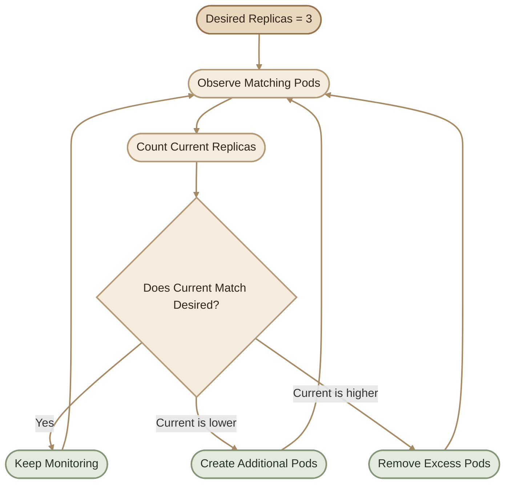

الـ controller بيستمر في المحاولة، لكن نجاح الوصول للحالة المطلوبة بيعتمد على ظروف الـ cluster، مثل توافر الموارد وصحة إعدادات الـ workload.

## 13. Practical Example

افترض إن عندك ReplicaSet مطلوب منه 3 replicas، والـ selector هو:

```text
app=nginx
```

والـ Cluster فيه:

```text
Pod A: app=nginx
Pod B: app=nginx
Pod C: app=redis
```

الـ ReplicaSet هيلاقي Podين مطابقين فقط، لأن `Pod C` مش بتطابق الـ selector.

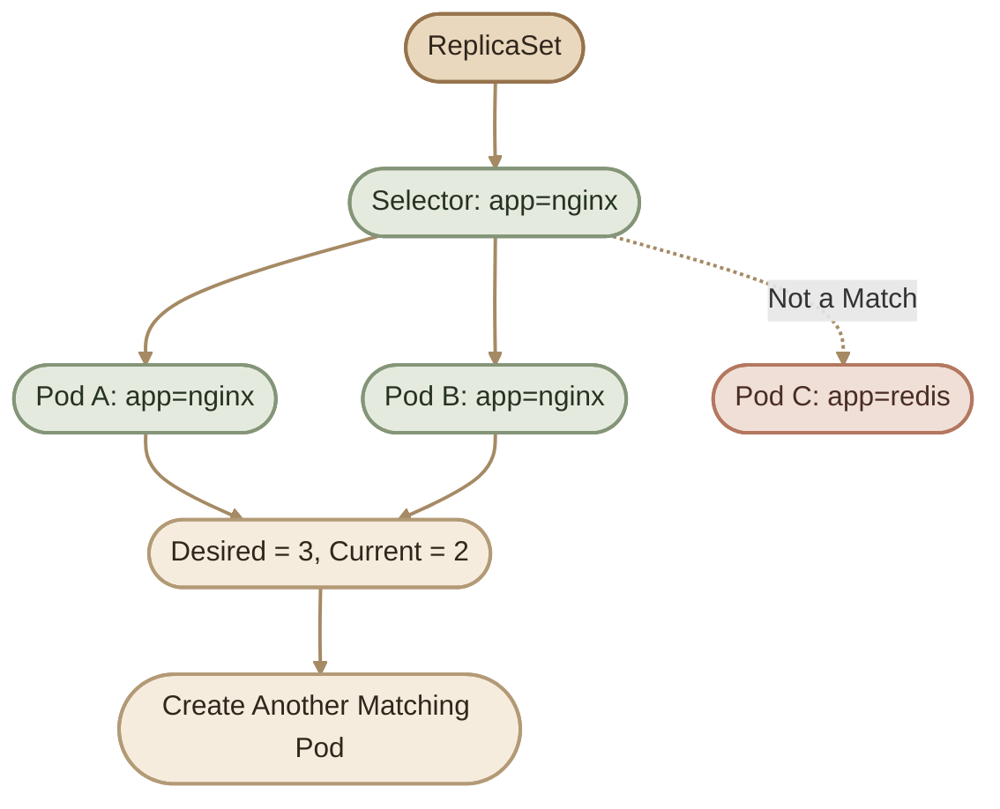

الـ ReplicaSet هيحاول إنشاء Pod جديدة تحقق الـ selector، لحد ما العدد الفعلي من الـ matching Pods يوصل إلى العدد المطلوب، بشرط إن الـ cluster يقدر يشغّلها.

## 14. Key Takeaways

<CardGrid>
  <InfoCard title="Desired State" icon="flag">
    الـ ReplicaSet بيحاول يحافظ على عدد الـ replicas اللي إنت محدده.
  </InfoCard>
  <InfoCard title="Selectors" icon="tag">
    الـ Selector بيحدد الـ Pods المطابقة بناءً على الـ labels.
  </InfoCard>
  <InfoCard title="Self-Healing" icon="cycle">
    لو العدد الفعلي قل، الـ controller بيحاول إنشاء Pods بديلة.
  </InfoCard>
  <InfoCard title="Scaling" icon="layers">
    زيادة أو تقليل `replicas` بيغيّر العدد المطلوب من الـ Pods.
  </InfoCard>
  <InfoCard title="Scheduling" icon="network">
    الـ kube-scheduler هو اللي بيختار الـ Node، مش الـ ReplicaSet.
  </InfoCard>
  <InfoCard title="Deployment" icon="branch">
    الـ Deployment بيدير ReplicaSets وبيوفر rollout وrollback.
  </InfoCard>
</CardGrid>

## Summary

الـ ReplicaSet هو Kubernetes resource بيحافظ على العدد المطلوب من الـ Pods المطابقة للـ selector. بيقارن باستمرار بين الـ Desired State والـ Current State، وبيحاول يصحح الفرق عن طريق إنشاء Pods جديدة أو تقليل العدد.

أهم العلاقات اللي لازم تفضل فاكرها:

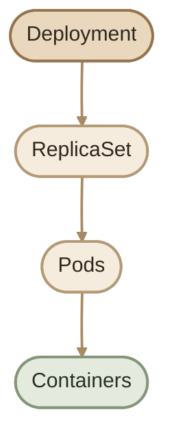

- **Deployment:** بيدير الـ rollout والـ ReplicaSets الخاصة بالتطبيق.
- **ReplicaSet:** بيحافظ على عدد الـ matching Pods.
- **Pod:** بتحتوي على الـ Containers.
- **Scheduler:** بيختار الـ Node المناسبة.
- **kubelet:** بيدير الـ Pods على الـ Node.

الـ mental model النهائي: **Desired State + Selector + Reconciliation = ReplicaSet behavior**.