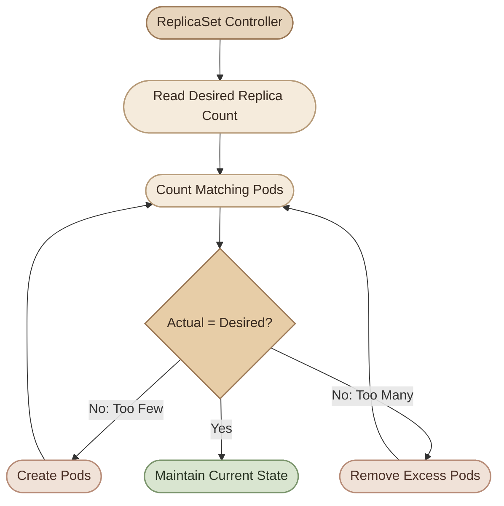

## Overview

الـ ReplicaSet مسؤولة عن الحفاظ على عدد محدد من الـ Pods المطابقة للـ **Pod template** والـ **Label Selector** بتاعها.

لكن أحيانًا تلاقي إن عدد الـ Pods مش مطابق للعدد المطلوب، أو الـ ReplicaSet مش بتنشئ Pods جديدة، أو فيه Pods موجودة لكن مش بتتحكم فيها الـ ReplicaSet المتوقعة.

في الدرس ده هنتعلم إزاي نحدد السبب بدل ما نبدأ بتغيير الإعدادات عشوائيًا.

## 1. Understand the Reconciliation Process

الـ ReplicaSet بتقارن بين الـ **Desired State** والـ **Actual State**، وبتحاول توصل للحالة المطلوبة.

مثلًا، لو عندك:

- `spec.replicas: 3`
- عدد الـ Pods المطابقة للـ selector هو `2`

الـ ReplicaSet بتحاول إنشاء Pod إضافية للوصول إلى العدد المطلوب.

ولو العدد الفعلي أكبر من المطلوب، بتحاول تقليله.



خلي بالك إن الـ ReplicaSet بتقيس عدد الـ Pods المطابقة للـ selector، مش عدد التطبيقات اللي شغالة بشكل سليم. ممكن تلاقي ثلاث Pods موجودة، لكن واحدة منها `CrashLoopBackOff` أو غير جاهزة لاستقبال traffic.

<Callout type="note" title="Key distinction">
وجود الـ Pod لا يعني إنها `Ready`، وكون الـ ReplicaSet وصلت إلى العدد المطلوب لا يعني بالضرورة إن التطبيق سليم.
</Callout>

## 2. Start with the Actual State

قبل ما تغيّر أي إعدادات، افحص حالة الـ ReplicaSet والـ Pods.

```bash
kubectl get replicasets -A
```

لو عارف الـ Namespace:

```bash
kubectl get replicasets -n default
kubectl get pods -n default -o wide
```

اعرض تفاصيل ReplicaSet محددة:

```bash
kubectl describe replicaset <replicaset-name> \
  -n <namespace>
```

ركز على المعلومات التالية:

- `Desired`: عدد النسخ المطلوبة.
- `Current`: عدد النسخ الحالية.
- `Ready`: عدد النسخ الجاهزة.
- `Labels` و`Selector`: الـ labels والـ selector المستخدمين.
- `Events`: الأحداث اللي ممكن توضح سبب الفشل.

ممكن كمان تعرض أعمدة النسخ بشكل مباشر:

```bash
kubectl get replicasets \
  -n <namespace> \
  -o custom-columns='NAME:.metadata.name,DESIRED:.spec.replicas,CURRENT:.status.replicas,READY:.status.readyReplicas'
```

لو قيمة `READY` فاضية أو `0`، مش لازم يكون السبب هو الـ ReplicaSet نفسها. ممكن تكون الـ Pods غير جاهزة بسبب مشكلة في الـ image أو التطبيق أو الموارد.

## 3. Problem: The ReplicaSet Has Fewer Pods Than Expected

مثلًا، عندك ReplicaSet محتاجة ثلاث Pods، لكن الموجود فعليًا Pod واحدة فقط.

ابدأ بالتفاصيل:

```bash
kubectl describe replicaset <replicaset-name> \
  -n <namespace>
```

وبعدين افحص الـ Pods:

```bash
kubectl get pods -n <namespace>
```

### I. Common causes

<CardGrid>
  <InfoCard title="Insufficient Resources" icon="sliders">
    الـ scheduler مش لاقي Node عندها CPU أو Memory كفاية لتشغيل Pods جديدة.
  </InfoCard>
  <InfoCard title="Image Pull Failure" icon="cube">
    اسم الـ image غلط، أو الـ tag غير موجود، أو الوصول إلى الـ registry محتاج credentials.
  </InfoCard>
  <InfoCard title="Invalid Pod Configuration" icon="code">
    الـ Pod template فيها إعداد غير صالح، أو الـ admission policy رفضت إنشاء الـ Pod.
  </InfoCard>
  <InfoCard title="Node Problems" icon="wrench">
    الـ Nodes المتاحة مش قادرة تستقبل Pods جديدة بسبب حالتها أو القيود المفروضة عليها.
  </InfoCard>
</CardGrid>

افحص الأحداث:

```bash
kubectl get events \
  -n <namespace> \
  --sort-by=.metadata.creationTimestamp
```

لو لقيت `FailedScheduling`، افحص رسالة الحدث. مثلًا:

- `Insufficient cpu`: مفيش CPU كفاية حسب الـ requests.
- `Insufficient memory`: مفيش Memory كفاية حسب الـ requests.
- رسائل عن `taints` أو `node affinity`: ممكن يكون فيه قيود بتمنع الـ Pod من العمل على الـ Nodes المتاحة.

لو الـ Pod موجودة لكن الـ image مش بتتحمّل:

```bash
kubectl describe pod <pod-name> \
  -n <namespace>
```

ابحث عن `ErrImagePull` أو `ImagePullBackOff`، ثم افحص الـ container logs لو الـ container بدأت بالفعل.

## 4. Problem: Pods Exist but Are Not Ready

ممكن تلاقي:

```text
NAME            DESIRED   CURRENT   READY
web-replicaset  3         3         1
```

ده معناه إن العدد الحالي وصل إلى ثلاث نسخ، لكن نسخة واحدة فقط جاهزة.

افحص حالة الـ Pods:

```bash
kubectl get pods -n <namespace>
```

حالات محتملة:

- `Pending`: الـ Pod لم تُجدول بعد أو ما زالت تنتظر موارد أو متطلبات أخرى.
- `ContainerCreating`: الـ container لسه بتتجهز.
- `CrashLoopBackOff`: الـ container بتفشل وKubernetes بيحاول يشغّلها مجددًا.
- `Running` مع `READY 0/1`: الـ container شغالة، لكن الـ Pod مش جاهزة بالكامل.

لما تلاقي Pod فيها مشكلة:

```bash
kubectl describe pod <pod-name> \
  -n <namespace>

kubectl logs <pod-name> \
  -n <namespace>
```

ولو الـ container بتعمل restart:

```bash
kubectl logs <pod-name> \
  -n <namespace> \
  --previous
```

الأمر الأخير مفيد لفحص logs الخاصة بآخر container instance انتهت.

<Callout type="tip" title="Troubleshooting rule">
ابدأ بـ `describe pod` عشان تعرف حالة الـ Pod والأحداث، وبعدها استخدم `logs` لفهم سلوك التطبيق. مش كل مشكلة في الـ Pod هتظهر في الـ logs؛ مشاكل الـ scheduling مثلًا ممكن تظهر في Events من غير ما يكون فيه container بدأت أصلًا.
</Callout>

## 5. Problem: Incorrect Labels and Selectors

الـ **Label Selector** هو اللي بيحدد أي Pods بتطابق الـ ReplicaSet.

مثال على ReplicaSet بتختار Pods عندها:

```yaml
selector:
  matchLabels:
    app: web
```

لازم الـ Pod template تحتوي على الـ label المطابقة:

```yaml
template:
  metadata:
    labels:
      app: web
```

لو الـ selector بتطلب `app: web` لكن الـ template فيها `app: api`، هيحصل عدم تطابق، والـ API server هيرفض إنشاء الـ ReplicaSet لو الـ selector مش بتطابق الـ labels الموجودة في الـ template.

مثال صحيح:

```yaml
apiVersion: apps/v1
kind: ReplicaSet
metadata:
  name: web-replicaset
spec:
  replicas: 3
  selector:
    matchLabels:
      app: web
  template:
    metadata:
      labels:
        app: web
    spec:
      containers:
        - name: nginx
          image: nginx:1.28
```

افحص الـ selector الفعلية:

```bash
kubectl get replicaset web-replicaset \
  -n <namespace> \
  -o yaml
```

اعرض الـ Pods المطابقة للـ label:

```bash
kubectl get pods \
  -n <namespace> \
  -l app=web
```

ولو محتاج تعرض الـ labels الموجودة على كل Pods:

```bash
kubectl get pods \
  -n <namespace> \
  --show-labels
```

### I. Important selector behavior

- الـ selector لازم تطابق الـ labels الموجودة في الـ Pod template.
- الـ selector بتحدد الـ Pods اللي الـ ReplicaSet بتديرها.
- تغيير labels على Pod ممكن يؤثر على مطابقتها للـ selector.
- الـ selectors في `apps/v1` الخاصة بالـ ReplicaSet غير قابلة للتغيير بعد الإنشاء.

لو اكتشفت إن الـ selector نفسها غلط، غالبًا هتحتاج إنشاء ReplicaSet جديدة بالإعداد الصحيح بدل محاولة تعديل الـ selector الحالية.

## 6. Problem: A ReplicaSet Is Managing Unexpected Pods

دي مشكلة مختلفة عن عدم تطابق الـ labels في الـ template.

لو الـ ReplicaSet عندها selector عام جدًا، مثل `app=web`، ممكن تتطابق مع Pods أخرى في نفس الـ Namespace عندها الـ label دي، حتى لو اتعملت من مصدر مختلف.

افحص الـ selector:

```bash
kubectl describe replicaset <replicaset-name> \
  -n <namespace>
```

ثم اعرض الـ Pods المطابقة:

```bash
kubectl get pods \
  -n <namespace> \
  -l app=web \
  --show-labels
```

ولفحص الـ owner references على Pod معينة:

```bash
kubectl get pod <pod-name> \
  -n <namespace> \
  -o yaml
```

راجع `metadata.ownerReferences` لمعرفة الـ owner المسجل للـ Pod، لو موجود.

### II. Why ownership matters

الـ label matching والـ ownership مش نفس الحاجة. الـ selector بتحدد المطابقة، بينما الـ `ownerReferences` بتوضح علاقة الملكية المسجلة بين الموارد.

لو فيه Pod مستقلة بتستخدم نفس الـ labels، متفترضش إن تعديل الـ labels أو حذف الـ Pod هو الحل الصحيح. الأول افهم مين أنشأها، وهل هي مملوكة لـ ReplicaSet أو Deployment أو controller آخر.

<Callout type="warning" title="Avoid broad selectors">
استخدم labels واضحة ومحددة، وتجنب selectors واسعة ممكن تتطابق مع Pods غير مقصودة. حذف أو تغيير labels من غير فهم الـ ownership ممكن يسبب إنشاء Pods إضافية أو ترك Pods خارج الإدارة المتوقعة.
</Callout>

## 7. Problem: Too Many Pods or Unexpected Pods

لو العدد الفعلي أكبر من العدد المطلوب، افحص أولًا هل كل الـ Pods فعلًا بتطابق الـ selector، وهل فيه ReplicaSets أخرى أو controllers بتنشئ Pods إضافية.

```bash
kubectl get replicasets,pods \
  -n <namespace> \
  -o wide
```

افحص الـ ReplicaSet:

```bash
kubectl describe replicaset <replicaset-name> \
  -n <namespace>
```

مهم تميّز بين الحالات التالية:

- **Pods managed by the same ReplicaSet:** الـ ReplicaSet بتحاول الحفاظ على العدد المطلوب من الـ Pods المطابقة اللي بتديرها.
- **Pods managed by another controller:** ممكن تكون تابعة لـ ReplicaSet أو Deployment مختلفة.
- **Standalone Pods:** ممكن تكون أنشئت يدويًا ومش مملوكة لأي controller.
- **Terminating Pods:** ممكن تفضل ظاهرة أثناء عملية الحذف، وبالتالي عدد الـ Pods الظاهر لحظيًا مش دايمًا بيمثل عدد النسخ الجاهزة.

متستخدمش حذف الـ Pods كحل أول لمجرد إن العدد الظاهر أكبر من المتوقع. حدّد مصدر كل Pod الأول.

## 8. Problem: The ReplicaSet Cannot Be Created

لو أمر `kubectl apply` فشل، افحص رسالة الخطأ نفسها.

```bash
kubectl apply -f replicaset.yaml
```

أسباب شائعة:

- YAML syntax غير صحيح.
- `apiVersion` أو `kind` غير مناسب.
- `selector` لا تطابق labels الموجودة في `template`.
- الـ `selector` بتحاول استخدام إعداد غير صالح.
- قيود من admission policies أو صلاحيات RBAC بتمنع العملية.

تقدر تتحقق من الـ manifest قبل تطبيقه:

```bash
kubectl apply \
  --dry-run=server \
  -f replicaset.yaml
```

الـ server-side dry run بيطلب من الـ API server التحقق من الطلب من غير حفظ التغيير، لكنه مش ضمان إن كل الـ Pods هتشتغل بنجاح بعد التطبيق.

لو الخطأ متعلق بالصلاحيات، افحصها باستخدام:

```bash
kubectl auth can-i create replicasets \
  -n <namespace>
```

ولفحص القدرة على إنشاء Pods:

```bash
kubectl auth can-i create pods \
  -n <namespace>
```

الأمرين بيفحصوا صلاحيات المستخدم الحالي حسب إعدادات الوصول الفعالة.

## 9. Hands-on Lab: Diagnose a ReplicaSet

هننشئ ReplicaSet فيها ثلاث Pods، ونفحص الـ selector والعدد الفعلي والـ ownership.

<Steps>
<li>

<InfoCard title="Create a Namespace" icon="terminal" />

```bash
kubectl create namespace rs-troubleshooting-lab
```
</li>
<li>

<InfoCard title="Create a ReplicaSet" icon="cube" />

احفظ الملف التالي باسم `replicaset.yaml`:

```yaml
apiVersion: apps/v1
kind: ReplicaSet
metadata:
  name: web-replicaset
  namespace: rs-troubleshooting-lab
spec:
  replicas: 3
  selector:
    matchLabels:
      app: web
  template:
    metadata:
      labels:
        app: web
    spec:
      containers:
        - name: nginx
          image: nginx:1.28
          ports:
            - containerPort: 80
```

طبّق الملف:

```bash
kubectl apply -f replicaset.yaml
```

افحص النتيجة:

```bash
kubectl get replicaset,pods \
  -n rs-troubleshooting-lab \
  --show-labels
```

المفروض تلاقي ReplicaSet مطلوبة منها ثلاث Pods، وبعد اكتمال التشغيل تكون النسخ الثلاث جاهزة.
</li>
<li>

<InfoCard title="Inspect the Selector" icon="tag" />

```bash
kubectl describe replicaset web-replicaset \
  -n rs-troubleshooting-lab
```

اعرض الـ Pods المطابقة:

```bash
kubectl get pods \
  -n rs-troubleshooting-lab \
  -l app=web
```

قارن الـ labels بالـ selector الموجود في الـ ReplicaSet.
</li>
<li>

<InfoCard title="Delete a Pod and Observe Self-Healing" icon="pulse" />

احذف واحدة من الـ Pods:

```bash
kubectl delete pod <pod-name> \
  -n rs-troubleshooting-lab
```

راقب الـ Pods:

```bash
kubectl get pods \
  -n rs-troubleshooting-lab \
  -w
```

المفروض الـ ReplicaSet تلاحظ إن عدد النسخ المطابقة أقل من المطلوب، وتحاول إنشاء Pod بديلة.

اخرج من المتابعة باستخدام `Ctrl+C` بعد ملاحظة النتيجة.
</li>
<li>

<InfoCard title="Inspect Ownership" icon="code" />

اختار Pod جديدة أو موجودة:

```bash
kubectl get pod <pod-name> \
  -n rs-troubleshooting-lab \
  -o jsonpath='{.metadata.ownerReferences[*].kind}{"\n"}{.metadata.ownerReferences[*].name}{"\n"}'
```

لو الـ Pod تابعة مباشرة للـ ReplicaSet، هتلاقي الـ owner kind هو `ReplicaSet` واسم الـ owner هو `web-replicaset`.
</li>
<li>

<InfoCard title="Clean Up" icon="wrench" />

```bash
kubectl delete namespace rs-troubleshooting-lab
```

ده بيحذف الـ Namespace والموارد اللي بداخلها، فاستخدمه فقط بعد ما تنتهي من اللاب.
</li>
</Steps>

## 10. Troubleshooting Checklist

لما تواجه مشكلة في ReplicaSet، امشِ بالترتيب ده:

<list>
  <list-item>**1. Inspect the ReplicaSet:** راجع `DESIRED`, `CURRENT`, و`READY`.</list-item>
  <list-item>**2. Inspect the Pods:** اعرف هل الـ Pods مش موجودة أصلًا، ولا موجودة لكن غير جاهزة.</list-item>
  <list-item>**3. Check Events:** ابحث عن `FailedScheduling`، أو مشاكل الـ image، أو رفض إنشاء الموارد.</list-item>
  <list-item>**4. Verify Labels and Selectors:** تأكد إن الـ selector بتطابق الـ Pod template، وافحص الـ Pods اللي بتطابقها فعليًا.</list-item>
  <list-item>**5. Inspect Ownership:** حدد مين الـ controller المسؤول عن كل Pod.</list-item>
  <list-item>**6. Check Application Logs:** لو الـ container بدأت، افحص الـ logs والـ previous logs عند الحاجة.</list-item>
  <list-item>**7. Apply a Targeted Fix:** أصلح السبب المحدد، ثم أعد فحص الحالة بدل تكرار الحذف والإنشاء من غير تشخيص.</list-item>
</list>

## Summary

الـ ReplicaSet بتحافظ على عدد من الـ Pods المطابقة للـ selector، لكنها مش مسؤولة عن ضمان سلامة التطبيق من كل النواحي.

أهم نقاط التشخيص:

- `DESIRED` و`CURRENT` و`READY` بتوضح الفرق بين العدد المطلوب والحالي والجاهز.
- الـ Events بتساعد في اكتشاف مشاكل الـ scheduling وإنشاء الـ Pods.
- الـ labels والـ selectors بتحدد الـ Pods المطابقة، بينما الـ owner references بتوضح الملكية المسجلة.
- `describe` و`get` و`logs` أدوات أساسية لفهم المشكلة.
- لو الـ Pods مش جاهزة، افحص سبب الفشل بدل افتراض إن المشكلة في الـ ReplicaSet نفسها.

في الدرس التالي هننتقل إلى **Deployment Troubleshooting**، ونستخدم نفس أسلوب التشخيص لكن على مستوى الـ Deployment والـ rollout والـ ReplicaSets المرتبطة بيه.
