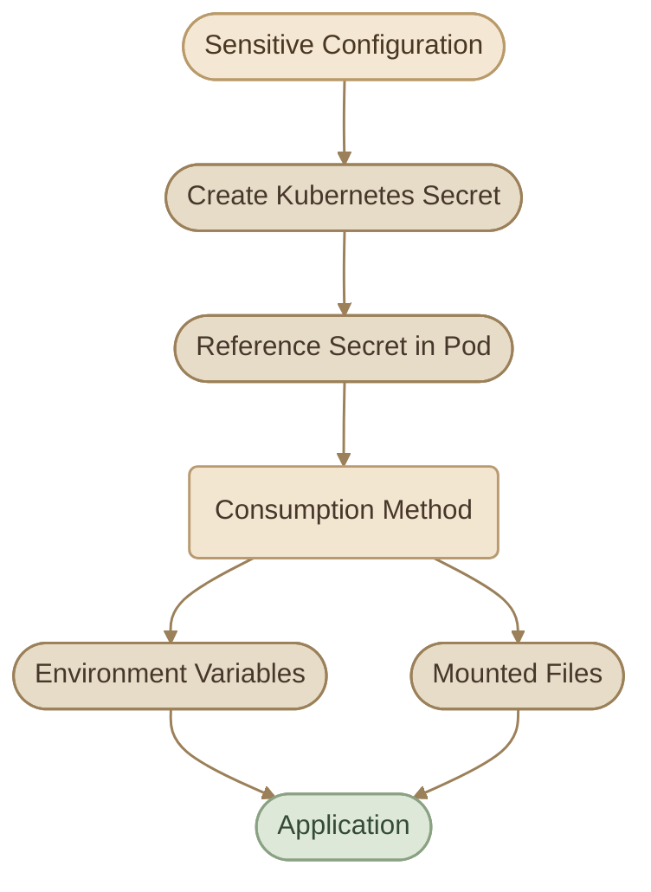

## 1. What Is a Secret?

في التطبيقات، بنحتاج أحيانًا نتعامل مع بيانات حساسة زي:

<CardGrid columns={3} label="Sensitive Data Types">
  <InfoCard variant="concept" title="Database passwords" icon="database" />
  <InfoCard variant="concept" title="API tokens" icon="tag" />
  <InfoCard variant="concept" title="Authentication credentials" icon="shield" />
  <InfoCard variant="concept" title="TLS certificates" icon="network" />
  <InfoCard variant="concept" title="Private keys" icon="code" />
</CardGrid>

مينفعش نحط البيانات دي مباشرةً داخل Application Code أو نكتبها بشكل مكشوف في ملفات الـ Configuration العادية.

هنا بييجي دور **Kubernetes Secret**.

الـ Secret هو Kubernetes Object مصمم لتخزين البيانات الحساسة وتوفيرها للـ Pods اللي محتاجاها.

أمثلة على البيانات اللي ممكن نخزنها فيه:

<TableCard>
| Key | Example Value |
|---|---|
| `DB_HOST` | `mysql.default.svc` |
| `DB_USER` | `app-user` |
| `DB_PASSWORD` | A database password |
| `API_TOKEN` | An application token |
</TableCard>

الـ Secret بيخلينا نفصل الـ Sensitive Configuration عن الـ Application Definition، وده بيسهّل إدارة البيانات دي بشكل مستقل.

<InfoCard variant="warning" title="Important Security Note" description="Kubernetes Secrets لا يتم تشفير قيمها تلقائيًا لمجرد إنها اتخزنت كـ Secret. الـ Base64 Encoding مش Encryption، ولازم تأمّن الوصول للـ Secrets وتراجع إعدادات Encryption at Rest." icon="shield" tags={["Security", "Base64", "Encryption"]} />

## 2. ConfigMaps vs Secrets

الاتنين بيستخدموا لتوفير Configuration للـ Applications، لكن الغرض الأساسي مختلف.

<TableCard>
| Feature | ConfigMap | Secret |
|---|---|---|
| Primary purpose | Non-sensitive configuration | Sensitive configuration |
| Examples | Application mode, feature flags | Passwords, tokens, certificates |
| Data representation | Plain strings | Usually Base64-encoded under `data` |
| Environment variables | Supported | Supported |
| Volume mounts | Supported | Supported |
| Access control | Kubernetes RBAC | Kubernetes RBAC |
| Automatic encryption at rest | Not inherently encrypted | Not inherently encrypted |
</TableCard>

استخدم `ConfigMap` للـ Non-sensitive Configuration، واستخدم `Secret` للبيانات الحساسة.

لكن خلي بالك: **استخدام Secret مش معناه إن البيانات بقت آمنة تلقائيًا**. مستوى الحماية بيعتمد كمان على إعدادات الـ Cluster، والـ RBAC Permissions، وطريقة تخزين البيانات وإدارتها.

## 3. How Secrets Work

الـ Workflow الأساسي بيتكوّن من خطوتين:

1. Create the Secret.
2. Reference the Secret from a Pod.

الـ Pod يقدر يستهلك البيانات من الـ Secret كـ Environment Variables أو كـ Files عن طريق Volume Mounts.



<InfoCard variant="warning" title="Security Reminder" icon="shield">

**Security reminder:** الـ Secret مش بيتم حقنه في كل الـ Pods تلقائيًا. لازم تحدد الـ Secret اللي الـ Pod محتاجه، وتسمح له بالوصول ليه من خلال الـ Pod Specification والـ Kubernetes Security Configuration.

</InfoCard>

## 4. Creating Secrets Imperatively

أسرع طريقة لإنشاء Secret هي باستخدام `kubectl create secret generic`.

### I. Create a Secret from Literal Values

```bash
kubectl create secret generic app-credentials \
  --from-literal=username=demo-user \
  --from-literal=password='demo-password'
```

الأمر ده بيعمل Secret اسمه `app-credentials` وبيخزن فيه قيمتين:

- `username`
- `password`

القيم هنا تجريبية للتعلم فقط، ومش Credentials حقيقية.

تقدر تضيف أكتر من Key باستخدام `--from-literal` عدة مرات.

<InfoCard variant="warning" title="Shell History Exposure" icon="terminal">

**مهم:** القيم المكتوبة في الـ Command Line ممكن تظهر في Shell History أو تكون متاحة لعمليات محلية حسب طريقة التنفيذ وإعدادات النظام. متستخدمش الطريقة دي بلا تفكير مع Production Secrets.

</InfoCard>

### II. Verify the Secret

اعرض الـ Secrets الموجودة في الـ Namespace الحالي:

```bash
kubectl get secrets
```

اعرض معلومات الـ Secret:

```bash
kubectl describe secret app-credentials
```

الأمر التاني بيعرض الـ Metadata وأسماء الـ Keys وأحجام البيانات، لكنه مش بيعرض القيم الفعلية بالطريقة المعتادة.

تقدر كمان تعرض الـ Keys الموجودة داخل الـ Secret من غير ما تطبع قيمها:

```bash
kubectl get secret app-credentials \
  -o jsonpath='{.data}' 
```

الأمر الأخير بيعرض القيم الموجودة تحت `data` بترميز Base64؛ وبالتالي هو مش وسيلة لإخفاء البيانات عن شخص عنده صلاحية قراءة الـ Secret.

## 5. Creating Secrets Declaratively

ممكن كمان تعرّف الـ Secret باستخدام YAML Manifest.

### I. Using `data`

الـ `data` field بيستقبل قيمًا بترميز Base64.

على Linux، تقدر تحوّل قيمة إلى Base64 بالشكل ده:

```bash
printf '%s' 'demo-password' | base64
```

استخدم `printf` بدل `echo` عشان تتجنب إضافة Newline بشكل غير مقصود.

بعد كده، تقدر تستخدم القيمة الناتجة داخل الـ Manifest:

```yaml
apiVersion: v1
kind: Secret
metadata:
  name: app-credentials
type: Opaque
data:
  username: <BASE64_ENCODED_USERNAME>
  password: <BASE64_ENCODED_PASSWORD>
```

استبدل القيمتين بالـ Base64 Values الصحيحة قبل تطبيق الملف.

```bash
kubectl apply -f secret.yaml
```

<InfoCard variant="warning" title="data Is Not Encryption" icon="database">

**مهم جدًا:** استخدام `data` مش معناه إن القيم اتعملها Encryption. الـ Base64 مجرد Encoding سهل فكّه.

كمان متحطّش Production Secrets داخل ملفات YAML محفوظة في Git Repository عام أو خاص من غير آلية آمنة لإدارة الأسرار.

</InfoCard>

### II. Using `stringData`

فيه اختيار تاني اسمه `stringData`، بيسمحلك تكتب القيم كنص عادي داخل الـ Manifest، وKubernetes بيحوّلها داخليًا للصيغة المناسبة عند إنشاء الـ Secret.

```yaml
apiVersion: v1
kind: Secret
metadata:
  name: app-credentials
type: Opaque
stringData:
  username: demo-user
  password: demo-password
```

طبّق الملف:

```bash
kubectl apply -f secret.yaml
```

الفرق الأساسي:

<CardGrid columns={2} label="data vs stringData">
  <InfoCard variant="comparison" title="data" icon="database">

`data`: القيم لازم تكون Base64-encoded.

  </InfoCard>
  <InfoCard variant="comparison" title="stringData" icon="code">

`stringData`: القيم بتتكتب كنص عادي.

  </InfoCard>
</CardGrid>

<InfoCard variant="warning" title="stringData Is Not Safer" icon="shield">

لكن **`stringData` مش أكثر أمانًا من `data`**. لو الملف فيه Password حقيقي، فهو لسه موجود كنص واضح في الملف نفسه.

</InfoCard>

وكمان `stringData` مش بيظهر كـ Field مستقل عند قراءة الـ Secret من الـ API؛ Kubernetes بيحوّل القيم إلى `data`.

## 6. Understanding Secret Types

الـ Secret عنده `type` بيحدد نوع البيانات اللي بيحتوي عليها أو الغرض منه.

<TableCard>
| Type | Purpose |
|---|---|
| `Opaque` | General-purpose Secret، وهو النوع الافتراضي |
| `kubernetes.io/tls` | TLS certificate and private key |
| `kubernetes.io/dockerconfigjson` | Docker registry authentication |
| `kubernetes.io/service-account-token` | Legacy ServiceAccount token Secret |
</TableCard>

لما تستخدم الأمر:

```bash
kubectl create secret generic app-credentials \
  --from-literal=username=demo-user
```

فـ Kubernetes بيستخدم النوع `Opaque`.

تقدر تعرف نوع أي Secret باستخدام:

```bash
kubectl get secret app-credentials \
  -o jsonpath='{.type}{"\n"}'
```

الـ Secret اللي بيحتوي على بيانات التطبيق العادية غالبًا هيكون `Opaque`.

## 7. Injecting Secrets into Environment Variables

بعد ما تنشئ الـ Secret، تقدر توفر بياناته للـ Container كـ Environment Variables.

### I. Using `envFrom`

استخدم `envFrom` لو عايز تضيف كل الـ Keys الموجودة في Secret إلى Environment Variables داخل الـ Container.

```yaml
apiVersion: v1
kind: Pod
metadata:
  name: secret-env-demo
spec:
  containers:
    - name: app
      image: busybox:1.36
      command: ["/bin/sh", "-c"]
      args:
        - |
          if [ -n "$username" ] && [ -n "$password" ]; then
            echo "Credentials are available"
          else
            echo "Credentials are missing"
          fi
          sleep 3600
      envFrom:
        - secretRef:
            name: app-credentials
```

في المثال ده:

<CardGrid columns={3} label="How envFrom Works">
  <InfoCard variant="concept" title="envFrom" icon="sliders">

`envFrom` بيستورد الـ Keys من الـ Secret.

  </InfoCard>
  <InfoCard variant="concept" title="username" icon="terminal">

قيمة الـ `username` بتصبح متاحة من خلال Environment Variable اسمه `username`.

  </InfoCard>
  <InfoCard variant="concept" title="password" icon="terminal">

قيمة الـ `password` بتصبح متاحة من خلال Environment Variable اسمه `password`.

  </InfoCard>
</CardGrid>

الـ Application تقدر تستخدم القيم دي وقت التشغيل بدل ما تكتبها مباشرةً داخل الكود.

لاحظ إن المثال بيتحقق من وجود القيم من غير ما يطبعها.

### II. Using `secretKeyRef`

أحيانًا التطبيق بيحتاج Key واحدة بس من الـ Secret.

في الحالة دي، استخدم `secretKeyRef`:

```yaml
env:
  - name: DB_PASSWORD
    valueFrom:
      secretKeyRef:
        name: app-credentials
        key: password
```

هنا:

- `DB_PASSWORD`: اسم الـ Environment Variable داخل الـ Container.
- `app-credentials`: اسم الـ Secret.
- `password`: اسم الـ Key داخل الـ Secret.

الطريقة دي مفيدة لما تحتاج تتحكم في أسماء الـ Environment Variables أو تختار Keys محددة بدل استيراد الـ Secret بالكامل.

ولو عايز تتعامل مع Key اختيارية، تقدر تستخدم `optional: true` داخل `secretKeyRef`. لكن خليك واعي إن التطبيق ممكن يفشل وقت التشغيل لو القيمة مطلوبة فعلًا ومش موجودة.

## 8. Mounting Secrets as Volumes

مش كل Applications بتقرأ الـ Credentials من Environment Variables. بعض التطبيقات بتحتاج بيانات اعتماد موجودة في Files.

تقدر تستخدم Secret Volume عشان كل Key في الـ Secret تتحول إلى File داخل الـ Container.

مثال:

```yaml
apiVersion: v1
kind: Pod
metadata:
  name: secret-volume-demo
spec:
  containers:
    - name: app
      image: busybox:1.36
      command: ["/bin/sh", "-c"]
      args:
        - |
          if [ -s /etc/app-secrets/password ]; then
            echo "Password file exists and is not empty"
          else
            echo "Password file is missing or empty"
          fi
          sleep 3600
      volumeMounts:
        - name: app-secrets
          mountPath: /etc/app-secrets
          readOnly: true
  volumes:
    - name: app-secrets
      secret:
        secretName: app-credentials
```

الـ Container هيلاقي الملفات في المسار:

```text
/etc/app-secrets/username
/etc/app-secrets/password
```

محتوى كل File بيكون القيمة المقابلة للـ Key الموجودة في الـ Secret.

### I. Environment Variables vs Volume Mounts

<TableCard>
| Feature | Environment Variables | Secret Volume |
|---|---|---|
| How the application reads data | From the process environment | From files |
| Good fit for | Apps expecting environment variables | Apps expecting credential files |
| Secret updates | Running processes don't automatically receive updated environment values | Mounted files can update eventually |
| Application changes required | Depends on the app | Depends on the app |
</TableCard>

في الحالتين، لازم تتأكد إن التطبيق بيستهلك البيانات بالطريقة المناسبة، وإن الملفات أو Environment Variables مش بتتسجل بالخطأ في Logs أو Diagnostics.

<InfoCard variant="callout" title="Volume Update Timing" icon="database">

**ملحوظة:** الـ Secret Volume Files ممكن تتحدّث بعد تعديل الـ Secret، لكن التحديث مش لحظي بالضرورة. ولو استخدمت `subPath` لعمل Mount لملف محدد، التحديثات اللاحقة مش هتظهر تلقائيًا في الـ Mounted File بالطريقة المعتادة.

</InfoCard>

## 9. Updating Secrets

تقدر تحدّث Secret موجود باستخدام Manifest أو `kubectl`.

مثلًا، بعد تعديل `secret.yaml`:

```bash
kubectl apply -f secret.yaml
```

لكن طريقة استهلاك الـ Secret بتأثر على كيفية ظهور التحديث للتطبيق:

<CardGrid columns={2} label="How Updates Appear">
  <InfoCard variant="comparison" title="Environment Variables" description="الـ Processes الموجودة مش بتشوف القيم الجديدة تلقائيًا. غالبًا هتحتاج Restart للـ Application أو إعادة إنشاء الـ Pod." icon="terminal" />
  <InfoCard variant="comparison" title="Secret Volumes" description="الملفات ممكن تتحدّث في النهاية، حسب طريقة الـ Mount، لكن التطبيق نفسه لازم يقدر يقرأ التغييرات الجديدة." icon="database" />
</CardGrid>

لو الـ Pod تابع لـ Deployment، الأفضل عادةً إنك تدير التحديث من خلال الـ Deployment والآلية اللي بتستخدمها لإدارة الـ Secrets، بدل ما تحاول تعدّل الـ Pod مباشرةً.

## 10. Secret Security Best Practices

الـ Secrets بتساعدك تفصل البيانات الحساسة عن الـ Application Configuration، لكن أمانها بيعتمد على إعدادات الـ Cluster وطريقة إدارتها.

### I. Base64 Is Not Encryption

القيم الموجودة في `data` بتكون Base64-encoded، وده مش تشفير.

لو شخص عنده صلاحية قراءة الـ Secret، يقدر يفك الترميز ويقرأ القيمة.

### II. Enable Encryption at Rest

بشكل افتراضي، Kubernetes Secrets ممكن تتخزن في الـ etcd من غير Encryption at Rest.

لازم تراجع إعدادات الـ Cluster وتفعّل آلية Encryption at Rest المناسبة للـ Secrets. وجود البيانات داخل Secret Object لوحده مش كفاية.

### III. Apply Least Privilege with RBAC

استخدم Kubernetes RBAC عشان تحدد مين يقدر يعمل:

- `get` على Secrets.
- `list` على Secrets.
- `watch` على Secrets.

الصلاحيات دي مش متساوية في تأثيرها، وكل واحدة ممكن تكشف بيانات حساسة حسب طريقة استخدامها.

خلي الوصول للـ Secrets مقتصرًا على الـ Users والـ Service Accounts اللي محتاجاها فعلًا.

### IV. Avoid Committing Secrets to Git

متخزنش Production Passwords أو Tokens داخل Git Repository، حتى لو كان Private، إلا لو عندك آلية مناسبة لإدارة وتشفير الأسرار قبل تخزينها.

لو Secret حقيقي اتسرّب إلى Repository، مجرد حذفه من آخر Commit مش كفاية؛ غالبًا لازم تعمل Rotation للـ Credential وتراجع سجل الـ Repository ووسائل الوصول المرتبطة به.

### V. Use External Secret Management When Appropriate

في البيئات الإنتاجية، ممكن تحتاج حلول متخصصة لإدارة الأسرار، زي External Secret Managers أو Secrets Management Systems.

الاختيار بيعتمد على بنية النظام، ومتطلبات الأمان، وطريقة توزيع الصلاحيات وإدارة دورة حياة الـ Credentials.

## 11. Custom Hands-on Lab: Secure Application Configuration

في الـ Lab ده هتعمل Secret من الصفر، وتستهلكه من Pod، وبعدها تتحقق إن الـ Application تقدر تستخدم البيانات من غير ما تطبع القيم الحساسة.

الـ Lab بيستخدم بيانات تجريبية فقط، ومش محتاج Cloud Account أو VPS.

<Steps>
<li>

<InfoCard title="Verify the Kubernetes Context" icon="terminal" />

تأكد إنك متصل بالـ Local Cluster المقصود:

```bash
kubectl config current-context
kubectl cluster-info
kubectl get nodes
```

متكملش لو الـ Context مش هو الـ Cluster اللي ناوي تشتغل عليه.
</li>
<li>

<InfoCard title="Create an Isolated Namespace" icon="layers" />

```bash
kubectl create namespace secrets-lab
kubectl config set-context --current --namespace=secrets-lab
```

هنستخدم Namespace مستقلة عشان نفصل موارد التدريب عن بقية موارد الـ Cluster.
</li>
<li>

<InfoCard title="Create a Secret" icon="cube" />

أنشئ Secret باسم `checkout-credentials` باستخدام بيانات تجريبية:

```bash
kubectl create secret generic checkout-credentials \
  --from-literal=APP_USER=checkout-demo \
  --from-literal=APP_PASSWORD=training-only-value
```

اتأكد إن الـ Secret اتعمل:

```bash
kubectl get secrets
kubectl describe secret checkout-credentials
```

**Task:** من غير ما تطبع القيم الفعلية، اعرف عدد الـ Keys الموجودة في الـ Secret.
</li>
<li>

<InfoCard title="Create a Pod That Consumes the Secret" icon="shield" />

أنشئ ملفًا باسم `checkout-app.yaml`:

```yaml
apiVersion: v1
kind: Pod
metadata:
  name: checkout-app
spec:
  containers:
    - name: app
      image: busybox:1.36
      command: ["/bin/sh", "-c"]
      args:
        - |
          if [ -n "$APP_USER" ] && [ -n "$APP_PASSWORD" ]; then
            echo "Application configuration loaded"
          else
            echo "Application configuration is incomplete"
          fi
          sleep 3600
      envFrom:
        - secretRef:
            name: checkout-credentials
```

طبّق الـ Manifest:

```bash
kubectl apply -f checkout-app.yaml
```

استنى لحد ما الـ Pod يشتغل:

```bash
kubectl get pod checkout-app -w
```

لما الحالة تبقى `Running`، أوقف أمر المتابعة باستخدام `Ctrl+C`.
</li>
<li>

<InfoCard title="Verify the Application" icon="pulse" />

اعرض الـ Logs:

```bash
kubectl logs checkout-app
```

المفروض تشوف رسالة بتأكد إن الـ Configuration اتحمّلت، من غير ما تظهر القيم نفسها.

اتأكد كمان إن الـ Container لسه شغال:

```bash
kubectl get pod checkout-app
```

بعد كده، راجع الـ Pod Specification:

```bash
kubectl describe pod checkout-app
```

**Tasks:**

1. ليه الـ Pod بيستخدم `envFrom` بدل ما يكتب الـ Credentials مباشرةً في الـ Manifest؟
2. إيه الفرق بين اسم الـ Secret واسم الـ Environment Variable؟
3. لو شلت `APP_PASSWORD` من الـ Secret وأعدت إنشاء الـ Pod، إيه المتوقع يحصل؟
4. هل تحديث الـ Secret وحده هيغيّر Environment Variables داخل الـ Container الشغال؟
</li>
<li>

<InfoCard title="Optional Challenge — Use a Secret Volume" icon="database" />

أنشئ Pod تاني باسم `checkout-file-app` بيستخدم نفس الـ Secret، لكن بدل `envFrom`، اعمل Mount للـ Secret داخل المسار:

```text
/etc/checkout-secrets
```

تحقق من وجود الملفين:

```text
/etc/checkout-secrets/APP_USER
/etc/checkout-secrets/APP_PASSWORD
```

اعمل Verification لوجود الملفات من غير ما تطبع محتواها.
</li>
<li>

<InfoCard title="Cleanup" icon="tag" />

بعد ما تخلص التدريب، احذف الـ Namespace الخاصة بالـ Lab:

```bash
kubectl delete namespace secrets-lab
```

الأمر ده هيحذف الـ Namespace والموارد الموجودة داخلها، بما فيها الـ Secret والـ Pods اللي أنشأناها في الـ Lab.
</li>
</Steps>

## Summary

<CardGrid columns={2} label="Key Takeaways">
  <InfoCard variant="summary" title="Secrets Store Sensitive Data">

الـ Secret مخصص لتخزين البيانات الحساسة وإتاحتها للـ Applications اللي محتاجاها.

  </InfoCard>
  <InfoCard variant="summary" title="Imperative Creation">

`kubectl create secret generic` بيسمح بإنشاء Secret من Literal Values أو Files.

  </InfoCard>
  <InfoCard variant="summary" title="data vs stringData">

`data` بيستخدم Base64-encoded Values، بينما `stringData` بيسمح بإدخال القيم كنص عادي.

  </InfoCard>
  <InfoCard variant="summary" title="Base64 Is Not Encryption">

Base64 Encoding مش Encryption.

  </InfoCard>
  <InfoCard variant="summary" title="envFrom Injects All Keys">

`envFrom` بيوفر كل الـ Keys الموجودة في Secret كـ Environment Variables.

  </InfoCard>
  <InfoCard variant="summary" title="secretKeyRef Selects a Key">

`secretKeyRef` بيسمح باختيار Key محددة.

  </InfoCard>
  <InfoCard variant="summary" title="Mount Secrets as Files">

Secret Volumes بتوفر البيانات في صورة Files داخل الـ Container.

  </InfoCard>
  <InfoCard variant="summary" title="Secure RBAC and Encryption">

لازم تراجع Encryption at Rest وRBAC، ومتخزنش Production Secrets بشكل مكشوف في Git.

  </InfoCard>
  <InfoCard variant="summary" title="Updates Are Not Automatic">

تحديث Secret مش معناه إن كل Application هتستقبل القيمة الجديدة تلقائيًا.

  </InfoCard>
</CardGrid>
