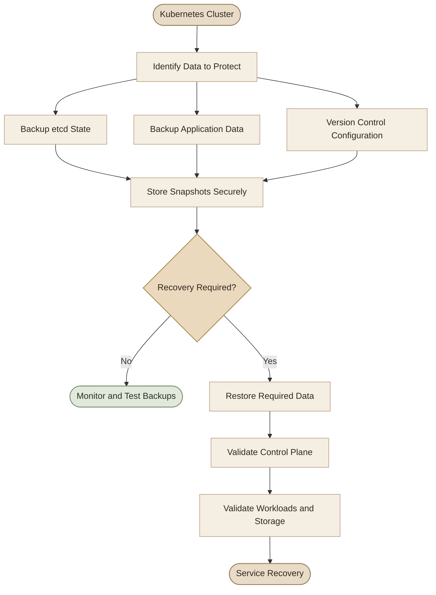

## Overview

تخيّل إن الـ Control Plane حصل فيه عطل، أو إنك عملت Maintenance Reboot وبعد ما الـ Nodes رجعت اكتشفت إن الـ Deployments والـ Services اختفت. هل تقدر ترجع الـ Cluster لحالته السابقة؟

الإجابة تعتمد على نوع الـ Backup اللي عندك، وهل الـ Backup نفسه سليم وممكن استعادته.

في Kubernetes، الـ Backup مش مجرد نسخ ملفات من السيرفر. لازم نفهم الفرق بين **Cluster State** و**Application Data** و**Configuration Files**، وإزاي نستعيد كل نوع منهم.

## Learning Objectives

بنهاية الموضوع، هتقدر:

- تميّز بين Backup للـ Kubernetes resources وBackup للـ etcd.
- تفهم دور الـ Persistent Volumes في خطة الـ Backup.
- تاخد `etcd` snapshot باستخدام `etcdctl`.
- تتحقق من الـ snapshot وتستعيده باستخدام `etcdutl` عند دعمه في إصدارك.
- تفهم دور الـ Static Pod manifests أثناء استعادة الـ Control Plane.
- تتجنب الأخطاء اللي ممكن تحوّل عملية الاستعادة لمشكلة أكبر.

## 1. What Should You Back Up?

فيه أكتر من نوع من البيانات لازم تفكر فيه عند بناء خطة الـ Backup.

<CardGrid>
  <InfoCard title="etcd Snapshot" icon="database">
    بيحفظ الـ Kubernetes state المخزّن في etcd، بما فيه تعريفات الـ resources والـ cluster metadata.
  </InfoCard>
  <InfoCard title="Application Data" icon="database">
    البيانات الفعلية للتطبيقات الموجودة على Persistent Volumes، زي ملفات المستخدمين وقواعد البيانات.
  </InfoCard>
  <InfoCard title="Configuration Files" icon="code">
    ملفات YAML والـ Helm values والـ manifests والـ infrastructure configuration اللازمة لإعادة إنشاء البيئة.
  </InfoCard>
  <InfoCard title="Certificates & Recovery Information" icon="shield">
    معلومات استعادة الوصول للـ Control Plane، مع حماية المفاتيح والـ certificates والـ secrets من الوصول غير المصرح به.
  </InfoCard>
</CardGrid>

### I. Cluster State vs Application Data

دي نقطة مهمة جدًا: الـ `etcd` snapshot بيحفظ حالة Kubernetes، لكنه **مش بديل عن Backup لبيانات التطبيق الموجودة على الـ Persistent Volumes**.

مثلًا، لو عندك PostgreSQL شغال داخل Kubernetes:

- الـ Deployment والـ Service والـ PVC definitions ممكن تكون موجودة في etcd snapshot.
- البيانات الفعلية لقاعدة البيانات موجودة على الـ Persistent Volume أو نظام التخزين المستخدم.
- استعادة الـ etcd وحدها مش معناها إن ملفات قاعدة البيانات نفسها اتعمل لها Backup.

كمان، استعادة تعريف الـ PVC لا تضمن استعادة الـ PV أو البيانات المرتبطة به لو نظام التخزين فقدها.

## 2. Backup Strategies

عندك ثلاث طرق أساسية بتكمّل بعضها، ومش بالضرورة تختار طريقة واحدة بس.

### I. Declarative Configuration Backup

لما تكتب الـ Kubernetes resources في ملفات YAML وتخزنها في Git، بتقدر تعيد إنشاء معظم الـ resources من الملفات دي.

مثال على تنظيم ملفات تطبيق:

```text
application/
├── namespace.yaml
├── deployment.yaml
├── service.yaml
├── configmap.yaml
└── ingress.yaml
```

وتقدر تطبق الملفات باستخدام:

```bash
kubectl apply -f application/
```

الميزة هنا إن الـ configuration بتبقى محفوظة، قابلة للمراجعة، وممكن تتشارك مع الفريق.

لكن فيه حدود مهمة:

- ملفات YAML مش بالضرورة تحتوي على كل الـ resources اللي اتعملت يدويًا.
- بعض الـ resources بتحتوي على بيانات أو حقول بيضيفها Kubernetes تلقائيًا.
- البيانات الحساسة زي passwords وtokens لازم تتعامل معاها بحذر.
- ملفات الـ manifests مش بتحتوي تلقائيًا على بيانات الـ Persistent Volumes.

> **مهم:** GitOps وInfrastructure as Code بيساعدوك تعيد بناء البيئة، لكنهم مش بديل عن etcd snapshots أو Application Data Backups.

### II. Backup Through the Kubernetes API

ممكن تجمع تعريفات الـ resources عن طريق الـ Kubernetes API باستخدام `kubectl` أو أدوات مخصصة.

مثال لاستعراض موارد من كل الـ Namespaces:

```bash
kubectl get deployments,services,configmaps -A
```

ومثال لتصدير نوع واحد من الموارد بصيغة YAML:

```bash
kubectl get deployments -A -o yaml > deployments.yaml
```

لكن الأمر ده مش بيعمل Backup كامل للـ Cluster. كمان، `kubectl get all -A -o yaml` مش معناه إنه بيجيب كل أنواع الـ resources؛ مجموعة `all` بتشمل أنواعًا محددة فقط.

لو هتبني حل للـ Backup عن طريق الـ API، لازم تحدد أنواع الـ resources المطلوبة وتتعامل مع البيانات الناتجة بشكل مناسب. أدوات متخصصة زي Velero ممكن تساعد في إدارة الـ backups والـ restores، حسب الـ storage provider والـ configuration المستخدمين.

### III. etcd Snapshot Backup

الـ `etcd` هو الـ key-value store اللي Kubernetes بيستخدمه لتخزين الـ cluster state.

في Cluster مبني باستخدام `kubeadm`، غالبًا هتلاقي etcd شغال كـ Static Pod على الـ Control Plane، وبياناته محفوظة على الـ Host في مسار زي `/var/lib/etcd`.

الـ snapshot بيسمح لك تحفظ حالة الـ etcd في ملف وتستخدمه لاحقًا في Disaster Recovery.

وده مهم لأن لو الـ API server فقد الوصول إلى etcd، مش هيقدر يقرأ أو يحدّث الـ cluster state بشكل طبيعي.

## 3. How the Backup and Restore Process Fits Together



## 4. Understanding etcd in a kubeadm Cluster

قبل ما تعمل Backup، لازم تعرف الـ etcd endpoint والـ certificates والـ data directory الفعلية.

في الـ kubeadm cluster المعتاد، ابدأ من الـ Control Plane Node.

### I. Inspect the etcd Pod

```bash
kubectl get pods -n kube-system -o wide
```

ممكن تلاقي Pod اسمه `etcd-controlplane` أو اسم مشابه. ده غالبًا Static Pod، لكن اسم الـ Pod مش ثابت في كل البيئات.

اعرض تفاصيله:

```bash
kubectl describe pod -n kube-system etcd-controlplane
```

استبدل الاسم بالاسم الفعلي الموجود عندك.

أو افحص الـ manifest على الـ Control Plane:

```bash
sudo cat /etc/kubernetes/manifests/etcd.yaml
```

من الـ manifest، دور على الخيارات دي:

- `--listen-client-urls` أو `--advertise-client-urls`: عناوين الاتصال بالـ etcd.
- `--data-dir`: مسار البيانات داخل الـ etcd container.
- `--cert-file`: شهادة الـ etcd server المستخدمة في الاتصال.
- `--key-file`: المفتاح الخاص بالشهادة.
- `--trusted-ca-file` أو الإعداد المقابل للـ CA: الشهادة المستخدمة للتحقق من العميل، حسب إعدادات الـ etcd.

وفي إعدادات kubeadm الشائعة، ممكن تلاقي الملفات دي:

```text
/etc/kubernetes/pki/etcd/server.crt
/etc/kubernetes/pki/etcd/server.key
/etc/kubernetes/pki/etcd/ca.crt
```

**ما تفترضش إن المسارات أو الـ endpoint ثابتين.** راجع الـ manifest والإعدادات الفعلية عندك قبل تنفيذ أوامر الـ Backup.

### II. Understand the hostPath Mapping

في الـ Static Pod manifest، ممكن تلاقي إعدادًا بالشكل ده:

```yaml
volumes:
  - name: etcd-data
    hostPath:
      path: /var/lib/etcd
      type: DirectoryOrCreate
```

وفي الـ container:

```yaml
volumeMounts:
  - name: etcd-data
    mountPath: /var/lib/etcd
```

الـ `name: etcd-data` هو اللي بيربط الـ volume بالـ volume mount.

أما الـ `hostPath.path` فهو المسار الموجود على الـ Node، والـ `mountPath` هو المسار اللي بيشوفه الـ container.

الاتنين ممكن يكونوا مختلفين؛ المهم إن الـ mapping صحيح وإن إعداد `--data-dir` داخل الـ container بيشير للمسار المناسب.

## 5. Taking an etcd Snapshot

في الإصدارات اللي بتدعم `ETCDCTL_API=3`، تقدر تستخدم `etcdctl snapshot save` لإنشاء snapshot من الـ etcd endpoint.

الأمر التالي مثال شائع في kubeadm cluster يستخدم TLS.

<Steps>
<li>

<InfoCard title="Set the Connection Details" icon="terminal" />

نفّذ على الـ Control Plane Node، بعد التأكد من المسارات والـ endpoint:

```bash
export ETCDCTL_API=3

export ETCD_ENDPOINT="https://127.0.0.1:2379"
export ETCD_CACERT="/etc/kubernetes/pki/etcd/ca.crt"
export ETCD_CERT="/etc/kubernetes/pki/etcd/server.crt"
export ETCD_KEY="/etc/kubernetes/pki/etcd/server.key"
```

الـ endpoint هنا مجرد مثال. استخدم العنوان الفعلي اللي ظهر في إعدادات etcd عندك.

> **ملاحظة:** متغير `ETCDCTL_API=3` مطلوب في إصدارات `etcdctl` اللي بتعتمد عليه. راجع إصدار الأداة عندك؛ ما تفترضش إنه مطلوب بنفس الطريقة في كل إصدار حديث.
</li>
<li>

<InfoCard title="Save the Snapshot" icon="database" />

أنشئ مسارًا مناسبًا للـ backup، وتأكد من صلاحيات الكتابة والمساحة المتاحة:

```bash
sudo mkdir -p /var/backups/etcd
sudo chmod 700 /var/backups/etcd
```

بعدها، نفّذ أمر الـ snapshot مع المسارات الفعلية للـ certificates:

```bash
sudo env ETCDCTL_API=3 etcdctl \
  --endpoints="${ETCD_ENDPOINT}" \
  --cacert="${ETCD_CACERT}" \
  --cert="${ETCD_CERT}" \
  --key="${ETCD_KEY}" \
  snapshot save /var/backups/etcd/snapshot.db
```

الأمر ده بيفترض إن `etcdctl` موجود في `PATH`، وإن المستخدم عنده صلاحيات الوصول للملفات المطلوبة.
</li>
<li>

<InfoCard title="Verify the Snapshot" icon="flag" />

في الإصدارات الحديثة اللي بتوفر `etcdutl`، استخدم:

```bash
sudo etcdutl snapshot status \
  /var/backups/etcd/snapshot.db \
  --write-out=table
```

النتيجة بتوضح معلومات زي الـ revision وعدد الـ keys والحجم.

وجود ملف باسم `snapshot.db` وحده مش كفاية. لازم تتأكد إن عملية الـ snapshot نجحت، وتختبر الاستعادة دوريًا في بيئة منفصلة.
</li>
</Steps>

<Callout type="warning" title="Protect the Backup">
  الـ snapshot ممكن يحتوي على Kubernetes Secrets وبيانات حساسة أخرى. خزّنه في مكان محدود الصلاحيات، وشفّره أثناء التخزين والنقل حسب سياسة المؤسسة، واحتفظ بنسخة خارج الـ Node أو الـ Cluster نفسه.
</Callout>

## 6. Restoring an etcd Snapshot

الـ Restore عملية حساسة؛ تنفيذها على Cluster شغال من غير خطة ممكن يسبب فقد بيانات أو يجعل الـ Control Plane غير متاح.

الفكرة العامة:

1. توقف الوصول والكتابة للـ etcd أثناء عملية الاستعادة وفقًا لإجراءات الاستعادة المناسبة للـ topology.
2. تستعيد الـ snapshot إلى Data Directory.
3. توجّه etcd إلى البيانات المستعادة.
4. تعيد تشغيل المكونات المطلوبة وتتحقق من حالة الـ Cluster.

في الـ kubeadm Static Pod setup، غالبًا هتحتاج تراجع الـ etcd manifest وتعدّل `hostPath.path` للـ data volume بعد الاستعادة.

<Steps>
<li>

<InfoCard title="Restore into a New Directory" icon="database" />

في الإصدارات اللي بتوفر `etcdutl`، استخدم:

```bash
sudo etcdutl snapshot restore \
  /var/backups/etcd/snapshot.db \
  --data-dir /var/lib/etcd-from-backup
```

الأمر ده بيستعيد البيانات إلى directory جديد. لازم تتأكد إن المسار مناسب وإن الـ etcd process مش بيستخدم نفس الـ directory أثناء عملية الاستعادة.

في بعض الإصدارات القديمة، كانت عملية الاستعادة بتتم باستخدام `etcdctl snapshot restore`. راجع وثائق الإصدار المستخدم؛ ما تخلطش بين أوامر إصدارات مختلفة.
</li>
<li>

<InfoCard title="Update the etcd Static Pod Manifest" icon="code" />

في kubeadm cluster، الملف المعتاد هو:

```text
/etc/kubernetes/manifests/etcd.yaml
```

لو الـ restore بيتم باستخدام data directory جديد، لازم تراجع وتحدّث `volumes.hostPath.path` الخاص بالـ volume المسمى `etcd-data` عشان يشير للمسار المستعاد.

مثال توضيحي فقط:

```yaml
volumes:
  - name: etcd-data
    hostPath:
      path: /var/lib/etcd-from-backup
      type: DirectoryOrCreate
```

لا تستبدل الملف كاملًا بالمثال ده؛ عدّل الـ manifest الفعلي مع الحفاظ على باقي الإعدادات الصحيحة.

تأكد كمان إن إعداد `--data-dir` داخل etcd متوافق مع الـ `mountPath` والـ volume mapping.
</li>
<li>

<InfoCard title="Restart and Validate" icon="pulse" />

في الـ Static Pod setup، الـ kubelet بيراقب مجلد الـ manifests. تغيير الملف ممكن يؤدي إلى إعادة إنشاء الـ etcd Pod تلقائيًا.

لكن **إعادة إنشاء الـ Pod مش دليل على نجاح الاستعادة**. لازم تتابع الحالة والـ logs، وتتأكد إن الـ API server وباقي مكونات الـ Control Plane رجعت للعمل.

```bash
kubectl get pods -n kube-system -o wide
kubectl get nodes
kubectl get deployments -A
kubectl get services -A
```

لو الـ API server غير متاح، أوامر `kubectl` ممكن تفشل؛ وقتها هتحتاج تفحص حالة الـ Node والـ kubelet والـ etcd logs من خلال أدوات الوصول المتاحة على الـ Control Plane.

> **تحذير مهم:** في الـ HA cluster أو الـ external etcd cluster، الاستعادة بتحتاج خطة مختلفة تشمل جميع أعضاء etcd وواجهات الـ API server. ما تطبقش خطوات الـ Single Control Plane مباشرة على Cluster متعدد الأعضاء.
</li>
</Steps>

## 7. What Happens to Kubernetes Resources After Restore?

لما تستعيد etcd snapshot، أنت بترجع الـ cluster state الموجود وقت إنشاء الـ snapshot، مش بالضرورة أحدث حالة كانت موجودة قبل العطل.

مثلًا، لو الـ snapshot اتاخد الساعة 10:00 صباحًا، وبعدها اتعمل Deployment جديد الساعة 11:00 صباحًا، فاستعادة الـ snapshot القديم ممكن ترجعك لحالة ما قبل إنشاء الـ Deployment ده.

وده معناه إن الـ Restore ممكن يسترجع أو يعيد حالة الموارد، لكنه مش بالضرورة يسترجع كل التغييرات اللي حصلت بعد وقت الـ Backup.

### I. Why Restarting Components May Matter

بعد استعادة etcd، بعض مكونات Kubernetes ممكن يكون عندها caches أو watches مبنية على الحالة القديمة. إجراءات الاستعادة الرسمية بتراعي إيقاف الـ API servers أثناء الاستعادة وإعادة تشغيل المكونات المطلوبة حتى تتعامل مع الحالة المستعادة بشكل صحيح.

في بعض البيئات، ممكن تحتاج إجراءات إضافية حسب إصدار Kubernetes وetcd وطريقة النشر.

## 8. Backup Methods Compared

| Method | What it protects | Main limitation |
|---|---|---|
| Git / YAML manifests | Resource configuration | لا يحفظ تلقائيًا كل الـ live state أو بيانات التطبيقات |
| Kubernetes API backup | الموارد التي تجمعها الأداة | يعتمد على أنواع الموارد والصلاحيات والتعامل مع البيانات |
| etcd snapshot | Kubernetes state المخزّن في etcd | لا يغني عن Backup لبيانات الـ Persistent Volumes |
| Persistent Volume backup | بيانات التطبيقات المخزنة | يعتمد على نوع التخزين وطريقة الـ backup والاستعادة |
| Managed Kubernetes backup | يعتمد على خصائص الخدمة | لازم تتأكد من نطاق الـ backup ومسؤوليات الـ provider |

النهج العملي هو الجمع بين أكثر من طريقة: احتفظ بالـ configuration في Git، وخطط لـ etcd backup عند الحاجة، واعمل Backup لبيانات التطبيقات بطريقة مناسبة لطبيعتها.

## 9. Common Mistakes and Troubleshooting

<CardGrid>
  <InfoCard title="Snapshot Command Fails" icon="terminal">
    راجع إصدار `etcdctl`، وقيمة `ETCDCTL_API` إذا كان الإصدار يحتاجها، والـ endpoint والـ TLS certificates وصلاحيات الملفات.
  </InfoCard>
  <InfoCard title="Snapshot File Exists but Restore Fails" icon="flag">
    تحقق من سلامة الـ snapshot، وتوافق إصدار الأدوات، ومسار الـ data directory، ورسائل الخطأ الفعلية.
  </InfoCard>
  <InfoCard title="etcd Pod Does Not Start" icon="pulse">
    راجع الـ Static Pod manifest، والـ hostPath mapping، والـ ownership والـ permissions، والـ etcd logs.
  </InfoCard>
  <InfoCard title="Applications Are Missing" icon="layers">
    تأكد إن الـ API server متصل بالـ etcd المستعاد، وإن الـ resources موجودة فعلًا. راجع أيضًا حالة الـ workloads والـ storage.
  </InfoCard>
</CardGrid>

### Mistake 1: Backing Up Only YAML Files

ملفات YAML مهمة لإعادة بناء الـ configuration، لكنها مش نسخة كاملة من كل ما هو موجود في الـ Cluster، ومش بديل عن Backup بيانات التطبيقات.

### Mistake 2: Treating `kubectl get all` as a Complete Backup

الأمر ده لا يجمع كل أنواع الـ Kubernetes resources. استخدامه وحده ممكن يسيب موارد مهمة خارج الـ backup.

### Mistake 3: Restoring into a Directory Still in Use

ما تستعيدش البيانات فوق Data Directory بيستخدمه etcd شغال. اتبع إجراءات الإيقاف والاستعادة المناسبة، واستخدم مسارًا جديدًا عند الحاجة.

### Mistake 4: Forgetting the Static Pod Configuration

لو استعدت البيانات في directory جديد وما حدّثتش إعداد الـ volume mapping، ممكن etcd يفضل يستخدم البيانات القديمة بدل المستعادة.

### Mistake 5: Assuming the Snapshot Includes Persistent Volume Data

الـ etcd snapshot بيحفظ حالة Kubernetes، لكنه مش نسخة من محتوى الـ storage volumes. خطط لاستعادة الـ application data بشكل مستقل.

## 10. Pre-Backup and Recovery Checklist

### I. Before a Failure

- [ ] حدّد الموارد والبيانات اللي محتاج تحميها.
- [ ] اعمل etcd snapshots دورية لو أنت مسؤول عن etcd.
- [ ] احتفظ بالـ manifests والـ infrastructure configuration في مصدر موثوق.
- [ ] اعمل Backup لبيانات الـ Persistent Volumes وقواعد البيانات.
- [ ] احمِ ملفات الـ snapshots والـ certificates والـ secrets.
- [ ] احتفظ بنسخة من الـ backups خارج الـ Cluster نفسه.
- [ ] اختبر عملية الـ Restore في بيئة معزولة.

### II. During Recovery

- [ ] حدد الـ failure والـ recovery point المطلوب.
- [ ] تأكد من اختيار الـ snapshot الصحيح وسلامته.
- [ ] اتبع إجراءات الاستعادة المناسبة للـ etcd topology وإصدار الأدوات.
- [ ] راجع الـ data directory والـ Static Pod manifest.
- [ ] تحقق من صحة etcd والـ API server والـ Control Plane.
- [ ] تحقق من الـ Deployments والـ Services والـ PVCs والـ application data.
- [ ] اختبر التطبيق فعليًا قبل إعلان استعادة الخدمة.

## 11. Key Takeaways

<Callout type="tip" title="Remember the Three Layers">
  **Configuration** تساعدك تعيد بناء الموارد، و**etcd snapshots** تحفظ حالة Kubernetes، و**application data backups** تحمي بيانات التطبيقات الفعلية. خطة Disaster Recovery جيدة بتحدد إزاي تستعيد كل طبقة منهم.
</Callout>

- `etcdctl snapshot save` بيستخدم للاتصال بالـ etcd وإنشاء snapshot.
- `etcdutl snapshot status` بيعرض معلومات عن الـ snapshot في الإصدارات اللي بتدعمه.
- `etcdutl snapshot restore` بيستعيد snapshot إلى data directory في الإصدارات الحديثة اللي بتوفره.
- الـ kubeadm cluster غالبًا بيشغّل etcd كـ Static Pod، لكن مش كل Kubernetes clusters بتستخدم نفس التصميم.
- عملية الـ Restore لازم تتنفذ وفقًا لوثائق إصدار Kubernetes وetcd الفعلي، خصوصًا في بيئات الـ High Availability.
- **Backup غير مُختبَر مش ضمان للاستعادة.**

## Official References

- [Kubernetes — Operating etcd clusters](https://kubernetes.io/docs/tasks/administer-cluster/configure-upgrade-etcd/)
- [etcd — Disaster Recovery](https://etcd.io/docs/v3.7/op-guide/recovery/)
- [Kubernetes — Velero ecosystem information](https://velero.io/)

