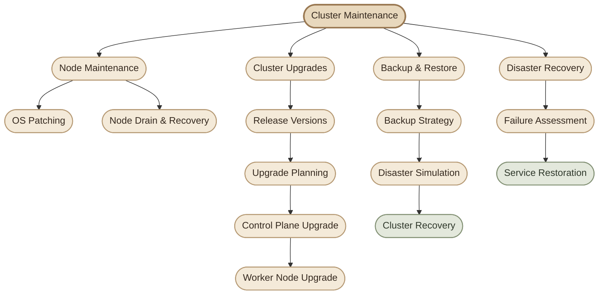
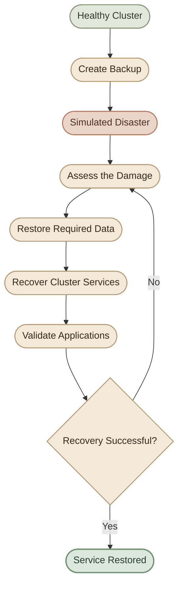

## Overview

تُعتبر **Cluster Maintenance** من المهارات الأساسية لأي Kubernetes Administrator؛ لأن تشغيل الـ Cluster مش معناه إن الشغل خلص. لازم نعرف إزاي نحافظ على استقرار الـ Cluster، ونحدّث مكوناته بأمان، ونتعامل مع الأعطال، ونسترجع البيانات والخدمات بعد الكوارث.

في القسم ده، هنتعلم إزاي ندير دورة حياة الـ Kubernetes Cluster بدايةً من صيانة الـ Nodes، مرورًا بترقية إصدارات Kubernetes، وصولًا إلى Backup & Restore وDisaster Recovery.

<InfoCard title="Learning Objectives" icon="flag" variant="insight">

بنهاية القسم، هتكون قادر على فهم تأثير توقف الـ Nodes على الـ Workloads، والتخطيط لترقية الـ Cluster، وتنفيذ إجراءات الصيانة بطريقة تقلل انقطاع الخدمات، وفهم كيفية استعادة الـ Cluster من Backup مناسب.

</InfoCard>

## 1. Why Cluster Maintenance Matters

الـ Kubernetes Cluster بيتكوّن من Control Plane وWorker Nodes، وبيشغّل Applications ممكن تكون مهمة للـ Business.

أثناء التشغيل، ممكن تحتاج إلى:

- تحديث نظام التشغيل وتثبيت Security Patches.
- صيانة Node أو إخراجها مؤقتًا من الخدمة.
- ترقية Kubernetes إلى إصدار أحدث ومدعوم.
- الاحتفاظ بنسخ احتياطية من بيانات الـ Cluster المهمة.
- استعادة الخدمات والبيانات بعد حدوث Disaster.

المشكلة إن أي إجراء من دول ممكن يؤثر على الـ Availability لو اتنفّذ من غير تخطيط مناسب.

<CardGrid>

<InfoCard title="Node Maintenance" icon="wrench" variant="feature">

صيانة الـ Nodes، والتعامل مع توقفها، وتجهيز الـ Workloads قبل إخراج Node من الخدمة.

</InfoCard>

<InfoCard title="Cluster Upgrades" icon="cycle" variant="feature">

فهم Kubernetes Releases وVersion Compatibility، ثم تنفيذ Upgrade بطريقة منظمة.

</InfoCard>

<InfoCard title="Backup & Restore" icon="database" variant="feature">

حماية بيانات الـ Cluster المهمة وفهم كيفية استرجاعها عند الحاجة.

</InfoCard>

<InfoCard title="Disaster Recovery" icon="shield" variant="feature">

التعامل مع سيناريوهات الفشل واستعادة البيئة إلى حالة تشغيل سليمة.

</InfoCard>

</CardGrid>

## 2. Cluster Maintenance Workflow

المخطط التالي بيوضح العلاقة بين الموضوعات الرئيسية اللي هندرسها خلال القسم.

> **ملاحظة:** المخطط خريطة مبدئية للموضوعات اللي هنغطيها، مش تسلسل إلزامي لتنفيذ كل عمليات الصيانة في بيئة Production.

## 3. Operating System Upgrades

### I. Understanding Node Maintenance

أثناء إدارة الـ Cluster، ممكن تحتاج إلى إخراج Worker Node مؤقتًا من الخدمة لتثبيت تحديثات نظام التشغيل أو إصلاح مشكلة في الـ Hardware أو تنفيذ صيانة دورية.

لكن لازم نفهم إن توقف الـ Node ممكن يؤثر على الـ Pods الموجودة عليها.

الـ Kubernetes بيحاول يحافظ على العدد المطلوب من الـ Replicas لو الـ Workloads مُدارة بواسطة Controllers مناسبة، لكن نجاح إعادة تشغيل الـ Pods على Nodes أخرى بيعتمد على توافر الموارد، والـ Scheduling Constraints، والـ Storage Configuration، وحالة الـ Cluster.

### II. Key Concepts

- **Node Availability:** هل الـ Node متاحة وقادرة على تشغيل الـ Workloads؟
- **Pod Eviction:** إخراج الـ Pods من الـ Node بطريقة منظمة.
- **Drain:** تجهيز الـ Node للصيانة عن طريق إخلائها من الـ Pods القابلة للإخلاء.
- **Workload Rescheduling:** محاولة جدولة الـ Pods على Nodes أخرى عند توافر الشروط المناسبة.

هنفصّل المفاهيم دي ونتعلم أوامر الصيانة العملية في الدروس القادمة.

<Callout type="warning" title="Important">

إيقاف الـ Node أو إعادة تشغيلها مباشرةً مش بديلًا عن التخطيط للصيانة. قبل تنفيذ أي إجراء، لازم تفهم تأثيره على الـ Availability، والـ Replicas، والـ Persistent Volumes، والـ PodDisruptionBudgets.

</Callout>

## 4. Kubernetes Cluster Upgrades

### I. Why Upgrade Kubernetes?

Kubernetes بيصدر إصدارات جديدة بتتضمن تحسينات، وإصلاحات للأخطاء، وتحديثات أمنية، وتغييرات في الـ APIs والخصائص المتاحة.

علشان كده، ترقية الـ Cluster مش مجرد تغيير رقم الإصدار؛ دي عملية محتاجة تخطيط ومراجعة للتوافق بين مكونات البيئة.

هنتعلم خلال القسم:

- **Kubernetes Release Versions:** إزاي نفهم أرقام الإصدارات والفرق بينها.
- **Version Compatibility:** إزاي نختار إصدارًا مناسبًا ونتأكد من توافق المكونات.
- **Upgrade Planning:** إزاي نحدد ترتيب الترقية والمتطلبات السابقة.
- **Control Plane Upgrade:** ترقية مكونات الـ Control Plane.
- **Worker Node Upgrade:** تحديث إصدارات Kubernetes على الـ Worker Nodes.

الهدف إننا نقدر ننفّذ Upgrade منظم مع تقليل تأثيره على التطبيقات العاملة.

## 5. Backup & Restore

### I. Protecting Cluster Data

وجود Cluster شغّال مش معناه إن بياناته محمية من الفقدان.

لازم نعرف إيه البيانات اللي محتاجة Backup، وإزاي نحتفظ بنسخ مناسبة منها، وإزاي نتحقق إننا نقدر نستعيدها وقت الحاجة.

في Kubernetes، فيه فرق بين حفظ حالة الـ Cluster، وحفظ بيانات التطبيقات نفسها.

مثلًا:

- بيانات الـ Kubernetes API المخزنة في **etcd**.
- ملفات إعدادات الـ Cluster والـ Manifests.
- بيانات التطبيقات الموجودة في **Persistent Volumes**.
- ملفات الإعدادات والـ Secrets والموارد المطلوبة لإعادة تشغيل الخدمات.

كل نوع من البيانات ممكن يحتاج استراتيجية Backup مختلفة.

<InfoCard title="A Backup Is Not Enough" icon="database" variant="warning">

الـ Backup اللي ما اتجرّبش استرجاعه مش دليل كافٍ على قدرتك على التعافي من Disaster. لازم نختبر عملية الـ Restore ونتأكد إن البيانات والخدمات رجعت للحالة المطلوبة.

</InfoCard>

## 6. Disaster Recovery

### I. From Failure to Recovery

في سيناريو الـ Disaster Recovery، هنتعامل مع موقف افتراضي يحصل فيه فشل كبير يؤثر على الـ Cluster، ثم نستخدم النسخ الاحتياطية والإجراءات المناسبة لاستعادة البيئة.

الهدف مش مجرد تشغيل الـ Cluster مرة تانية؛ الهدف هو استعادة البيانات والخدمات المطلوبة بأقل فقد ممكن للبيانات وأقل فترة توقف ممكنة.

### II. Recovery Objectives

في البيئات العملية، فيه مفهومين مهمين هنحتاج نفهمهم أثناء دراسة الـ Backup & Restore:

- **RPO — Recovery Point Objective:** أقصى مقدار مقبول من فقدان البيانات، ويُعبّر عنه عادةً بفترة زمنية.
- **RTO — Recovery Time Objective:** المدة المستهدفة لاستعادة الخدمة بعد حدوث العطل.

مثلًا، لو الـ RPO المستهدف هو ساعة، فده معناه إن استراتيجية الـ Backup لازم تراعي إن فقدان البيانات عند التعافي ما يتجاوزش الهدف ده.

أما لو الـ RTO المستهدف هو ساعتان، فلازم تكون خطة الاستعادة قابلة للتنفيذ في الإطار الزمني المطلوب.

القيم الفعلية بتعتمد على متطلبات الـ Business، وطبيعة البيانات، وإمكانيات الاستعادة.

### III. Practical Tasks

<ChecklistCard title="Pre-Maintenance Tasks" items={[
  "مراجعة عدد الـ Replicas وصحة التطبيقات",
  "التأكد من وجود Capacity كافية على Nodes بديلة",
  "مراجعة PodDisruptionBudget والـ Storage Configuration",
  "افحص الـ Standalone Pods والـ DaemonSets",
  "حدد خطة واضحة للـ Rollback والاستعادة"
]} />

## III. Production Mindset

<Callout type="tip" title="Production Mindset">

قبل أي عملية صيانة، اسأل نفسك: إيه اللي ممكن يتعطل؟ هل فيه موارد كفاية لاستيعاب الـ Workloads؟ هل عندي Backup قابل للاستعادة؟ وإزاي هتأكد إن النظام رجع سليم بعد العملية؟

التفكير بالطريقة دي هو اللي بيحوّل معرفة الأوامر إلى مهارة فعلية في إدارة الـ Clusters.

</Callout>

## Summary

في المقدمة دي، اتعرفنا على المجالات الرئيسية في **Cluster Maintenance**:

- **Operating System Upgrades:** صيانة الـ Nodes وتقليل تأثير توقفها.
- **Kubernetes Cluster Upgrades:** فهم الإصدارات والتوافق وتنفيذ الترقية.
- **Backup & Restore:** حماية البيانات وتجهيز وسائل الاستعادة.
- **Disaster Recovery:** استعادة الـ Cluster والخدمات بعد حدوث فشل كبير.

في الموضوع القادم، هنبدأ بأول مشكلة عملية: **إيه اللي بيحصل لما نفقد Node من الـ Cluster، وإزاي نجهزها للصيانة بطريقة آمنة؟**
