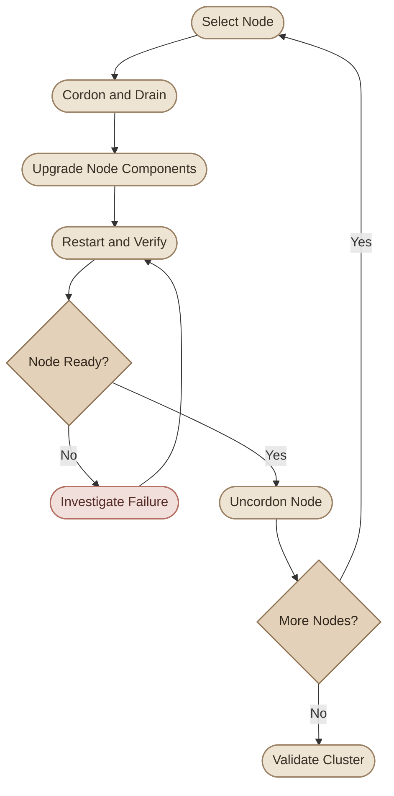

## Overview

ترقية Kubernetes Cluster مش مجرد تحديث package؛ دي عملية لازم تتخطط كويس علشان تحدّث مكونات الـ Cluster وتحافظ على استقرار الـ workloads قدر الإمكان.

خلال الـ upgrade، ممكن نحتاج نحدّث الـ Control Plane، والـ Worker Nodes، والـ `kubelet`، وأحيانًا مكونات إضافية زي CNI plugins وCoreDNS، حسب طريقة نشر الـ Cluster وإصدار Kubernetes المستهدف.

في المقال ده هنركّز على الـ upgrade باستخدام `kubeadm`، مع فهم الاستراتيجيات والمخاطر قبل تنفيذ أي أوامر.

## 1. Understand Kubernetes Versioning

إصدارات Kubernetes بتتبع النمط:

`MAJOR.MINOR.PATCH`

مثال:

`v1.36.2`

| Part | Meaning |
|---|---|
| `1` | Major version |
| `36` | Minor version |
| `2` | Patch version |

الـ **Minor version** بيقدّم تغييرات وتطويرات جديدة، وممكن يتضمن تغييرات في APIs أو إزالة APIs قديمة. أما الـ **Patch version** فعادةً بيحتوي على bug fixes وsecurity fixes من غير الانتقال لمينور جديد.

<CardGrid>
  <InfoCard title="Patch Upgrade" icon="shield">
    مثال: `v1.36.1` إلى `v1.36.2`. غالبًا نطاق التغيير أصغر، لكن لازم تراجع release notes.
  </InfoCard>
  <InfoCard title="Minor Upgrade" icon="branch">
    مثال: `v1.36.x` إلى `v1.37.x`. محتاج مراجعة توافق المكونات والـ APIs قبل التنفيذ.
  </InfoCard>
</CardGrid>

مش معنى إن إصدار أحدث متاح إنك تحدّث إليه مباشرةً. لازم تتأكد إن الإصدار المستهدف مدعوم، وإن مسار الترقية متوافق مع إصدار الـ Cluster الحالي.

## 2. Understand Version Skew

مش لازم كل مكونات Kubernetes تكون على نفس الإصدار في كل لحظة، لكن فيه قواعد بتحدد الفروق المسموح بها بين الإصدارات.

أهم مبدأ: الـ `kube-apiserver` هو نقطة الاتصال الأساسية لمعظم مكونات الـ Control Plane، وعشان كده لازم باقي المكونات تلتزم بسياسة التوافق الخاصة بيه.

حسب سياسة Kubernetes الحالية، القواعد العامة تشمل:

| Component | General compatibility rule |
|---|---|
| `kube-apiserver` | لازم الانتقال بين إصدارات الـ Minor يكون بالتتابع، من غير تخطي Minor version. |
| `kube-controller-manager` | مايبقاش أحدث من الـ API server اللي بيتواصل معاه، ومسموح له يكون أقدم بمينور واحد في الحدود المحددة. |
| `kube-scheduler` | نفس المبدأ العام الخاص بالـ controller-manager. |
| `kubelet` | مايبقاش أحدث من الـ API server، ومسموح له يكون أقدم ضمن حدود سياسة Version Skew. |
| `kube-proxy` | مايبقاش أحدث من الـ API server، مع الالتزام بحدود فرق الإصدارات المسموح بها. |
| `kubectl` | مدعوم عادةً في حدود Minor version واحدة أعلى أو أقل من الـ API server. |

الحدود الدقيقة بتختلف حسب المكون، وإصدار Kubernetes، ووجود أكتر من Control Plane node. راجع [Version Skew Policy](https://kubernetes.io/releases/version-skew-policy/) قبل أي ترقية.

### I. Example: A Controlled Upgrade

لو الـ Cluster على `v1.35` وعايز تنقله إلى `v1.37`، فالمسار الصحيح للـ Control Plane هو:

```text
v1.35 → v1.36 → v1.37
```

مش:

```text
v1.35 → v1.37
```

لازم تكمّل كل Minor upgrade بنجاح قبل ما تبدأ اللي بعده.

كمان خد بالك إن تحديث الـ Control Plane ممكن يسيب الـ Worker Nodes مؤقتًا على إصدار أقدم، وده مقبول فقط طالما التكوين الحالي داخل حدود Version Skew المدعومة.

<Callout type="warning">
متستخدمش أرقام الإصدارات القديمة في الشروحات أو اللابات كأنها سياسة ثابتة. حدود التوافق، وإصدارات Kubernetes المدعومة، وتعليمات الـ package manager بتتغير؛ ارجع للتوثيق المطابق للإصدار اللي هتحدّث إليه.
</Callout>

## 3. Choose an Upgrade Strategy

طريقة الترقية بتعتمد على البيئة، وعدد الـ Nodes، والـ workload capacity، ومستوى الـ availability المطلوب.

### I. Strategy A: Upgrade All Nodes at Once

بتحدّث كل الـ Nodes في نفس الوقت.

<InfoCard title="When is it appropriate?" icon="database">
  ممكن تكون مناسبة لبيئة development أو lab، أو بيئة تقدر تتحمل downtime أثناء الصيانة.
</InfoCard>

**Advantages**
- خطوات تشغيلية أقل.
- فترة صيانة واحدة.

**Disadvantages**
- ممكن كل نسخ التطبيق تتوقف معًا.
- استعادة الخدمة هتتأخر لحد ما الـ Nodes ترجع وتصبح جاهزة.
- مش مناسبة عادةً للتطبيقات اللي محتاجة availability مستمرة.

### II. Strategy B: Upgrade One Node at a Time

بتحدّث Node واحدة، وبعد التأكد إنها رجعت سليمة، تنتقل للي بعدها.



**Advantages**
- بتقلل عدد الـ Nodes اللي خارج الخدمة في نفس الوقت.
- بتسمح باكتشاف المشاكل بدري قبل ما تكمل باقي الترقية.

**Disadvantages**
- محتاجة capacity كافية على باقي الـ Nodes.
- ممكن تحتاج وقت أطول.
- مش ضمان لعدم انقطاع الخدمة.

لو عندك Node واحدة فقط قادرة على تشغيل التطبيق، أو كل الـ replicas موجودة على نفس الـ Node، فترقيتها ممكن توقف التطبيق مهما كانت خطواتك صحيحة.

### III. Strategy C: Replace Nodes Gradually

بدل تحديث الـ Nodes الحالية، ممكن تضيف Nodes جديدة بالإصدار المطلوب، وتنقل الـ workloads إليها، وبعد التحقق تتخلص من الـ Nodes القديمة.

ده شائع في البيئات السحابية والبيئات اللي بتدعم استبدال الـ Node pools.

**Advantages**
- بيسمح بتجهيز الـ Nodes الجديدة والتحقق منها قبل التخلص من القديمة.
- ممكن يقلل مخاطر التغيير داخل النظام التشغيلي للـ Node نفسها.

**Disadvantages**
- محتاج موارد إضافية مؤقتًا.
- ممكن يسبب تكلفة إضافية.
- مش متاح دائمًا في البيئات اللي ممنوع فيها إضافة VMs جديدة.

## 4. Prepare Before the Upgrade

قبل تنفيذ الترقية، اجمع معلومات عن الحالة الحالية واتأكد إن عندك خطة للتعافي.

### I. Inspect the Cluster

```bash
kubectl version

kubectl get nodes -o wide

kubectl get pods -A

kubectl get deployments -A

kubectl get events -A --sort-by=.metadata.creationTimestamp
```

افحص حالة الـ Nodes، والـ Pods، والـ Deployments، وأي أحداث غير طبيعية. لو عندك workloads مهمة، افحص الـ replicas والـ readiness والـ PodDisruptionBudgets كمان.

### II. Check Node Scheduling and Capacity

```bash
kubectl describe nodes
```

راجع:

- هل كل الـ Nodes في حالة `Ready`؟
- هل فيه Node عليها `SchedulingDisabled`؟
- هل الـ workloads موزعة بشكل مناسب؟
- هل الـ Nodes المتبقية عندها CPU وMemory كفاية لاستضافة الـ Pods اللي هتنتقل إليها؟
- هل فيه `taints` أو `nodeSelector` أو affinity تمنع إعادة الجدولة؟

### III. Protect Application Data

الـ Kubernetes control plane upgrade مش بديل عن backup للتطبيقات.

لو عندك Stateful workloads، راجع الـ storage والـ database backups، وخطة استعادة البيانات. كمان راجع الـ release notes وأي APIs deprecated أو removed بيستخدمها التطبيق.

<Callout type="warning">
وجود نسخة احتياطية مش كفاية لو ماجربتش استعادتها. قبل ترقية production، اتأكد إن عندك backup قابل للاسترجاع وخطة rollback أو recovery مناسبة لكل من Kubernetes والتطبيقات والبيانات.
</Callout>

## 5. Understand the kubeadm Upgrade Workflow

`kubeadm` بيساعد في إدارة ترقية مكونات Kubernetes الداخلية، لكنه مش بيعمل كل حاجة تلقائيًا.

في Cluster تم إنشاؤه باستخدام `kubeadm`، الترتيب العام بيكون:

1. مراجعة متطلبات الترقية واختيار الإصدار المستهدف.
2. ترقية الـ primary Control Plane node.
3. ترقية أي Control Plane nodes إضافية.
4. ترقية الـ Worker Nodes تدريجيًا.
5. التحقق من صحة الـ Cluster والـ workloads.
6. التعامل مع أي مكونات إضافية حسب توثيق الـ CNI أو الـ platform المستخدمة.

الـ managed Kubernetes services غالبًا عندها workflow مختلف؛ اتبع تعليمات مزود الخدمة بدل تنفيذ إجراءات `kubeadm` على Cluster مُدار.

<Steps>
<li>

<InfoCard title="Inspect the Current State" icon="terminal" />

ابدأ بتحديد الإصدارات الحالية:

```bash
kubectl get nodes -o wide

kubeadm version
```

`kubectl get nodes` بيعرض إصدار الـ kubelet المسجل لكل Node، مش إصدار الـ API server نفسه. علشان كده ما تعتمدش عليه وحده لمعرفة إصدار كل مكونات الـ Control Plane.
</li>
<li>

<InfoCard title="Plan the Upgrade" icon="layers" />

على الـ primary Control Plane node:

```bash
sudo kubeadm upgrade plan
```

الأمر بيساعدك تفهم الحالة الحالية، والإصدارات المتاحة في سياق إصدار `kubeadm` المستخدم، وخطوات الترقية المطلوبة.

لكن النتيجة مش معناها إن أحدث إصدار موجود على الإنترنت هو بالضرورة الإصدار المناسب لبيئتك. راجع سياسة Version Skew، والـ release notes، وتوثيق الإصدار المستهدف.
</li>
<li>

<InfoCard title="Upgrade kubeadm First" icon="wrench" />

في الـ kubeadm-based cluster، لازم تحدث أداة `kubeadm` إلى إصدار الترقية المقصود وفقًا للتعليمات الرسمية.

طريقة تثبيت الحزم بتعتمد على نظام التشغيل ومصدر الحزم. على أنظمة Debian/Ubuntu مثلًا، Kubernetes بيستخدم repositories خاصة بكل Minor release. لذلك لا تعتمد على أوامر `apt-get upgrade` القديمة من الفيديو من غير مراجعة إعدادات الـ repository والـ package version المطلوبة.

بعد تثبيت الإصدار المستهدف، تحقق من الأداة:

```bash
kubeadm version
```
</li>
<li>

<InfoCard title="Upgrade the Primary Control Plane" icon="shield" />

بعد تجهيز `kubeadm`، نفّذ أمر الترقية المناسب للإصدار المستهدف وفقًا للتوثيق الرسمي، مثل:

```bash
sudo kubeadm upgrade apply v1.36.x
```

استبدل `v1.36.x` بإصدار patch فعلي مدعوم ومحدد مسبقًا، ومتوافق مع الـ Cluster الحالي. المثال توضيحي وليس أمرًا جاهزًا للتنفيذ.

في الـ primary Control Plane node، `kubeadm upgrade apply` بيحدّث مكونات الـ Control Plane التي يديرها kubeadm، وبيتعامل مع manifests وإعدادات مرتبطة بالترقية.

**لكن ده لا يعني إن كل الـ Node components اتحدّثت بالفعل.** لازم تكمل تحديث `kubelet` وغيره من المكونات المطلوبة حسب التوثيق.
</li>
<li>

<InfoCard title="Upgrade the Control Plane Node's kubelet" icon="cycle" />

لو الـ Control Plane node عندها `kubelet`، حدّثه وفقًا لتعليمات نظام التشغيل والإصدار المستهدف، ثم أعد تشغيل الخدمة عند الحاجة.

```bash
sudo systemctl restart kubelet

sudo systemctl status kubelet
```

الأوامر دي تفترض إن النظام بيستخدم systemd، وإن تحديث الـ package تم بالفعل. إعادة تشغيل `kubelet` وحدها مش بتحدّث الإصدار.
</li>
<li>

<InfoCard title="Upgrade Additional Control Plane Nodes" icon="branch" />

في الـ HA cluster، كرر الإجراء المناسب لكل Control Plane node إضافية باستخدام خطوات `kubeadm upgrade node` والتحديثات المطلوبة للحزم، طبقًا للتوثيق الخاص بالإصدار.

اتبع الترتيب المحدد في التوثيق الرسمي، وحافظ على عدد كافٍ من الـ API servers السليمة. في الـ HA clusters، ترقية الـ Control Plane محتاجة مراعاة فرق الإصدارات المسموح به بين نسخ الـ API server.
</li>
<li>

<InfoCard title="Upgrade Worker Nodes" icon="cube" />

بعد ترقية الـ Control Plane، حدّث الـ Worker Nodes تدريجيًا. قبل ترقية كل Node، انقل الـ workloads منها بأمان قدر الإمكان، ثم حدّث المكونات المطلوبة.

ترتيب العمليات العام:

1. اختار Worker Node.
2. اعمل `drain` بعد مراجعة تأثيره على الـ workloads.
3. حدّث `kubeadm` و`kubelet` والحزم المطلوبة.
4. نفّذ `kubeadm upgrade node` عند الحاجة وفقًا للتوثيق.
5. أعد تشغيل `kubelet` بعد تحديثه.
6. تحقق من رجوع الـ Node إلى `Ready`.
7. استخدم `uncordon` لإتاحة الجدولة عليها مرة أخرى.
8. انتقل إلى Node أخرى بعد التحقق من استقرار الحالة.

الأوامر الدقيقة لتحديث الحزم بتختلف حسب الـ operating system والـ package repository؛ استخدم تعليمات الإصدار المستهدف بدل نسخ أوامر من إصدار قديم.
</li>
</Steps>

## 6. Understand Cordon, Drain, and Uncordon

الأوامر دي أساسية في صيانة الـ Nodes، لكنها مش بتؤدي نفس الوظيفة.

<CardGrid>
  <InfoCard title="cordon" icon="shield">
    يمنع جدولة Pods جديدة على الـ Node، لكنه لا ينقل أو يحذف الـ Pods الموجودة عليها.
  </InfoCard>
  <InfoCard title="drain" icon="cycle">
    يطلب إخلاء الـ Pods المناسبة من الـ Node لتتمكن الـ workloads المُدارة من إعادة الجدولة في مكان آخر، وبيجعل الـ Node غير قابلة للجدولة.
  </InfoCard>
  <InfoCard title="uncordon" icon="pulse">
    يعيد السماح بجدولة Pods جديدة على الـ Node. مش معناه إن الـ Pods القديمة هترجع تلقائيًا إليها.
  </InfoCard>
</CardGrid>

### I. Cordon a Node

```bash
kubectl cordon worker-01
```

بعد الأمر، افحص الحالة:

```bash
kubectl get nodes
```

غالبًا هتشوف `SchedulingDisabled` بجانب الـ Node.

### II. Drain a Node

```bash
kubectl drain worker-01 --ignore-daemonsets
```

استخدم الاسم الفعلي للـ Node في بيئتك. الخيار `--ignore-daemonsets` بيمنع `drain` من محاولة إخلاء Pods التابعة لـ DaemonSets بالطريقة العادية؛ الـ Pods دي بتفضل موجودة على الـ Node.

**مهم:** الأمر ممكن يفشل أو يتوقف لو فيه PodDisruptionBudget يمنع الإخلاء، أو Pods غير مُدارة بواسطة controller، أو قيود أخرى. ما تضفش `--force` أو `--disable-eviction` بشكل تلقائي لتجاوز المشكلة؛ افهم السبب الأول.

### III. Uncordon a Node

```bash
kubectl uncordon worker-01
```

بعد تحديث الـ Node والتأكد من سلامتها، الأمر ده بيسمح بجدولة Pods جديدة عليها.

## 7. How to Minimize Workload Disruption

الـ rolling node upgrade بيقلل مخاطر انقطاع الخدمة، لكنه مش ضمان للـ zero downtime.

علشان تزيد فرص الحفاظ على availability:

- شغّل عددًا مناسبًا من الـ replicas.
- وزّع الـ replicas على Nodes مختلفة باستخدام `topologySpreadConstraints` أو Pod anti-affinity عند الحاجة.
- راجع الـ PodDisruptionBudgets وتأكد إنها بتسمح بإخلاء Node واحدة في كل مرة.
- تأكد إن الـ readiness probes بتعكس قدرة التطبيق الفعلية على استقبال الترافيك.
- احتفظ بسعة كافية على الـ Nodes المتبقية.
- راجع التخزين والـ volume attachment limits والـ scheduling constraints.
- خطط لترحيل الـ workloads ذات الحالة الخاصة، زي قواعد البيانات، بشكل منفصل عند الحاجة.

### I. Why PodDisruptionBudgets Matter

الـ PodDisruptionBudget (PDB) بيحدد الحد الأدنى من الـ Pods المتاحة أو الحد الأقصى للانقطاعات المتزامنة الناتجة عن عمليات الإخلاء المدارة.

لكن الـ PDB مش بيضمن إن التطبيق شغال؛ لو التطبيق فيه مشكلة أصلًا، أو كل الـ replicas موجودة على Node واحدة، ممكن تفضل معرضًا للانقطاع.

كمان الـ PDB مش بيمنع كل أنواع التوقف، مثل أعطال الـ Node المفاجئة أو كل أنواع الـ involuntary disruptions.

## 8. Understand What Happens During an Upgrade

لما الـ Control Plane node تكون خارج الخدمة مؤقتًا، ممكن تتأثر عمليات إدارة الـ Cluster، لكن ده مش معناه إن كل التطبيقات لازم تتوقف.

في Cluster سليم، الـ workloads الموجودة على الـ Worker Nodes ممكن تستمر في العمل، حسب صحة الـ Nodes والشبكة والتطبيقات.

لكن خلال فترة عدم توفر الـ API server أو الـ controllers:

- ممكن `kubectl` يفشل في تنفيذ عمليات الإدارة.
- ممكن عمليات الجدولة أو reconciliation تتأخر.
- مش هتقدر تعتمد على إنشاء Pods بديلة فورًا لو حصل فشل.
- ممكن تتأثر الخدمات المعتمدة على مكونات الـ Control Plane أو الـ external integrations.

في الـ HA cluster، وجود Control Plane nodes متعددة مصممة بشكل صحيح ممكن يقلل أثر صيانة Node واحدة. لكن ده يعتمد على إعدادات الـ API server والـ etcd والـ load balancer وباقي مكونات الـ HA.

## 9. Verify the Upgrade

بعد إكمال الترقية، لازم تتحقق من حالة الـ Cluster بدل ما تفترض نجاحها بناءً على انتهاء الأوامر.

```bash
kubectl get nodes -o wide

kubectl get pods -A

kubectl get deployments -A

kubectl get events -A --sort-by=.metadata.creationTimestamp
```

راجع النقاط التالية:

- كل الـ Nodes المطلوبة رجعت إلى `Ready`.
- إصدار الـ kubelet على كل Node هو الإصدار المتوقع.
- الـ system Pods المهمة مستقرة.
- الـ Deployments عندها عدد الـ replicas المطلوب.
- مفيش Pods عالقة في `Pending` أو `CrashLoopBackOff` أو `ImagePullBackOff`.
- الـ Services والـ DNS والـ network connectivity شغالة.
- التطبيقات الأساسية اجتازت smoke tests أو health checks مناسبة.

لو عندك أكثر من Control Plane node، تحقق من صحة الـ API servers والـ etcd quorum والـ load balancing باستخدام الأدوات المناسبة لتوزيعتك.

## 10. Troubleshooting Common Upgrade Issues

### I. `kubeadm upgrade plan` Reports an Unsupported Version

**Possible causes:**
- إصدار `kubeadm` مش مناسب للـ upgrade المستهدف.
- محاولة تخطي Minor version.
- إصدار غير متاح في الـ package repository.
- الـ Cluster الحالي مش في حالة تسمح بالترقية.

**What to do:**
- راجع إصدار `kubeadm` والـ API server.
- اختار المسار المدعوم التالي.
- راجع الـ package repositories والتوثيق الرسمي للإصدار.

### II. A Node Remains `NotReady`

افحص تفاصيل الـ Node:

```bash
kubectl describe node worker-01
```

وعلى الجهاز نفسه:

```bash
sudo systemctl status kubelet

sudo journalctl -u kubelet -n 100 --no-pager
```

راجع أخطاء الـ kubelet، والـ container runtime، والـ CNI، والموارد المتاحة. ما تفترضش إن كل مشكلة `NotReady` سببها الإصدار الجديد.

### III. `drain` Fails

افحص الـ Pods على الـ Node والـ PDBs:

```bash
kubectl get pods -A -o wide

kubectl get pdb -A
```

راجع هل فيه Pods غير مُدارة، أو PDB يمنع الإخلاء، أو workload لا يمكن جدولته على الـ Nodes المتبقية.

ما تتجاوزش قيود الإخلاء قبل ما تفهم أثرها على availability والبيانات.

### IV. Workloads Do Not Return to the Upgraded Node

ده ممكن يكون طبيعيًا. `uncordon` بيسمح بجدولة Pods جديدة، لكنه مش بيرجع الـ Pods اللي انتقلت قبل كده بشكل تلقائي.

لو الـ Pods مش بتتجدول، افحص:

```bash
kubectl get pods -A -o wide

kubectl describe pod <pod-name> -n <namespace>

kubectl describe node worker-01
```

راجع الـ scheduling constraints والـ taints والموارد المتاحة وأحداث الجدولة.

## 11. Hands-on Practice: Plan Before You Upgrade

بدل ما تنفذ upgrade فعلي على Cluster من غير استعداد، ابدأ بتدريب تشخيصي على Cluster موجود أو lab مخصص.

<Steps>
<li>

<InfoCard title="Inventory the Cluster" icon="layers" />

```bash
kubectl get nodes -o wide

kubectl get pods -A -o wide

kubectl get deployments -A

kubectl get pdb -A
```

اكتب ملخصًا عن:

- إصدار كل Node.
- عدد الـ Control Plane والـ Worker Nodes.
- عدد الـ workloads المهمة.
- الـ replicas المتاحة لكل تطبيق.
- القيود اللي ممكن تمنع إخلاء Node.
</li>
<li>

<InfoCard title="Build an Upgrade Plan" icon="code" />

حدّد إصدار الـ Cluster الحالي والإصدار المستهدف، ثم راجع:

- سياسة Version Skew.
- الـ release notes والتغييرات في APIs.
- تعليمات ترقية `kubeadm` الخاصة بالإصدار.
- الـ CNI والـ CoreDNS والـ kube-proxy compatibility.
- الـ backups وخطة الاستعادة.
- السعة المتبقية بعد إخلاء Node واحدة.
</li>
<li>

<InfoCard title="Explain Your Sequence" icon="flag" />

قبل تنفيذ أي أوامر، اكتب الترتيب اللي هتتبعه لترقية الـ Control Plane والـ Worker Nodes، وإيه معايير النجاح اللي لازم تتحقق قبل الانتقال للخطوة التالية.

لو اللاب بيوفر Cluster disposable، تقدر تنفذ ترقية فعلية وفقًا لتعليمات الإصدار. لكن ما تستخدمش أوامر حزم أو إصدارات ثابتة من فيديو قديم على Cluster حقيقي من غير مراجعة التوثيق.
</li>
</Steps>

## 12. Upgrade Checklist

- [ ] حددت إصدار Kubernetes الحالي والإصدار المستهدف.
- [ ] تأكدت إن مسار الترقية مدعوم من غير تخطي Minor version للـ Control Plane.
- [ ] راجعت Version Skew Policy والـ release notes.
- [ ] تأكدت من سلامة الـ Control Plane والـ Nodes قبل البداية.
- [ ] راجعت backups وخطة الاستعادة.
- [ ] تحققت من الـ replicas والـ PDBs والـ scheduling constraints.
- [ ] تأكدت إن الـ Nodes المتبقية عندها capacity كافية.
- [ ] حدّثت الـ Control Plane حسب الترتيب الرسمي.
- [ ] حدّثت الـ Worker Nodes تدريجيًا.
- [ ] تحققت من الـ kubelet versions وحالة `Ready`.
- [ ] تحققت من الشبكة والـ system Pods والـ workloads بعد الترقية.

## Summary

ترقية Kubernetes Cluster عملية متدرجة لازم تتنفذ وفقًا للإصدار وطريقة نشر الـ Cluster.

أهم المبادئ:

1. لا تتخطَّ Minor versions عند ترقية الـ Control Plane.
2. التزم بسياسة Version Skew بين مكونات Kubernetes.
3. حدّث الـ Control Plane قبل الـ Worker Nodes عند استخدام مسار `kubeadm` المعتاد.
4. استخدم `cordon` و`drain` و`uncordon` لفهم وإدارة جدولة الـ workloads أثناء الصيانة.
5. لا تفترض إن ترقية Node واحدة في كل مرة تضمن عدم انقطاع التطبيق.
6. تحقق من صحة الـ Cluster والتطبيقات بعد كل مرحلة.

الهدف مش إنك تنهي الـ upgrade بس؛ الهدف إنك تنهيه وCluster سليم، وworkloads مستقرة، وخطة واضحة للتعامل مع أي فشل.