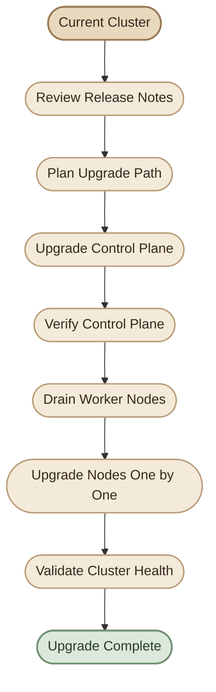

## Overview

ترقية Kubernetes مش مجرد تحديث رقم الإصدار. كل إصدار بيحمل تحسينات، إصلاحات أمان، وتغييرات في الـ APIs. في هذا الموضوع، هنفهم إزاي نقرأ أرقام الإصدارات، ونختار إصدارًا متوافقًا، ونخطط للترقية بأمان.

<InfoCard title="Learning Objectives" icon="flag" variant="insight">

بنهاية الموضوع، هتكون قادر على فهم نظام إصدارات Kubernetes، ومراجعة التوافق بين المكونات، والتخطيط لترقية منسقة تقلل التأثير على التطبيقات.

</InfoCard>

## 1. Kubernetes Release Versions

Kubernetes بيصدر إصدارات جديدة بشكل دوري. الرقم الأساسي (مثل `1.28`) بيمثل إصدارًا رئيسيًا يتضمن تحديثات عبر جميع المكونات.

<InfoCard title="Release Cycle" icon="cycle" variant="concept">

كل إصدار جديد بيتم نشره بعد اختبارات مكثفة، وبيتم دعمه لفترة محددة قبل إيقاف التحديثات الأمنية له.

</InfoCard>

### Key Concepts

- **Major / Minor Versions:** تحديد الإصدار الحالي وفهم الفروق بين الإصدارات.
- **Patch Releases:** تحديثات صغيرة لإصلاح الأخطاء والثغرات الأمنية.
- **Version Skew Policy:** القاعدة اللي بتحدد مدى اختلاف الإصدارات بين مكونات الـ Cluster.

## 2. Version Compatibility

قبل تنفيذ أي ترقية، لازم نتأكد إن كل المكونات متوافقة مع الإصدار الجديد.

<CardGrid>

<InfoCard title="API Compatibility" icon="shield" variant="feature">

تأكد إن الـ APIs اللي بتستخدمها التطبيقات متوفرة ومُدعمة في الإصدار المستهدف.

</InfoCard>

<InfoCard title="Component Versions" icon="layers" variant="feature">

راجع توافق إصدارات `kubelet`، `kubeadm`، ومكونات الـ Control Plane معًا.

</InfoCard>

</CardGrid>

## 3. Upgrade Planning

التخطيط الجيد هو أساس الترقية الآمنة. اتبع الخطوات المنظمة:

<Steps>
<li>راجع الإصدار الحالي وأرقام المكونات.</li>
<li>حدد الإصدار المستهدف بناءً على متطلبات التوافق والأمان.</li>
<li>افحص الـ Release Notes للتغييرات المحتملة على الـ APIs والـ Features.</li>
<li>جهّز بيئة اختبار للتحقق من تأثير الترقية.</li>
<li>حدّد ترتيب الترقية: Control Plane أولًا، ثم Worker Nodes.</li>
</Steps>

## 4. Upgrade Execution

### Control Plane Upgrade

ابدأ بترقية مكونات الـ Control Plane أولًا، لأن ده بيضمن إن الـ Cluster يتعامل مع الإصدارات الجديدة بشكل صحيح.

<InfoCard title="Control Plane First" icon="wrench" variant="tip">

ترقية الـ Control Plane قبل الـ Worker Nodes تقلل من مخاطر التوافق أثناء العملية.

</InfoCard>

### Worker Node Upgrade

بعد التأكد من سلامة الـ Control Plane، ابدأ بترقية الـ Worker Nodes واحدة تلو الأخرى، مع استخدام `drain` لتجهيز كل Node قبل الصيانة.

<ChecklistCard title="Before Upgrading Nodes" items={[
  "مراجعة صحة الـ Cluster الحالية",
  "التأكد من وجود Capacity كافية على Nodes بديلة",
  "مراجعة PodDisruptionBudgets",
  "تنفيذ Drain على الـ Node المستهدفة",
  "تنفيذ الترقية والتحقق من نجاحها"
]} />

## 5. Modern Upgrade Flow

المخطط التالي يوضح مسار الترقية المنظم:

## Summary

- **Releases:** فهم أرقام الإصدارات ودورة الإصدار.
- **Compatibility:** مراجعة التوافق قبل الترقية.
- **Planning:** التخطيط للترقية بأمان مع تقليل التأثير.
- **Execution:** ترقية Control Plane أولًا، ثم Worker Nodes واحدة تلو الأخرى.

في الموضوع القادم، هنبدأ بأول مشكلة عملية: **إيه اللي بيحصل لما نفقد Node من الـ Cluster، وإزاي نجهزها للصيانة بطريقة آمنة؟**
