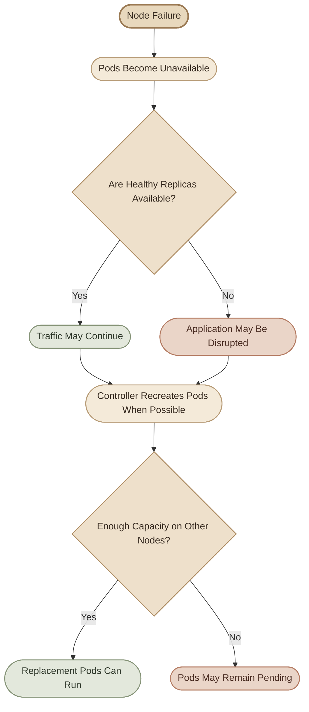
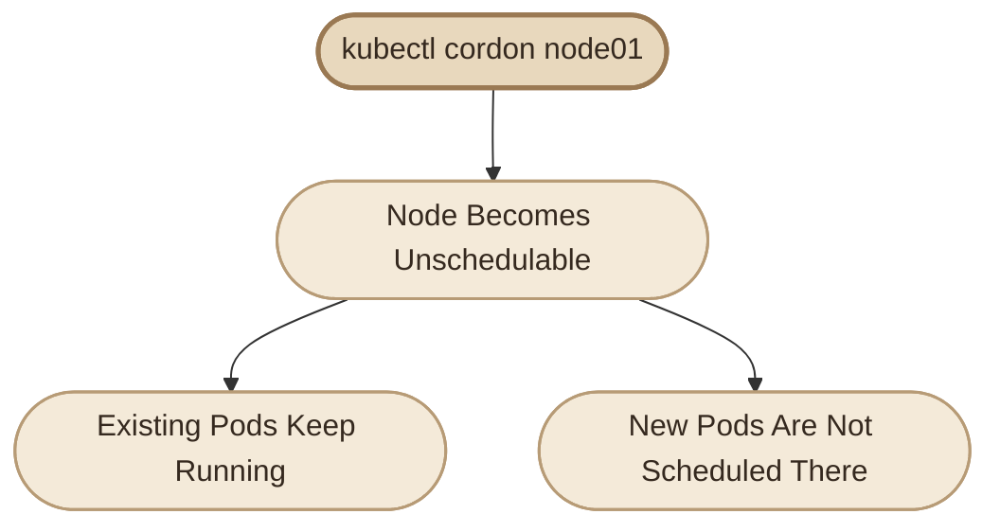
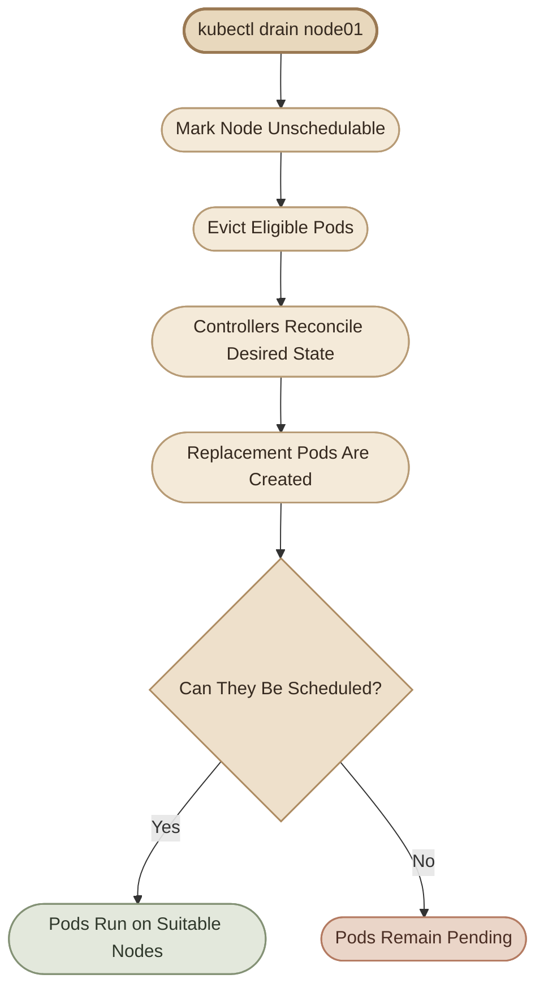
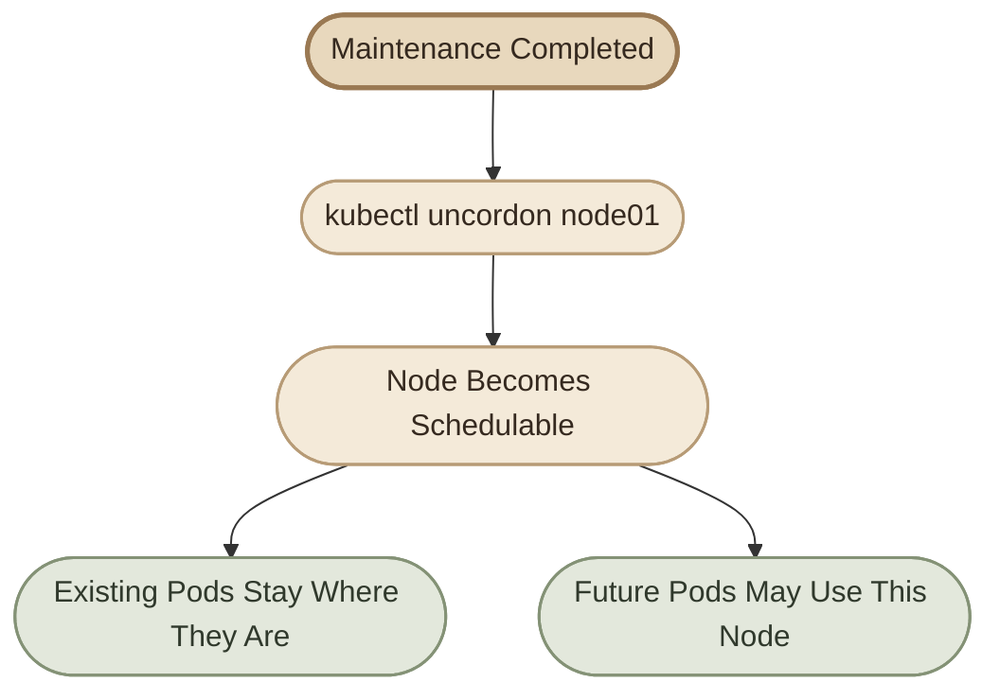

## Overview

أثناء إدارة Kubernetes Cluster، ممكن نحتاج نخرج Node مؤقتًا من الخدمة علشان ننفذ أعمال صيانة، زي:

- تثبيت Security Patches على نظام التشغيل.
- تحديث Kernel أو مكونات النظام.
- إعادة تشغيل الـ Node.
- إصلاح مشكلة في الـ Hardware أو الـ Runtime.
- تنفيذ تغييرات تتطلب توقف الـ Node مؤقتًا.

المشكلة إن الـ Node ممكن تكون بتشغّل Pods بتخدم مستخدمين حقيقيين. لو أوقفناها فجأة، ممكن تتأثر التطبيقات، خصوصًا لو مفيش Replicas كافية أو Nodes بديلة قادرة على تشغيل الـ Workloads.

علشان كده، Kubernetes بيوفر ثلاث أوامر أساسية لإدارة الـ Node أثناء الصيانة:

<InfoCard title="The Three Essential Commands" icon="terminal" variant="command">

- `kubectl cordon`: يمنع جدولة Pods جديدة على الـ Node.
- `kubectl drain`: يمنع الجدولة الجديدة ويحاول إخلاء الـ Pods الموجودة بطريقة منظمة.
- `kubectl uncordon`: يسمح بجدولة Pods جديدة على الـ Node مرة أخرى.

</InfoCard>

## 1. Understanding Node Failure

### I. What Happens When a Node Goes Down?

تخيّل إن عندنا Cluster فيها Node بتشغّل تطبيقين:

- **Blue Application:** عنده ثلاث Replicas.
- **Green Application:** عنده Replica واحدة فقط.

لو الـ Node اللي بتشغّل بعض الـ Pods توقفت، تأثير العطل هيختلف حسب عدد الـ Replicas المتاحة، والـ Controllers المسؤولة عن الـ Workloads، والـ Nodes البديلة.



### II. Managed Pods vs. Standalone Pods

مش كل Pods بتتصرف بنفس الطريقة لما تتوقف Node.

<InfoCard title="Managed Pods" icon="layers" variant="feature">

الـ Pods اللي أنشأها `Deployment` أو `ReplicaSet` بيكون فيه Controller مسؤول عن الحفاظ على العدد المطلوب من الـ Replicas.

لو Pod اتعمل لها Eviction أثناء الصيانة، الـ Controller يقدر ينشئ بديلًا، بشرط إن الـ Scheduling Constraints والموارد تسمح بتشغيله.

</InfoCard>

<InfoCard title="Standalone Pods" icon="cube" variant="feature">

الـ Standalone Pod هي Pod مش مُدارة بواسطة Controller زي Deployment أو ReplicaSet.

لو اتمسحت، Kubernetes مش هيعيد إنشاءها تلقائيًا. لازم تنشئها بنفسك أو تستخدم آلية أخرى لإدارتها.

</InfoCard>

### III. Does Kubernetes Wait Five Minutes?

في حالة انقطاع Node عن الـ Control Plane، Kubernetes بيحتاج يكتشف إن الـ Node غير مستجيبة، وبعدها يتعامل مع الـ Pods المرتبطة بيها.

الـ Pods العادية بيُضاف لها تلقائيًا، في الإعدادات الافتراضية، `tolerations` لمدة 300 ثانية لبعض حالات `NotReady` و`Unreachable`. ده بيسمح لها بالبقاء مرتبطة بالـ Node لفترة قبل بدء الإخلاء المرتبط بالـ Taints.

لكن **الخمس دقائق مش قاعدة عامة لكل حالات الصيانة**، ومش معناها إن أي Pod هتتمسح بالضبط بعد خمس دقائق من إيقاف الجهاز. التوقيت الفعلي بيتأثر باكتشاف العطل، وإعدادات الـ Cluster، والـ Tolerations، ونوع الـ Workload.

كمان `kubectl drain` بيبدأ عملية صيانة مقصودة، ودي مختلفة عن انقطاع Node بشكل مفاجئ.

للتفاصيل: [Kubernetes — Nodes](https://kubernetes.io/docs/concepts/architecture/nodes/) و[Kubernetes — Taints and Tolerations](https://kubernetes.io/docs/concepts/scheduling-eviction/taint-and-toleration/).

## 2. Cordon — Disable New Scheduling

### I. What Is Cordon?

الأمر `cordon` بيخلّي الـ Node في حالة `Unschedulable`، بمعنى إن الـ Scheduler مش هيختارها لتشغيل Pods جديدة بالطريقة المعتادة.

```bash
kubectl cordon node01
```

بعد التنفيذ، هتلاحظ حالة شبيهة بالآتي عند عرض الـ Nodes:

```text
NAME      STATUS                     ROLES    AGE   VERSION
node01    Ready,SchedulingDisabled   <none>   ...   ...
```

قد يختلف شكل الـ Output حسب إصدار Kubernetes والبيئة المستخدمة.

### II. What Does Cordon Actually Do?

- يمنع الـ Scheduler من اختيار الـ Node لجدولة Pods جديدة.
- لا يوقف الـ Pods الموجودة بالفعل.
- لا يعمل Eviction للـ Pods.
- لا يضمن إن كل Pod موجودة حاليًا هتفضل سليمة؛ لو الـ Node نفسها تعطلت، فده موضوع مختلف.



### III. When Should You Use Cordon?

استخدم `cordon` لما تحتاج تمنع وصول Workloads جديدة إلى Node، لكن مش عايز تطرد الـ Pods الموجودة عليها.

أمثلة:

- منع الجدولة الجديدة لحين فحص مشكلة في الـ Node.
- عزل الـ Node مؤقتًا عن الـ Scheduling.
- الاحتفاظ بـ Workload حرجة تعمل عليها أثناء التحضير لعملية أخرى، من غير تنفيذ Drain في نفس اللحظة.

**مهم:** لو هدفك إخراج كل الـ Workloads من الـ Node قبل إعادة تشغيلها، فـ `cordon` وحده مش كفاية.

## 3. Drain — Prepare a Node for Maintenance

### I. What Is Drain?

الأمر `drain` هو الأداة الأساسية لإخلاء Node قبل صيانتها.

```bash
kubectl drain node01
```

بشكل عام، الأمر بيعمل الآتي:

1. يعلّم الـ Node على إنها `Unschedulable`.
2. يحاول إخلاء الـ Pods المناسبة عن طريق الـ Eviction API، لو مدعومة.
3. ينتظر انتهاء عملية الإخلاء والإيقاف المنظم للـ Pods.
4. يسمح للـ Controllers المناسبة بإعادة إنشاء الـ Pods على Nodes أخرى إذا كان ذلك ممكنًا.

بعد نجاح الـ Drain، تقدر تبدأ صيانة نظام التشغيل على الجهاز، بشرط التأكد من انتهاء العملية ومراعاة متطلبات البيئة.

### II. Drain Does Not Move Pods Literally

خلّي بالك من النقطة دي: Kubernetes مش بينقل الـ Pod نفسها من Node إلى Node.

اللي بيحصل هو إن الـ Pod القديمة بتُنهى، والـ Controller المسؤول عن الـ Workload ممكن ينشئ Pod بديلة. الـ Scheduler بعدها بيختار Node مناسبة للـ Pod الجديدة.

علشان كده، نجاح الـ Drain لا يضمن إن كل الـ Pods هتشتغل على Node بديلة فورًا. ممكن البدائل تفضل `Pending` لو الموارد غير كافية أو فيه قيود Scheduling تمنع تشغيلها.



### III. Important Drain Options

<TableCard title="Drain Options Reference">

<table>
<thead><tr><th>Option</th><th>Purpose</th></tr></thead>
<tbody>
<tr><td><code>--ignore-daemonsets</code></td><td>يسمح باستكمال Drain رغم وجود Pods مُدارة بواسطة DaemonSets، لكنه لا يحذف هذه الـ Pods.</td></tr>
<tr><td><code>--force</code></td><td>يسمح بالتعامل مع Pods غير مُدارة بواسطة Controllers معروفة، أو موارد فقدت الـ Controller الخاصة بها.</td></tr>
<tr><td><code>--delete-emptydir-data</code></td><td>يسمح بإخلاء Pods تستخدم <code>emptyDir</code> رغم فقدان بياناتها المحلية عند الإزالة.</td></tr>
<tr><td><code>--dry-run=client</code></td><td>يعرض ما ستنفذه العملية من غير تطبيق التغييرات الفعلية.</td></tr>
</tbody>
</table>

</TableCard>

لا تستخدم `--force` أو `--delete-emptydir-data` لمجرد إسكات رسالة خطأ. لازم تفهم تأثير كل خيار على الـ Workloads والبيانات.

للمرجع الكامل: [kubectl drain — Official Reference](https://kubernetes.io/docs/reference/kubectl/generated/kubectl_drain/).

## 4. Understanding DaemonSets and Drain Failures

### I. Why Can Drain Fail?

ممكن تنفذ `drain` ويظهر خطأ بسبب وجود نوع معين من الـ Pods على الـ Node.

أشهر الحالات:

**DaemonSet-managed Pods**

الـ DaemonSet مسؤول عن تشغيل Pod على كل Node مطابقة للشروط المحددة. علشان كده، `drain` مش بيحذف Pods التابعة لـ DaemonSet؛ لأنه لو حذفها، الـ DaemonSet Controller ممكن يعيد إنشائها على نفس الـ Node.

الحل المعتاد هو:

```bash
kubectl drain node01 --ignore-daemonsets
```

الخيار ده لا يعني حذف الـ DaemonSet Pods، ولا يعني إن كل الـ Pods اختفت من الـ Node. ممكن تفضل Pods زي مكونات الشبكة أو الـ Logging أو الـ Monitoring موجودة عليها.

**Standalone Pods**

لو فيه Pod غير مُدارة بواسطة Controller مناسب، `drain` ممكن يرفض الاستمرار؛ لأن حذفها مش هيضمن إنشاء بديل لها.

افحص الـ Pod الأول:

```bash
kubectl get pods -A -o wide
kubectl get pod hr-app -n default -o yaml
```

وتأكد إذا كانت تابعة إلى Deployment أو ReplicaSet أو StatefulSet أو Job، أو إنها Pod مستقلة فعلًا.

**PodDisruptionBudget (PDB)**

الـ PDB ممكن يمنع بعض عمليات الـ Eviction لو كانت هتتسبب في تجاوز حدود التعطيل المسموح بها للـ Application.

ده سلوك مقصود لحماية الـ Availability، ومش بالضرورة خطأ في الأمر.

### II. The Meaning of `--force`

الفرق المهم إن `--force` مش أمر لاستعادة الـ Pods أو بياناتها.

```bash
kubectl drain node01 --ignore-daemonsets --force
```

الأمر ده ممكن يسمح بحذف Pods غير مُدارة أو فقدت الـ Controller المسؤولة عنها. لو كانت Pod مستقلة، فغالبًا مش هتتعمل تلقائيًا مرة أخرى.

كمان لو البيانات محفوظة في `emptyDir`، فحذف الـ Pod بيفقد البيانات الموجودة في الـ Volume ده. أما البيانات المحفوظة في Persistent Volume، فمصيرها بيعتمد على إعدادات الـ Storage وطريقة التعامل مع الـ Volume.

<Callout type="warning" title="Never Force Drain Blindly">

قبل استخدام `--force`، حدّد الـ Pods المتأثرة، وتأكد من وجود طريقة لإعادة إنشائها، وراجع أي بيانات محلية أو Persistent Volumes ممكن تتأثر. الخيار ده مش بديلًا عن فهم سبب فشل الـ Drain.

</Callout>

## 5. Uncordon — Return the Node to Scheduling

### I. What Is Uncordon?

بعد انتهاء الصيانة والتأكد إن الـ Node رجعت لحالة سليمة، نقدر نسمح بجدولة Pods جديدة عليها:

```bash
kubectl uncordon node01
```

الـ Node هترجع قابلة للجدولة، بشرط إنها تكون مناسبة من ناحية الحالة والموارد والقيود الأخرى.

### II. Does Uncordon Move Pods Back?

لا. `uncordon` لا يعيد الـ Pods التي أُنشئت على Nodes أخرى إلى الـ Node الأصلية.

هو فقط يرفع حالة `Unschedulable`. بعد كده، الـ Scheduler ممكن يختار الـ Node لتشغيل Pods جديدة لو كانت مناسبة لها.



## 6. Cordon vs. Drain vs. Uncordon

<TableCard title="Command Comparison">

<table>
<thead><tr><th>Behavior</th><th>Cordon</th><th>Drain</th><th>Uncordon</th></tr></thead>
<tbody>
<tr><td>Prevent new scheduling</td><td>Yes</td><td>Yes</td><td>Removes this restriction</td></tr>
<tr><td>Evict existing Pods</td><td>No</td><td>Yes, when eligible</td><td>No</td></tr>
<tr><td>Keep existing Pods running</td><td>Yes, unless affected by other events</td><td>Attempts graceful termination of eligible Pods</td><td>No direct effect</td></tr>
<tr><td>Intended use</td><td>Temporarily stop new scheduling</td><td>Prepare for maintenance</td><td>Return Node to scheduling</td></tr>
</tbody>
</table>

</TableCard>

احفظ الفرق الأساسي:

- `cordon` = **Stop new scheduling.**
- `drain` = **Prepare the Node by evicting eligible Pods.**
- `uncordon` = **Allow scheduling again.**

## 7. Hands-on Lab — Safe Node Maintenance

### I. Lab Objectives

هنبني لاب عملي باستخدام Namespace مستقلة وDeployment وStandalone Pod، وهنختبر:

1. تحديد Node مناسبة للصيانة.
2. الفرق بين Cordon وDrain.
3. سلوك الـ Deployment بعد إخلاء Pods.
4. التعامل مع Pod مستقلة تمنع Drain من الاستكمال.
5. إعادة الـ Node إلى الخدمة والتحقق من النتيجة.

### II. Lab Prerequisites

- Cluster فيها Node مستهدفة وNode أخرى على الأقل قادرة على استقبال Pods.
- صلاحيات تسمح بإنشاء Namespace وDeployment وPods وتنفيذ Node Maintenance.
- مساحة موارد كافية لتشغيل أربع Replicas من NGINX.

**تنبيه:** لا تنفذ اللاب على Production Cluster أو على Node حرجة. الأوامر التالية تعدّل حالة الـ Node المستهدفة.

### Lab Steps

<Steps>

<li>
<b>Step 1 — Inspect the Cluster</b>
<p>ابدأ بعرض الـ Nodes:</p>
<pre>{`kubectl get nodes -o wide`}</pre>
<p>اختَر Node مناسبة للصيانة ودوّن اسمها. بعد كده، افحص الـ Pods الموجودة عليها:</p>
<pre>{`kubectl get pods -A -o wide`}</pre>
<p>راجع كمان الـ Taints والـ Conditions:</p>
<pre>{`kubectl describe node &lt;NODE_NAME&gt;`}</pre>
<p>استبدل <code>&lt;NODE_NAME&gt;</code> باسم الـ Node الفعلي. لا تفترض إن الـ Control Plane مناسبة لاستضافة التطبيقات؛ ده بيتوقف على الـ Taints والموارد والإعدادات الموجودة في الـ Cluster.</p>
</li>

<li>
<b>Step 2 — Create an Isolated Workload</b>
<p>أنشئ Namespace خاصة باللاب:</p>
<pre>{`kubectl create namespace node-maintenance-lab`}</pre>
<p>أنشئ Deployment بأربع Replicas:</p>
<pre>{`kubectl create deployment web-app \
  --image=nginx:1.28 \
  --replicas=4 \
  -n node-maintenance-lab`}</pre>
<p>انتظر حتى تصبح الـ Pods جاهزة:</p>
<pre>{`kubectl rollout status deployment/web-app \
  -n node-maintenance-lab`}</pre>
<p>اعرض أماكن تشغيلها:</p>
<pre>{`kubectl get pods -n node-maintenance-lab -o wide`}</pre>
<p>اختَر Node موجود عليها واحدة على الأقل من الـ Pods التابعة للـ Deployment، بشرط وجود Node بديلة مناسبة لاستقبال الـ Workloads.</p>
<p>سجّل اسمها في متغير Shell:</p>
<pre>{`export TARGET_NODE="node01"`}</pre>
<p>غيّر <code>node01</code> إلى اسم الـ Node اللي اخترتها فعلًا.</p>
</li>

<li>
<b>Step 3 — Create a Standalone Pod</b>
<p>هننشئ Pod مستقلة على الـ Node المستهدفة علشان نختبر سلوك <code>drain</code> مع Pod مفيش Controller مسؤول عن إعادة إنشائها.</p>
<pre>{`cat &lt;&lt;EOF | kubectl apply -f -
apiVersion: v1
kind: Pod
metadata:
  name: standalone-test
  namespace: node-maintenance-lab
spec:
  nodeName: \${TARGET_NODE}
  containers:
    - name: nginx
      image: nginx:1.28
EOF`}</pre>
<p>استخدام <code>nodeName</code> هنا مقصود للّاب؛ لأنه بيربط الـ Pod بالـ Node المحددة مباشرةً بدلًا من الاعتماد على اختيار الـ Scheduler.</p>
<p>تحقق من مكان تشغيلها:</p>
<pre>{`kubectl get pods -n node-maintenance-lab -o wide`}</pre>
<p>لا تنتقل للخطوة التالية إلا لما تتأكد إن <code>standalone-test</code> موجودة على الـ Node المستهدفة.</p>
</li>

<li>
<b>Step 4 — Test Cordon</b>
<p>نفّذ:</p>
<pre>{`kubectl cordon "$TARGET_NODE"`}</pre>
<p>تحقق من حالة الـ Node:</p>
<pre>{`kubectl get nodes`}</pre>
<p>وتحقق من الـ Pods الموجودة:</p>
<pre>{`kubectl get pods -n node-maintenance-lab -o wide`}</pre>
<p>لاحظ إن الـ Pods الموجودة بالفعل بتفضل موجودة؛ لأن <code>cordon</code> مش بيعمل Eviction.</p>
<p><b>Challenge:</b> حاول إنشاء Pod جديدة من نفس الـ Namespace بعد الـ Cordon. راقب مكان تشغيلها وحالتها. لو الـ Scheduler مش لاقي Node مناسبة، ممكن تفضل <code>Pending</code>.</p>
<p>بعدها، أعد إتاحة الجدولة للخطوة التالية:</p>
<pre>{`kubectl uncordon "$TARGET_NODE"`}</pre>
</li>

<li>
<b>Step 5 — Test Drain Failure</b>
<p>جرّب Drain على الـ Node المستهدفة:</p>
<pre>{`kubectl drain "$TARGET_NODE" --ignore-daemonsets`}</pre>
<p>ممكن الأمر يفشل برسالة تشير إلى وجود Pod غير مُدارة بواسطة Controller مناسبة. ده متوقع في اللاب؛ لأننا أنشأنا <code>standalone-test</code>.</p>
<p>لاحظ إن <code>drain</code> بيعلّم الـ Node على إنها <code>Unschedulable</code> قبل محاولة إخلاء الـ Pods. بالتالي، حتى لو الأمر فشل، افحص حالة الـ Node قبل ما تقرر الخطوة التالية.</p>
<pre>{`kubectl get nodes
kubectl get pods -n node-maintenance-lab -o wide`}</pre>
</li>

<li>
<b>Step 6 — Handle the Standalone Pod Safely</b>
<p>في اللاب ده، الـ Standalone Pod مجرد مورد تجريبي، ومفيش بيانات مهمة محفوظة عليه.</p>
<p>احذفها بشكل صريح:</p>
<pre>{`kubectl delete pod standalone-test \
  -n node-maintenance-lab`}</pre>
<p>لو كانت Pod حقيقية أو عليها بيانات مهمة، ما تنفذش الحذف قبل ما تحدد طريقة استعادتها.</p>
<p>بعد حذفها، أعد محاولة Drain:</p>
<pre>{`kubectl drain "$TARGET_NODE" --ignore-daemonsets`}</pre>
<p>لو الأمر فشل بسبب PDB أو قيود أخرى، افحص رسالة الخطأ والـ Workloads المتأثرة بدلًا من تجاوز الحماية تلقائيًا.</p>
<p>لو نجح، اعرض الـ Pods مرة أخرى:</p>
<pre>{`kubectl get pods -n node-maintenance-lab -o wide`}</pre>
<p>تحقق إن الـ Deployment ما زال عنده أربع Replicas جاهزة:</p>
<pre>{`kubectl get deployment web-app \
  -n node-maintenance-lab`}</pre>
<p>لو الموارد والقيود تسمح، هتلاقي الـ Controller أنشأ Pods بديلة على Nodes مناسبة.</p>
</li>

<li>
<b>Step 7 — Simulate Maintenance and Restore Scheduling</b>
<p>بعد نجاح الـ Drain، افترض إن أعمال الصيانة انتهت وإن الـ Node سليمة.</p>
<p>أعد إتاحتها للـ Scheduling:</p>
<pre>{`kubectl uncordon "$TARGET_NODE"`}</pre>
<p>تحقق من الحالة:</p>
<pre>{`kubectl get nodes
kubectl get pods -n node-maintenance-lab -o wide`}</pre>
<p>مش مطلوب إن الـ Deployment Pods ترجع إلى الـ Node الأصلية. نجاح اللاب بيتقاس بسلامة الـ Workload والـ Node، مش بعودة كل Pod إلى مكانها القديم.</p>
</li>

<li>
<b>Step 8 — Cleanup</b>
<p>بعد ما تخلص التحقق، احذف موارد اللاب:</p>
<pre>{`kubectl delete namespace node-maintenance-lab`}</pre>
<p>لو كنت غيّرت حالة Node موجودة في Cluster مشتركة، تأكد إن حالتها رجعت كما كانت قبل انتهاء اللاب.</p>
</li>

</Steps>

## 8. Troubleshooting Checklist

<TableCard title="Symptom → Diagnosis → Fix">

<table>
<thead><tr><th>Symptom</th><th>What to Check</th></tr></thead>
<tbody>
<tr><td><code>drain</code> refuses to continue</td><td>هل فيه Standalone Pods أو Controllers مفقودة؟</td></tr>
<tr><td><code>drain</code> mentions DaemonSets</td><td>استخدم <code>--ignore-daemonsets</code> بعد مراجعة دور الـ DaemonSet Pods.</td></tr>
<tr><td>Replacement Pods stay <code>Pending</code></td><td>افحص الموارد، والـ Taints، والـ Affinity، والـ PVCs.</td></tr>
<tr><td><code>drain</code> is blocked by a PDB</td><td>افحص الـ PDB وصحة الـ Replicas قبل إعادة المحاولة.</td></tr>
<tr><td>Node remains SchedulingDisabled</td><td>استخدم <code>kubectl uncordon</code> بعد التأكد من جاهزيتها.</td></tr>
<tr><td>Pods do not return to the original Node</td><td>ده سلوك طبيعي؛ <code>uncordon</code> لا يعيد توزيع الـ Pods تلقائيًا.</td></tr>
</tbody>
</table>

</TableCard>

أوامر تشخيص مفيدة:

```bash
kubectl get nodes
kubectl get pods -A -o wide
kubectl describe node "$TARGET_NODE"
kubectl get pdb -A
kubectl get events -A --sort-by=.metadata.creationTimestamp
```

## 9. Production Best Practices

<CardGrid>

<InfoCard title="Before Draining" icon="shield" variant="tip">

- راجع عدد الـ Replicas وصحة التطبيقات.
- تأكد من وجود Capacity كافية على Nodes بديلة.
- راجع `PodDisruptionBudget` والـ Storage Configuration.
- افحص الـ Standalone Pods والـ DaemonSets.
- حدد خطة واضحة للـ Rollback والاستعادة.

</InfoCard>

<InfoCard title="During Maintenance" icon="wrench" variant="warning">

- نفّذ Drain على Node واحدة في كل مرة في العمليات العادية، وتجنب صيانة عدة Nodes معًا لو ده ممكن يهدد الـ Availability.
- انتظر انتهاء `kubectl drain` قبل بدء أعمال الصيانة.
- لا تتجاوز أخطاء الـ Eviction من غير فهم سببها.
- راقب حالة الـ Pods والـ Applications أثناء العملية.

</InfoCard>

<InfoCard title="After Maintenance" icon="cycle" variant="success">

- تأكد إن الـ Node رجعت `Ready`.
- نفّذ `uncordon` بعد التحقق من سلامتها.
- راجع الـ Pods والـ Events وصحة التطبيق.
- تأكد إن الـ Replicas المطلوبة أصبحت جاهزة.
- وثّق نتيجة الصيانة وأي مشكلات ظهرت.

</InfoCard>

</CardGrid>

## Summary

صيانة الـ Node بشكل آمن بتعتمد على فهم الفرق بين الأوامر الثلاثة:

- **Cordon:** يمنع الـ Scheduling الجديد، من غير إخلاء الـ Pods الحالية.
- **Drain:** يحاول إخلاء الـ Pods المناسبة قبل الصيانة، وقد يتوقف بسبب قيود أو موارد غير مُدارة.
- **Uncordon:** يعيد السماح بجدولة Pods جديدة، لكنه لا يعيد الـ Pods القديمة إلى مكانها تلقائيًا.

وأهم قاعدة عملية: **نجاح أمر الصيانة مش كفاية لوحده؛ لازم تتحقق من حالة الـ Node والـ Workloads قبل العملية وبعدها.**
