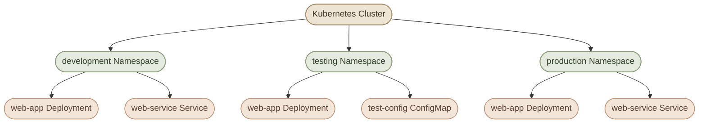
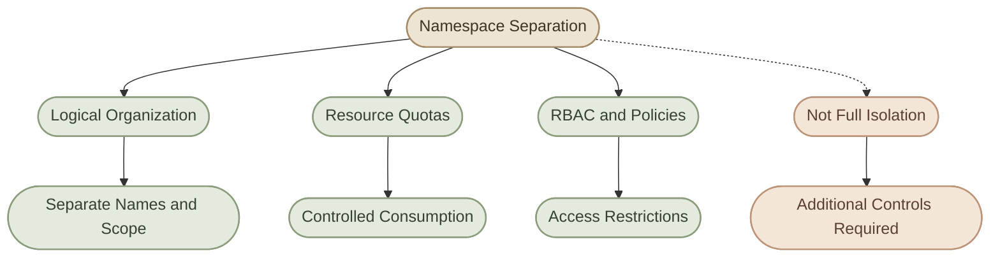
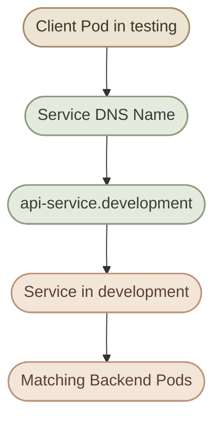

## Overview

لما نشتغل على Kubernetes Cluster، ممكن يكون عندنا عشرات أو مئات الـ resources: Pods وDeployments وServices وConfigMaps وغيرها.

تخيّل إن نفس الـ Cluster بيشغّل تطبيقات مختلفة:

- تطبيق خاص بالـ Development.
- تطبيق خاص بالـ Testing.
- تطبيق Production بيخدم المستخدمين.
- أدوات داخلية للـ Monitoring والـ Logging.

لو كل الموارد دي موجودة في نفس المساحة المنطقية، إدارتها ومتابعتها ممكن تبقى أصعب.

هنا بييجي دور **Kubernetes Namespaces**.

الـ Namespace بتقسّم الموارد اللي بتدعمها إلى مجموعات منطقية منفصلة داخل نفس الـ Cluster. ده بيساعدنا ننظّم الموارد، ونستخدم أسماء متكررة في مساحات مختلفة، ونطبّق سياسات إدارة وصلاحيات حسب احتياجاتنا.

<Callout type="note">
  الـ Namespace مش Cluster جديد، ومش Node، ومش Virtual Machine. هي وسيلة لتنظيم الموارد داخل نفس Kubernetes Cluster، لكنها لوحدها مش بتوفر عزلًا أمنيًا أو شبكيًا كاملًا.
</Callout>

## 1. What Is a Namespace?

<InfoCard variant="concept" title="Namespace" description="مساحة منطقية لتنظيم الموارد داخل Kubernetes Cluster، مع إمكانية تطبيق سياسات وصلاحيات على الموارد الموجودة فيها." icon="modules" tags={["Resource Organization"]} />

الـ **Namespace** هي Kubernetes resource بتقسّم الموارد ذات الـ namespaced scope إلى مجموعات منطقية داخل نفس الـ Cluster.

مثلًا، ممكن يكون عندنا `Deployment` اسمه `web-app` في كل من `development` و`production`. ده مسموح لأن اسم المورد لازم يكون فريدًا داخل الـ Namespace ونوع المورد نفسه، مش بالضرورة على مستوى الكلاستر كله.



لاحظ إن اسم `web-app` موجود في أكتر من Namespace، لكن كل Deployment منهم مورد مستقل بإعداداته والـ Pods اللي بيديرها.

ده بيساعدنا نفصل الموارد منطقيًا، لكن **مش معناه إن التطبيقات معزولة أمنيًا بشكل كامل عن بعضها**.

## 2. Default Kubernetes Namespaces

لما تنشئ Kubernetes Cluster، هتلاقي عادةً مجموعة من الـ Namespaces الأساسية.

اعرضهم بالأمر:

```bash
kubectl get namespaces
```

أو بالاختصار:

```bash
kubectl get ns
```

من أشهر الـ Namespaces الأساسية:

<CardGrid columns={2} label="Default Kubernetes Namespaces">
  <InfoCard variant="concept" title="default" description="الـ Namespace اللي بيستخدمها kubectl افتراضيًا لما مفيش Namespace محددة في الأمر أو الـ current context." icon="layers" tags={["Default Scope"]} />
  <InfoCard variant="concept" title="kube-system" description="بتحتوي عادةً على موارد ومكونات النظام الخاصة بـ Kubernetes، حسب طريقة تثبيت الكلاستر." icon="wrench" tags={["System Components"]} />
  <InfoCard variant="concept" title="kube-public" description="مخصصة للمعلومات العامة على مستوى الكلاستر. إمكانية القراءة العامة الفعلية بتعتمد على إعدادات الصلاحيات." icon="network" tags={["Public Information"]} />
  <InfoCard variant="concept" title="kube-node-lease" description="بتحتوي على Lease objects الخاصة بالـ Nodes، وبتساعد الـ Control Plane في متابعة حالة الـ Nodes." icon="cycle" tags={["Node Heartbeats"]} />
</CardGrid>

### I. Important Distinctions

- الـ `default` Namespace مش معناها إن كل موارد الكلاستر موجودة فيها.
- مش كل موارد Kubernetes ينفع تتحط داخل Namespace.
- بعض الموارد نطاقها الكلاستر كله، زي `Node` و`PersistentVolume` و`StorageClass`.
- وجود Namespace باسم `kube-system` أو `kube-public` مش معناه إن كل مواردها متاحة لأي مستخدم.

## 3. Namespaced vs. Cluster-Scoped Resources

<InfoCard variant="concept" title="Resource Scope" description="كل نوع من Kubernetes resources له نطاق محدد: إما Namespace معينة أو الكلاستر كله." icon="network" tags={["Namespaced", "Cluster-Scoped"]} />

من أهم الحاجات اللي لازم تفهمها إن Kubernetes resources مش كلها بتتبع Namespace.

عندنا نوعان أساسيان:

### I. Namespaced Resources

دي موارد مرتبطة بـ Namespace معينة، زي:

- Pods
- Deployments
- ReplicaSets
- Services
- ConfigMaps
- Secrets
- ServiceAccounts
- PersistentVolumeClaims

<InfoCard variant="summary" title="Namespaced Resources" description="تقدر تنشئ وتستعرض كل مورد منها داخل Namespace محددة، وممكن يتكرر الاسم في Namespace مختلفة." icon="modules" tags={["Pods", "Deployments", "Services"]} />

### II. Cluster-Scoped Resources

دي موارد نطاقها الكلاستر كله، مش Namespace واحدة، زي:

- Nodes
- Namespaces
- PersistentVolumes
- StorageClasses
- ClusterRoles
- ClusterRoleBindings

<InfoCard variant="summary" title="Cluster-Scoped Resources" description="الموارد دي مش مملوكة لـ Namespace بعينها؛ نطاقها بيشمل الكلاستر كله." icon="layers" tags={["Nodes", "PersistentVolumes", "StorageClasses"]} />

التمييز ده مهم لأن تحديد Namespace أثناء التعامل مع مورد Cluster-scoped مش هيحوّله إلى مورد داخل Namespace.

### III. How to Check a Resource Scope

تقدر تعرض أنواع الموارد ونطاقها باستخدام:

```bash
kubectl api-resources
```

لعرض الموارد المرتبطة بـ Namespaces فقط:

```bash
kubectl api-resources --namespaced=true
```

ولعرض الموارد غير المرتبطة بـ Namespace:

```bash
kubectl api-resources --namespaced=false
```

<Callout type="tip">
  لو `kubectl get` مش بيعرض المورد لما تحدد Namespace معينة، اتأكد إن نوع المورد Namespaced أصلًا، وإنك بتبحث في الـ Namespace الصحيحة.
</Callout>

## 4. Creating and Managing Namespaces

### I. Create a Namespace

لإنشاء Namespace جديدة:

```bash
kubectl create namespace development
```

وتقدر تتحقق إنها اتعملت:

```bash
kubectl get namespace development
```

### II. Inspect a Namespace

لعرض معلومات مختصرة:

```bash
kubectl get namespace development
```

ولعرض التفاصيل:

```bash
kubectl describe namespace development
```

### III. Delete a Namespace

لحذف Namespace:

```bash
kubectl delete namespace development
```

<Callout type="warning">
  حذف Namespace بيؤدي إلى حذف الموارد الـ Namespaced الموجودة بداخلها، وقد تستغرق العملية وقتًا بسبب الـ cleanup والـ finalizers. راجع الموارد قبل تنفيذ الأمر، خصوصًا في بيئات Production.
</Callout>

تقدر تبدأ المراجعة بالأمر:

```bash
kubectl get all -n development
```

لكن خد بالك إن `kubectl get all` **مش بيعرض كل أنواع الموارد** الموجودة في الـ Namespace؛ هو بيعرض مجموعة من الموارد الشائعة فقط. لو محتاج مراجعة شاملة، افحص أنواع الموارد الأخرى بشكل منفصل.

## 5. Working with Resources Inside a Namespace

بعد إنشاء Namespace، نقدر ننشئ موارد داخلها.

مثلًا، أنشئ Deployment داخل `development`:

```bash
kubectl create deployment web-app \
  --image=nginx \
  --replicas=2 \
  -n development
```

اعرض الـ Deployment:

```bash
kubectl get deployments -n development
```

اعرض الـ Pods:

```bash
kubectl get pods -n development
```

ولو عايز تعرض Pods من كل الـ Namespaces:

```bash
kubectl get pods --all-namespaces
```

أو بالاختصار:

```bash
kubectl get pods -A
```

### I. The `-n` Flag

الخيار `-n` اختصار لـ `--namespace`.

مثلًا:

```bash
kubectl get pods -n development
kubectl get services -n production
kubectl describe deployment web-app -n development
```

كل أمر من دول بيستهدف الـ Namespace المحددة.

لو ما حددتش Namespace في الأمر، فـ `kubectl` بيستخدم الـ Namespace الموجودة في الـ current context، ولو مفيش Namespace محددة في الـ context، بيستخدم `default`.

<Callout type="warning">
  وجود Deployment باسم `web-app` في `development` لا يعني إن الأمر `kubectl describe deployment web-app` هيعرضه تلقائيًا. لازم تحدد الـ Namespace الصحيحة، أو تتأكد من الـ current context والـ Namespace المرتبطة بيه.
</Callout>

## 6. Setting a Default Namespace for kubectl

بدل ما تكتب `-n development` مع كل أمر، تقدر تغيّر الـ Namespace الافتراضية للـ current context.

اعرض الـ context الحالي:

```bash
kubectl config current-context
```

غيّر الـ Namespace الافتراضية له:

```bash
kubectl config set-context --current --namespace=development
```

بعد كده، الأوامر التالية هتستخدم `development` افتراضيًا طالما ما حددتش Namespace مختلفة:

```bash
kubectl get pods
kubectl get deployments
kubectl get services
```

### I. Verify the Current Namespace

اعرض إعدادات الـ current context:

```bash
kubectl config view --minify
```

راجع قيمة `namespace` داخل الـ context، لو كانت محددة.

للرجوع إلى `default`:

```bash
kubectl config set-context --current --namespace=default
```

<Callout type="warning">
  تغيير الـ Namespace الافتراضية بيعدّل إعدادات الـ kubeconfig للـ current context. ده مش معناه إن موارد اتنقلت بين Namespaces، ومش بيغيّر الـ Namespace الخاصة بالـ contexts الأخرى.
</Callout>

## 7. Namespace Isolation: What It Does and What It Doesn't

<InfoCard variant="concept" title="Isolation Boundaries" description="الـ Namespace بتوفر Logical Separation، لكن درجة العزل الفعلية بتعتمد على السياسات وإعدادات الكلاستر." icon="shield" tags={["Logical Isolation"]} />

### I. What Namespaces Help With

<CardGrid columns={2} label="Namespace Benefits">
  <InfoCard variant="concept" title="Organization" description="تنظيم الموارد حسب البيئة أو الفريق أو التطبيق." icon="modules" tags={["Structure"]} />
  <InfoCard variant="concept" title="Resource Names" description="السماح بتكرار أسماء الموارد في Namespaces مختلفة." icon="tag" tags={["Naming Scope"]} />
  <InfoCard variant="concept" title="ResourceQuota" description="تحديد حدود استهلاك الموارد وعدد بعض أنواع الـ objects داخل Namespace." icon="sliders" tags={["Resource Management"]} />
  <InfoCard variant="concept" title="RBAC" description="تقييد الوصول إلى الموارد باستخدام Roles وRoleBindings المناسبة." icon="shield" tags={["Access Control"]} />
</CardGrid>

### II. What Namespaces Do Not Guarantee

<CardGrid columns={2} label="Namespace Limitations">
  <InfoCard variant="summary" title="Not Separate Nodes" description="الـ Namespace مش بتنشي Nodes منفصلة؛ ممكن موارد من Namespaces مختلفة تعمل على نفس الـ Node." icon="database" tags={["Shared Cluster"]} />
  <InfoCard variant="summary" title="Not Automatic Resource Isolation" description="مش بتضمن حجز CPU أو Memory أو تحديد استهلاكهما تلقائيًا؛ محتاج سياسات وإعدادات إضافية." icon="sliders" tags={["Resource Controls"]} />
  <InfoCard variant="summary" title="Not a Network Barrier" description="مش بتمنع الاتصال الشبكي بين التطبيقات بشكل تلقائي." icon="network" tags={["Network Policies"]} />
  <InfoCard variant="summary" title="Not Complete Security" description="مش بديل عن RBAC أو NetworkPolicies أو باقي ضوابط الأمان المطلوبة." icon="shield" tags={["Security"]} />
</CardGrid>



## 8. Resource Management Within Namespaces

الـ Namespace بتساعدنا نطبّق سياسات إدارة الموارد على مجموعة من التطبيقات. لكن إنشاء Namespace لوحدها مش كفاية لتطبيق السياسات دي.

### I. ResourceQuota

الـ `ResourceQuota` بتحدد حدودًا لاستهلاك الموارد أو عدد بعض أنواع الـ objects داخل Namespace.

مثلًا، ممكن تفرض حدودًا إجمالية على CPU وMemory requests والـ limits الخاصة بالـ Pods.

مثال على ResourceQuota:

```yaml
apiVersion: v1
kind: ResourceQuota
metadata:
  name: development-quota
  namespace: development
spec:
  hard:
    requests.cpu: "2"
    requests.memory: 2Gi
    limits.cpu: "4"
    limits.memory: 4Gi
    pods: "10"
```

في المثال ده، الـ Namespace عندها حدود إجمالية للـ CPU والـ Memory requests والـ limits، بالإضافة إلى عدد الـ Pods.

القيم دي أمثلة للتوضيح وليست توصيات ثابتة لكل بيئة.

### II. LimitRange

الـ `LimitRange` بتسمح بتحديد قيم افتراضية أو حدود دنيا وعليا لاستهلاك الموارد لبعض أنواع الـ resources داخل Namespace.

مثال: تحديد Default CPU وMemory requests والـ limits للـ Containers اللي مش محددة القيم دي في مواصفاتها.

### III. RBAC

تقدر تربط `Role` و`RoleBinding` بالـ Namespace لتحديد العمليات المسموح بها على مواردها. أما `ClusterRole` و`ClusterRoleBinding` فيمكن استخدامهما لمنح صلاحيات على مستوى الكلاستر أو نطاقات أوسع، حسب إعدادات الربط.

### IV. NetworkPolicy

تقدر تستخدم `NetworkPolicy` لتقييد حركة المرور الشبكية بين الـ Pods أو بينها وبين مصادر أخرى، بشرط دعم الـ CNI plugin المستخدم لهذه السياسات.

<Callout type="note">
  إنشاء Namespace لوحدها لا يفرض ResourceQuota أو LimitRange أو NetworkPolicy، ولا يضمن تقييد الوصول باستخدام RBAC. لازم تنشئ السياسات المطلوبة وتتحقق من تطبيقها.
</Callout>

## 9. Namespace and Service Discovery

الـ Namespace ليها دور مهم في أسماء الـ Services والـ DNS داخل الكلاستر.

افترض إن عندنا Service اسمها `api-service` داخل Namespace اسمها `development`.

الـ Pods الموجودة في نفس الـ Namespace تقدر عادةً توصل للخدمة باستخدام الاسم المختصر:

```text
api-service
```

أما من Namespace مختلفة، فيمكن استخدام الاسم المؤهل بالـ Namespace:

```text
api-service.development
```

والاسم الكامل الشائع للـ Service داخل DNS الخاص بالكلاستر هو:

```text
api-service.development.svc.cluster.local
```

الجزء `cluster.local` هو الـ DNS domain الافتراضي الشائع، لكنه قابل للتغيير حسب إعدادات الكلاستر.



**مهم:** الـ Namespace مش حاجز شبكي يمنع الـ Pods الموجودة في `testing` من الاتصال بـ Service في `development`. نجاح الاتصال الفعلي بيعتمد على إعدادات الشبكة، والـ NetworkPolicies، وسياسات الوصول الأخرى.

هنشرح تفاصيل الـ DNS والـ Service discovery في ملف `service-discovery-and-networking.mdx` بدل ما نكررها بالكامل هنا.

## 10. Hands-on Lab — Namespace Management

في اللاب ده هتنشئ Namespace، وتنشئ Deployment داخلها، وتختبر الفرق بين الاستعلام عن الموارد في Namespace محددة والاستعلام عنها على مستوى الكلاستر.

### Step 1 — Create the Lab Namespace

```bash
kubectl create namespace namespace-lab
```

تحقق من إنشائها:

```bash
kubectl get namespace namespace-lab
```

### Step 2 — Create a Deployment

```bash
kubectl create deployment web-app \
  --image=nginx \
  --replicas=2 \
  -n namespace-lab
```

### Step 3 — Inspect the Resources

```bash
kubectl get deployments -n namespace-lab
kubectl get pods -n namespace-lab
```

اعرض Pods الموجودة في كل الـ Namespaces:

```bash
kubectl get pods -A
```

قارن النتائج وحدد الـ Namespace اللي موجود فيها كل Pod.

### Step 4 — Test Namespace Scope

جرّب الأمرين:

```bash
kubectl get deployment web-app -n namespace-lab
kubectl get deployment web-app -n default
```

لو مفيش Deployment بالاسم ده في `default`، الأمر الثاني مش هيعرض الـ Deployment الموجود في `namespace-lab`.

ده يوضح إن الوصول إلى الموارد الـ Namespaced بيتحدد بالاسم والـ Namespace معًا.

### Step 5 — Inspect Namespace Details

```bash
kubectl describe namespace namespace-lab
```

راجع المعلومات المتاحة عن الـ Namespace، ومنها الـ labels والـ status وأي quota أو resource usage information متاحة.

### Step 6 — Clean Up

بعد ما تخلص اللاب:

```bash
kubectl delete namespace namespace-lab
```

<Callout type="warning">
  الأمر ده بيحذف الـ Namespace والموارد الـ Namespaced الموجودة بداخلها. استخدمه فقط بعد التأكد إنك مش محتاج الموارد دي.
</Callout>

## 11. Troubleshooting Common Namespace Issues

### I. Problem 1 — Resource Not Found

**Symptom:**

```text
Error from server (NotFound): deployments.apps "web-app" not found
```

**Possible causes:**

- الـ Deployment موجود في Namespace مختلفة.
- الاسم المكتوب مش صحيح.
- الـ Deployment لسه ما اتعملش أو اتحذف.

**Check:**

```bash
kubectl get deployments -A
```

### II. Problem 2 — Wrong Namespace

**Symptom:** أمر `kubectl get pods` بيعرض نتائج مختلفة عن المتوقع.

**Check:**

```bash
kubectl config view --minify
```

أو حدّد الـ Namespace صراحةً:

```bash
kubectl get pods -n namespace-lab
```

### III. Problem 3 — Cannot Create a Resource

**Possible causes:**

- المستخدم مش عنده الصلاحيات المطلوبة.
- الـ Namespace غير موجودة.
- فيه ResourceQuota أو LimitRange أو سياسة أخرى بتأثر على الإنشاء.

**Check:**

```bash
kubectl auth can-i create deployments -n namespace-lab
kubectl describe namespace namespace-lab
kubectl get resourcequota,limitrange -n namespace-lab
```

الأمر الأخير بيعرض الـ ResourceQuotas والـ LimitRanges الموجودة، لكنه مش بيغطي كل أنواع السياسات اللي ممكن تمنع إنشاء الموارد.

## 12. Best Practices

- استخدم أسماء واضحة للـ Namespaces، زي `development` و`staging` و`production`.
- حدّد الـ Namespace صراحةً في الأوامر المهمة والـ automation scripts.
- استخدم RBAC لتقييد الوصول إلى الموارد حسب الفريق أو الدور.
- استخدم ResourceQuotas وLimitRanges عند الحاجة للتحكم في استهلاك الموارد.
- ما تعتمدش على الـ Namespace وحدها لتحقيق العزل الأمني أو الشبكي.
- راجع الـ NetworkPolicies وتأكد من دعم الـ CNI plugin لها لو محتاج تقييد الاتصال الشبكي.
- تعامل بحذر مع `kubectl delete namespace` لأن تأثيره يمتد إلى الموارد الموجودة بداخلها.
- راجع الـ current context قبل تنفيذ أوامر التعديل أو الحذف.

## Key Takeaways

<InfoCard variant="summary" title="The Namespace Mental Model" description="الـ Namespace بتنظم الموارد داخل نفس الكلاستر، لكنها مش Cluster مستقلة ولا حاجز أمني كامل. استخدمها مع سياسات الموارد والوصول المناسبة حسب احتياجاتك." icon="modules" tags={["Mental Model"]} />

<CardGrid columns={2} label="Key Takeaways">
  <InfoCard variant="summary" title="Resource Scope" description="الـ Namespaced resources بتتبع Namespace معينة، أما الـ Cluster-scoped resources فنطاقها الكلاستر كله." icon="layers" tags={["Namespaced", "Cluster-Scoped"]} />
  <InfoCard variant="summary" title="kubectl Context" description="الخيار `-n` بيحدد الـ Namespace للأمر الحالي، بينما `set-context` بيغيّر الـ Namespace الافتراضية للـ current context." icon="terminal" tags={["kubectl", "Context"]} />
  <InfoCard variant="summary" title="Resource Management" description="استخدم ResourceQuota وLimitRange للتحكم في استهلاك الموارد، وRBAC لتنظيم صلاحيات الوصول." icon="sliders" tags={["Quota", "RBAC"]} />
  <InfoCard variant="summary" title="Isolation and Networking" description="الـ Namespace مش بتمنع الاتصال الشبكي تلقائيًا. استخدم NetworkPolicies وضوابط الأمان المناسبة عند الحاجة." icon="shield" tags={["Security", "NetworkPolicy"]} />
</CardGrid>

الخطوة التالية هي **Deployment Fundamentals**، وهنربط فيها الـ Deployments بالـ ReplicaSets والـ Pods اللي درسناهم بالفعل، من غير ما نكرر شرح الأساسيات السابقة.