## 1. Big Picture

<InfoCard variant="concept" title="The Big Picture" icon="layers">
  الـKubernetes Cluster بيتكوّن من Control Plane بيدير الـCluster، وWorker Nodes بتوفّر بيئة تشغيل الـapplication workloads.
</InfoCard>

قبل ما ندخل في تفاصيل كل Component، خلينا نفهم الأول **Kubernetes Cluster Architecture** بشكل عام.

الـ**Cluster** هو مجموعة من الـMachines والـcomponents اللي بتشتغل مع بعض علشان Kubernetes يقدر يشغّل ويدير الـcontainerized applications.

الـarchitecture بتتقسم بشكل أساسي إلى جزأين:

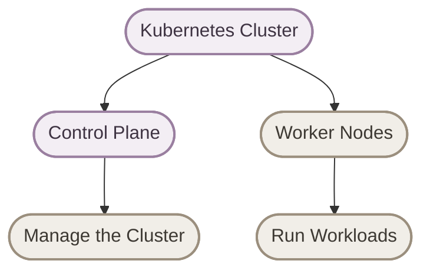

بشكل مبسط:

> **Control Plane = Manages the Cluster**
>
> **Worker Nodes = Run the Workloads**

الـControl Plane مسؤول عن إدارة حالة الـCluster واتخاذ قرارات الـorchestration، بينما الـWorker Nodes بتشغّل الـPods اللي بتحتوي على الـapplication containers.

## 2. Kubernetes Cluster Architecture

<InfoCard variant="concept" title="Architecture Overview" icon="layers">
  كل Component ليه مسؤولية محددة، والـcomponents بتتواصل من خلال Kubernetes API أو آليات الاتصال الداخلية المناسبة لكل Component.
</InfoCard>

الـControl Plane بيضم المكونات المسؤولة عن إدارة الـCluster، والـWorker Nodes بتضم المكونات المسؤولة عن إدارة الـPods وتشغيل الـcontainers على الـNode.

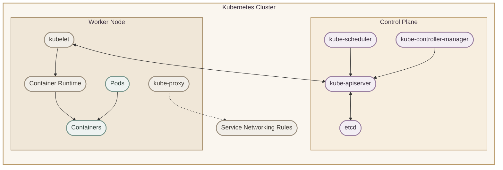

الرسمة دي **conceptual overview**؛ مش معناها إن كل الاتصالات بتحصل مباشرة بين كل Component والتانية، أو إن كل Cluster لازم يكون فيه Worker Node واحدة فقط.

<Callout type="note">
الـ`kube-proxy` مش شرط يكون موجودًا في كل Kubernetes installation؛ بعض الـnetworking implementations بتوفّر وظائف Service networking بطرق بديلة.
</Callout>

## 3. Control Plane

<InfoCard variant="concept" title="Control Plane" icon="layers">
  الـControl Plane هو مجموعة المكونات المسؤولة عن إدارة الـCluster، وتخزين الحالة المطلوبة، واتخاذ قرارات زي Scheduling، ومتابعة الـresources عن طريق Controllers.
</InfoCard>

الـ**Control Plane** هو الجزء المسؤول عن إدارة الـCluster.

وظائفه الأساسية بتشمل:

- استقبال ومعالجة الـKubernetes API requests.
- تخزين الـCluster state.
- اختيار Node مناسبة للـPods اللي محتاجة Scheduling.
- تشغيل Controllers بتراقب الموارد وتحاول تحقق الـdesired state.

الـControl Plane الأساسي بيضم:

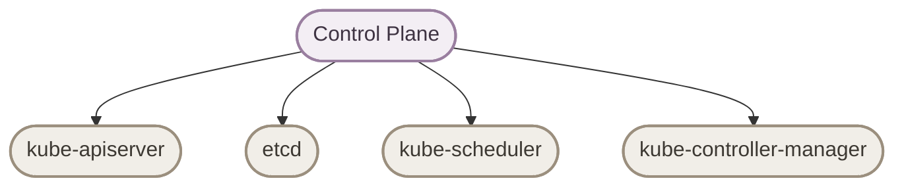

كل Component ليه وظيفة مختلفة، وهنفهمها واحدة واحدة.

## 4. kube-apiserver

<InfoCard variant="concept" title="kube-apiserver" icon="layers">
  الـ`kube-apiserver` هو الـfront end الأساسي للـKubernetes Control Plane، وبيوفّر الـKubernetes API اللي بتتواصل من خلالها الأدوات والـcomponents.
</InfoCard>

الـ**kube-apiserver** هو نقطة الاتصال الأساسية مع Kubernetes API.

لما تستخدم:

```bash
kubectl get pods
```

أنت مش بتكلم الـPods مباشرةً.

الـ`kubectl` بيبعت API request للـAPI Server، والـAPI Server بيتعامل مع الطلب حسب نوعه وصلاحيات المستخدم وحالة الـCluster.

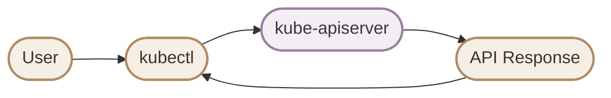

الـAPI Server بيتعامل مع الـetcd، وبيوفّر واجهة الـAPI اللي الـScheduler والـControllers والـkubelet بيستخدموها في عملياتهم.

مثلًا، عند تنفيذ:

```bash
kubectl apply -f deployment.yaml
```

الـAPI Server بيستقبل الـrequest ويتحقق من الـauthentication والـauthorization والـvalidation المناسبين، وبعدها بيتم حفظ التغيير المقبول في الـCluster state.

**افتكر:**

> **kube-apiserver = The Kubernetes API entry point**

هو مش المسؤول عن تشغيل الـcontainers بنفسه؛ مسؤوليته الأساسية هي توفير وإدارة الوصول إلى الـKubernetes API.

## 5. etcd

<InfoCard variant="concept" title="etcd" icon="layers">
  الـ`etcd` هو distributed key-value store بيستخدمه Kubernetes لتخزين بيانات الـCluster state بشكل دائم.
</InfoCard>

الـ**etcd** بيخزن البيانات اللي Kubernetes محتاجها عشان يحتفظ بحالة الـresources.

من أمثلة البيانات دي:

- تعريفات الـNodes والـPods.
- الـDeployments والـReplicaSets.
- الـdesired configuration للـresources.
- بيانات وmetadata خاصة بالـCluster.

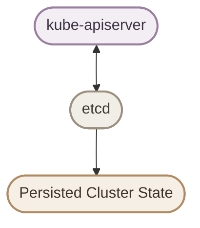

مثلًا، لو عايز Deployment يكون عنده:

```yaml
spec:
  replicas: 3
```

القيمة دي جزء من الـdesired state اللي Kubernetes بيحتفظ بيه.

**المهم:**

> **etcd stores the cluster data; it doesn't run your applications.**

حماية الـetcd مهمة جدًا، لأن الوصول غير المصرّح به لبياناته ممكن يعرّض الـCluster كله للخطر.

## 6. kube-scheduler

<InfoCard variant="concept" title="kube-scheduler" icon="layers">
  الـ`kube-scheduler` بيختار Node مناسبة للـPod اللي لسه متعملهاش Scheduling، بناءً على الـresource requirements والـconstraints والـpolicies.
</InfoCard>

الـ**kube-scheduler** مسؤول عن اختيار الـNode المناسبة للـPod.

لما تكون عندنا Pod لسه مش متعيّن لها Node، الـScheduler بيقيّم الـNodes المتاحة ويختار واحدة مناسبة لو فيه Node مستوفية الشروط.

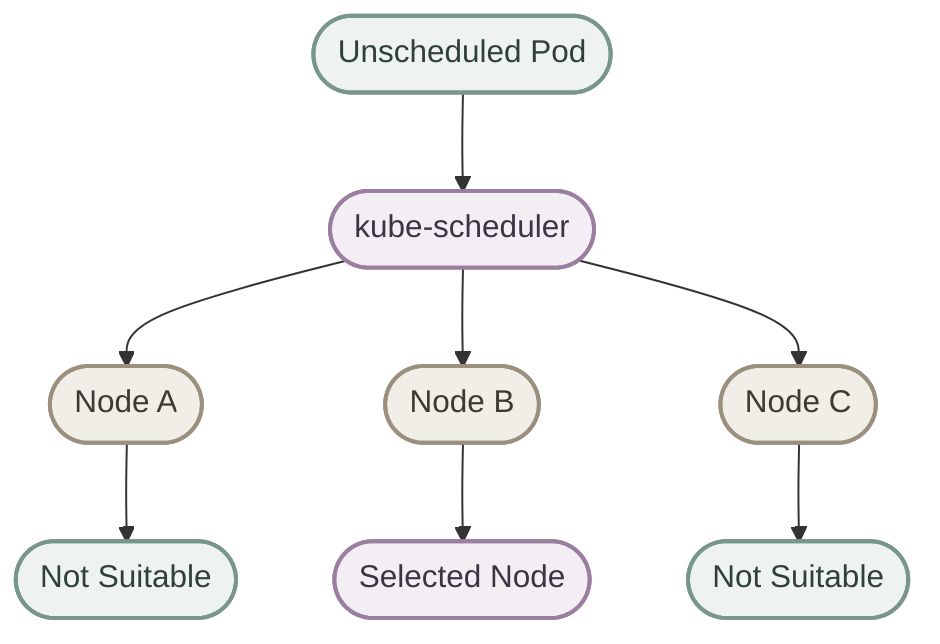

الـScheduler ممكن ياخد في اعتباره:

- CPU وMemory requests.
- Node conditions وavailable resources.
- `nodeSelector` وnode affinity.
- Taints وtolerations.
- Pod affinity وanti-affinity.
- Topology constraints والـscheduling policies.

لكن خد بالك من نقطة مهمة:

> **The Scheduler selects the Node; it does not run the Pod.**

بعد اختيار الـNode، الـkubelet الموجود عليها بيتولى التأكد من تشغيل الـPod المطلوبة.

ولو مفيش Node مناسبة، ممكن تفضل الـPod في حالة `Pending` لحد ما المشكلة تتحل أو الظروف تتغير.

## 7. Controllers and Reconciliation

<InfoCard variant="concept" title="Controllers" icon="layers">
  الـControllers بتراقب Kubernetes resources، وبتقارن الـcurrent state بالـdesired state، وبتنفّذ الإجراءات اللازمة لتقليل الفرق بينهم.
</InfoCard>

الـ**Controllers** من أهم الأفكار في Kubernetes.

وظيفتها الأساسية هي متابعة الموارد ومحاولة الوصول للحالة المطلوبة.

مثلًا، لو الـdesired state هو 3 Pods، لكن الموجود حاليًا Pod واحدة فقط، فالـcontroller المسؤولة عن إدارة الـreplicas هتحاول تعوّض الـPods الناقصة.

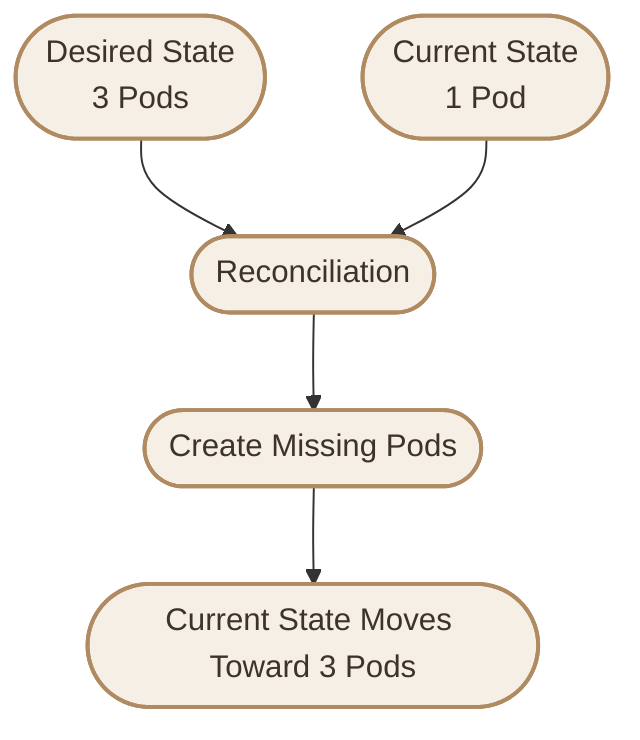

العملية دي اسمها **Reconciliation**.

وهي مش مجرد عملية بتحصل مرة واحدة؛ الـControllers بتكرر المراقبة والاستجابة للتغييرات.

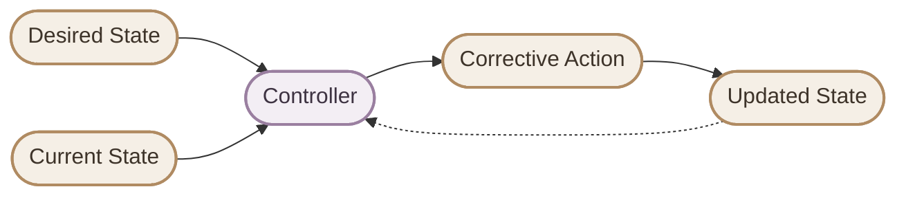

الـ`kube-controller-manager` بيشغّل مجموعة من الـControllers الأساسية، لكن مش كل Controller في Kubernetes لازم تكون جزءًا منه؛ بعض الـControllers بتشتغل داخل مكونات أو إضافات أخرى.

**افتكر:**

> **Controllers continuously work to move the current state toward the desired state.**

## 8. Worker Nodes

<InfoCard variant="concept" title="Worker Nodes" icon="layers">
  الـWorker Nodes هي الـMachines اللي بتشغّل الـPods، وبتحتوي عادةً على kubelet وContainer Runtime، بالإضافة إلى مكونات الـnetworking حسب الـCluster setup.
</InfoCard>

الجزء التاني من الـCluster هو **Worker Nodes**.

الـNode ممكن تكون:

- Physical machine.
- Virtual machine.
- Cloud instance.

وكل Node بتوفّر الـcompute resources المطلوبة لتشغيل الـworkloads.

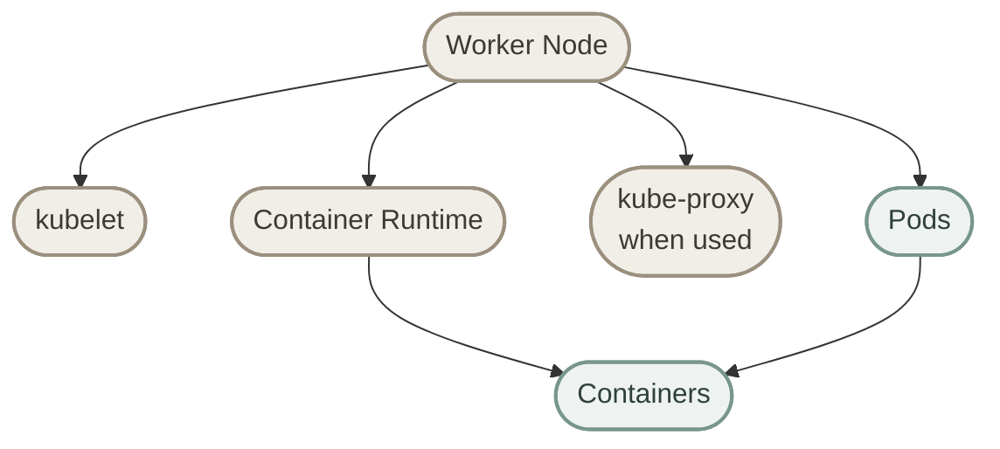

كل Component ليها دور مختلف في تشغيل الـPods وإدارة الـNode والـnetworking.

## 9. kubelet

<InfoCard variant="concept" title="kubelet" icon="layers">
  الـ`kubelet` هو الـNode Agent اللي بيتأكد من تنفيذ الـPod specifications المسندة للـNode، وبيتابع حالة الـPods والـcontainers.
</InfoCard>

الـ**kubelet** بيشتغل على الـNode، وبيتواصل مع الـAPI Server علشان يتابع الـPod specifications المسندة للـNode.

ومن مسؤولياته:

- التأكد من تشغيل الـPods المطلوبة على الـNode.
- التواصل مع الـContainer Runtime من خلال الـCRI.
- متابعة حالة الـPods والـcontainers.
- إرسال معلومات عن حالة الـNode والـworkloads للـControl Plane.

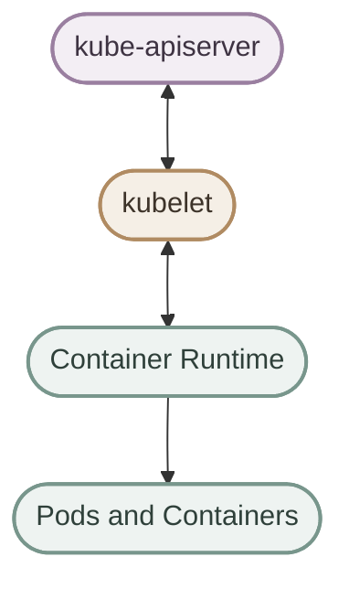

الـkubelet مش هو الـScheduler، ومش بيقرر بنفسه الـPod المفروض تتوزع على أنهي Node. هو بيتعامل مع الـPods المسندة للـNode بتاعته.

## 10. Container Runtime

<InfoCard variant="concept" title="Container Runtime" icon="layers">
  الـContainer Runtime هو البرنامج اللي بيتولى تشغيل وإدارة الـcontainers على الـNode، وKubernetes بيتعامل معاه من خلال الـContainer Runtime Interface (CRI).
</InfoCard>

الـ**Container Runtime** مسؤول عن تشغيل الـcontainers وإدارة دورة حياتها على الـNode.

من الأمثلة الشائعة:

- `containerd`
- `CRI-O`

الـkubelet بيتواصل مع الـruntime من خلال **CRI — Container Runtime Interface**.

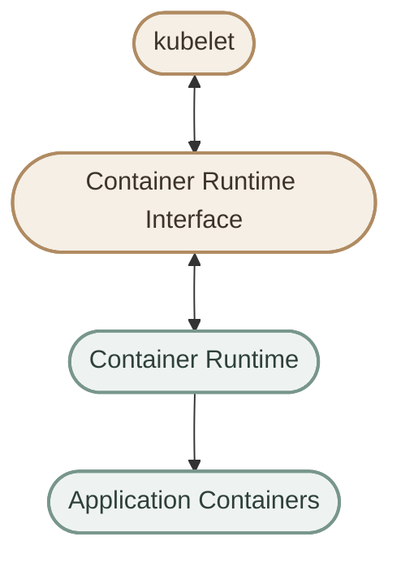

بالتالي، Kubernetes مش هو الـsoftware اللي بينفّذ تشغيل الـcontainer مباشرةً؛ الـkubelet بيطلب من الـruntime تنفيذ العمليات المطلوبة.

## 11. kube-proxy

<InfoCard variant="concept" title="kube-proxy" icon="layers">
  الـ`kube-proxy` بيساعد في تنفيذ Service networking على الـNodes عن طريق إدارة network rules لتوجيه الاتصالات إلى الـService backends.
</InfoCard>

الـ**kube-proxy** مرتبط بالـnetworking داخل Kubernetes.

في الـsetups اللي بتستخدمه، بيعمل configuration لقواعد الشبكة المطلوبة عشان الـtraffic الموجّه للـService يوصل للـappropriate backend Pods.

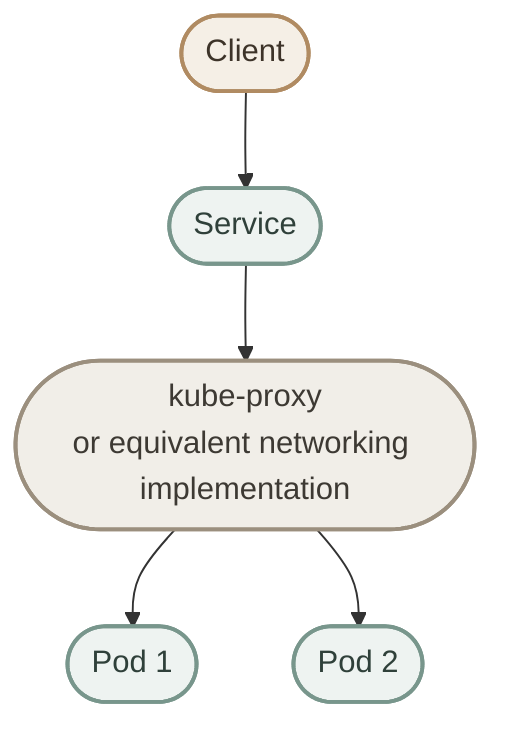

الرسم ده conceptual؛ الـService مش بالضرورة تكون software process مستقلة بتستقبل كل packet، والـtraffic handling الفعلي بيعتمد على الـnetwork rules والـCNI والـimplementation المستخدمة.

<Callout type="note">
مش كل Kubernetes Cluster محتاج `kube-proxy` تحديدًا. بعض الـnetworking implementations بتنفّذ وظائف Service forwarding بطرق بديلة.
</Callout>

## 12. The Complete Architecture

<InfoCard variant="concept" title="The Complete Architecture" icon="layers">
  الـControl Plane بيقدّم الإدارة والـAPI والـScheduling والـReconciliation، بينما الـWorker Nodes بتنفّذ الـworkloads باستخدام الـkubelet والـContainer Runtime.
</InfoCard>

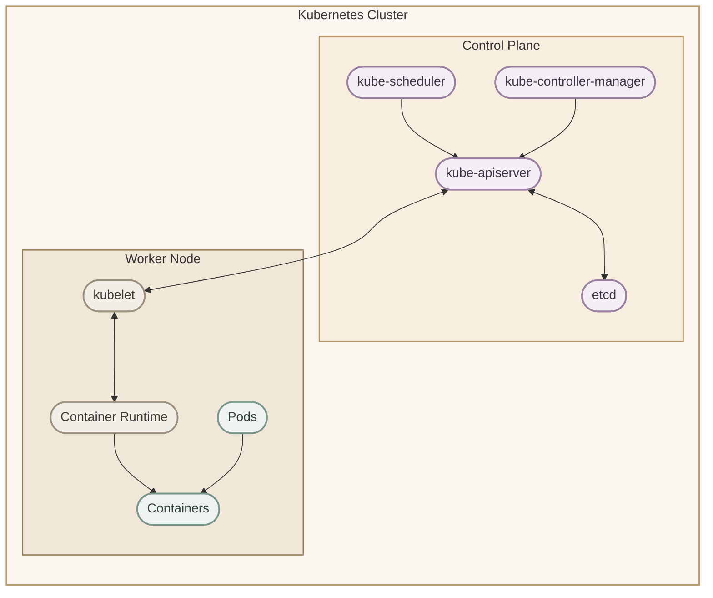

الـarchitecture دي مبسطة لتوضيح المكونات الرئيسية. الـCluster الحقيقي ممكن يحتوي على عدة Control Plane Nodes وعدة Worker Nodes، ومكونات إضافية للـnetworking والـstorage والـobservability.

## 13. How Everything Works Together

<InfoCard variant="concept" title="From API Request to Running Workload" icon="layers">
  لما نعمل apply لـDeployment، Kubernetes بيحفظ الـdesired state، والـControllers بتنشئ وتدير الـReplicaSets والـPods، والـScheduler بيختار Node، وبعدها الـkubelet والـContainer Runtime بيتولوا تشغيل الـworkload.
</InfoCard>

خلينا ناخد مثال: عايزين نشغّل Deployment فيها 3 replicas.

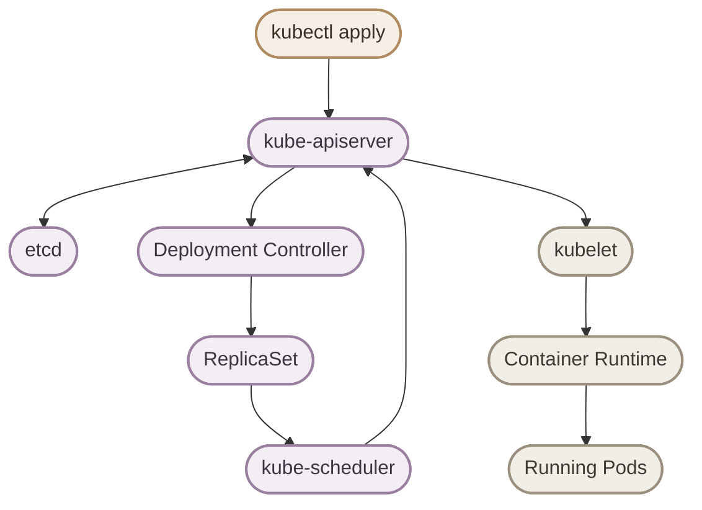

الرسم ده بيعرض المسار بشكل مبسط، مش sequence زمني كامل لكل request داخلي.

خلينا نفهم الخطوات:

1. `kubectl` بيبعت الـmanifest للـAPI Server.
2. الـAPI Server بيتحقق من الطلب ويحفظ التغييرات المقبولة في الـCluster state.
3. الـDeployment Controller بيلاحظ الـDeployment وبيضمن وجود ReplicaSet مناسبة.
4. الـReplicaSet Controller بيحاول توفير العدد المطلوب من الـPods.
5. الـScheduler بيختار Node مناسبة لكل Pod محتاجة Scheduling.
6. الـkubelet على الـNode المختارة بيطلب من الـContainer Runtime تشغيل الـcontainers المطلوبة.
7. Kubernetes بيستمر في متابعة الحالة ومحاولة تحقيق الـdesired state.

**مهم:** مش كل الخطوات بتحصل كعملية واحدة متزامنة. Kubernetes بيعتمد على Controllers وComponents بتراقب التغييرات وتستجيب لها بشكل مستمر.

## 14. The Kubernetes Control Loop

<InfoCard variant="concept" title="The Kubernetes Control Loop" icon="layers">
  Kubernetes نظام قائم على المراقبة المستمرة والـReconciliation؛ الـControllers بتحاول تقلل الفرق بين الـdesired state والـcurrent state.
</InfoCard>

Kubernetes مش مجرد مجموعة Commands بتنفذها مرة واحدة وخلاص.

هو **Continuous Control System**.

لو الـdesired state هو 3 replicas، لكن الـcurrent state فيها Replica واحدة، الـcontroller المناسبة هتحاول تعالج الفرق.

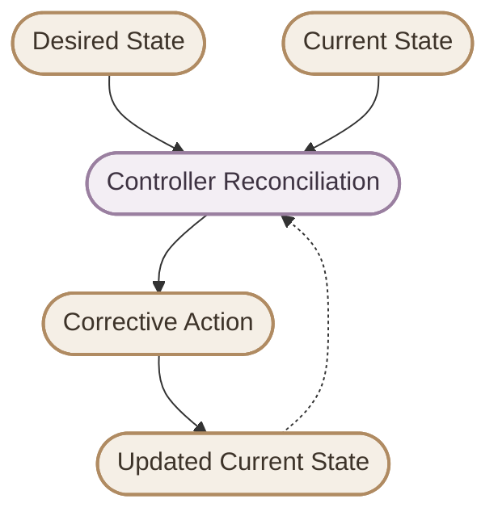

الآلية دي بتساعد Kubernetes في التعامل مع:

- Failed Pods.
- Replica count changes.
- بعض حالات الـNode failure.
- Application rollouts.
- Changes in resource specifications.

لكن ده مش معناه إن Kubernetes يقدر يصلّح أي Application Failure أو يضمن توافر الـapplication في كل الظروف.

مثلًا، لو الـapplication فيها Bug أو محتاجة Database غير متاحة، إعادة إنشاء Pod مش بالضرورة تحل المشكلة.

**الفكرة الأساسية:**

> Kubernetes continuously tries to move the current state toward the desired state.

## 15. The Most Important Mental Model

<InfoCard variant="concept" title="The Architecture Mental Model" icon="layers">
  افهم كل Component حسب مسؤوليتها: الـAPI Server يستقبل API requests، والـetcd يخزّن الـstate، والـScheduler يختار Node، والـControllers تتابع الحالة، والـkubelet يدير الـPods على الـNode، والـRuntime يشغّل الـcontainers.
</InfoCard>

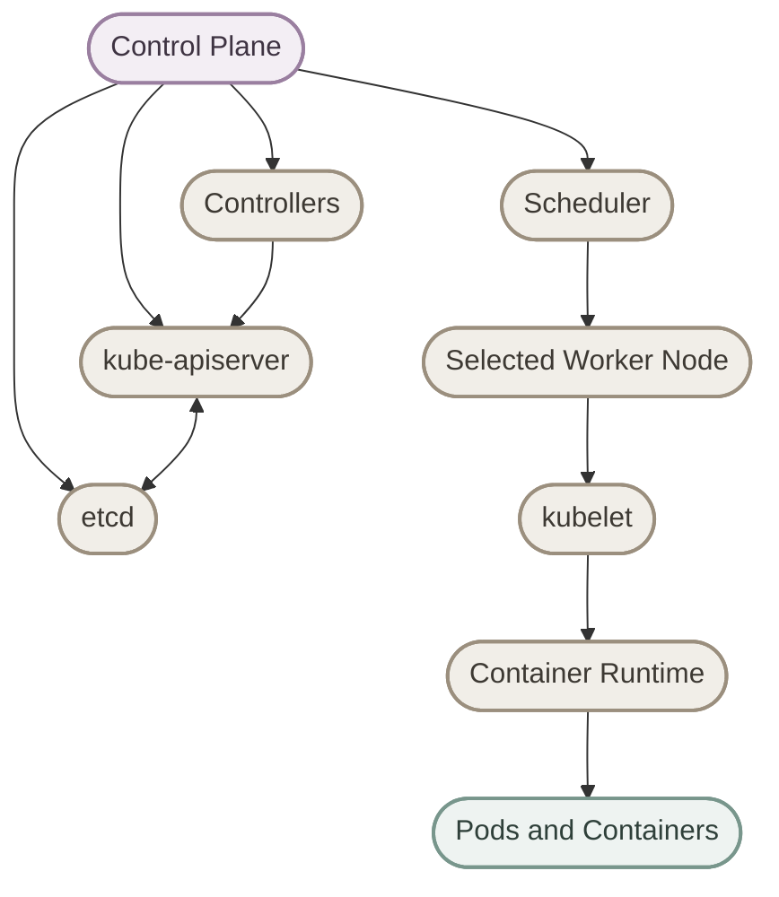

خلّي المسؤوليات دي ثابتة عندك:

- **kube-apiserver:** Provides the Kubernetes API.
- **etcd:** Stores persistent cluster data.
- **kube-scheduler:** Selects a Node for an unscheduled Pod.
- **Controllers:** Reconcile resources toward their desired state.
- **kubelet:** Manages Pods assigned to its Node.
- **Container Runtime:** Runs the containers.
- **Worker Nodes:** Provide the environment where workloads run.

## 16. Quick Reference

<InfoCard variant="concept" title="Quick Reference" icon="layers">
  استخدم الجدول ده كمراجعة سريعة قبل ما تدخل في تفاصيل كل Component.
</InfoCard>

| Component | Main Responsibility |
|---|---|
| `kube-apiserver` | Kubernetes API entry point |
| `etcd` | Stores persistent cluster state |
| `kube-scheduler` | Selects Nodes for unscheduled Pods |
| `kube-controller-manager` | Runs core controllers |
| Controllers | Reconcile resources toward desired state |
| `kubelet` | Manages Pods on a Node |
| Container Runtime | Runs and manages containers |
| `kube-proxy` | Implements Service networking rules when used |
| Worker Node | Provides compute resources for workloads |
| Pod | Smallest deployable unit in Kubernetes |

## 17. Final Mental Model

<InfoCard variant="concept" title="Final Mental Model" icon="layers">
  الـCluster هو منظومة متكاملة: الـControl Plane بيدير ويُنسّق، والـWorker Nodes بتشغّل الـworkloads، والـControllers بتحاول باستمرار تحافظ على الحالة المطلوبة.
</InfoCard>

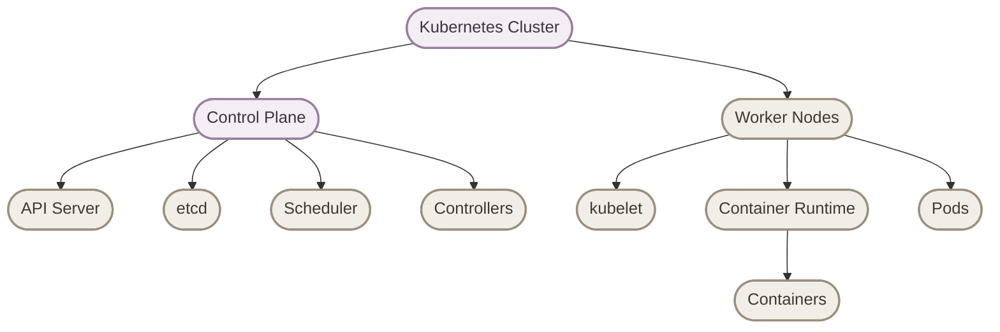

**The core idea:**

> **Kubernetes Cluster = Control Plane + Worker Nodes**

> **Control Plane manages and coordinates.**

> **Worker Nodes run the workloads.**

> **Controllers continuously work toward the desired state.**