## Introduction

<InfoCard variant="concept" title="Overview" icon="layers">
  Kubernetes مبني على مجموعة من الـ**objects and abstractions**، وكل واحدة ليها مسؤولية محددة. لما أفهم العلاقات بينهم، هقدر أفهم إزاي Kubernetes بيشغّل الـapplications ويديرها ويحافظ على الـdesired state.
</InfoCard>

بعد ما فهمنا **What Kubernetes Is** وليه بنستخدمه، محتاجين نفهم الـ**Core Concepts** اللي Kubernetes مبني عليها.

الصورة العامة بتبدأ بالـCluster، اللي بيحتوي على Nodes، والـNodes بتشغّل Pods، والـPods بتحتوي على Containers.

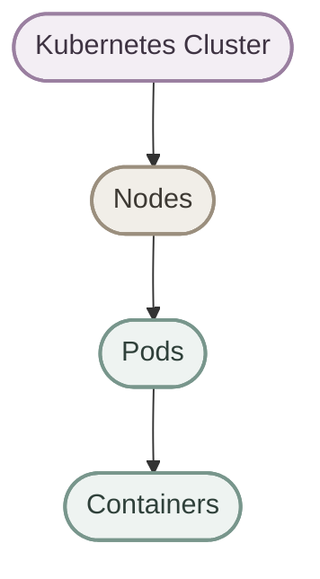

وحول الـPods فيه resources تانية بتساعدنا في إدارة الـapplication، زي `Deployments` و`Services` و`ConfigMaps` و`Secrets` و`Volumes` و`Namespaces`.

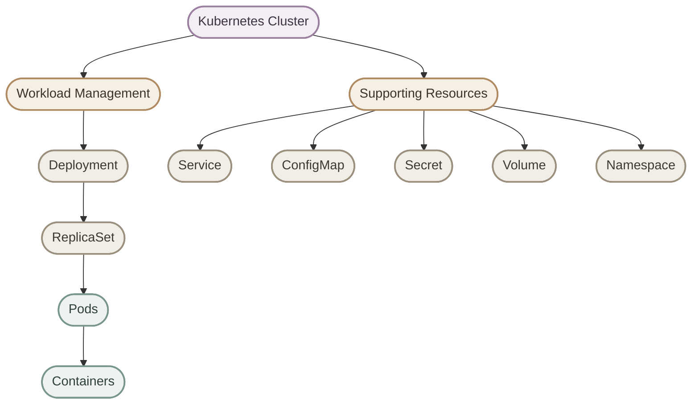

دي صورة تمهيدية؛ هنفهم كل Resource بالتفصيل في الأقسام الجاية.

## 1. Kubernetes Cluster

<InfoCard variant="concept" title="Kubernetes Cluster" icon="layers">
  الـCluster هو بيئة Kubernetes الكاملة، وبيضم الـControl Plane والـWorker Nodes اللي بتشغّل الـworkloads.
</InfoCard>

الـ**Cluster** هو البيئة اللي Kubernetes بيدير من خلالها الـworkloads.

بيتكوّن منطقيًا من جزأين أساسيين:

- **Control Plane:** مسؤول عن إدارة الـCluster واتخاذ قرارات الـorchestration.
- **Worker Nodes:** بتوفّر البيئة اللي بتشتغل عليها الـPods.

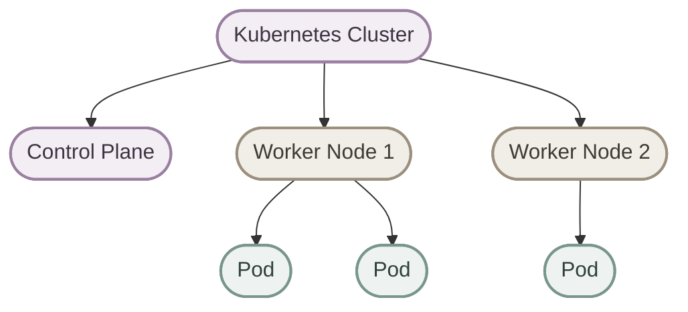

<Callout type="note">
الـControl Plane مش لازم يكون موجود على Machine منفصلة في كل بيئة. في بعض الـsetups، ممكن مكونات الـControl Plane والـworkloads تتواجد على نفس الـNode، حسب طريقة إعداد الـCluster.
</Callout>

**افتكر:** الـCluster هو الـenvironment بالكامل، مش مجرد مجموعة Worker Nodes.

## 2. Node

<InfoCard variant="concept" title="Node" icon="layers">
  الـNode هي Machine بتوفّر الـcompute resources اللازمة لتشغيل الـPods، وممكن تكون Physical Machine أو Virtual Machine أو Cloud Instance.
</InfoCard>

الـ**Node** هي Machine داخل الـCluster.

ممكن تكون:

- Physical machine.
- Virtual machine.
- Cloud instance.

والـNode بتوفّر resources زي CPU والـMemory والـStorage، بالإضافة إلى الـnetwork connectivity اللازمة لتشغيل الـworkloads.

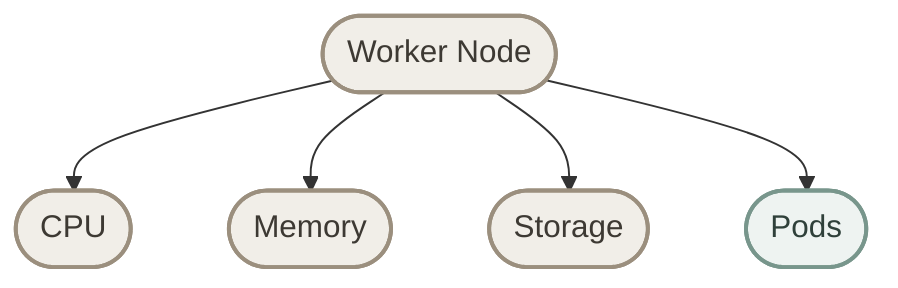

ومن ناحية الـrole، بنميّز بين نوعين أساسيين:

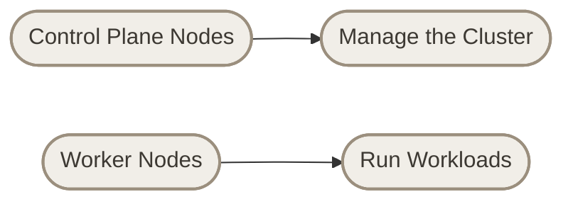

الـControl Plane مسؤول عن إدارة الـCluster، بينما الـWorker Nodes هي المكان المعتاد لتشغيل الـapplication Pods.

## 3. Pod

<InfoCard variant="concept" title="Pod" icon="layers">
  الـPod هي أصغر وحدة deployable في Kubernetes، وبتحتوي على Container واحدة أو أكثر بتشارك نفس الـnetwork namespace، وممكن تشارك Volumes.
</InfoCard>

دي من أهم النقاط في Kubernetes:

> **Kubernetes schedules Pods, not individual containers.**

الـPod هي الـabstraction اللي Kubernetes بيتعامل معاها كوحدة تشغيل وجدولة.

في أغلب الـapplications البسيطة، الـPod بتحتوي على Container واحدة:

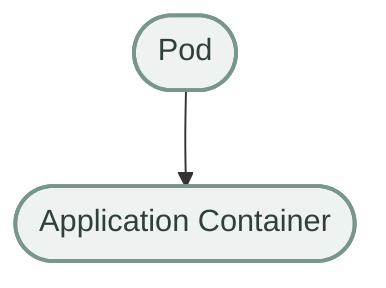

لكن ممكن الـPod تحتوي على أكتر من Container، زي الـmain application container والـsidecar container:

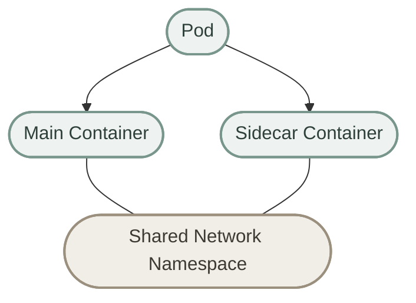

الـContainers الموجودة داخل نفس الـPod:

- بتشارك نفس الـnetwork namespace، وبالتالي بتقدر تتواصل مع بعضها باستخدام `localhost`.
- بتقدر تشارك Volumes لو تم تعريفها واستخدامها في الـPod configuration.
- بتشتغل على نفس الـNode.

<Callout type="tip">
لو الـcontainers مش محتاجة lifecycle أو network context مشترك، غالبًا الأفضل تشغيلها في Pods منفصلة بدل جمعها في Pod واحدة.
</Callout>

## 4. Pod vs Container

<InfoCard variant="concept" title="Pod vs Container" icon="layers">
  الـContainer بيشغّل التطبيق، أما الـPod فهي Kubernetes abstraction اللي بتجمع Container واحدة أو أكتر وتوفّر لهم بيئة التشغيل المشتركة.
</InfoCard>

### I. Container

الـ**Container** هو بيئة تشغيل معزولة نسبيًا للتطبيق، مبنية على image وبتشتغل باستخدام container runtime.

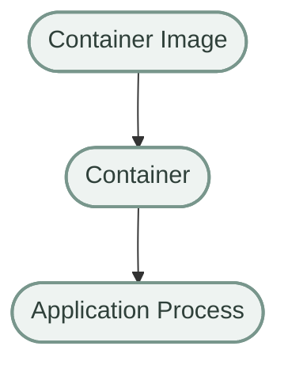

### II. Pod

الـ**Pod** بتجمع Container واحدة أو أكتر مرتبطة ببعض، وبتوفّر لهم network context مشترك وإمكانية مشاركة Volumes.

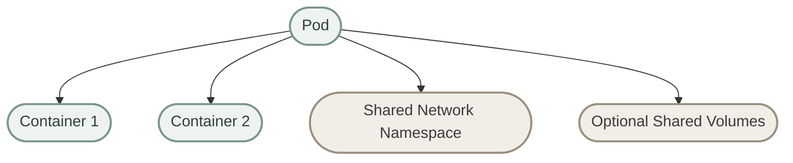

العلاقة الأساسية:


لو سألتني:

> What does Kubernetes schedule?

الإجابة الأساسية: **Pods**.

## 5. One Pod vs Multiple Pods

<InfoCard variant="concept" title="One Pod vs Multiple Pods" icon="layers">
  كل Pod ممكن تمثّل Instance مستقلة من الـapplication، وتشغيل عدة Pods بيساعدنا على زيادة عدد الـreplicas وتوزيع الـworkload.
</InfoCard>

لو عندي NGINX شغال في Pod واحدة، فده معناه إن عندي Instance واحدة من الـworkload:

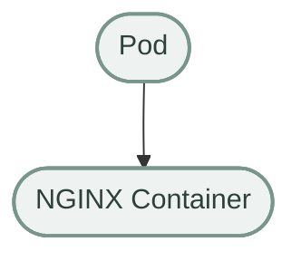

لو محتاج 3 replicas، يبقى عندي 3 Pods:

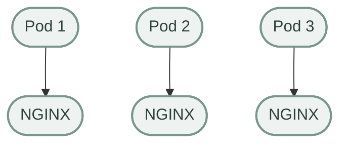

كل Pod هنا Instance مستقلة من الـworkload، ومش شرط تكون على نفس الـNode.

لكن في الـproduction، عادةً مش بننشئ كل Pod ونديرها يدويًا؛ بنستخدم Controllers زي `Deployment` عشان نحافظ على العدد المطلوب من الـreplicas.

## 6. Deployment

<InfoCard variant="concept" title="Deployment" icon="layers">
  الـDeployment بيدير الـapplication Pods بطريقة Declarative، وبيوفّر آليات زي Rolling Updates والـrollback للـupdates اللي بيديرها.
</InfoCard>

بدل ما أقول:

> Create Pod 1, then Pod 2, then Pod 3.

بحدد الـdesired state:

```yaml
spec:
  replicas: 3
```

المعنى إنني عايز 3 replicas من الـapplication.

الـDeployment بيدير الـReplicaSet المناسب، والـReplicaSet بيحافظ على العدد المطلوب من الـPods.

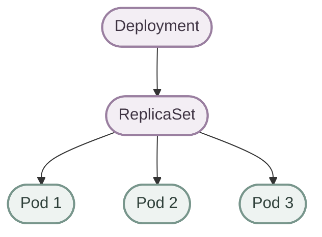

لو Pod وقفت أو اتمسحت، الـReplicaSet بيحاول يرجّع العدد للـdesired state، طالما الـCluster عنده الموارد والظروف المناسبة.

<Callout type="warning">
الـDeployment مش ضمان إن الـapplication نفسها سليمة أو إن الـPods هتشتغل مهما كانت الظروف. هو بيدير الـdesired state، لكن نجاح التشغيل بيعتمد كمان على الـimages والـconfiguration والـresources وباقي مكونات النظام.
</Callout>

## 7. Deployment and ReplicaSet

<InfoCard variant="concept" title="Deployment and ReplicaSet" icon="layers">
  الـDeployment بيدير الـReplicaSets والـrollout history، بينما الـReplicaSet مسؤول عن الحفاظ على العدد المطلوب من الـPod replicas.
</InfoCard>

العلاقة المعتادة:

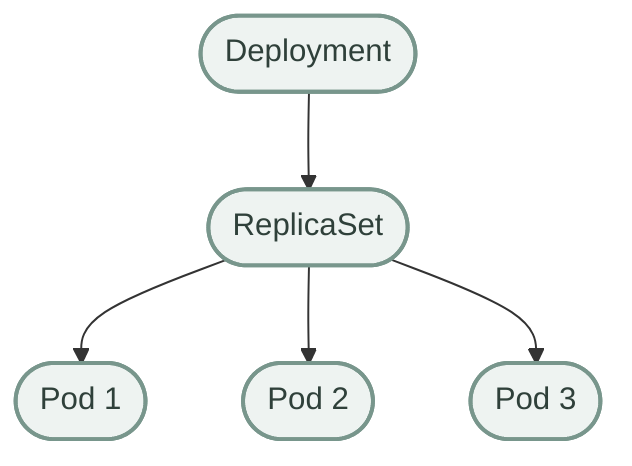

الفرق باختصار:

| Resource | Responsibility |
|---|---|
| **Deployment** | إدارة الـapplication rollout والـupdates والـrollback |
| **ReplicaSet** | الحفاظ على العدد المطلوب من الـPod replicas |
| **Pod** | تشغيل Container واحدة أو أكثر |

في الاستخدام المعتاد، بنتعامل مع الـDeployment مباشرة بدل إدارة الـReplicaSet يدويًا.

## 8. Service

<InfoCard variant="concept" title="Service" icon="layers">
  الـService بيوفّر network endpoint ثابت نسبيًا للوصول إلى مجموعة من الـPods، بدل الاعتماد على عناوين الـPods المتغيرة.
</InfoCard>

الـPods تعتبر **ephemeral**؛ ممكن تتشال وتتعمل من جديد، والـPod الجديدة ممكن تحصل على IP مختلفة.

عشان كده، الاعتماد على Pod IP مباشرة مش اختيار مناسب لمعظم الـapplication communication.

هنا بيظهر الـ**Service**.

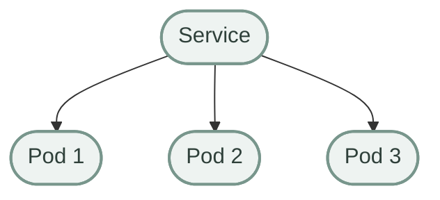

بدل ما الـclient يعرف IP كل Pod، بيتعامل مع الـService:

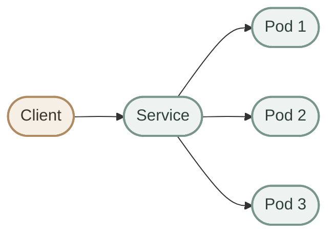

الـService بتعتمد على الـlabel selectors، لو تم تعريفها، لاختيار الـPods المستهدفة.

ومن فوائدها:

- **Stable Endpoint:** عنوان وصول ثابت نسبيًا.
- **Service Discovery:** اكتشاف الخدمة من خلال اسمها داخل الـCluster في الحالات المدعومة.
- **Traffic Distribution:** توزيع الاتصالات على الـeligible endpoints حسب نوع الـService وسلوك الشبكة والـconfiguration.

<Callout type="note">
الـService مش بتعمل Pods ومش مسؤولة عن الحفاظ على عددها. دي مسؤولية الـworkload controllers زي Deployment وReplicaSet.
</Callout>

## 9. Deployment + Service

<InfoCard variant="concept" title="Deployment + Service" icon="layers">
  الـDeployment بيدير الـPods، والـService بتوفّر وسيلة مستقرة نسبيًا للوصول إلى الـPods المطابقة للـselector.
</InfoCard>

دول من أهم الـresources اللي بنستخدمهم مع بعض.

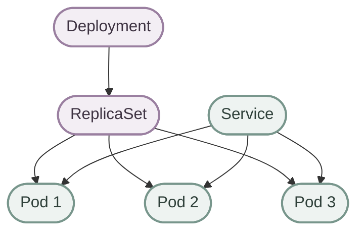

خلي بالك إن الـService والـDeployment مش مرتبطين ببعض مباشرةً بشكل تلقائي. الـService بتحدد الـPods المستهدفة عن طريق الـselector، والـDeployment بيدير الـPods من خلال الـReplicaSet.

> **Deployment manages the Pods.**
>
> **Service provides network access to matching Pods.**

## 10. Labels

<InfoCard variant="concept" title="Labels" icon="layers">
  الـLabels عبارة عن key-value pairs بتستخدم لتصنيف الـKubernetes objects واختيارها وربط الـresources ببعضها عن طريق الـselectors.
</InfoCard>

مثال:

```yaml
labels:
  app: nginx
  environment: production
```

الـLabels هنا:

```text
app = nginx
environment = production
```

بتساعدنا في:

- Grouping resources.
- Selecting resources.
- Organizing workloads.
- ربط الـServices والـcontrollers بالـPods المناسبة.

مثلًا، لو الـService عندها selector بالشكل ده:

```yaml
selector:
  app: nginx
```

فهي بتختار الـPods اللي عندها `app: nginx`.

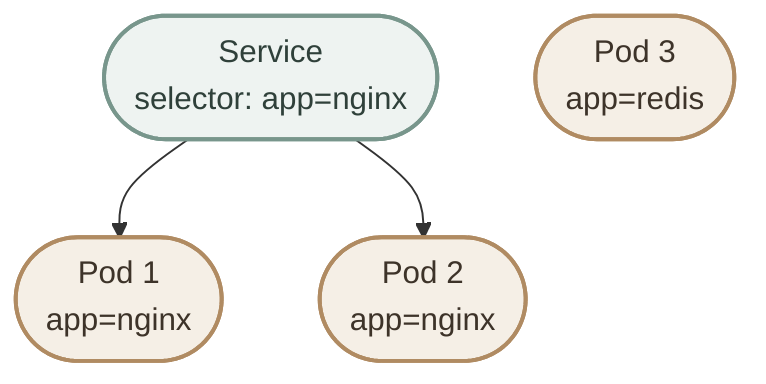

الـPod الثالثة مش هتتختار بالـselector ده، لأن `app=redis` مش بتطابق `app=nginx`.

<Callout type="tip">
الـLabels مش مجرد وصف؛ الـselectors بتستخدمها فعليًا لاختيار الـobjects. عشان كده لازم تكون الـlabels والـselectors متوافقة.
</Callout>

## 11. ConfigMap

<InfoCard variant="concept" title="ConfigMap" icon="layers">
  الـConfigMap بتخزن non-confidential configuration بعيدًا عن الـcontainer image، بحيث نقدر نغيّر الإعدادات من غير ما نحتاج نبني Image مختلفة لكل Environment.
</InfoCard>

مش كل configuration لازم تتحط جوه الـcontainer image.

مثلًا، application ممكن تحتاج:

```text
APP_ENV=production
LOG_LEVEL=info
API_URL=https://api.example.com
```

ممكن نخزّن الإعدادات دي في `ConfigMap`.


الـPod ممكن تستخدم الـConfigMap بأكثر من طريقة، منها:

- Environment variables.
- Command-line arguments بعد استخدام القيم في تعريف الـPod.
- Files mounted داخل الـcontainer.

**الفكرة الأساسية:**

> ConfigMap stores non-confidential configuration data separately from the application image.

وده بيساعدنا نفصل الـapplication artifact عن الـenvironment-specific configuration.

<Callout type="warning">
تغيير الـConfigMap مش معناه إن كل application هتطبّق التغييرات فورًا. النتيجة بتعتمد على طريقة استهلاك الإعدادات، وهل التطبيق بيعيد قراءتها، وهل محتاج restart.
</Callout>

## 12. Secret

<InfoCard variant="concept" title="Secret" icon="layers">
  الـSecret مخصّصة لتخزين sensitive configuration زي credentials والـtokens، مع ضرورة ضبط الـaccess control وطرق التخزين بشكل مناسب.
</InfoCard>

الـ**Secret** بتُستخدم لتخزين بيانات حساسة، زي:

- Passwords.
- API keys.
- Tokens.
- Database credentials.

مثلًا، الـapplication ممكن تحتاج `DB_USERNAME` و`DB_PASSWORD` أو `API_TOKEN`.


الفكرة الأساسية:

> Secret is designed for sensitive configuration data.

لكن مهم جدًا نفهم إن تخزين البيانات في Kubernetes Secret **مش معناه تلقائيًا إنها encrypted everywhere**.

الأمان بيعتمد كمان على:

- **Encryption at Rest:** إعداد التشفير للبيانات المخزنة في الـAPI datastore.
- **RBAC:** تحديد مين يقدر يقرأ أو يعدّل الـSecrets.
- **Least Privilege:** منح أقل صلاحيات لازمة.
- **Access to Nodes and Containers:** حماية البيئة اللي بتُستخدم فيها البيانات الحساسة.

<Callout type="warning">
ما تحطّش Secrets حقيقية في Git أو ملفات YAML منشورة. كمان الـBase64 encoding المستخدم في بعض تمثيلات Kubernetes Secrets مش تشفير.
</Callout>

## 13. ConfigMap vs Secret

<InfoCard variant="concept" title="ConfigMap vs Secret" icon="layers">
  الاتنين بيفصلوا الـconfiguration عن الـapplication image، لكن الـConfigMap للبيانات غير الحساسة، والـSecret للبيانات الحساسة.
</InfoCard>

| Resource | Purpose | Examples |
|---|---|---|
| **ConfigMap** | Non-sensitive configuration | `APP_ENV`, `LOG_LEVEL`, `API_URL` |
| **Secret** | Sensitive configuration | Passwords, API tokens, credentials |

مثال على ConfigMap:

```yaml
apiVersion: v1
kind: ConfigMap
metadata:
  name: app-config
data:
  APP_ENV: production
  LOG_LEVEL: info
```

أما الـSecret، فممكن تتضمن قيمًا حساسة، مثل:

```yaml
apiVersion: v1
kind: Secret
metadata:
  name: app-secret
type: Opaque
stringData:
  DB_PASSWORD: replace-me
```

القيمة `replace-me` مجرد placeholder، مش Password حقيقية.

```mermaid
flowchart TB
    P(["Pod"])

    CM(["ConfigMap<br/>Non-sensitive Data"])
    SE(["Secret<br/>Sensitive Data"])

    CM --> P
    SE --> P

    classDef pod fill:#eef3f1,stroke:#78968c,stroke-width:2px,color:#2f403a;
    classDef config fill:#f1eee8,stroke:#9b8f7e,stroke-width:2px,color:#3d3933;
    classDef secret fill:#f1eee8,stroke:#9b8f7e,stroke-width:2px,color:#3d3933;

    class P pod
    class CM config
    class SE secret

```

## 14. Volume

<InfoCard variant="concept" title="Volume" icon="layers">
  الـVolume بتوفّر storage للـcontainers داخل الـPod، وبتسمح بمشاركة البيانات بين الـcontainers أو الاحتفاظ بها بعد انتهاء عمر الـcontainer، حسب نوع الـVolume.
</InfoCard>

الـcontainer filesystem مش هو الاختيار المناسب لكل أنواع البيانات؛ بعض البيانات ممكن تختفي لما الـcontainer تتشال وتتعمل من جديد.

لو الـapplication محتاجة storage، ممكن نستخدم **Volumes**.

```mermaid
flowchart TB
    P(["Pod"])
    P --> C(["Container"])
    P --> V(["Volume"])
    V --> D(["Storage Data"])

    classDef pod fill:#eef3f1,stroke:#78968c,stroke-width:2px,color:#2f403a;
    classDef container fill:#eef3f1,stroke:#78968c,stroke-width:2px,color:#2f403a;
    classDef storage fill:#f1eee8,stroke:#9b8f7e,stroke-width:2px,color:#3d3933;

    class P pod
    class C container
    class V,D storage

```

الـVolumes أنواع مختلفة، ومش كلها بتوفر نفس خصائص الاستمرارية.

- بعض الأنواع بتوفّر مساحة مؤقتة مرتبطة بعمر الـPod.
- بعض الأنواع بتسمح بمشاركة البيانات بين Containers داخل نفس الـPod.
- الـPersistentVolume وPersistentVolumeClaim بيساعدوا في إدارة الـpersistent storage.

<Callout type="note">
الـVolume مش بالضرورة تكون Persistent. لو محتاج البيانات تفضل موجودة بعد حذف الـPod، لازم تختار وتضبط نوع الـstorage المناسب، زي persistent storage المدعوم من الـCluster.
</Callout>

## 15. Namespace

<InfoCard variant="concept" title="Namespace" icon="layers">
  الـNamespace بتقسّم الـnamespaced resources داخل نفس الـCluster إلى logical groups، وبتساعد في التنظيم وتطبيق بعض حدود الـquotas والـaccess control.
</InfoCard>

الـ**Namespace** بتساعدنا ننظّم الـresources داخل نفس الـCluster.

مثلًا، ممكن نستخدم:

- `production`
- `staging`
- `development`

```mermaid
flowchart TB
    C(["Kubernetes Cluster"])

    C --> P(["production"])
    C --> S(["staging"])
    C --> D(["development"])

    P --> P1(["Deployments / Services"])
    S --> S1(["Deployments / Services"])
    D --> D1(["Deployments / Services"])

    classDef cluster fill:#f3eef4,stroke:#9a7fa0,stroke-width:2px,color:#3e3342;
    classDef namespace fill:#f1eee8,stroke:#9b8f7e,stroke-width:2px,color:#3d3933;
    classDef resources fill:#f1eee8,stroke:#9b8f7e,stroke-width:2px,color:#3d3933;

    class C cluster
    class P,S,D namespace
    class P1,S1,D1 resources

```

الـNamespaces بتساعد في:

- **Organization:** تنظيم الـresources حسب الفريق أو البيئة.
- **Resource Quotas:** وضع حدود على استهلاك موارد معينة.
- **Access Control:** تطبيق سياسات وصول حسب الـnamespace والـRBAC configuration.

لكن مهم نعرف إن الـNamespace مش معناه إن الـresources اتحطت على Machines منفصلة، ومش بتوفّر network isolation تلقائيًا.

> **A Namespace is a logical boundary inside a cluster, not a separate physical cluster.**

كمان مش كل Kubernetes resources بتكون namespaced؛ فيه resources على مستوى الـCluster نفسه.

## 16. The Core Relationships

<InfoCard variant="concept" title="The Core Relationships" icon="layers">
  كل Resource ليها مسؤولية وعلاقات مختلفة: بعض الـresources بتدير الـworkloads، وبعضها بيوفّر networking أو configuration أو storage، والـNamespace بتنظّم الـnamespaced resources.
</InfoCard>

خلينا نجمع أهم العلاقات في Diagram واحدة.

```mermaid
flowchart TB
    CL(["Kubernetes Cluster"])

    CL --> CP(["Control Plane"])
    CL --> N(["Worker Node"])

    N --> P(["Pod"])
    P --> C(["Container"])

    D(["Deployment"]) --> R(["ReplicaSet"])
    R --> P

    S(["Service"]) --> P

    CM(["ConfigMap"]) -.-> P
    SE(["Secret"]) -.-> P
    V(["Volume"]) -.-> P

    NS(["Namespace"]) -.-> D
    NS -.-> S
    NS -.-> CM
    NS -.-> SE

    classDef cluster fill:#f3eef4,stroke:#9a7fa0,stroke-width:2px,color:#3e3342;
    classDef management fill:#f3eef4,stroke:#9a7fa0,stroke-width:2px,color:#3e3342;
    classDef workload fill:#eef3f1,stroke:#78968c,stroke-width:2px,color:#2f403a;
    classDef support fill:#f1eee8,stroke:#9b8f7e,stroke-width:2px,color:#3d3933;

    class CL cluster
    class CP,D,R,S,NS management
    class N,P,C workload
    class CM,SE,V support

```

**مهم:** الرسم بيوضح العلاقات المفاهيمية، مش كل التفاصيل الداخلية للـKubernetes architecture. مثلًا، الـService بتوصل للـPods عن طريق الـselectors والـendpoints، والـNamespace بتنظّم الموارد بدل ما تكون Controller بتدير تشغيلها.

## 17. A Typical Kubernetes Application

<InfoCard variant="concept" title="A Typical Kubernetes Application" icon="layers">
  الـpattern الشائع لتطبيق بسيط بيستخدم Deployment لإدارة الـPods، وService لتوفير الوصول الشبكي، مع ConfigMap وSecret للإعدادات وVolume للـstorage عند الحاجة.
</InfoCard>

تخيّل إن عندنا Web Application فيها 3 replicas.

```mermaid
flowchart TB
    NS(["Namespace: production"])

    NS --> D(["Deployment"])
    D --> R(["ReplicaSet"])

    R --> P1(["Pod 1"])
    R --> P2(["Pod 2"])
    R --> P3(["Pod 3"])

    S(["Service"]) --> P1
    S --> P2
    S --> P3

    CM(["ConfigMap"]) -.-> P1
    CM -.-> P2
    CM -.-> P3

    SE(["Secret"]) -.-> P1
    SE -.-> P2
    SE -.-> P3

    classDef management fill:#f3eef4,stroke:#9a7fa0,stroke-width:2px,color:#3e3342;
    classDef workload fill:#eef3f1,stroke:#78968c,stroke-width:2px,color:#2f403a;
    classDef support fill:#f1eee8,stroke:#9b8f7e,stroke-width:2px,color:#3d3933;

    class NS,D,R,S management
    class P1,P2,P3 workload
    class CM,SE support

```

الـPods ممكن تستخدم الـConfigMap والـSecret من خلال الـPod configuration. أما الـVolume، فبيتم تعريفه وMounting داخل الـcontainers حسب الحاجة.

مش كل Application محتاجة كل الـresources دي؛ بنستخدم منها اللي يناسب الـrequirements.

## 18. Declarative Model

<InfoCard variant="concept" title="Declarative Model" icon="layers">
  الـDeclarative Model معناه إننا بنحدد الحالة المطلوبة، وKubernetes controllers بتحاول تقرّب الحالة الفعلية منها باستمرار.
</InfoCard>

بدل ما أكتب خطوات يدوية لكل Pod، بحدد الـ**desired state**.

مثلًا:

```yaml
spec:
  replicas: 3
```

ده جزء من الـDeployment specification، ومعناه إنني عايز 3 replicas من الـapplication.

```mermaid
flowchart TB
    A(["Declarative Configuration"])
    B(["Kubernetes API"])
    C(["Desired State"])
    D(["Controllers"])
    E(["Current State"])
    F(["Reconciliation"])

    A --> B
    B --> C
    C --> D
    D --> E
    E --> F
    F -.-> C

    classDef config fill:#f1eee8,stroke:#9b8f7e,stroke-width:2px,color:#3d3933;
    classDef control fill:#f3eef4,stroke:#9a7fa0,stroke-width:2px,color:#3e3342;
    classDef state fill:#f5efe6,stroke:#b08b62,stroke-width:2px,color:#3d3329;

    class A,C config
    class B,D,F control
    class E state

```

الـControllers بتراقب الحالة الفعلية وتحاول تحقق الحالة المطلوبة. لكن الـScheduler له مسؤولية مختلفة: اختيار Node مناسبة للـPods اللي محتاجة Scheduling.

<Callout type="note">
الـReconciliation مش عملية واحدة بتنفذ كل شيء بالترتيب؛ دي مجموعة من الـcontrollers والـcomponents اللي بتتعاون، وكل واحد مسؤول عن جزء معين من الحالة المطلوبة.
</Callout>

## 19. The Most Important Mental Model

<InfoCard variant="concept" title="Build Your Mental Model" icon="layers">
  افهم Kubernetes كطبقات مترابطة: Cluster وNodes لتوفير بيئة التشغيل، Pods لتشغيل الـcontainers، Controllers لإدارة الـworkloads، وSupporting Resources للـnetworking والـconfiguration والـstorage.
</InfoCard>

### I. Workload Hierarchy

```mermaid
flowchart TB
    C(["Cluster"])
    N(["Node"])
    P(["Pod"])
    CO(["Container"])

    C --> N
    N --> P
    P --> CO

    classDef item fill:#eef3f1,stroke:#78968c,stroke-width:2px,color:#2f403a;

    class C,N,P,CO item

```

### II. Management Layer

```mermaid
flowchart TB
    D(["Deployment"]) --> R(["ReplicaSet"])
    R --> P(["Pods"])
    P --> C(["Containers"])

    classDef management fill:#f3eef4,stroke:#9a7fa0,stroke-width:2px,color:#3e3342;
    classDef workload fill:#eef3f1,stroke:#78968c,stroke-width:2px,color:#2f403a;

    class D,R management
    class P,C workload

```

### III. Networking Layer

```mermaid
flowchart LR
    C(["Client"]) --> S(["Service"])
    S --> P(["Matching Pods"])

    classDef service fill:#eef3f1,stroke:#78968c,stroke-width:2px,color:#2f403a;
    classDef workload fill:#eef3f1,stroke:#78968c,stroke-width:2px,color:#2f403a;

    class C,S service
    class P workload

```

### IV. Configuration and Storage

```mermaid
flowchart TB
    CM(["ConfigMap"])
    SE(["Secret"])
    V(["Volume"])
    P(["Pod"])

    CM -.-> P
    SE -.-> P
    V -.-> P

    classDef support fill:#f1eee8,stroke:#9b8f7e,stroke-width:2px,color:#3d3933;
    classDef pod fill:#eef3f1,stroke:#78968c,stroke-width:2px,color:#2f403a;

    class CM,SE,V support
    class P pod

```

### V. Organization Layer

```mermaid
flowchart TB
    NS(["Namespace"])
    NS --> D(["Deployments"])
    NS --> S(["Services"])
    NS --> P(["Pods"])
    NS --> CM(["ConfigMaps"])
    NS --> SE(["Secrets"])

    classDef namespace fill:#f1eee8,stroke:#9b8f7e,stroke-width:2px,color:#3d3933;
    classDef resources fill:#f1eee8,stroke:#9b8f7e,stroke-width:2px,color:#3d3933;

    class NS namespace
    class D,S,P,CM,SE resources

```

الرسومات دي بتوضّح علاقات مختلفة؛ مش معناها إن كل resource بتتحكم مباشرة في الموارد اللي تحتها بنفس الطريقة.

## 20. Quick Reference

<InfoCard variant="concept" title="Quick Reference" icon="layers">
  الجدول ده مرجع سريع للمسؤولية الأساسية لكل Concept. استخدمه للمراجعة بعد ما تفهم الشرح والـrelationships.
</InfoCard>

| Concept | Responsibility |
|---|---|
| **Cluster** | بيئة Kubernetes الكاملة |
| **Control Plane** | إدارة الـCluster واتخاذ قرارات الـorchestration |
| **Node** | Machine بتوفّر resources لتشغيل الـPods |
| **Pod** | أصغر وحدة deployable في Kubernetes |
| **Container** | تشغيل الـapplication process |
| **Deployment** | إدارة الـapplication rollout والـReplicaSets |
| **ReplicaSet** | الحفاظ على العدد المطلوب من الـPod replicas |
| **Service** | توفير network endpoint للوصول إلى الـmatching Pods |
| **Label** | تصنيف الـobjects واختيارها باستخدام selectors |
| **ConfigMap** | تخزين non-confidential configuration |
| **Secret** | تخزين sensitive configuration |
| **Volume** | توفير storage للـcontainers |
| **Namespace** | تنظيم الـnamespaced resources داخل الـCluster |

## 21. Core Concepts in One Diagram

<InfoCard variant="concept" title="Core Concepts Overview" icon="layers">
  الرسم ده بيجمع الـworkload hierarchy مع الـmanagement والـsupporting resources في نظرة واحدة.
</InfoCard>

```mermaid
flowchart TB
    CL(["Kubernetes Cluster"])

    CL --> CP(["Control Plane"])
    CL --> N(["Worker Nodes"])
    N --> P(["Pods"])
    P --> C(["Containers"])

    D(["Deployment"]) --> R(["ReplicaSet"])
    R --> P

    S(["Service"]) --> P
    CM(["ConfigMap"]) -.-> P
    SE(["Secret"]) -.-> P
    V(["Volume"]) -.-> P

    NS(["Namespace"]) -.-> D
    NS -.-> S
    NS -.-> CM
    NS -.-> SE

    classDef cluster fill:#f3eef4,stroke:#9a7fa0,stroke-width:2px,color:#3e3342;
    classDef management fill:#f3eef4,stroke:#9a7fa0,stroke-width:2px,color:#3e3342;
    classDef workload fill:#eef3f1,stroke:#78968c,stroke-width:2px,color:#2f403a;
    classDef support fill:#f1eee8,stroke:#9b8f7e,stroke-width:2px,color:#3d3933;

    class CL cluster
    class CP,D,R,S,NS management
    class N,P,C workload
    class CM,SE,V support

```

## 22. Final Summary

<InfoCard variant="concept" title="Final Summary" icon="flag">
  الهدف مش حفظ أسماء الـresources بس؛ الهدف إنك تفهم كل Resource مسؤولة عن إيه، وإزاي بتتعاون مع الباقي لتشغيل الـapplication.
</InfoCard>

أهم hierarchy لازم تكون واضحة:

> **Cluster → Node → Pod → Container**

وأهم management relationship:

> **Deployment → ReplicaSet → Pods**

وأهم networking relationship:

> **Service → Matching Pods**

والـconfiguration والـstorage:

> **ConfigMap / Secret / Volume → Pod**

والـorganization:

> **Namespace → Namespaced Resources**

**الفكرة الأساسية:**

Kubernetes مش مجرد مجموعة commands منفصلة. هو نظام لإدارة الـdesired state، مبني على Resources لكل واحدة مسؤولية واضحة.

لما تفهم العلاقات دي، هتقدر تنتقل بسهولة للـYAML manifests والـ`kubectl` commands، وبعدها تتعمق في Scheduling وNetworking وStorage وCluster Maintenance.