## Introduction

<InfoCard variant="concept" title="Overview" icon="layers" />

قبل ما نبدأ نتعامل مع Kubernetes Resources زي:

- Pods
- Deployments
- Services
- ConfigMaps

لازم يكون عندنا **Kubernetes Cluster** نقدر نجرّب عليه ونطبّق الأوامر ونختبر الـ configurations.

في بيئة الـ Production، ممكن الـ Kubernetes Cluster يشتغل على مجموعة من الـ Servers أو على Cloud Infrastructure.

لكن أثناء التعلّم والتطوير، مش ضروري نجهّز Cloud Environment كاملة أو نحتاج أكثر من جهاز فعلي.

عشان كده بنستخدم أدوات زي:

- **kind** — Kubernetes clusters باستخدام Docker containers.
- **minikube** — Local Kubernetes environment للتعلّم والتطوير.
- **k3d** — تشغيل k3s clusters داخل Docker.

في المقال ده هنركّز على إنشاء Local Cluster باستخدام `kind` و`minikube`، وبعدها نتعلّم إزاي نتعامل معاه باستخدام `kubectl` والـ `kubeconfig` والـ `Contexts`.

<Callout type="tip">

**مهم:** إنشاء Local Cluster لا يعني إنك بتشغّل Kubernetes كاملًا داخل Process واحد بالضرورة. حسب الأداة والـ configuration، ممكن الـ Cluster يتكوّن من Node واحدة أو عدة Nodes، وتكون كل Node عبارة عن Container أو Virtual Machine.

</Callout>

## 1. What Is a Kubernetes Cluster?

<InfoCard variant="concept" title="Kubernetes Cluster" icon="layers" />

الـ **Kubernetes Cluster** هو مجموعة من الـ Nodes بتشغّل Kubernetes وتدير الـ Containerized Applications.

بشكل عام، بيتكوّن من جزأين أساسيين:

- **Control Plane:** مسؤول عن إدارة حالة الـ Cluster، واتخاذ قرارات الـ Scheduling، ومتابعة الحالة المطلوبة للـ Resources.
- **Worker Nodes:** بتشغّل الـ Pods والـ Application Workloads.

في الـ Clusters الصغيرة أو المحلية، ممكن الـ Control Plane والـ Workloads يشتغلوا على نفس الـ Node، حسب إعدادات الـ Cluster.

أما في بيئات Production، فغالبًا بيكون فيه فصل أوضح بين مكونات الإدارة والـ Application Workloads، حسب تصميم البنية التحتية.

## 2. Kubernetes Cluster Architecture

<InfoCard variant="concept" title="Cluster Architecture" icon="layers" />

الـ Developer بيتعامل مع الـ Cluster باستخدام `kubectl`، اللي بيبعت الطلبات إلى الـ Kubernetes API Server.

الـ Control Plane بيحتوي على مكونات إدارة الـ Cluster، بينما الـ Worker Nodes بتشغّل الـ Pods عن طريق الـ Kubelet والـ Container Runtime.

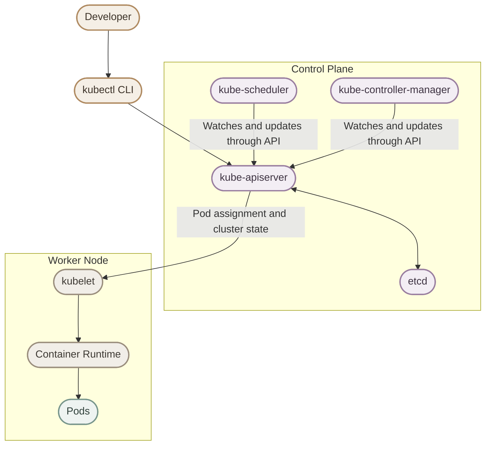

**خلي بالك:** الرسم بيوضح العلاقات الأساسية بشكل مبسّط. الـ Scheduler والـ Controllers بيتعاملوا مع الـ API Server لمراقبة حالة الـ Cluster وتحديثها؛ مش معنى كده إن الـ API Server بيشغّلهم كعمليات فرعية.

## 3. Local Kubernetes Cluster

<InfoCard variant="concept" title="Local Cluster" icon="terminal" />

في بيئة Production، ممكن الـ Cluster يتكوّن من عدة Nodes موزعة على Servers مختلفة.

أما في الـ Local Environment، فنقدر نشغّل Cluster على جهازنا للتعلّم والتجارب.

### I. Production Environment

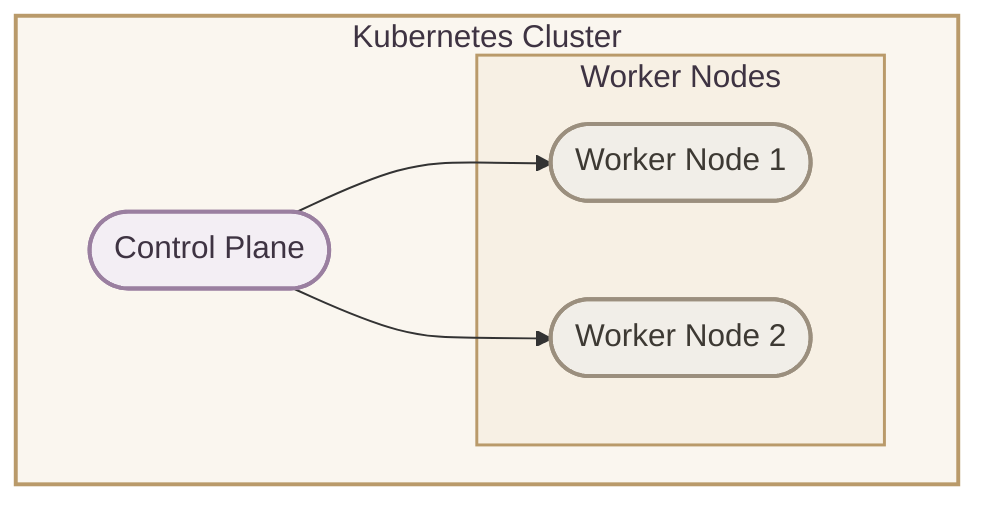

### II. Local Environment with kind

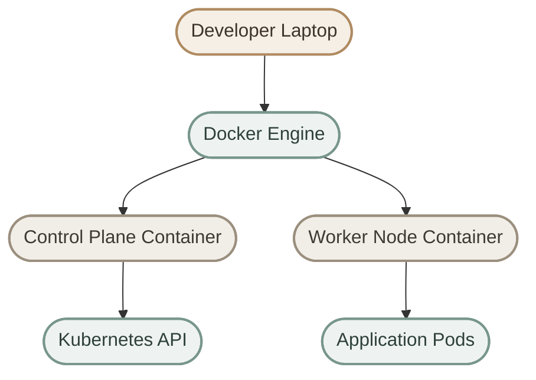

**ملاحظة:** الرسم بيوضح مثالًا لـ multi-node `kind` cluster. تقدر كمان تنشئ Cluster مكوّنًا من Control Plane Node واحدة فقط.

## 4. Why Do We Need a Local Kubernetes Cluster?

<InfoCard variant="concept" title="Why Local Clusters Matter" icon="terminal" />

وجود Local Cluster مهم أثناء التعلّم والتطوير؛ لأنه بيوفّر بيئة تقدر تجرّب عليها من غير ما تغيّر إعدادات Production.

### I. Testing Kubernetes Manifests

قبل ما تعمل Deploy لأي Application، تقدر تختبر الـ Kubernetes YAML manifests محليًا.

أمثلة على الملفات:

```text
deployment.yaml
service.yaml
configmap.yaml
```

تقدر تطبّقها باستخدام:

```bash
kubectl apply -f deployment.yaml
kubectl apply -f service.yaml
kubectl apply -f configmap.yaml
```

لكن نجاح `kubectl apply` معناه إن الطلب اتقبل، مش بالضرورة إن الـ Application اشتغلت بشكل صحيح. لازم تتحقق من حالة الـ Resources والـ Application نفسها.

### II. Learning Kubernetes Commands

بدل تجربة الأوامر على Production Cluster، تقدر تتعلّم بأمان باستخدام:

```bash
kubectl get pods
kubectl describe pod nginx
kubectl logs pod-name
```

### III. Troubleshooting Practice

الـ Local Cluster يسمح لك بالتدريب على مشاكل زي:

- Pods في حالة `Pending`.
- Containers بتدخل في `CrashLoopBackOff`.
- أخطاء في الـ YAML configurations.
- مشاكل الـ Networking.
- Resource requests وlimits غير المناسبة.
- مشاكل الـ Scheduling.

<Callout type="tip">

أفضل طريقة للتعلّم هي إنك تنشئ المشكلة بنفسك، تلاحظ الـ Symptoms، تستخدم `kubectl describe` و`kubectl logs`، وبعدها تصلح السبب بدل ما تحفظ الحل بس.

</Callout>

## 5. Tools for Running Kubernetes Locally

<InfoCard variant="concept" title="Local Kubernetes Tools" icon="terminal" />

فيه أكتر من Tool لإنشاء Kubernetes Cluster محلي.

| Tool | طريقة العمل | استخدام مناسب |
|---|---|---|
| `kind` | يشغّل Kubernetes Nodes داخل Containers باستخدام Docker أو Container Engine مدعوم | Testing، التعلّم، وCI |
| `minikube` | يوفّر Local Kubernetes Cluster باستخدام Driver مثل Docker أو Virtual Machine | التعلّم والتطوير |
| `k3d` | يشغّل k3s Clusters داخل Containers | Local development وTesting |

في المقال ده هنركّز على `kind` و`minikube`.

## 6. kind — Kubernetes IN Docker

### I. What Is kind?

<InfoCard variant="concept" title="kind" icon="terminal" />

`kind` اختصار لـ **Kubernetes IN Docker**.

وهو Tool لإنشاء Kubernetes Clusters باستخدام Containers بدل ما تحتاج إلى تجهيز مجموعة من الـ Physical Machines.

في `kind`، كل Kubernetes Node بتشتغل داخل Container. والـ Container دي بتشغّل مكونات الـ Node، بما فيها Kubernetes components والـ Container Runtime المستخدم داخلها.

ده مختلف عن تشغيل الـ Application Containers مباشرة على جهازك؛ لأن الـ Containers اللي بتمثّل الـ Nodes هي نفسها جزء من بيئة الـ Cluster.

### II. kind Architecture

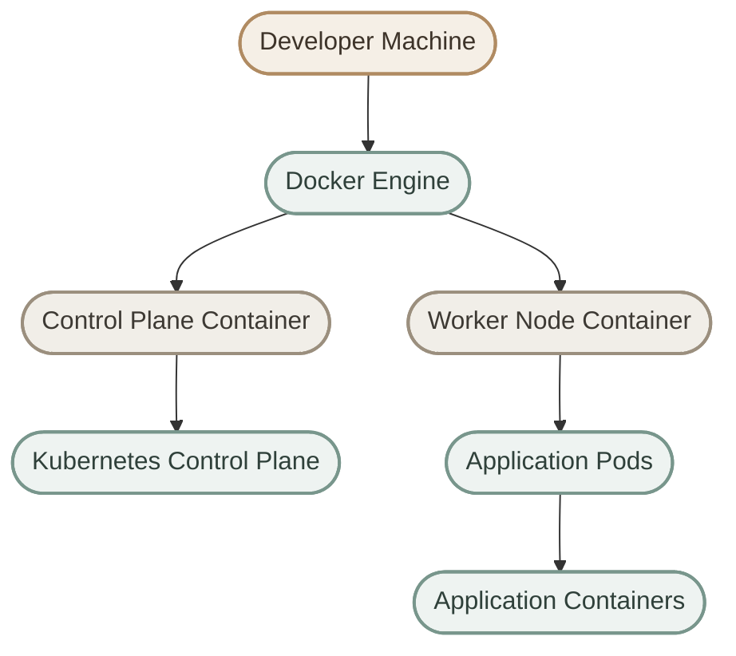

### III. Why Use kind?

من أهم مميزات `kind`:

- خفيف نسبيًا، حسب عدد الـ Nodes والـ Workloads.
- إنشاء وحذف الـ Clusters بسهولة.
- مناسب لتجربة Kubernetes manifests.
- يدعم إنشاء multi-node clusters.
- مناسب لعمليات الـ Automated Testing والـ CI pipelines.

### IV. Installation Guide

للتثبيت والاطلاع على المتطلبات، راجع الوثائق الرسمية:

- **Official Website:** https://kind.sigs.k8s.io/
- **Quick Start:** https://kind.sigs.k8s.io/docs/user/quick-start/

لازم يكون عندك Container Engine مدعوم ومُعدّ للعمل، زي Docker، بالإضافة إلى تثبيت `kind`.

### V. Create a kind Cluster

لإنشاء Cluster باسم `devops-lab`:

```bash
kind create cluster --name devops-lab
```

الأمر ده بينشئ Cluster جديدًا باستخدام الإعدادات الافتراضية، واللي بتتضمن Control Plane Node واحدة.

الـ Workflow بشكل مبسّط:

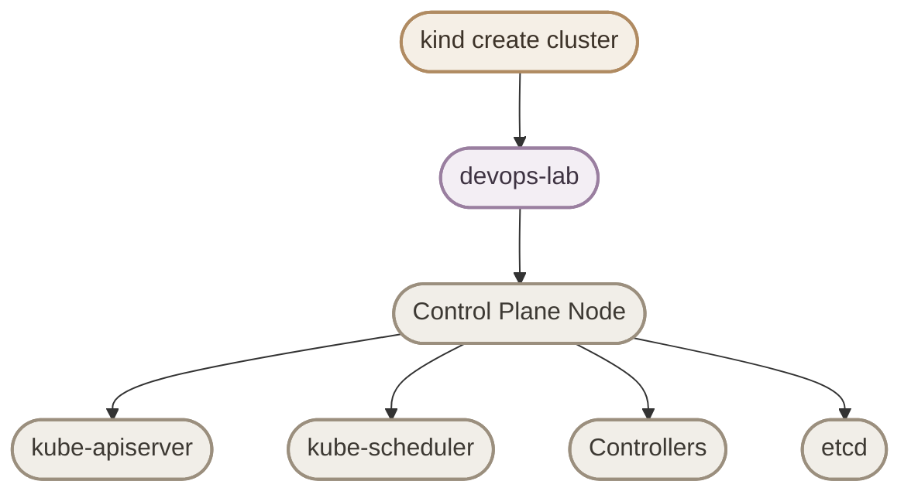

الرسم بيوضح المكونات الرئيسية بشكل مبسّط، مش ترتيبًا زمنيًا لإنشائها أو تشغيلها.

### VI. Check Existing Clusters

لعرض الـ Clusters اللي أنشأتها باستخدام `kind`:

```bash
kind get clusters
```

مثال على الـ Output:

```text
devops-lab
```

### VII. Delete a Cluster

لحذف الـ Cluster:

```bash
kind delete cluster --name devops-lab
```

**خلي بالك:** حذف الـ Cluster بيحذف بيئة الـ Cluster المحلية والـ Resources الموجودة بداخلها؛ ما تستخدمش الأمر ده على Cluster مش عايز تفقد بياناته.

## 7. minikube

### I. What Is minikube?

<InfoCard variant="concept" title="minikube" icon="terminal" />

`minikube` هو Tool لإنشاء Local Kubernetes Cluster بهدف التعلّم والتطوير والاختبار.

بيقدر يشغّل الـ Cluster باستخدام Drivers مختلفة، حسب نظام التشغيل والـ Configuration، زي Docker أو Virtual Machines.

الفرق الأساسي إن `kind` مصمّم لتشغيل Kubernetes Nodes داخل Containers، بينما `minikube` بيوفّر تجربة Local Kubernetes من خلال Drivers متعددة.

### II. Start minikube

لتشغيل الـ Cluster أو إنشائه عند الحاجة:

```bash
minikube start
```

ممكن تحدد Driver، لو مناسب لبيئتك:

```bash
minikube start --driver=docker
```

### III. Check Status

لمعرفة حالة الـ Cluster:

```bash
minikube status
```

### IV. Stop the Cluster

لإيقاف الـ Cluster مؤقتًا:

```bash
minikube stop
```

الأمر ده بيوقف الـ Cluster، لكنه مش بيحذفه.

## 8. Choosing Between kind and minikube

<InfoCard variant="concept" title="Choosing a Local Cluster Tool" icon="layers" />

اختيار الأداة بيعتمد على احتياجك، ومفيش أداة أفضل في كل الحالات.

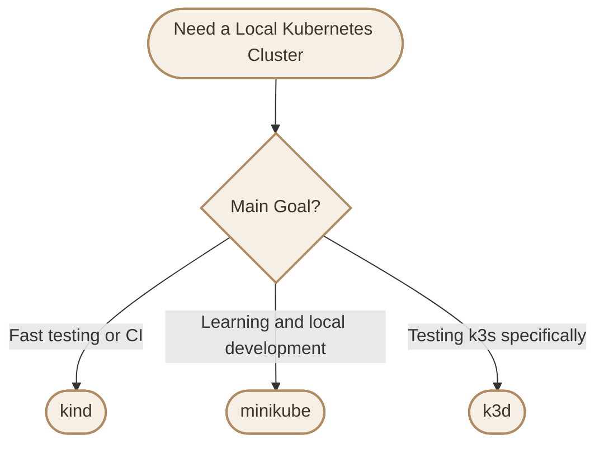

| Consideration | kind | minikube |
|---|---|---|
| Main approach | Kubernetes Nodes inside Containers | Local Kubernetes using supported Drivers |
| Multi-node clusters | Supported | Supported |
| Local testing | Excellent fit | Suitable |
| Learning Kubernetes | Suitable | Excellent fit |
| Driver flexibility | Focused on Container-based Nodes | Supports multiple Drivers |

بالنسبة للتطبيق العملي في المقال ده، هنستخدم `kind` في الأمثلة الأساسية.

## 9. kubectl

### I. What Is kubectl?

<InfoCard variant="concept" title="kubectl" icon="terminal" />

`kubectl` هو الـ **Command-Line Interface (CLI)** الرسمي للتعامل مع Kubernetes API.

من خلاله تقدر:

- تعرض الـ Resources.
- تنشئ أو تعدّل Resources.
- تتابع حالة الـ Pods.
- تفحص الـ Events والـ Logs.
- تدير الـ Contexts والـ Namespaces.

بمعنى بسيط: `kubectl` هو الـ Client اللي بيبعت Requests إلى Kubernetes API Server.

### II. kubectl Communication Flow

لما تنفّذ:

```bash
kubectl get pods
```

`kubectl` بيستخدم الـ Current Context والـ Credentials الموجودة في الـ `kubeconfig` علشان يتصل بالـ API Server، وبعدها يطلب قائمة الـ Pods من الـ API.

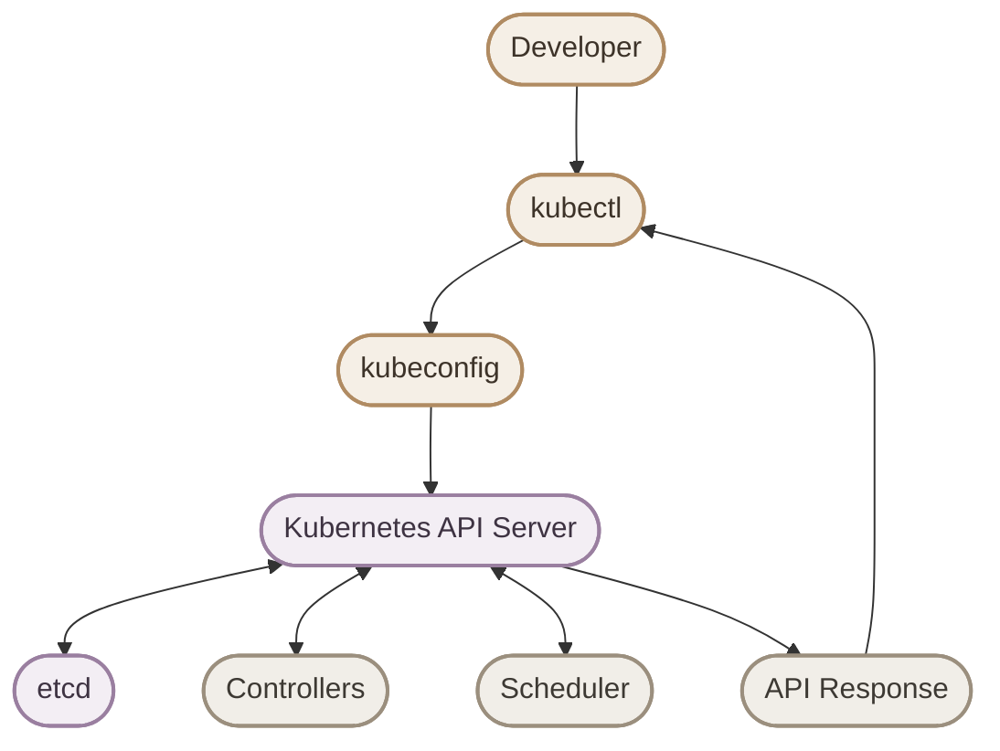

الرسم بيوضح العلاقات الأساسية فقط. مثلًا، `kubectl get pods` هو طلب قراءة، فمش شرط يغيّر حالة الـ Cluster أو يشغّل Controllers جديدة.

## 10. kubectl Common Commands

### I. Check Cluster Nodes

<InfoCard variant="concept" title="Essential kubectl Commands" icon="terminal" />

لعرض الـ Nodes الموجودة في الـ Cluster:

```bash
kubectl get nodes
```

مثال على الـ Output في Cluster أنشأناه باستخدام `kind`:

```text
NAME                       STATUS
devops-lab-control-plane   Ready
```

### II. Get Pods

لعرض الـ Pods في الـ Current Namespace:

```bash
kubectl get pods
```

لعرض الـ Pods في جميع الـ Namespaces:

```bash
kubectl get pods -A
```

### III. Get Cluster Information

لمعرفة معلومات الاتصال بالـ Cluster:

```bash
kubectl cluster-info
```

### IV. Describe Resources

لعرض تفاصيل Resource معين:

```bash
kubectl describe pod pod-name
```

استبدل `pod-name` بالاسم الحقيقي للـ Pod.

### V. View Logs

لعرض الـ Logs الخاصة بـ Container داخل Pod:

```bash
kubectl logs pod-name
```

لو الـ Pod فيه أكثر من Container، تقدر تحدد اسم الـ Container:

```bash
kubectl logs pod-name -c container-name
```

## 11. kubeconfig

### I. What Is kubeconfig?

<InfoCard variant="concept" title="kubeconfig" icon="layers" />

بعد تثبيت `kubectl`، محتاجين نحدد إزاي يتصل بالـ Kubernetes Cluster.

ملف **kubeconfig** بيحتوي على إعدادات الاتصال بالـ Clusters، ومعلومات الـ Authentication، والـ Contexts المتاحة.

المكان الافتراضي غالبًا:

```text
~/.kube/config
```

لكن ممكن تحدد ملفًا مختلفًا باستخدام متغير البيئة `KUBECONFIG` أو باستخدام الخيار `--kubeconfig`.

### II. kubeconfig Components

الملف بيحتوي على ثلاثة مفاهيم أساسية:

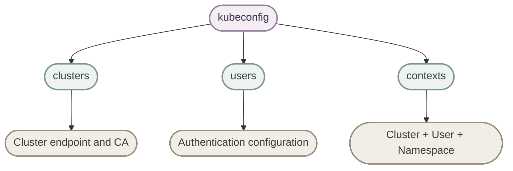

### III. Clusters

قسم `clusters` بيحتوي على إعدادات الاتصال بالـ Kubernetes API Server، زي عنوان الـ Server ومعلومات الـ Certificate Authority عند الحاجة.

مثال مبسّط:

```yaml
clusters:
  - name: kind-devops-lab
    cluster:
      server: https://127.0.0.1:XXXXX
```

`XXXXX` مجرد Placeholder، مش Port حقيقي. عنوان الـ Server والـ Port الفعليين بيعتمدوا على إعدادات الـ Cluster، و`kind` ممكن يخصص Port مختلفًا على جهازك.

### IV. Users

قسم `users` بيحتوي على إعدادات الـ Authentication المستخدمة للاتصال بالـ Cluster.

مثال توضيحي مبسّط:

```yaml
users:
  - name: kubernetes-admin
    user:
      # Authentication settings depend on the cluster.
      # They may use certificates, tokens, or an exec plugin.
```

ده مثال توضيحي، مش Configuration كامل صالح للاتصال. بيانات الـ Authentication الفعلية بتعتمد على طريقة إعداد الـ Cluster.

**تنبيه أمني:** ملف `kubeconfig` ممكن يحتوي على Credentials أو يشير إلى أدوات بتوفّرها. ما تشاركوش بدون مراجعة محتواه، وما ترفعش بيانات Authentication إلى Git.

### V. Contexts

الـ Context بيربط بين:

- Cluster.
- User.
- Namespace اختياري.

مثال:

```yaml
contexts:
  - name: dev-context
    context:
      cluster: kind-devops-lab
      user: kubernetes-admin
      namespace: default
```

الـ Namespace هنا هو الـ Default Namespace المستخدم عند تنفيذ الأوامر من خلال الـ Context ده، إلا لو حددت Namespace مختلفًا في الأمر.

## 12. Kubernetes Context

### I. What Is a Context?

<InfoCard variant="concept" title="Kubernetes Context" icon="layers" />

الـ **Context** بيحدد إعدادات الاتصال اللي هيستخدمها `kubectl`، وهي:

- الـ Cluster اللي هيتصل بيه.
- الـ User أو Authentication configuration.
- الـ Default Namespace، لو محدد.

يعني بدل ما تحدد الـ Cluster والـ User في كل أمر، بتختار Context محفوظًا في الـ `kubeconfig`.

### II. Context Structure

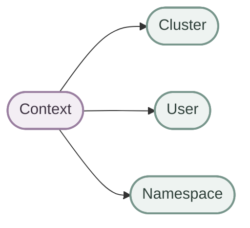

### III. Real-World Example

في بيئة العمل، ممكن تتعامل مع أكثر من Cluster:

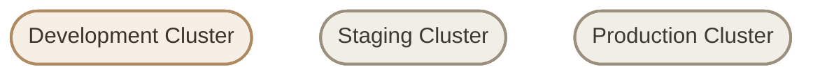

اختيار Context غلط ممكن يخليك تنفّذ أمر على Production بدل Development؛ لذلك لازم تتأكد من الـ Current Context قبل تنفيذ تغييرات مهمة.

### IV. View Available Contexts

لعرض الـ Contexts الموجودة:

```bash
kubectl config get-contexts
```

مثال:

```text
CURRENT   NAME
*         kind-devops-lab
          staging
          production-cluster
```

العلامة `*` بتحدد الـ Current Context.

### V. Switch Context

لتغيير الـ Current Context:

```bash
kubectl config use-context kind-devops-lab
```

وللتأكد من الاختيار الحالي:

```bash
kubectl config current-context
```

### VI. Verify Before Making Changes

قبل تنفيذ أمر بيغيّر Resources، اتأكد من الـ Context:

```bash
kubectl config current-context
kubectl get nodes
```

**مهم:** اختيار Context صحيح مش بديل عن صلاحيات الـ RBAC أو إجراءات حماية Production. هو بس بيحدد إعدادات الاتصال اللي هيستخدمها `kubectl`.

## 13. kubectx

### I. What Is kubectx?

<InfoCard variant="concept" title="kubectx" icon="terminal" />

`kubectx` هو Tool بيسهّل التبديل بين Kubernetes Contexts.

هو مش مسؤول عن إنشاء الـ Clusters، ومش بيضيف صلاحيات جديدة؛ هو بيسهّل التعامل مع الـ Contexts الموجودة في إعداداتك.

### II. Without kubectx

الطريقة التقليدية باستخدام `kubectl`:

```bash
kubectl config get-contexts
kubectl config use-context production-cluster
```

### III. With kubectx

باستخدام `kubectx`:

```bash
kubectx production-cluster
```

الأمر بيختار الـ Context المطلوب من الـ Contexts المتاحة في إعداداتك.

### IV. kubectx Workflow

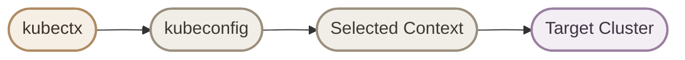

### V. List Contexts

لتشغيل قائمة بالـ Contexts المتاحة:

```bash
kubectx
```

مثال توضيحي:

```text
kind-devops-lab
staging
production
```

### VI. Why Is kubectx Useful?

في بيئة DevOps، ممكن تتعامل مع Development وStaging وProduction في نفس اليوم.

`kubectx` بيسهّل التنقل بينهم ويقلل كتابة الأوامر، لكنه مش بيمنع اختيار Production بالخطأ. اتأكد دائمًا من الـ Context قبل تنفيذ تغييرات حساسة.

الوثائق والمشروع الرسمي:

- https://github.com/ahmetb/kubectx

## 14. kubens

### I. What Is kubens?

<InfoCard variant="concept" title="kubens" icon="terminal" />

داخل الـ Kubernetes Cluster، الـ **Namespace** بيقسّم الموارد إلى نطاقات منطقية منفصلة.

على سبيل المثال، ممكن يكون عندك Namespaces باسم:

- `development`
- `staging`
- `production`

الـ Namespace مش Cluster مستقل، ومش بيوفّر Network Isolation تلقائيًا بين الـ Workloads. التحكم في الوصول بيعتمد على RBAC، أما عزل الشبكة فيحتاج إعدادات مناسبة، مثل NetworkPolicies مع دعمها من الـ Networking implementation.

### II. Why Use Namespaces?

بدل ما تكون الموارد كلها في Namespace واحدة:

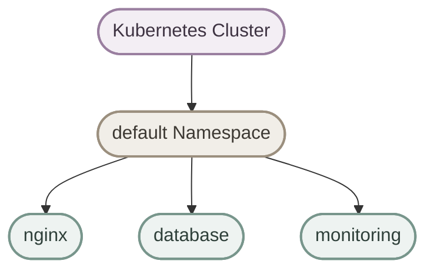

تقدر تنظّم الموارد حسب البيئة:

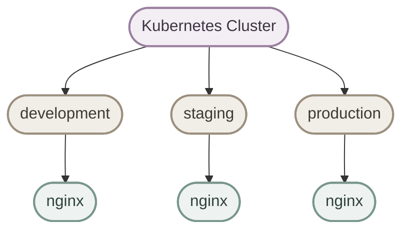

لاحظ إن كل Namespace ممكن تحتوي على Resource بنفس الاسم؛ لأن أسماء كتير من الـ Resources بتكون فريدة داخل الـ Namespace، مش بالضرورة على مستوى الـ Cluster كله.

### III. kubens Role

`kubens` بيسهّل تغيير الـ Namespace الافتراضية المستخدمة بواسطة الـ Current Context.

### IV. Without kubens

باستخدام `kubectl`:

```bash
kubectl config set-context --current --namespace=development
```

الأمر ده بيعدّل الـ Namespace في الـ Current Context.

### V. With kubens

باستخدام `kubens`:

```bash
kubens development
```

### VI. List Namespaces

لعرض الـ Namespaces المتاحة:

```bash
kubens
```

أو باستخدام `kubectl`:

```bash
kubectl get namespaces
```

### VII. kubens Workflow

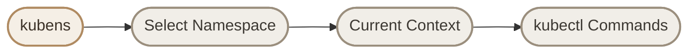

## 15. Create a Cluster Using kind

<InfoCard variant="concept" title="Hands-on Lab" icon="terminal" />

هنطبّق اللي اتعلمناه وننشئ Local Kubernetes Cluster باستخدام `kind`.

### I. Create the Cluster

```bash
kind create cluster --name devops-lab
```

لو الـ Cluster موجود بالفعل بنفس الاسم، راجع حالته بدل ما تحاول إنشاء Cluster مكرر بنفس الاسم.

### II. Verify the Cluster

اعرض الـ Nodes:

```bash
kubectl get nodes
```

مثال على الـ Output:

```text
NAME                       STATUS
devops-lab-control-plane   Ready
```

ممكن تشوف أسماء أو عددًا مختلفًا من الـ Nodes لو استخدمت إعدادات مختلفة.

### III. Check the Current Context

```bash
kubectl config current-context
```

الـ Output المتوقع عند استخدام الإعداد الافتراضي لـ `kind`:

```text
kind-devops-lab
```

### IV. Test the Kubernetes API

```bash
kubectl cluster-info
```

الأمر بيعرض معلومات عن الـ Kubernetes Control Plane والخدمات المرتبطة به.

### V. Verify the Cluster Is Responsive

```bash
kubectl get pods -A
```

ده بيعرض الـ Pods الموجودة في جميع الـ Namespaces، وبيساعدك تتأكد إن مكونات الـ Cluster الأساسية بتظهر في الـ API.

لو الـ Cluster لسه بيبدأ، ممكن تحتاج تنتظر قليلًا وتعيد التحقق.

## 16. Complete Workflow

<InfoCard variant="concept" title="From Developer to Kubernetes Resources" icon="network" />

الـ Workflow العام للتعامل مع Local Kubernetes Cluster بيكون كالتالي:

1. تشغّل الـ Cluster باستخدام `kind` أو `minikube`.
2. تتأكد من إعدادات الاتصال داخل `kubeconfig`.
3. تختار الـ Context الصحيح.
4. تحدد الـ Namespace المناسبة.
5. تستخدم `kubectl` للتعامل مع الـ Kubernetes Resources.

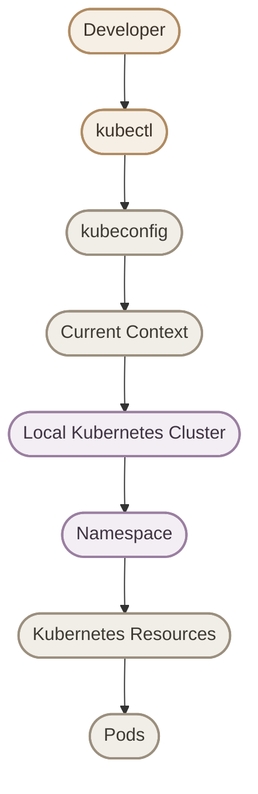

الرسم بيوضح تسلسل المفاهيم اللي بتتعامل معاها، مش ترتيبًا إلزاميًا لكل عملية داخل Kubernetes.

## 17. Quick Reference

| Task | Command |
|---|---|
| Create a kind Cluster | `kind create cluster --name devops-lab` |
| List kind Clusters | `kind get clusters` |
| Delete a kind Cluster | `kind delete cluster --name devops-lab` |
| Start minikube | `minikube start` |
| Stop minikube | `minikube stop` |
| Check minikube Status | `minikube status` |
| List Nodes | `kubectl get nodes` |
| List Pods | `kubectl get pods` |
| List Pods across Namespaces | `kubectl get pods -A` |
| Get Cluster Information | `kubectl cluster-info` |
| List Contexts | `kubectl config get-contexts` |
| Show Current Context | `kubectl config current-context` |
| Switch Context | `kubectl config use-context context-name` |
| List Namespaces | `kubectl get namespaces` |
| Change Current Namespace | `kubectl config set-context --current --namespace=namespace-name` |

## Final Mental Model

<InfoCard variant="concept" title="The Big Picture" icon="layers" />

خلي الصورة دي ثابتة في ذهنك:

- **kind / minikube:** أدوات لإنشاء وتشغيل Local Kubernetes Clusters.
- **kubectl:** الـ CLI اللي بتستخدمه للتعامل مع Kubernetes API.
- **kubeconfig:** إعدادات الاتصال والـ Authentication والـ Contexts.
- **Context:** بيحدد الـ Cluster والـ User والـ Default Namespace.
- **Namespace:** بتنظّم الموارد داخل الـ Cluster.
- **Kubernetes Cluster:** البيئة اللي بتدير وتشغّل الـ Workloads.

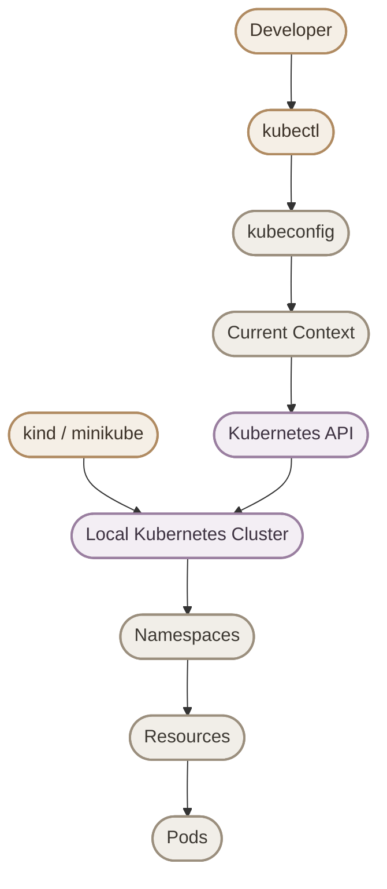

بعد ما تجهّز الـ Local Cluster وتتأكد إن `kubectl` بيتصل بيه، تقدر تبدأ تطبّق Kubernetes Resources زي Pods وDeployments وServices، وتتعلم إزاي Kubernetes بيدير الـ Applications.