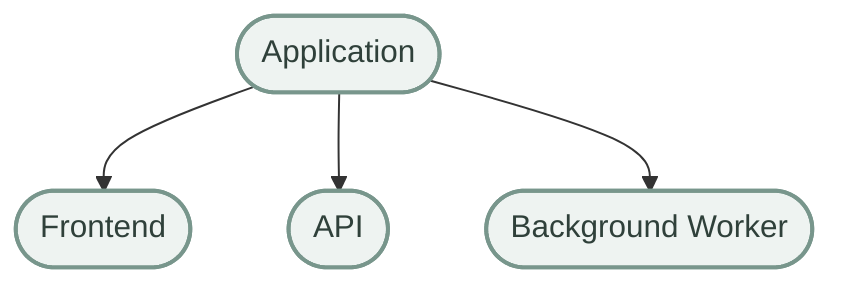
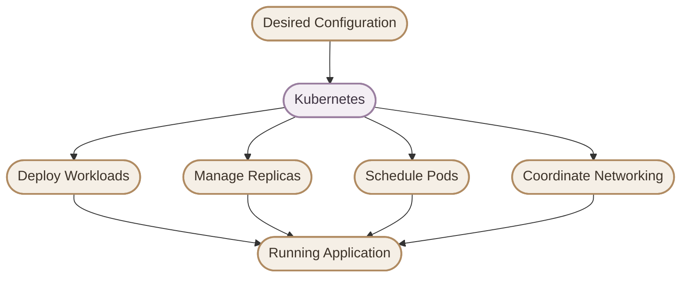
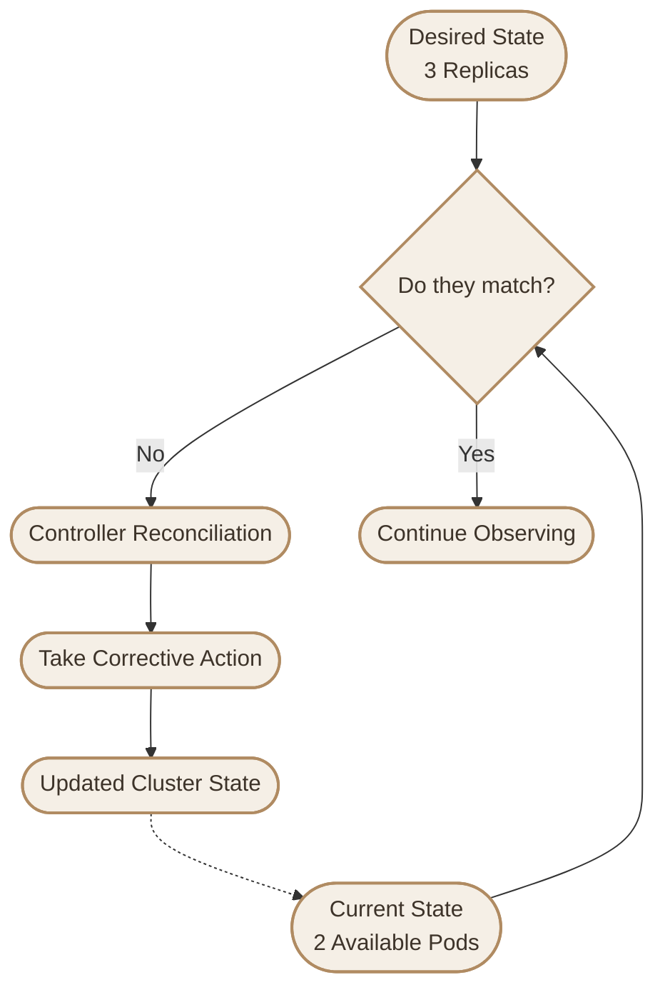
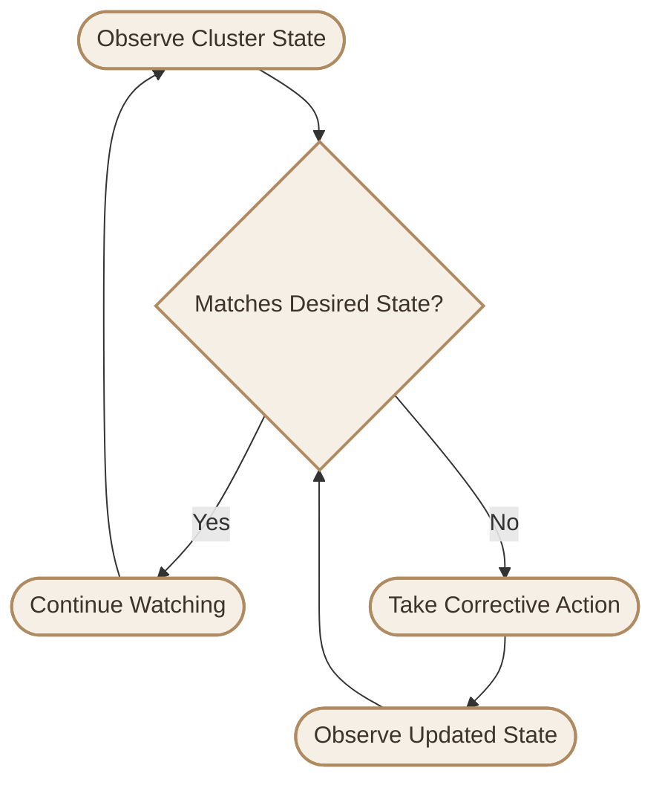
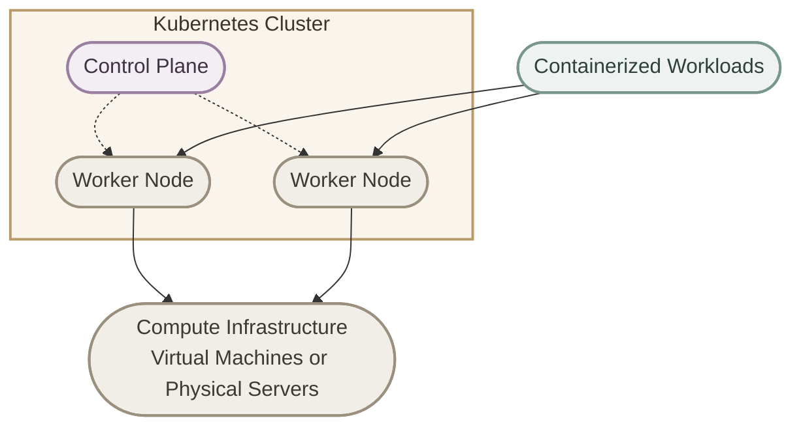
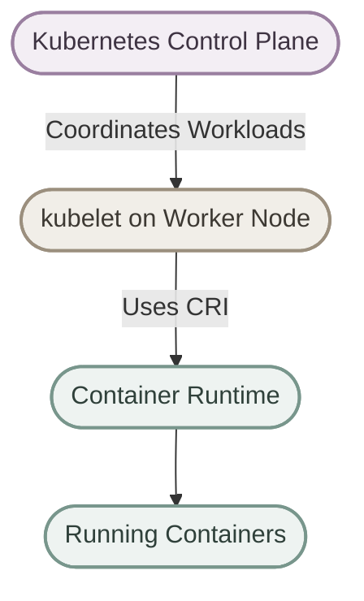
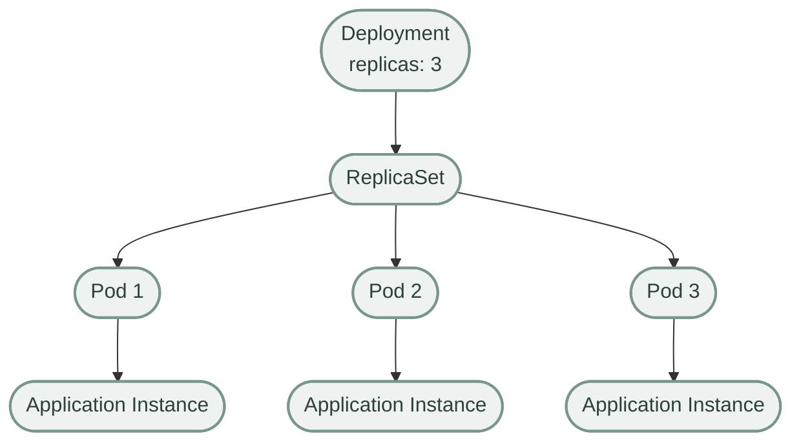
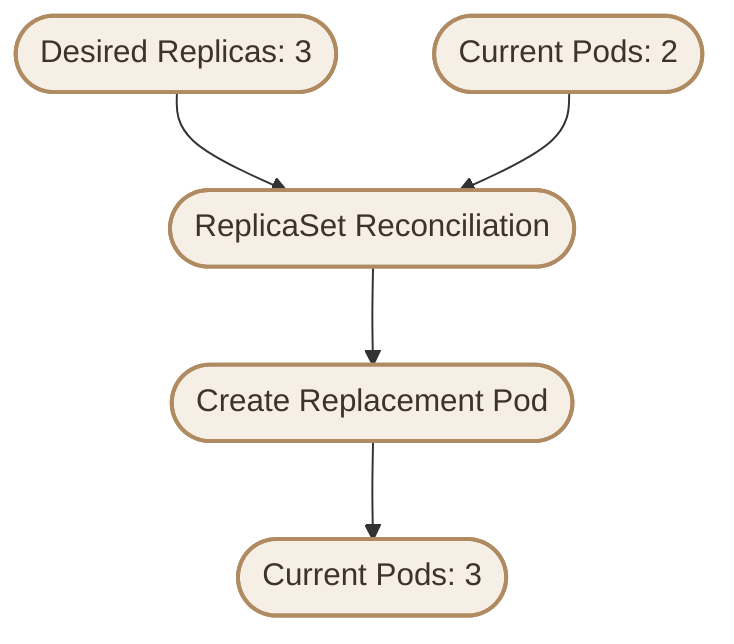
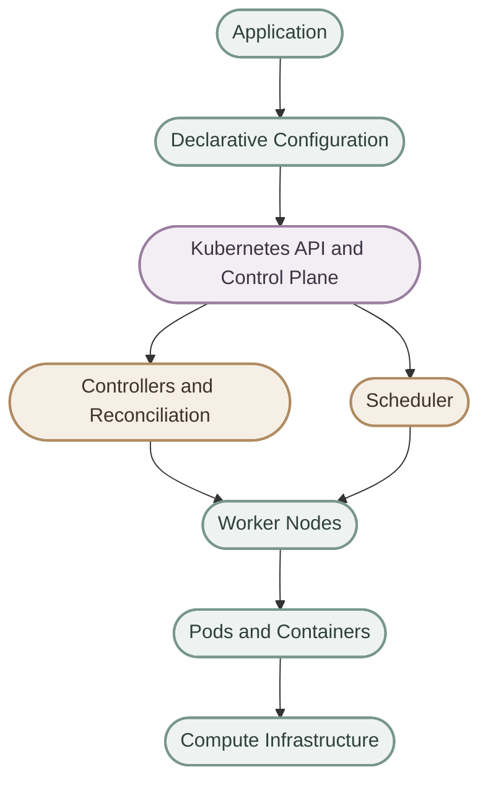

## Introduction

<InfoCard variant="concept" title="What is Kubernetes?" icon="layers" />

**Kubernetes (K8s)** هو Open-Source Platform مسؤول عن **Container Orchestration**؛ يعني بيساعدنا في تشغيل وإدارة وتوسيع نطاق الـContainerized Applications عبر مجموعة من الـMachines.

لو عندي Application صغيرة، ممكن أشغّل الـContainers باستخدام Docker وأديرها بشكل مباشر. لكن لما التطبيق يكبر، ويكون عندي Services متعددة وInstances كتير موزعة على Servers مختلفة، إدارة كل ده يدويًا بتبقى أصعب.

هنا بيظهر دور Kubernetes.

<Callout type="note" title="The Big Picture">

Kubernetes بيخليني أحدد الحالة اللي عايز الـApplication تكون عليها، وهو بيستخدم Controllers وScheduling وNetworking وآليات تانية علشان يساعد في الوصول للحالة دي والمحافظة عليها.

</Callout>

### I. Why Do We Need Container Orchestration?

تخيل إن عندك Application بتتكون من:

- Multiple Frontend Instances
- Multiple API Instances
- Background Workers
- Database
- Internal Network Communication

ومحتاج كمان تتعامل مع زيادة الـTraffic، وتعطل الـContainers، وتحديث الـApplication من غير ما توقف الخدمة بالكامل.

من غير Orchestration Platform، هتحتاج تدير العمليات دي باستخدام مجموعة من الأدوات والـScripts والإجراءات اليدوية.

Kubernetes بيوفر آليات تساعدك في أتمتة أجزاء كبيرة من العمليات دي.

## 1. What Is Container Orchestration?

<InfoCard variant="concept" title="Container Orchestration" icon="layers" />

**Container Orchestration** هو إدارة وتنسيق تشغيل الـContainers على Infrastructure مكونة من Machine واحدة أو مجموعة Machines، حسب قدرات الـPlatform المستخدمة.

مثلًا، عندنا Application مكونة من Frontend وAPI وWorker:



لما عدد الـInstances يزيد وتتوزع على Machines مختلفة، بتظهر أسئلة مهمة:

- مين مسؤول عن Scheduling للـWorkloads؟
- إيه اللي يحصل لو Pod خرج من الخدمة؟
- إزاي نحدد عدد الـReplicas المطلوبة؟
- إزاي الـServices تتواصل مع بعضها؟
- إزاي نحدّث الـApplication تدريجيًا؟
- إزاي نحدد الـCPU والـMemory اللي كل Workload محتاجها؟

دي أمثلة للمشاكل اللي Container Orchestration Platforms بتساعد في إدارتها.

ومن أشهر الـPlatforms المستخدمة في المجال ده Kubernetes.

## 2. Kubernetes in Simple Terms

ممكن أفكر في Kubernetes باعتباره نظام إدارة بيستقبل الـDesired State، وبعد كده بيستخدم مجموعة من الـComponents علشان يحاول يحققها.

مثلًا، بدل ما أدير كل Instance بنفسي، أقدر أحدد إن التطبيق محتاج 3 Replicas.



لكن مهم نفهم إن Kubernetes مش مجرد أداة بتشغّل Commands تلقائيًا؛ هو Platform مكونة من APIs وControllers وScheduler وComponents تانية، كل واحدة ليها مسؤوليات محددة.

## 3. Kubernetes Manages Workloads, Not Just Containers

من الأخطاء الشائعة إننا نختصر Kubernetes في إنه:

> A tool that runs containers.

الواقع إن Kubernetes بيدير **Workloads** باستخدام مجموعة من الـAPI Resources والـControllers.

من أهم الـResources اللي هنتعامل معاها:

<CardGrid>
  <InfoCard variant="concept" title="Pods" icon="cube">
    أصغر وحدة قابلة للـDeployment في Kubernetes، وبتحتوي على Container واحدة أو أكثر بتشارك في بعض الموارد.
  </InfoCard>
  <InfoCard variant="concept" title="Deployments" icon="layers">
    بتدير الـReplicaSets والـPods الخاصة بالتطبيقات الـStateless، وبتدعم تحديثها وإدارة عدد الـReplicas.
  </InfoCard>
  <InfoCard variant="concept" title="Services" icon="network">
    بتوفر Endpoint ثابت للوصول إلى مجموعة من الـPods، حسب نوع الـService وإعداداتها.
  </InfoCard>
  <InfoCard variant="concept" title="ConfigMaps & Secrets" icon="shield">
    لتوفير Configuration وبيانات حساسة للـApplications بطرق مناسبة لطبيعة كل مورد.
  </InfoCard>
</CardGrid>

وفيه Resources تانية مهمة، زي:

- **StatefulSets:** لإدارة Workloads اللي بتحتاج هوية مستقرة أو خصائص مرتبطة بالـStorage والترتيب.
- **DaemonSets:** لتشغيل Pod على كل Node مطابقة للـScheduling Requirements، أو على مجموعة منها.
- **Jobs & CronJobs:** لتشغيل مهام تنتهي بعد إتمام العمل، سواء مرة واحدة أو وفق جدول زمني.
- **PersistentVolumes & PersistentVolumeClaims:** لإدارة استهلاك الـPersistent Storage.

الـContainers بتشتغل داخل Pods، والـControllers بتدير الحالة المطلوبة للـResources اللي مسؤولة عنها.

<Callout type="tip" title="Remember">

الـPod مش مجرد اسم تاني للـContainer. الـPod هو Kubernetes Object بيحدد بيئة تشغيل Container واحدة أو أكثر، مع إمكانية مشاركة موارد زي Network Namespace والـVolumes.

</Callout>

## 4. Desired State and Current State

<InfoCard variant="concept" title="Desired State" icon="flag" />

من أهم مفاهيم Kubernetes إننا بنحدد **Desired State**، أي الحالة اللي عايزين النظام يوصل ليها ويحافظ عليها قدر الإمكان.

خلينا نفترض إننا عايزين نشغّل 3 Replicas من Application.

مثال مبسط لجزء من Deployment Configuration:

```yaml
spec:
  replicas: 3
```

القيمة دي بتحدد عدد الـReplicas المطلوبة للـDeployment، مش ضمانًا إن 3 Pods هتكون Running في كل لحظة.

عندنا مفهومين أساسيين:

- **Desired State:** الحالة المطلوبة حسب الـConfiguration.
- **Current State:** الحالة الفعلية اللي الـCluster موجود عليها حاليًا.



لو فيه Pod اختفى، الـDeployment Controller ممكن يلاحظ إن عدد الـReplicas أقل من المطلوب، ويعمل على إنشاء Pod بديلة.

لكن الوصول للحالة المطلوبة ممكن يتأخر أو يفشل لو فيه مشكلة في الـCluster، زي نقص الموارد أو قيود الـScheduling.

<Callout type="warning" title="Important Distinction">

تحديد `replicas: 3` مش معناه إن Kubernetes بيضمن وجود 3 Pods سليمة ومتاحة دائمًا. دي الحالة المطلوبة، والـControllers بتحاول تحقيقها، لكن النتيجة بتعتمد على ظروف الـCluster والـApplication.

</Callout>

## 5. The Reconciliation Loop

الـ**Reconciliation Loop** من أهم الأفكار في Kubernetes.

الـController بيراقب حالة الـResources اللي مسؤول عنها، ويقارن الحالة الفعلية بالحالة المطلوبة، وبعد كده يحاول يعالج الاختلافات.



مثلًا، الـDeployment Controller مسؤول عن التأكد من إن عدد الـReplicas بيتوافق مع العدد المطلوب، وبيستخدم ReplicaSet لتحقيق ده.

لكن مش كل Controller بيعمل نفس المهمة؛ كل Controller بيتعامل مع مجموعة معينة من الـResources ومسؤولياتها.

كمان الـReconciliation مش عملية بتحصل مرة واحدة وتنتهي. دي عملية مستمرة، لأن حالة الـCluster ممكن تتغير في أي وقت.

## 6. Kubernetes and Automation

Kubernetes بيوفر آليات بتساعد في أتمتة عمليات كتير مرتبطة بتشغيل الـApplications.

<CardGrid>
  <InfoCard variant="concept" title="Scheduling" icon="layers">
    الـScheduler بيختار Node مناسبة للـPod بناءً على الموارد والقيود والسياسات ذات الصلة.
  </InfoCard>
  <InfoCard variant="concept" title="Self-Healing" icon="cycle">
    بعض الـControllers بتعيد إنشاء Pods أو تستبدلها لما الحالة الفعلية تختلف عن الحالة المطلوبة.
  </InfoCard>
  <InfoCard variant="concept" title="Scaling" icon="pulse">
    يمكن تعديل عدد الـReplicas يدويًا أو باستخدام آليات Autoscaling المناسبة.
  </InfoCard>
  <InfoCard variant="concept" title="Rolling Updates" icon="branch">
    الـDeployments بتدعم تحديث الـApplication تدريجيًا وفق استراتيجية التحديث المحددة.
  </InfoCard>
</CardGrid>

ومع ذلك، Kubernetes مش بيصلح كل مشكلة تلقائيًا.

مثلًا، لو الـApplication نفسها فيها Bug، أو قاعدة البيانات فيها Data Corruption، Kubernetes مش هيقدر يضمن إصلاح المشكلة لمجرد إن الـPod رجعت تشتغل.

<Callout type="warning" title="Self-Healing Is Not Application Recovery">

إعادة إنشاء Pod لا تعني استعادة البيانات المفقودة أو إصلاح الـApplication Bug. الـSelf-Healing بيعالج حالات تشغيلية محددة، مش كل أنواع الأعطال.

</Callout>

## 7. Kubernetes at a High Level

Kubernetes بيشتغل كـManagement and Orchestration Layer فوق مجموعة من الـNodes اللي بتوفر الموارد اللازمة لتشغيل الـWorkloads.



الـCluster بيتكون بشكل أساسي من:

- **Control Plane:** مسؤول عن إدارة الـCluster واتخاذ القرارات المتعلقة بالـScheduling وإدارة الـResources.
- **Worker Nodes:** بتوفر بيئة تشغيل الـPods والـWorkloads.

في بيئات Kubernetes المعتادة، الـControl Plane بيضم Components زي `kube-apiserver` و`etcd` و`kube-scheduler` و`kube-controller-manager`.

أما الـWorker Nodes، فبتضم عادةً Components زي `kubelet` وContainer Runtime، وقد تضم `kube-proxy` حسب طريقة تنفيذ Networking في الـCluster.

هنشرح كل Component بالتفصيل في الأقسام القادمة.

## 8. Kubernetes Does Not Replace Containers

Kubernetes مش بديل عن الـContainers، ومش هو نفسه الـContainer Runtime.

كل واحد ليه دور مختلف.

<CardGrid>
  <InfoCard variant="concept" title="Container" icon="cube">
    بيقدم طريقة لتغليف وتشغيل الـApplication مع الـDependencies الخاصة بيها في بيئة معزولة نسبيًا.
  </InfoCard>
  <InfoCard variant="concept" title="Container Runtime" icon="terminal">
    مسؤول عن تشغيل الـContainers وإدارتها على الـNode، من خلال التكامل المناسب مع Kubernetes.
  </InfoCard>
  <InfoCard variant="concept" title="Kubernetes" icon="layers">
    بيدير الـWorkloads وبيحدد مكان تشغيل الـPods وبيحاول يحافظ على الحالة المطلوبة.
  </InfoCard>
</CardGrid>

العلاقة بينهم ممكن تتلخص بالشكل ده:



من أمثلة الـContainer Runtimes المتوافقة مع Kubernetes:

- `containerd`
- `CRI-O`

Kubernetes بيتكامل مع الـRuntime من خلال **Container Runtime Interface (CRI)**، والـ`kubelet` بيستخدم الواجهة دي للتواصل مع الـRuntime.

<Callout type="tip" title="Remember">

**Container Runtime** مسؤول عن تشغيل الـContainers، بينما **Kubernetes** مسؤول عن Orchestration وإدارة الـWorkloads. والـ`kubelet` هو أحد المكونات الأساسية اللي بتربط إدارة الـPods ببيئة التشغيل على الـNode.

</Callout>

## 9. What Problems Does Kubernetes Help Solve?

Kubernetes بيوفر مجموعة من الـMechanisms لإدارة الـApplications، وأهمها:

<CardGrid>
  <InfoCard variant="concept" title="Deployment" icon="layers">
    إدارة الـWorkloads وتحديث الـApplication من خلال Declarative Resources.
  </InfoCard>
  <InfoCard variant="concept" title="Scaling" icon="pulse">
    زيادة أو تقليل عدد الـReplicas، مع إمكانية استخدام Autoscaling عند توافر الإعدادات المطلوبة.
  </InfoCard>
  <InfoCard variant="concept" title="Service Discovery" icon="network">
    الوصول إلى الـServices باستخدام آليات الـService Discovery والـCluster Networking.
  </InfoCard>
  <InfoCard variant="concept" title="Traffic Distribution" icon="branch">
    توزيع الاتصالات على الـBackends المناسبة باستخدام Services أو حلول Networking إضافية.
  </InfoCard>
  <InfoCard variant="concept" title="Resource Management" icon="sliders">
    تحديد CPU وMemory Requests وLimits للمساعدة في Scheduling وإدارة استهلاك الموارد.
  </InfoCard>
  <InfoCard variant="concept" title="Self-Healing" icon="cycle">
    محاولة إعادة الـWorkloads للحالة المطلوبة عند حدوث بعض أنواع الأعطال.
  </InfoCard>
</CardGrid>

### I. A Note About High Availability

Kubernetes بيساعد في بناء أنظمة عالية التوافر، لكنه مش بيضمن **High Availability** بشكل تلقائي.

تحقيق ده بيعتمد على عوامل إضافية، منها:

- توزيع الـReplicas على Nodes مناسبة.
- توفير عدد كافٍ من الـNodes والموارد.
- إعداد الـProbes المناسبة.
- ضبط الـScheduling Constraints عند الحاجة.
- تصميم الـApplication نفسها لتحمل الأعطال.
- استخدام Storage وNetworking Solutions مناسبة.

وكمان الـRolling Updates مش معناها ضمان عدم حدوث Downtime في كل الحالات؛ النتيجة بتعتمد على إعدادات الـDeployment وصحة الـApplication وطريقة تعاملها مع الاتصالات والبيانات.

## 10. A Simple Example: Maintaining Three Replicas

خلينا نفترض إن عندنا Web Application محتاجين نشغّل منها 3 Replicas.



الـDeployment بيحدد عدد الـReplicas المطلوبة، وبيستخدم ReplicaSet لإدارة الـPods التابعة له.

لو Pod اختفت، الـReplicaSet بيحاول إنشاء Pod بديلة علشان يرجع العدد للحالة المطلوبة.

لكن فيه فرق مهم بين عدد الـPods الموجودة وعدد الـPods المتاحة فعلًا لاستقبال الـTraffic.

لو الـPod الجديدة لسه بتبدأ أو بتفشل في اجتياز الـReadiness Probe، ممكن العدد الإجمالي للـPods يرجع إلى 3، لكن عدد الـAvailable Pods يفضل أقل من المطلوب.



المثال ده بيوضح إزاي Kubernetes بيستخدم الـDesired State والـControllers للمساعدة في إدارة الـWorkloads.

## 11. Declarative Configuration

Kubernetes بيعتمد بشكل كبير على **Declarative Configuration**.

الفرق الأساسي إنك بتحدد النتيجة المطلوبة بدل ما تكتب كل خطوة تشغيل بنفسك.

### I. Imperative Approach

في الـImperative Approach، بتطلب تنفيذ إجراءات مباشرة، زي إنشاء Resource باستخدام Command معين.

مثلًا:

```bash
kubectl create deployment web --image=nginx
```

الأمر ده بيطلب من Kubernetes إنشاء Deployment باسم `web` باستخدام صورة `nginx`.

### II. Declarative Approach

في الـDeclarative Approach، بتكتب الـConfiguration اللي بتوصف الحالة المطلوبة، وبعد كده بتطبقها على الـCluster.

مثال كامل لملف Deployment:

**File:** `deployment.yaml`

```yaml
apiVersion: apps/v1
kind: Deployment
metadata:
  name: web
spec:
  replicas: 3
  selector:
    matchLabels:
      app: web
  template:
    metadata:
      labels:
        app: web
    spec:
      containers:
        - name: nginx
          image: nginx:stable
          ports:
            - containerPort: 80
```

لتطبيق الـConfiguration:

```bash
kubectl apply -f deployment.yaml
```

الـManifest ده بيحدد إننا عايزين Deployment باسم `web`، مسؤول عن 3 Replicas من Pods، وكل Pod فيها Container مبنية على صورة `nginx:stable`.

الـ`selector` لازم يتوافق مع الـLabels الموجودة في الـPod Template علشان الـDeployment يقدر يدير الـPods التابعة له.

<Callout type="tip" title="Important">

استخدام `kubectl apply` شائع في الـDeclarative Workflow، لكن مجرد كتابة YAML مش كفاية؛ لازم تطبق الـManifest على الـCluster، وتتحقق من الحالة الفعلية بعد التطبيق.

</Callout>

## 12. Kubernetes in One Sentence

<InfoCard variant="concept" title="Kubernetes Definition" icon="tag" />

> Kubernetes is an open-source container orchestration platform that automates the deployment, scaling, and management of containerized workloads across a cluster of machines.

الجملة دي بتلخص الفكرة الأساسية، لكن فهم Kubernetes بجد محتاج نفهم الـResources والـControllers والـScheduling والـNetworking وآليات إدارة الـCluster.

## 13. Mental Model

في نهاية الصفحة، عايزين نثبت الصورة الذهنية الأساسية دي:



خلي بالك إن الرسم ده بيوضح العلاقة بشكل مبسط، مش كل تفاصيل الـArchitecture أو مسارات الاتصال داخل Kubernetes.

المهم إنك تفتكر إن:

- **Kubernetes API:** نقطة التعامل الأساسية مع الـCluster Resources.
- **Controllers:** بتراقب الحالة وبتحاول تحقيق الـDesired State.
- **Scheduler:** بيختار Node مناسبة للـPods اللي محتاجة Scheduling.
- **Worker Nodes:** بتوفر بيئة تشغيل الـPods.
- **Container Runtime:** مسؤول عن تشغيل الـContainers على الـNodes.

<Callout type="tip" title="Key Takeaway">

لو فهمت إن Kubernetes بيستقبل Desired State، وبيستخدم Controllers وScheduling وContainer Runtime علشان يدير الـWorkloads داخل Cluster، فأنت بنيت أساسًا كويس جدًا قبل ما تدخل في تفاصيل الـArchitecture.

</Callout>