## Introduction

<InfoCard variant="concept" title="Why Kubernetes?" icon="layers" />

بعد ما فهمنا **What Kubernetes Is**، السؤال الطبيعي هو:

> **Why do we need Kubernetes in the first place?**

لو عندي Container واحدة أو Application صغيرة، ممكن أشغّلها وأديرها بسهولة باستخدام Docker أو أدوات تانية.

لكن مع زيادة حجم الـApplication والـInfrastructure، إدارة الـContainers يدويًا بتصبح أصعب؛ لأن الموضوع مش مجرد تشغيل Containers، لكن كمان Scheduling وNetworking وScaling وRecovery وUpdates.

عشان كده Kubernetes بيوفر Platform لإدارة الـContainerized Workloads على مستوى الـCluster.

<Callout type="note" title="The Core Problem">

How can we reliably deploy, scale, manage, and operate containerized workloads across multiple machines without relying entirely on manual operations?

</Callout>

## 1. The Problem with Managing Containers Manually

في البداية، ممكن يكون عندنا Application بسيطة بتشتغل على Server واحدة.

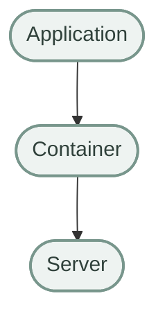

في الحالة دي، تشغيل الـContainer ومتابعتها مش بالضرورة يكون معقدًا.

لكن تخيل إن الـApplication كبرت وبقت مكونة من Frontend وBackend API وBackground Workers، وكل جزء منه عنده عدة Instances.

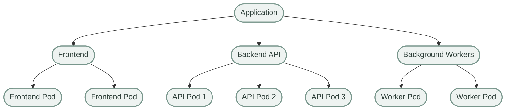

ولو الـWorkloads دي موزعة على Machines مختلفة، هتحتاج تتعامل مع أسئلة تشغيلية أكتر:

- فين كل Workload المفروض تشتغل؟
- إيه اللي يحصل لو Instance تعطلت؟
- إزاي نوزع الـTraffic؟
- إزاي نزود عدد الـInstances وقت الضغط؟
- إزاي نحدّث التطبيق تدريجيًا؟
- إزاي نضمن إن الـResources المتاحة تكفي؟
- إزاي نكتشف المشاكل ونتعامل معاها؟

المشكلة الأساسية هنا مش إن تشغيل Container صعب، لكن إن **إدارة عدد كبير من الـWorkloads بصورة متناسقة وموثوقة بتصبح معقدة**.

## 2. Scaling and Resource Management

<InfoCard variant="concept" title="Scaling Applications" icon="pulse" />

افترض إن عندنا API شغالة بنسخة واحدة، وبعد فترة الـTraffic زاد.

في البداية:

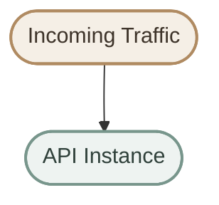

ومع زيادة الحمل، ممكن نحتاج أكتر من Instance.

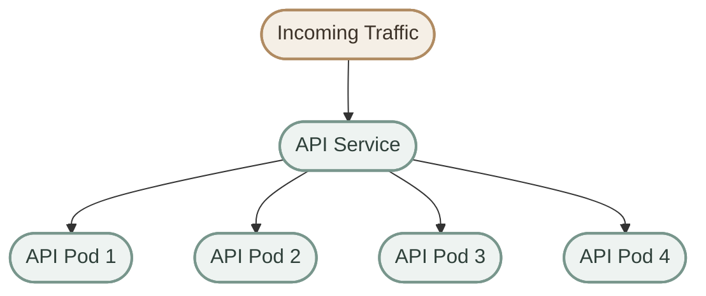

لكن زيادة عدد الـInstances مش مجرد تشغيل Containers إضافية. لازم نراعي:

- هل فيه CPU وMemory كفاية؟
- هل الـNodes تقدر تستضيف الـPods الجديدة؟
- هل الـApplication قادرة تتعامل مع أكتر من Instance؟
- إزاي الـTraffic هيوصل للـInstances؟
- إمتى نزود العدد وإمتى نقلله؟

Kubernetes بيساعد في إدارة الـReplicas والـScheduling والـResource Allocation، وبيوفر آليات للـAutoscaling عند إعدادها بالشكل المناسب.

<Callout type="warning" title="Scaling Is Not Automatically Triggered by Traffic">

Kubernetes مش بيزود عدد الـPods تلقائيًا لمجرد إن الـTraffic زاد. الـHorizontal Pod Autoscaler (HPA)، مثلًا، ممكن يعدّل عدد الـReplicas بناءً على Metrics وإعدادات محددة، وده محتاج توفير مصدر Metrics مناسب وإعداد الـWorkload والـAutoscaler.

</Callout>

## 3. What Happens When a Workload Fails?

<InfoCard variant="concept" title="Self-Healing" icon="cycle" />

واحدة من المشاكل المهمة في تشغيل الـApplications هي التعامل مع الأعطال.

افترض إننا محتاجين 3 Replicas من Application.


لو واحدة من الـPods اختفت أو اتوقفت، الحالة الفعلية هتختلف عن الحالة المطلوبة.

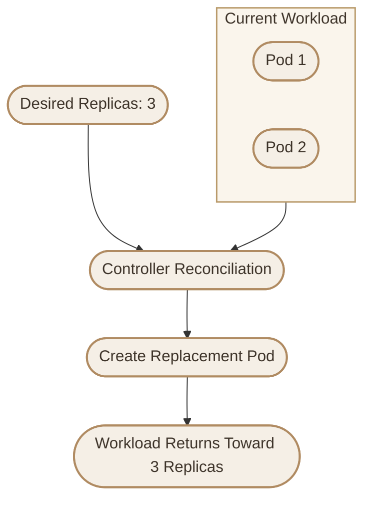

لو عندنا Deployment، فالـDeployment Controller بيدير ReplicaSet، والـReplicaSet Controller بيحاول يحافظ على عدد الـPods المطلوب.

لو Pod اختفت، الـReplicaSet Controller ممكن ينشئ Pod بديلة.

ده مثال على **Self-Healing**.

لكن لازم نفهم إن Kubernetes مش بيصلح كل أنواع الأعطال.

<CardGrid>
  <InfoCard variant="concept" title="What Kubernetes Can Do" icon="cycle">
    إعادة إنشاء Pods مفقودة، وإعادة تشغيل Containers في حالات معينة، ومحاولة استعادة الحالة المطلوبة.
  </InfoCard>
  <InfoCard variant="warning" title="What It Cannot Guarantee" icon="shield">
    إصلاح Bugs داخل التطبيق، أو استعادة بيانات مفقودة، أو ضمان توافر الخدمة في كل الظروف.
  </InfoCard>
</CardGrid>

كمان فيه فرق بين إن الـPod تكون موجودة وإنها تكون **Ready to Serve Traffic**. ممكن Pod بديلة تتنشأ بنجاح، لكن تفضل غير جاهزة لاستقبال الطلبات.

## 4. Scheduling Across Multiple Machines

<InfoCard variant="concept" title="Workload Scheduling" icon="layers" />

في Cluster مكون من عدة Nodes، مش كل Node عندها نفس الإمكانيات أو الظروف.

ممكن تختلف في:

- CPU and Memory Capacity
- Available Resources
- Node Labels and Taints
- Scheduling Constraints
- Affinity and Anti-Affinity Rules

السؤال هنا:

> **Where should each Pod run?**

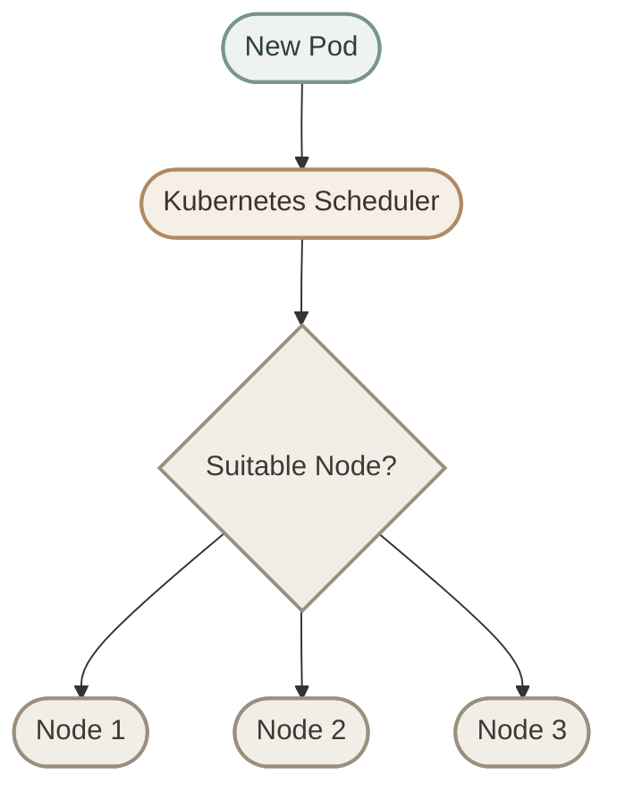

الـKubernetes Scheduler بيختار Node مناسبة للـPod بناءً على الـResource Requests والقيود والسياسات ذات الصلة.

لكن الـScheduler مش بيشغّل الـContainer بنفسه؛ هو بيحدد الـNode اللي الـPod هتتجدول عليها، وبعد كده مكونات الـNode بتتولى تشغيلها.

<Callout type="tip" title="Remember">

**Scheduling** هو اختيار مكان تشغيل الـPod. أما تشغيل الـContainers فعليًا، فبيتم من خلال مكونات الـWorker Node، ومنها `kubelet` والـContainer Runtime.

</Callout>

## 5. Networking and Service Discovery

في الـModern Applications، غالبًا بيكون عندنا Services متعددة محتاجة تتواصل مع بعضها.

مثلًا:


الـPods ممكن تتغير أو تتعاد إنشاؤها، وبالتالي عناوين الـIP الخاصة بيها ممكن تتغير.

علشان كده Kubernetes بيوفر Services بتقدم Endpoints مستقرة نسبيًا للوصول إلى مجموعات من الـPods، حسب نوع الـService وإعداداتها.

ومن خلال الـCluster Networking وآليات Service Discovery، تقدر الـApplications تتواصل مع بعضها بدون ما تحتاج تعتمد على معرفة عنوان IP ثابت لكل Pod.

من المهم نفهم إن الـService والـNetworking مش مسؤولية Component واحدة في كل الحالات؛ تنفيذ الشبكات بيعتمد على الـCNI Plugin ومكونات الـCluster وإعداداته.

## 6. Application Updates and Rolling Deployments

<InfoCard variant="concept" title="Rolling Updates" icon="branch" />

افترض إن عندنا Application شغالة باستخدام Version `1.0`، وعايزين نحدّثها إلى Version `2.0`.

لو وقفنا كل الـInstances القديمة قبل تشغيل الجديدة، ممكن يحصل Downtime.

الـDeployment في Kubernetes بيدعم **Rolling Updates**، اللي بتسمح باستبدال الـPods تدريجيًا وفق استراتيجية التحديث والإعدادات المحددة.

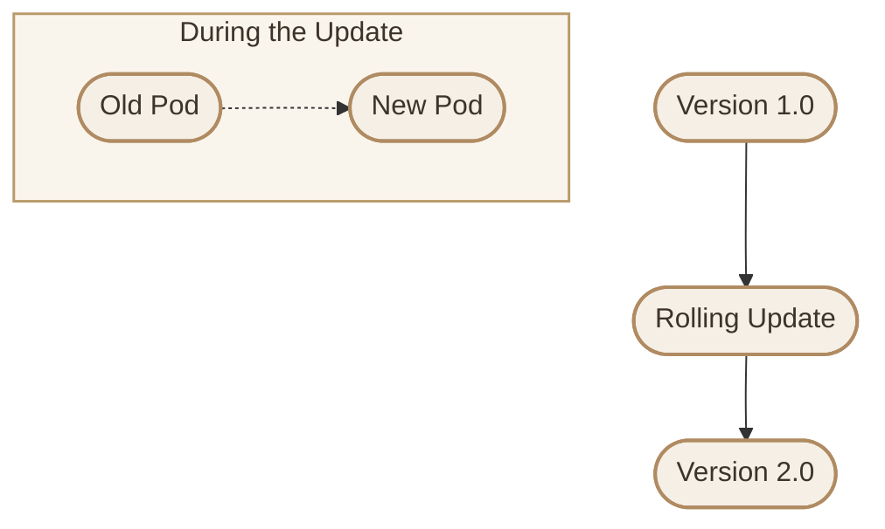

الفكرة إن Kubernetes يقدر يدير الانتقال التدريجي من الـOld ReplicaSet إلى الـNew ReplicaSet.

لكن Rolling Updates مش ضمان مطلق لعدم حدوث Downtime. النتيجة بتعتمد على عوامل زي:

- Readiness Probes
- `maxSurge` and `maxUnavailable`
- توفر الـCluster Resources
- صحة الـApplication الجديدة
- توافق الـVersions مع البيانات والـDependencies

<Callout type="tip" title="Important">

الـRolling Update بيساعد في تقليل مخاطر تحديث الـApplication، لكنه مش بديل عن Testing أو Health Checks أو تصميم التطبيق لتحمل التحديثات.

</Callout>

## 7. Desired State and Declarative Management

<InfoCard variant="concept" title="Declarative Management" icon="flag" />

من أهم أسباب استخدام Kubernetes إننا مش محتاجين نعتمد بالكامل على سلسلة من الإجراءات اليدوية.

بدل ما نطلب تنفيذ كل خطوة لوحدها، بنحدد الحالة المطلوبة.

مثلًا:

```yaml
spec:
  replicas: 3
```

القيمة دي جزء من الـConfiguration بتاعة Resource، وبتحدد عدد الـReplicas المطلوبة في الـWorkload المناسبة.

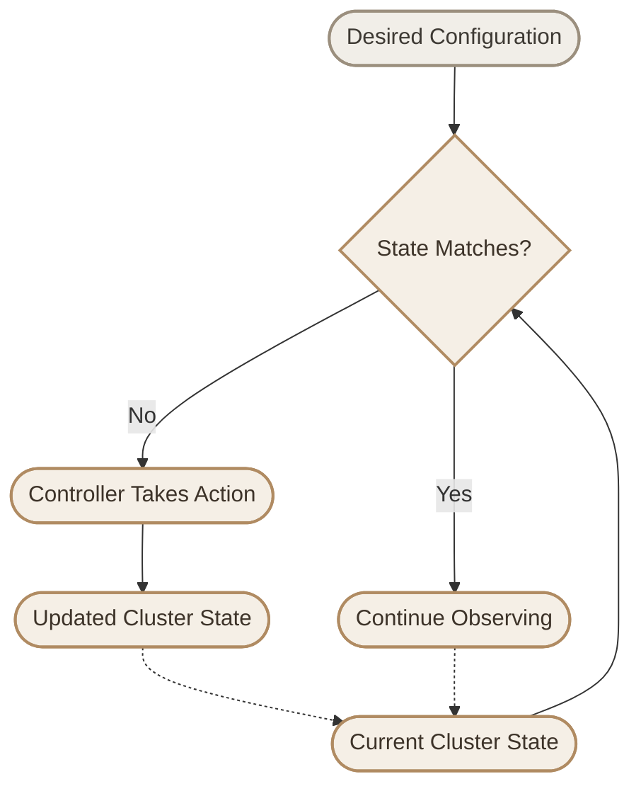

الـControllers بتراقب الـResources اللي مسؤولة عنها، وبتحاول معالجة الاختلافات بين الـDesired State والـCurrent State.

وده جوهر الـ**Reconciliation Loop**.

لكن تحقيق الحالة المطلوبة مش مضمون في كل الظروف؛ ممكن مثلًا الـCluster يكون عنده نقص في الموارد أو قيود تمنع تشغيل Pod جديدة.

## 8. Resource Management

الـApplications المختلفة بتحتاج موارد مختلفة.

مثلًا، Application بسيطة ممكن تحتاج CPU وMemory أقل من Background Worker بيعمل Processing مكثف.

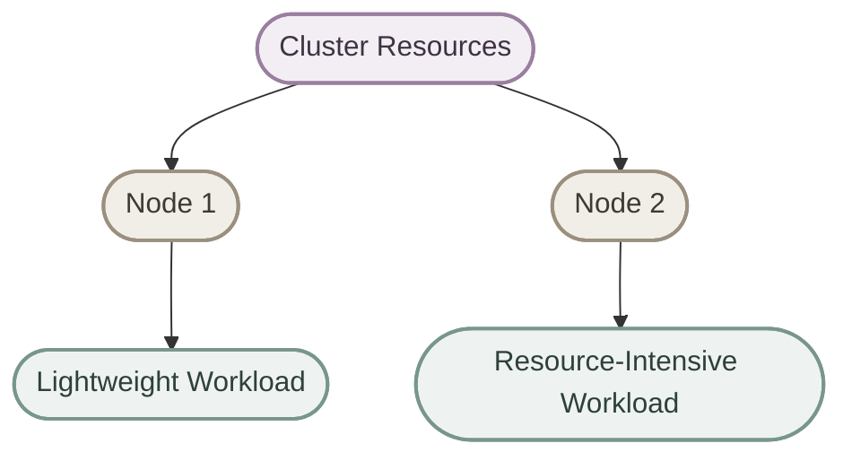

Kubernetes بيسمح بتحديد CPU وMemory Requests وLimits للـContainers.

- **Requests:** بتحدد الموارد المطلوبة لأغراض منها الـScheduling.
- **Limits:** بتحط حدود لاستهلاك بعض الموارد، وفق طبيعة المورد وآلية تطبيق الحد.

الـRequests والـLimits بيساعدوا في تنظيم استخدام الموارد، لكنهم مش بيخلقوا موارد إضافية، ومش بيضمنوا إن كل Application هتشتغل بأفضل أداء.

كمان الـScheduler بيستخدم الـRequests في تقييم إمكانية وضع Pod على Node، مش مجرد مقارنة الاستهلاك اللحظي للـCPU والـMemory.

## 9. High Availability and Reliability

في بيئات Production، غالبًا مش عايزين Application تعتمد على Server واحدة فقط.

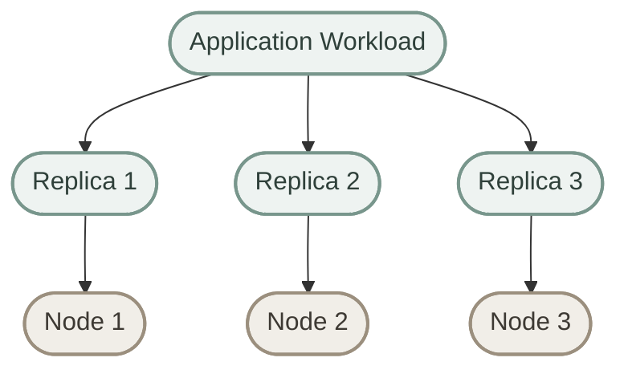

توزيع الـReplicas على Nodes مختلفة ممكن يساعد في تقليل تأثير تعطل Node واحدة.

لكن مجرد إنشاء 3 Replicas مش معناه إنهم هيتوزعوا تلقائيًا على 3 Nodes مختلفة؛ التوزيع بيعتمد على Scheduling Decisions والـConstraints والسياسات المستخدمة.

ولتحقيق مستوى مناسب من الـHigh Availability، لازم نراعي:

- توزيع الـReplicas على Failure Domains مختلفة عند الحاجة.
- توفر موارد كافية.
- إعداد الـReadiness وLiveness Probes بشكل صحيح.
- تصميم الـApplication لتحمل الأعطال.
- توفير Storage وNetworking مناسبين.
- تجنب Single Points of Failure في الـInfrastructure والـDependencies.

<Callout type="warning" title="Kubernetes Does Not Guarantee High Availability by Itself">

Kubernetes بيوفر Building Blocks تساعد في بناء أنظمة عالية التوافر، لكن الـAvailability الفعلية بتعتمد على تصميم الـApplication والـCluster والـInfrastructure بالكامل.

</Callout>

## 10. From Manual Operations to Automation

لما الـEnvironment تكبر، عدد العمليات اللي محتاجين نديرها بيزيد.

<CardGrid>
  <InfoCard variant="concept" title="Manual Deployment" icon="terminal">
    تنفيذ إجراءات متكررة لتشغيل الـWorkloads وتحديثها ومتابعة حالتها.
  </InfoCard>
  <InfoCard variant="concept" title="Manual Recovery" icon="cycle">
    اكتشاف الأعطال والتدخل لاستعادة الحالة المطلوبة.
  </InfoCard>
  <InfoCard variant="concept" title="Manual Scaling" icon="pulse">
    تعديل عدد الـInstances والتأكد من توافر الموارد اللازمة.
  </InfoCard>
  <InfoCard variant="concept" title="Manual Networking" icon="network">
    إدارة الوصول إلى الـServices والـEndpoints والاتصال بين الـWorkloads.
  </InfoCard>
</CardGrid>

Kubernetes بيساعد في تحويل جزء كبير من المهام دي إلى عمليات Declarative وAutomated.

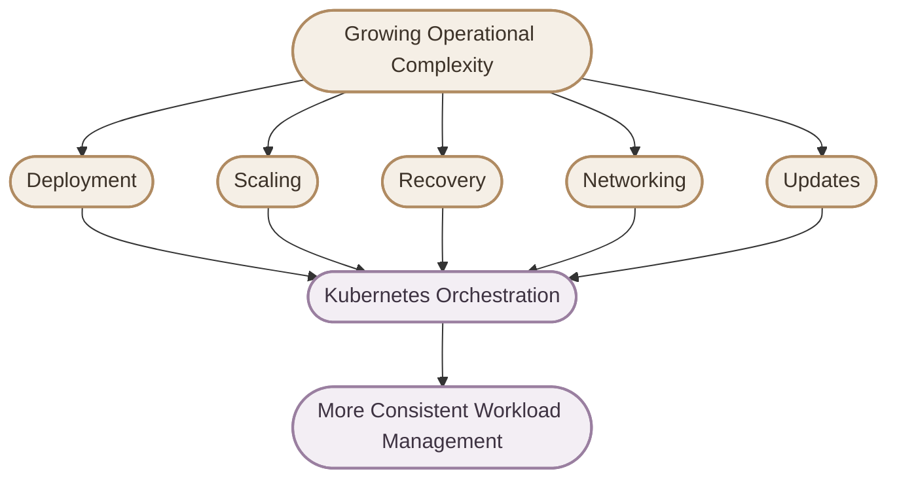

المهم إن Kubernetes مش بيلغي الـOperations؛ هو بيغير طريقة تنفيذ جزء كبير منها.

بدل ما نعتمد بالكامل على Manual Procedures، بنستخدم APIs وConfigurations وControllers وآليات Automation.

## 11. Why Not Just Use Docker?

سؤال مهم: لو Docker بيشغّل Containers، ليه أحتاج Kubernetes؟

الإجابة إن الأدوات دي بتتعامل مع مستويات مختلفة من إدارة الـApplications.

### I. Container Tools

أدوات زي Docker بتوفر إمكانيات لبناء Images وتشغيل Containers وإدارتها، وكمان إمكانيات Networking وStorage وغيرها.

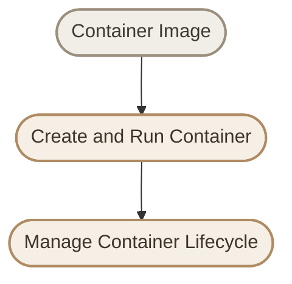

### II. Kubernetes

Kubernetes بيشتغل على مستوى أعلى، وبيوفر إدارة للـWorkloads عبر Cluster من الـNodes.

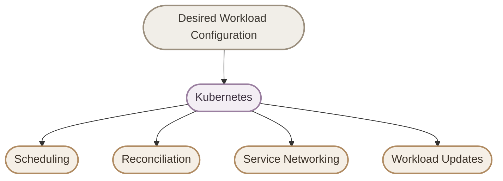

في Cluster Kubernetes المعتاد، الـkubelet بيتكامل مع Container Runtime متوافق من خلال CRI لتشغيل الـContainers الخاصة بالـPods.

لكن Docker Engine نفسه مش هو الـRuntime اللي Kubernetes بيتواصل معاه مباشرة بالطريقة المعتادة حاليًا؛ لو محتاج تستخدم Docker Engine كـRuntime، فده ممكن يتم من خلال `cri-dockerd`.

<Callout type="tip" title="Remember">

مش لازم تستخدم Kubernetes لكل Application. Docker وأدوات Container Management الأخرى ممكن تكون كافية تمامًا لتطبيق صغير أو Deployment بسيط.

</Callout>

## 12. When Does Kubernetes Become Useful?

Kubernetes مش الاختيار المناسب لكل Application.

لو عندك Application صغيرة، بتشتغل على Server واحدة، وعدد الـContainers قليل، ممكن تكون إدارة الـContainers باستخدام Docker Compose أبسط وأسهل في الصيانة.

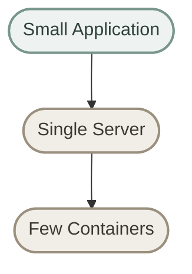

لكن Kubernetes بيكون أكثر فائدة لما يكون عندك احتياج حقيقي لإدارة الـWorkloads على نطاق أكبر، خصوصًا لما تحتاج:

- Multiple Nodes and Workloads
- Declarative Deployment Management
- Advanced Scheduling
- Automated Recovery
- Horizontal Scaling
- Service Discovery
- Rolling Updates
- Resource Requests and Limits
- Standardized Operations Across Environments

<Callout type="note" title="The Trade-Off">

Kubernetes بيقلل بعض أنواع التعقيد التشغيلي، لكنه بيضيف تعقيد في الـPlatform نفسها؛ لأنك محتاج تفهم وتدير الـCluster والـNetworking والـStorage والـSecurity والـMonitoring.

</Callout>

الفكرة الأساسية:

> Kubernetes becomes valuable when its orchestration capabilities justify the operational complexity of running the platform.

## 13. Core Benefits at a Glance

| Operational Challenge | How Kubernetes Helps |
|---|---|
| Repetitive deployments | Declarative Workload Management |
| Changing workload demand | Scaling Mechanisms and Autoscalers |
| Failed Pods | Controller Reconciliation and Recovery |
| Multiple Nodes | Scheduling |
| Service communication | Services and Cluster Networking |
| Application updates | Rolling Updates |
| Resource allocation | CPU and Memory Requests and Limits |
| Configuration management | ConfigMaps and Secrets |
| Operational consistency | APIs, Controllers, and Automation |

لاحظ إن العمود التاني بيوضح الآليات اللي Kubernetes بيوفرها، مش ضمان إن كل مشكلة هتتحل تلقائيًا من غير Configuration أو تدخل تشغيلي.

## 14. The Main Mental Model

لما تسأل نفسك:

> **Why Kubernetes?**

مش المطلوب إنك تحفظ قائمة Features، لكن إنك تفهم المشكلة اللي الـPlatform بتحاول تحلها.

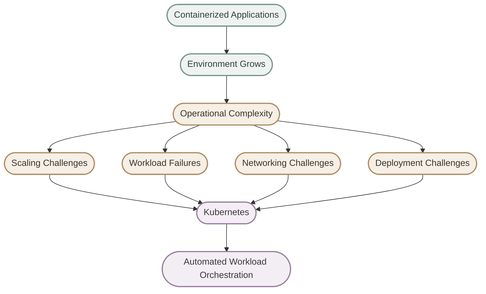

كل ما الـSystem يكبر، بيزيد عدد الـOperational Concerns اللي محتاجين نديرها.

Kubernetes بيوفر Platform موحدة لإدارة الـWorkloads، وبيساعدنا نحول جزء كبير من العمليات المتكررة إلى Declarative Workflows.

## 15. Final Summary

<InfoCard variant="concept" title="Why Kubernetes?" icon="flag" />

**Why Kubernetes?**

لأن تشغيل الـContainers لوحده مش كفاية لما الـApplication والـInfrastructure يكبروا.

Kubernetes بيوفر آليات لإدارة:

- Deployment
- Scheduling
- Scaling
- Networking
- Recovery
- Rolling Updates
- Resource Management

وبدل ما نعتمد بالكامل على إجراءات يدوية، بنحدد الـDesired State، والـControllers بتحاول تحافظ على الحالة المطلوبة من خلال الـReconciliation Loop.

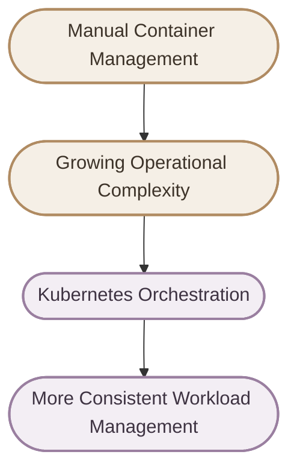

> **Kubernetes helps turn container management into a declarative orchestration system that can manage workloads across a cluster of machines.**

وده السبب الأساسي لاستخدام Kubernetes: مش مجرد تشغيل Containers، لكن تنظيم وإدارة الـWorkloads بصورة أكثر اتساقًا مع زيادة حجم الـSystem وتعقيده.