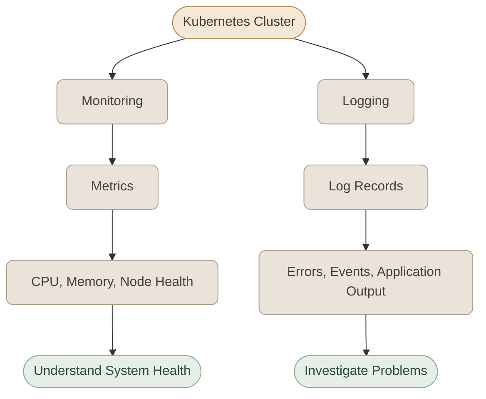

## Overview
<InfoCard variant="concept" title="Monitoring Foundation" description="جمع البيانات من العقد والتطبيقات لفهم حالة الكلستر." icon="cube" tags={["Monitoring", "Logs"]} />

يُعتبر **Logging & Monitoring** من الجوانب الأساسية في إدارة وتشغيل Kubernetes Clusters، لأنهم بيساعدونا نفهم حالة الـ Cluster والـ Applications اللي شغالة عليه، ونكتشف المشاكل ونتتبع أسبابها.

في الموديول ده هنتعلم إزاي نراقب أداء الـ Kubernetes Cluster والـ Applications، وإزاي نعرض ونتعامل مع الـ Logs الخاصة بيهم.

## 1. What You'll Learn

- **Cluster Monitoring:** متابعة حالة الـ Nodes والـ Kubernetes Components ومراقبة استهلاك الـ CPU والـ Memory.
- **Application Monitoring:** مراقبة الـ Applications والـ Workloads اللي شغالة داخل الـ Cluster.
- **Logging:** عرض وتحليل الـ Logs الخاصة بالـ Applications والـ Cluster Components لفهم الأخطاء وتشخيص المشاكل.
- **Troubleshooting:** تطبيق المفاهيم من خلال تمارين عملية وسيناريوهات واقعية.

## 2. Logging vs. Monitoring

بشكل مبسط، الـ **Monitoring** بيساعدنا نعرف حالة النظام وأداءه من خلال الـ Metrics، بينما الـ **Logging** بيساعدنا نفهم الأحداث والأخطاء اللي حصلت من خلال الـ Log Records.

الاتنين بيكملوا بعض، وبيساعدونا في اكتشاف المشاكل وتحليلها داخل الـ Kubernetes Cluster.