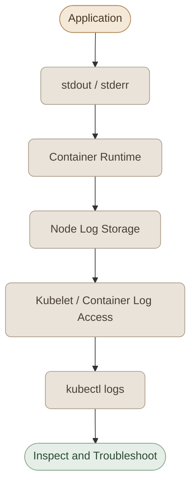
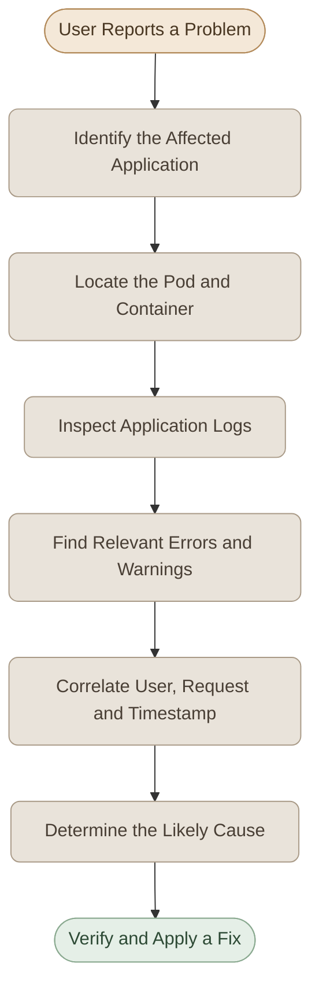

## Overview
<InfoCard variant="concept" title="Logging Foundation" description="جمع وتحليل الرسائل من التطبيقات داخل Kubernetes." icon="cube" tags={["Logs", "Monitoring"]} />

الـ **Logging** من أهم الأدوات اللي بنستخدمها في الـ Troubleshooting؛ لأنه بيساعدنا نفهم إيه اللي حصل داخل الـ Application، ونحدد أسباب الأخطاء بدل ما نعتمد على حالة الـ Pod فقط.

في Kubernetes، تقدر تعرض الـ Logs الخاصة بالـ Containers باستخدام الأمر `kubectl logs`، سواء عايز تشوف الرسائل اللي اتسجلت بالفعل أو تتابع الرسائل الجديدة لحظة بلحظة.

في الدرس ده هنتعلم إزاي نعرض الـ Logs، ونتعامل مع الـ Multi-container Pods، ونستخدم المعلومات اللي فيها لتشخيص مشاكل واقعية.

## 1. What Are Application Logs?

الـ **Logs** هي Records بتسجل الأحداث اللي بتحصل أثناء تشغيل التطبيق، زي:

- استقبال Request من User.
- فشل تسجيل الدخول.
- فشل عملية شراء بسبب عدم توافر منتج.
- حدوث Error أثناء الاتصال بقاعدة البيانات.
- بدء التطبيق أو إعادة تشغيله.

الـ Logs ممكن تكون معلومات عادية، أو تحذيرات، أو أخطاء. لكن شكل الرسالة ومستوى الخطورة بيعتمدوا على التطبيق نفسه؛ مش كل التطبيقات بتستخدم نفس التنسيق أو نفس أسماء الـ Log Levels.

<InfoCard title="Important Concept" description="كون الـ Pod حالتها Running مش معناه إن التطبيق بيشتغل بشكل سليم. الـ Logs ممكن تكشف أخطاء في الـ Application حتى لو الـ Container شغالة ومفيش مشكلة واضحة في Kubernetes." icon="layers" tags={["Logging", "Troubleshooting"]} />

## 2. How Container Logging Works

معظم التطبيقات بتكتب الـ Logs على واحد أو الاتنين من الـ Output Streams دول:

- **stdout (Standard Output):** المخرجات العادية للتطبيق.
- **stderr (Standard Error):** المخرجات اللي بتُستخدم عادةً لرسائل الأخطاء.

الـ Container Runtime والـ Kubernetes بيقدروا يوفّروا الـ Logs الناتجة من الـ Container عشان نقدر نعرضها باستخدام أدوات زي `kubectl logs`.



الـ Diagram بيوضح المسار بصورة مبسطة. في الواقع، تفاصيل تخزين الـ Logs والوصول ليها بتختلف حسب الـ Container Runtime وإعدادات الـ Node.

كمان مهم تعرف إن `kubectl logs` مش بيقرأ تلقائيًا أي ملف Log داخل الـ Container. لو التطبيق بيكتب الـ Logs داخل ملف فقط، هتحتاج طريقة مناسبة للوصول للملف أو تجمع الـ Logs باستخدام Logging Agent أو نظام مركزي.

## 3. Viewing Pod Logs

### I. Basic Usage

لعرض الـ Logs الخاصة بـ Pod معينة:

```bash
kubectl logs <pod-name>
```

مثال:

```bash
kubectl logs api-pod
```

الأمر ده بيعرض الـ Logs الخاصة بالـ Container الافتراضية في الـ Pod. لو الـ Pod فيها Container واحدة، مش محتاج تحدد اسمها.

### II. Follow Logs in Real Time

لو عايز تتابع الـ Logs الجديدة أثناء تشغيل التطبيق، استخدم `-f`:

```bash
kubectl logs -f api-pod
```

الاختيار `-f` اختصار `--follow`، وبيخلي الأمر يستمر في عرض الرسائل الجديدة بدل ما ينتهي بعد عرض الـ Logs الموجودة.

تقدر توقف المتابعة باستخدام `Ctrl+C` من غير ما يكون ده أمرًا لحذف الـ Pod.

### III. Specify a Namespace

لو الـ Pod موجودة في Namespace غير الـ `default`:

```bash
kubectl logs api-pod -n development
```

ولو مش متأكد من اسم الـ Pod أو الـ Namespace:

```bash
kubectl get pods -A
```

### IV. Limit the Output

في الـ Applications اللي بتنتج Logs كتير، مش دايمًا محتاج تعرض كل الرسائل.

لعرض آخر 50 سطرًا:

```bash
kubectl logs api-pod --tail=50
```

لعرض الـ Logs الخاصة بآخر 10 دقائق:

```bash
kubectl logs api-pod --since=10m
```

لعرض الـ Logs مع الـ Timestamps:

```bash
kubectl logs api-pod --timestamps
```

وتقدر تجمع أكتر من اختيار:

```bash
kubectl logs api-pod --since=10m --tail=100 --timestamps
```

ده مفيد لما تحاول تحدد وقت حدوث المشكلة وتقلل كمية البيانات اللي بتراجعها.

## 4. Logging in Multi-container Pods

الـ Pod ممكن تحتوي على Container واحدة أو أكثر. مثلًا، ممكن يكون فيها Container للتطبيق الأساسي وContainer تانية بتساعده في أداء وظيفة إضافية.

لو الـ Pod فيها أكثر من Container، لازم تحدد اسم الـ Container اللي عايز تشوف الـ Logs الخاصة بيها.

<InfoCard title="Container Selection" description="لو ظهر خطأ بيطلب منك تحديد Container name، فده مش بالضرورة معناه إن الـ Application فيها مشكلة. ممكن تكون الـ Pod ببساطة بتحتوي على أكثر من Container." icon="layers" tags={["Multi-container Pods"]} />

### I. Specify the Container

لعرض أسماء الـ Containers داخل الـ Pod:

```bash
kubectl get pod webapp-2 -o jsonpath='{.spec.containers[*].name}{"\n"}'
```

لو الناتج مثلًا:

```text
webapp db
```

تقدر تعرض الـ Logs الخاصة بالـ Web Application باستخدام:

```bash
kubectl logs webapp-2 -c webapp
```

ولعرض Logs قاعدة البيانات:

```bash
kubectl logs webapp-2 -c db
```

الاختيار `-c` بيحدد اسم الـ Container المطلوب.

### II. Follow a Specific Container

```bash
kubectl logs -f webapp-2 -c webapp
```

### III. Inspect All Containers

لعرض الـ Logs الخاصة بكل الـ Containers داخل الـ Pod:

```bash
kubectl logs webapp-2 --all-containers=true
```

ولعرض الـ Logs لكل الـ Containers في مجموعة Pods مطابقة لـ Label معينة:

```bash
kubectl logs -l app=webapp --all-containers=true --prefix
```

الاختيار `--prefix` بيساعدك تميّز مصدر كل رسالة من خلال معلومات الـ Pod والـ Container.

## 5. Reading Logs for Previous Container Instances

أحيانًا الـ Container بتفشل وتُعاد تشغيلها. وقتها ممكن تحتاج تشوف الـ Logs الخاصة بالنسخة السابقة، مش النسخة الحالية فقط.

استخدم:

```bash
kubectl logs api-pod --previous
```

ولو الـ Pod فيها أكثر من Container:

```bash
kubectl logs api-pod -c api --previous
```

الاختيار `--previous` بيعرض الـ Logs الخاصة بآخر نسخة سابقة من الـ Container، لو كانت متاحة.

<InfoCard title="Troubleshooting Tip" description="لو الـ Pod بتعمل Restarts متكررة، افحص kubectl describe pod وراجع Last State وRestart Count، وبعدها جرّب kubectl logs --previous. ممكن تلاقي سبب الفشل في الـ Logs السابقة." icon="layers" tags={["Restart", "Troubleshooting"]} />

## 6. How to Investigate Application Errors

الـ Logs بتبقى أكثر فائدة لما تربط الرسائل ببعض وتبحث عن السبب، بدل ما تكتفي بأول رسالة شكلها غريب.

خلينا نفترض إن المستخدم بيشتكي إنه مش قادر يشتري منتج من الـ Application.

الـ Logs ممكن تحتوي على الرسائل التالية:

```text
INFO  User USER12 logged in successfully
INFO  User USER30 requested item SKU-102
WARN  Inventory check failed for SKU-102
ERROR Order failed for USER30: item out of stock
INFO  User USER18 logged in successfully
```

من الرسائل دي، نقدر نستنتج إن:

- المستخدم المتأثر هو `USER30`.
- العملية اللي فشلت هي طلب شراء المنتج `SKU-102`.
- السبب المذكور في الـ Logs هو إن المنتج غير متاح في المخزون.

لكن لازم ناخد بالنا إن الـ Logs بتعرض المعلومات اللي التطبيق سجّلها، وممكن نحتاج نراجع الـ Database أو خدمة الـ Inventory عشان نتأكد من السبب الجذري.

### I. A Practical Investigation Workflow



الترتيب ده بيخليك تنتقل من شكوى عامة إلى دليل محدد يساعدك تحدد المشكلة.

## 7. Logs vs. Events

مهم نفرّق بين الـ Application Logs والـ Kubernetes Events.

| Feature | Application Logs | Kubernetes Events |
|---|---|---|
| Purpose | فهم سلوك التطبيق والأخطاء اللي بيسجلها | فهم الأحداث المتعلقة بموارد Kubernetes |
| Examples | فشل تسجيل الدخول أو فشل عملية شراء | FailedScheduling أو BackOff |
| Command | `kubectl logs` | `kubectl get events` |
| Source | التطبيق أو الـ Container | مكونات Kubernetes والموارد المرتبطة بيها |

لعرض الأحداث:

```bash
kubectl get events --sort-by=.metadata.creationTimestamp
```

ولو الـ Application شغالة لكن المستخدمين مش قادرين يوصلوا ليها، ممكن تحتاج تراجع الـ Logs والـ Events مع بعض.

## 8. Common Logging Problems

### I. The Pod Does Not Exist

لو ظهر خطأ إن الـ Pod مش موجودة، افحص أسماء الـ Pods والـ Namespace:

```bash
kubectl get pods -A
```

### II. The Container Name Must Be Specified

لو الـ Pod فيها أكثر من Container، استخدم `-c` وحدد اسم الـ Container المطلوبة.

### III. No Useful Logs Are Available

لو مفيش Logs مفيدة، افحص إذا كان التطبيق بيكتب على `stdout` أو `stderr`، أو إذا كان بيكتب الـ Logs داخل ملفات فقط.

### IV. The Container Has Restarted

لو الـ Container اتعملها Restart، راجع الـ Logs الحالية والسابقة، وافحص الـ Pod Events وحالة الـ Container.

### V. Logs Are Not Historical Storage

أمر `kubectl logs` مناسب للفحص المباشر، لكنه مش نظام مركزي لتخزين وتحليل الـ Logs لفترات طويلة.

في البيئات الأكبر، ممكن تستخدم حلول زي Loki أو Elastic Stack لجمع الـ Logs والبحث فيها والاحتفاظ بيها وفقًا لإعدادات النظام.

## 9. Hands-on Lab

في الـ Lab ده، هتشتغل على سيناريوهات مختلفة من تصميمنا. الهدف إنك تتعلم تختار الأمر المناسب وتستنتج السبب من الـ Logs، مش إنك تحفظ إجابات الكورس.

### 1. Lab Rules

- افحص الـ Cluster الحالية قبل ما تنشئ أي Resources جديدة.
- استخدم الـ Namespace الصحيحة في كل أمر.
- متحذفش أو تعيد تشغيل أي Workload موجودة لمجرد إنك بتجرب.
- لو الـ Cluster مفيهاش بيئة اختبار مناسبة، استخدم الـ Test Pods اللي هننشئها في آخر الـ Lab.
- سجّل الأمر اللي استخدمته والدليل اللي بنيت عليه إجابتك.

### II. Task 1: Investigate a User Login Failure

افترض إن مستخدمًا بيشتكي إنه مش قادر يسجل الدخول إلى تطبيق شغال داخل Kubernetes.

ابدأ بفحص الـ Pods:

```bash
kubectl get pods -A
```

بعد ما تحدد الـ Pod والـ Namespace المناسبتين، اعرض الـ Logs.

**Questions**

1. إيه المعلومات اللي محتاج تعرفها قبل ما تنفّذ `kubectl logs`؟
2. لو الـ Logs بتحتوي على `account locked due to repeated failed attempts`، إيه السبب المباشر للمشكلة؟
3. هل الرسالة دي تثبت إن Kubernetes نفسها هي اللي سببت المشكلة؟ وضّح.
4. لو المستخدم مش معروف من أول نظرة، إزاي تستخدم الـ Timestamps وباقي الرسائل لتحديد الـ Request المتأثر؟

### III. Task 2: Diagnose a Failed Purchase

افترض إنك راجعت Logs لتطبيق متجر إلكتروني ووجدت الرسائل التالية:

```text
10:15:01 INFO  USER12 requested item SKU-100
10:15:02 INFO  USER30 requested item SKU-205
10:15:02 WARN  Inventory service returned unavailable
10:15:03 ERROR Order failed for USER30: inventory check timed out
10:15:04 INFO  USER12 order completed successfully
10:15:05 WARN  USER44 login attempt failed
```

**Questions**

1. مين المستخدم اللي فشلت عملية الشراء الخاصة بيه؟
2. إيه السبب الأقرب للفشل حسب الرسائل المتاحة؟
3. ليه فشل تسجيل الدخول الخاص بـ `USER44` مش هو الإجابة على مشكلة الشراء؟
4. إيه الخدمة أو الـ Component اللي هتحتاج تفحصها بعد كده عشان تتأكد من الـ Root Cause؟
5. لو ظهر إن الـ Inventory service شغالة، إيه الاحتمالات الأخرى اللي ممكن تتحقق منها؟

### IV. Task 3: Troubleshoot a Multi-container Pod

عندك Pod اسمها `webapp-2` داخل Namespace اسمها `shop`.

بتنفّذ الأمر:

```bash
kubectl logs webapp-2 -n shop
```

لكن الأمر بيرجع رسالة بتطلب منك تحديد اسم الـ Container.

**Your Mission**

1. اكتب الأمر اللي يعرض أسماء الـ Containers داخل الـ Pod.
2. اكتب الأمر اللي يعرض Logs الخاصة بالـ `webapp` فقط.
3. اكتب الأمر اللي يعرض Logs الخاصة بالـ `db` فقط.
4. لو محتاج تتابع Logs الـ `webapp` لحظة بلحظة، هتستخدم إيه؟
5. هل فشل الأمر الأول دليل على إن الـ Pod فيها عطل؟ وليه؟

### V. Task 4: Investigate a Restarting Container

الـ Pod التالية موجودة في الـ Cluster:

```text
NAME       READY   STATUS    RESTARTS
payment    1/1     Running   4
```

الـ Pod حالتها `Running`، لكن عدد الـ Restarts بقى 4.

**Questions**

1. اكتب الأمر اللي يعرض الـ Logs الخاصة بالـ Container الحالية.
2. اكتب الأمر اللي يعرض Logs الخاصة بآخر نسخة سابقة من الـ Container.
3. إيه المعلومات الإضافية اللي هتراجعها باستخدام `kubectl describe pod`؟
4. ليه الاعتماد على الـ Logs الحالية فقط ممكن يخليك تفوّت سبب المشكلة؟
5. هل `Running` معناها إن الـ Application مستقرة؟ وضّح.

### VI. Task 5: Choose the Correct Logging Command

اختار الأمر الأنسب لكل موقف، واشرح السبب.

**Scenario A:** عايز تعرض آخر 30 سطرًا من Logs تطبيق اسمه `api`.

**Scenario B:** عايز تعرض Logs اللي اتسجلت خلال آخر 5 دقائق.

**Scenario C:** عايز تتابع Logs الجديدة لحظة بلحظة.

**Scenario D:** عايز تعرض Logs كل الـ Containers الموجودة داخل Pod اسمها `webapp-2`.

**Scenario E:** عايز تعرض Logs آخر نسخة سابقة من Container اسمها `api` داخل Pod اسمها `payment`.

**Scenario F:** عايز تعرض Logs لكل الـ Pods اللي بتطابق Label اسمها `app=api`.

**Scenario G:** عايز تعرف الأحداث الأخيرة المتعلقة بالـ Scheduling أو فشل تشغيل الـ Pods، مش رسائل التطبيق.

لكل Scenario، اكتب الأمر الصحيح بنفسك، مع تحديد أي Namespace مطلوبة لو الحالة تستدعي ذلك.

### VII. Task 6: Build a Safe Logging Test Environment

لو عندك Cluster محلية مناسبة، أنشئ Namespace مخصصة للـ Lab بدل ما تغيّر في التطبيقات الموجودة.

أنشئ ملفًا اسمه `logging-test.yaml` بالمحتوى التالي:

```yaml
apiVersion: v1
kind: Namespace
metadata:
  name: logging-lab
---
apiVersion: v1
kind: Pod
metadata:
  name: log-generator
  namespace: logging-lab
  labels:
    app: log-generator
spec:
  containers:
    - name: app
      image: busybox:1.36
      command:
        - /bin/sh
        - -c
        - |
          i=1
          while true; do
            echo "$(date -u +%Y-%m-%dT%H:%M:%SZ) INFO request_id=$i status=success"
            if [ $((i % 4)) -eq 0 ]; then
              echo "$(date -u +%Y-%m-%dT%H:%M:%SZ) WARN request_id=$i retry_required" >&2
            fi
            i=$((i + 1))
            sleep 5
          done
```

طبّق الملف:

```bash
kubectl apply -f logging-test.yaml
```

استنى لحد ما الـ Pod تشتغل، وبعدها نفّذ:

```bash
kubectl get pods -n logging-lab
kubectl logs -n logging-lab log-generator
```

**Questions**

1. إيه نوع المعلومات اللي بيكتبها التطبيق في كل رسالة؟
2. ليه بعض الرسائل بتظهر بمستوى `WARN`؟
3. نفّذ `kubectl logs -f` وتابع الرسائل الجديدة. إيه الفرق بينه وبين الأمر العادي؟
4. استخدم `--tail=5` وفسّر الناتج.
5. لو نفّذت `kubectl logs -n logging-lab -l app=log-generator`، إيه اللي بيخلي الأمر يقدر يحدد الـ Pods المطلوبة؟

**Cleanup**

بعد ما تخلص، احذف موارد الاختبار فقط:

```bash
kubectl delete namespace logging-lab
```

### VIII. Task 7: Design a Troubleshooting Plan

عندك السيناريو التالي:

> الـ Application بتشتغل، لكن بعض المستخدمين بيشتكوا من فشل عملياتهم. الـ Pod حالتها `Running`، ومفيش معلومات كافية من الـ Monitoring لتحديد السبب.

اكتب خطة Troubleshooting قصيرة توضّح:

1. إزاي تحدد الـ Pod والـ Container المرتبطتين بالمشكلة.
2. إزاي تعرض الـ Logs ذات الصلة من غير ما تغرق في رسائل غير مهمة.
3. إزاي تربط الـ Error بالمستخدم أو الـ Request والوقت.
4. إمتى تحتاج `kubectl logs --previous`؟
5. إمتى تحتاج تفحص Kubernetes Events بدلًا من الاكتفاء بالـ Application Logs؟
6. إزاي تتأكد إنك وصلت إلى سبب محتمل، وإيه الدليل اللي محتاج تجمعه قبل تطبيق Fix؟

### XI. Lab Completion Checklist

- [ ] قدرت تعرض Logs الخاصة بـ Pod.
- [ ] استخدمت `-f` و`--tail` و`--since`.
- [ ] تعاملت مع Multi-container Pods باستخدام `-c`.
- [ ] عرفت إمتى تستخدم `--previous`.
- [ ] حللت سيناريوهات Login Failure وPurchase Failure.
- [ ] فرّقت بين Application Logs وKubernetes Events.
- [ ] أنشأت Test Pod وعرضت Logs الخاصة بيها.
- [ ] كتبت خطة Troubleshooting مبنية على الأدلة.

## Key Takeaways

- `kubectl logs` هو الأمر الأساسي لعرض Application Logs من الـ Containers.
- استخدم `-f` لمتابعة الرسائل الجديدة، و`--tail` و`--since` لتقليل حجم الناتج.
- في الـ Multi-container Pods، استخدم `-c` لتحديد الـ Container المطلوبة.
- استخدم `--previous` للتحقيق في Logs آخر نسخة سابقة من الـ Container، لو كانت متاحة.
- افحص رسائل الـ Errors والـ Warnings مع الـ Timestamps وسياق الـ Request.
- استخدم Application Logs لفهم سلوك التطبيق، وKubernetes Events لفهم الأحداث المتعلقة بالـ Cluster والـ Resources.
- الـ Logging والـ Monitoring بيكملوا بعض، لكن `kubectl logs` وحده مش بديلًا عن نظام مركزي لتجميع الـ Logs والبحث فيها والاحتفاظ بيها.

وبكده تكون خلصت أساسيات **Logging & Monitoring** في الموديول ده، وبقي عندك أساس عملي تبدأ تطبقه في مشروع Kubernetes الكبير.
