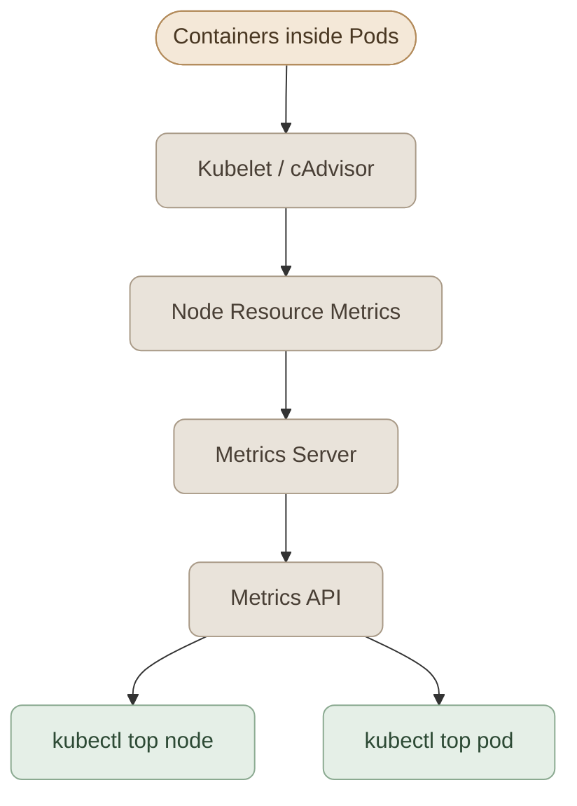
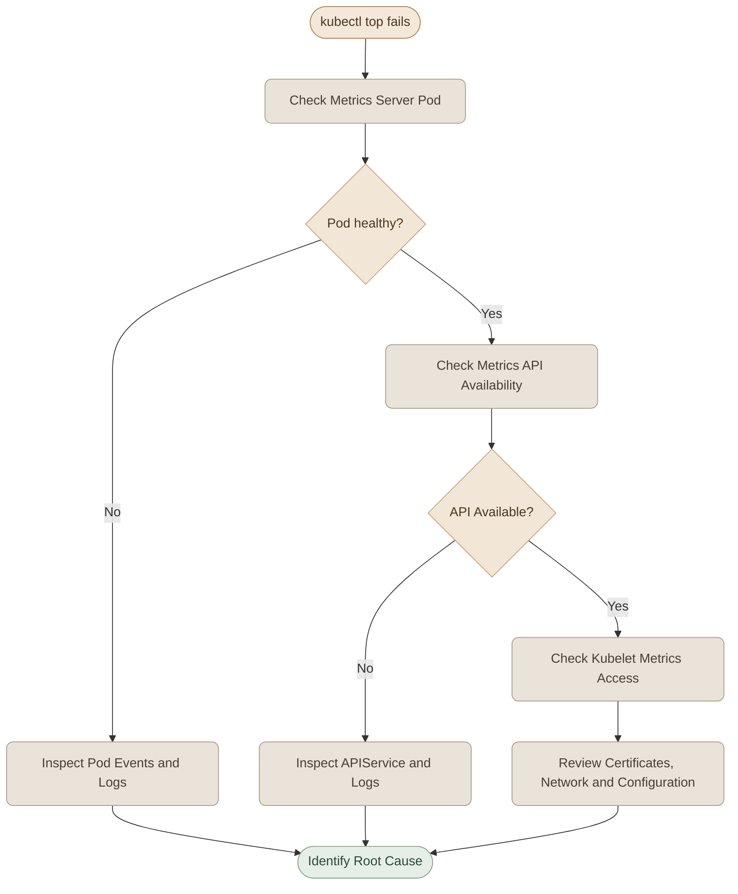

## Overview
<InfoCard variant="concept" title="Monitoring Foundation" description="جمع البيانات من العقد والتطبيقات لفهم حالة الكلستر." icon="cube" tags={["Monitoring", "Logs"]} />

الـ **Monitoring** في Kubernetes بيساعدنا نفهم حالة الـ Cluster والـ Applications اللي شغالة عليه، ونعرف إذا كانت بتستهلك الموارد بشكل طبيعي ولا فيه مشكلة محتاجة تدخل.

أهم حاجة نراقبها في البداية هي استهلاك الـ CPU والـ Memory على مستوى الـ Nodes والـ Pods.

لكن مجرد إن الـ Pod حالتها `Running` مش معناه بالضرورة إن أداءها كويس؛ ممكن تكون شغالة، لكنها بتستهلك موارد بشكل كبير أو بتواجه مشكلة في الأداء.

في الدرس ده هنتعلم إزاي نستخدم **Metrics Server** مع `kubectl top` عشان نعرض استهلاك الموارد الحالي ونحلل البيانات اللي بتظهر لنا.

## 1. What Should We Monitor?

في البداية، هنقسم الـ Monitoring إلى مستويين أساسيين.

### I. Node-Level Monitoring

الـ Node هي الـ Machine اللي بتشغّل الـ Pods، سواء كانت Virtual Machine أو Physical Machine أو Node داخل Local Cluster.

أهم المعلومات اللي نهتم بيها:

- **Node Status:** هل الـ Node حالتها `Ready` ولا عندها مشكلة؟
- **CPU Usage:** قد إيه من قدرة المعالجة بيتم استخدامه؟
- **Memory Usage:** قد إيه من الـ Memory مستخدم؟
- **Disk & Network:** حالة التخزين وحركة البيانات على الـ Node، باستخدام أدوات مناسبة للقياس ده.

### II. Pod-Level Monitoring

الـ Pod هي أصغر وحدة قابلة للنشر في Kubernetes، وبتحتوي على Container واحدة أو أكثر.

على مستوى الـ Pod، نهتم بـ:

- **CPU Consumption:** استهلاك الـ CPU بواسطة الـ Pod.
- **Memory Consumption:** استهلاك الـ Memory بواسطة الـ Pod.
- **Resource Pressure:** هل استهلاك الموارد ممكن يسبب مشاكل للتطبيق أو للـ Node؟

الـ Metrics Server بيوفر لنا بيانات أساسية عن استهلاك الـ CPU والـ Memory، لكنه مش بديل كامل لأدوات مراقبة الـ Disk والـ Network وباقي جوانب أداء النظام.

## 2. How Kubernetes Monitoring Works

الـ Kubernetes Cluster مش بيجمع كل الـ Metrics بنفسه من غير مكونات إضافية. فيه سلسلة من المكونات مسؤولة عن جمع بيانات الموارد وإتاحتها.



خلينا نفهم دور كل Component.

### I. Kubelet

الـ `kubelet` هو Agent بيشتغل على كل Node، ومسؤول عن التأكد من تشغيل الـ Pods المكلّف بيها.

كمان بيوفر واجهات بتسمح بجمع معلومات عن استهلاك الموارد على الـ Node والـ Containers الموجودة عليها.

### II. cAdvisor

الـ **cAdvisor (Container Advisor)** مسؤول عن جمع معلومات أداء الـ Containers، زي استهلاك الـ CPU والـ Memory.

في البيئات المعتادة، بيكون جزء من آلية جمع Container Metrics المرتبطة بالـ kubelet.

### III. Metrics Server

الـ **Metrics Server** بيجمع Resource Metrics من الـ Nodes عن طريق الـ kubelet، وبيوفرها من خلال Kubernetes Metrics API.

البيانات دي بتُستخدم بواسطة أوامر زي `kubectl top`، وكمان ممكن تعتمد عليها مكونات أخرى، زي Horizontal Pod Autoscaler، في حالات الـ Autoscaling المبنية على استهلاك الموارد.

## 3. What Is Metrics Server?

الـ Metrics Server هو Component إضافي للـ Kubernetes، بيجمع بيانات استهلاك الموارد الحالية من الـ Cluster وبيوفرها من خلال الـ API.

من أهم خصائصه:

- بيجمع Metrics من الـ Nodes والـ Pods.
- بيتيح البيانات من خلال `metrics.k8s.io`.
- بيسمح باستخدام `kubectl top`.
- بيحتفظ بالبيانات في الذاكرة لفترة قصيرة، ومش بيقدم تخزينًا تاريخيًا دائمًا للـ Metrics.

### I. Metrics Server vs. Prometheus

الـ Metrics Server مش نظام Monitoring كامل لتخزين وتحليل البيانات التاريخية.

لو عايز تعرف استهلاك الـ CPU من ساعة، أو تقارن أداء التطبيق على مدار أسبوع، هتحتاج نظام Monitoring بيحتفظ بالبيانات التاريخية، زي Prometheus.

| Feature | Metrics Server | Prometheus |
|---|---|---|
| Primary Purpose | توفير Resource Metrics الحالية | جمع وتخزين وتحليل Metrics |
| `kubectl top` | نعم | مش بشكل مباشر |
| Historical Metrics | لا يوفر تخزينًا تاريخيًا دائمًا | نعم، حسب إعدادات الاحتفاظ بالبيانات |
| Alerting | مش نظام Alerting متكامل | يدعم التكامل مع أنظمة التنبيه |
| Typical Use | Resource Metrics واحتياجات الـ Autoscaling | Monitoring وAnalysis وAlerting |

**Important:** الـ Metrics Server مش بديل عن Prometheus، والاتنين مش بيؤدوا نفس الدور بالكامل.

## 4. Installing Metrics Server

قبل استخدام `kubectl top`، لازم تتأكد إن الـ Metrics Server موجود وشغال في الـ Cluster.

### I. Step 1: Check the Current Cluster

```bash
kubectl config current-context
kubectl get nodes
kubectl get pods -n kube-system
```

الأوامر دي بتساعدنا نعرف الـ Cluster اللي بنتعامل معاه وحالة الـ Nodes والـ System Pods.

### II. Step 2: Check Metrics Server

```bash
kubectl get deployment metrics-server -n kube-system
```

لو الـ Deployment موجود، افحص الـ Pods الخاصة بيه:

```bash
kubectl get pods -n kube-system -l k8s-app=metrics-server
```

الـ Label المستخدم ممكن يختلف حسب طريقة التثبيت، فلو الأمر مرجعش نتيجة، اعرض الـ Pods الموجودة في `kube-system` وابحث عن الـ Metrics Server.

### III. Step 3: Deploy Metrics Server if Needed

في الـ Local Clusters، ممكن تحتاج تثبّت الـ Metrics Server يدويًا.

راجع تعليمات التثبيت الرسمية، واستخدم الـ Manifest المناسب لبيئتك وإصدار Kubernetes عندك.

المرجع الرسمي:

- Metrics Server: https://github.com/kubernetes-sigs/metrics-server
- Kubernetes Resource Metrics Pipeline: https://kubernetes.io/docs/tasks/debug/debug-cluster/resource-metrics-pipeline/

**Important:** بعض إعدادات الـ Local Cluster بتحتاج تعديلات خاصة عشان الـ Metrics Server يقدر يتصل بالـ kubelet. ما تستخدمش إعدادات بتعطّل التحقق من الشهادات في Production لمجرد إن التثبيت اشتغل في الـ Lab.

### IV. Step 4: Verify Metrics Collection

بعد تثبيت الـ Metrics Server، اديله وقت يجمع البيانات ويبدأ يعرضها.

افحص الـ API الخاص بالـ Metrics:

```bash
kubectl get apiservices v1beta1.metrics.k8s.io
```

المفروض تكون حالة الـ API Service هي `True` تحت `AVAILABLE`.

وتقدر كمان تفحص الـ Logs:

```bash
kubectl logs -n kube-system deployment/metrics-server
```

لو الـ Metrics مش متاحة، راجع حالة الـ Deployment والـ API Service والـ Logs قبل ما تنتقل للخطوة التالية.

## 5. Monitoring Nodes with kubectl top

بعد ما الـ Metrics Server يشتغل، نقدر نعرض استهلاك الموارد على مستوى الـ Nodes.

```bash
kubectl top nodes
```

مثال توضيحي لشكل الناتج:

```text
NAME                    CPU(cores)   CPU(%)   MEMORY(bytes)   MEMORY(%)
devops-lab-control-plane  420m         21%      1800Mi          45%
devops-lab-worker         150m          8%       900Mi          23%
```

الأرقام دي افتراضية للتوضيح، ومش نتائج من الـ Cluster بتاعك.

### I. Understanding the Output

- **NAME:** اسم الـ Node.
- **CPU(cores):** استهلاك الـ CPU بوحدة Cores أو millicores.
- **CPU(%):** نسبة استهلاك الـ CPU مقارنة بالقدرة التي يعتمد عليها حساب النسبة.
- **MEMORY(bytes):** استهلاك الـ Memory، وغالبًا بيظهر بوحدة زي `Mi`.
- **MEMORY(%):** نسبة استهلاك الـ Memory حسب طريقة الحساب المستخدمة.

### II. What Does 420m Mean?

الرمز `m` هنا معناه **milliCPU**.

كل `1000m` تساوي CPU Core واحدة.

يعني:

- `100m` = `0.1` CPU Core.
- `250m` = `0.25` CPU Core.
- `500m` = `0.5` CPU Core.
- `1000m` = `1` CPU Core.

لو لقيت Node بتستهلك `420m`، فده معناه إن استهلاكها الحالي حوالي `0.42` من CPU Core.

لكن لازم نفرّق بين استهلاك الـ CPU الحالي وبين الـ CPU Requests والـ CPU Limits اللي متعرفة للـ Pods.

## 6. Monitoring Pods with kubectl top

لعرض استهلاك الموارد على مستوى الـ Pods:

```bash
kubectl top pods
```

لعرض الـ Pods الموجودة في Namespace معينة:

```bash
kubectl top pods -n kube-system
```

لعرض كل الـ Pods في الـ Cluster:

```bash
kubectl top pods -A
```

مثال توضيحي:

```text
NAME       CPU(cores)   MEMORY(bytes)
api        120m         180Mi
frontend    35m          75Mi
worker     250m         320Mi
```

من المثال ده، نقدر نلاحظ إن الـ `worker` عندها أعلى استهلاك CPU وMemory بين الـ Pods المعروضة.

لكن أعلى استهلاك مش معناه تلقائيًا إن فيه مشكلة. لازم نفهم وظيفة الـ Pod، والموارد المتاحة، والـ Requests والـ Limits، وطبيعة الحمل اللي بتتعامل معاه.

### I. Comparing Pods

تقدر ترتّب الناتج حسب استهلاك الـ CPU:

```bash
kubectl top pods --sort-by=cpu
```

أو حسب استهلاك الـ Memory:

```bash
kubectl top pods --sort-by=memory
```

الأوامر دي بتسهّل اكتشاف الـ Pods الأعلى استهلاكًا للموارد، خصوصًا لما يكون عندك عدد كبير من الـ Workloads.

### II. Monitoring Containers Inside a Pod

لو الـ Pod بتحتوي على أكثر من Container، تقدر تعرض استهلاك كل Container باستخدام:

```bash
kubectl top pod <pod-name> --containers
```

ولو محتاج تحدد الـ Namespace:

```bash
kubectl top pod <pod-name> -n <namespace> --containers
```

ده بيساعدك تحدد أي Container داخل الـ Pod هي اللي بتستهلك الموارد بشكل أكبر.

## 7. Interpreting Resource Metrics

عرض الأرقام مجرد بداية؛ المهم إنك تعرف تفسّرها.

### I. High CPU Usage

لو لقيت CPU Usage مرتفع، اسأل نفسك:

- هل التطبيق بيستقبل Requests أكتر من المعتاد؟
- هل فيه عمليات مكثفة في الخلفية؟
- هل الـ CPU Requests والـ Limits مناسبة؟
- هل الاستهلاك المرتفع مستمر ولا مجرد زيادة مؤقتة؟

ارتفاع الـ CPU مش دليل كافي على وجود عطل، لكنه ممكن يكون مؤشر يحتاج تحقيق.

### II. High Memory Usage

لو لقيت Memory Usage مرتفع، افحص:

- هل استهلاك الذاكرة بيزيد باستمرار؟
- هل الـ Pod قريبة من الـ Memory Limit؟
- هل فيه Memory Leak محتملة؟
- هل الـ Node عندها موارد كافية لتشغيل باقي الـ Pods؟

الـ Memory ليها طبيعة مختلفة عن الـ CPU؛ لأن تجاوز الـ Memory Limit ممكن يؤدي إلى إنهاء الـ Container بسبب `OOMKilled`.

### III. Resource Usage vs. Resource Requests

الـ **Resource Requests** بتحدد الموارد اللي Kubernetes بيستخدمها في قرارات الجدولة، بينما الـ **Resource Limits** بتحط حدودًا على استهلاك بعض الموارد.

الـ Metrics الحالية بتوضح الاستهلاك الفعلي وقت القياس، مش القيم اللي متعرفة في الـ Manifest.

تقدر تفحص إعدادات الموارد باستخدام:

```bash
kubectl describe pod <pod-name>
```

أو تعرض الـ Resource Requests والـ Limits من خلال:

```bash
kubectl get pod <pod-name> -o yaml
```

## 8. Troubleshooting Metrics Server

لو أمر `kubectl top` رجّع خطأ، متفترضش إن الـ Cluster كلها فيها مشكلة.

ابدأ بتحديد مكان العطل.



### I. Useful Diagnostic Commands

```bash
# Check the Metrics Server Pod
kubectl get pods -n kube-system

# Inspect the Metrics Server Deployment
kubectl describe deployment metrics-server -n kube-system

# Read Metrics Server logs
kubectl logs -n kube-system deployment/metrics-server

# Check Metrics API availability
kubectl get apiservices v1beta1.metrics.k8s.io

# Check Node readiness
kubectl get nodes

# Inspect recent events
kubectl get events -A --sort-by=.metadata.creationTimestamp
```

من الأسباب المحتملة للمشكلة:

- الـ Metrics Server مش متثبت أو مش شغال.
- الـ Metrics API مش متاحة.
- فيه مشكلة في الاتصال بين الـ Metrics Server والـ kubelet.
- فيه مشكلة في الشهادات أو إعدادات الاتصال.
- الـ Metrics Server لسه بيجمع البيانات بعد تشغيله أو إعادة تشغيله.

ما تختارش حل عشوائي؛ استخدم الـ Logs والـ Events عشان تحدد السبب الفعلي.

## 9. Hands-on Lab

الـ Lab ده معمول عشان يختبر فهمك وقدرتك على التحليل، مش مجرد حفظ أوامر الكورس.

هنستخدم الـ Kubernetes Cluster المحلي الموجود عندك، ونبدأ بفحصه قبل ما نضيف أي Components جديدة.

### I. Lab Objectives

بنهاية الـ Lab، المفروض تكون قادر على:

- فحص حالة الـ Nodes والـ Pods.
- التحقق من توافر الـ Metrics API.
- تحليل استهلاك الـ CPU والـ Memory.
- المقارنة بين الـ Nodes والـ Pods.
- تشخيص مشاكل الـ Metrics Server.
- التمييز بين Resource Usage وResource Requests وResource Limits.

### II. Task 1: Inspect the Cluster

نفّذ:

```bash
kubectl get nodes -o wide
kubectl get pods -A
kubectl get apiservices v1beta1.metrics.k8s.io
```

**Questions:**

1. كام Node موجودة في الـ Cluster؟ وكم واحدة حالتها `Ready`؟
2. هل الـ Metrics API متاحة؟ إيه الدليل من الناتج؟
3. لو كل الـ Nodes حالتها `Ready`، هل ده معناه بالضرورة إن `kubectl top` هيشتغل؟ وضّح السبب.

### III. Task 2: Analyze Node Resource Usage

جرّب:

```bash
kubectl top nodes
```

**Questions:**

1. أي Node بتستهلك CPU أكتر؟ وأي Node بتستهلك Memory أكتر؟
2. هل الـ Node اللي بتستهلك CPU أكتر هي نفسها اللي بتستهلك Memory أكتر؟
3. لو الـ Control Plane بتستهلك موارد أكتر من الـ Worker Nodes، هل ده دليل كافي إن فيه مشكلة؟
4. إيه الفرق بين `420m` من CPU و`420Mi` من Memory؟

لو الـ Metrics Server مش شغال، شخّص المشكلة الأول بدل ما تعتبر فشل الأمر هو نهاية الـ Lab.

### IV. Task 3: Analyze Pod Resource Usage

اعرض الـ Pods واستهلاك الموارد:

```bash
kubectl get pods -A
kubectl top pods -A
```

**Questions:**

1. حدّد أعلى ثلاث Pods استهلاكًا للـ CPU، إن كان عدد الـ Pods كافيًا.
2. حدّد أعلى ثلاث Pods استهلاكًا للـ Memory.
3. هل أعلى Pod استهلاكًا للـ CPU هي بالضرورة أعلى Pod استهلاكًا للـ Memory؟ استخدم نتائج الـ Cluster لتوضيح إجابتك.
4. اختار Pod واحدة وافحص الـ Resource Requests والـ Limits الخاصة بيها. إيه الفرق بينها وبين الاستهلاك الحالي اللي ظهر في `kubectl top`؟

لو الـ Cluster فيها عدد قليل من الـ Pods، سجّل النتائج المتاحة، ومتحاولش تستنتج ترتيبًا غير موجود في البيانات.

### V. Task 4: Inspect Container-Level Usage

اختار Pod بتحتوي على أكثر من Container، لو متاحة عندك.

```bash
kubectl top pod <pod-name> -n <namespace> --containers
```

**Questions:**

1. هل الـ Containers داخل الـ Pod بتستهلك نفس مقدار الموارد؟
2. لو واحدة من الـ Containers بتستهلك موارد أكتر من الباقي، إزاي تحدد إذا كان ده متوقعًا؟
3. لو كل الـ Pods عندك بتحتوي على Container واحدة فقط، إيه التغيير اللي هتحتاج تعمله في بيئة الاختبار عشان تنفّذ الجزء ده؟

### VI. Task 5: Troubleshoot a Monitoring Failure

افترض السيناريو التالي:

> الـ Nodes كلها `Ready`، والـ Applications شغالة، لكن أمر `kubectl top nodes` بيرجع خطأ متعلقًا بعدم توافر Metrics API.

**Your Mission:**

1. اكتب أول ثلاثة أوامر هتنفذها لتشخيص المشكلة، بالترتيب.
2. حدّد إزاي هتفرّق بين إن الـ Metrics Server مش شغال وإنه شغال لكن مش قادر يجمع Metrics من الـ kubelet.
3. لو الـ Metrics Server Pod حالتها `Running`، هل ده كافي لإثبات إن الـ Monitoring شغال بشكل سليم؟ ليه؟
4. اكتب خطة تشخيص قصيرة تبدأ من الـ API وتنتهي بتحديد السبب المحتمل.

**مهم:** المطلوب تشخيص المشكلة، مش حذف الـ Metrics Server وإعادة تثبيته مباشرة.

### VII. Task 6: Understand Monitoring Limitations

جاوب عن السيناريوهات التالية من فهمك:

1. مطلوب منك تعرف استهلاك الـ Memory لتطبيق من ساعتين. هل Metrics Server وحده كافي؟
2. مطلوب منك تعمل Alert لو استهلاك الـ CPU فضل مرتفعًا لمدة خمس دقائق. هل `kubectl top` وحده كافي لتنفيذ ده؟
3. مطلوب منك تتابع استهلاك الـ CPU والـ Memory الحالي للـ Pods. هل Metrics Server اختيار مناسب؟
4. إيه نوع الحل اللي ممكن تستخدمه لو محتاج Historical Metrics وDashboards وAlerting؟

في كل إجابة، وضّح السبب بدل ما تكتب اسم الأداة فقط.

### VIII. Lab Completion Checklist

- [ ] فحصت حالة الـ Nodes والـ Pods.
- [ ] تحققت من حالة الـ Metrics API.
- [ ] استخدمت `kubectl top nodes`.
- [ ] استخدمت `kubectl top pods`.
- [ ] قارنت استهلاك الموارد بين الـ Nodes والـ Pods.
- [ ] فحصت Resource Requests وResource Limits.
- [ ] كتبت خطة لتشخيص مشكلة Metrics Server.
- [ ] وضّحت حدود Metrics Server مقارنة بأنظمة Monitoring المتكاملة.

## Key Takeaways

- الـ Monitoring بيخلينا نتابع استهلاك الموارد وحالة الـ Cluster بدل الاعتماد على حالة الـ Pods وحدها.
- الـ Metrics Server بيوفر Resource Metrics الحالية من خلال `metrics.k8s.io`.
- `kubectl top nodes` بيعرض استهلاك الموارد على مستوى الـ Nodes.
- `kubectl top pods` بيعرض استهلاك الموارد على مستوى الـ Pods.
- الـ Resource Requests والـ Limits مش نفس الحاجة زي الاستهلاك الحالي.
- الـ Metrics Server مش بيحتفظ بتاريخ دائم للـ Metrics، ومش بديلًا كاملًا عن Prometheus.
- تشخيص مشاكل الـ Monitoring لازم يبدأ بفحص الـ Metrics API والـ Components المسؤولة عن جمع البيانات، بدل إعادة التثبيت بشكل عشوائي.