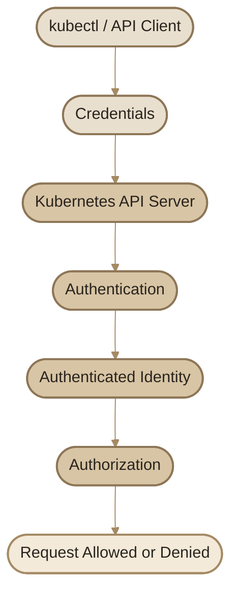
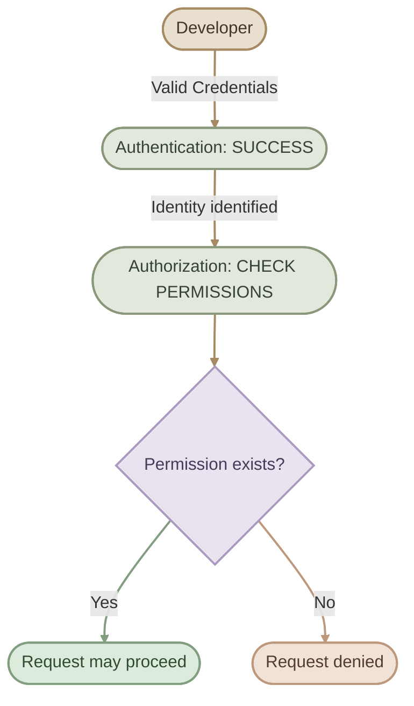

## Overview

الـ **Authentication (AuthN)** هي أول خطوة لفهم مين بيحاول يتعامل مع الـ Kubernetes API.

 هنتعلم إزاي Kubernetes بيتعرف على الهويات اللي بتبعتله Requests، والفرق بين الـ Human Users والـ ServiceAccounts، وإيه دور الـ API Server والـ kubeconfig، وإزاي طرق المصادقة المختلفة بتشتغل.

هنشرح كمان الـ Static Password Files والـ Static Token Files  مع توضيح ليه مش بنعتمد عليهم في إعدادات حديثة وآمنة.

### I. Learning Objectives

بنهاية المقال، هتكون قادر على:

- شرح وظيفة الـ Authentication داخل Kubernetes.
- التمييز بين Human Users وServiceAccounts.
- فهم دور الـ Kubernetes API Server في التحقق من الهوية.
- التعرف على أشهر Authentication Methods.
- فهم العلاقة بين `kubectl` و`kubeconfig` وCredentials.
- شرح فكرة Static Password Files وStatic Token Files ومخاطرهم.
- استكشاف الـ Authentication Configuration الحالية باستخدام أوامر آمنة للقراءة فقط.

## 1. Who Needs to Authenticate?

الـ Kubernetes Cluster مش بيتعامل مع شخص واحد بس. فيه جهات مختلفة بتحتاج تتواصل مع الـ Cluster لأغراض مختلفة.

<CardGrid>
  <InfoCard title="Administrators" icon="shield">
    مسؤولون عن إدارة الـ Cluster، ومراقبة حالته، وتنفيذ المهام الإدارية.
  </InfoCard>
  <InfoCard title="Developers" icon="code">
    بيحتاجوا ينشروا التطبيقات ويتابعوا الـ Workloads حسب الصلاحيات الممنوحة لهم.
  </InfoCard>
  <InfoCard title="Automated Workloads" icon="cube">
    Applications وCI/CD Pipelines وعمليات آلية ممكن تحتاج الوصول إلى Kubernetes API.
  </InfoCard>
  <InfoCard title="Application End Users" icon="layers">
    المستخدمون اللي بيفتحوا التطبيق نفسه، وده مختلف عن دخولهم إلى Kubernetes Cluster.
  </InfoCard>
</CardGrid>

### I. Kubernetes Access vs. Application Access

لازم نفرّق بين نوعين من الوصول:

- **Kubernetes API Access:** زي إن Developer يستخدم `kubectl` لعرض Pods أو تعديل Deployment.
- **Application Access:** زي إن مستخدم يفتح موقعًا مستضافًا داخل Kubernetes ويسجّل الدخول لحسابه.

الـ Authentication الخاص بمستخدمي التطبيق بيتعامل معاه التطبيق أو نظام الهوية المرتبط به، مش بالضرورة Kubernetes نفسه.

في المقال ده هنركّز على الـ Authentication الخاص بالوصول إلى **Kubernetes API**.

## 2. Human Users vs. ServiceAccounts

Kubernetes بيميز بين نوعين أساسيين من الهويات اللي بتتعامل مع الـ API.

| Identity Type | Typical Purpose | Managed By |
|---|---|---|
| Normal User | Administrators وDevelopers وغيرهم من المستخدمين | نظام هوية خارجي أو آلية مصادقة مُهيّأة |
| ServiceAccount | Applications والـ Workloads والعمليات الآلية | Kubernetes API |

### I. Normal Users

الـ Normal User بيمثل هوية بشرية أو هوية مستخدم عادية بيتعرف عليها Kubernetes من خلال آلية Authentication مُهيّأة.

أمثلة:

- `ahmed`
- `developer@example.com`
- `platform-admin`

الأسماء دي أمثلة توضيحية فقط؛ Kubernetes مش بيعمل User Object لكل اسم منها.

**النقطة الأساسية:** Kubernetes لا يوفر API مدمجة لإنشاء وإدارة الـ Normal User Accounts بالشكل اللي بنعمل به `Pods` أو `Namespaces`.

يعني الأمر التالي مش طريقة صحيحة لإنشاء Kubernetes User:

```bash
kubectl create user ahmed
```

مفيش أمر `kubectl create user` مدمج لإنشاء Normal User.

بدلًا من ذلك، الهوية ممكن تيجي من مصدر خارجي أو آلية مصادقة، زي:

- External Identity Provider.
- OIDC.
- Client Certificates.
- آليات Authentication أخرى مدعومة ومُهيّأة على الـ Cluster.

الـ API Server بيستخدم معلومات الهوية الناتجة عن الـ Authentication، مثل الـ Username والـ Groups، في مراحل التفويض التالية.

### II. ServiceAccounts

الـ **ServiceAccount** هو نوع من الهويات اللي Kubernetes بيديرها من خلال الـ API.

بيُستخدم عادةً بواسطة الـ Workloads والعمليات الآلية اللي محتاجة تتعامل مع Kubernetes API.

مثال لإنشاء ServiceAccount:

```bash
kubectl create serviceaccount app-reader
```

الأمر ده بينشئ ServiceAccount في الـ Namespace الحالية، لكنه **مش بيمنحها تلقائيًا صلاحيات قراءة كل الموارد**.

الصلاحيات بتتحدد بصورة منفصلة باستخدام آليات Authorization زي RBAC، وهنشرحها في مقال مستقل.

كمان لازم تعرف إن ServiceAccounts بتكون مرتبطة بـ Namespace، على عكس الـ Normal Users اللي هويتهم مش محصورة في Namespace معينة.

هنفصّل الـ ServiceAccounts واستخدامها مع الـ Pods في المقال المخصص ليها.

## 3. How Authentication Works

كل Request موجه إلى Kubernetes API لازم تتحدد هويته، سواء كانت الهوية مستخدمًا عاديًا أو ServiceAccount أو مكوّنًا من مكونات النظام.

لما تستخدم `kubectl`، الأداة بتبعت Requests إلى الـ API Server. والـ API Server بيستخدم آليات المصادقة المُهيّأة علشان يحدد هوية صاحب الطلب.

### I. Authentication Flow



الرسم بيوضح الفكرة الأساسية، مش كل التفاصيل الداخلية لمعالجة الـ API Request.

<Steps>
<li>

<InfoCard title="The Client Sends a Request" icon="terminal" />

ممكن تستخدم `kubectl` أو تتعامل مع الـ Kubernetes API مباشرة من خلال Client أو Application.
</li>
<li>

<InfoCard title="The Client Presents Credentials" icon="shield" />

الـ Credentials هي المعلومات اللي بتستخدمها آلية المصادقة للتحقق من الهوية.

حسب الإعدادات، ممكن تكون:

- Client Certificate.
- Bearer Token.
- OIDC Token.
- بيانات بتوفرها آلية Authentication أخرى مدعومة.
</li>
<li>

<InfoCard title="The API Server Authenticates the Request" icon="cycle" />

الـ API Server بيتحقق من الـ Credentials باستخدام آليات Authentication المُهيّأة عنده.

لو قدر يحدد هوية الطلب، بيستخدم معلومات زي Username وGroups في الخطوات التالية.

لو الطلب مش قابل للمصادقة، ممكن يُرفض، أو يُعامل كطلب Anonymous حسب الإعدادات والسياسات.
</li>
<li>

<InfoCard title="Authorization Determines Permissions" icon="sliders" />

بعد تحديد الهوية، آلية Authorization بتحدد إذا كان مسموحًا للهوية تنفيذ العملية المطلوبة أم لا.

وده الفرق الأساسي:

- Authentication: **Who are you?**
- Authorization: **What are you allowed to do?**

نجاح الـ Authentication مش معناه إن الطلب هيتنفّذ؛ ممكن الهوية تكون صحيحة لكن مفيش صلاحيات كافية.
</li>
</Steps>

## 4. Authentication Methods

Kubernetes بيدعم طرقًا مختلفة لتحديد الهوية، والاختيار المناسب بيعتمد على نوع الـ Cluster ومتطلبات التشغيل ونظام الهوية المستخدم.

<CardGrid>
  <InfoCard title="Client Certificates" icon="shield">
    شهادات X.509 ممكن تُستخدم للتحقق من هوية Client، بشرط الثقة في الشهادة وإعداد الـ API Server بصورة صحيحة.
  </InfoCard>
  <InfoCard title="Bearer Tokens" icon="tag">
    قيمة Token بتُرسل عادةً في HTTP Authorization Header، ويجري التحقق منها وفقًا لآلية المصادقة المُهيّأة.
  </InfoCard>
  <InfoCard title="OIDC" icon="network">
    OpenID Connect بيسمح بربط Kubernetes بنظام هوية خارجي يدعم البروتوكول.
  </InfoCard>
  <InfoCard title="Authenticating Webhooks" icon="cycle">
    ممكن استخدام خدمة خارجية للتحقق من بيانات المصادقة من خلال Webhook Authentication.
  </InfoCard>
</CardGrid>

كمان توجد طرق أخرى وتكاملات ممكنة حسب إصدار Kubernetes والإعدادات. بعض أنظمة الـ Cloud بتوفر آليات هوية خاصة بها، وقد تستخدم Proxy أو Webhook أو تكاملًا مع مزود الهوية.

**مهم:** مش كل الطرق دي مفعّلة تلقائيًا في كل Cluster، ومش كل Cluster بيستخدم نفس الـ Authentication Configuration.

### I. Client Certificate Authentication

في الطريقة دي، الـ Client بيقدم شهادة X.509 مناسبة، ويجب أن يكون الـ API Server مُهيّأ للثقة في الجهة التي أصدرت الشهادة.

في Kubernetes، بيانات الشهادة ممكن تُستخدم لتحديد اسم المستخدم والـ Groups وفقًا لإعدادات وآلية المصادقة.

الشهادة مش مجرد ملف بنحطه في أي مكان؛ لازم يكون فيه Trust صحيح، والـ Client يحتاج المفتاح الخاص المرتبط بالشهادة لإثبات امتلاكه للهوية.

هنشرح الشهادات بالتفصيل في مقالات TLS القادمة.

### II. Bearer Token Authentication

الـ Bearer Token عبارة عن Credential بيقدمه الـ Client في الـ HTTP Request، عادةً بالشكل ده:

```http
Authorization: Bearer <TOKEN>
```

الـ API Server لازم يكون قادرًا على التحقق من الـ Token باستخدام آلية Authentication مناسبة.

بالنسبة إلى ServiceAccounts في Kubernetes الحديثة، فيه آليات لإصدار Tokens قصيرة العمر، مثل `TokenRequest API`، ودي أفضل من الاعتماد على Tokens ثابتة وطويلة العمر في الاستخدامات المناسبة.

لكن لازم نفتكر إن أي شخص يحصل على Bearer Token صالح ممكن يحاول استخدامه لانتحال الهوية المرتبطة به؛ لذلك لازم نحمي الـ Tokens من التسريب.

### III. External Identity Providers

في بيئات العمل، ممكن المؤسسة تستخدم نظامًا مركزيًا لإدارة المستخدمين، بحيث تكون عملية إنشاء الحسابات وتعطيلها وإدارة الهوية خارج Kubernetes.

من الأمثلة:

- OpenID Connect (OIDC).
- Corporate Identity Providers.
- أنظمة خارجية متكاملة عبر Authentication Proxy أو Webhook.

LDAP وKerberos وSAML مش معناهم إن كل Kubernetes API Server بيدعمهم تلقائيًا كـ Native Authentication Configuration مباشرة؛ التكامل معاهم ممكن يحتاج وسيطًا أو آلية مناسبة.

### IV. Which Method Should You Learn First?

للتعلم، افهم الفكرة العامة لكل طريقة، لكن ركّز عمليًا على:

1. فهم الـ kubeconfig والـ Contexts والـ Credentials.
2. فهم Client Certificate Authentication.
3. فهم Bearer Tokens، خصوصًا ServiceAccount Tokens.
4. فهم OIDC والتكامل مع External Identity Providers.
5. معرفة طريقة فحص الـ Identity والـ Permissions باستخدام `kubectl`.

## 5. Kubeconfig and Authentication

الـ `kubeconfig` هو ملف إعدادات بيستخدمه `kubectl` وبعض Kubernetes Clients لتحديد معلومات الاتصال بالـ Cluster والـ Credentials المستخدمة.

غالبًا بتلاقي فيه ثلاثة مفاهيم أساسية:

- **Clusters:** معلومات الاتصال بالـ API Servers والشهادات المرتبطة بالثقة.
- **Users:** بيانات الـ Credentials أو إعدادات المصادقة.
- **Contexts:** ربط Cluster مع User، وممكن كمان Namespace افتراضية.

### I. Simplified Kubeconfig Structure

```yaml
apiVersion: v1
kind: Config

clusters:
  - name: dev-cluster
    cluster:
      server: https://api.example.invalid:6443

users:
  - name: developer
    user:
      # Authentication configuration goes here.

contexts:
  - name: dev-context
    context:
      cluster: dev-cluster
      user: developer
      namespace: default

current-context: dev-context
```

ده مثال تعليمي لتوضيح تركيب الملف، مش إعدادًا جاهزًا للاتصال بـ Cluster حقيقي.

لاحظ إن `users` هنا معناها إدخالات إعدادات المصادقة اللي بيستخدمها الـ Client؛ مش معناها إن فيه User Objects بالاسم ده داخل Kubernetes.

### II. Inspect Your Current Context

```bash
kubectl config current-context
```

الأمر بيعرض اسم الـ Context الحالي.

لعرض تفاصيل الإعدادات الخاصة بالـ Context الحالي:

```bash
kubectl config view --minify
```

**تحذير:** متشاركش ملف `kubeconfig` أو ناتج أوامر عرضه من غير مراجعة؛ لأنه ممكن يحتوي على Tokens أو بيانات حساسة أو مراجع إلى ملفات Credentials.

الـ `kubeconfig` بيحدد بيانات الاتصال والمصادقة التي يستخدمها الـ Client، لكنه مش بديل عن Authentication Configuration على الـ API Server، ولا عن Authorization Policies.

## 6. Static Password Files

في بعض الشروحات القديمة، هتلاقي طريقة بتعتمد على ملف CSV يحتوي على أسماء المستخدمين وكلمات المرور، ويُشار إليه باسم **Static Password File Authentication**.

الفكرة التعليمية كانت إن الـ API Server يقرأ بيانات من ملف ثابت، ثم يستخدمها للتحقق من بيانات الدخول.

### I. Historical CSV Format

مثال توضيحي فقط:

```csv
password,username,uid
example-password,developer,1001
```

في بعض الصيغ التاريخية، كان ممكن إضافة عمود للمجموعات، بحيث يمكن ربط المستخدم بمجموعات معينة.

لكن لازم نفرّق بين فهم الطريقة تاريخيًا وبين استخدامها فعليًا.

<Callout type="warning" title="Do Not Configure This on a Modern Cluster">
الـ Basic Authentication الذي اعتمد على Static Password Files أُزيل من Kubernetes في الإصدارات الحديثة. لا تعتمد على `--basic-auth-file` كطريقة مصادقة صالحة على Cluster حديث، ولا تستخدم كلمات مرور حقيقية في ملفات CSV أو في أوامر Shell بغرض التجربة.
</Callout>

### II. Why Was This Approach Insecure?

- تخزين كلمات المرور كنص واضح يعرضها للتسريب.
- نسخ الملف أو نسخه الاحتياطية ممكن يوسّع دائرة الوصول إلى Credentials.
- إدارة تغيير كلمات المرور وإلغاء الوصول بتكون أصعب.
- الطريقة لا توفر تجربة إدارة هوية مركزية مناسبة للبيئات الحديثة.

عشان كده، هنكتفي بفهم الفكرة والمخاطر، ومش هننفّذ إعدادات Static Password Files على الـ Lab Cluster.

## 7. Static Token Files

طريقة تاريخية أخرى بتعتمد على ملف ثابت يحتوي على Tokens مرتبطة بهويات المستخدمين، بدلًا من كلمات المرور.

في الإعدادات التي تدعم هذه الآلية، كان يتم تمرير الملف إلى الـ API Server من خلال خيار مثل:

```text
--token-auth-file
```

وكان الـ Client يرسل الـ Token داخل الـ HTTP Authorization Header.

### I. Example of the Request Format

```http
Authorization: Bearer <TOKEN>
```

الـ Header ده بيوضح طريقة إرسال الـ Token، لكنه مش دليل على إن الـ API Server مهيّأ لقبوله؛ لازم يكون فيه Authenticator قادر على التحقق منه.

### II. Security Risks

- لو الـ Token اتسرّب، ممكن يُستخدم لانتحال الهوية المرتبطة به.
- تخزين Tokens ثابتة في ملفات بيزيد خطر تسريبها.
- تدوير الـ Tokens وإلغاء صلاحيتها وإدارة المستخدمين ممكن يكون معقدًا.
- استخدام ملف ثابت لا يوفر تلقائيًا دورة حياة آمنة للـ Credentials.

<Callout type="warning" title="Static Tokens Are Not the Same as Modern ServiceAccount Tokens">
متخلطش بين Static Token File Authentication التاريخية وبين ServiceAccount Tokens الحديثة. Kubernetes بيوفر آليات مثل TokenRequest لإصدار Tokens قصيرة العمر، ودي مختلفة عن الاحتفاظ بقيم ثابتة في ملف.
</Callout>

مش هنستخدم `--token-auth-file` في الـ Lab. الهدف هنا هو فهم الفكرة مع إدراك إن طرق المصادقة المناسبة بتختلف حسب إصدار Kubernetes والـ Cluster Configuration.

## 8. Authentication Is Not Authorization

دي من أهم النقاط اللي لازم تثبت عندك قبل ما ننتقل إلى RBAC.

تخيّل إن Developer عنده Credentials صحيحة، وقدر يعمل Authentication بنجاح. ده لا يعني إنه مسموح له يحذف أي Pod أو يعدّل أي Deployment في كل الـ Namespaces.

الـ Authentication بيحدد الهوية، وبعد كده الـ Authorization بيحدد العمليات المسموح بها.

### I. Example



الطلب ممكن يواجه كمان مراحل إضافية، زي Admission Control، حتى لو الهوية عندها الصلاحيات المطلوبة.

### II. Check Your Current Permissions

تقدر تستخدم الأمر التالي للاستعلام عن صلاحية الهوية الحالية:

```bash
kubectl auth can-i get pods
```

ولفحص صلاحية داخل Namespace محددة:

```bash
kubectl auth can-i get pods -n default
```

الأوامر دي بتفحص الصلاحيات من خلال Kubernetes، ومش بتغيّر الموارد.

لكن خليك فاكر إن نجاح `kubectl auth can-i` مش معناه إن الـ Credentials نفسها اتغيرت؛ الأمر بيسأل عن الصلاحية المطلوبة باستخدام إعدادات الاتصال والهوية الحالية.

## 9. Practical Lab: Inspect Authentication Configuration

هنعمل استكشاف آمن للـ Cluster الحالي باستخدام أوامر قراءة فقط. مش هننشئ مستخدمين، ومش هنعدّل الـ API Server، ومش هنغيّر أي Credentials.

<Steps>
<li>

<InfoCard title="Check the Current Context" icon="terminal" />

```bash
kubectl config current-context
```

**Expected result:** اسم الـ Context اللي `kubectl` بيستخدمه حاليًا.

لو عندك أكتر من Cluster، اتأكد إنك فاهم السياق الحالي قبل تنفيذ أي أوامر بتغيّر الموارد.
</li>
<li>

<InfoCard title="Inspect the Current Kubeconfig Context" icon="code" />

```bash
kubectl config view --minify
```

راجع أسماء الـ Cluster والـ User والـ Context.

متشاركش الناتج علنًا من غير ما تتأكد إنه مفيهوش بيانات حساسة.
</li>
<li>

<InfoCard title="Check Whether You Can Read Pods" icon="shield" />

```bash
kubectl auth can-i get pods
```

الأمر بيفحص هل الهوية الحالية مسموح لها بقراءة Pods في الـ Namespace الافتراضية المرتبطة بالسياق الحالي.
</li>
<li>

<InfoCard title="Check the Active Identity Indirectly" icon="pulse" />

```bash
kubectl auth whoami
```

في الإصدارات الحديثة من `kubectl`، الأمر ده ممكن يساعدك في عرض معلومات الهوية اللي Kubernetes بيرجعها للطلب.

لو الأمر مش متاح في إصدار `kubectl` عندك، مش معنى كده إن الـ Authentication فاشل؛ ممكن تكون الميزة غير متاحة في الإصدار المستخدم.
</li>
<li>

<InfoCard title="Inspect ServiceAccounts" icon="layers" />

```bash
kubectl get serviceaccounts -n default
```

الأمر بيعرض الـ ServiceAccounts الموجودة في الـ Namespace المسماة `default`.

ده بيساعدك تلاحظ الفرق بين الـ ServiceAccounts، اللي بتظهر كموارد Kubernetes، وبين الـ Normal Users اللي مش ليهم User Objects مدمجة بنفس الطريقة.
</li>
</Steps>

<Callout type="lab" title="Lab Questions">
بعد ما تنفّذ الأوامر، جاوب عن الأسئلة دي:

1. إيه اسم الـ Context الحالي؟
2. إيه الفرق بين الـ User الموجود في `kubeconfig` وبين الـ ServiceAccount الموجود في الـ API؟
3. هل `kubectl auth can-i` بيختبر Authentication ولا Authorization بشكل مباشر؟
4. هل ظهور ServiceAccount في الـ API معناه إنها تقدر تحذف Pods؟
5. ليه مش هنجرّب إنشاء Static Password File على الـ Cluster الحديث؟
</Callout>

## 10. Common Misconceptions

<CardGrid>
  <InfoCard title="Users Are Not API Objects" icon="layers">
    الـ Normal Users لا تُنشأ باستخدام Kubernetes API المدمجة؛ بيانات هويتهم تأتي من آليات المصادقة المُهيّأة.
  </InfoCard>
  <InfoCard title="Kubeconfig Is Client Configuration" icon="sliders">
    وجود User Entry داخل `kubeconfig` لا يعني وجود User Object داخل الـ Cluster.
  </InfoCard>
  <InfoCard title="A Valid Identity Has Limited Rights" icon="shield">
    نجاح الـ Authentication لا يمنح صلاحيات تلقائية على كل موارد Kubernetes.
  </InfoCard>
  <InfoCard title="Tokens Must Be Protected" icon="tag">
    أي Credential ممكن يؤدي تسريبه إلى انتحال الهوية، حسب صلاحيته وآلية التحقق منه.
  </InfoCard>
</CardGrid>

## 11. Knowledge Check

### Question 1

Which statement best describes Kubernetes Normal Users?

- A. They are always stored as User objects in the Kubernetes API.
- B. They are managed outside the built-in Kubernetes user-object model and authenticated through configured mechanisms.
- C. They can only authenticate using passwords.
- D. They are identical to ServiceAccounts.

<Callout type="note" title="Answer">
**Correct answer: B.** Kubernetes لا يوفر API مدمجة لإدارة الـ Normal Users بالشكل نفسه المستخدم لإدارة ServiceAccounts.
</Callout>

### Question 2

What is the primary role of Authentication?

- A. To decide which Pods a user can delete.
- B. To verify or establish the identity associated with a request.
- C. To encrypt all traffic between Pods.
- D. To create Namespaces.

<Callout type="note" title="Answer">
**Correct answer: B.** الـ Authentication بتحدد الهوية المرتبطة بالـ Request، بينما الصلاحيات مسؤولية الـ Authorization.
</Callout>

### Question 3

Where are Kubernetes ServiceAccounts represented?

- A. Only in a local CSV file.
- B. As objects in the Kubernetes API.
- C. Only inside a user's kubeconfig.
- D. Only in the host operating system.

<Callout type="note" title="Answer">
**Correct answer: B.** الـ ServiceAccounts موارد Kubernetes مرتبطة بـ Namespaces، ويمكن إنشاؤها وإدارتها من خلال الـ API.
</Callout>

### Question 4

What does a kubeconfig User Entry represent?

- A. A guarantee that a matching User object exists in the Cluster.
- B. Client-side authentication configuration or credentials.
- C. A NetworkPolicy.
- D. A Kubernetes Deployment.

<Callout type="note" title="Answer">
**Correct answer: B.** الـ User Entry بيحدد إعدادات المصادقة التي يستخدمها الـ Client، لكنه مش إثباتًا لوجود User Object.
</Callout>

### Question 5

Why should you avoid relying on Static Password Files for modern Kubernetes authentication?

- A. Kubernetes requires every user to be a Pod.
- B. Basic Authentication using this mechanism was removed from modern Kubernetes releases, and storing credentials in plain text is insecure.
- C. Password files automatically create ClusterRoles.
- D. Static password files are required for TLS.

<Callout type="note" title="Answer">
**Correct answer: B.** لازم نفرّق بين الطرق التاريخية اللي بنشرحها للتعلم وبين آليات المصادقة المناسبة للإصدارات الحديثة.
</Callout>

### Question 6

A user authenticates successfully but receives a `Forbidden` response when trying to delete a Pod. Which concept should you investigate next?

- A. Authorization.
- B. DNS resolution only.
- C. ImagePullPolicy.
- D. Container restart policy.

<Callout type="note" title="Answer">
**Correct answer: A.** نجاح المصادقة لا يعني امتلاك الصلاحيات المطلوبة. افحص الـ Authorization والـ RBAC Rules المرتبطة بالهوية.

</Callout>

## Summary

الـ Authentication هي الآلية اللي بتحدد الهوية المرتبطة بطلب الوصول إلى Kubernetes API.

أهم النقاط:

- الـ Normal Users والـ ServiceAccounts نوعان مختلفان من الهويات.
- الـ Normal Users لا تُدار كـ User Objects من خلال Kubernetes API المدمجة.
- الـ ServiceAccounts موارد Kubernetes تُستخدم عادةً بواسطة الـ Workloads والعمليات الآلية.
- الـ `kubeconfig` بيحدد إعدادات الاتصال والمصادقة التي يستخدمها `kubectl`.
- Kubernetes بيدعم آليات مصادقة مختلفة، منها Client Certificates وTokens وOIDC وتكاملات خارجية.
- الـ Static Password File Authentication طريقة تاريخية أُزيلت من الإصدارات الحديثة.
- نجاح الـ Authentication لا يساوي نجاح الـ Authorization.
- لازم نحمي الـ Credentials، ونستخدم آليات مناسبة لإدارة دورة حياتها وتقليل مخاطر تسريبها.

**The core idea:**

**Authentication identifies the caller; Authorization determines what that identity is allowed to do.**

