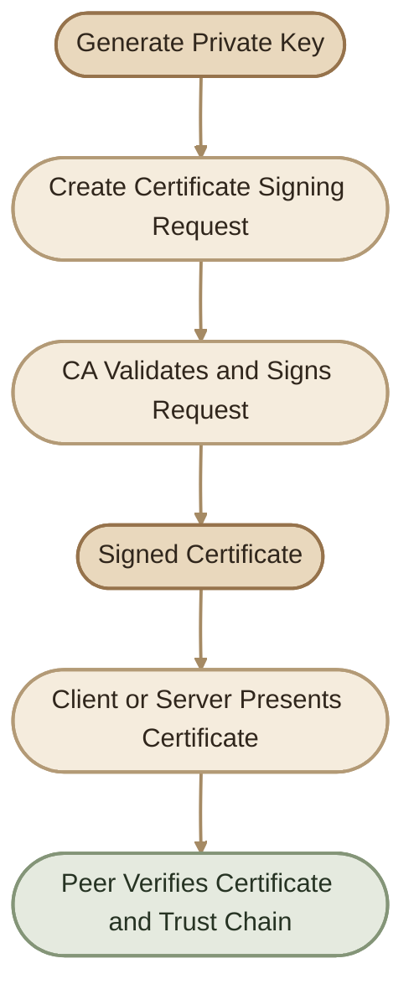
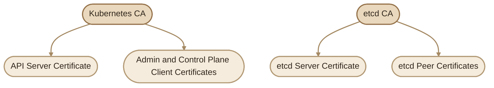
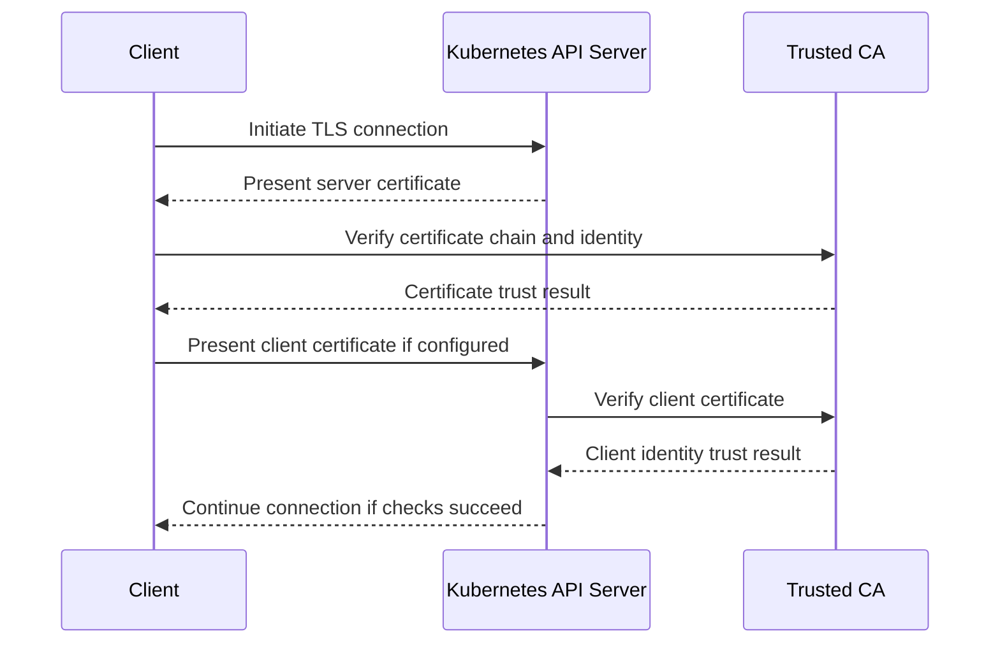

## Overview

في Kubernetes، التواصل بين الـ Control Plane والـ Nodes والـ Clients لازم يكون مؤمّن. المكوّنات مش المفروض تثق في أي اتصال لمجرد إنه وصلها؛ لازم تقدر تتحقق من هوية الطرف الآخر.

واحدة من أهم الآليات اللي بتحقق ده هي **Public Key Infrastructure (PKI)** باستخدام Certificates وTLS.

في المقال ده هنتعلم إزاي نظام الشهادات بيشتغل، وإزاي المكوّنات المختلفة بتستخدمه، وإيه العلاقة بين الـ Certificate والـ Private Key والـ Certificate Authority.

## 1. Understanding Kubernetes PKI

<InfoCard title="الفكرة الأساسية" icon="shield">
الـ Certificate بتساعدنا نتحقق من الهوية، والـ Private Key بيثبت امتلاك صاحب الشهادة للمفتاح المرتبط بيها. أما الـ Certificate Authority (CA)، فهي الجهة الموثوقة اللي بتصدر أو توقّع الشهادات.
</InfoCard>

### I. The Main Components

<CardGrid>
  <InfoCard title="Private Key" icon="code">
    مفتاح سري لازم يفضل محمي. بيُستخدم في عمليات التشفير أو إثبات امتلاك المفتاح الخاص، حسب البروتوكول.
  </InfoCard>
  <InfoCard title="Certificate" icon="tag">
    ملف بيحتوي على Public Key ومعلومات عن الهوية، بالإضافة إلى توقيع جهة إصدار الشهادة.
  </InfoCard>
  <InfoCard title="Certificate Authority (CA)" icon="shield">
    جهة موثوقة بتوقّع الشهادات. المكوّن اللي بيتحقق من الشهادة لازم يثق في الـ CA المناسبة.
  </InfoCard>
  <InfoCard title="CSR" icon="terminal">
    اختصار Certificate Signing Request؛ طلب بيحتوي على Public Key ومعلومات الهوية المطلوبة لإصدار شهادة.
  </InfoCard>
</CardGrid>

### II. How Certificate Trust Works



خلي بالك إن توقيع الشهادة مش معناه إن الـ CA ضمنت إن صاحبها شخص صالح أو إن عنده صلاحيات Administrator. التوقيع بيثبت إن الشهادة صدرت من جهة موثوقة وفقًا لسياسة الإصدار.

في Kubernetes، الـ Authentication والـ Authorization مرحلتان منفصلتان:

- **Authentication:** مين الطرف اللي بيتواصل مع الـ API Server؟
- **Authorization:** هل الطرف ده مسموح له ينفذ العملية المطلوبة؟

---

## 2. Kubernetes Certificate Authority

الـ CA هي أساس الثقة في نظام الشهادات.

في Cluster تم تجهيزه باستخدام `kubeadm`، هتلاقي عادةً شهادات ومفاتيح الـ PKI تحت:

```text
/etc/kubernetes/pki/
```

من الملفات المهمة:

```text
/etc/kubernetes/pki/
├── ca.crt
├── ca.key
├── apiserver.crt
├── apiserver.key
└── etcd/
    ├── ca.crt
    └── ca.key
```

ده مثال توضيحي؛ الملفات الموجودة فعليًا بتختلف حسب طريقة إعداد الـ Cluster والمكوّنات المستخدمة.

### III. Why Can There Be More Than One CA?

الـ Kubernetes CA الرئيسية ممكن توقّع شهادات تخص التواصل مع الـ API Server، لكن `kubeadm` عادةً بيستخدم CA منفصلة لـ etcd.



**مهم:** مش معنى إن الشهادة صالحة زمنيًا إنها موثوقة عند كل المكوّنات. لازم كمان تكون موقعة من CA موثوق فيها عند الطرف اللي بيعمل التحقق.

---

## 3. Generating a Certificate Authority

هنستخدم OpenSSL كمثال تعليمي لإنشاء CA وشهادات مرتبطة بيها.

> <Callout type="warning" title="Security Warning">
> الأوامر دي للتعلّم داخل Lab. ما تستخدمش المفاتيح الناتجة مباشرةً في Production، وما تنشئش CA جديدة داخل Cluster موجود لمجرد التجربة. حماية الـ CA Private Key من أهم مسؤوليات إدارة الـ PKI.
> </Callout>

<Steps>
<li>

<InfoCard title="Generate the CA Private Key" icon="code" />

```bash
openssl genrsa -out ca.key 2048
```

الأمر ده بيولّد RSA Private Key ويحفظه في `ca.key`.

- `genrsa`: إنشاء RSA private key.
- `-out`: تحديد الملف اللي هيتحفظ فيه المفتاح.
- `2048`: حجم المفتاح بالـ bits.

في البيئات الحديثة، اختَر خوارزمية وحجم مفتاح متوافقين مع سياسة الأمان المعتمدة عندك.
</li>
<li>

<InfoCard title="Generate the CA Certificate" icon="shield" />

هننشئ CSR يحتوي على معلومات الـ CA:

```bash
openssl req -new \
  -key ca.key \
  -out ca.csr \
  -subj "/CN=kubernetes-ca"
```

وبعدها هنصدر شهادة CA موقعة ذاتيًا:

```bash
openssl x509 -req \
  -in ca.csr \
  -signkey ca.key \
  -out ca.crt \
  -days 3650 \
  -sha256
```

ده مثال مبسّط للتوضيح. لو هتستخدم الشهادة كـ CA حقيقية، لازم إعدادات الشهادة تشمل خصائص الـ CA المناسبة، زي `basicConstraints = critical, CA:TRUE` وقيود الاستخدام المناسبة للمفتاح. التوقيع الذاتي وحده مش كفاية لضمان إن الشهادة صالحة للاستخدام كـ CA.

الناتج الأساسي:

| File | Purpose |
|---|---|
| `ca.key` | الـ CA Private Key |
| `ca.csr` | طلب الشهادة |
| `ca.crt` | شهادة الـ CA العامة |
</li>
<li>

<InfoCard title="Verify the CA Certificate" icon="terminal" />

```bash
openssl x509 -in ca.crt -noout -text
```

هتلاقي تفاصيل زي:

- `Subject`: الهوية الموجودة في الشهادة.
- `Issuer`: الجهة اللي أصدرت الشهادة.
- `Validity`: بداية ونهاية الصلاحية.
- `Basic Constraints`: هل الشهادة مخصصة كـ CA؟
- `Key Usage`: الاستخدامات المسموح بها.
</li>
</Steps>

---

## 4. Generating Client Certificates

الـ Client Certificate بتُستخدم لإثبات هوية عميل بيتصل بخدمة، زي Kubernetes API Server.

الخطوات العامة:

1. إنشاء Private Key.
2. إنشاء CSR.
3. توقيع الـ CSR بواسطة CA موثوق فيها.
4. إعداد العميل لاستخدام الشهادة والمفتاح والـ CA المناسبة.

<Steps>
<li>

<InfoCard title="Generate an Admin Client Key" icon="code" />

```bash
openssl genrsa -out admin.key 2048
```
</li>
<li>

<InfoCard title="Create a CSR" icon="terminal" />

```bash
openssl req -new \
  -key admin.key \
  -out admin.csr \
  -subj "/CN=kube-admin/O=system:masters"
```

في المثال ده:

- `CN=kube-admin`: اسم المستخدم اللي هيظهر عند المصادقة باستخدام الشهادة.
- `O=system:masters`: المجموعة المرتبطة بهوية المستخدم.

الـ `CN` والـ `O` مش مجرد أسماء شكلية؛ Kubernetes بيستخدم معلومات الهوية والمجموعات المستخرجة من الشهادة أثناء الـ Authentication.

**تنبيه أمني مهم:** المجموعة `system:masters` تمتلك صلاحيات إدارية شديدة الاتساع في Kubernetes. ما تستخدمهاش لحسابات التشغيل اليومية أو لمستخدمين عاديين. الأفضل إنشاء هويات مناسبة وتحديد الصلاحيات من خلال RBAC وفقًا لمبدأ Least Privilege.
</li>
<li>

<InfoCard title="Sign the Client Certificate" icon="shield" />

```bash
openssl x509 -req \
  -in admin.csr \
  -CA ca.crt \
  -CAkey ca.key \
  -CAcreateserial \
  -out admin.crt \
  -days 365 \
  -sha256
```

الأمر بيصدر شهادة موقّعة بواسطة الـ CA المحددة.

> توقيع الشهادة لا يمنح المستخدم صلاحيات Kubernetes بمفرده؛ الصلاحيات بتتحدد بعد ما Kubernetes يتعرف على الهوية، من خلال آليات الـ Authorization المناسبة.
</li>
</Steps>

### IV. Client Certificate Identity Examples

في إعداد تقليدي للشهادات، هتلاقي هويات مرتبطة بمكوّنات النظام، مثل:

| Component | Example Common Name |
|---|---|
| kube-scheduler | `system:kube-scheduler` |
| kube-controller-manager | `system:kube-controller-manager` |
| kube-proxy | `system:kube-proxy` |
| Kubelet client for node01 | `system:node:node01` |

بالنسبة لشهادات الـ Kubelet Client، لازم كمان تكون المجموعة `system:nodes` موجودة بالشكل المناسب؛ لأن Kubernetes بيعتمد على الهوية والمجموعة لتحديد صلاحيات الـ Node.

أسماء الشهادات وإعداداتها الفعلية بتختلف حسب طريقة تثبيت الـ Cluster، ومش كل Cluster بيستخدم نفس أسلوب إصدار الشهادات أو إدارتها.

---

## 5. Generating Server Certificates

الـ Server Certificate بتُستخدم لإثبات هوية الخادم للطرف اللي بيتصل بيه، وغالبًا بيتم التحقق منها أثناء TLS Handshake.

في Kubernetes عندنا أكتر من Server Certificate، لأن كل مكوّن ممكن يستضيف Endpoint خاص بيه.

### I. etcd Server Certificate

الـ etcd بيخزّن حالة Kubernetes وبياناته الأساسية. عشان كده، لازم الاتصال بيه يكون محميًا.

في إعداد `kubeadm` تقليدي، ممكن تلاقي:

```text
/etc/kubernetes/pki/etcd/
├── ca.crt
├── server.crt
├── server.key
├── peer.crt
├── peer.key
├── healthcheck-client.crt
└── healthcheck-client.key
```

الأسماء الفعلية ممكن تختلف حسب الإصدار والإعداد.

- `server.crt` و`server.key`: لهوية etcd Server.
- `peer.crt` و`peer.key`: للاتصالات بين أعضاء etcd Cluster في إعدادات الـ High Availability.
- `ca.crt`: شهادة الـ CA المستخدمة للتحقق من الشهادات المرتبطة بإعداد etcd ده.

في Cluster مكوّن من عضو واحد، مش بالضرورة تحتاج إعدادات Peer Communication بنفس الشكل المستخدم في Cluster متعدد الأعضاء.

### II. API Server Certificate

الـ API Server بيستقبل اتصالات من مستخدمين ومكوّنات مختلفة، وبالتالي لازم تكون الشهادة متوافقة مع أسماء وعناوين الـ Endpoint اللي العملاء بيستخدموها.

أمثلة على أسماء ممكن تظهر في إعداد تقليدي:

```text
kubernetes
kubernetes.default
kubernetes.default.svc
kubernetes.default.svc.cluster.local
```

وممكن كمان يكون فيه:

- عنوان IP الخاص بخدمة Kubernetes.
- عنوان IP الخاص بالـ API Server.
- DNS names إضافية تم إعدادها للـ Cluster.

وجود اسم في القائمة السابقة مش معناه إنه موجود تلقائيًا في كل شهادة.

### III. Subject Alternative Names (SANs)

الـ SANs بتحدد أسماء DNS وعناوين IP اللي الشهادة صالحة للتعريف بالخادم من خلالها.

مثال على ملف OpenSSL Configuration:

```ini
[req]
distinguished_name = req_distinguished_name
req_extensions = v3_req
prompt = no

[req_distinguished_name]
CN = kube-apiserver

[v3_req]
subjectAltName = @alt_names

[alt_names]
DNS.1 = kubernetes
DNS.2 = kubernetes.default
DNS.3 = kubernetes.default.svc
DNS.4 = kubernetes.default.svc.cluster.local
IP.1 = 10.96.0.1
IP.2 = 192.168.1.10
```

العناوين هنا أمثلة فقط؛ لازم تستبدلها بالقيم الفعلية لبيئتك.

لإنشاء CSR مع الـ Extensions:

```bash
openssl req -new \
  -key apiserver.key \
  -out apiserver.csr \
  -config openssl.cnf
```

وعند إصدار الشهادة، لازم تتأكد إن الـ SAN Extensions المطلوبة اتنقلت للشهادة النهائية. في OpenSSL، ده ممكن يتعمل من خلال إعداد Extensions مناسب أثناء عملية التوقيع، مثل `-extensions v3_req -extfile openssl.cnf` عند استخدام ملف الإعداد المناسب.

**نقطة مهمة:** الـ Common Name لوحده مش بديل عن SAN للتحقق من هوية الخادم في TLS الحديثة. وكمان اسم الـ API Server ممكن يظهر كـ DNS name أو IP حسب عنوان الاتصال المستخدم.

---

## 6. Kubelet Certificates

الـ Kubelet بيشتغل على كل Node، وبيتعامل مع الـ API Server في الاتجاهين:

- الـ API Server بيتواصل مع Kubelet لتنفيذ عمليات مرتبطة بالـ Node والـ Pods.
- الـ Kubelet بيتصل بالـ API Server لتسجيل الـ Node، ومتابعة حالة الـ Pods، وإرسال المعلومات المطلوبة.

عشان كده، فيه نوعان مختلفان من الشهادات لازم تميّز بينهم:

<CardGrid>
  <InfoCard title="Kubelet Server Certificate" icon="cube">
    الشهادة اللي بيقدمها الـ Kubelet لما طرف تاني يتصل بواجهة الـ HTTPS الخاصة بيه.
  </InfoCard>
  <InfoCard title="Kubelet Client Certificate" icon="network">
    الشهادة اللي بيستخدمها الـ Kubelet لإثبات هويته عند الاتصال بالـ API Server.
  </InfoCard>
</CardGrid>

هوية شهادة الـ Kubelet Client في إعداد تقليدي بتكون بالشكل ده:

```text
CN = system:node:<node-name>
O  = system:nodes
```

مثال:

```text
CN = system:node:node01
O  = system:nodes
```

كل Node لازم يستخدم هوية مناسبة ليه، لأن Kubernetes بيعتمد عليها في تطبيق الصلاحيات المرتبطة بالـ Nodes.

في إعدادات `kubeadm`، شهادات الـ Kubelet ممكن تُدار أو تتجدد تلقائيًا حسب الإعدادات، وبالتالي مش شرط تلاقي كل الشهادات في مكان واحد ثابت.

---

## 7. How Components Use Certificates

الشهادات مش بتُستخدم في اتجاه واحد فقط. الـ API Server مثلًا بيحتاج شهادة خاصة بيه لاستقبال اتصالات TLS، وشهادات Client لما يتصل بخدمات أخرى.

| Communication | Certificate Purpose |
|---|---|
| kubectl → API Server | Client authentication and server identity verification |
| API Server → etcd | API Server client authentication to etcd |
| API Server → Kubelet | Authentication and TLS verification for Kubelet communication |
| Kubelet → API Server | Kubelet client authentication |
| etcd member → etcd member | Peer authentication and TLS protection in clustered etcd setups |

كل طرف لازم يستخدم الشهادات والمفاتيح المناسبة، ويثق في الـ CA الصحيحة للطرف الآخر.

### I. Client Authentication vs. Server Authentication



المثال بيوضح الفكرة العامة. التفاصيل الفعلية بتعتمد على إعدادات TLS وطريقة المصادقة المستخدمة.

بعد الـ Authentication، الـ API Server بيطبّق الـ Authorization لتحديد هل العملية المطلوبة مسموح بيها أم لا.

---

## 8. Kubeconfig and Certificates

بدل ما تحدد كل إعدادات الاتصال يدويًا مع كل أمر، تقدر تستخدم ملف `kubeconfig`.

الملف بيحتوي عادةً على:

- Cluster information: عنوان الـ API Server وشهادة الـ CA الموثوق فيها.
- User information: بيانات المصادقة، وممكن تشمل Client Certificate وPrivate Key.
- Contexts: الربط بين Cluster وUser وNamespace اختياريًا.

مثال توضيحي مبسّط:

```yaml
apiVersion: v1
kind: Config

clusters:
  - name: lab-cluster
    cluster:
      server: https://api.example.local:6443
      certificate-authority: /path/to/ca.crt

users:
  - name: lab-admin
    user:
      client-certificate: /path/to/admin.crt
      client-key: /path/to/admin.key

contexts:
  - name: lab-context
    context:
      cluster: lab-cluster
      user: lab-admin

current-context: lab-context
```

ده مثال تعليمي، مش ملف جاهز للاستخدام. لازم تعدّل الـ Endpoint ومسارات الشهادات، وتضمن إن الهوية عندها الصلاحيات المطلوبة.

**تحذير:** ملف `kubeconfig` ممكن يحتوي على بيانات اعتماد حساسة. ما ترفعهش على GitHub، وما تشاركش الـ Private Keys أو ملفات الاعتماد مع أشخاص غير مخوّلين.

---

## 9. Best Practices

<Callout type="tip" title="Security Checklist">
- احمِ الـ CA Private Key من الوصول غير المصرح به.
- استخدم هويات منفصلة بدل مشاركة شهادة Admin بين المستخدمين.
- طبّق Least Privilege باستخدام RBAC.
- راجع الـ SANs وتأكد إنها متوافقة مع الـ Endpoints الفعلية.
- راقب تاريخ انتهاء الشهادات.
- افصل بين الـ Kubernetes CA والـ etcd CA عند استخدام إعدادات منفصلة.
- لا تغيّر ملفات الشهادات أو Static Pod Manifests في Production بدون خطة تغيير واسترجاع.
- لا تفترض إن كل Kubernetes Cluster عنده نفس مسارات الشهادات؛ افحص طريقة تثبيته أولًا.
</Callout>

---

## 10. Key Takeaways

<CardGrid>
  <InfoCard title="Trust" icon="shield">
    الـ CA هي أساس الثقة، والشهادة الموقعة لازم تكون موثوقة عند الطرف اللي بيتحقق منها.
  </InfoCard>
  <InfoCard title="Identity" icon="shield">
    الـ CN والمجموعات وبيانات الشهادة بتساهم في تحديد الهوية، لكن الصلاحيات الفعلية مرتبطة بسياسات الـ Authorization.
  </InfoCard>
  <InfoCard title="TLS" icon="shield">
    الـ Server Certificates والـ Client Certificates ليهم أدوار مختلفة، ومش كل شهادة تنفع لكل استخدام.
  </InfoCard>
  <InfoCard title="Operations" icon="terminal">
    فهم أماكن الشهادات وإعداداتها هيساعدك تفحصها وتكتشف المشاكل بدل ما تغيّر الملفات عشوائيًا.
  </InfoCard>
</CardGrid>

في المقال التالي هننتقل من فهم الشهادات لإننا نفحص الشهادات الموجودة فعلًا داخل Cluster تم تجهيزه باستخدام `kubeadm`، ونستخرج منها معلومات الهوية والصلاحية والـ Issuer والـ SANs.