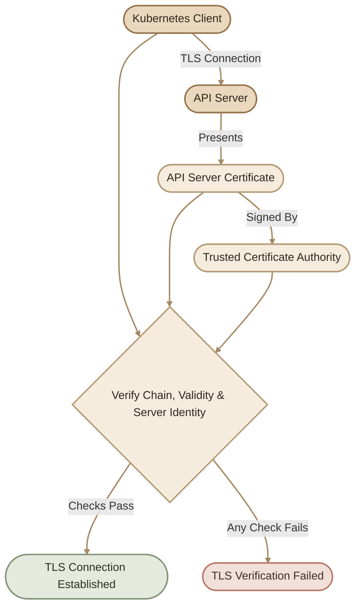

## Overview

الشهادات الرقمية (TLS Certificates) من أهم مكونات الـ Kubernetes Security؛ لأنها بتساعد الـ components تتأكد من هوية بعضها وتؤمّن الاتصال بينها.

في الـ Topic السابق، اتعلمنا أساسيات الشهادات وتوليدها. دلوقتي هنركّز على إزاي نفحص الشهادات الموجودة في الـ cluster، ونتأكد إنها سليمة، ونعرف إمتى هتنتهي صلاحيتها، ونحدد المشاكل الشائعة في إعدادات الـ PKI.

<Callout type="note">
الشرح العملي هنا مبني على Kubernetes clusters المُدارة باستخدام `kubeadm`. لو الـ cluster بتاعك متثبت بطريقة مختلفة، ممكن تلاقي ملفات الشهادات في مسارات تانية.
</Callout>

## 1. Where Are Kubernetes Certificates Stored?

في الـ `kubeadm` clusters، ملفات الشهادات الأساسية بتكون غالبًا داخل:

```text
/etc/kubernetes/pki/
```

الـ directory ده بيحتوي على الـ certificates والـ private keys اللي بتستخدمها مكونات الـ Kubernetes Control Plane.

### I. Common Certificate Files

| File | Purpose |
|---|---|
| `ca.crt` | شهادة الـ Kubernetes cluster CA |
| `ca.key` | الـ private key الخاص بالـ Kubernetes CA، لو موجود على الـ node |
| `apiserver.crt` | شهادة الـ API Server لاستقبال اتصالات TLS |
| `apiserver.key` | الـ private key المقابل لشهادة الـ API Server |
| `apiserver-etcd-client.crt` | شهادة الـ API Server عند الاتصال بالـ etcd |
| `apiserver-etcd-client.key` | الـ private key المستخدم في اتصال الـ API Server بالـ etcd |
| `apiserver-kubelet-client.crt` | شهادة الـ API Server عند الاتصال بالـ kubelets |
| `apiserver-kubelet-client.key` | الـ private key المقابل لشهادة الـ API Server-to-kubelet client |
| `front-proxy-ca.crt` | شهادة الـ CA الخاصة باتصالات الـ front-proxy |
| `front-proxy-client.crt` | شهادة client مستخدمة في بعض اتصالات الـ aggregation layer |

الـ etcd بيكون له PKI منفصل غالبًا داخل:

```text
/etc/kubernetes/pki/etcd/
```

ومن أشهر ملفاته:

| File | Purpose |
|---|---|
| `ca.crt` | شهادة الـ etcd CA |
| `server.crt` | شهادة الـ etcd server |
| `server.key` | الـ private key الخاص بالـ etcd server |
| `peer.crt` | شهادة اتصالات etcd peer في إعدادات etcd المناسبة |
| `peer.key` | الـ private key الخاص بشهادة الـ peer |

**مهم:** وجود الملفات وأسماؤها ممكن يختلف حسب إصدار Kubernetes وطريقة التثبيت. افحص الـ manifests عشان تعرف الملفات المستخدمة فعلًا بدل ما تعتمد على أسماء ثابتة.

## 2. Inspecting Certificate Details

أداة `openssl` بتسمح لنا نقرأ معلومات الشهادة من غير ما نحتاج الـ private key.

### I. Display the Full Certificate

لفحص شهادة الـ API Server:

```bash
sudo openssl x509 \
  -in /etc/kubernetes/pki/apiserver.crt \
  -noout -text
```

الأمر ده بيعرض تفاصيل منها:

- `Subject`: هوية صاحب الشهادة.
- `Issuer`: الجهة اللي أصدرت الشهادة.
- `Validity`: تاريخ بداية ونهاية صلاحية الشهادة.
- `Public Key`: المفتاح العام.
- `X509v3 Subject Alternative Name`: أسماء الـ DNS وعناوين الـ IP المسموح للشهادة تمثيلها.
- `Extended Key Usage`: الاستخدامات المسموح بها للشهادة، لو محددة.

### II. Display Only Important Fields

بدل ما نقرأ كل التفاصيل، نقدر نستخدم:

```bash
sudo openssl x509 \
  -in /etc/kubernetes/pki/apiserver.crt \
  -noout \
  -subject \
  -issuer \
  -dates \
  -ext subjectAltName
```

ده بيساعدنا نراجع هوية الشهادة، والـ CA المصدرة لها، وتاريخ صلاحيتها، والـ SANs بسرعة.

<Callout type="tip">
ابدأ بالأمر المختصر أثناء الـ troubleshooting. لو لقيت حاجة غير متوقعة، استخدم `-text` عشان تفحص التفاصيل كاملة.
</Callout>

## 3. Understanding Subject, Issuer & SANs

### I. Subject

الـ `Subject` بيحدد الهوية المكتوبة داخل الشهادة.

مثال:

```text
CN = kube-apiserver
```

ده مثال لهوية ممكن تظهر في شهادة، لكنه مش شرط يكون الاسم الموجود في كل Kubernetes cluster.

### II. Issuer

الـ `Issuer` بيحدد الجهة اللي أصدرت الشهادة.

مثلًا، ممكن تلاقي شهادة الـ API Server صادرة عن الـ Kubernetes cluster CA، بينما شهادة الـ etcd server صادرة عن etcd CA منفصل.

### III. Subject Alternative Names (SANs)

الـ SANs بتحدد أسماء الـ DNS وعناوين الـ IP اللي الشهادة صالحة لتمثيلها عند التحقق من هوية الـ server.

مثلًا:

```text
DNS:kubernetes
DNS:kubernetes.default
DNS:kubernetes.default.svc
DNS:kubernetes.default.svc.cluster.local
IP Address:10.96.0.1
IP Address:192.168.1.10
```

دي أمثلة توضيحية فقط؛ القيم الفعلية بتعتمد على إعدادات الـ cluster وعنوان الـ API Server المستخدم.

لو العميل اتصل بعنوان مش موجود ضمن الـ SANs المناسبة، ممكن يظهر خطأ زي:

```text
x509: certificate is valid for ..., not ...
```

### IV. Certificate Trust Flow



## 4. Checking Certificate Expiration

انتهاء صلاحية الشهادة ممكن يمنع اتصالات TLS، وبالتالي يؤثر على تواصل الـ Kubernetes components.

### I. Inspect a Single Certificate

```bash
sudo openssl x509 \
  -in /etc/kubernetes/pki/apiserver.crt \
  -noout -dates
```

مثال للنتيجة:

```text
notBefore=Oct 20 10:00:00 2026 GMT
notAfter=Oct 20 10:00:00 2027 GMT
```

- `notBefore`: بداية صلاحية الشهادة.
- `notAfter`: آخر وقت لصلاحية الشهادة.

التواريخ هنا أمثلة، مش تواريخ فعلية لشهادتك.

### II. Check kubeadm-managed Certificates

لو الـ cluster متثبت باستخدام `kubeadm`، استخدم:

```bash
sudo kubeadm certs check-expiration
```

الأمر ده بيعرض معلومات عن صلاحية الشهادات اللي `kubeadm` بيديرها.

ممكن تلاقي معلومات عن:

- تاريخ انتهاء كل شهادة.
- الوقت المتبقي على انتهاء الصلاحية.
- هل الشهادة من الملفات المحلية ولا مرتبطة بمصدر خارجي، حسب نوع الشهادة وإصدار `kubeadm`.

<Callout type="warning">
الأمر ده مش بديل عن فحص كل الشهادات الموجودة في النظام. بعض شهادات الـ kubelet، خصوصًا الشهادات المُدارة ديناميكيًا، قد تحتاج فحصًا منفصلًا.
</Callout>

## 5. Auditing the API Server Certificate Configuration

معرفة مكان الشهادة على القرص مش كفاية؛ لازم نعرف هل الـ API Server بيستخدمها فعلًا، وهل مسارات الملفات صحيحة.

في `kubeadm` clusters، الـ Control Plane components غالبًا بتشتغل كـ static Pods، وملفات تعريفها موجودة هنا:

```text
/etc/kubernetes/manifests/
```

لعرض إعدادات الـ API Server:

```bash
sudo grep -nE \
  'tls-cert-file|tls-private-key-file|client-ca-file|etcd-cafile|etcd-certfile|etcd-keyfile|kubelet-client-certificate|kubelet-client-key' \
  /etc/kubernetes/manifests/kube-apiserver.yaml
```

هتلاقي arguments مرتبطة باستخدام الشهادات والمفاتيح والـ CA certificates.

### I. Important API Server TLS Arguments

| Argument | Purpose |
|---|---|
| `--tls-cert-file` | شهادة الـ API Server لاستقبال اتصالات TLS |
| `--tls-private-key-file` | الـ private key المقابل لشهادة الـ API Server |
| `--client-ca-file` | الـ CA المستخدمة للتحقق من شهادات العملاء عند تفعيل هذا النوع من المصادقة |
| `--etcd-cafile` | شهادة الـ CA المستخدمة للتحقق من شهادة etcd server |
| `--etcd-certfile` | شهادة العميل التي يستخدمها الـ API Server عند الاتصال بـ etcd |
| `--etcd-keyfile` | الـ private key المقابل لشهادة العميل المستخدمة للاتصال بـ etcd |
| `--kubelet-client-certificate` | شهادة العميل التي يستخدمها الـ API Server عند الاتصال بالـ kubelets |
| `--kubelet-client-key` | الـ private key المقابل لشهادة العميل المستخدمة للاتصال بالـ kubelets |

لاحظ الفرق بين نوعين من الشهادات:

- `--tls-cert-file`: شهادة الـ API Server نفسه.
- `--etcd-certfile`: شهادة العميل اللي بيقدمها الـ API Server عند الاتصال بالـ etcd.

الاتنين بيستخدموا في TLS، لكن كل واحدة لها دور مختلف.

## 6. Auditing etcd Certificates

في الـ kubeadm clusters، إعدادات الـ etcd غالبًا بتكون في:

```text
/etc/kubernetes/manifests/etcd.yaml
```

افحص المسارات المتعلقة بالشهادات:

```bash
sudo grep -nE \
  'cert-file|key-file|trusted-ca-file|peer-cert-file|peer-key-file|peer-trusted-ca-file' \
  /etc/kubernetes/manifests/etcd.yaml
```

قد تلاقي arguments مثل:

| Argument | Purpose |
|---|---|
| `--cert-file` | شهادة الـ etcd server |
| `--key-file` | الـ private key الخاص بشهادة الـ server |
| `--trusted-ca-file` | الـ CA المستخدمة للتحقق من شهادات العملاء |
| `--peer-cert-file` | شهادة اتصالات etcd peer |
| `--peer-key-file` | الـ private key المقابل لشهادة الـ peer |
| `--peer-trusted-ca-file` | الـ CA المستخدمة للتحقق من شهادات الـ peers |

مش كل إعدادات etcd بتستخدم نفس الخيارات؛ راجع الـ manifest الفعلي عندك.

### I. Inspect the etcd Server Certificate

```bash
sudo openssl x509 \
  -in /etc/kubernetes/pki/etcd/server.crt \
  -noout \
  -subject \
  -issuer \
  -dates \
  -ext subjectAltName
```

لو المسار مش موجود، ما تفترضش إن الشهادة تالفة؛ ممكن يكون الـ cluster بيستخدم مسارًا مختلفًا. ارجع إلى الـ etcd manifest لتحديد المسار الصحيح.

## 7. Certificate Audit Checklist

قبل ما تعتبر الشهادة سليمة، راجع النقاط دي:

<CardGrid>
  <InfoCard title="Identity" icon="shield">
    اتأكد إن الـ Subject والهوية مناسبين لدور الشهادة.
  </InfoCard>
  <InfoCard title="Issuer & Trust" icon="shield">
    اتأكد إن الـ Issuer والـ CA متوافقين مع إعدادات الثقة لدى الطرف اللي بيتحقق من الشهادة.
  </InfoCard>
  <InfoCard title="Validity" icon="cycle">
    راجع `notBefore` و`notAfter` وتأكد إن الشهادة صالحة حاليًا.
  </InfoCard>
  <InfoCard title="SANs" icon="network">
    اتأكد إن أسماء الـ DNS والـ IP المطلوبة موجودة في الـ SANs.
  </InfoCard>
  <InfoCard title="File Paths" icon="layers">
    راجع المسارات الموجودة في الـ manifests وتأكد إن الملفات موجودة ويمكن قراءتها.
  </InfoCard>
  <InfoCard title="Key & Usage" icon="wrench">
    اتأكد إن الـ private key مطابق للشهادة، وإن استخدامات الشهادة مناسبة لدورها.
  </InfoCard>
</CardGrid>

### I. Verify That the Certificate and Private Key Match

في OpenSSL، نقدر نقارن الـ public key المستخرج من الشهادة بالـ public key المستخرج من الـ private key.

للشهادة:

```bash
sudo openssl x509 \
  -in /etc/kubernetes/pki/apiserver.crt \
  -pubkey -noout |
openssl pkey -pubin -outform DER |
sha256sum
```

للمفتاح الخاص:

```bash
sudo openssl pkey \
  -in /etc/kubernetes/pki/apiserver.key \
  -pubout -outform DER |
sha256sum
```

لو الـ SHA-256 hashes متطابقة، فالـ public key الموجود في الشهادة مطابق للـ public key المستخرج من المفتاح الخاص.

نفّذ المقارنة على جهاز عنده صلاحية قراءة الملفات؛ لأن بعض الـ private keys لا يمكن قراءتها إلا بصلاحيات محددة.

## 8. Troubleshooting Certificate Inspection

### I. Error: Certificate Has Expired

**السبب المحتمل:** انتهت صلاحية الشهادة المستخدمة في الاتصال.

ابدأ بالفحص:

```bash
sudo openssl x509 \
  -in /path/to/certificate.crt \
  -noout -dates
```

بعد تحديد الشهادة المنتهية، حدّد الجهة المسؤولة عن إدارتها وطريقة تجديدها قبل تنفيذ أي تغيير.

### II. Error: Certificate Is Valid for Another Name

**السبب المحتمل:** عنوان الاتصال لا يتطابق مع الـ SANs الموجودة في الشهادة.

افحصها باستخدام:

```bash
sudo openssl x509 \
  -in /path/to/certificate.crt \
  -noout -ext subjectAltName
```

بعد كده قارن الـ SANs بعنوان الـ DNS أو الـ IP المستخدم فعلًا للاتصال.

### III. Error: Unknown Authority

**السبب المحتمل:** الطرف اللي بيتحقق من الشهادة لا يثق في الـ CA التي أصدرتها، أو إن إعداد الـ CA path غير صحيح.

راجع:
- ملف الـ CA المحدد في إعدادات الاتصال.
- الـ Issuer الموجود في الشهادة.
- هل الشهادة صادرة عن الـ CA المتوقع؟
- هل تم استخدام Kubernetes CA بدل etcd CA أو العكس؟

### IV. Error: Cannot Open Certificate File

**السبب المحتمل:** مسار الملف غير صحيح، أو الملف غير موجود، أو الصلاحيات لا تسمح بقراءته.

تحقق من المسار:

```bash
sudo ls -l /path/to/certificate.crt
```

ثم راجع الـ manifest الذي يحدد المسار.

<Callout type="warning">
ما تغيّرش مسارات الشهادات أو تستبدل ملفات الـ CA بشكل عشوائي. خطأ بسيط في إعدادات الـ etcd أو الـ API Server ممكن يوقف الـ Control Plane بالكامل.
</Callout>

## 9. Practical Lab: Audit the API Server Certificate

**الهدف:** تجمع معلومات أساسية عن شهادة الـ API Server وتراجع إعداداتها من غير ما تغيّر أي حاجة في الـ cluster.

<Steps>
<li>
<InfoCard title="Step 1 — Inspect the Certificate" icon="layers" />

```bash
sudo openssl x509 \
  -in /etc/kubernetes/pki/apiserver.crt \
  -noout \
  -subject \
  -issuer \
  -dates \
  -ext subjectAltName
```

سجّل:
- الـ Subject.
- الـ Issuer.
- تاريخ انتهاء الصلاحية.
- الـ SANs.
</li>
<li>
<InfoCard title="Step 2 — Inspect the Manifest" icon="layers" />

```bash
sudo grep -nE \
  'tls-cert-file|tls-private-key-file|client-ca-file' \
  /etc/kubernetes/manifests/kube-apiserver.yaml
```

حدّد مسار شهادة الـ API Server والـ private key والـ client CA.
</li>
<li>
<InfoCard title="Step 3 — Check Expiration" icon="cycle" />

```bash
sudo kubeadm certs check-expiration
```

قارن نتيجة الأمر بتاريخ انتهاء الشهادة التي فحصتها.
</li>
<li>
<InfoCard title="Step 4 — Review Your Findings" icon="shield" />

جاوب عن الأسئلة دي:

1. مين أصدر شهادة الـ API Server؟
2. إمتى هتنتهي صلاحيتها؟
3. هل الـ SANs بتغطي عنوان الاتصال الفعلي بالـ API Server؟
4. هل مسارات الشهادة والـ private key في الـ manifest صحيحة؟
5. إيه الفرق بين `apiserver.crt` و`apiserver-etcd-client.crt`؟
6. ليه ما ينفعش نفترض إن `ca.crt` الخاص بالـ Kubernetes هو نفسه الـ CA الخاص بالـ etcd؟
</li>
</Steps>

## 10. Key Takeaways

- ملفات الـ PKI بتكون غالبًا داخل `/etc/kubernetes/pki/` في الـ kubeadm clusters.
- استخدم `openssl x509` لفحص هوية الشهادة والـ Issuer والصلاحية والـ SANs.
- استخدم `kubeadm certs check-expiration` لمراجعة الشهادات التي يديرها `kubeadm`.
- افحص الـ manifests لتحديد مسارات الشهادات المستخدمة فعليًا.
- شهادة الـ API Server لاستقبال الاتصالات تختلف عن شهادة العميل التي يستخدمها للاتصال بالـ etcd.
- الـ Kubernetes CA والـ etcd CA ممكن يكونوا منفصلين، ولازم كل اتصال يستخدم إعدادات الثقة المناسبة.
- ابدأ بالفحص قبل أي تعديل؛ تغيير الشهادات أو المسارات من غير فهم الاعتماديات ممكن يعطّل الـ Control Plane.

<Callout type="lab">
في الـ Topic القادم، هنطبّق الكلام ده في Certificate Troubleshooting Lab: هنشخّص مشاكل في مسارات الشهادات وإعدادات الـ CA داخل الـ etcd والـ API Server، ونصلحها بطريقة آمنة.
</Callout>