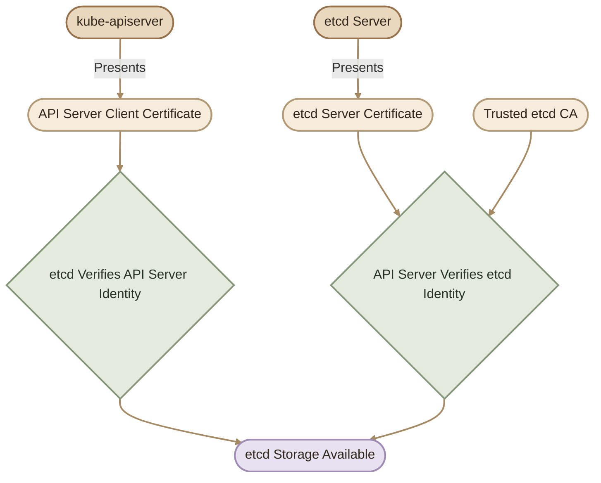
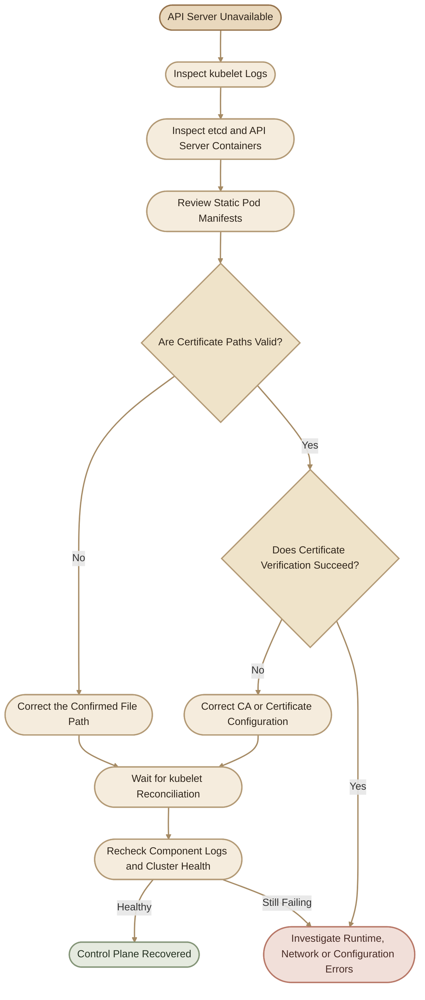

## Overview

مشاكل الـ TLS Certificates من المشاكل اللي ممكن تكون محيّرة في Kubernetes؛ لأن الـ component اللي بيظهر فيه الخطأ مش شرط يكون هو مصدر المشكلة.

مثلًا، لو الـ API Server مش قادر يتصل بالـ etcd، ممكن تكون المشكلة في:
- شهادة العميل اللي بيستخدمها الـ API Server.
- شهادة الـ etcd server.
- الـ CA المستخدمة للتحقق من الشهادة.
- تاريخ صلاحية إحدى الشهادات.
- مسار ملف غير صحيح داخل الـ configuration.
- صلاحيات قراءة ملفات الـ certificates أو الـ private keys.

الهدف هنا إنك تتعلم **تحدد نقطة الفشل، وتجمع الأدلة، وتصلح السبب الحقيقي بأقل تغيير ممكن** بدل ما تبدأ بتجديد الشهادات أو إعادة تشغيل المكونات عشوائيًا.

<Callout type="note">
الأمثلة الخاصة بمسارات الملفات والـ static Pods بتفترض cluster يستخدم `kubeadm`. لو بتستخدم Kubernetes distribution مختلفة، اتبع مسارات وإجراءات الإدارة الخاصة بيها.
</Callout>

## 1. Understand the TLS Connection Before Troubleshooting

أول خطوة إنك تحدد مين بيتصل بمين، وإيه الشهادات المستخدمة في الاتصال.

### I. API Server and etcd

الـ API Server بيستخدم etcd لتخزين حالة الـ Kubernetes cluster. في الإعدادات التي تستخدم TLS authentication، الاتصال ده ممكن يحتاج:

- **etcd server certificate:** لإثبات هوية الـ etcd server.
- **etcd CA certificate:** عشان الـ API Server يقدر يتحقق من شهادة الـ etcd server.
- **API Server client certificate:** عشان الـ etcd يقدر يتحقق من هوية العميل.
- **API Server client private key:** المفتاح الخاص المقابل لشهادة العميل.



الرسم بيوضح اتجاهات التحقق الأساسية. نجاح الاتصال فعليًا محتاج كمان إن الشهادات تكون صالحة، والـ private keys متطابقة، والـ identities والصلاحيات مناسبة.

### II. Common Certificate Paths in kubeadm

| File | Role |
|---|---|
| `/etc/kubernetes/pki/apiserver.crt` | شهادة الـ API Server لاستقبال اتصالات TLS |
| `/etc/kubernetes/pki/apiserver-etcd-client.crt` | شهادة العميل المستخدمة في اتصال الـ API Server بالـ etcd |
| `/etc/kubernetes/pki/etcd/server.crt` | شهادة الـ etcd server |
| `/etc/kubernetes/pki/etcd/ca.crt` | شهادة الـ etcd CA |
| `/etc/kubernetes/pki/ca.crt` | شهادة الـ Kubernetes cluster CA |

دي المسارات الافتراضية الشائعة في `kubeadm`، مش قاعدة ثابتة لكل cluster.

**قاعدة مهمة:** ما تختارش الـ CA بناءً على اسم الملف بس؛ اختارها بناءً على هوية الشهادة والـ trust configuration الخاصة بالاتصال.

## 2. Use a Systematic Troubleshooting Workflow

بدل ما تبدأ بتعديل الملفات، اتبع الترتيب ده.

<CardGrid>
  <InfoCard title="1. Identify" icon="wrench">
    حدّد الـ component اللي فشل، والاتصال اللي كان بيحاول يعمله.
  </InfoCard>
  <InfoCard title="2. Inspect" icon="layers">
    افحص الـ logs والـ manifests ورسائل الخطأ.
  </InfoCard>
  <InfoCard title="3. Verify" icon="shield">
    راجع صلاحية الشهادة والـ issuer والـ SANs والـ CA المستخدمة.
  </InfoCard>
  <InfoCard title="4. Repair" icon="wrench">
    عدّل السبب المؤكد فقط، مع الحفاظ على نسخة احتياطية خارج مجلد الـ static Pods.
  </InfoCard>
  <InfoCard title="5. Validate" icon="cycle">
    تأكد إن المكون رجع للعمل وإن الاتصال أصبح سليمًا.
  </InfoCard>
</CardGrid>

### Step 1 — Identify the Failing Component

لو الـ API Server شغال، ابدأ بمراجعة حالة الـ cluster:

```bash
kubectl get nodes
kubectl get pods -n kube-system
```

لو الأمر الأول فشل، ده مش دليل كافي إن الشهادات هي السبب؛ ممكن تكون المشكلة في الشبكة، أو الـ API Server، أو الـ authentication، أو مكونات أخرى.

في الحالة دي، انتقل للفحص على الـ control-plane node نفسه.

### Step 2 — Inspect Static Pod Manifests

في `kubeadm`، ملفات الـ static Pods غالبًا موجودة هنا:

```text
/etc/kubernetes/manifests/
```

اعرض إعدادات الـ API Server:

```bash
sudo grep -nE \
  'etcd-cafile|etcd-certfile|etcd-keyfile|tls-cert-file|tls-private-key-file|kubelet-client-certificate|kubelet-client-key' \
  /etc/kubernetes/manifests/kube-apiserver.yaml
```

واعرض إعدادات الـ etcd:

```bash
sudo grep -nE \
  'cert-file|key-file|trusted-ca-file|peer-cert-file|peer-key-file|peer-trusted-ca-file' \
  /etc/kubernetes/manifests/etcd.yaml
```

قارن كل مسار بالملف الفعلي على القرص.

مثلًا، لو الـ manifest بيشير إلى:

```text
/etc/kubernetes/pki/etcd/server-certificate.crt
```

لكن الملف الموجود هو:

```text
/etc/kubernetes/pki/etcd/server.crt
```

فده احتمال قوي لوجود configuration error، بشرط إن الخيار اللي بيستخدم المسار ده هو فعلًا الخيار المسؤول عن الشهادة المطلوبة.

ما تغيّرش المسار قبل ما تحدد وظيفة الـ argument وتتحقق من الملف الصحيح.

## 3. Scenario One: Incorrect etcd Certificate Path

### I. Symptoms

الـ etcd static Pod بيفشل في التشغيل، أو بيبدأ ثم يتوقف باستمرار.

ممكن تلاقي في الـ logs رسالة مشابهة لـ:

```text
open /etc/kubernetes/pki/etcd/server-certificate.crt:
no such file or directory
```

الرسالة دي معناها إن العملية حاولت تفتح ملفًا غير موجود في المسار المحدد.

### Step 1 — Check the Actual Files

```bash
sudo ls -l /etc/kubernetes/pki/etcd/
```

حدد ملفات الشهادات والمفاتيح الموجودة فعلًا.

### Step 2 — Inspect the Manifest

```bash
sudo grep -nE 'cert-file|key-file' \
  /etc/kubernetes/manifests/etcd.yaml
```

راجع إن المسارات المحددة في `--cert-file` و`--key-file` تشير إلى الملفات الصحيحة.

### Step 3 — Back Up the Manifest

قبل التعديل، احفظ نسخة خارج مجلد الـ static Pods:

```bash
sudo cp \
  /etc/kubernetes/manifests/etcd.yaml \
  /root/etcd.yaml.backup
```

استخدام `/root/` هنا مقصود؛ ما تحطش ملفات backup بامتداد YAML داخل مجلد الـ manifests، لأن الـ kubelet ممكن يتعامل مع ملفات إضافية هناك باعتبارها manifests حسب طريقة اكتشاف الملفات.

### Step 4 — Correct the Path

افتح الملف باستخدام محرر متاح عندك، مثل `nano`:

```bash
sudo nano /etc/kubernetes/manifests/etcd.yaml
```

صحّح المسار الخاطئ فقط، مع الحفاظ على بنية YAML وباقي الإعدادات.

احفظ الملف واخرج من المحرر.

### Step 5 — Validate the Recovery

الـ kubelet بيراقب ملفات الـ static Pods، وعند اكتشاف التغيير بيحاول إعادة إنشاء الـ Pod وفقًا للـ manifest الجديد.

**ما تحذفش الـ static Pod باستخدام `kubectl` باعتبار ده إصلاحًا للمشكلة.** لازم تصلح الـ manifest نفسه.

لو الـ API Server رجع للعمل:

```bash
kubectl get pods -n kube-system
kubectl get nodes
```

لو لسه مش متاح، افحص حالة الـ containers والـ logs من خلال الـ container runtime.

## 4. Scenario Two: The API Server Uses the Wrong CA

دي مشكلة مختلفة عن مسار شهادة غير موجود.

ممكن كل الملفات تكون موجودة، لكن الـ API Server مش قادر يثق في شهادة الـ etcd server.

### I. Symptoms

قد تظهر رسائل مثل:

```text
x509: certificate signed by unknown authority
```

أو أخطاء مرتبطة بالـ TLS handshake.

الرسالة دي بتشير إلى فشل التحقق من الثقة في الشهادة، لكنها لوحدها مش كفاية لتحديد السبب النهائي.

### II. Why Does This Happen?

افترض إن إعدادات الـ API Server بتستخدم:

```yaml
- --etcd-cafile=/etc/kubernetes/pki/ca.crt
```

بينما شهادة الـ etcd server صادرة عن CA مختلفة، موجودة هنا:

```text
/etc/kubernetes/pki/etcd/ca.crt
```

في الحالة دي، الـ API Server بيستخدم CA غير المناسبة للتحقق من شهادة الـ etcd server.

وجود ملف CA سليم مش معناه إنه الـ CA الصحيح لهذا الاتصال.

### Step 1 — Verify the Certificate Issuer

افحص شهادة الـ etcd server:

```bash
sudo openssl x509 \
  -in /etc/kubernetes/pki/etcd/server.crt \
  -noout -subject -issuer -dates
```

وبعدها افحص شهادة الـ etcd CA:

```bash
sudo openssl x509 \
  -in /etc/kubernetes/pki/etcd/ca.crt \
  -noout -subject -issuer -dates
```

الـ issuer والـ subject بيساعدوك في فهم علاقة الشهادة بالـ CA، لكن مجرد تشابه الأسماء مش إثبات تشفيري كافي لوحده.

للتحقق من توقيع الشهادة باستخدام الـ CA المناسبة:

```bash
sudo openssl verify \
  -CAfile /etc/kubernetes/pki/etcd/ca.crt \
  /etc/kubernetes/pki/etcd/server.crt
```

النتيجة المتوقعة عند نجاح التحقق:

```text
/etc/kubernetes/pki/etcd/server.crt: OK
```

ده بيتحقق من سلسلة الثقة الأساسية للشهادة باستخدام الـ CA المحددة. ما زال مطلوبًا التأكد من صلاحية الشهادة، والـ SANs عند التحقق من اسم الـ server، والإعدادات الأخرى الخاصة بالاتصال.

### Step 2 — Inspect the API Server Configuration

```bash
sudo grep -n -- '--etcd-cafile' \
  /etc/kubernetes/manifests/kube-apiserver.yaml
```

قارن المسار بالـ CA الصحيحة التي أصدرت شهادة الـ etcd server.

### Step 3 — Correct the CA Path If Confirmed

لو أثبت الفحص إن المسار غلط، خُد نسخة احتياطية من manifest:

```bash
sudo cp \
  /etc/kubernetes/manifests/kube-apiserver.yaml \
  /root/kube-apiserver.yaml.backup
```

بعد كده صحّح قيمة `--etcd-cafile` إلى مسار الـ etcd CA الصحيحة في بيئتك.

بعد الحفظ، الـ kubelet هيحاول إعادة تشغيل الـ static Pod وفقًا للتغييرات. لو الـ API Server متوقف، ما تعتمدش على `kubectl` للتحقق؛ استخدم الـ runtime logs كما هو موضح في القسم التالي.

<Callout type="warning">
ما تستبدلش الـ CA لمجرد ظهور خطأ `unknown authority`. اتأكد أولًا من الـ certificate issuer، ومسار الـ CA، وسلسلة الثقة المتوقعة. تغيير CA غير صحيحة أو توليد CA جديدة عشوائيًا ممكن يوسّع المشكلة بدل ما يحلها.
</Callout>

## 5. Troubleshooting When the API Server Is Down

لو الـ API Server مش متاح، أوامر `kubectl` ممكن تفشل؛ لأنها بتعتمد عليه.

في الحالة دي، ابدأ من الـ control-plane node.

### I. Check the Container Runtime

في أنظمة Kubernetes الحديثة، الـ runtime ممكن يكون `containerd` أو CRI-compatible runtime آخر. لو `crictl` مضبوط على الـ runtime المستخدم:

```bash
sudo crictl ps -a
```

ابحث عن containers الخاصة بـ:

- `kube-apiserver`
- `etcd`
- `kube-controller-manager`
- `kube-scheduler`

بعد تحديد الـ container ID، اعرض الـ logs:

```bash
sudo crictl logs <container-id>
```

استبدل `<container-id>` بالمعرّف الفعلي للـ container.

لو `crictl` مش متصل بالـ runtime الصحيح، راجع إعدادات الـ CRI socket في بيئتك. ولو الـ runtime المستخدم هو Docker فعلًا، استخدم أدوات Docker المناسبة بدل افتراض إن كل الأنظمة بتستخدم نفس runtime.

### II. Inspect Kubelet Logs

في الأنظمة اللي بتستخدم `systemd`:

```bash
sudo journalctl -u kubelet -n 100 --no-pager
```

ولمتابعة الرسائل الجديدة:

```bash
sudo journalctl -u kubelet -f
```

دور على رسائل مرتبطة بقراءة الـ manifests، أو فشل إنشاء الـ containers، أو مشاكل mount وقراءة الملفات.

### III. Recovery Decision Tree



## 6. Scenario Three: Certificate Expired

انتهاء صلاحية الشهادة ممكن يمنع إنشاء اتصال TLS، حتى لو كانت مسارات الملفات والـ CA صحيحة.

### I. Inspect the Certificate

```bash
sudo openssl x509 \
  -in /etc/kubernetes/pki/apiserver.crt \
  -noout -dates
```

راجع قيمة `notAfter`، وقارنها بالوقت الحالي.

لو الشهادة انتهت صلاحيتها، حدّد نوعها والجهة المسؤولة عن إدارتها قبل التجديد.

### II. Check kubeadm-managed Certificates

```bash
sudo kubeadm certs check-expiration
```

الأمر ده بيساعدك تحدد الشهادات التي يديرها `kubeadm` وتواريخ انتهائها.

### III. Before Renewing a Certificate

راجع الأسئلة دي:

1. هل الشهادة من الشهادات التي يديرها `kubeadm`؟
2. هل الـ cluster يستخدم شهادات محلية أم شهادات مُدارة خارجيًا؟
3. هل توجد نسخة احتياطية مناسبة من ملفات الـ PKI؟
4. هل تحتاج المكونات المتأثرة إلى إعادة تشغيل بعد التجديد؟
5. هل إعدادات الـ kubeconfig أو المكونات الأخرى تعتمد على الشهادة القديمة؟

تجديد الشهادة مش مجرد استبدال ملف؛ لازم تتأكد إن المكونات اللي بتستخدمها قادرة على تحميل الشهادة الجديدة، وإن أي اعتماديات مرتبطة بيها ما زالت صحيحة.

## 7. Scenario Four: Certificate and Private Key Do Not Match

الشهادة والـ private key لازم يكونوا زوجًا متطابقًا.

لو تم استبدال أحد الملفين دون الآخر، ممكن يفشل الـ component في بدء التشغيل أو إعداد TLS.

### I. Compare the Public Keys

استخراج الـ public key من الشهادة:

```bash
sudo openssl x509 \
  -in /etc/kubernetes/pki/apiserver.crt \
  -pubkey -noout |
openssl pkey -pubin -outform DER |
sha256sum
```

استخراج الـ public key من الـ private key:

```bash
sudo openssl pkey \
  -in /etc/kubernetes/pki/apiserver.key \
  -pubout -outform DER |
sha256sum
```

قارن الـ hashes الناتجة.

- لو متطابقة، فالـ public keys متطابقة.
- لو مختلفة، فالشهادة والـ private key مش زوجًا متطابقًا.

ما تطبعش محتوى الـ private key في الـ terminal logs أو تشاركه في تقارير الـ troubleshooting.

## 8. Scenario Five: Certificate SAN Mismatch

ممكن الشهادة تكون سليمة وغير منتهية، لكن الاتصال يفشل لأن عنوان الـ server مش موجود في الـ SANs.

### I. Inspect the SANs

```bash
sudo openssl x509 \
  -in /etc/kubernetes/pki/apiserver.crt \
  -noout -ext subjectAltName
```

لو بتتصل بالـ API Server باستخدام DNS name، اتأكد إن الاسم موجود ضمن DNS SANs المناسبة. ولو بتستخدم IP address، اتأكد من وجود IP SAN مطابق.

**مهم:** الـ SANs بتتعلق بهوية الـ server، ومش هي نفسها هوية المستخدم أو الـ client. إضافة DNS name إلى الشهادة مش بديل عن إعداد الـ authentication والـ authorization.

لو محتاج تصلح الـ SANs، لازم تعدّل إعدادات إصدار الشهادة وتعيد إصدارها بالطريقة المناسبة لبيئتك، مع الحفاظ على توافقها مع الـ endpoint الفعلي وإعدادات الـ Control Plane.

## 9. Post-Recovery Validation

بعد إصلاح المشكلة، ما تكتفيش باختفاء رسالة الخطأ.

### I. Verify the Control Plane

لو الـ API Server رجع للعمل:

```bash
kubectl get nodes
kubectl get pods -n kube-system
```

### II. Verify etcd and API Server Health

راجع الـ logs للتأكد من اختفاء أخطاء TLS المتكررة:

```bash
sudo crictl ps -a
```

حدد الـ container IDs الخاصة بالـ etcd والـ API Server، ثم افحص الـ logs:

```bash
sudo crictl logs <container-id>
```

استخدم الـ container ID الصحيح لكل component، وراعِ إن الـ runtime قد يختلف من بيئة لأخرى.

### III. Verify Certificate Configuration

أعد فحص الشهادات والمسارات اللي عدّلتها:

```bash
sudo openssl x509 \
  -in /etc/kubernetes/pki/etcd/server.crt \
  -noout -subject -issuer -dates
```

ثم راجع الـ manifest للتأكد إن التعديل ما غيّرش أي إعدادات غير مقصودة.

## 10. Security Best Practices

<InfoCard title="Protect Private Keys" icon="shield">
الـ private keys أسرار حساسة. قلّل صلاحيات الوصول إليها، وما تنسخشها إلى أماكن عامة أو مستودعات Git.
</InfoCard>

<InfoCard title="Back Up Before Changes" icon="database">
احتفظ بنسخ احتياطية مناسبة من ملفات الإعدادات قبل التعديل، وخزّنها خارج مجلد الـ static Pod manifests.
</InfoCard>

<InfoCard title="Prefer Evidence-Based Changes" icon="wrench">
اربط كل تعديل برسالة خطأ أو نتيجة فحص واضحة. ما تجدّدش كل الشهادات لمجرد ظهور خطأ TLS واحد.
</InfoCard>

<InfoCard title="Monitor Expiration" icon="cycle">
تابع صلاحية الشهادات بشكل دوري، وخطط للتجديد قبل انتهاء الصلاحية بوقت كافٍ.
</InfoCard>

<InfoCard title="Separate Trust Domains" icon="network">
افهم الفرق بين Kubernetes CA وetcd CA وأي CAs إضافية قبل تغيير إعدادات الثقة.
</InfoCard>

## 11. Key Takeaways

- مشاكل الشهادات مش كلها مشاكل انتهاء صلاحية؛ ممكن تكون بسبب المسارات أو الـ CA أو الـ SANs أو عدم تطابق المفاتيح.
- افحص الـ manifests والـ logs قبل ما تغيّر أي ملف.
- الـ API Server client certificate تختلف عن الـ API Server serving certificate.
- الـ etcd CA مش بالضرورة تكون هي الـ Kubernetes cluster CA.
- لو الـ API Server متوقف، استخدم أدوات الـ node والـ container runtime بدل الاعتماد على `kubectl`.
- الـ static Pods بتدار بواسطة الـ kubelet؛ إصلاح الـ manifest هو الأساس عند وجود خطأ في تعريفها.
- بعد الإصلاح، تحقّق من صحة الـ Control Plane والاتصالات، مش مجرد اختفاء رسالة الخطأ.
