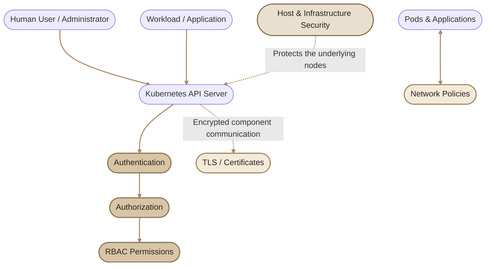
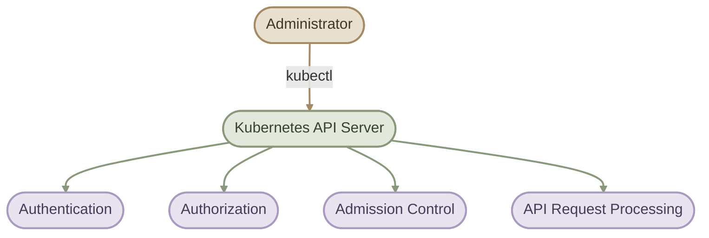
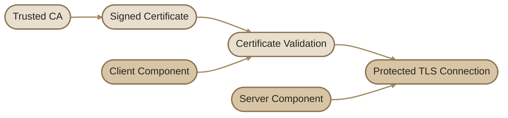
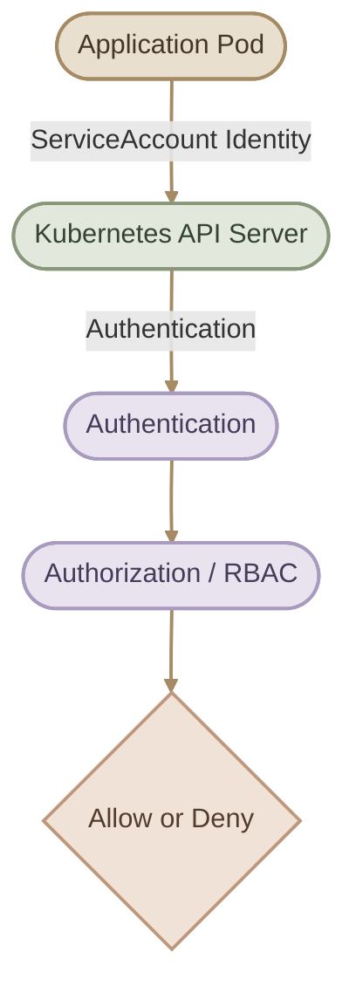
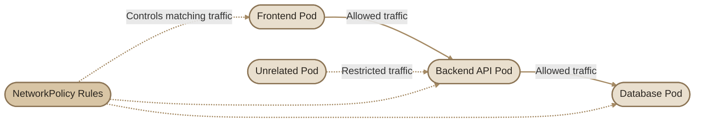

## Overview

الأمان في Kubernetes مش مجرد إنك تحط Password على الـ Cluster؛ هو مجموعة من الآليات اللي بتحمي الـ Infrastructure، وبتتحكم في مين يقدر يدخل الـ Cluster، وإيه العمليات اللي مسموح له ينفذها، وإزاي المكونات والتطبيقات تتواصل مع بعضها بأمان.

في المقال ده هنفهم الـ **Security Primitives** الأساسية، وهنبني خريطة ذهنية تساعدنا نفهم باقي موضوعات الـ Kubernetes Security.

### I. Learning Objectives

بنهاية المقال، هتكون قادر على:

- فهم ليه تأمين الـ Host والـ Infrastructure مهم قبل تأمين Kubernetes نفسه.
- شرح دور الـ Kubernetes API Server باعتباره نقطة مركزية للتعامل مع الـ Cluster.
- التمييز بين Authentication وAuthorization.
- فهم دور الـ TLS Certificates في حماية الاتصال بين مكونات Kubernetes.
- معرفة وظيفة الـ ServiceAccounts.
- فهم إزاي الـ Network Policies بتتحكم في الاتصال بين الـ Pods.
- ربط المفاهيم دي ببعض وفهم إيه اللي كل واحدة بتحميه.

## 1. The Kubernetes Security Model

تخيّل إن عندك Kubernetes Cluster بيشغّل تطبيقات Production. الأمان هنا لازم يغطي أكتر من طبقة؛ لأن اختراق أي طبقة ممكن يعرّض الطبقات التانية للخطر.

<CardGrid>
  <InfoCard title="Infrastructure Security" icon="terminal">
    تأمين السيرفرات والـ Virtual Machines ونظام التشغيل اللي بيشغّل Kubernetes.
  </InfoCard>
  <InfoCard title="Authentication" icon="shield">
    تحديد هوية الشخص أو الـ Workload اللي بيحاول يتعامل مع الـ Cluster.
  </InfoCard>
  <InfoCard title="Authorization" icon="sliders">
    تحديد العمليات والموارد اللي الهوية دي مسموح لها تستخدمها.
  </InfoCard>
  <InfoCard title="Communication Security" icon="network">
    حماية الاتصال بين مكونات Kubernetes باستخدام TLS، والتحكم في الاتصال بين التطبيقات باستخدام Network Policies.
  </InfoCard>
</CardGrid>

### I. The Big Picture


> **Important:** الرسم بيوضح العلاقات الأساسية، لكنه مش ترتيب كامل لكل خطوات معالجة الـ API Request. الـ TLS بيحمي الاتصال نفسه، بينما الـ Authentication والـ Authorization بيتعاملوا مع الهوية والصلاحيات.

## 2. Infrastructure Security

قبل ما نتكلم عن Kubernetes، لازم نفتكر إن الـ Cluster شغّال فوق Infrastructure: سواء كانت Physical Servers أو Virtual Machines أو Cloud Instances.

لو مهاجم قدر يسيطر على Node بصلاحيات عالية، ممكن يتجاوز أجزاء من الحماية اللي بنعتمد عليها داخل Kubernetes.

### I. Essential Host Security Measures

- **SSH Access:** استخدم وسائل مصادقة قوية، زي SSH Keys أو آليات مؤسسية مناسبة، بدل الاعتماد على Passwords ضعيفة.
- **Least Privilege:** قلّل استخدام حساب `root`، وامنح المستخدمين أقل صلاحيات لازمة لشغلهم.
- **OS Patching:** حدّث نظام التشغيل والـ Packages لسد الثغرات الأمنية.
- **Network Exposure:** قلّل الخدمات والمنافذ المكشوفة، واسمح بالوصول للإدارة من مصادر موثوقة قدر الإمكان.
- **Secrets Protection:** احمِ مفاتيح الـ SSH والـ Credentials والـ Certificates، ومتخزنهاش في أماكن مكشوفة.
- **Monitoring:** راقب محاولات تسجيل الدخول والأحداث المهمة على الـ Host.

<Callout type="warning" title="Security Starts Below Kubernetes">
لو الـ Host نفسه مخترق، فالمهاجم ممكن يحصل على وصول للـ Containers أو بياناتها أو Credentials متاحة على الـ Node، حسب مستوى الاختراق وإعدادات الـ Cluster. عشان كده تأمين Kubernetes لازم يشمل الـ Infrastructure كمان.
</Callout>

**ملاحظة:** تعطيل Password Authentication أو تقييد وصول `root` أمثلة على إجراءات شائعة، لكن طريقة التنفيذ تعتمد على بيئة التشغيل ومتطلبات الإدارة. المهم هو تطبيق سياسة وصول آمنة ومناسبة، مش مجرد تنفيذ إعداد واحد بمعزل عن باقي النظام.

## 3. The Kubernetes API Server

الـ **Kubernetes API Server** هو الواجهة الأساسية اللي بنتعامل من خلالها مع الـ Cluster.

لما تستخدم `kubectl` لإنشاء Deployment أو قراءة Pods أو تعديل ConfigMap، فالطلبات بتوصل إلى الـ API Server، وهو المسؤول عن استقبال طلبات الـ Kubernetes API ومعالجتها.



الرسم مبسّط: بعد المصادقة والتفويض، قد تمر الطلبات بمراحل إضافية مثل الـ Admission Control قبل قبول التغيير أو رفضه.

### I. Why Is the API Server a Security Boundary?

لأن التحكم في الوصول للـ API Server بيساعدنا نحدد:

1. مين الهوية اللي بتبعت الطلب؟
2. هل الهوية دي مسموح لها تنفّذ العملية المطلوبة؟
3. هل الطلب مقبول وفقًا لسياسات الـ Cluster؟

لكن فيه نقطة مهمة: **مش كل العمليات على الـ Host لازم تمر من خلال الـ API Server**. لو مهاجم حصل على وصول مباشر للـ Node، فدي مشكلة أمنية منفصلة، وممكن ما تتحلش بمجرد ضبط RBAC.

## 4. Authentication: Who Are You?

الـ **Authentication (AuthN)** هو التحقق من هوية الجهة اللي بتحاول تتعامل مع الـ API Server.

ببساطة، بنسأل:

> إنت مين، وإيه الدليل اللي يثبت هويتك؟

حسب إعدادات الـ Cluster

، Kubernetes بيدعم طرق مختلفة للتعامل مع الهويات، منها:

- **Client Certificates:** استخدام شهادة عميل موثوق بها لإثبات الهوية.
- **Bearer Tokens:** تقديم Token تقبله آلية المصادقة المُعدّة على الـ Cluster.
- **External Identity Providers:** التكامل مع أنظمة هوية خارجية، غالبًا باستخدام OIDC أو آليات أخرى مدعومة.
- **ServiceAccounts:** هويات داخل Kubernetes تُستخدم عادةً بواسطة الـ Workloads والعمليات الآلية.

الطرق المتاحة فعلًا بتعتمد على إعدادات الـ Cluster ومكوّنات المصادقة المستخدمة.

<Callout type="note" title="A Common Misconception">
مش معنى إنك بتستخدم `kubectl` إن Kubernetes بيعتمد تلقائيًا على Username وPassword. الـ `kubectl` بيستخدم بيانات الاتصال والـ Credentials الموجودة في الـ kubeconfig، أو آلية مصادقة مناسبة لبيئتك.
</Callout>

### I. Human Users vs. Workloads

| Identity | Typical Use | Example |
|---|---|---|
| Human User | إدارة الـ Cluster أو تشغيل عمليات إدارية | Administrator |
| ServiceAccount | تمثيل Application أو Process داخل Kubernetes | Application reading permitted resources |
| External Identity | ربط Kubernetes بنظام هوية خارجي | OIDC-backed user |

الـ ServiceAccount مش مجرد Username عادي؛ دي آلية هوية مخصصة للـ Workloads والعمليات الآلية داخل Kubernetes.

## 5. Authorization: What Can You Do?

بعد ما Kubernetes يتعرف على الهوية، لازم يحدد هل الهوية دي مسموح لها تنفّذ العملية المطلوبة أم لا.

وده دور الـ **Authorization (AuthZ)**.

مثال: مستخدم قدر يعمل Authentication بنجاح، لكن هل مسموح له يحذف Pods في Namespace اسمها `production`؟

الإجابة بتعتمد على صلاحياته وسياسات التفويض الموجودة في الـ Cluster.

### I. Authentication vs. Authorization

<CardGrid>
  <InfoCard title="Authentication (AuthN)" icon="shield">
    **السؤال:** مين إنت؟

    **الهدف:** التحقق من الهوية.
  </InfoCard>
  <InfoCard title="Authorization (AuthZ)" icon="sliders">
    **السؤال:** مسموح لك تعمل إيه؟

    **الهدف:** تحديد الصلاحيات على الموارد والعمليات.
  </InfoCard>
</CardGrid>

من أشهر آليات التفويض في Kubernetes:

- **RBAC (Role-Based Access Control):** تحديد الصلاحيات باستخدام Roles وBindings.
- **Node Authorization:** آلية متخصصة لتقييد طلبات الـ Kubelet المتعلقة بالـ Nodes والموارد المرتبطة بها.
- **Webhook Authorization:** تفويض الطلبات لنظام خارجي يقرر قبولها أو رفضها.
- **ABAC (Attribute-Based Access Control):** آلية تفويض تعتمد على Attributes، لكنها مش هي الاختيار المعتاد للـ Access Control في أغلب الـ Clusters الحديثة.

الـ RBAC هو محور أساسي في القسم ده، وهنفصّله في مقالات لاحقة.

<Callout type="tip" title="Remember the Difference">
نجاح الـ Authentication مش معناه إن المستخدم عنده صلاحية ينفّذ أي عملية. ممكن هويتك تكون صحيحة، لكن طلبك يتترفض لأنك مش مخوّل له.
</Callout>

## 6. TLS and Certificates

مكونات Kubernetes بتتبادل معلومات وطلبات مع بعضها. من أمثلة المكونات دي:

- `kube-apiserver`
- `etcd`
- `kube-controller-manager`
- `kube-scheduler`
- `kubelet`
- `kube-proxy`

بحسب تصميم الـ Cluster وإعداداته، بنستخدم **TLS (Transport Layer Security)** لحماية اتصالات بين المكونات.

TLS بيساعد على توفير:

- **Encryption:** تشفير البيانات أثناء انتقالها عبر الاتصال.
- **Authentication:** التحقق من هوية الطرف الآخر باستخدام الشهادات أو وسائل أخرى يدعمها الاتصال.
- **Integrity:** اكتشاف التلاعب بالبيانات أثناء انتقالها.

### I. How Certificates Fit In

الشهادة الرقمية بتربط هوية معيّنة بمفتاح عام، وبتكون موقّعة من جهة موثوقة أو صادرة وفقًا لنظام الثقة المُعتمد.

في إعدادات Kubernetes المعتمدة على شهادات X.509، هنقابل عادةً:

| Component | Purpose |
|---|---|
| Certificate | تحمل الهوية والمفتاح العام ومعلومات أخرى |
| Private Key | يُستخدم في عمليات التشفير أو التوقيع المناسبة، ويجب حمايته |
| Certificate Authority (CA) | جهة تصدر أو توقّع الشهادات ضمن نطاق الثقة الخاص بها |
| CA Certificate | شهادة الجهة التي يستخدمها الطرف الآخر للتحقق من الثقة |
| TLS | البروتوكول الذي يحمي الاتصال باستخدام إعدادات التشفير والمصادقة المناسبة |

### II. Simplified TLS Trust Model



الرسم توضيحي ومبسّط؛ إنشاء اتصال TLS حقيقي يتضمن خطوات إضافية، والتحقق الفعلي يعتمد على إعدادات الشهادات والأسماء وسياسات الثقة.

<Callout type="warning" title="Protect Private Keys">
امتلاك شهادة عامة مش معناه إن الشخص يقدر ينتحل الهوية المرتبطة بيها. الخطر الحقيقي بيظهر لما الـ Private Key المرتبط بالشهادة يتسرّب أو يتستخدم بدون تصريح.
</Callout>

هنبدأ من أساسيات TLS، وبعدها نفهم استخدام الشهادات داخل Kubernetes وإزاي نفحصها ونشخّص المشاكل المرتبطة بيها.

## 7. ServiceAccounts

الـ ServiceAccount بيمثل هوية ممكن تستخدمها الـ Applications والـ Processes اللي شغالة داخل Kubernetes.

تخيّل إن عندك Application محتاجة تقرأ بيانات معينة من الـ Kubernetes API. بدل ما تستخدم Credentials خاصة بمستخدم بشري، ممكن تربط الـ Pod بـ ServiceAccount وتمنحه الصلاحيات المطلوبة.



وجود ServiceAccount لوحده مش معناه إن الـ Application عندها صلاحيات واسعة. الصلاحيات بتعتمد على آليات التفويض والـ RoleBindings أو ClusterRoleBindings المرتبطة بالهوية.

### I. Security Best Practices

- متديش الـ ServiceAccount صلاحيات أكتر من احتياج الـ Application.
- متفترضش إن كل Pod لازم يوصل للـ Kubernetes API.
- لو الـ Workload مش محتاجة Token للوصول للـ API، فكّر في تعطيل تركيب الـ Token تلقائيًا باستخدام `automountServiceAccountToken: false` على الـ Pod أو الـ ServiceAccount المناسب.
- احمِ أي Credentials أو Tokens من التسريب.

هنشرح الـ ServiceAccounts بالتفصيل في المقال المخصص ليها.

## 8. Network Policies

لحد هنا ركّزنا على تأمين الوصول للـ Kubernetes API والاتصالات بين مكونات الـ Cluster.

لكن فيه سؤال مختلف:

> لو اتنين Pods شغالين داخل نفس الـ Cluster، هل ده معناه إن كل واحد فيهم يقدر يتواصل مع التاني؟

في Kubernetes، مفيش عزل شبكي تلقائي بين كل الـ Pods لمجرد إنهم Pods منفصلة. في الشبكات التي تسمح باتصال الـ Pods بصورة افتراضية، قد تتمكن الـ Pods من التواصل مع بعضها ما لم توجد قيود مناسبة.

الـ **NetworkPolicy** بتحدد قواعد للتحكم في الـ Network Traffic، مثل:

- **Ingress:** الاتصال الوارد إلى الـ Pod.
- **Egress:** الاتصال الصادر من الـ Pod.

مثال: Application موجودة في Namespace اسمها `frontend` ومحتاجة تتواصل مع API في Namespace اسمها `backend`، لكن مش المفروض يكون فيه اتصال مباشر من أي Pod عشوائية إلى الـ API.

ممكن نستخدم Network Policies لتحديد الاتصالات المسموح بها، بشرط إن الـ CNI المستخدم في الـ Cluster يدعم تطبيق السياسات دي.

### I. Conceptual Network Isolation



ده مثال تصوّري، مش NetworkPolicy جاهزة للتطبيق. القواعد الفعلية لازم تتحدد وفقًا للـ Namespaces والـ Labels والـ Ports والـ Traffic المطلوب، وكمان لازم تراعي احتياجات الـ DNS لو فيه قيود على الـ Egress.

<Callout type="note" title="NetworkPolicy Is Not RBAC">
الـ RBAC بيتحكم في العمليات على Kubernetes API Resources، بينما الـ NetworkPolicy بتتحكم في أنواع محددة من الاتصال الشبكي بين الـ Pods والـ Endpoints. كل واحدة بتحل مشكلة مختلفة.
</Callout>

## 9. Putting It All Together

خلينا نربط كل المفاهيم بمثال واحد.

عندنا Administrator عايز يعدّل Deployment في الـ Cluster، وApplication شغالة داخل Pod وبتحتاج تقرأ بيانات من Kubernetes API.

### I. Administrator Request

1. الـ Administrator يستخدم `kubectl`.
2. الطلب يوصل إلى الـ API Server عبر اتصال آمن وفقًا لإعدادات الـ Cluster.
3. الـ API Server يتحقق من هوية المستخدم باستخدام آلية Authentication المناسبة.
4. آلية Authorization، مثل RBAC، تحدد هل المستخدم مسموح له بتعديل الـ Deployment.
5. الطلب ممكن يمر بمراحل إضافية، مثل Admission Control، قبل تنفيذ التغيير.

### II. Application Request

1. الـ Application تستخدم هويتها، مثل ServiceAccount، للوصول إلى Kubernetes API عند الحاجة.
2. الـ API Server يتحقق من الـ Credentials المستخدمة.
3. الـ Authorization يحدد هل الـ ServiceAccount مسموح لها بالعملية المطلوبة.
4. بصورة منفصلة، الـ Network Policies ممكن تقيّد الاتصالات الشبكية بين الـ Pod والـ Pods أو الـ Endpoints الأخرى، لو الـ CNI بيدعم تطبيقها.

### III. Security Responsibility Map

| Security Mechanism | Main Question | What It Protects |
|---|---|---|
| Infrastructure Security | هل الـ Host مؤمّن؟ | Nodes, operating systems, infrastructure |
| Authentication | مين بيبعت الطلب؟ | Identity verification |
| Authorization / RBAC | مسموح له يعمل إيه؟ | Access to API resources and operations |
| TLS | هل الاتصال محمي والطرف الآخر موثوق؟ | Communication between participating endpoints |
| ServiceAccounts | إيه الهوية المستخدمة بواسطة الـ Workload؟ | Workload identity |
| Network Policies | مين يقدر يتواصل مع مين شبكيًا؟ | Supported Pod network traffic |
| Admission Control | هل الطلب مقبول وفقًا للسياسات؟ | Validation and policy enforcement on API requests |

## 10. Practical Exploration

هنستخدم شوية أوامر للقراءة والاستكشاف فقط. الأوامر دي مش بتغيّر إعدادات الـ Cluster.

### I. Check Your Current Context

```bash
kubectl config current-context
```

الأمر بيعرض اسم الـ Context الحالي اللي `kubectl` بيستخدمه.

لو شغال على أكتر من Cluster، اتأكد إنك فاهم الـ Context الحالي قبل تنفيذ أوامر تغيّر الموارد.

### II. Inspect the Current Identity Configuration

```bash
kubectl config view
```

الأمر بيعرض إعدادات الـ kubeconfig، لكن بعض بيانات الـ Credentials ممكن تكون مخفية أو معروضة بشكل غير مباشر حسب الخيارات والإعدادات.

**مهم:** متشاركش ناتج الـ kubeconfig بدون مراجعته؛ لأنه ممكن يحتوي على معلومات حساسة، منها بيانات اتصال أو References إلى ملفات Credentials.

لعرض الـ Context الحالي وتفاصيله بشكل مختصر:

```bash
kubectl config view --minify
```

ده برضه ممكن يعرض معلومات حساسة؛ راجع الناتج قبل مشاركته.

### III. Explore API Resources

```bash
kubectl api-resources
```

الأمر بيعرض أنواع الـ Resources المتاحة من خلال الـ Kubernetes API، زي Pods وDeployments وServices.

### IV. Check Your Permissions

```bash
kubectl auth can-i get pods
```

الأمر بيسأل الـ API Server هل الهوية الحالية مسموح لها بتنفيذ عملية `get` على Pods ضمن الـ Namespace الافتراضية الحالية.

ولفحص صلاحية في Namespace محددة:

```bash
kubectl auth can-i get pods -n default
```

ولمعرفة هل الهوية الحالية مسموح لها بإنشاء Deployments:

```bash 
kubectl auth can-i create deployments -n default
```

دي أوامر لفحص الصلاحيات؛ مش بتنشئ أو تعدّل موارد.

<Callout type="lab" title="Mini Lab: Understand Your Security Context">
نفّذ الأوامر السابقة على الـ Lab Cluster الخاص بيك، وسجّل:

1. اسم الـ Context الحالي.
2. هل تقدر تقرأ Pods في الـ Namespace الافتراضية؟
3. هل تقدر تنشئ Deployments فيها؟
4. إيه الفرق بين نتيجة `kubectl auth can-i` ووجود الـ Authentication Credentials أصلًا؟

متغيّرش صلاحيات أو إعدادات الـ Cluster لمجرد إن نتيجة أمر مش مطابقة لتوقعاتك. الهدف هنا هو الاستكشاف وفهم الهوية والصلاحيات الحالية.
</Callout>

## 11. Common Misconceptions

<CardGrid>
  <InfoCard title="Authentication ≠ Authorization" icon="shield">
    إثبات الهوية لا يعني امتلاك صلاحية تنفيذ كل العمليات.
  </InfoCard>
  <InfoCard title="TLS ≠ Access Control" icon="pulse">
    تشفير الاتصال لا يمنح المستخدم صلاحيات مناسبة، ولا يغني عن Authorization.
  </InfoCard>
  <InfoCard title="ServiceAccount ≠ Permissions" icon="code">
    الـ ServiceAccount بيوفر هوية للـ Workload، لكن الصلاحيات الفعلية بتعتمد على إعدادات التفويض.
  </InfoCard>
  <InfoCard title="NetworkPolicy ≠ Universal Firewall" icon="network">
    تطبيق السياسات يعتمد على دعم الـ CNI، والـ NetworkPolicy لا تستبدل كل طبقات حماية الشبكة.
  </InfoCard>
</CardGrid>

## 12. Knowledge Check

### Question 1

What is the primary role of the Kubernetes API Server?

- A. To provide a graphical interface for all applications.
- B. To act as the main API interface for Kubernetes operations.
- C. To encrypt every Pod-to-Pod connection automatically.
- D. To replace the operating system on every Node.

<Callout type="note" title="Answer">
**Correct answer: B.** الـ API Server هو الواجهة الأساسية للتعامل مع Kubernetes API، وبيشارك في معالجة الطلبات والتحقق من الهوية والصلاحيات.
</Callout>

### Question 2

An administrator successfully authenticates to the API Server but cannot delete a Deployment. Which security concept most directly determines whether the operation is permitted?

- A. Authentication
- B. TLS
- C. Authorization
- D. NetworkPolicy

<Callout type="note" title="Answer">
**Correct answer: C.** الـ Authorization هو اللي بيحدد هل الهوية عندها صلاحية تنفيذ العملية المطلوبة أم لا.
</Callout>

### Question 3

What is the primary purpose of TLS in Kubernetes component communication?

- A. To assign CPU and memory limits.
- B. To protect communication using encryption and appropriate authentication and integrity mechanisms.
- C. To create namespaces automatically.
- D. To grant administrator permissions to ServiceAccounts.

<Callout type="note" title="Answer">
**Correct answer: B.** TLS بيحمي الاتصال بين الأطراف المشاركة فيه وفقًا لإعداداته، لكنه مش بديل عن ضبط الصلاحيات.
</Callout>

### Question 4

What is the primary purpose of a ServiceAccount?

- A. To represent an identity commonly used by workloads and automated processes.
- B. To replace all RBAC policies.
- C. To isolate every Pod at the network layer.
- D. To encrypt the host's disk automatically.

<Callout type="note" title="Answer">
**Correct answer: A.** الـ ServiceAccount بيوفر هوية للـ Workload، لكن الصلاحيات بتتحدد بشكل منفصل.
</Callout>

### Question 5

What should you verify before relying on Kubernetes NetworkPolicies to isolate Pods?

- A. Whether the application uses a Deployment.
- B. Whether the CNI implementation supports enforcing NetworkPolicies.
- C. Whether every Pod has a ServiceAccount.
- D. Whether the API Server uses a specific port.

<Callout type="note" title="Answer">
**Correct answer: B.** لازم تتأكد إن الـ CNI بيدعم تطبيق الـ NetworkPolicies؛ وجود الـ Policy Object وحده مش ضمان إن حركة الشبكة هتتقيّد.
</Callout>

## Summary

الـ Kubernetes Security بيعتمد على أكتر من آلية، وكل آلية مسؤولة عن جزء مختلف من الحماية:

- **Infrastructure Security:** حماية الـ Hosts والـ Nodes ونظام التشغيل.
- **Authentication:** التحقق من الهوية.
- **Authorization:** تحديد العمليات المسموح بها.
- **TLS:** حماية الاتصالات بين الأطراف المشاركة في الاتصال.
- **ServiceAccounts:** توفير هويات للـ Workloads والعمليات الآلية.
- **NetworkPolicies:** تقييد أنواع محددة من الاتصال الشبكي، بشرط دعم الـ CNI.
- **Admission Control:** تطبيق قواعد إضافية على طلبات الـ API قبل قبولها.

الفكرة الأساسية اللي لازم تفضل ثابتة عندك:

**Identity → Permissions → Secure Communication → Network Isolation**
