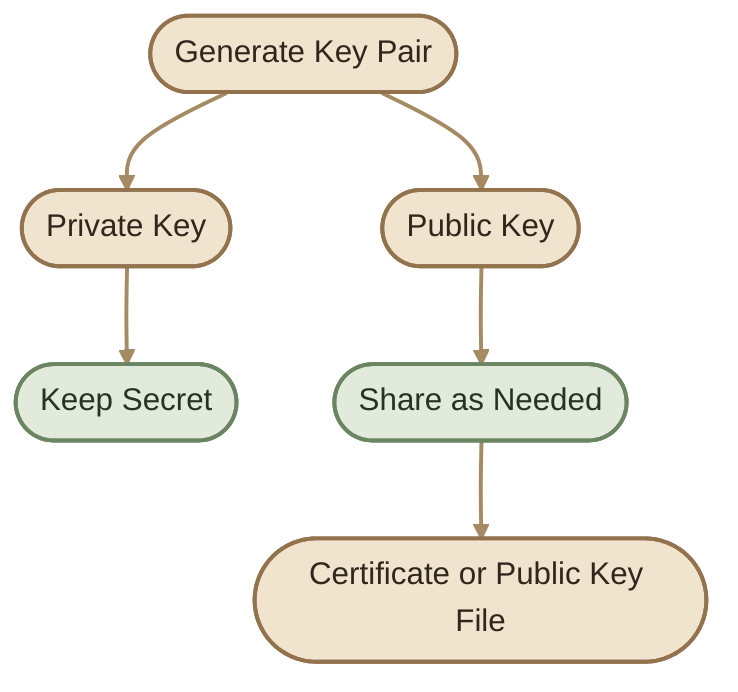
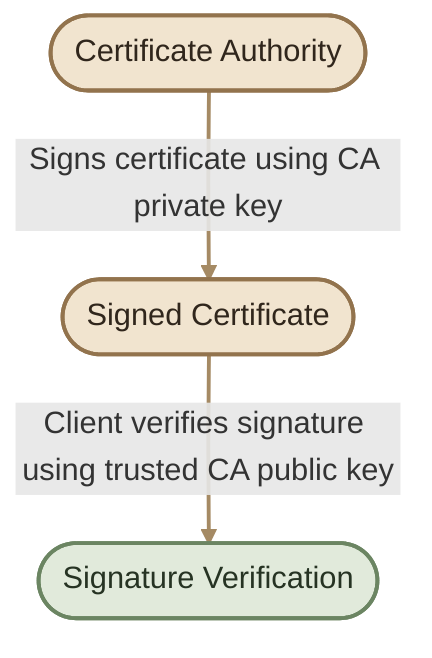
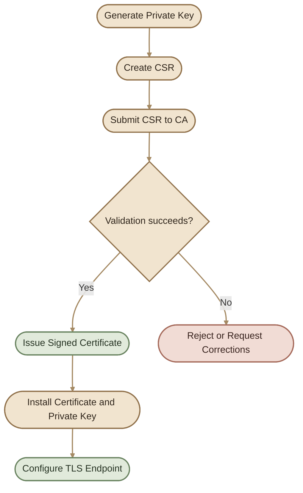
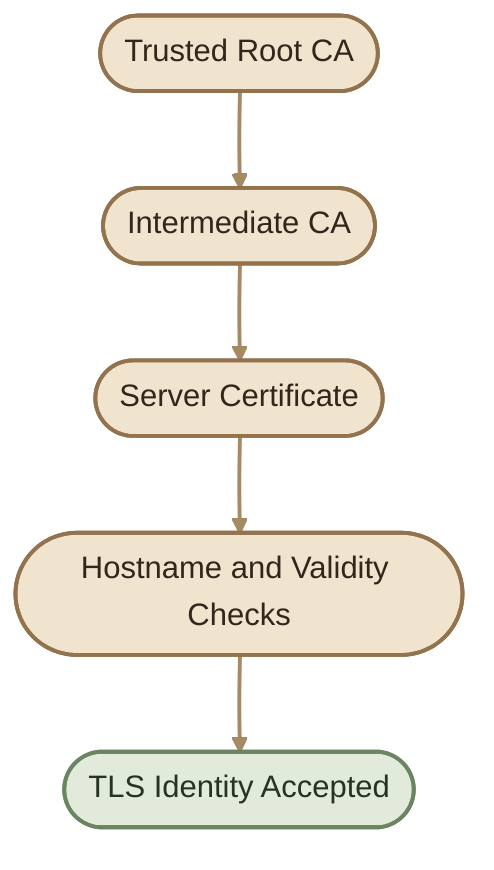

## Overview

في المقال السابق عرفنا ليه TLS مهم وإزاي الشهادات الرقمية بتساعد في بناء الثقة. هنا هنركّز على العلاقة بين الـ Public Key والـ Private Key والـ Certificate، وإزاي الشهادة بتتوقّع وتتراجع قبل ما العميل يثق فيها.

## 1. Understanding the Key Pair

كل Key Pair بيتكوّن من مفتاحين مرتبطين رياضيًا:

- **Private Key:** بيتحفظ بأمان، ومالكه بيستخدمه في عمليات تشفيرية زي إنشاء Digital Signatures أو عمليات TLS المطلوبة.
- **Public Key:** بيتوزّع على الأطراف اللي محتاجة تتحقق من التوقيع أو تستخدمه وفقًا للخوارزمية.



<Callout type="warning" title="Never Share the Private Key">

الـ Private Key مش جزء من الـ CSR اللي بتبعته للـ CA، ومش المفروض ترفعه إلى GitHub أو تحطه في Docker image أو تشاركه في ملفات الـ logs.

</Callout>

## 2. How Does a Digital Signature Work?

لما الـ CA تصدر شهادة، بتوقّع بيانات الشهادة باستخدام الـ Private Key الخاص بيها.

العميل اللي عنده شهادة الـ CA أو المفتاح العام الموثوق بيستخدمه للتحقق من التوقيع. نجاح التحقق بيثبت إن التوقيع متوافق مع المفتاح العام، لكنه لوحده مش كفاية لإثبات إن الشهادة مناسبة للموقع المطلوب؛ لازم باقي خطوات التحقق تنجح برضه.



التوقيع الرقمي مش هو نفس تشفير البيانات. في TLS، التوقيعات بتساعد في التحقق من المصدر وسلامة بيانات محددة، بينما تشفير الجلسة بيحمي بيانات الاتصال من القراءة والتلاعب.

## 3. The Certificate Signing Request (CSR)

الـ CSR هو طلب لإصدار شهادة، بيتعمل عادةً بعد إنشاء Key Pair.

العملية المعتادة:

1. إنشاء Private Key وPublic Key.
2. إعداد CSR يحتوي على الـ Public Key ومعلومات الهوية المطلوبة.
3. إرسال CSR إلى CA.
4. التحقق من الهوية أو ملكية النطاق وفقًا لسياسة الـ CA.
5. إصدار شهادة موقّعة، لو الطلب اتقبل.
6. تثبيت الشهادة وربطها بالـ Private Key المناسب على الخادم.



## 4. Inspecting a Certificate with OpenSSL

تقدر تستخدم `openssl` لفحص الشهادات والـ keys. الأمثلة دي للفحص فقط، ومش بتغيّر أي شهادة داخل Kubernetes.

### I. Inspect a Certificate

```bash
openssl x509 -in server.crt -text -noout
```

الأمر بيعرض تفاصيل زي:

- Subject وIssuer.
- Validity dates.
- Public Key information.
- Subject Alternative Name (لو موجود).
- Signature algorithm.

### II. Inspect the Certificate Dates

```bash
openssl x509 -in server.crt -noout -dates
```

### III. Inspect the Subject Alternative Name

```bash
openssl x509 -in server.crt -noout -ext subjectAltName
```

لو الملف مش موجود في المسار الحالي، استبدل `server.crt` بمسار الشهادة الفعلي. الأوامر دي بتفترض إن الملف شهادة X.509 قابلة للقراءة من OpenSSL.

## 5. Certificate Identity: Subject and SAN

الشهادة ممكن تحتوي على معلومات عن صاحبها، لكن عند التحقق من هوية خادم TLS لازم اسم الخادم المطلوب يتطابق مع الاسم الموجود في الشهادة بالطريقة المناسبة.

**Subject Alternative Name (SAN)** هو المكان الأساسي المستخدم للتحقق من أسماء النطاقات وعناوين IP.

مثلًا، لو العميل بيتصل بـ:

```text
https://api.example.internal
```

فالشهادة لازم تكون مناسبة للاسم `api.example.internal`. وجود اسم مختلف في الشهادة ممكن يؤدي إلى فشل التحقق حتى لو الشهادة موقّعة من CA موثوق فيها.

لو الخادم بيتستخدم بأكتر من اسم، لازم تتضمن الشهادة أسماء الاتصال المطلوبة في SAN.

## 6. Certificate Chain of Trust

مش كل شهادة لازم تكون موقّعة مباشرةً بواسطة Root CA.

سلسلة الثقة ممكن تتكوّن من:

- **Root CA Certificate:** نقطة ثقة موجودة في Trust Store عند العميل.
- **Intermediate CA Certificate:** شهادة وسيطة بتستخدم لتوقيع شهادات أخرى.
- **Server Certificate:** الشهادة المقدمة من الخادم.



العميل بيتحقق من السلسلة باستخدام الشهادات المتاحة وسياسة الثقة عنده. لازم كمان يتأكد من صلاحية الشهادة واسم الخادم وأي شروط تحقق أخرى مطلوبة.

**مهم:** وجود توقيع صالح مش معناه تلقائيًا إن الشهادة موثوقة. لو الـ Root CA مش موجودة ضمن مصادر الثقة المناسبة عند العميل، ممكن الاتصال يفشل.

## 7. Self-Signed Certificates

الـ Self-signed Certificate بتكون موقّعة بالمفتاح الخاص المرتبط بيها، بدل ما تكون موقّعة من CA مختلفة.

استخداماتها ممكن تشمل:

- Local development.
- Testing environments.
- Internal systems مع إعداد الثقة بشكل صريح.

لكنها مش بتكتسب الثقة تلقائيًا لمجرد إن توقيعها صحيح. لازم العميل يثق فيها بشكل مستقل، مثل تثبيتها ضمن Trust Store المناسب أو استخدام آلية ثقة محددة للبيئة.

## 8. Server Certificates and Client Certificates

<CardGrid>
  <InfoCard title="Server Certificate" icon="layers">
    بيساعد العميل يتحقق من هوية الخادم.
  </InfoCard>
  <InfoCard title="Client Certificate" icon="terminal">
    ممكن يستخدمه الخادم للتحقق من هوية العميل في mTLS.
  </InfoCard>
  <InfoCard title="CA Certificate" icon="shield">
    بيساعد على بناء سلسلة الثقة والتحقق من الشهادات.
  </InfoCard>
</CardGrid>

في الاتصال العادي بموقع HTTPS، المتصفح بيتحقق من هوية الخادم. لكن ده مش معناه إن الخادم عرف هوية المستخدم البشري من شهادة TLS؛ غالبًا المستخدم بيتحقق منه بآلية التطبيق، مثل Session أو OAuth أو كلمة مرور.

في **Mutual TLS (mTLS)**، الطرفين بيتحققوا من الشهادات حسب إعداد الاتصال وسياسات الثقة.

## 9. What Is PKI?

**Public Key Infrastructure (PKI)** هي المنظومة اللي بتدير دورة حياة الشهادات والمفاتيح، وبتشمل عادةً:

- Certificate Authorities.
- Certificate issuance and signing.
- Trust stores.
- Certificate renewal and revocation mechanisms.
- Secure storage and rotation of private keys.
- Policies وإجراءات التحقق.

في البيئات الكبيرة، إدارة الشهادات مش مجرد إصدار شهادة مرة واحدة؛ لازم تتابع تواريخ الانتهاء، وتجدد الشهادات، وتتعامل مع المفاتيح اللي اتسرّبت أو الشهادات اللي لم تعد موثوقة.

## 10. Troubleshooting Checklist

لو TLS connection فشل، ابدأ بالتحقق من النقاط دي:

<Callout type="tip" title="Start with Read-Only Checks">

ابدأ بفحص الشهادة والـ logs والإعدادات الحالية. ما تمسحش أو تستبدل شهادات الإنتاج لمجرد إن الاتصال فشل، لأن السبب ممكن يكون hostname mismatch أو CA غير موثوقة أو شهادة منتهية.

</Callout>

<CardGrid>
  <InfoCard title="Expiration" icon="cycle">
    هل الشهادة انتهت صلاحيتها؟
  </InfoCard>
  <InfoCard title="Hostname / SAN" icon="code">
    هل الشهادة مناسبة للاسم المستخدم في الاتصال؟
  </InfoCard>
  <InfoCard title="Trust Chain" icon="shield">
    هل العميل بيثق في الـ CA المناسبة؟
  </InfoCard>
  <InfoCard title="Certificate & Key Pairing" icon="sliders">
    هل الشهادة مرتبطة بالـ Private Key المتوقع؟
  </InfoCard>
  <InfoCard title="System Time" icon="pulse">
    هل وقت النظام مضبوط؟
  </InfoCard>
  <InfoCard title="Configuration" icon="terminal">
    هل التطبيق بيستخدم مسارات الملفات الصحيحة، وهل الخدمة تقدر تقرأ الملفات المطلوبة بأمان؟ هل الشهادة اتجدّدت لكن الخدمة لسه بتستخدم النسخة القديمة؟
  </InfoCard>
</CardGrid>

## Key Takeaways

- الـ CSR طلب إصدار شهادة، مش شهادة موقّعة.
- الـ Private Key لازم يفضل سرّي.
- توقيع الشهادة جزء من التحقق، لكنه مش كل التحقق.
- SAN وValidity وTrust Chain عناصر مهمة في التحقق من هوية الخادم.
- Self-signed مش معناها تلقائيًا غير آمنة؛ معناها إن الثقة محتاجة إعداد مستقل.
- TLS client certificates وserver certificates بيخدموا أدوار مختلفة.
