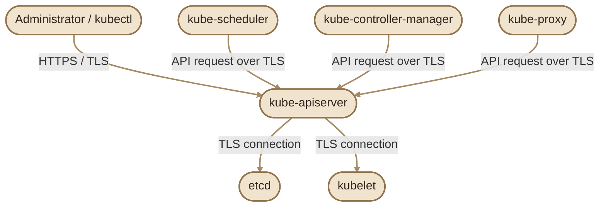
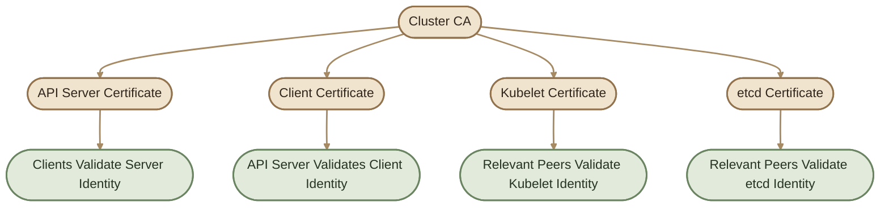
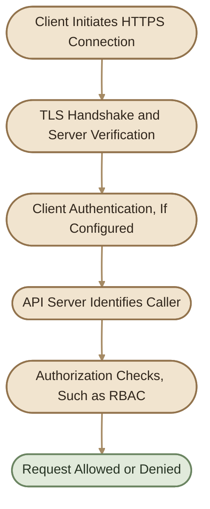

## Overview

بعد ما فهمنا TLS والـ Certificates، نقدر نطبّق المفاهيم دي على Kubernetes.

الـ Kubernetes Cluster فيه مكونات كتير بتتواصل مع بعضها: `kube-apiserver` و`etcd` و`kubelet` و`kube-scheduler` وغيرها. لازم الاتصالات دي تتأمّن حسب طبيعة كل اتصال، وده بيشمل التحقق من هوية الخوادم والعملاء باستخدام TLS أو آليات مصادقة أخرى.

<Callout type="note" title="Important">

TLS بيحمي الاتصال وبيساعد على التحقق من الهوية، لكنه مش بديل عن Kubernetes Authentication وAuthorization وRBAC. نجاح TLS لوحده مش معناه إن العميل عنده صلاحية لتنفيذ API request.

</Callout>

## 1. Where Is TLS Used?

أهم نقطة دخول للـ Kubernetes API هي `kube-apiserver`. أدوات زي `kubectl` بتتصل بيه باستخدام HTTPS.

كمان فيه اتصالات داخلية بين مكونات الـ Control Plane والـ Worker Nodes. نوع الشهادة وطريقة التحقق بيختلفوا حسب المكون والاتصال والإعدادات.



الرسم بيوضح العلاقات الرئيسية بشكل مبسّط، مش كل اتصالات الشبكة داخل Kubernetes. تفاصيل الـ TLS والمصادقة بتعتمد على إعدادات الكلاستر وطريقة تشغيله.

## 2. Servers and Clients

أي اتصال TLS له طرف بيقدّم خدمة وطرف بيتصل بيها. نفس المكوّن ممكن يكون Server في اتصال وClient في اتصال تاني.

### I. Server-Side Certificates

الشهادة هنا بتساعد الطرف المتصل على التحقق من هوية الخادم.

<CardGrid>
  <InfoCard title="kube-apiserver" icon="wheel">
    بيقدّم Kubernetes API عبر HTTPS، وبيحتاج Serving Certificate مناسبة لعناوين الاتصال المستخدمة.
  </InfoCard>
  <InfoCard title="etcd" icon="database">
    بيخزّن بيانات الكلاستر. إعداداته ممكن تتضمن Server وClient وPeer Certificates حسب طريقة النشر.
  </InfoCard>
  <InfoCard title="kubelet" icon="cube">
    بيقدّم HTTPS API على الـ Node. ممكن يستخدم Serving Certificate للتحقق من هوية الـ kubelet.
  </InfoCard>
</CardGrid>

### II. Client-Side Certificates

بعض المكونات بتستخدم Client Certificates لإثبات هويتها عند الاتصال بـ API Server أو بخدمة أخرى.

<CardGrid>
  <InfoCard title="Administrator" icon="terminal">
    ممكن يستخدم Client Certificate ضمن الـ kubeconfig للمصادقة أمام API Server.
  </InfoCard>
  <InfoCard title="kube-scheduler" icon="cycle">
    بيتواصل مع API Server لإدارة عمليات الـ Scheduling باستخدام بيانات المصادقة المهيّأة له.
  </InfoCard>
  <InfoCard title="kube-controller-manager" icon="sliders">
    بيتواصل مع API Server لمتابعة حالة الموارد وتشغيل Controllers.
  </InfoCard>
  <InfoCard title="kube-proxy" icon="network">
    بيتواصل مع API Server عند استخدامه لمتابعة معلومات الشبكة والخدمات.
  </InfoCard>
</CardGrid>

**مهم:** مش كل مكوّن لازم يستخدم Client Certificate في كل إعداد. Kubernetes بيدعم أكتر من طريقة للمصادقة، منها Client Certificates وServiceAccount Tokens وOIDC وغيرها، حسب نوع العميل والإعداد.

## 3. The Kubernetes Certificate Authority

الـ **Certificate Authority (CA)** بتساعد المكونات على التحقق من شهادات بعضها. الـ CA نفسها عندها Certificate وPrivate Key:

- `ca.crt` — مثال شائع لشهادة الـ CA.
- `ca.key` — مثال شائع للـ Private Key الخاص بالـ CA.

الأسماء دي أمثلة شائعة، مش أسماء إلزامية في كل Kubernetes Cluster.

الـ CA بتوقّع شهادات المكونات وفقًا للسياسات المطلوبة. المكوّن اللي بيتحقق من شهادة الطرف الآخر لازم يكون عنده مصدر ثقة مناسب، ويطبّق شروط التحقق المطلوبة.



الرسم بيشرح نموذجًا ممكنًا باستخدام CA مشتركة. بعض الكلاسترات بتستخدم أكتر من CA، مثل CA منفصلة لاتصالات `etcd`.

## 4. The Main Certificate Groups

في بيئة Kubernetes، الأفضل نفكر في الشهادات حسب وظيفتها بدل ما نحفظ أسماء الملفات فقط.

| Certificate group | Purpose |
|---|---|
| API Server serving certificate | تمكين العملاء من التحقق من هوية API Server |
| API Server client certificates | ممكن استخدامها عند اتصال API Server بخدمات أخرى |
| etcd certificates | تأمين اتصالات etcd، ومنها Server وClient وPeer حسب الإعداد |
| Kubelet certificates | تأمين اتصالات kubelet وتحديد هويته حسب نوع الشهادة |
| Component client certificates | مصادقة مكونات مثل Scheduler وController Manager أمام API Server |
| CA certificates | توفير مصادر الثقة للتحقق من الشهادات |

### I. API Server Certificate

لما `kubectl` يتصل بالـ API Server، لازم العميل يقدر يتحقق من شهادة الخادم. لو عنوان الاتصال هو `api.example.internal`، فلازم الشهادة تكون مناسبة للاسم ده ضمن SAN.

لو الشهادة موقّعة من CA غير موثوق فيها، أو منتهية، أو الاسم مش مطابق، ممكن اتصال TLS يفشل حتى لو الـ API Server شغّال.

### II. etcd Certificates

`etcd` بيخزّن حالة الكلاستر وبياناته الحساسة، ولذلك حماية اتصالاته مهمة جدًا.

حسب إعدادات النشر، ممكن تلاقي شهادات مختلفة من أجل:

- اتصال Client بخادم etcd.
- اتصال API Server بخادم etcd.
- اتصالات Peer بين أعضاء etcd عند تشغيله ككلاستر.

مش كل بيئة هتستخدم نفس عدد الشهادات أو نفس الأسماء.

### III. Kubelet Certificates

الـ `kubelet` Agent موجود على كل Node، وبيقدّم API للعمليات الإدارية المطلوبة من مكونات الكلاستر.

فيه فرق بين:

- **Kubelet client certificate:** ممكن يستخدمه kubelet للمصادقة أمام API Server.
- **Kubelet serving certificate:** ممكن يستخدمه API Server أو عميل آخر للتحقق من هوية kubelet عند الاتصال بواجهته.

دول دورين مختلفين، ومش لازم يكونوا نفس الشهادة.

## 5. One CA or Multiple CAs?

ممكن تستخدم CA واحدة لتوقيع شهادات متعددة داخل الكلاستر، وممكن تستخدم CAs منفصلة لأجزاء مختلفة من النظام.

### I. Single CA

مميزاتها إن إدارة الثقة أبسط نسبيًا، لأن مكونات كتير ممكن تثق في نفس الـ CA.

لكن المفتاح الخاص بالـ CA بيكون عنصرًا شديد الحساسية، وأي تسريب له ممكن يؤثر على الثقة في شهادات كتير.

### II. Multiple CAs

مثلًا، ممكن تستخدم CA لاتصالات Kubernetes العامة وCA منفصلة لاتصالات etcd.

ده بيساعد على فصل نطاقات الثقة، لكنه بيحتاج إدارة أدق لشهادات كل طرف ومصادر الثقة اللي بيستخدمها.

**الخلاصة:** اختيار CA واحدة أو أكتر قرار معماري وأمني، مش قاعدة ثابتة لازم كل الكلاسترات تتبعها.

## 6. Where Are the Certificates Stored?

في الكلاسترات اللي بتتجهّز باستخدام `kubeadm`، غالبًا هتلاقي شهادات الـ Control Plane والـ CA في:

```text
/etc/kubernetes/pki/
```

وممكن تلاقي ملفات بأسماء شائعة زي:

```text
ca.crt
ca.key
apiserver.crt
apiserver.key
apiserver-kubelet-client.crt
apiserver-kubelet-client.key
front-proxy-ca.crt
```

دي أمثلة من تخطيطات شائعة، ومش قائمة ثابتة لكل Cluster. ممكن أسماء الملفات وترتيبها يختلفوا حسب طريقة الإنشاء والإعداد.

<Callout type="warning" title="Do Not Modify Cluster Certificates Blindly">

ما تمسحش أو تستبدل ملفات الشهادات أو مفاتيح الـ CA في الكلاستر اللي بتستخدمه. تغيير شهادة من غير فهم الاتصالات المعتمدة عليها ممكن يوقف الـ API Server أو يقطع اتصال مكونات الكلاستر.

</Callout>

### I. What About kind?

بما إن `kind` بيشغّل Kubernetes Nodes داخل Containers، 

ابدأ بفهم الـ Context الحالي قبل أي فحص أو تعديل:

```bash
kubectl config current-context
kubectl cluster-info
kubectl get nodes
```

الأوامر دي للقراءة والفحص. وهي بتساعدك تتأكد من الكلاستر اللي بتتعامل معاه قبل ما تبدأ أي خطوات إضافية.

## 7. TLS Authentication Is Not RBAC

خلينا نفصل بين المراحل دي لأنها من أهم نقاط Kubernetes Security.



- **TLS:** بيأمّن الاتصال ويساعد على التحقق من هوية الطرف الآخر.
- **Authentication:** بيحدد هوية الـ Caller باستخدام آلية مصادقة مدعومة.
- **Authorization:** بيحدد إذا كانت الهوية دي مسموح لها تنفّذ العملية المطلوبة.

مثال: لو `kubectl` نجح في إنشاء اتصال TLS مع API Server، ده مش معناه تلقائيًا إن المستخدم يقدر يحذف Pods أو يغيّر Secrets. القرار ده مرتبط بالـ Authentication والـ Authorization والإعدادات الفعلية للكلاستر.

## 8. Read-Only Troubleshooting

لو عايز تبدأ تتأكد من حالة الكلاستر من غير تعديل أي شهادات:

```bash
kubectl config current-context
kubectl cluster-info
kubectl get nodes
kubectl get --raw=/readyz
```

الأمر الأخير بيطلب Readiness endpoint من API Server، ونجاحه بيدل على إن الـ endpoint ردّ بشكل ناجح، لكنه مش فحص شامل لكل الشهادات أو كل الاتصالات الداخلية.

لو عندك ملف Certificate وعايز تفحصه، استخدم:

```bash
openssl x509 -in /path/to/certificate.crt -noout -subject -issuer -dates
```

استبدل المسار بمسار شهادة موجود فعلًا في البيئة اللي بتفحصها. الفحص ده بيعرض معلومات الشهادة، لكنه لوحده مش بيثبت إن الشهادة صالحة لكل اتصال أو إن سلسلة الثقة كاملة.

### I. Common TLS Problems

| Symptom | Possible cause |
|---|---|
| `certificate has expired` | الشهادة انتهت صلاحيتها |
| `certificate is valid for ..., not ...` | الاسم المستخدم في الاتصال لا يطابق الشهادة |
| `unknown authority` | العميل لا يثق في الـ CA المصدرة، أو سلسلة الثقة غير مكتملة |
| `connection refused` | الخدمة لا تستمع على العنوان أو المنفذ، أو الاتصال محجوب؛ مش بالضرورة مشكلة شهادة |
| API authentication failure | بيانات المصادقة غير صحيحة أو غير مقبولة؛ قد لا تكون المشكلة في TLS |
| Authorization denied | الهوية اتحددت، لكن الطلب غير مسموح به وفق سياسة الصلاحيات |

## 9. What Comes Next?

المقال ده بيركّز على شكل الـ TLS داخل Kubernetes، لكن إنشاء الشهادات وفحص تفاصيلها وإدارة طلباتها موضوعات مستقلة.

في الدروس التالية، هنقدر نتوسع في:

- إنشاء Certificate Authority وشهادات مخصصة.
- قراءة تفاصيل الشهادة والتحقق من صلاحيتها.
- Certificates API وCertificate Signing Requests (CSRs).
- Kubeconfig وعلاقته ببيانات الاتصال والمصادقة.

## Key Takeaways

- `kube-apiserver` نقطة محورية في اتصالات Kubernetes، وبيقدّم API عبر HTTPS.
- `etcd` و`kubelet` وغيرهم عندهم احتياجات مختلفة للشهادات حسب الاتصال.
- الشهادة ممكن تكون Server Certificate أو Client Certificate أو CA Certificate حسب دورها.
- أسماء الملفات ومواقعها بتختلف حسب طريقة تثبيت الكلاستر.
- وجود TLS مش معناه إن كل الاتصالات تستخدم mTLS، ولا إن كل العملاء بيستخدموا Client Certificates.
- TLS وAuthentication وAuthorization طبقات مختلفة ومتكاملة.
- ما تعدّليش شهادات الكلاستر قبل ما تفهم وظيفتها والاتصالات اللي بتعتمد عليها.
