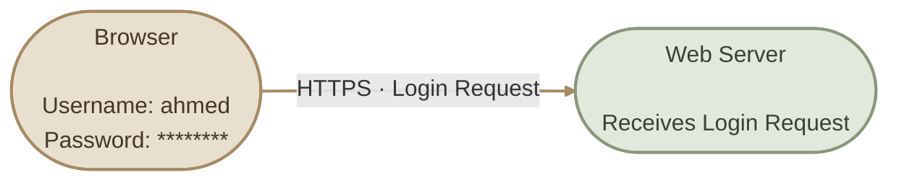
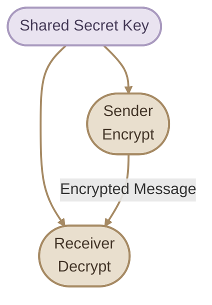
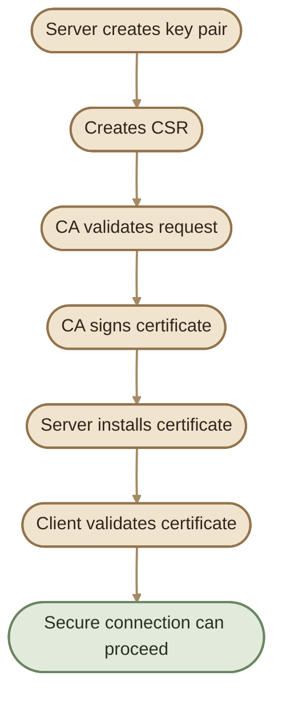
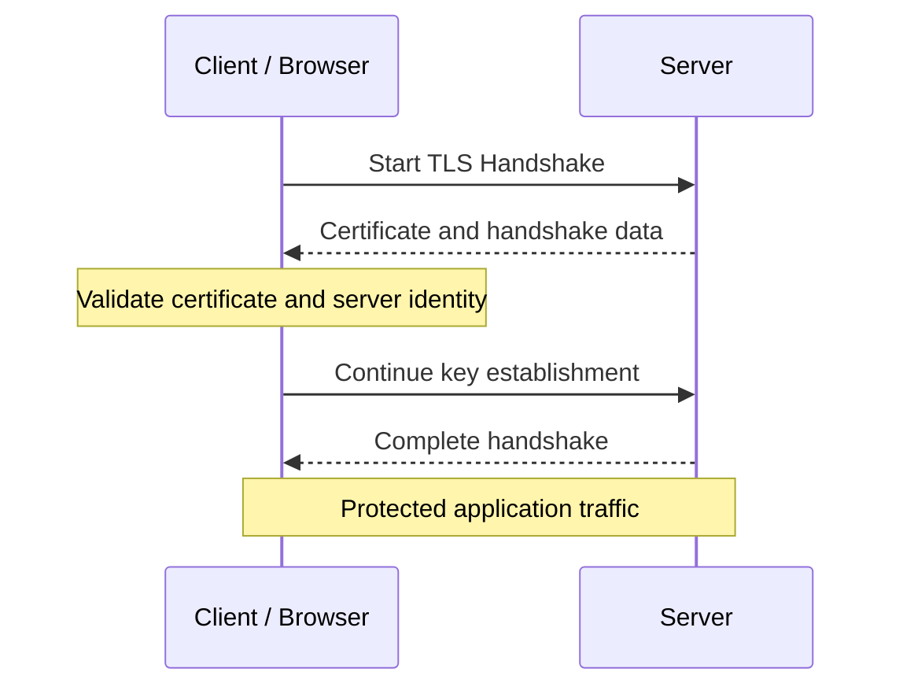

## Overview

قبل ما نبدأ نتعامل مع Certificates داخل Kubernetes، محتاجين نفهم المشكلة اللي TLS بيحلّها، وإزاي نقدر نثق في الطرف اللي بنتواصل معاه.

في نهاية المقال ده هتقدر تميّز بين:

- **Encryption** — تشفير البيانات لحمايتها أثناء انتقالها.
- **Authentication** — التأكد من هوية الطرف اللي بنتواصل معاه.
- **TLS Certificate** — شهادة رقمية بتساعد في إثبات الهوية وربطها بـ Public Key.
- **Certificate Authority (CA)** — جهة أو نظام بنثق فيه علشان يوقّع الشهادات.
- **PKI** — البنية الكاملة المسؤولة عن إصدار الشهادات وإدارتها والتحقق منها.

<Callout type="note" title="الفكرة الأساسية">

وجود `HTTPS` في عنوان الموقع مش مجرد معناه إن البيانات مشفّرة؛ TLS كمان بيساعد المتصفح يتأكد إنه بيتواصل مع الموقع الصحيح، بشرط إن الشهادة تكون صالحة وموثوق فيها.

</Callout>

## 1. Why Do We Need TLS?

تخيّل إنك بتسجّل الدخول إلى موقع البنك باستخدام اتصال غير مشفّر.

لو شخص قدر يراقب حركة البيانات على الشبكة، ممكن يقرأ المعلومات اللي بتتنقل بدون حماية.

TLS بيحمي الاتصال عن طريق تشفير البيانات أثناء انتقالها، وبيساعد الطرفين يتحققوا من هوية بعضهم حسب إعداد الاتصال.

### I. The Three Security Goals

<CardGrid>
  <InfoCard title="Confidentiality" icon="shield">
    البيانات تكون غير قابلة للقراءة بسهولة بواسطة شخص بيراقب الشبكة.
  </InfoCard>
  <InfoCard title="Integrity" icon="pulse">
    اكتشاف التلاعب بالبيانات أثناء انتقالها.
  </InfoCard>
  <InfoCard title="Authentication" icon="sliders">
    التحقق من هوية الطرف الآخر، حسب نوع المصادقة المستخدمة.
  </InfoCard>
</CardGrid>

ملحوظة: TLS بيوفّر حماية للاتصال، لكنه مش بيضمن إن التطبيق نفسه آمن، ولا إن المستخدم عنده صلاحية ينفّذ أي عملية يطلبها.

## 2. Symmetric Encryption

في **Symmetric Encryption**، نفس الـ Secret Key بيُستخدم لتشفير البيانات وفك تشفيرها.

الميزة الأساسية هي السرعة، وده بيخليه مناسب لتشفير كميات كبيرة من البيانات.

المشكلة إن الطرفين لازم يمتلكوا نفس المفتاح بشكل آمن. لو المهاجم حصل على المفتاح، ممكن يقدر يفك تشفير البيانات المحمية بيه.

## 3. Asymmetric Cryptography

في **Asymmetric Cryptography**، فيه زوج من المفاتيح مرتبطين ببعض:

- **Private Key:** لازم يفضل سرّي عند مالكه.
- **Public Key:** ممكن مشاركته مع الآخرين.

المفتاحين مرتبطين رياضيًا، لكن ما ينفعش عمليًا استنتاج الـ Private Key من الـ Public Key باستخدام خوارزميات قوية وإعدادات سليمة.

في بعض خوارزميات التشفير، البيانات المشفّرة بأحد المفتاحين يمكن فكّها بالمفتاح المقابل. لكن استخدامات المفاتيح بتختلف حسب الخوارزمية: فيه عمليات للتشفير، وعمليات للتوقيع الرقمي والتحقق منه.

<Callout type="warning" title="Public Key مش هو Certificate">

الـ Public Key هو مفتاح تشفيري. أما الـ Certificate فهي وثيقة رقمية ممكن تحتوي على المفتاح العام ومعلومات عن صاحب الشهادة والجهة المصدرة ومدة الصلاحية وأسماء النطاقات.

</Callout>

## 4. What Is a TLS Certificate?

شهادة TLS هي وثيقة رقمية بصيغة زي X.509، بتربط هوية معيّنة بـ Public Key، وبتحتوي عادةً على معلومات زي:

- Subject أو هوية صاحب الشهادة.
- Subject Alternative Name (SAN)، للأسماء أو عناوين IP اللي الشهادة صالحة ليها.
- Public Key.
- Issuer، الجهة اللي أصدرت الشهادة.
- Validity Period، بداية ونهاية صلاحية الشهادة.
- Digital Signature من الجهة المصدرة.

الـ Certificate مش سرّية في العادة؛ اللي لازم نحميه هو الـ Private Key المرتبط بيها.

## 5. What Is a Certificate Authority?

**Certificate Authority (CA)** هي جهة أو نظام بنثق فيه، وبيصدر أو يوقّع شهادات بعد التحقق المطلوب.

### I. Certificate Signing Request (CSR)

الـ CSR هو طلب توقيع شهادة. غالبًا بيتضمن الـ Public Key ومعلومات الهوية المطلوبة. في الاستخدام المعتاد، بيتولد باستخدام الـ Private Key الموجود عند صاحب الطلب، لكن **الـ Private Key نفسه ما بيتبعتش للـ CA**.

بعد التحقق من الطلب، الـ CA ممكن تصدر Certificate موقّعة.

### II. Public CA vs Private CA

- **Public CA:** شهاداتها ممكن تكون موثوق فيها تلقائيًا من المتصفحات وأنظمة التشغيل، حسب الـ Trust Store وسياسات الثقة.
- **Private CA:** بتستخدم داخل مؤسسة أو بيئة خاصة. الأجهزة اللي محتاجة تثق في شهاداتها لازم تكون مهيّأة للثقة في الـ CA المناسبة.

الشهادة الموقعة ذاتيًا (**Self-signed Certificate**) مش بالضرورة غير آمنة في كل الحالات؛ ممكن تكون مناسبة للاختبارات أو بيئات خاصة، لكن لازم يكون عند العميل سبب مستقل وموثوق للثقة فيها.

## 6. TLS and HTTPS

لما تفتح موقع باستخدام HTTPS، بيحصل TLS Handshake قبل تبادل بيانات التطبيق المحمية.

في الاتصال المعتاد، المتصفح بيتحقق من الشهادة، ومنها:

1. هل سلسلة الشهادات بتنتهي عند CA موثوق فيها؟
2. هل الشهادة ضمن فترة صلاحيتها؟
3. هل اسم الموقع موجود ضمن SAN المناسب؟
4. هل الشهادة والتوقيعات مقبولة وفقًا لسياسات التحقق؟

بعد كده بيتم الاتفاق على مفاتيح جلسة آمنة باستخدام آليات الـ TLS المناسبة. في TLS الحديث، غالبًا بيتم استخدام **asymmetric cryptography للتوثيق أو إنشاء المفاتيح**، وبعدها **symmetric cryptography** لتشفير معظم البيانات بكفاءة.

الخطوات التفصيلية بتختلف حسب إصدار TLS وخوارزميات التبادل المستخدمة؛ مش كل اتصال بيبعت Symmetric Key مشفّرًا مباشرةً بالـ Server Public Key.

## 7. TLS Certificates vs SSH Keys

الـ SSH Key Pair والـ TLS Certificate مش نفس الحاجة، حتى لو الاتنين ممكن يعتمدوا على Public-Key Cryptography.

| Concept | Purpose |
|---|---|
| SSH key pair | غالبًا لمصادقة مستخدم أو نظام عند الاتصال عبر SSH |
| TLS certificate | ربط هوية بـ Public Key، والتحقق من الشهادة أثناء TLS |
| TLS private key | إثبات امتلاك المفتاح المرتبط بالشهادة، حسب البروتوكول |
| CA certificate | شهادة تُستخدم ضمن سلسلة الثقة للـ CA |

## 8. Common File Extensions

| Extension | Common use |
|---|---|
| `.crt` / `.cer` | Certificate |
| `.pem` | Container format ممكن يحتوي على Certificate أو Key أو بيانات أخرى |
| `.key` | غالبًا Private Key |
| `.csr` | Certificate Signing Request |
| `.p12` / `.pfx` | Container ممكن يحتوي على Certificate وPrivate Key وشهادات إضافية |

**مهم:** الامتداد لوحده مش دليل قاطع على محتوى الملف. ملف `.pem` ممكن يحتوي على شهادة أو مفتاح خاص أو أكثر من عنصر. افحص المحتوى والأداة المستخدمة قبل ما تفترض نوعه.

## Key Takeaways

- TLS بيحمي الاتصال بالتشفير، وبيساعد على التحقق من الهوية وسلامة البيانات.
- Symmetric Encryption سريع، لكنه يحتاج طريقة آمنة لتأسيس مفاتيح الجلسة.
- Public Keys ممكن مشاركتها؛ Private Keys لازم تتأمّن.
- الشهادة بتربط هوية بـ Public Key، والـ CA بتساعد في بناء الثقة.
- وجود HTTPS وحده مش دليل على إن الموقع جدير بالثقة من كل النواحي.
- TLS ما بيستبدلش Authentication أو Authorization داخل التطبيق.
  