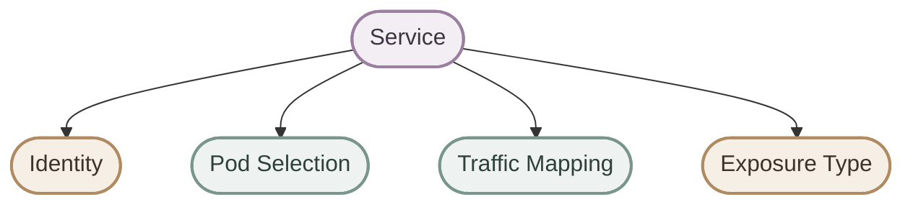
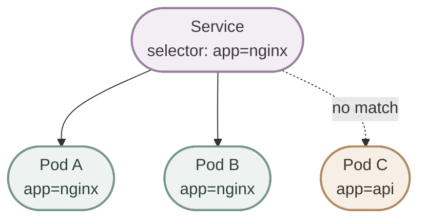
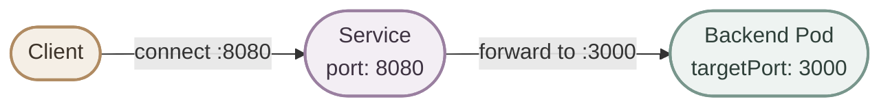
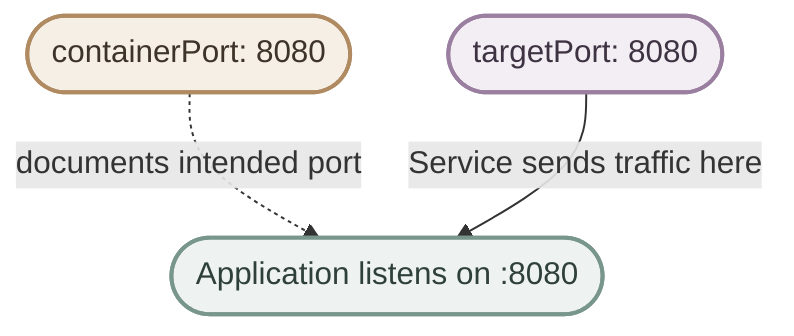
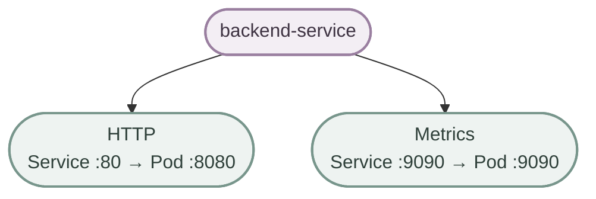
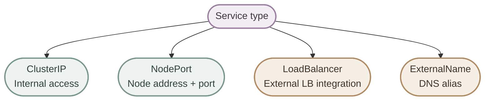
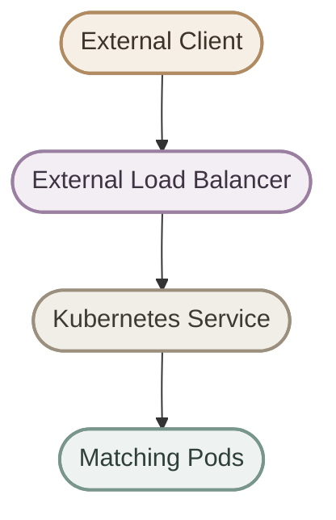
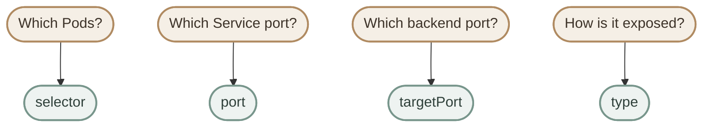

## 1. Service YAML Structure

الـ Service هو Kubernetes object من الـ Core API، لذلك بنستخدم `apiVersion: v1`، ونحدد إعداداته داخل `spec`.

```yaml
apiVersion: v1
kind: Service
metadata:
  name: nginx-service
spec:
  selector:
    app: nginx
  ports:
    - name: http
      protocol: TCP
      port: 80
      targetPort: 80
  type: ClusterIP
```

<CardGrid>
  <InfoCard title="Identity" icon="tag">
    `apiVersion` و`kind` و`metadata` بيحددوا نوع الـ object واسمه.
  </InfoCard>
  <InfoCard title="Pod Selection" icon="layers">
    `selector` بيطابق Labels على الـ Pods علشان يحدد الـ backends.
  </InfoCard>
  <InfoCard title="Traffic Mapping" icon="network">
    `ports` بتحدد الـ Service port والـ target port والـ protocol.
  </InfoCard>
  <InfoCard title="Exposure" icon="network">
    `type` بيحدد نمط الوصول للخدمة، زي `ClusterIP` أو `NodePort` أو `LoadBalancer`.
  </InfoCard>
</CardGrid>



## 2. `apiVersion`, `kind`, and `metadata`

- `apiVersion: v1`: لأن Service جزء من Kubernetes Core API، مش `apps/v1` زي Deployment.
- `kind: Service`: بيحدد نوع الـ object.
- `metadata.name`: اسم الـ Service اللي هتستخدمه في أوامر `kubectl` والـ DNS.
- `metadata.labels`: Labels على الـ Service object نفسه؛ ما تخلطهاش مع `spec.selector` اللي بيحدد الـ Pods المستهدفة.

```yaml
apiVersion: v1
kind: Service
metadata:
  name: backend-service
  labels:
    team: platform
```

```bash
kubectl get services
kubectl get svc backend-service
kubectl describe svc backend-service
```

## 3. `spec.selector`: Choose the Backend Pods

الـ `selector` بيطابق الـ labels الموجودة على الـ Pods. لازم قيم الـ selector تتطابق مع Labels الفعلية؛ لو مفيش Pods مطابقة، الـ Service غالبًا مش هيكون عنده endpoints صالحة يوجّه لها traffic.

```yaml
spec:
  selector:
    app: nginx
```

لو الـ Service عنده `app: nginx`:



<Callout type="warning" title="Selector mismatch">
  لو الـ Deployment بيستخدم `app: backend` لكن الـ Service بيختار `app: nginx`، الـ Service مش هيلاقي الـ Pods المقصودة. راجع الـ labels والـ selector قبل ما تفترض إن المشكلة في الشبكة.
</Callout>

## 4. `ports`, `port`, and `targetPort`

الفرق بين `port` و`targetPort` أساسي:

| Field | Meaning |
|---|---|
| `port` | الـ port اللي الـ Service بيعرضه للعملاء |
| `targetPort` | الـ port على الـ backend Pod اللي الـ traffic بيتوجه له |
| `protocol` | بروتوكول النقل؛ الافتراضي `TCP` |
| `name` | اسم مميز للـ Service port، ومفيد عند تعريف أكثر من port |

مثلًا، العميل يتصل على `backend-service:8080`، لكن التطبيق داخل الـ Pod بيسمع على `3000`:

```yaml
ports:
  - name: http
    protocol: TCP
    port: 8080
    targetPort: 3000
```



<InfoCard title="Quick rule" icon="git-merge">
  `port` هو باب الدخول على الـ Service، و`targetPort` هو المكان اللي الـ Service بيوصل له على الـ backend. مش لازم الرقمين يكونوا متساويين.
</InfoCard>

## 5. `containerPort` Is Not the Same as `targetPort`

ممكن تلاقي `containerPort` في تعريف الـ container:

```yaml
containers:
  - name: backend
    image: example/backend:1.0
    ports:
      - name: http
        containerPort: 8080
```

الـ `containerPort` بيوثق الـ port المقصود في تعريف الـ Pod، لكنه مش أمر بيفتح الـ port ولا بيعمل networking لوحده. لازم التطبيق فعلًا يسمع على الـ port المناسب، والـ Service يوجّه له traffic من خلال `targetPort`.



## 6. Named `targetPort`

تقدر تستخدم اسم port بدل رقم. اسم الـ target لازم يطابق اسم port معرف في الـ container الخاص بالـ Pod.

```yaml
# In the Pod template
ports:
  - name: http
    containerPort: 8080
```

```yaml
# In the Service
ports:
  - name: web
    port: 80
    targetPort: http
```

كده الـ Service بيستقبل traffic على port `80` ويوجهه للـ named port `http`، واللي متعرف في المثال على `8080`.

## 7. Multiple Service Ports

الـ Service الواحد يقدر يعرّف أكتر من port. عند استخدام multiple ports، لازم كل port يكون له `name` فريد.

```yaml
apiVersion: v1
kind: Service
metadata:
  name: backend-service
spec:
  selector:
    app: backend
  ports:
    - name: http
      port: 80
      targetPort: 8080
      protocol: TCP
    - name: metrics
      port: 9090
      targetPort: 9090
      protocol: TCP
```



## 8. `protocol`

الـ protocol الافتراضي للـ Service port هو `TCP`، وهو الشائع لتطبيقات HTTP وHTTPS. Kubernetes Services تدعم أيضًا `UDP`، و`SCTP` حسب دعم البيئة والإعدادات.

```yaml
ports:
  - name: http
    port: 80
    targetPort: 8080
    protocol: TCP
```

غالبًا مش محتاج تكتب `protocol: TCP` صراحةً إلا لو عايز توضح الإعداد؛ لأنه default.

## 9. Service Types

نوع الـ Service بيحدد طريقة الوصول إليه، مش طريقة إنشاء الـ Pods أو إدارتها.

<CardGrid>
  <InfoCard title="ClusterIP" icon="network">
    النوع الافتراضي. بيوفر عنوان Service داخلي للاستخدام من داخل الـ cluster.
  </InfoCard>
  <InfoCard title="NodePort" icon="database">
    بيعرّض الخدمة على port من نطاق الـ NodePort على عناوين الـ Nodes، مع استمرار وجود Service routing.
  </InfoCard>
  <InfoCard title="LoadBalancer" icon="network">
    بيطلب تكامل load balancer خارجي من البيئة أو الـ cloud provider، لو متاح.
  </InfoCard>
  <InfoCard title="ExternalName" icon="branch">
    بيعمل DNS alias لاسم خارجي باستخدام CNAME؛ مش بيختار Pods عن طريق selector بالطريقة المعتادة.
  </InfoCard>
</CardGrid>



## 10. `ClusterIP`

`ClusterIP` هو الـ default type. مناسب للتواصل الداخلي بين التطبيقات داخل الـ cluster، مثل اتصال frontend بخدمة backend.

```yaml
apiVersion: v1
kind: Service
metadata:
  name: nginx-service
spec:
  type: ClusterIP
  selector:
    app: nginx
  ports:
    - name: http
      port: 80
      targetPort: 80
```

تقدر تحذف `type: ClusterIP` لأن Kubernetes بيستخدمه افتراضيًا.


تقدر تشوف الـ ClusterIP الفعلي باستخدام:

```bash
kubectl get svc nginx-service
kubectl get svc nginx-service -o wide
```

الـ IP بيتم تخصيصه عادةً تلقائيًا، وبيفضل ثابت طوال عمر الـ Service ما لم يتم حذف الخدمة وإعادة إنشائها أو تغيير إعداداتها بطريقة تؤثر عليه.

## 11. `NodePort`

`NodePort` بيتيح الوصول للخدمة من خلال عنوان Node وport مخصص. نطاق الـ NodePort الافتراضي في Kubernetes عادةً `30000–32767`، لكن ممكن يتغير حسب إعدادات الـ cluster.

```yaml
apiVersion: v1
kind: Service
metadata:
  name: nginx-nodeport
spec:
  type: NodePort
  selector:
    app: nginx
  ports:
    - name: http
      port: 80
      targetPort: 80
      nodePort: 30080
```


لو ما حددتش `nodePort`، Kubernetes عادةً بيختار واحد تلقائيًا من النطاق المسموح. الوصول الفعلي من خارج الـ cluster لسه بيعتمد على network routing وfirewall وإعدادات البيئة.

## 12. `LoadBalancer`

`LoadBalancer` بيطلب external load balancer من الـ infrastructure أو الـ cloud integration المتاحة. وجود الـ Service في YAML لوحده مش ضمان إن load balancer خارجي هيتوفر في كل بيئة، خصوصًا في local clusters من غير integration مناسبة.

```yaml
apiVersion: v1
kind: Service
metadata:
  name: nginx-loadbalancer
spec:
  type: LoadBalancer
  selector:
    app: nginx
  ports:
    - name: http
      port: 80
      targetPort: 80
```



## 13. `ExternalName`

`ExternalName` بيربط اسم Service باسم DNS خارجي من خلال CNAME. النوع ده مختلف عن الأنواع اللي بتختار Pods باستخدام `selector`؛ هو DNS mapping وليس proxy لوجهة خارجية.

```yaml
apiVersion: v1
kind: Service
metadata:
  name: external-api
spec:
  type: ExternalName
  externalName: api.example.com
```

داخل الـ cluster، العملاء يقدروا يستخدموا اسم الـ Service حسب إعدادات DNS، ويقوم DNS بإرجاع الاسم الخارجي المستهدف. تأكد إن العميل والبروتوكول مناسبين لطبيعة الـ DNS alias.

## 14. Common Configuration Mistakes

<Callout type="warning" title="Wrong selector">
  الـ Service بيستخدم `selector: app: backend` بينما الـ Pods عليها `app: nginx`. النتيجة: مفيش Pods مطابقة، وبالتالي مفيش backend مناسب للـ traffic.
</Callout>

<Callout type="warning" title="Wrong targetPort">
  لو التطبيق بيسمع على `8080` لكن الـ Service عنده `targetPort: 80`، فالـ Service هيوجه traffic للـ port الغلط. راجع الـ port الفعلي اللي التطبيق بيسمع عليه.
</Callout>

<Callout type="warning" title="Invalid nodePort">
  مع النطاق الافتراضي، `nodePort: 8080` خارج النطاق المعتاد. استخدم قيمة من النطاق المسموح أو راجع إعدادات الـ cluster.
</Callout>

<Callout type="note" title="containerPort does not open a port">
  إضافة `containerPort` في YAML مش بتخلي التطبيق يسمع على الـ port تلقائيًا. التطبيق نفسه لازم يكون configured ويستمع على العنوان والـ port المناسبين.
</Callout>

## 15. Troubleshooting Checklist

ابدأ بالتحقق من وجود الـ Service وإعداداته، وبعدها راجع الـ selector والـ endpoints والـ ports.

```bash
kubectl get svc
kubectl describe svc nginx-service
kubectl get pods --show-labels
kubectl get endpointslices
kubectl get endpoints nginx-service
```

- تأكد إن `spec.selector` مطابق للـ Pod labels.
- تأكد إن `port` هو الـ port اللي العميل بيستخدمه.
- تأكد إن `targetPort` مطابق للـ port اللي التطبيق بيسمع عليه، أو لاسم port صحيح.
- راجع حالة الـ Pods وReadiness probes؛ الـ Pod غير الجاهز قد لا يكون endpoint صالحًا لتوجيه traffic إليه.
- راجع NetworkPolicy وfirewall وrouting لو الـ Service configuration والـ endpoints شكلهم صحيح لكن الاتصال ما زال بيفشل.

> `EndpointSlices` هي واجهة Kubernetes الحديثة لتجميع معلومات endpoints. أمر `kubectl get endpoints` ما زال مفيدًا للفحص، لكن ما تعتمدش عليه وحده في كل سيناريوهات التشخيص.

## 16. Configuration Mental Model

قبل ما تكتب Service، جاوب على أربع أسئلة:



## 17. Key Takeaways

- `apiVersion: v1` لأن Service من الـ Core API.
- `metadata.name` هو اسم الـ Service، ومهم في الاستخدام والـ DNS.
- `selector` بيختار Pods من خلال Labels مطابقة.
- `port` هو الـ port اللي الـ Service بيعرضه؛ `targetPort` هو الـ backend port.
- `containerPort` بيوثق port في تعريف الـ container، لكنه مش بديل عن إعداد التطبيق أو `targetPort`.
- الـ protocol الافتراضي هو `TCP`.
- عند تعريف أكثر من Service port، استخدم أسماء فريدة للـ ports.
- `ClusterIP` مناسب للوصول الداخلي، و`NodePort` يعرّض الخدمة من خلال Node port، و`LoadBalancer` يعتمد على دعم البيئة، و`ExternalName` يوفر DNS alias.
- لو الاتصال فشل، ابدأ بالـ selector والـ EndpointSlices والـ port mapping قبل ما تفترض إن المشكلة في Kubernetes networking نفسها.

<InfoCard title="Final mental model" icon="cycle">
  **Service Configuration = Select the right Pods + expose the right Service port + map traffic to the right target port + choose the appropriate exposure type.**
</InfoCard>
