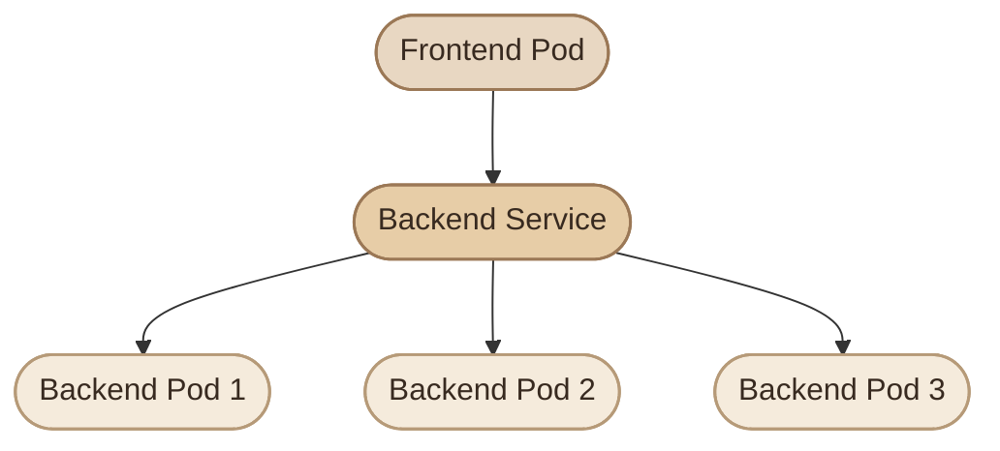

## Overview

في Kubernetes، الـ Pods بتتعمل وبتتمسح وبتتغير عناوين الـ IP بتاعتها. وده بيخلق مشكلة: إزاي تطبيق يوصل لتطبيق تاني من غير ما يعتمد على IP ممكن يتغير في أي وقت؟

الحل الأساسي هو **Service Discovery** باستخدام الـ `Service` والـ DNS الداخلي في Kubernetes.

في الدرس ده هنفهم إزاي الـ Services بتوصل الـ clients بالـ Pods، وإزاي نكتشف الخدمات بالاسم، وإزاي نشخّص مشاكل الاتصال خطوة بخطوة.

## 1. Why Do We Need Service Discovery?

تخيّل عندك frontend محتاجة تتواصل مع backend، والـ backend شغالة في ثلاث Pods.

كل Pod ليها عنوان IP خاص بيها، لكن العناوين دي ممكن تتغير لما الـ Pods تتبدل أو تتعاد جدولتها.

لو الـ frontend خزّنت عناوين الـ Pods يدويًا، هتحتاج تحديث الإعدادات كل ما العناوين تتغير.

الـ Service بتحل المشكلة دي من خلال توفير نقطة وصول مستقرة للتواصل مع مجموعة من الـ Pods.

<Callout type="note" title="الفكرة الأساسية">
  الـ client بتتصل بعنوان الـ Service، والـ Service بتوجّه الاتصال إلى Pod مناسبة من الـ endpoints المتاحة.
</Callout>



الـ Service بتوفّر عنوانًا ثابتًا منطقيًا للوصول إلى مجموعة من الـ Pods، لكن ده مش معناه إن كل طلب HTTP هيضمن الوصول إلى Pod سليمة لو التطبيق أو الـ health checks مش متضبطين بشكل صحيح.

## 2. How a Service Finds Its Pods

الـ Service غالبًا بتستخدم **Label Selector** لتحديد الـ Pods اللي المفروض تستقبل traffic.

مثال على Pod labels:

```yaml
metadata:
  labels:
    app: backend
```

والـ Service ممكن تستخدم selector بالشكل ده:

```yaml
spec:
  selector:
    app: backend
```

في الحالة دي، الـ Service بتختار الـ Pods المطابقة للـ selector داخل نفس الـ Namespace.

### I. The traffic flow

<Steps>
<li>

<InfoCard title="Client Sends Request" icon="network" />

الـ client بتبعت request إلى عنوان الـ Service بدل الاتصال المباشر بـ Pod IP.

</li>
<li>

<InfoCard title="Cluster Networking Intercepts" icon="layers" />

Kubernetes networking components تتعامل مع الاتصال حسب نوع الـ Service وإعدادات الـ cluster.

</li>
<li>

<InfoCard title="Traffic Routed to an Endpoint" icon="branch" />

الـ traffic بيتوجّه إلى endpoint مناسبة من الـ endpoints المتاحة المرتبطة بالـ Service.

</li>
<li>

<InfoCard title="Pod Receives the Connection" icon="cube" />

الـ Pod المستهدفة تستقبل الاتصال على الـ port المحدد في `targetPort`.

</li>
</Steps>

في التطبيق العملي، الـ Service مش لازم تكون proxy process شغّالة داخل Pod. في كثير من الـ clusters، توجيه الـ traffic بيتنفذ بواسطة آليات الشبكة مثل `kube-proxy` أو بدائل CNI/eBPF.

## 3. Service Ports: Port vs TargetPort

واحدة من أشهر مشاكل الـ networking هي الخلط بين `port` و`targetPort`.

```yaml
apiVersion: v1
kind: Service
metadata:
  name: backend
spec:
  selector:
    app: backend
  ports:
    - name: http
      port: 80
      targetPort: 8080
```

<CardGrid>
  <InfoCard title="port" icon="network">
    الـ port اللي الـ client بتتصل بيه على الـ Service، هنا `80`.
  </InfoCard>
  <InfoCard title="targetPort" icon="database">
    الـ port اللي الـ traffic بيتوجّه إليه داخل الـ Pod المستهدفة، هنا `8080`.
  </InfoCard>
</CardGrid>

لو التطبيق داخل الـ Pod بيسمع على `8080`، فالـ Service تقدر تستقبل الاتصال على `80` وتوجّهه إلى `8080`.

أما `containerPort` الموجود في الـ Pod specification فهو وصف للـ port المقصود استخدامه داخل الـ container؛ مش هو اللي بيشغّل التطبيق أو بيفتح الـ port تلقائيًا.

## 4. Kubernetes DNS

Kubernetes عادةً بيشغّل DNS service داخل الـ cluster، وغالبًا بيكون CoreDNS.

الـ DNS بيسمح للتطبيقات باستخدام أسماء الخدمات بدل كتابة عناوين IP يدويًا.

لو عندك Service اسمها `backend` في Namespace اسمها `production`، فالاسم الكامل الشائع ليها هو:

`backend.production.svc.cluster.local`

حيث:

- `backend`: اسم الـ Service.
- `production`: اسم الـ Namespace.
- `svc`: نطاق خدمات Kubernetes.
- `cluster.local`: الـ cluster domain الافتراضي الشائع، لكنه قابل للتغيير.

### I. DNS names within the cluster

| DNS name | الاستخدام |
|---|---|
| `backend` | اسم مختصر عند الوصول من نفس الـ Namespace، حسب DNS search configuration |
| `backend.production` | اسم الخدمة مع الـ Namespace |
| `backend.production.svc.cluster.local` | الاسم الكامل الشائع للـ Service |

اسم الـ Namespace مهم لأن أسماء الخدمات ممكن تتكرر في Namespaces مختلفة.

مثلًا، ممكن يكون عندك `backend` في `development` و`backend` في `production`، وكل واحدة بتشير إلى Service مختلفة.

<Callout type="tip" title="Prefer Service names over Pod IPs">
في إعدادات التطبيقات، استخدم DNS name الخاص بالـ Service بدل تخزين Pod IPs يدويًا. ده بيسهّل استبدال الـ Pods وتوسيع عدد النسخ من غير ما تغيّر عنوان الاتصال في كل client.
</Callout>

## 5. Common Service Types

الـ `Service` ليها أنواع مختلفة حسب طريقة الوصول المطلوبة.

<CardGrid>
  <InfoCard title="ClusterIP" icon="network">
    النوع الافتراضي. بيوفّر عنوانًا داخليًا للوصول إلى الخدمة من داخل الـ cluster.
  </InfoCard>
  <InfoCard title="NodePort" icon="network">
    بيفتح port على الـ Nodes للوصول إلى الخدمة من خلال عنوان Node والـ NodePort المخصص.
  </InfoCard>
  <InfoCard title="LoadBalancer" icon="network">
    بيطلب توفير load balancer خارجي من خلال البيئة أو التكامل المتاح، لو الـ cluster بيدعم ده.
  </InfoCard>
  <InfoCard title="ExternalName" icon="branch">
    بيربط اسم Service باسم DNS خارجي باستخدام CNAME، بدل توجيه traffic إلى مجموعة Pods عبر selector.
  </InfoCard>
</CardGrid>

### I. ClusterIP

مناسب للاتصال الداخلي بين الخدمات.

```yaml
apiVersion: v1
kind: Service
metadata:
  name: backend
spec:
  type: ClusterIP
  selector:
    app: backend
  ports:
    - port: 80
      targetPort: 8080
```

### II. NodePort

بيتيح الوصول للخدمة عن طريق عنوان Node والـ NodePort المخصص. النطاق الافتراضي الشائع للـ NodePort هو `30000–32767`، لكنه قابل للتغيير في إعدادات الـ API server.

```yaml
spec:
  type: NodePort
  selector:
    app: backend
  ports:
    - port: 80
      targetPort: 8080
      nodePort: 30080
```

توافر الوصول الفعلي بيعتمد على إعدادات الشبكة والـ firewall والـ node addresses المستخدمة.

### III. LoadBalancer

```yaml
spec:
  type: LoadBalancer
  selector:
    app: backend
  ports:
    - port: 80
      targetPort: 8080
```

في بيئات Cloud، ممكن يتوفر external load balancer من خلال تكامل الـ platform. أما في local clusters، مش مضمون إن النوع ده يوفّر عنوانًا خارجيًا تلقائيًا من غير إعداد إضافي.

### IV. ExternalName

```yaml
apiVersion: v1
kind: Service
metadata:
  name: external-api
spec:
  type: ExternalName
  externalName: api.example.com
```

الـ DNS بيرجع CNAME للاسم الخارجي. النوع ده مش بيعمل proxy للـ traffic بنفسه، ومش بيستخدم `selector` لتوجيه الاتصالات إلى Pods.

## 6. EndpointSlices: Where Traffic Can Go

الـ Service بتحدد مجموعة من الـ endpoints اللي ممكن توجّه إليها الاتصالات.

في Kubernetes الحديثة، الـ **EndpointSlices** هي الآلية الأساسية لتخزين معلومات الـ endpoints الخاصة بالخدمات.

اعرض الـ Services:

```bash
kubectl get services -n <namespace>
```

اعرض الـ EndpointSlices:

```bash
kubectl get endpointslices \
  -n <namespace>
```

ولفحص EndpointSlices الخاصة بخدمة محددة:

```bash
kubectl get endpointslices \
  -n <namespace> \
  -l kubernetes.io/service-name=backend
```

افحص التفاصيل:

```bash
kubectl describe service backend \
  -n <namespace>
```

### I. What if a Service has no endpoints?

لو الـ Service موجودة لكن مش بتوصل لأي Pod، افحص:

<CardGrid columns={2} label="Endpoint Checks">
  <InfoCard variant="concept" title="Selector Match" description="هل `spec.selector` بيطابق الـ labels الفعلية على الـ Pods؟" icon="sliders" tags={["Selector"]} />
  <InfoCard variant="concept" title="Same Namespace" description="هل الـ Pods موجودة في نفس الـ Namespace الخاصة بالـ Service؟" icon="layers" tags={["Namespace"]} />
  <InfoCard variant="concept" title="Pod Readiness" description="هل الـ Pods جاهزة؟ الـ Pod غير الجاهزة مش بتظهر كـ endpoint صالح." icon="pulse" tags={["Readiness"]} />
  <InfoCard variant="concept" title="Port Alignment" description="هل الـ Service و Pod ports متوافقة مع الـ port اللي التطبيق بيسمع عليه؟" icon="network" tags={["Ports"]} />
  <InfoCard variant="concept" title="EndpointSlices" description="هل الـ EndpointSlices بتعرض endpoints متوقعة للخدمة؟" icon="branch" tags={["Endpoints"]} />
</CardGrid>

غياب الـ endpoints ممكن يكون بسبب selector غلط أو عدم وجود Pods مطابقة، لكنه مش السبب الوحيد المحتمل لمشكلة الاتصال.

## 7. Headless Services

في الوضع المعتاد، الـ Service بتوفّر ClusterIP. لكن فيه نوع خاص اسمه **Headless Service**، وبيتعمل عن طريق تعيين `clusterIP: None`.

```yaml
apiVersion: v1
kind: Service
metadata:
  name: database
spec:
  clusterIP: None
  selector:
    app: database
  ports:
    - port: 5432
      targetPort: 5432
```

الـ Headless Service مش بتوفّر ClusterIP افتراضية للخدمة. بدلًا من ذلك، الـ DNS ممكن يرجّع عناوين الـ endpoints المطابقة مباشرةً، حسب حالة الخدمة وإعدادات DNS.

بتُستخدم كثيرًا مع Stateful applications، خصوصًا لما التطبيق محتاج يكتشف نسخًا محددة بدل الاتصال بعنوان افتراضي واحد.

لكن الـ Headless Service مش بديلًا تلقائيًا عن كل خصائص الـ Service العادية؛ لازم التطبيق يكون مناسبًا لطريقة اكتشاف الـ endpoints والاتصال بيها.

## 8. Test Service Connectivity

لو عندك Service اسمها `backend` في Namespace اسمها `production`، تقدر تختبر DNS من داخل الـ cluster باستخدام Pod مخصصة للاختبار.

مثلًا، لو الـ image متاحة في بيئتك:

```bash
kubectl run dns-test \
  --image=busybox:1.36 \
  --restart=Never \
  -it \
  --rm \
  -- nslookup backend.production.svc.cluster.local
```

الأمر بيحاول تشغيل Pod مؤقتة ويستخدم `nslookup` للاستعلام عن الاسم.

اختبر الاتصال بالـ Service على الـ port المناسب باستخدام أداة متاحة داخل الـ test container، مثل `wget` أو `curl` لو كانت موجودة في الـ image المستخدمة.

```bash
kubectl run network-test \
  --image=curlimages/curl:8.12.1 \
  --restart=Never \
  -it \
  --rm \
  -- curl -v http://backend.production.svc.cluster.local:80/
```

استبدل اسم الـ Service والـ Namespace والـ port حسب بيئتك. المثال يفترض إن الـ backend بتستقبل HTTP على port `80` الخاص بالـ Service.

لو الاختبار فشل، ده مش معناه بالضرورة إن الـ DNS هي السبب. لازم تفرّق بين فشل name resolution وفشل TCP connection وفشل HTTP response.

## 9. Troubleshooting Service Discovery

### I. Case 1 — DNS Resolution Fails

<InfoCard variant="warning" title="DNS Resolution Fails" description="الاسم مش بيتحل — تحقق من اسم الـ Service والـ Namespace وحالة CoreDNS." icon="pulse" tags={["DNS", "CoreDNS"]} />

ابدأ باختبار الاسم:

```bash
nslookup backend.production.svc.cluster.local
```

<Steps>
<li>

<InfoCard title="Verify Service and Namespace Names" icon="tag" />

تأكد إن اسم الـ Service واسم الـ Namespace مكتوبين صح في الاستعلام.

</li>
<li>

<InfoCard title="Check DNS Search Configuration" icon="sliders" />

تأكد إن الـ DNS search configuration على الـ Pod مناسبة للاسم المختصر المستخدم.

</li>
<li>

<InfoCard title="Inspect CoreDNS Pods" icon="pulse" />

تأكد إن DNS Pods والـ Service الخاصة بـ CoreDNS شغّالة في الـ cluster:

```bash
kubectl get services,pods -n kube-system
```

</li>
<li>

<InfoCard title="Check for NetworkPolicy Blocking DNS" icon="shield" />

تأكد إن مفيش NetworkPolicy أو مشكلة شبكة بتمنع الوصول إلى DNS على port `53`.

</li>
</Steps>

اسم الـ DNS service وإعداداتها ممكن تختلف حسب توزيع Kubernetes.

### II. Case 2 — DNS Works but Connection Fails

<InfoCard variant="warning" title="DNS Works, Connection Fails" description="الاسم بيتحل لكن الاتصال بيفشل — تحقق من Service endpoints والـ ports." icon="network" tags={["Connectivity", "Ports"]} />

<Steps>
<li>

<InfoCard title="Confirm the Service Exists" icon="layers" />

```bash
kubectl get service backend -n production
```

</li>
<li>

<InfoCard title="Check for Endpoints" icon="branch" />

```bash
kubectl describe service backend -n production
```

</li>
<li>

<InfoCard title="Validate port and targetPort" icon="sliders" />

تأكد إن `port` و`targetPort` مضبوطين ومطابقين للـ port اللي التطبيق بيسمع عليه.

</li>
<li>

<InfoCard title="Inspect EndpointSlices" icon="pulse" />

```bash
kubectl get endpointslices \
  -n production \
  -l kubernetes.io/service-name=backend
```

</li>
<li>

<InfoCard title="Check NetworkPolicy and CNI" icon="shield" />

تأكد مفيش NetworkPolicy أو firewall أو مشكلة CNI بتمنع الاتصال.

</li>
</Steps>

### III. Case 3 — The Service Has No Endpoints

<InfoCard variant="warning" title="Service Has No Endpoints" description="الـ Service موجودة لكن مفيش Pods مطابقة — تحقق من الـ selector والـ labels." icon="sliders" tags={["Selector", "Labels"]} />

<Steps>
<li>

<InfoCard title="List Pods with Their Labels" icon="tag" />

```bash
kubectl get pods \
  -n production \
  --show-labels
```

</li>
<li>

<InfoCard title="Inspect the Service Selector" icon="sliders" />

```bash
kubectl get service backend \
  -n production \
  -o yaml
```

</li>
<li>

<InfoCard title="Compare Selector to Pod Labels" icon="layers" />

قارن `spec.selector` بالـ labels الموجودة على الـ Pods.

لو الـ Service بتختار `app: backend`، لكن الـ Pods عندها `app: api`، فالـ selector مش هتطابقها. أصلح الـ labels أو الـ selector في مصدر الإعدادات الصحيح.

</li>
</Steps>

### IV. Case 4 — Endpoints Exist but Requests Fail

<InfoCard variant="warning" title="Endpoints Exist but Requests Fail" description="وجود endpoints مش ضمان إن التطبيق بيرد — تحقق من الـ app وإعدادات الشبكة." icon="wrench" tags={["Application", "Networking"]} />

<CardGrid columns={2} label="What to Inspect">
  <InfoCard variant="concept" title="Pod Readiness" description="تأكد إن الـ Pods في حالة Ready وإن الـ readiness probes ناجحة." icon="pulse" tags={["Health"]} />
  <InfoCard variant="concept" title="Container Logs" description="افحص logs الـ container لأي errors أو crashes بتمنع الرد." icon="terminal" tags={["Logs"]} />
  <InfoCard variant="concept" title="Listening Address" description="التطبيق لازم يسمع على عنوان مناسب داخل الـ Pod، مش على `127.0.0.1` فقط." icon="network" tags={["Binding"]} />
  <InfoCard variant="concept" title="Protocol and TLS" description="تأكد من الـ protocol المتوقع (HTTP/HTTPS/TCP) وأي متطلبات TLS أو authentication." icon="shield" tags={["Security"]} />
</CardGrid>

## 10. Hands-on Lab: Create and Test a Service

هننشئ Deployment بثلاث نسخ NGINX، ثم نعرّضها باستخدام ClusterIP Service ونختبر اكتشاف الخدمة والاتصال بيها.

<Steps>
<li>

<InfoCard title="Create a Namespace" icon="layers" />

```bash
kubectl create namespace service-discovery-lab
```

</li>
<li>

<InfoCard title="Create the Deployment" icon="cube" />

```bash
kubectl create deployment web \
  --image=nginx:1.28 \
  --replicas=3 \
  -n service-discovery-lab
```

انتظر لحد ما الـ Deployment تبقى جاهزة:

```bash
kubectl rollout status deployment/web \
  -n service-discovery-lab
```

</li>
<li>

<InfoCard title="Expose the Deployment" icon="network" />

```bash
kubectl expose deployment web \
  --name=web-service \
  --port=80 \
  --target-port=80 \
  --type=ClusterIP \
  -n service-discovery-lab
```

اعرض الـ Service:

```bash
kubectl get service web-service \
  -n service-discovery-lab
```

واعرض الـ EndpointSlices:

```bash
kubectl get endpointslices \
  -n service-discovery-lab \
  -l kubernetes.io/service-name=web-service
```

</li>
<li>

<InfoCard title="Test DNS and HTTP" icon="pulse" />

شغّل Pod مؤقتة لاختبار الاتصال:

```bash
kubectl run curl-test \
  --image=curlimages/curl:8.12.1 \
  --restart=Never \
  -it \
  --rm \
  -n service-discovery-lab \
  -- curl -v http://web-service/
```

بما إن الـ test Pod موجودة في نفس الـ Namespace، فالاسم المختصر `web-service` المفروض يكون كافيًا في إعداد DNS المعتاد.

للتجربة باستخدام الاسم الكامل:

```bash
kubectl run curl-test \
  --image=curlimages/curl:8.12.1 \
  --restart=Never \
  -it \
  --rm \
  -n service-discovery-lab \
  -- curl -v http://web-service.service-discovery-lab.svc.cluster.local/
```

المفروض تستقبل HTTP response من NGINX لو الـ Pods والـ Service والـ cluster networking شغّالين بشكل صحيح.

</li>
<li>

<InfoCard title="Inspect the Service Selector" icon="sliders" />

```bash
kubectl describe service web-service \
  -n service-discovery-lab
```

اعرض الـ Pods المطابقة للـ selector:

```bash
kubectl get pods \
  -n service-discovery-lab \
  --show-labels
```

قارن الـ selector بالـ labels الموجودة على الـ Pods، وبعدها راجع الـ EndpointSlices للتأكد من وجود endpoints متوقعة.

</li>
<li>

<InfoCard title="Clean Up" icon="wrench" />

```bash
kubectl delete namespace service-discovery-lab
```

الأمر ده بيحذف الـ Namespace والموارد الموجودة بداخلها، فاستخدمه بعد ما تنتهي من التجربة.

</li>
</Steps>

## 11. Networking Troubleshooting Checklist

<Steps>
<li>

<InfoCard title="Verify the Service" icon="network" />

تأكد من الاسم والـ Namespace والـ type الخاصة بالـ Service.

</li>
<li>

<InfoCard title="Check the Selector" icon="sliders" />

قارن `spec.selector` بالـ Pod labels وتأكد إن المطابقة صحيحة.

</li>
<li>

<InfoCard title="Inspect EndpointSlices" icon="branch" />

تأكد إن الـ Service عندها endpoints مناسبة ومرتبطة بـ Pods جاهزة.

</li>
<li>

<InfoCard title="Validate Ports" icon="layers" />

افحص `port` و`targetPort` والـ port اللي التطبيق بيسمع عليه فعليًا.

</li>
<li>

<InfoCard title="Test DNS" icon="pulse" />

جرّب الاسم المختصر والاسم الكامل من داخل الـ cluster للتأكد من صحة الـ DNS resolution.

</li>
<li>

<InfoCard title="Test Connectivity" icon="terminal" />

افصل بين مشكلة DNS ومشكلة TCP connection ومشكلة HTTP response في تشخيصك.

</li>
<li>

<InfoCard title="Inspect Policies and Logs" icon="shield" />

راجع NetworkPolicies، والـ application logs، وحالة الـ Pods لأي مؤشرات على سبب المشكلة.

</li>
</Steps>

## Summary

الـ Service Discovery بتسمح للتطبيقات بالوصول إلى الخدمات باستخدام أسماء مستقرة بدل الاعتماد على Pod IPs المتغيرة.

- `ClusterIP` هي الطريقة المعتادة للوصول الداخلي إلى Service.
- Kubernetes DNS بيوفّر أسماء للخدمات، وغالبًا بيكون CoreDNS هو الـ DNS provider.
- `selector` بتحدد الـ Pods المطابقة، والـ EndpointSlices بتعرض endpoints المرتبطة بالخدمة.
- `port` هو منفذ الـ Service، و`targetPort` هو المنفذ المستهدف داخل الـ Pod.
- `Headless Service` بتسمح باكتشاف endpoints من غير ClusterIP افتراضية.
- فشل الاتصال ممكن يكون سببه DNS أو selector أو ports أو التطبيق أو قيود الشبكة.


