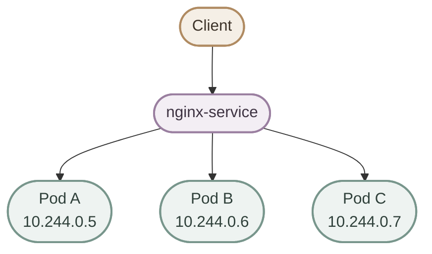
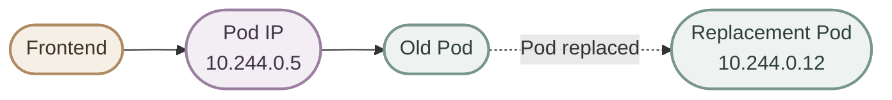
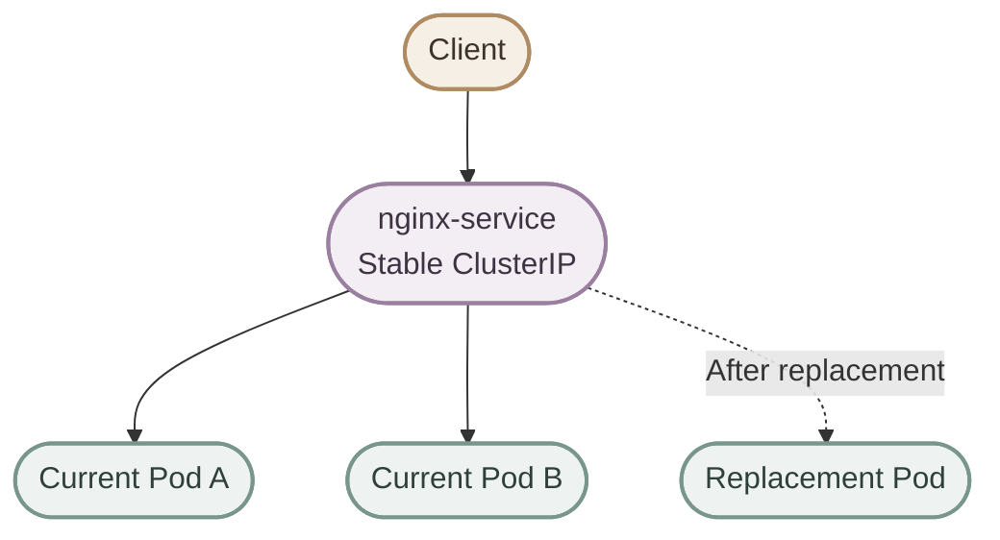
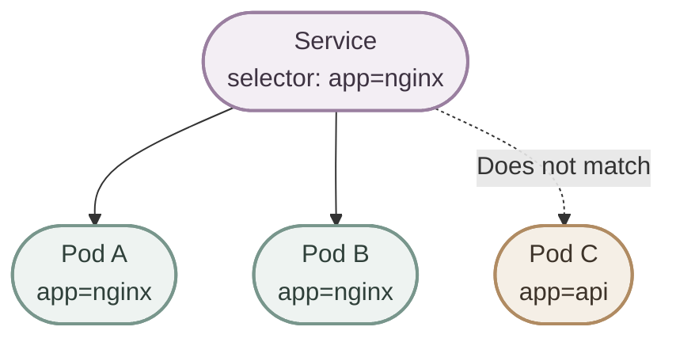
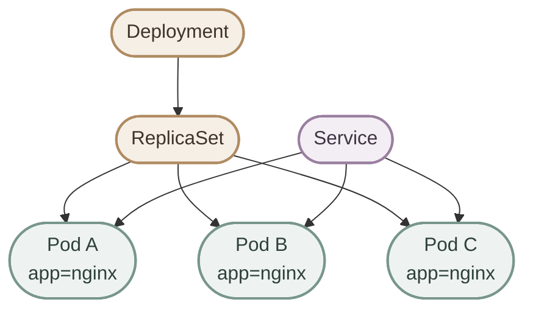
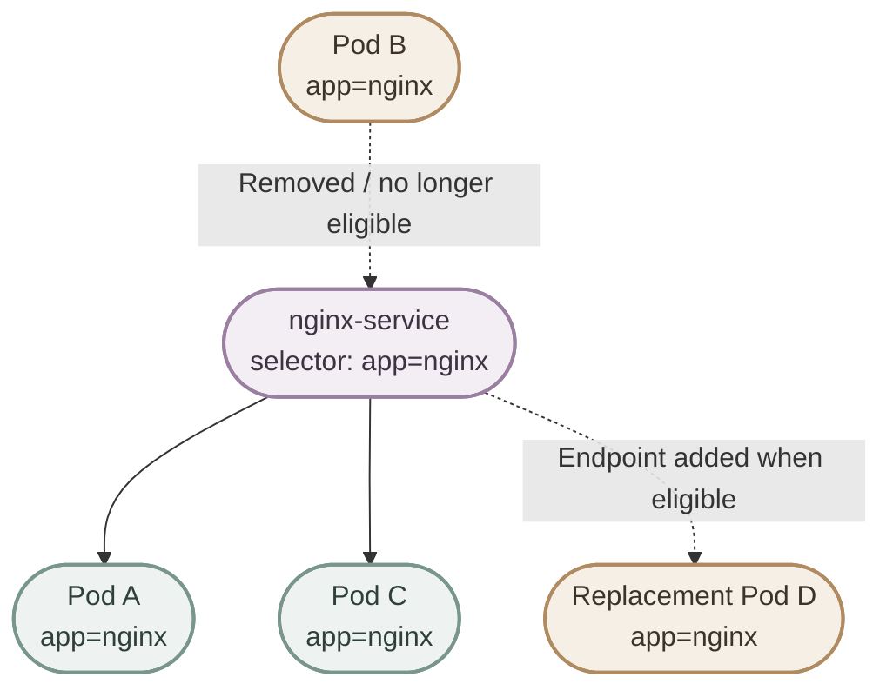
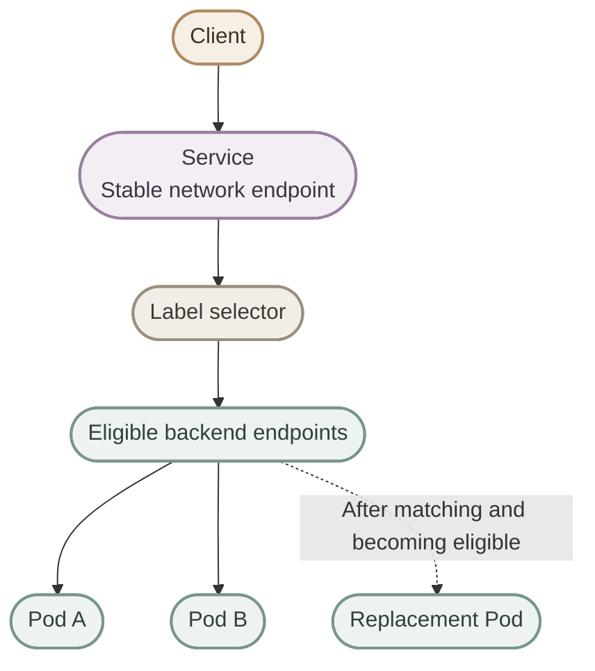

## 1. What Is a Service?

في Kubernetes، الـ **Service** هو object بيوفر طريقة ثابتة للوصول إلى مجموعة من الـ Pods، من غير ما الـ clients تحتاج تعرف الـ IP address بتاع كل Pod.

الـ Pods ممكن تتوقف أو تتبدل، والـ replacement Pod ممكن تحصل على IP مختلف. الـ Service بيخفي التغييرات دي عن الـ clients عن طريق stable network endpoint.



<CardGrid columns={2} label="Service fundamentals">
  <InfoCard variant="concept" title="Stable Access" description="الـ client بيتعامل مع عنوان الـ Service بدل الاعتماد على Pod IP متغير." icon="network" tags={["Networking"]} />
  <InfoCard variant="concept" title="Label Selection" description="الـ Service ممكن يستخدم selector عشان يحدد الـ Pods المطابقة للـ labels." icon="tag" tags={["Labels"]} />
  <InfoCard variant="concept" title="Dynamic Backends" description="الـ endpoint information بتتحدث مع تغيّر الـ Pods المطابقة والجاهزة." icon="cycle" tags={["Endpoints"]} />
  <InfoCard variant="warning" title="Not a Workload Controller" description="الـ Service لا ينشئ Pods ولا يحافظ على عددها؛ دي مسؤولية الـ workload controllers." icon="layers" tags={["Architecture"]} />
</CardGrid>

## 2. Why Do We Need Services?

تخيّل إن عندنا Frontend محتاج يتواصل مع Backend شغال في مجموعة Pods. الاتصال المباشر بـ Pod IP ممكن يشتغل في البداية، لكنه بيعمل coupling بين الـ client وعنوان ممكن يتغير.



لو الـ Pod القديمة اختفت، الـ Frontend مش المفروض يفضل معتمد على الـ IP القديمة. باستخدام Service، الـ client بيتصل بعنوان ثابت نسبيًا داخل الـ cluster، والـ Service بيستخدم الـ backend endpoints الحالية.

<Callout type="note">
الـ Service مش بيمنع الـ Pods من إنها تتوقف أو يتغير IP بتاعها. هو بيوفر abstraction بتخلي الـ clients مش محتاجة تتابع تغييرات الـ Pod IPs بنفسها.
</Callout>

## 3. Pod IP vs Service IP

| Pod IP | Service IP |
|---|---|
| بيخص Pod معينة | بيخص Service من نوع بيوفر ClusterIP |
| ممكن يتغير لما Pod تتبدل | بيظل ثابتًا طوال عمر الـ Service، ما لم يُعد إنشاءه أو يتغير إعداد الـ IP |
| مناسب للـ networking داخل الـ cluster، لكن مش عنوان ثابت تعتمد عليه التطبيقات | عنوان افتراضي مستقر للوصول إلى الـ Service داخل الـ cluster |
| الـ Pod نفسها ممكن تختفي | الـ Service ممكن يستمر ويشير إلى Pods أخرى مطابقة |



خلي بالك: الـ **ClusterIP** هو الـ default Service type، لكن مش كل Services لازم يكون لها ClusterIP؛ مثلًا `ExternalName` بيشتغل بطريقة مختلفة.

## 4. How Does a Service Find Pods?

الـ Service عادةً بيستخدم **label selector** عشان يحدد الـ Pods اللي المفروض يستقبلوا الـ traffic. هو مش بيختار Pods بناءً على أسمائها.

الـ Pod ممكن يكون عليها labels بالشكل ده:

```yaml
metadata:
  labels:
    app: nginx
    environment: production
```

والـ Service ممكن يستخدم:

```yaml
selector:
  app: nginx
```

معناه إن الـ selector بيطابق الـ Pods اللي عندها `app=nginx`، بغض النظر عن أسماء الـ Pods أو قيمة `environment`.



<CardGrid columns={2} label="Labels and selectors">
  <InfoCard variant="concept" title="Label" description="Key-value metadata على الـ object، مثل app=nginx، بتساعد في التصنيف والاختيار." icon="tag" tags={["Metadata"]} />
  <InfoCard variant="concept" title="Selector" description="شرط بيحدد الـ objects اللي بتطابق labels المطلوبة." icon="sliders" tags={["Matching"]} />
</CardGrid>

<Callout type="warning">
لو الـ selector مش مطابق لأي Pod، فالـ Service ممكن يفضل موجود لكن من غير usable backend endpoints. افحص labels والـ selector والـ endpoint readiness بدل ما تفترض إن إنشاء الـ Service معناه إن فيه traffic هيوصل.
</Callout>

## 5. Service and Pod Lifecycle

الـ Service والـ workload controllers مسؤولياتهم مختلفة:

- **Deployment** بيدير rollout والتحديثات والـ desired state بتاع التطبيق.
- **ReplicaSet** بيحافظ على العدد المطلوب من الـ Pod replicas.
- **Service** بيوفر network access لمجموعة الـ Pods اللي بتطابق إعداداته.



الـ Service مش بيعمل Pods ومش بيعمل scale للـ Deployment. لكنه يقدر يتعامل مع Pods جديدة تلقائيًا لما تكون labels بتاعتها مطابقة للـ selector، وتكون مؤهلة لاستقبال traffic.

## 6. Dynamic Pod Membership

افترض إن الـ Service عنده `selector: app=nginx`، والـ Deployment شغّال بثلاث Pods. لو Pod اتبدلت، فالـ Deployment/ReplicaSet مسؤول عن إنشاء replacement حسب الـ desired state، والـ Kubernetes بيحدّث الـ endpoint information بناءً على الـ Pods المطابقة وحالتها.



المهم إن التغيير مش بيعتمد على Pod name. الـ selector هو اللي بيحدد الـ membership، والـ readiness والـ endpoint updates بتأثر على الـ backends اللي تستقبل traffic. مش معنى إن Pod عندها label مطابق إنها بالضرورة جاهزة لاستقبال الطلبات في كل لحظة.

## 7. Service Discovery and DNS

داخل Kubernetes، التطبيقات غالبًا تقدر توصل للـ Service باستخدام اسمه بدل ما تحفظ الـ ClusterIP. مع تفعيل DNS الخاص بالـ cluster، بيتوفر اسم DNS للـ Service.

مثال داخل نفس الـ namespace:

```text
nginx-service
```

ومن namespace مختلفة، تقدر تستخدم الاسم المؤهل:

```text
nginx-service.production
```

والصيغة الكاملة الشائعة:

```text
nginx-service.production.svc.cluster.local
```

`production` هنا اسم الـ namespace، و`cluster.local` هو suffix شائع لكنه قابل للتغيير حسب إعدادات الـ cluster.

<Callout type="tip">
استخدم Service DNS name في إعدادات التطبيقات بدل كتابة Pod IPs مباشرة. لو التطبيق والـ Service في نفس namespace، غالبًا الاسم القصير كفاية؛ لو في namespace مختلفة، استخدم اسم الـ Service مع الـ namespace.
</Callout>

## 8. One Service, Multiple Pods and Scaling

Service واحد ممكن يوجّه traffic إلى عدة Pods مطابقة. لما تعمل scale للـ Deployment من 3 إلى 5 replicas، مش محتاج تعدّل الـ Service يدويًا طالما الـ Pods الجديدة بتطابق الـ selector.

```bash
kubectl scale deployment nginx-deployment --replicas=5
```

بعدها تقدر تفحص الـ Pods والـ Service:

```bash
kubectl get pods -l app=nginx
kubectl get svc nginx-service
```

الـ Service بيقدّم نقطة وصول واحدة لمجموعة backends، لكن ده مش معناه إن كل request هيتوزع بالتساوي تمامًا على كل Pod؛ سلوك توزيع traffic بيتأثر بآلية الـ Service والـ networking implementation وظروف الاتصال.

## 9. Service vs Pod vs Deployment

| Resource | مسؤوليته الأساسية |
|---|---|
| **Pod** | تشغيل الـ application containers، وليها Pod IP |
| **Deployment** | إدارة desired state والـ rollout والـ updates للتطبيق |
| **ReplicaSet** | الحفاظ على عدد الـ Pod replicas المطلوب |
| **Service** | توفير network endpoint والوصول إلى الـ matching backends |

<CardGrid columns={2} label="Remember the responsibilities">
  <InfoCard variant="comparison" title="Deployment" description="يدير الـ workload: عدد النسخ، والتحديثات، والـ rollout." icon="layers" tags={["Workload"]} />
  <InfoCard variant="comparison" title="Service" description="يوفر network access ثابت نسبيًا لمجموعة الـ Pods المطابقة." icon="network" tags={["Networking"]} />
</CardGrid>

## 10. Practical Commands

### I. List Services

```bash
kubectl get services
kubectl get svc
```

### II. Inspect a Specific Service

```bash
kubectl get svc nginx-service
kubectl describe svc nginx-service
```

### III. Find Pods by Label

```bash
kubectl get pods -l app=nginx
kubectl get pods --show-labels
```

### IV. Inspect EndpointSlices

```bash
kubectl get endpointslice \
  -l kubernetes.io/service-name=nginx-service
```

`EndpointSlice` هو الـ API الحديث المستخدم لتمثيل مجموعات الـ Service endpoints. تقدر كمان تستخدم الأمر القديم `kubectl get endpoints nginx-service` للتشخيص في clusters اللي ما زالت تعرض الـ Endpoints object، لكن EndpointSlices هي الاختيار الأفضل لفهم الـ endpoint data الحديثة.

## 11. Practical Example

المثال ده بيعرض Deployment بثلاث replicas، مع Service بيحدد الـ Pods عن طريق `app: nginx`.

```yaml
apiVersion: apps/v1
kind: Deployment
metadata:
  name: nginx-deployment
spec:
  replicas: 3
  selector:
    matchLabels:
      app: nginx
  template:
    metadata:
      labels:
        app: nginx
    spec:
      containers:
        - name: nginx
          image: nginx:stable
          ports:
            - containerPort: 80
---
apiVersion: v1
kind: Service
metadata:
  name: nginx-service
spec:
  type: ClusterIP
  selector:
    app: nginx
  ports:
    - name: http
      port: 80
      targetPort: 80
      protocol: TCP
```

في المثال ده:

- الـ Deployment بينشئ ويدير ثلاث replicas.
- الـ Pods بتاخد label اسمها `app: nginx`.
- الـ Service selector بيطابق نفس الـ label.
- الـ Service بيستقبل الاتصال على port `80` ويوجهه إلى `targetPort: 80` في الـ Pods المؤهلة.

طبّق الملف لو حفظته باسم `nginx-service.yaml`:

```bash
kubectl apply -f nginx-service.yaml
kubectl get deployment,pods,svc
kubectl get endpointslice \
  -l kubernetes.io/service-name=nginx-service
```

## 12. Key Takeaways

<CardGrid columns={2} label="Service recap">
  <InfoCard variant="concept" title="Stable Abstraction" description="الـ client يعتمد على Service endpoint بدل Pod IPs المتغيرة." icon="network" tags={["Core idea"]} />
  <InfoCard variant="concept" title="Label-Based Selection" description="الـ selector بيختار الـ Pods من خلال labels، مش أسماء الـ Pods." icon="tag" tags={["Selectors"]} />
  <InfoCard variant="concept" title="Changing Backends" description="الـ endpoint information بتتحدث مع تغيّر الـ Pods المطابقة والجاهزة." icon="cycle" tags={["Lifecycle"]} />
  <InfoCard variant="warning" title="Separate Responsibilities" description="الـ Service لا ينشئ Pods ولا يدير replicas أو rollout؛ دي مسؤولية controllers." icon="layers" tags={["Architecture"]} />
</CardGrid>

## 13. Final Mental Model



> **Remember:** A Service provides a stable network abstraction over a dynamic set of eligible Pods selected by labels.
