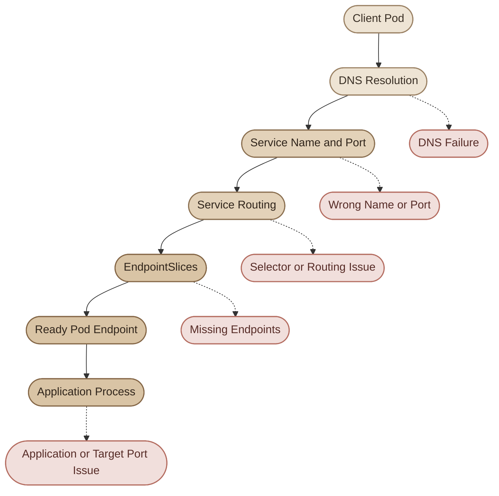
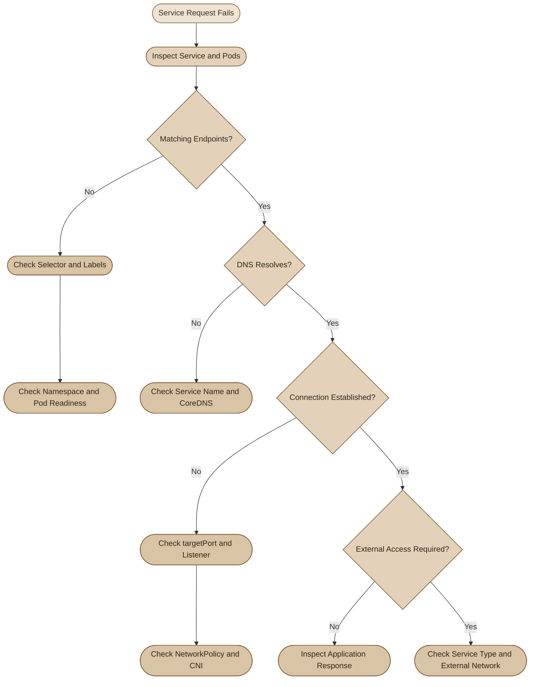

## Overview

الـ `Service` في Kubernetes بيوفّر نقطة اتصال مستقرة لمجموعة من الـ Pods، لكن وجود الـ Service لوحده مش معناه إن التطبيق قابل للوصول.

ممكن الـ Service يكون موجود، والـ Pods تكون `Running`، ومع ذلك الاتصال يفشل بسبب `selector` غلط، أو `targetPort` غير صحيح، أو مشكلة في DNS أو الشبكة.

الهدف هنا إنك تتبع مسار الاتصال خطوة بخطوة بدل ما تغيّر إعدادات عشوائيًا.

## 1. Understand the Request Path

لما تطبيق يحاول يتصل بـ Service داخل الـ Cluster، فيه أكتر من مرحلة لازم تشتغل صح:



المخطط بيوضّح إن المشكلة ممكن تكون في أي مرحلة. عشان كده لازم نحدد هل الفشل في **DNS resolution**، ولا الوصول للـ Service، ولا الوصول للـ Pod نفسه، ولا التطبيق اللي جوّاه.

<CardGrid>
  <InfoCard title="Service" icon="network">
    نقطة الاتصال المستقرة اللي بيستخدمها الـ Client للوصول للتطبيق.
  </InfoCard>
  <InfoCard title="EndpointSlices" icon="branch">
    بتعرض عناوين الـ endpoints المرتبطة بالـ Service، وبتساعدك تعرف هل فيه Pods مستهدفة أصلًا.
  </InfoCard>
  <InfoCard title="Application" icon="terminal">
    حتى لو الـ Service والـ endpoints مضبوطين، لازم التطبيق يكون شغّال وبيستمع على المنفذ الصحيح.
  </InfoCard>
</CardGrid>

## 2. Start with Basic Inspection

ابدأ بجمع المعلومات الأساسية قبل ما تعدّل أي إعداد.

```bash
kubectl get services -n default

kubectl describe service web-service -n default

kubectl get pods -n default -o wide --show-labels
```

ركّز على:

- `TYPE`: نوع الـ Service.
- `CLUSTER-IP`: عنوانه الداخلي، لو كان له Cluster IP.
- `PORT(S)`: المنافذ المعرّضة من الـ Service.
- `SELECTOR`: الـ labels اللي بيستخدمها لاختيار الـ Pods.
- `Endpoints`: ممكن تظهر في تفاصيل الـ Service، حسب إصدار وأدوات Kubernetes.
- Pod status و`READY`: هل الـ Pods جاهزة لاستقبال الترافيك؟

بعد كده افحص الـ EndpointSlices، لأنها الواجهة الحديثة الأساسية لعرض endpoints الخاصة بالـ Service.

```bash
kubectl get endpointslices \
  -n default \
  -l kubernetes.io/service-name=web-service
```

ولفحص تفاصيلها:

```bash
kubectl describe endpointslice \
  -n default \
  -l kubernetes.io/service-name=web-service
```

ممكن كمان تستخدم `kubectl get endpoints` كطريقة قديمة للفحص، لكن الأفضل تتعوّد على EndpointSlices.

<Callout type="tip">
ابدأ دائمًا بسؤالين: **هل الـ Service بيستهدف الـ Pods الصح؟ وهل عنده endpoints جاهزة؟** الإجابة غالبًا هتحدد اتجاه التشخيص بسرعة.
</Callout>

## 3. Troubleshoot Common Service Issues

### I. Case 1: Service Has No Endpoints

دي من أشهر المشاكل: الـ Service موجود، لكن مفيش endpoints متاحة للتوجيه.

افحص الـ selector:

```bash
kubectl get service web-service \
  -n default \
  -o jsonpath='{.spec.selector}{"\n"}'
```

وافحص labels الخاصة بالـ Pods:

```bash
kubectl get pods \
  -n default \
  --show-labels
```

مثلًا، لو الـ Service عنده:

```yaml
selector:
  app: web
```

لكن الـ Pods عليها:

```yaml
labels:
  app: nginx
```

مش هيحصل match، وبالتالي الـ Service مش هيختار الـ Pods دي.

كمان اتأكد إن الـ Pods موجودة في **نفس الـ namespace**؛ الـ Service العادي بيختار Pods من الـ namespace بتاعه، مش من namespace تاني.

بعد التأكد من الـ selector، افحص حالة الـ Pods:

```bash
kubectl get pods -n default

kubectl describe pods -n default
```

الأسباب المحتملة تشمل:

- مفيش Pods مطابقة للـ selector.
- الـ Pods اتعملت في namespace مختلف.
- الـ Pods مش موجودة أو اتعمل لها deletion.
- الـ readiness checks مش ناجحة، وبالتالي الـ endpoints ممكن تكون غير جاهزة لاستقبال الترافيك.
- الـ Service معمول من غير selector، وده ممكن يكون مقصودًا لو الـ endpoints بتتدار يدويًا أو بآلية أخرى.

### II. Case 2: Service Selects the Wrong Pods

أحيانًا الـ Service بيكون عنده endpoints، لكن endpoints دي بتشير لتطبيق غير المقصود.

افحص الـ selector والـ labels جنب بعض:

```bash
kubectl get service web-service \
  -n default \
  -o yaml

kubectl get pods \
  -n default \
  -L app,environment
```

مثال على selector واسع زيادة عن اللزوم:

```yaml
selector:
  environment: production
```

لو عندك أكتر من تطبيق عليه label `environment: production`، ممكن الـ Service يختار Pods من تطبيقات مختلفة.

الأفضل استخدام labels بتحدد هوية التطبيق بوضوح، مثل:

```yaml
selector:
  app: web
```

وتأكد إن الـ labels دي موجودة على الـ Pod template في الـ Deployment، مش بس على الـ Deployment object نفسه.

### III. Case 3: Service Exists but Connection Fails

لو الـ Service عنده endpoints لكن الاتصال بيرجع `Connection refused` أو بيعمل timeout، افحص المنافذ أولًا.

```bash
kubectl get service web-service \
  -n default \
  -o yaml

kubectl get deployment web \
  -n default \
  -o yaml
```

افهم الفرق بين المنافذ دي:

| Field | وظيفته |
|---|---|
| `port` | المنفذ اللي الـ Client بيستخدمه على الـ Service. |
| `targetPort` | المنفذ اللي الـ Service بيوجّه الترافيك ليه على الـ Pod. |
| `containerPort` | معلومة عن المنفذ المعلن في تعريف الـ Container؛ مش أمر لتشغيل التطبيق أو فتح المنفذ. |

مثال:

```yaml
ports:
  - port: 80
    targetPort: 8080
```

ده معناه إن الـ Client يتصل بالـ Service على المنفذ `80`، والـ Service يوجّه الترافيك للمنفذ `8080` على الـ Pod.

لو التطبيق فعليًا بيستمع على `3000`، لازم إعداد `targetPort` يعكس المنفذ الصحيح.

كمان افحص الآتي:

- هل التطبيق بيستمع على المنفذ المتوقع؟
- هل بيستمع على عنوان شبكة الـ Pod، مثل `0.0.0.0`، ولا على `127.0.0.1` فقط؟
- هل البروتوكول صحيح، مثل TCP أو UDP؟
- هل الـ Pod جاهز؟
- هل فيه `NetworkPolicy` بتمنع الاتصال؟
- هل الـ CNI أو مسار الشبكة في الـ Cluster فيه مشكلة؟

وجود `containerPort: 8080` في الـ manifest مش معناه إن التطبيق بدأ يسمع على `8080` تلقائيًا.

### IV. Case 4: DNS Lookup Fails

لو الاتصال باستخدام اسم الـ Service مش شغال، اختبر الـ DNS من داخل الـ Cluster.

اسم Service في نفس الـ namespace غالبًا بيكون:

```text
web-service
```

ولو الـ Client في namespace مختلف، استخدم اسم الـ Service مع الـ namespace:

```text
web-service.default
```

والاسم الكامل المعتاد:

```text
web-service.default.svc.cluster.local
```

`cluster.local` هو الـ default الشائع، لكن اسم الـ cluster domain ممكن يختلف حسب إعدادات البيئة.

شغّل اختبار DNS من Pod مؤقت:

```bash
kubectl run dns-test \
  -n default \
  --image=busybox:1.36 \
  --restart=Never \
  --rm -it \
  -- nslookup web-service.default.svc.cluster.local
```

لو الـ DNS فشل:

1. راجع اسم الـ Service والـ namespace.
2. اختبر الـ DNS باستخدام الاسم الكامل.
3. افحص حالة CoreDNS:

   ```bash
   kubectl get pods -n kube-system
   ```

4. افحص logs الخاصة بـ CoreDNS عند الحاجة:

   ```bash
   kubectl logs \
     -n kube-system \
     -l k8s-app=kube-dns \
     --tail=100
   ```

   الـ label وطريقة نشر CoreDNS ممكن يختلفوا بين توزيعات Kubernetes؛ لو الـ selector مش موجود، افحص أسماء الـ Pods مباشرة.

5. افحص هل فيه `NetworkPolicy` بتمنع DNS traffic، خصوصًا UDP/TCP على المنفذ `53`.

**مهم:** نجاح DNS مش دليل على إن التطبيق قابل للوصول؛ DNS بيحل الاسم لعنوان، لكنه مش بيضمن نجاح الاتصال بعد كده.

### V. Case 5: Service Works Internally but Not Externally

لو الـ Service شغال من داخل الـ Cluster لكن مش متاح من خارجها، افحص نوعه وطريقة النشر.

| Service Type | طريقة الوصول |
|---|---|
| `ClusterIP` | داخليًا داخل الـ Cluster بشكل افتراضي. |
| `NodePort` | عبر عنوان Node والمنفذ المخصّص، بشرط إن الشبكة والـ firewall يسمحوا بالوصول. |
| `LoadBalancer` | يحتاج دعمًا أو تكاملًا مناسبًا من الـ platform أو مزوّد الـ cloud. |
| `ExternalName` | بيرجع DNS CNAME لاسم خارجي؛ مش بيعمل proxy للترافيك. |

افحص نوع الـ Service:

```bash
kubectl get service web-service \
  -n default \
  -o wide
```

لو `ClusterIP`، عدم إمكانية الوصول المباشر من الإنترنت سلوك متوقع. حسب احتياجك، ممكن تستخدم `Ingress` مع Ingress Controller، أو `LoadBalancer`، أو `NodePort` في البيئات المناسبة.

لو النوع `LoadBalancer`، افحص حالة الـ Service:

```bash
kubectl describe service web-service -n default
```

وجود `EXTERNAL-IP` في حالة `Pending` ممكن يشير إن الـ platform مش بتوفّر LoadBalancer integration أو إن فيه مشكلة في تخصيصه.

كمان افحص الـ external firewall، والـ cloud security rules، والـ routing، وإعدادات الـ Ingress Controller لو مستخدمه.

### VI. Case 6: Headless Service Behaves Differently

الـ Headless Service بيتعرّف عادةً بالشكل ده:

```yaml
spec:
  clusterIP: None
```

في الحالة دي، Kubernetes مش بيوفّر Cluster IP افتراضيًا للـ Service. بدلًا من كده، DNS ممكن يرجّع عناوين الـ endpoints نفسها.

ده سلوك مقصود في حالات زي StatefulSets أو التطبيقات اللي محتاجة تتعامل مع عناوين الـ Pods مباشرة.

لو متوقع عنوان Cluster IP ثابت للـ Service، راجع هل هو Headless بالفعل. ولو الـ DNS مش بيرجّع العناوين المتوقعة، افحص الـ selectors والـ EndpointSlices والـ readiness، وكمان نوع الـ Service وطريقة إعداد DNS.

### VII. Case 7: ExternalName Does Not Forward Traffic

الـ `ExternalName` بيعمل mapping من اسم Service داخل Kubernetes إلى اسم DNS خارجي باستخدام CNAME.

مثلًا:

```yaml
apiVersion: v1
kind: Service
metadata:
  name: external-api
  namespace: default
spec:
  type: ExternalName
  externalName: api.example.com
```

ده **مش** معناه إن Kubernetes بيعمل proxy للطلبات إلى `api.example.com`.

لو DNS resolution ناجح لكن الاتصال فاشل، افحص:

- هل الاسم الخارجي بيتحل بشكل صحيح؟
- هل الـ Client يقدر يوصل للوجهة الخارجية؟
- هل الـ TLS certificate واسم الـ host صحيحين؟
- هل إعدادات الـ HTTP `Host` header مناسبة للتطبيق الخارجي؟

## 4. Test Each Layer Separately

عشان تفصل بين مشاكل DNS ومشاكل الاتصال، نفّذ اختبارات مستقلة من داخل الـ Cluster.

اختبر DNS:

```bash
kubectl run curl-test \
  -n default \
  --image=curlimages/curl:8.12.1 \
  --restart=Never \
  --rm -it \
  -- curl -v http://web-service.default.svc.cluster.local/
```

اختبر الـ Service بالاسم القصير لو الـ Pod المؤقت في نفس الـ namespace:

```bash
kubectl run curl-test \
  -n default \
  --image=curlimages/curl:8.12.1 \
  --restart=Never \
  --rm -it \
  -- curl -v http://web-service/
```

لما تستخدم `curl -v`، لاحظ المرحلة اللي فشل عندها الاتصال:

- فشل حل الاسم: راجع DNS.
- `Connection refused`: راجع المنفذ والتطبيق المستمع.
- Timeout: راجع الشبكة، و`NetworkPolicy`، والـ routing.
- HTTP `4xx` أو `5xx`: الاتصال وصل إلى HTTP server، لكن محتاج تفحص استجابة التطبيق والـ URL والـ host headers.

النتائج دي مؤشرات تشخيصية وليست قواعد مطلقة؛ تفاصيل الخطأ بتعتمد على التطبيق والـ network implementation.

## 5. Hands-on Lab: Diagnose an Empty Service

في اللاب ده هننشئ Service شغال، وبعد كده هنكسر الـ selector عمدًا ونصلحه.

### Step 1: Create the Workload

```bash
kubectl create namespace service-troubleshooting-lab

kubectl create deployment web \
  -n service-troubleshooting-lab \
  --image=nginx:1.28 \
  --replicas=2

kubectl rollout status deployment/web \
  -n service-troubleshooting-lab
```

اتأكد من الـ labels اللي اتعملت:

```bash
kubectl get deployment web \
  -n service-troubleshooting-lab \
  -o jsonpath='{.spec.template.metadata.labels}{"\n"}'
```

الـ Deployment اللي اتعمل باستخدام `kubectl create deployment web` بيستخدم عادةً label `app=web`.

### Step 2: Create the Service

```bash
kubectl expose deployment web \
  -n service-troubleshooting-lab \
  --name=web-service \
  --port=80 \
  --target-port=80
```

افحص الـ Service والـ endpoints:

```bash
kubectl get service web-service \
  -n service-troubleshooting-lab

kubectl get endpointslices \
  -n service-troubleshooting-lab \
  -l kubernetes.io/service-name=web-service

kubectl get pods \
  -n service-troubleshooting-lab \
  --show-labels
```

### Step 3: Verify Connectivity

```bash
kubectl run curl-test \
  -n service-troubleshooting-lab \
  --image=curlimages/curl:8.12.1 \
  --restart=Never \
  --rm -it \
  -- curl -v http://web-service/
```

المفروض يرجع NGINX response طالما الـ Pods جاهزة والـ cluster networking شغالة.

### Step 4: Introduce a Selector Failure

غيّر الـ selector عمدًا لقيمة مش موجودة على الـ Pods:

```bash
kubectl patch service web-service \
  -n service-troubleshooting-lab \
  --type=merge \
  -p '{"spec":{"selector":{"app":"wrong"}}}'
```

افحص الـ EndpointSlices:

```bash
kubectl get endpointslices \
  -n service-troubleshooting-lab \
  -l kubernetes.io/service-name=web-service
```

ممكن تلاقي الـ EndpointSlice موجود لكن من غير endpoints فعالة، أو تشوف تفاصيل مختلفة حسب إصدار Kubernetes وطريقة إدارة الـ EndpointSlices. المهم إن الـ Service مش هيلاقي Pods مطابقة للـ selector الجديد.

جرّب الاتصال تاني:

```bash
kubectl run curl-test \
  -n service-troubleshooting-lab \
  --image=curlimages/curl:8.12.1 \
  --restart=Never \
  --rm -it \
  -- curl --max-time 5 -v http://web-service/
```

الاختبار ممكن ينتهي بـ timeout بدلًا من `Connection refused`؛ النتيجة الدقيقة بتعتمد على سلوك الـ Service proxy والـ network implementation.

### Step 5: Restore the Correct Selector

```bash
kubectl patch service web-service \
  -n service-troubleshooting-lab \
  --type=merge \
  -p '{"spec":{"selector":{"app":"web"}}}'
```

اتأكد إن الـ endpoints رجعت:

```bash
kubectl get endpointslices \
  -n service-troubleshooting-lab \
  -l kubernetes.io/service-name=web-service
```

وبعدين أعد اختبار الاتصال:

```bash
kubectl run curl-test \
  -n service-troubleshooting-lab \
  --image=curlimages/curl:8.12.1 \
  --restart=Never \
  --rm -it \
  -- curl -v http://web-service/
```

### Step 6: Clean Up

```bash
kubectl delete namespace service-troubleshooting-lab
```

<Callout type="lab">
**Lab takeaway:** لما الـ Service يبقى موجود لكن مش بيوصل للتطبيق، متفترضش إن المشكلة في DNS مباشرةً. قارن الـ selector بالـ Pod labels، وبعدها افحص الـ EndpointSlices، ثم اختبر المنافذ والاتصال.
</Callout>

## 6. Troubleshooting Decision Tree



## 7. Troubleshooting Checklist

قبل ما تعتبر المشكلة اتحلت، راجع النقاط دي:

- [ ] الـ Service موجود في الـ namespace الصحيح.
- [ ] الـ selector بيطابق labels الخاصة بالـ Pods المطلوبة فقط.
- [ ] الـ Pods موجودة و`Ready`.
- [ ] الـ EndpointSlices بتعرض endpoints المتوقعة.
- [ ] `port` و`targetPort` والبروتوكول مضبوطين.
- [ ] التطبيق بيستمع على العنوان والمنفذ الصحيحين.
- [ ] DNS بيحل اسم الـ Service الصحيح.
- [ ] اختبرت الاتصال من داخل الـ Cluster.
- [ ] راجعت `NetworkPolicy` والـ CNI عند وجود مؤشرات على مشكلة شبكية.
- [ ] لو الاتصال خارجي، راجعت Service type والـ Ingress أو LoadBalancer والـ firewall.

## 8. Best Practices

<CardGrid>
  <InfoCard title="Inspect Before Changing" icon="pulse">
    اجمع حالة الـ Service والـ Pods والـ EndpointSlices قبل ما تعدّل الـ manifests.
  </InfoCard>
  <InfoCard title="Use Specific Labels" icon="tag">
    استخدم selectors واضحة تمنع الـ Service من اختيار Pods لتطبيقات غير مقصودة.
  </InfoCard>
  <InfoCard title="Test Layer by Layer" icon="layers">
    افصل اختبار DNS عن اختبار TCP/HTTP وعن التحقق من استجابة التطبيق.
  </InfoCard>
  <InfoCard title="Prefer Declarative Fixes" icon="flag">
    بعد ما تحدد السبب، عدّل ملفات الـ manifests أو مصدر الـ GitOps عشان الإصلاح يفضل ثابتًا.
  </InfoCard>
</CardGrid>

## Summary

الـ Service troubleshooting بيعتمد على تتبّع الاتصال من الاسم لحد التطبيق:

1. افحص الـ Service والـ Pods والـ labels.
2. تحقق من الـ EndpointSlices والـ Pod readiness.
3. راجع `port` و`targetPort` والتطبيق المستمع.
4. اختبر DNS والاتصال من داخل الـ Cluster كلٌّ على حدة.
5. افحص NetworkPolicy وCoreDNS والـ CNI عند وجود دليل على مشكلة شبكية.
6. لو المشكلة خارجية، راجع طريقة نشر الخدمة والـ firewall وتكامل الـ platform.

القاعدة الأساسية: **وجود Service لا يضمن وجود endpoints، ووجود endpoints لا يضمن نجاح الاتصال بالتطبيق.** كل مرحلة محتاجة تحقق مستقل.
