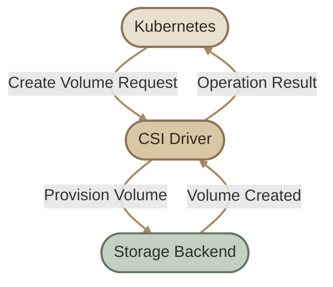
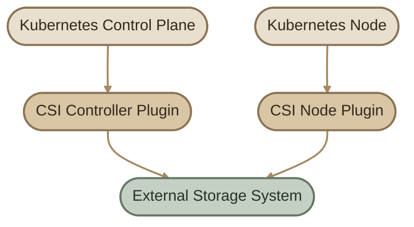

## 1. Introduction

في Kubernetes، مش منطقي إن الـ Orchestrator يكون مرتبطًا بطريقة تخزين واحدة أو Vendor معين.

تخيل إن عندك Cluster وعايز تستخدم Storage من:

- AWS EBS
- Azure Disk
- Google Persistent Disk
- NetApp
- Dell EMC
- Portworx

كل Provider عنده طريقة مختلفة للتعامل مع الـ Storage. هنا بيظهر دور **Container Storage Interface (CSI)**.

<InfoCard title="? What is CSI" variant="concept">
CSI هو Standard موحّد بيحدد طريقة التواصل بين Container Orchestrators وبين Storage Systems من خلال Drivers.
</InfoCard>

الفكرة الأساسية: بدل ما كل Storage Vendor يحتاج Integration خاص داخل Kubernetes Source Code، يقدر يطوّر CSI Driver يلتزم بالـ Standard.

## 2. Why Was CSI Introduced?

في البداية، كان Kubernetes يحتوي على كود خاص للتعامل مع Container Runtime معين، وكان Docker هو الاختيار الأساسي.

مع ظهور Runtimes أخرى مثل:

- rkt
- CRI-O

أصبح من المهم فصل طريقة التواصل عن Kubernetes نفسه.

ومن هنا ظهر **Container Runtime Interface (CRI)**.

نفس الفكرة اتطبقت على Networking وStorage:

| Interface | Responsibility |
|---|---|
| CRI | Communication with Container Runtimes |
| CNI | Integration with Networking Plugins |
| CSI | Integration with Storage Systems |

<Callout type="note">
الـ Interfaces دي بتحدد Contracts أو Standards للتواصل. هي مش الـ Runtime أو Network Plugin أو Storage Provider نفسه.
</Callout>

## 3. How CSI Works

CSI بيحدد مجموعة من العمليات اسمها **RPCs (Remote Procedure Calls)**.

الـ Container Orchestrator بيستدعي العمليات المطلوبة، والـ CSI Driver لازم ينفذها ويتعامل مع الـ Storage Backend.

مثال مبسط:

1. Kubernetes يحتاج Volume جديد.
2. Kubernetes يتواصل مع CSI Driver.
3. الـ Driver ينفذ عملية إنشاء الـ Volume على الـ Storage System.
4. الـ Driver يرجّع نتيجة العملية إلى Kubernetes.

### I. Example: Volume Provisioning

### II. Important CSI Operations

| Operation | Purpose |
|---|---|
| `CreateVolume` | Provision a new volume |
| `DeleteVolume` | Delete a provisioned volume |
| `ControllerPublishVolume` | Attach a volume to a node when required |
| `NodePublishVolume` | Make a volume available to a workload on a node |
| `NodeUnpublishVolume` | Remove the volume from a workload |
| `ControllerUnpublishVolume` | Detach a volume from a node |

مش كل Driver لازم ينفذ كل العمليات بنفس الطريقة؛ الـ CSI Specification بيحدد الـ RPCs المطلوبة والاختيارية حسب قدرات الـ Driver.

## 4. CSI Is Not Kubernetes-Specific

نقطة مهمة في المحاضرة: CSI مش Standard خاص بـ Kubernetes فقط.

هو Standard عام هدفه إن أي Container Orchestrator يدعم CSI يقدر يتعامل مع أي Storage Vendor عنده Driver متوافق.

بالتالي:

- Orchestrator يلتزم بالـ CSI Specification.
- Storage Vendor يطوّر CSI Driver.
- الاتنين يقدروا يتواصلوا من خلال الـ Standard.

<InfoCard title="The Main Benefit" variant="insight">
CSI يفصل Kubernetes عن تفاصيل كل Storage Provider، وده بيسهّل إضافة Storage Solutions جديدة من غير الحاجة لتعديل Kubernetes Source Code لكل Provider.
</InfoCard>

## 5. CSI Components in Kubernetes

في Kubernetes، الـ CSI Driver غالبًا بيتكوّن من Components بتشتغل داخل الـ Cluster، مثل:

- **Controller Plugin:** مسؤول عن عمليات إدارة الـ Volumes، زي Provisioning وAttach وDetach حسب دعم الـ Driver.
- **Node Plugin:** مسؤول عن عمليات تجهيز الـ Volume على الـ Node، زي Mounting وUnmounting.

التنفيذ الفعلي بيختلف من Driver للتاني.

## 6. Important Distinctions

| Concept | Meaning |
|---|---|
| CSI | Standard for Container Storage Integration |
| CSI Driver | Implementation of the CSI Specification |
| Storage Backend | Actual storage system providing the data storage |
| Kubernetes PV | Kubernetes representation of a storage resource |
| PVC | A user's request for storage |

**Don't confuse them:**

- CSI مش Storage Device.
- CSI Driver مش هو الـ Persistent Volume.
- PV وPVC Kubernetes Objects، بينما CSI هو Integration Standard.

## 7. Key Takeaways

- CSI stands for Container Storage Interface.
- CSI standardizes communication between Orchestrators and Storage Providers.
- Storage Vendors can develop independent CSI Drivers.
- CSI defines RPCs such as `CreateVolume` and `DeleteVolume`.
- CSI is not Kubernetes-specific.
- Controller Plugins and Node Plugins handle different parts of the storage lifecycle.

<Callout type="tip">
لما تشوف CSI Driver في Kubernetes، افتكر إنه الـ Bridge بين Kubernetes وبين الـ Storage Provider.
</Callout>
