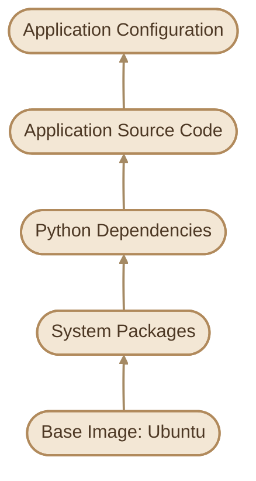
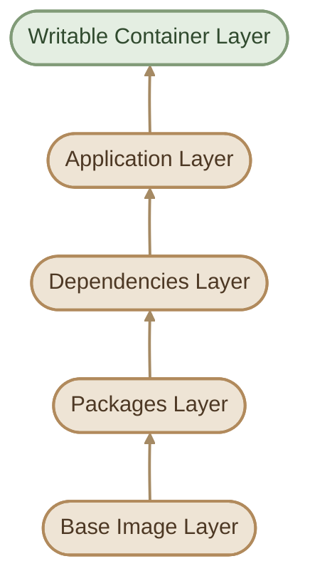
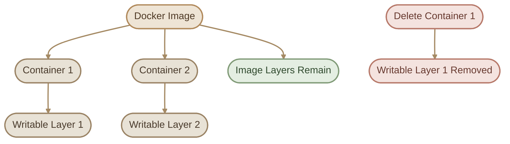
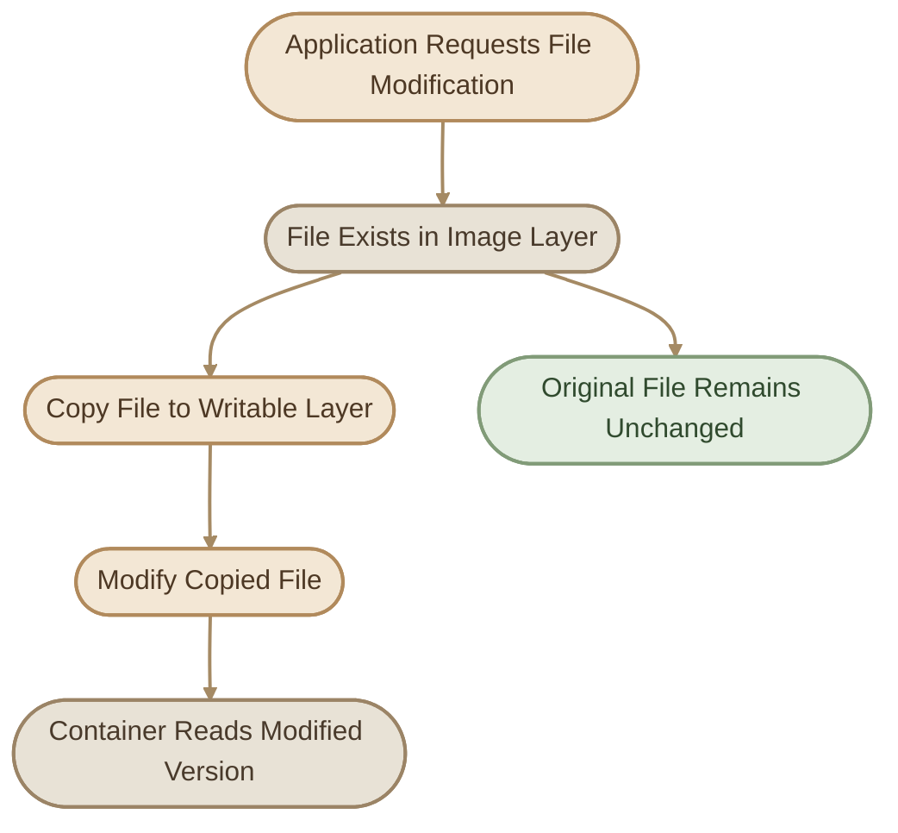
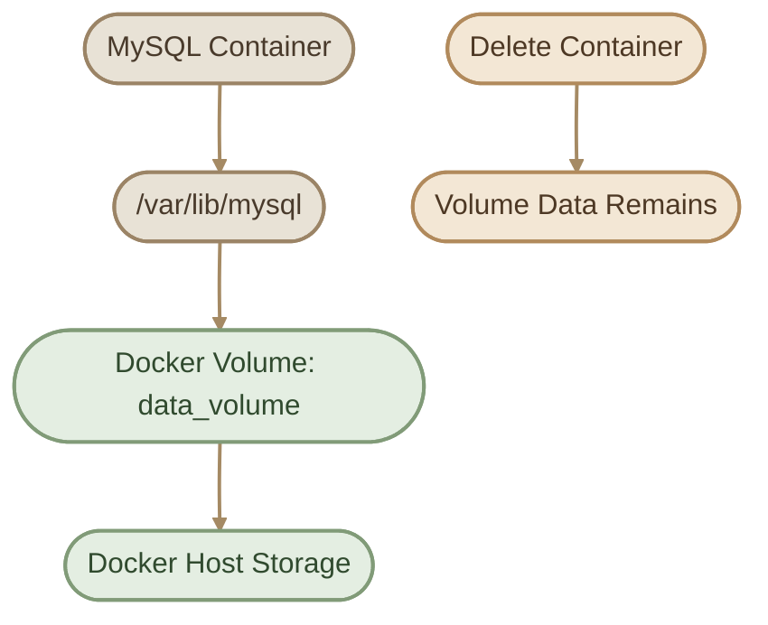
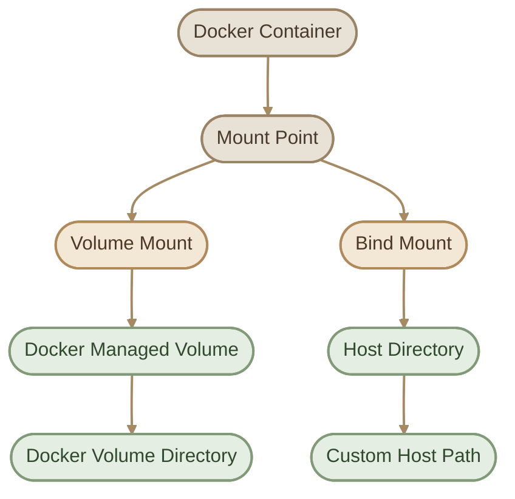
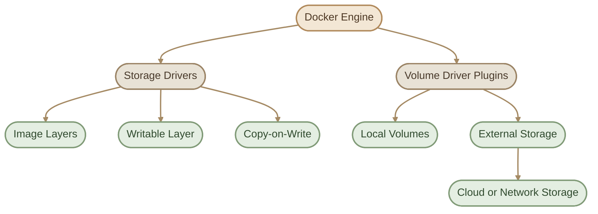
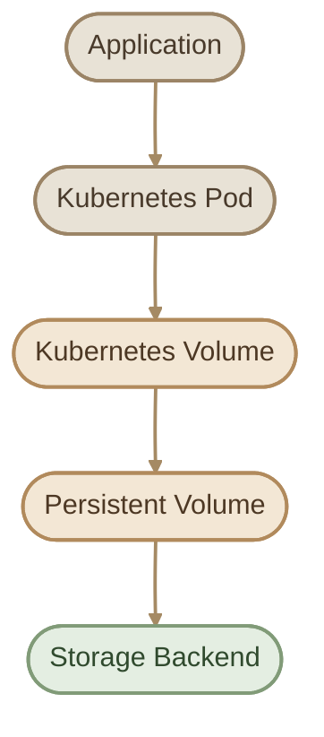

## 1. Introduction — Why Do We Need Storage?

قبل ما نفهم Storage في Kubernetes، لازم نفهم الأول Docker بيخزن البيانات إزاي.

الـ Containers بطبيعتها **Ephemeral**، يعني ممكن تتوقف أو تتمسح وتتعمل من جديد في أي وقت.

تخيل إن عندك Container بيشغل MySQL Database، والـ Database بتخزن بيانات المستخدمين والطلبات.

لو البيانات دي متخزنة داخل الـ Container filesystem، وحصل إن الـ Container اتمسح، البيانات دي هتضيع معاه.

هنا بنحتاج نفصل البيانات عن عمر الـ Container باستخدام Storage خارجي.

<Callout type="warning" title="The Main Problem">
الـ Container filesystem مش Persistent Storage. البيانات الموجودة في الـ Writable Layer بتضيع لما الـ Container يتم حذفه.
</Callout>

## 2. Docker Storage Architecture

لما بتثبت Docker على Linux، بيكون عنده Directory بيستخدمها لتخزين بياناته.

الـ Default Docker Data Directory في التثبيت التقليدي بيكون:

```bash
/var/lib/docker
```

جواه Docker بيخزن بيانات مختلفة، منها:

| Directory | Purpose |
|---|---|
| `containers/` | Container-related data |
| `image/` | Image-related metadata and data |
| `volumes/` | Docker-managed volumes |
| `overlay2/` | Data used by the overlay2 storage driver |

ممكن تعرض الـ Docker Root Directory الفعلية عندك باستخدام:

```bash
docker info --format '{{.DockerRootDir}}'
```

وتعرض معلومات الـ Storage Driver:

```bash
docker info --format '{{.Driver}}'
```

<Callout type="note" title="Important">
الـ `/var/lib/docker` هو المسار الافتراضي الشائع في Linux، لكنه مش ثابت في كل البيئات. ممكن يتغير حسب إعدادات Docker، وRootless Docker، وطريقة التثبيت.
</Callout>

## 3. Docker Image Layers

من أهم المفاهيم اللي لازم نفهمها هي إن Docker Images بتتكون من مجموعة من الـ Layers.

لما Docker يبني Image باستخدام Dockerfile، كل مجموعة من التعليمات اللي بتنتج Layer بتضيف تغييرات فوق الـ Layers السابقة.

خلينا ناخد المثال ده:

```dockerfile
FROM ubuntu:24.04

RUN apt-get update && apt-get install -y python3

RUN pip install flask

COPY app.py /app/app.py

WORKDIR /app

CMD ["python3", "app.py"]
```

الـ Image الناتجة بتتكون من Layers بتمثل التغييرات الناتجة عن تعليمات البناء.



### I. Why Layers?

الـ Layered Architecture بتوفر ميزتين أساسيتين:

**1. Image Reusability**

تخيل عندك تطبيقين بيستخدموا نفس Ubuntu Base Image ونفس Python Dependencies، لكن كل واحد عنده Source Code مختلف.

Docker مش محتاجة تعيد بناء كل الـ Layers المشتركة من الصفر.

بتقدر تعيد استخدام الـ Layers الموجودة بالفعل.

**2. Build Cache**

لو عدلت في `app.py` فقط، Docker ممكن تعيد استخدام الـ Layers السابقة اللي لسه صالحة من الـ Cache، وتبني الأجزاء المتغيرة فقط.

ده بيساعد في تقليل وقت بناء الـ Images واستهلاك المساحة.

<CardGrid columns={2}>
  <InfoCard variant="concept" title="Image Layers" description="Reusable layers shared between images and containers. They are read-only after being created." icon="layers" tags={["Read Only", "Reusable"]} />
  <InfoCard variant="insight" title="Build Cache" description="Reuses unchanged build layers to make subsequent builds faster." icon="cycle" tags={["Efficiency", "Caching"]} />
</CardGrid>

## 4. Container Writable Layer

لما بتعمل Container من Image، Docker بتستخدم الـ Image Layers الموجودة، وبتضيف فوقها Layer جديدة قابلة للكتابة.

الـ Layer دي اسمها:

**Writable Layer**

بتستخدم لتخزين التغييرات اللي بتحصل أثناء تشغيل الـ Container، زي:

- إنشاء ملفات جديدة.
- تعديل ملفات موجودة.
- إنشاء Temporary Files.
- كتابة Application Logs داخل الـ Container filesystem.



### I. Image Layer vs Writable Layer

| Image Layers | Writable Layer |
|---|---|
| Read-only | Read-write |
| Shared between containers using the same image | Belongs to a specific container |
| Created during image build | Created when the container is created |
| Remains available as long as the image is retained | Removed when the container is removed |

### II. What Happens When a Container Is Deleted?

لما تحذف Container، الـ Writable Layer الخاصة بيه بتتمسح معاها.

لكن الـ Image Layers بتفضل موجودة طالما الـ Image نفسها لسه موجودة.



<Callout type="warning" title="Remember">
Deleting a container removes its writable layer, but does not automatically remove the Docker image or independently managed volumes.
</Callout>

## 5. Copy-on-Write (CoW)

طيب، عندنا مشكلة:

الـ Image Layers عبارة عن Read-only Layers، فإزاي نقدر نعدل ملف موجود أصلًا داخل الـ Image؟

هنا بيظهر مفهوم اسمه:

**Copy-on-Write (CoW)**

لما تحاول تعدل ملف موجود في Read-only Image Layer، Docker بتعمل نسخة من الملف في الـ Writable Layer، وبعد كده التعديلات بتحصل على النسخة الجديدة.

الـ Original File بيفضل زي ما هو داخل الـ Image.

### I. How Copy-on-Write Works



### II. Example

تخيل إن عندك ملف:

```text
/app/config.yaml
```

الملف ده موجود في الـ Image Layer.

لما تعمل Container وتحاول تعدل الملف:

1. Docker بتعمل Copy للملف في الـ Writable Layer.
2. التعديل بيتم على النسخة الجديدة.
3. الـ Original File في الـ Image Layer بيفضل زي ما هو.
4. باقي الـ Containers اللي بتستخدم نفس الـ Image مش بتتأثر بالتعديل.

<InfoCard variant="insight" title="Copy-on-Write" description="Docker preserves the original image data and stores modifications in the container's writable layer. This is one of the mechanisms used by supported storage drivers." icon="layers" tags={["CoW", "Writable Layer"]} />

**Important:** الـ Copy-on-Write هنا مش معناه إن كل ملفات الـ Image بتتنسخ عند إنشاء Container. النسخ بيحصل عند الحاجة لتعديل ملف موجود في Layer سابقة.

## 6. Docker Volumes — Persisting Data

دلوقتي فهمنا إن البيانات الموجودة في الـ Writable Layer بتضيع لما الـ Container يتم حذفه.

طيب لو عندنا Database وعايزين البيانات تفضل موجودة حتى بعد حذف الـ Container؟

الحل هو استخدام **Docker Volumes**.

الـ Volume بتوفر Storage منفصل عن عمر الـ Container.

وبالتالي نقدر نربطها بالـ Container ونخلي الـ Application تكتب بياناتها فيها بدل الـ Writable Layer.

### I. Create a Docker Volume

نقدر ننشئ Volume باستخدام:

```bash
docker volume create data_volume
```

Docker هتنشئ Volume باسم `data_volume`.

في الـ Default Local Volume Driver على Linux، بيانات الـ Volume بتتخزن عادة تحت:

```text
/var/lib/docker/volumes/data_volume/_data
```

لعرض الـ Volumes الموجودة:

```bash
docker volume ls
```

ولمعرفة تفاصيل Volume معينة:

```bash
docker volume inspect data_volume
```

### II. Mount a Volume into a Container

بعد إنشاء الـ Volume، نقدر نربطها بالـ Container.

مثال باستخدام MySQL:

```bash
docker run -d \
  --name mysql-db \
  --mount type=volume,source=data_volume,target=/var/lib/mysql \
  -e MYSQL_ROOT_PASSWORD=example \
  mysql:8.4
```

في المثال ده:

| Parameter | Meaning |
|---|---|
| `type=volume` | Specifies that we are using a Docker Volume |
| `source=data_volume` | The name of the Docker Volume |
| `target=/var/lib/mysql` | The mount path inside the Container |
| `mysql:8.4` | The Docker Image |

الـ MySQL Database بتخزن بياناتها في `/var/lib/mysql`.

إحنا هنا بنربط المسار ده بالـ Volume، وبالتالي البيانات اللي MySQL بتكتبها بتتحفظ في الـ Volume بدل ما تعتمد على الـ Writable Layer.



حتى لو حذفنا الـ Container، الـ Volume بتفضل موجودة، ونقدر نربطها بـ Container جديدة.

### III. Automatic Volume Creation

مش لازم تنشئ Volume بنفسك قبل تشغيل الـ Container.

لو استخدمت Volume باسم مش موجود في أمر Docker، Docker بتقدر تنشئها تلقائيًا.

مثال:

```bash
docker run -d \
  --name mysql-db-2 \
  -v data_volume_2:/var/lib/mysql \
  -e MYSQL_ROOT_PASSWORD=example \
  mysql:8.4
```

لو `data_volume_2` مش موجودة، Docker هتنشئها وتعمل Mount ليها.

وده اسمه:

**Volume Mounting**

## 7. Bind Mounts

في بعض الحالات، ممكن تكون البيانات موجودة بالفعل على الـ Host Machine في مسار معين، وعايزين نربط المسار ده بالـ Container.

هنا بنستخدم:

**Bind Mount**

الفرق إننا بدل ما نستخدم Docker-managed Volume، بنحدد مسار موجود على الـ Host مباشرة.

مثال:

عندنا Directory على الـ Host:

```text
/data/mysql
```

وعايزين نربطه بالمسار:

```text
/var/lib/mysql
```

داخل الـ Container.

نقدر نعمل ده باستخدام:

```bash
docker run -d \
  --name mysql-db \
  --mount type=bind,source=/data/mysql,target=/var/lib/mysql \
  -e MYSQL_ROOT_PASSWORD=example \
  mysql:8.4
```

### I. Volume Mount vs Bind Mount



| Comparison | Volume Mount | Bind Mount |
|---|---|---|
| Source | Docker-managed Volume | Existing Host Path |
| Management | Managed by Docker | Managed by the Host |
| Typical location | Docker Volume directory | Any valid Host path |
| Common use | Persistent application data | Development files and configuration |

<Callout type="tip" title="Practical Difference">
الـ Volume بتخلي Docker تدير الـ Storage، أما الـ Bind Mount فإنت بتحدد المسار الفعلي على الـ Host بنفسك.
</Callout>

## 8. Docker Mount Syntax

فيه طريقتين شائعتين لكتابة أوامر Mount.

### I. The -v Option

الطريقة القديمة والأقصر:

```bash
docker run -v data_volume:/var/lib/mysql mysql:8.4
```

ولـ Bind Mount:

```bash
docker run -v /data/mysql:/var/lib/mysql mysql:8.4
```

### II. The --mount Option

الطريقة الأكثر وضوحًا لأنها بتحدد كل Parameter بصورة منفصلة.

Volume Mount:

```bash
docker run \
  --mount type=volume,source=data_volume,target=/var/lib/mysql \
  mysql:8.4
```

Bind Mount:

```bash
docker run \
  --mount type=bind,source=/data/mysql,target=/var/lib/mysql \
  mysql:8.4
```

### III. Syntax Comparison

| `-v` | `--mount` |
|---|---|
| Shorter syntax | More explicit syntax |
| Colon-separated values | Key-value parameters |
| Convenient for quick commands | Easier to read and configure |

**Recommendation:** استخدم `--mount` لما تكون عايز Command واضحة وسهلة القراءة، خصوصًا في الشروحات والـ Labs.

## 9. Docker Storage Drivers

دلوقتي عرفنا إن Docker بتستخدم Image Layers وWritable Layers، وعرفنا كمان Copy-on-Write.

السؤال هنا:

مين المسؤول عن إدارة الـ Layers دي؟

الإجابة:

**Storage Drivers**

الـ Storage Drivers مسؤولة عن إدارة الـ Container Image Layers والـ Writable Layer، والعمليات المرتبطة بيهم.

ومن أمثلتها:

- OverlayFS / `overlay2`
- AUFS
- Btrfs
- Device Mapper
- VFS
- ZFS

مش كل Storage Drivers متاحة على كل Operating Systems، والاختيار بيعتمد على دعم الـ Kernel وإعدادات Docker والـ Storage Backend.

في بيئات Linux الحديثة، OverlayFS من أشهر الاختيارات، لكن لازم تراجع الـ Storage Driver الفعلي المستخدم في بيئتك.

اعرف الـ Driver الحالي:

```bash
docker info --format '{{.Driver}}'
```

### I. What Do Storage Drivers Handle?

<InfoCard variant="concept" title="Layer Management" description="Manage image layers and the writable layer associated with containers." icon="layers" tags={["Image Layers"]} />

<InfoCard variant="concept" title="Copy-on-Write" description="Handle file modifications when a container changes files from read-only image layers." icon="layers" tags={["CoW"]} />

<InfoCard variant="concept" title="Container Filesystem" description="Provide the filesystem behavior that allows containers to use layered image data." icon="cube" tags={["Filesystem"]} />

## 10. Volume Driver Plugins

وصلنا لنقطة مهمة جدًا:

الـ Storage Drivers مش هي المسؤولة عن إدارة Docker Volumes.

دي مسؤولية مختلفة بتقوم بيها:

**Volume Driver Plugins**

الـ Default Volume Driver في Docker هو:

`local`

وده بيسمح بإنشاء Volumes على الـ Docker Host نفسه.

لكن ممكن نستخدم Volume Plugins للتعامل مع Storage Providers خارجية.

أمثلة على حلول التخزين اللي ظهرت في Docker Volume Plugin ecosystem:

- AWS EBS
- Azure File Storage
- Google Persistent Disk
- NetApp
- Portworx
- VMware vSphere
- GlusterFS

الأمثلة دي بتوضح إن Docker مش محصورة في التخزين المحلي فقط، لكن تقدر تتكامل مع حلول Storage مختلفة عن طريق Plugins المناسبة.

### I. Storage Driver vs Volume Driver

دي من أهم المقارنات في الجزء ده.

| Storage Drivers | Volume Driver Plugins |
|---|---|
| Manage container image layers | Manage Docker Volumes |
| Handle writable layers | Provide and manage volume storage |
| Support Copy-on-Write mechanisms | Connect to local or external storage |
| Work with container filesystem layers | Work with persistent data |



<Callout type="warning" title="Do Not Confuse Them">
Storage Driver وVolume Driver Plugin مش نفس الحاجة.

الأول مسؤول عن Container Filesystem Layers، والتاني مسؤول عن توفير وإدارة الـ Volumes.
</Callout>

## 11. Connecting Docker Storage to Kubernetes

دلوقتي عندنا الأساس اللي محتاجينه علشان نبدأ Kubernetes Storage.

في Docker، عرفنا إن:

- الـ Container عنده Writable Layer.
- الـ Writable Layer مرتبطة بعمر الـ Container.
- الـ Volumes بتوفر تخزين منفصل عن عمر الـ Container.
- ممكن نستخدم Local أو External Storage.
- فيه Drivers مسؤولة عن إدارة الـ Storage.

في Kubernetes، هنقابل نفس المشكلة الأساسية لكن على مستوى الـ Cluster.

مش كفاية إن الـ Pod يكون عندها مساحة تخزين، إحنا محتاجين طريقة لإدارة الـ Storage وربطه بالـ Pods بشكل منظم.

وهنا هنبدأ نتعرف على:

<CardGrid columns={2} label="Kubernetes Storage Concepts">
  <InfoCard variant="concept" title="Volumes" description="Provide storage that can be mounted into containers inside a Pod." icon="database" tags={["Pod Storage"]} />
  <InfoCard variant="concept" title="Persistent Volumes" description="Represent storage resources provisioned for use in a Kubernetes Cluster." icon="database" tags={["PV"]} />
  <InfoCard variant="concept" title="Persistent Volume Claims" description="Allow applications to request storage with specific requirements." icon="modules" tags={["PVC"]} />
  <InfoCard variant="concept" title="Storage Classes" description="Define classes of storage and support dynamic provisioning through suitable provisioners." icon="layers" tags={["Dynamic Provisioning"]} />
</CardGrid>



<Callout type="note" title="Important Distinction">
الـ Docker Volume وKubernetes Persistent Volume مش نفس الـ Object أو نفس آلية الإدارة. اللي اتعلمناه هنا هو الأساس المفاهيمي لفهم مشكلة الـ Storage، أما Kubernetes فلها Resources وInterfaces وآليات Provisioning خاصة بيها.
</Callout>

## 12. Practical Lab — Docker Storage

قبل ما نكمل، خلينا نطبق المفاهيم دي عمليًا.

<Steps>
  <li>
    **Inspect Docker Storage**

    اعرض معلومات الـ Docker Engine:

    ```bash
    docker info
    ```

    اعرف الـ Storage Driver:

    ```bash
    docker info --format '{{.Driver}}'
    ```

    واعرف الـ Docker Root Directory:

    ```bash
    docker info --format '{{.DockerRootDir}}'
    ```
  </li>
  <li>
    **Create a Volume**

    ```bash
    docker volume create storage-lab
    ```

    اعرض الـ Volumes:

    ```bash
    docker volume ls
    ```
  </li>
  <li>
    **Run a Container with a Volume**

    ```bash
    docker run -d \
      --name storage-test \
      --mount type=volume,source=storage-lab,target=/data \
      alpine:3.22 \
      sleep infinity
    ```
  </li>
  <li>
    **Write Data**

    ```bash
    docker exec storage-test sh -c \
      'echo "Persistent Docker Data" > /data/test.txt'
    ```

    تأكد إن البيانات اتكتبت:

    ```bash
    docker exec storage-test cat /data/test.txt
    ```
  </li>
  <li>
    **Delete the Container**

    ```bash
    docker rm -f storage-test
    ```
  </li>
  <li>
    **Create Another Container**

    استخدم نفس الـ Volume مع Container جديدة:

    ```bash
    docker run --rm \
      --mount type=volume,source=storage-lab,target=/data \
      alpine:3.22 \
      cat /data/test.txt
    ```

    المفروض تشوف:

    ```text
    Persistent Docker Data
    ```

    وده بيثبت إن البيانات فضلت موجودة بعد حذف الـ Container الأولى.
  </li>
  <li>
    **Cleanup**

    ```bash
    docker volume rm storage-lab
    ```

    <Callout type="warning" title="Cleanup">
    اتأكد إنك مش محتاج البيانات قبل حذف الـ Volume؛ لأن حذف الـ Volume ممكن يؤدي إلى فقدان البيانات المخزنة فيها.
    </Callout>
  </li>
</Steps>

## 13. Key Takeaways

<InfoCard variant="summary" title="The Docker Storage Mental Model" description="Image Layers are read-only, each container gets a writable layer, and persistent data should be stored outside that layer using Volumes or another suitable storage mechanism." icon="database" tags={["Storage Fundamentals"]} />

<CardGrid columns={2} label="What You Should Remember">
  <InfoCard variant="summary" title="Image Layers" description="Read-only layers shared between containers created from the same image." icon="layers" />
  <InfoCard variant="summary" title="Writable Layer" description="Stores container-specific changes and disappears when the container is removed." icon="code" />
  <InfoCard variant="summary" title="Copy-on-Write" description="Copies files into the writable layer before modifying files from read-only layers." icon="layers" />
  <InfoCard variant="summary" title="Docker Volumes" description="Store data independently from the container's writable layer." icon="database" />
  <InfoCard variant="summary" title="Bind Mounts" description="Mount an existing Host directory into a container." icon="modules" />
  <InfoCard variant="summary" title="Storage Drivers" description="Manage image layers and container filesystem behavior." icon="sliders" />
  <InfoCard variant="summary" title="Volume Plugins" description="Provide volume storage through local or external storage backends." icon="cube" />
</CardGrid>

### I. Quick Revision

- Docker stores its data under a configurable Docker Root Directory.
- Docker Images are built using reusable layers.
- Image Layers are read-only.
- Every container has its own writable layer.
- Deleting a container removes its writable layer.
- Copy-on-Write allows modification of files from read-only layers.
- Docker Volumes provide storage independent of container lifetime.
- Volume Mounts use Docker-managed volumes.
- Bind Mounts use paths from the Docker Host.
- Storage Drivers manage image and container filesystem layers.
- Volume Driver Plugins manage Docker Volumes.
