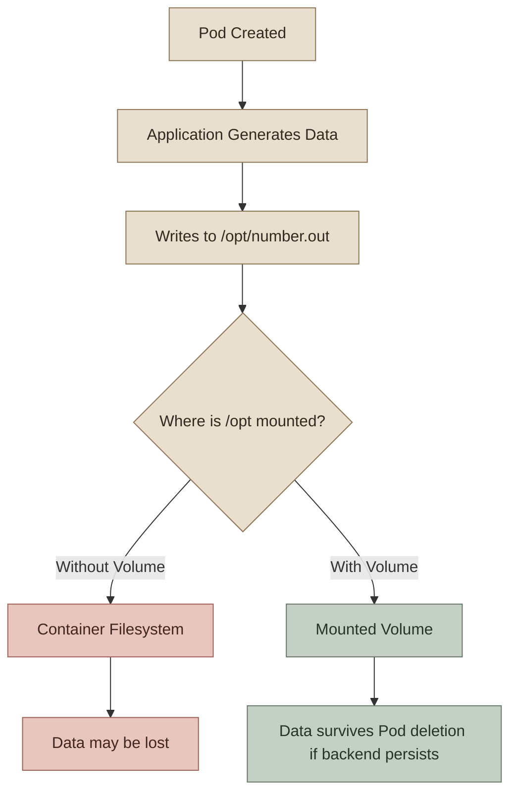
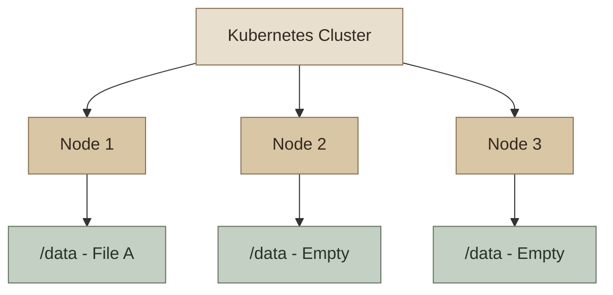

## 1. Introduction

الـ Containers والـ Pods بطبيعتهم **Ephemeral**؛ يعني ممكن يتعملهم Delete ويتعملهم Recreate في أي وقت.

المشكلة إن البيانات اللي موجودة داخل الـ Container Filesystem ممكن تضيع لما الـ Container يتوقف أو يتشال.

عشان نحتفظ بالبيانات، بنستخدم **Volumes**.

<InfoCard title="? What is a Volume" variant="concept">
Volume هو Storage Resource بيتم إتاحته للـ Container داخل الـ Pod عن طريق Mount Path، بحيث يقدر يقرأ ويكتب البيانات عليه.
</InfoCard>

## 2. The Problem: Ephemeral Storage

تخيل Pod بيشغّل Application بتكتب بيانات في الملف:

```text
/opt/number.out
```

لو البيانات اتكتبت داخل الـ Container Filesystem العادي، ممكن تضيع لما الـ Container يتشال.

لكن لو ربطنا Volume بالـ Pod وعملنا Mount له على `/opt`، البيانات هتتكتب داخل الـ Volume بدلًا من الـ Container's writable layer.



<Callout type="note">
وجود Volume لا يعني تلقائيًا إن البيانات هتفضل موجودة بعد حذف الـ Pod. ده بيعتمد على نوع الـ Volume والـ Storage Backend والـ Lifecycle الخاص بيهم.
</Callout>

## 3. Creating a Volume with hostPath

في المحاضرة، استخدمنا `hostPath` كمثال بسيط.

الـ `hostPath` بيستخدم Directory موجود على الـ Node نفسه.

مثال: هنستخدم `/data` على الـ Host، ونعمل Mount له داخل الـ Container على `/opt`.

### Pod Definition

```yaml
apiVersion: v1
kind: Pod
metadata:
  name: random-number-generator
spec:
  containers:
    - name: generator
      image: busybox
      command:
        - sh
        - -c
        - "shuf -i 1-100 -n 1 > /opt/number.out; sleep 3600"
      volumeMounts:
        - name: data-volume
          mountPath: /opt

  volumes:
    - name: data-volume
      hostPath:
        path: /data
        type: DirectoryOrCreate
```

### Understanding the Configuration

| Field | Purpose |
|---|---|
| `volumes` | Defines Volumes available to the Pod |
| `name` | Volume name inside the Pod specification |
| `hostPath` | Uses a path from the Node's filesystem |
| `path` | Directory on the Host Node |
| `volumeMounts` | Defines where the Volume appears inside the Container |
| `mountPath` | Container path where the Volume is mounted |

### Data Flow


بالتالي، الملف اللي التطبيق بيكتبه في `/opt/number.out` داخل الـ Container، بيظهر على الـ Node في:

```text
/data/number.out
```

لو الـ Pod اتحذف، الملف يفضل موجود على الـ Node طالما الـ Directory نفسه موجود.

## 4. The Problem with hostPath

`hostPath` مناسب للتجارب والـ Local Development في حالات معينة، لكنه مش اختيار مناسب عادةً لإدارة Persistent Storage في Multi-Node Production Clusters.

ليه؟

لأن كل Node عنده Filesystem مستقل.

تخيل Cluster فيه 3 Nodes:

```text
Node 1: /data
Node 2: /data
Node 3: /data
```

دي ثلاث Directories مختلفة، ومش معناها إنهم بيشاركوا نفس البيانات.

لو Pod اشتغل على Node 1 وكتب ملف في `/data`، وبعد كده اتنقل أو اتعمله Recreate على Node 2، مش هيلاقي نفس الملف تلقائيًا.



<Callout type="warning">
`hostPath` بيربط الـ Pod بمسار على Node معين. Kubernetes لا يقوم بمزامنة البيانات بين Nodes تلقائيًا.
</Callout>

## 5. Other Storage Options

Kubernetes بيدعم أنواع مختلفة من Storage Backends.

أمثلة من المحاضرة:

| Storage Type | Description |
|---|---|
| NFS | Network File System |
| CephFS | Distributed File System |
| Fibre Channel | Storage networking technology |
| AWS EBS | Block Storage on AWS |
| Azure Disk | Managed Block Storage on Azure |
| Azure File | Managed File Storage on Azure |
| Google Persistent Disk | Block Storage on Google Cloud |

اختيار الـ Backend بيعتمد على البيئة والـ Requirements والـ CSI Driver المتاح.

## 6. Example: Using AWS EBS

في المحاضرة، المثال بيستخدم `awsElasticBlockStore` داخل تعريف الـ Volume.

المفهوم الأساسي إننا بنحدد الـ Volume ID والـ Filesystem Type بدل الاعتماد على Directory محلي على الـ Node.

**ملاحظة مهمة:** ده مثال من الـ In-tree Volume Plugins القديمة. الـ AWS EBS In-tree integration تم استبداله بـ CSI Driver في الإصدارات الحديثة، لذلك ما تستخدمش المثال ده كـ Configuration حديثة.

في بيئة حديثة، عادةً هتتعامل مع EBS من خلال AWS EBS CSI Driver، ثم PV/PVC أو Dynamic Provisioning.

## 7. Volume vs Container Filesystem

| Container Filesystem | Volume |
|---|---|
| مرتبط بعمر الـ Container | Lifecycle يعتمد على نوع الـ Volume |
| البيانات ممكن تضيع مع حذف الـ Container | ممكن يحتفظ بالبيانات بعد حذف الـ Container أو Pod |
| موجود داخل Container Writable Layer | بيتم Mount داخل Container |
| مناسب للملفات المؤقتة | مناسب للبيانات التي تحتاج تخزينًا خارج الـ Container Layer |

## 8. Practical Lab

<Steps>
  <li>
    **Create the Pod**

    ```bash
    kubectl apply -f random-number-generator.yaml
    ```
  </li>
  <li>
    **Check the Pod**

    ```bash
    kubectl get pods
    ```
  </li>
  <li>
    **Read the Generated File**

    ```bash
    kubectl exec random-number-generator -- cat /opt/number.out
    ```
  </li>
  <li>
    **Check the Node Directory**

    في `hostPath`، لازم تفحص الـ Node اللي الـ Pod شغال عليه، مش تفترض إن `/data` موجودة على جهازك المحلي.

    لو بتستخدم `kind`، الـ Node عبارة عن Container، وممكن تفحصه باستخدام:

    ```bash
    docker exec -it devops-lab-control-plane sh
    ```

    ثم:

    ```bash
    cat /data/number.out
    ```
  </li>
  <li>
    **Delete the Pod**

    ```bash
    kubectl delete pod random-number-generator
    ```

    بعد حذف الـ Pod، افحص الملف على الـ Node مرة تانية.
  </li>
</Steps>

## 9. Key Takeaways

- Pods and Containers are ephemeral.
- Volumes provide storage to Containers.
- `volumes` defines the Volume at Pod level.
- `volumeMounts` mounts it inside a Container.
- `hostPath` uses a path on a specific Node.
- Different Nodes do not automatically share the same `hostPath` data.
- Production storage often uses networked or cloud storage through suitable drivers.

<Callout type="tip">
افتكر الفرق: `volumes` بتعرّف الـ Storage للـ Pod، أما `volumeMounts` فبتحدد مكان ظهوره داخل الـ Container.
</Callout>
