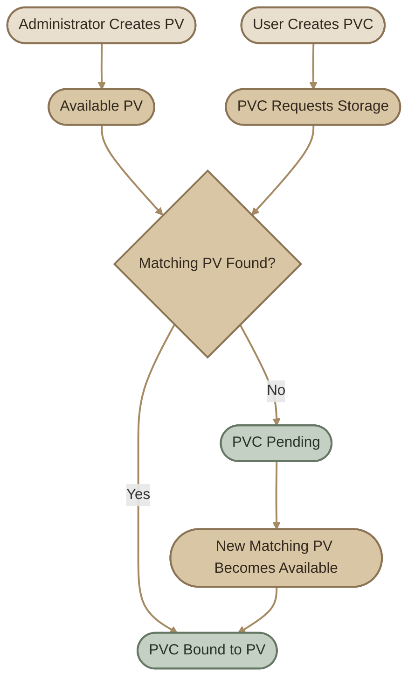
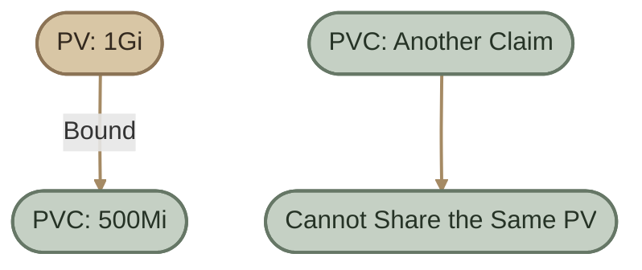
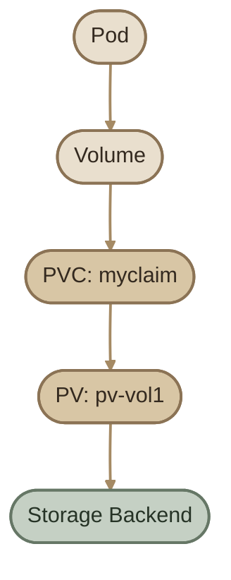

## 1. What is a Persistent Volume Claim?

في الدرس السابق، عرفنا إن الـ Administrator بيجهز Persistent Volumes.

لكن الـ Application User مش المفروض يحتاج يعرف كل تفاصيل الـ Storage Backend أو يختار الـ Disk بنفسه.

بدل كده، بيعمل **Persistent Volume Claim (PVC)** يطلب فيه الـ Storage اللي محتاجه.

<InfoCard title="Persistent Volume Claim" variant="concept">
PVC هو Kubernetes Object بيمثل طلب من User للحصول على Storage بمواصفات معينة، زي الحجم والـ Access Modes والـ Storage Class.
</InfoCard>

الفرق الأساسي:

| Persistent Volume (PV) | Persistent Volume Claim (PVC) |
|---|---|
| Represents available storage | Requests storage |
| Usually created by Administrator | Usually created by Application User |
| Cluster-scoped | Namespaced |
| Defines storage properties | Defines required properties |

## 2. How PV and PVC Work Together

الـ Administrator بيجهز PVs، والـ User بيعمل PVC.

Kubernetes بيحاول يعمل Binding بين الـ PVC وواحد من الـ PVs المتاحة بناءً على الـ Requirements.



## 3. PVC Binding Rules

Kubernetes بيبحث عن PV مناسب للـ PVC بناءً على مجموعة من الخصائص.

أهمها:

### 1. Capacity

الـ PV لازم تكون سعته مساوية أو أكبر من السعة المطلوبة في الـ PVC.

مثال:

```text
PVC requests: 500Mi
PV capacity: 1Gi
```

ممكن يحصل Binding لأن الـ PV عندها Capacity كافية.

### 2. Access Modes

الـ Access Modes المطلوبة في الـ PVC لازم تكون مدعومة من الـ PV.

مثال:

```yaml
# PV
accessModes:
  - ReadWriteOnce
```

```yaml
# PVC
accessModes:
  - ReadWriteOnce
```

### 3. Storage Class

الـ Storage Class بتساعد في تحديد نوع الـ Storage المطلوب.

الـ PVC ممكن يطلب Storage Class معينة، والـ PV لازم تتوافق مع الطلب.

### 4. Volume Mode

Kubernetes بيدعم نوعين أساسيين:

| Volume Mode | Meaning |
|---|---|
| `Filesystem` | Volume is presented as a filesystem |
| `Block` | Volume is presented as a raw block device |

### 5. Selector

ممكن تستخدم `selector` في PVC لاختيار PVs بناءً على Labels.

مثال:

```yaml
selector:
  matchLabels:
    environment: production
```

<Callout type="note">
Kubernetes بيعمل Matching بناءً على الـ Requirements والخصائص المطلوبة. مش شرط إن الـ PVC يختار PV بنفس الحجم بالضبط؛ ممكن Claim يترتبط بـ PV أكبر لو باقي الشروط متوافقة.
</Callout>

## 4. One-to-One Binding

العلاقة بين PV وPVC هي علاقة One-to-One.

يعني:

- PVC واحد يرتبط بـ PV واحدة.
- PV واحدة لا يتم تقسيمها تلقائيًا بين عدة PVCs.
- لو PVC طلبت `500Mi` واتربطت بـ PV سعتها `1Gi`، المساحة المتبقية مش بتتحول تلقائيًا إلى PV أخرى أو Claim جديدة.



## 5. Creating a PVC

هنعمل PVC اسمها `myclaim` تطلب `500Mi` وتستخدم `ReadWriteOnce`.

### I. persistent-volume-claim.yaml

```yaml
apiVersion: v1
kind: PersistentVolumeClaim
metadata:
  name: myclaim
spec:
  accessModes:
    - ReadWriteOnce

  resources:
    requests:
      storage: 500Mi
```

### II. Create the PVC

```bash
kubectl apply -f persistent-volume-claim.yaml
```

### III. Inspect the PVC

```bash
kubectl get pvc
```

أو:

```bash
kubectl describe pvc myclaim
```

## 6. Understanding the Pending State

لو مفيش PV متاحة تطابق شروط الـ PVC، هتفضل في حالة:

```text
STATUS: Pending
```

مثال:

```text
NAME      STATUS    VOLUME
myclaim   Pending
```

لما تتوفر PV مناسبة، Kubernetes ممكن يعمل Binding تلقائيًا.

**مهم:** الـ PVC ممكن تفضل Pending لأسباب مختلفة، مش بس عدم وجود PV. مثلًا:

- مفيش PV مطابقة.
- الـ Storage Class المطلوبة مش موجودة.
- Dynamic Provisioning مش قادر ينشئ Storage.
- الـ Access Modes أو الـ Volume Mode غير متوافقة.

## 7. Inspecting the Binding

 مثال:

```text
PV:
  Capacity: 1Gi
  Access Mode: ReadWriteOnce

PVC:
  Requested: 500Mi
  Access Mode: ReadWriteOnce
```

لو مفيش شروط أخرى تمنع الـ Binding، ممكن Kubernetes يربط الـ PVC بالـ PV.

افحص النتيجة:

```bash
kubectl get pv
kubectl get pvc
```

هتلاقي الـ PVC بقت `Bound`، والـ PV كمان بقت `Bound`.

وتقدر تعرف الـ PV المرتبطة بالـ PVC من:

```bash
kubectl get pvc myclaim
```

## 8. Using a PVC Inside a Pod

بعد ما الـ PVC ترتبط بـ PV، تقدر تستخدمها داخل Pod عن طريق `persistentVolumeClaim`.

### I. pod.yaml

```yaml
apiVersion: v1
kind: Pod
metadata:
  name: app
spec:
  containers:
    - name: app
      image: nginx:1.29-alpine
      volumeMounts:
        - name: app-storage
          mountPath: /usr/share/nginx/html

  volumes:
    - name: app-storage
      persistentVolumeClaim:
        claimName: myclaim
```

لاحظ الفرق:

- `persistentVolumeClaim` بيحدد الـ PVC اللي الـ Pod هتستخدمها.
- `claimName` هو اسم الـ PVC.
- `volumeMounts` بيحدد مكان ظهور الـ Storage داخل الـ Container.



## 9. What Happens When a PVC Is Deleted?

السؤال المهم: لما نحذف PVC، هل الـ PV والبيانات اللي جواها بيتم حذفهم تلقائيًا؟

الإجابة بتعتمد على:

**Persistent Volume Reclaim Policy**

الـ Reclaim Policy بتحدد Kubernetes يتعامل إزاي مع الـ PV بعد ما الـ PVC المرتبطة بيها تتحذف.

### 1. Retain

```yaml
persistentVolumeReclaimPolicy: Retain
```

- الـ PV تفضل موجودة بعد حذف الـ PVC.
- البيانات لا يتم حذفها تلقائيًا بواسطة Kubernetes.
- الـ PV تدخل غالبًا في حالة `Released`.
- الـ Administrator مسؤول عن التعامل مع الـ Storage وتجهيزها للاستخدام مرة أخرى.

<InfoCard variant="success" title="Retain — Data retained" description="The PV and its data are preserved after the PVC is deleted. Manual administrator action is required to reuse the volume." icon="shield" />

### 2. Delete

```yaml
persistentVolumeReclaimPolicy: Delete
```

- عند تحرير الـ PV بعد حذف الـ PVC، Kubernetes يطلب حذف الـ Storage Resource من خلال الـ Provisioner أو Driver المسؤول.
- الـ PV Object والـ Backing Storage ممكن يتم حذفهم.

<InfoCard variant="warning" title="Delete — Storage deletion requested" description="When the PVC is deleted, Kubernetes requests the backing storage resource to be deleted through the Provisioner or Driver." icon="shield" />

### 3. Recycle

كانت `Recycle` بتعتمد على تنظيف البيانات من الـ Volume قبل إتاحتها مرة أخرى.

لكنها **Deprecated** ولم تعد مدعومة كـ Reclaim Policy صالحة للاستخدام في Kubernetes الحديثة.

استخدم `Retain` أو `Delete` حسب الـ Requirement.

## 10. Reclaim Policy Comparison

| Policy | Behavior |
|---|---|
| `Retain` | Keeps the storage for manual recovery or cleanup |
| `Delete` | Requests deletion of the PV and backing storage when supported |
| `Recycle` | Deprecated legacy behavior |

<Callout type="warning">
حذف PVC مش معناه دائمًا إن البيانات هتتمسح، ومش معناه برضه إنها آمنة للأبد. لازم تعرف الـ Reclaim Policy ونوع الـ Storage Backend قبل ما تحذف Claims في بيئة Production.
</Callout>

## 11. Practical Lab

هنستخدم الـ PV اللي أنشأناها في الدرس السابق، واللي سعتها `1Gi`.

<Steps>
  <li>
    **Check Existing PV**

    ```bash
    kubectl get pv
    ```

    المفروض تلاقي PV في حالة `Available`.
  </li>
  <li>
    **Create the PVC**

    ```bash
    kubectl apply -f persistent-volume-claim.yaml
    ```
  </li>
  <li>
    **Check PVC Status**

    ```bash
    kubectl get pvc
    ```
  </li>
  <li>
    **Inspect PV and PVC**

    ```bash
    kubectl describe pv pv-vol1
    kubectl describe pvc myclaim
    ```
  </li>
  <li>
    **Verify the Binding**

    ```bash
    kubectl get pv,pvc
    ```

    اتأكد إن:

    - PVC status is `Bound`.
    - PV status is `Bound`.
    - الـ PV مرتبطة بالـ PVC المطلوبة.
  </li>
  <li>
    **Delete the PVC**

    ```bash
    kubectl delete pvc myclaim
    ```
  </li>
  <li>
    **Inspect the PV Again**

    ```bash
    kubectl get pv
    ```

    لو الـ Reclaim Policy هي `Retain`، غالبًا هتلاقي الـ PV في حالة `Released` بدل `Available`.
  </li>
</Steps>

## 12. Troubleshooting PVCs

| Symptom | Possible Cause | What to Check |
|---|---|---|
| PVC Pending | No matching PV | `kubectl get pv` |
| PVC Pending | StorageClass mismatch | `kubectl describe pvc` |
| PVC Pending | Requested capacity too large | PV capacity |
| PVC Pending | Access Mode mismatch | PV and PVC access modes |
| PV Released | Previous PVC was deleted | Reclaim Policy |
| Pod Pending | PVC is not Bound | `kubectl describe pod` |

Useful commands:

```bash
kubectl get pv
kubectl get pvc
kubectl describe pvc myclaim
kubectl describe pv pv-vol1
kubectl describe pod app
```

## 13. Key Takeaways

- PVC represents a request for storage.
- PV represents the actual Kubernetes storage resource.
- Kubernetes binds PVCs to matching PVs.
- Binding is one-to-one.
- A PVC can remain Pending until suitable storage is available.
- A Pod consumes storage through a PVC.
- Reclaim Policy controls what happens after a claim is released.
- `Retain` preserves the storage for manual handling.
- `Delete` requests deletion of the storage resource.
- `Recycle` is deprecated.

<Callout type="tip">
احفظ الـ Flow ده:

**Administrator → PV → User → PVC → Binding → Pod**

الـ Administrator بيجهز Storage، والـ User بيطلبها، وKubernetes بيربط الطلب بالـ Resource المناسبة، وبعدها الـ Pod تقدر تستخدم الـ PVC.
</Callout>
