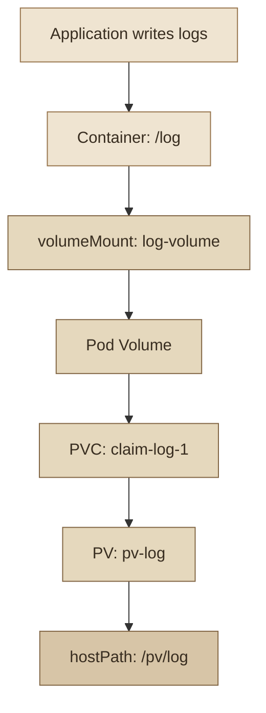

# Persistent Volumes & Claims — Practical Lab

## 1. Lab Objectives

في هذا الـ Lab هننفّذ سيناريو عملي متكامل لإدارة Persistent Storage داخل Kubernetes.

هنبدأ بتطبيق بيكتب Logs داخل الـ Container، وبعدها هننقل التخزين إلى Volume على الـ Node، ثم نستخدم PV وPVC لإدارة التخزين بصورة منفصلة عن تعريف الـ Pod.

بنهاية التطبيق هتكون قادر على:

- فهم مشكلة فقدان البيانات عند حذف الـ Pod.
- ربط Volume بمسار داخل الـ Container.
- إنشاء PersistentVolume باستخدام `hostPath`.
- إنشاء PersistentVolumeClaim وربطه بالـ PV.
- تشخيص أسباب بقاء PVC في حالة `Pending`.
- استخدام PVC داخل Pod.
- فهم تأثير `Retain` عند حذف الـ PVC.
- تشخيص `PVC protection` و`Released` state.

<Callout type="warning" title="Lab Environment">

هذا التطبيق يستخدم `hostPath` لأغراض التدريب على Kubernetes Storage APIs.

`hostPath` مرتبط بالـ Node المحلي، ولا يوفر Shared Storage بين Nodes. لا تستخدم هذا التصميم كحل Production لتخزين بيانات تطبيق يعمل على Cluster متعدد العقد.

</Callout>

### Lab Workflow

<Steps>
  <li>Understand the initial problem — data stored in Container filesystem is not persistent.</li>
  <li>Create a Host Volume using `hostPath` to persist logs on the Node.</li>
  <li>Create a PersistentVolume to represent a cluster-wide storage resource.</li>
  <li>Create a PersistentVolumeClaim to request storage from the PV.</li>
  <li>Use the PVC inside a Pod via `persistentVolumeClaim` volume type.</li>
  <li>Understand the `Retain` Reclaim Policy and what happens after PVC deletion.</li>
  <li>Observe PVC Protection and the `Terminating` state when a Pod holds the claim.</li>
</Steps>

## 2. Understand the Initial Problem

لدينا Pod اسمه `webapp`، والتطبيق يكتب Logs في المسار التالي:

```text
/log/app.log
```

في البداية، لا يوجد Volume مخصص لهذا المسار؛ لذلك البيانات موجودة داخل الـ Container filesystem.

### Inspect the Pod

```bash
kubectl get pods

kubectl describe pod webapp
```

اعرض محتويات ملف الـ Logs:

```bash
kubectl exec webapp -- cat /log/app.log
```

يمكنك استخدام `-c` إذا كان الـ Pod يحتوي على أكثر من Container:

```bash
kubectl exec webapp -c <container-name> -- cat /log/app.log
```

### Why Is This a Problem?

الـ Container filesystem ليس مكانًا مناسبًا للاحتفاظ بالبيانات التي يجب أن تستمر بعد إعادة إنشاء الـ Pod.

لو الـ Pod اتحذف واتعمله Recreate، فالبيانات الموجودة داخل الـ Container filesystem لن تكون مضمونة الاستمرار.

<Callout type="warning" title="Data Is Lost Without Persistent Storage">

```text
webapp Pod
└── Container
    └── /log/app.log
```

Pod recreated → Container data is lost.

</Callout>

الحل هو فصل مكان تخزين البيانات عن الـ Container filesystem.

## 3. Step One — Create a Host Volume

أول خطوة هي ربط مسار موجود على الـ Node بمسار الـ Logs داخل الـ Container.

سنستخدم:

| Location | Path |
|---|---|
| Node | `/var/log/webapp` |
| Container | `/log` |

### Configure the Volume

نحتاج إلى تعريف جزأين داخل Pod specification:

1. `volumes`: يحدد مصدر التخزين.
2. `volumeMounts`: يحدد أين سيظهر التخزين داخل الـ Container.

```yaml
spec:
  containers:
    - name: webapp
      # Keep the existing image and other settings.
      volumeMounts:
        - name: log-volume
          mountPath: /log

  volumes:
    - name: log-volume
      hostPath:
        path: /var/log/webapp
        type: DirectoryOrCreate
```

**How does it work?**

```text
Node filesystem: /var/log/webapp
        ↕  Volume: log-volume
Container filesystem: /log
```

أي كتابة داخل `/log` في الـ Container ستصل إلى المسار المرتبط به على الـ Node.

### Verify the Result

```bash
kubectl exec webapp -- cat /log/app.log
```

وعلى الـ Node:

```bash
sudo cat /var/log/webapp/app.log
```

المفترض أن ترى نفس محتوى الـ Logs.

<Callout type="note" title="Important">

الـ `hostPath` يربط الـ Pod بمسار على Node بعينها. لو تم تشغيل الـ Pod على Node أخرى، فقد يجد مسارًا مختلفًا أو فارغًا.

كذلك، حذف الـ Pod لا يعني حذف بيانات المسار الموجود على الـ Node.

</Callout>

## 4. Step Two — Create a PersistentVolume

الخطوة التالية هي إنشاء PersistentVolume يمثل Storage Resource داخل Kubernetes.

سننشئ PV بالمواصفات التالية:

| Property | Value |
|---|---|
| Name | `pv-log` |
| Capacity | `100Mi` |
| Access Mode | `ReadWriteMany` |
| Reclaim Policy | `Retain` |
| Storage Backend | `hostPath` |
| Host Path | `/pv/log` |

### pv.yaml

```yaml
apiVersion: v1
kind: PersistentVolume
metadata:
  name: pv-log
spec:
  capacity:
    storage: 100Mi

  accessModes:
    - ReadWriteMany

  persistentVolumeReclaimPolicy: Retain

  hostPath:
    path: /pv/log
    type: DirectoryOrCreate
```

أنشئ الـ PV:

```bash
kubectl apply -f pv.yaml
```

تحقق من حالته:

```bash
kubectl get pv
```

اعرض التفاصيل:

```bash
kubectl describe pv pv-log
```

### Understand the PV State

عند إنشاء PV بدون PVC مرتبط به، تكون حالته:

`Available`

أي أن الـ Storage Resource موجود وجاهز ليتم حجزه بواسطة PVC مناسب.

<Callout type="tip" title="Remember">

الـ PV هو Resource على مستوى الـ Cluster، وليس Resource داخل Namespace.

```bash
kubectl get pv
```

لا تحتاج إلى تحديد Namespace عند التعامل مع PV.

</Callout>

## 5. Step Three — Create a PersistentVolumeClaim

الآن سننشئ PVC ليطلب Storage من Kubernetes.

سنستخدم المواصفات التالية:

| Property | Value |
|---|---|
| Name | `claim-log-1` |
| Access Mode | `ReadWriteOnce` |
| Requested Storage | `50Mi` |

### pvc.yaml

```yaml
apiVersion: v1
kind: PersistentVolumeClaim
metadata:
  name: claim-log-1
spec:
  accessModes:
    - ReadWriteOnce

  resources:
    requests:
      storage: 50Mi
```

أنشئ الـ PVC:

```bash
kubectl apply -f pvc.yaml
```

تحقق من الحالة:

```bash
kubectl get pvc
```

ستجد أن الـ PVC في حالة:

`Pending`

بينما الـ PV ما زال:

`Available`

## 6. Troubleshooting — Why Is the PVC Pending?

لدينا:

| Property | PV | PVC |
|---|---|---|
| Capacity | `100Mi` | `50Mi` |
| Access Mode | `ReadWriteMany` | `ReadWriteOnce` |
| Status | Available | Pending |

قد تظن أن المشكلة في Capacity، لكن هذا ليس السبب.

الـ PV لديه `100Mi`، وبالتالي يستطيع تلبية طلب `50Mi`.

المشكلة هنا هي اختلاف الـ Access Modes.

### Compare the Access Modes

```bash
kubectl describe pv pv-log

kubectl describe pvc claim-log-1
```

الـ PV يعلن:

```yaml
accessModes:
  - ReadWriteMany
```

بينما الـ PVC يطلب:

```yaml
accessModes:
  - ReadWriteOnce
```

يجب أن تتوافق شروط الـ PVC مع الـ PV حتى يتم الـ Binding.

### Fix the PVC

حدّث الـ PVC ليطلب نفس Access Mode الموجود في الـ PV:

```yaml
apiVersion: v1
kind: PersistentVolumeClaim
metadata:
  name: claim-log-1
spec:
  accessModes:
    - ReadWriteMany

  resources:
    requests:
      storage: 50Mi
```

> في هذا المثال، الـ PVC موجود بالفعل. تعديل `accessModes` في PVC قائم ليس تحديثًا عاديًا مدعومًا؛ يجب إعادة إنشاء الـ PVC بعد التأكد أنه غير مستخدم بواسطة أي Pod.

احذف الـ PVC القديم:

```bash
kubectl delete pvc claim-log-1
```

ثم أنشئه مرة أخرى:

```bash
kubectl apply -f pvc.yaml
```

تحقق من النتيجة:

```bash
kubectl get pv,pvc
```

المفترض أن يصبح:

- PV: `Bound`
- PVC: `Bound`

### What Happened to the Capacity?

لاحظ أن الـ PV سعته `100Mi` بينما الـ PVC طلب `50Mi`.

عند حدوث Binding، يتم ربط الـ PVC بالـ PV بالكامل.

قد يظهر في `kubectl get pvc` أن الـ Capacity المرتبطة بالـ Claim أصبحت `100Mi`؛ لأن هذه هي سعة الـ PV المرتبط به، وليس معنى ذلك أن Kubernetes أنشأ PV جديدًا بسعة `50Mi`.

<Callout type="tip" title="CKA Insight">
الـ PVC لا يأخذ جزءًا منفصلًا من PV أكبر منه.

العلاقة بينهما One-to-One:

- PVC واحد يرتبط بـ PV واحد.
- PV واحد لا يرتبط بأكثر من PVC في نفس الوقت.
- زيادة سعة الـ PV عن طلب الـ PVC لا تعني إمكانية حجز الجزء المتبقي بواسطة PVC آخر.

</Callout>

## 7. Step Four — Use the PVC Inside a Pod

أصبح لدينا الآن:

```text
PersistentVolume: pv-log
          |
          | Bound
          v
PersistentVolumeClaim: claim-log-1
```

الخطوة التالية هي استخدام الـ PVC داخل الـ Pod.

### Configure the Pod

نحتفظ بنفس `mountPath`:

```yaml
volumeMounts:
  - name: log-volume
    mountPath: /log
```

لكن بدلًا من تعريف `hostPath` مباشرة، سنستخدم `persistentVolumeClaim`.

```yaml
volumes:
  - name: log-volume
    persistentVolumeClaim:
      claimName: claim-log-1
```

### Complete Storage Configuration

```yaml
apiVersion: v1
kind: Pod
metadata:
  name: webapp
spec:
  containers:
    - name: webapp
      image: <existing-image>
      volumeMounts:
        - name: log-volume
          mountPath: /log

  volumes:
    - name: log-volume
      persistentVolumeClaim:
        claimName: claim-log-1
```

<Callout type="note" title="Existing Pod">

المثال أعلاه يوضح جزء التخزين فقط، وليس بالضرورة الـ Pod specification الكامل للتطبيق الموجود بالفعل.

إذا كنت تعدّل Pod قائمًا، فبعض حقول `spec` غير قابلة للتعديل. راجع الـ workload definition، أو احذف وأعد إنشاء الـ Pod عند الحاجة، مع الحفاظ على إعداداته الأصلية.

</Callout>

### Understand the Complete Storage Flow



لاحظ الفرق بين المسؤوليات:

- **PV:** يعرّف Storage Resource.
- **PVC:** يطلب ويحجز Storage Resource.
- **Pod:** يستخدم الـ PVC من خلال Volume.
- **VolumeMount:** يحدد مكان ظهور التخزين داخل الـ Container.

### Verify the Configuration

```bash
kubectl get pv,pvc,pods

kubectl describe pod webapp
```

افحص الـ Logs داخل الـ Pod:

```bash
kubectl exec webapp -- cat /log/app.log
```

وافحص المسار الذي يستخدمه الـ PV على الـ Node:

```bash
sudo cat /pv/log/app.log
```

المفترض أن تكون البيانات موجودة في المكان المرتبط بالـ PV.

## 8. Step Five — Understand the Reclaim Policy

تحقق من Reclaim Policy:

```bash
kubectl get pv pv-log
```

أو:

```bash
kubectl describe pv pv-log
```

ستجد:

```yaml
persistentVolumeReclaimPolicy: Retain
```

الـ Reclaim Policy تحدد ما الذي يحدث للـ PV والـ Storage Backend بعد حذف الـ PVC المرتبط به.

### Retain

عند حذف الـ PVC:

- لا يتم حذف الـ PV تلقائيًا.
- لا يتم حذف البيانات تلقائيًا من الـ Storage Backend.
- يدخل الـ PV في حالة `Released`.
- لا يصبح متاحًا تلقائيًا لـ PVC جديد.

```text
PV Lifecycle with Retain
  Bound → Released
  PVC deleted → PV retains its data and binding history
```

### Reclaim Policy Comparison

| Policy | Behavior |
|---|---|
| `Retain` | يحتفظ بالـ PV والبيانات، ويحتاج Administrator إلى معالجة الـ Volume وإعادة استخدامه يدويًا. |
| `Delete` | يحذف الـ PV والـ Storage Backend عند دعم الـ Driver لهذه العملية. |
| `Recycle` | Deprecated؛ لا تعتمد عليه في تصميمات Kubernetes الحديثة. |

<Callout type="warning" title="Important">

`Retain` لا تعني أن الـ PV سيعود تلقائيًا إلى `Available`.

حالة `Released` تعني أن الـ PVC السابق تم حذفه، لكن الـ PV لا يزال يحتفظ بارتباطه السابق ويحتاج إلى تدخل يدوي قبل إعادة استخدامه.

</Callout>

## 9. Step Six — PVC Protection

سنفترض أن الـ Pod `webapp` ما زال يستخدم `claim-log-1`.

حاول حذف الـ PVC:

```bash
kubectl delete pvc claim-log-1
```

قد تلاحظ أن الـ PVC يظل في:

`Terminating`

### Why Does This Happen?

Kubernetes يستخدم Finalizer اسمه:

`kubernetes.io/pvc-protection`

الغرض منه منع حذف PVC ما زال مستخدمًا بواسطة Pod.

افحص الـ PVC:

```bash
kubectl describe pvc claim-log-1
```

واعرض الـ Finalizers:

```bash
kubectl get pvc claim-log-1 -o yaml
```

قد تجد:

```yaml
metadata:
  finalizers:
    - kubernetes.io/pvc-protection
```

### Resolve the Issue

أولًا، احذف الـ Pod الذي يستخدم الـ PVC:

```bash
kubectl delete pod webapp
```

بعد اختفاء الـ Pod، يستطيع Kubernetes إكمال حذف الـ PVC.

تحقق:

```bash
kubectl get pvc
```

ثم افحص الـ PV:

```bash
kubectl get pv
```

المفترض أن تظهر حالة الـ PV:

`Released`

والسبب هو أن الـ Reclaim Policy مضبوطة على `Retain`.

<Callout type="tip" title="CKA Insight">
لا تحاول إزالة `kubernetes.io/pvc-protection` يدويًا لمجرد أن PVC عالق في `Terminating`.

افحص أولًا هل ما زال هناك Pod يستخدم الـ Claim، واحذف أو حدّث الـ Workload بطريقة آمنة.

</Callout>

## 10. Troubleshooting Commands

الأوامر التالية مفيدة عند تشخيص مشاكل PV وPVC:

| Command | Purpose |
|---|---|
| `kubectl get pv` | عرض جميع PersistentVolumes |
| `kubectl get pvc -A` | عرض PersistentVolumeClaims عبر جميع Namespaces |
| `kubectl describe pv <name>` | فحص تفاصيل PV |
| `kubectl describe pvc <name>` | فحص تفاصيل PVC |
| `kubectl get pv,pvc` | عرض حالات PV وPVC معًا |
| `kubectl get pod <name> -o yaml` | فحص Volume وVolumeMount configuration |
| `kubectl describe pod <name>` | فحص Events ومشاكل Mounting |
| `kubectl get events --sort-by=.metadata.creationTimestamp` | مراجعة الأحداث الأخيرة |

### Common Problems

**PVC Pending**

أسباب محتملة:

- لا يوجد PV مناسب.
- اختلاف Access Modes.
- الـ PV لا يملك Capacity كافية.
- اختلاف `storageClassName`.
- وجود Selector لا يطابق أي PV.

---

**Pod Cannot Mount the Volume**

أسباب محتملة:

- PVC غير موجود في Namespace الخاص بالـ Pod.
- PVC لم يصل إلى حالة `Bound`.
- Storage Driver أو Backend لديه مشكلة.
- مشاكل في Node أو Volume Mount.

---

**PVC Stuck in Terminating**

افحص:

- هل يوجد Pod ما زال يستخدم الـ PVC؟
- هل يوجد Finalizer يمنع الحذف؟
- هل عملية الحذف ما زالت قيد التنفيذ؟

---

**PV Stuck in Released**

مع `Retain`، هذا سلوك متوقع.

الـ PV يحتفظ بالـ Storage Resource ولا يصبح `Available` تلقائيًا بعد حذف الـ PVC.

## 11. Key Takeaways

- البيانات داخل Container filesystem ليست Persistent Storage.
- `hostPath` يربط Volume بمسار على Node محددة.
- `volumes` يعرّف مصدر التخزين، و`volumeMounts` يحدد مكان استخدامه داخل Container.
- PV يمثل Storage Resource على مستوى الـ Cluster.
- PVC يمثل طلبًا وحجزًا لمورد التخزين.
- الـ PVC والـ PV يرتبطان بعلاقة One-to-One.
- يجب أن تتوافق شروط الـ PVC مع مواصفات PV المناسب.
- PVC لا يمكن استخدامه بواسطة Pod من Namespace آخر.
- `Retain` يحتفظ بالـ PV والبيانات بعد حذف PVC، لكنه لا يعيد PV إلى `Available` تلقائيًا.
- `kubernetes.io/pvc-protection` يمنع حذف PVC ما زال مستخدمًا بواسطة Pod.

<Callout type="note" title="The Storage Architecture">

```text
Application
    |
    v
Container Mount
    |
    v
Pod Volume
    |
    v
PersistentVolumeClaim
    |
    v
PersistentVolume
    |
    v
Storage Backend
```

افهم العلاقة بين هذه الطبقات جيدًا؛ فهي أساس التعامل مع Persistent Storage في Kubernetes.
</Callout>
